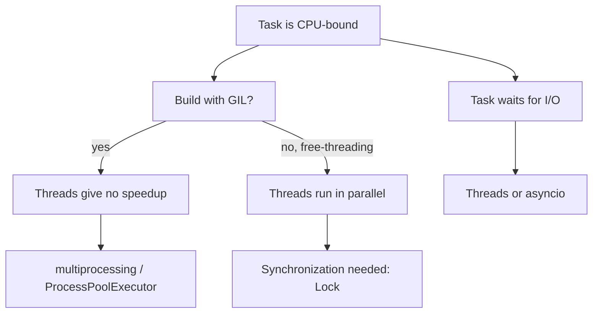

Classic CPython has a **GIL** — the Global Interpreter Lock. Because of it, only one thread executes bytecode at any given moment. This simplifies the interpreter's internal structures (reference counters don't tear), but deprives threads of real parallelism on the CPU. Starting with Python 3.13 the project develops **GIL-free** builds — so-called free-threading. In this lesson we'll figure out how it works and what it costs.

## What the GIL is

The GIL (Global Interpreter Lock) is a mutex inside CPython: before executing bytecode, a thread must acquire the GIL. Threads switch quickly but never run simultaneously. The result: for CPU-bound tasks threads give no benefit — while for I/O-bound tasks they remain useful: while one thread waits for a network or disk response, another works.

```python
import threading
import time

def busy_work(rounds):
    total = 0
    for i in range(rounds):
        total += i * i
    return total

WORKERS = 4
ROUNDS = 2_000_000

t0 = time.perf_counter()
for _ in range(WORKERS):
    busy_work(ROUNDS)
t1 = time.perf_counter()

threads = [threading.Thread(target=busy_work, args=(ROUNDS,)) for _ in range(WORKERS)]
t2 = time.perf_counter()
for t in threads:
    t.start()
for t in threads:
    t.join()
t3 = time.perf_counter()

print(f"sequentially: {t1 - t0:.3f} sec")
print(f"in 4 threads: {t3 - t2:.3f} sec")
```

Under the GIL both times nearly match. That's the "GIL effect".

## Free-threading: GIL-free builds

PEP 703 describes Python builds without a GIL. They are prepared separately: when building from source — the `--disable-gil` flag, and on Windows the official Python 3.13+ installer offers `Python 3.13t` (the letter t comes from *free-threaded*). How to check which build you're running:

```python
import sys
import sysconfig

print("Version:", sys.version)
print("Py_GIL_DISABLED:", sysconfig.get_config_var("Py_GIL_DISABLED"))
if hasattr(sys, "_is_gil_enabled"):
    print("GIL enabled:", sys._is_gil_enabled())
```

`sysconfig.get_config_var("Py_GIL_DISABLED")` returns `1` on a free-threaded build and `0` on a regular one. `sys._is_gil_enabled()` (Python 3.13+) reports the GIL state in the current interpreter. On a free-threaded build the same thread example speeds up almost proportionally to the core count — but you pay for it.

## The cost of freedom from the GIL

Without the GIL threads really can run simultaneously, and real data races appear. The classic demonstration is a shared counter:

```python
import threading

counter = 0

def increment(rounds):
    global counter
    for _ in range(rounds):
        counter += 1

threads = [threading.Thread(target=increment, args=(1_000_000,)) for _ in range(8)]
for t in threads:
    t.start()
for t in threads:
    t.join()

print("counter:", counter)  # expect 8_000_000, but often less
```

Why is the result smaller than expected? `counter += 1` is not atomic: it reads the value, adds one, and writes back. Two threads may read the same value and write the same result — increments get "lost". Under the GIL thread switches happened less often and at safe points, so this behavior was almost invisible. Without the GIL races are real and require explicit synchronization:

```python
import threading

lock = threading.Lock()
counter = 0

def increment(rounds):
    global counter
    for _ in range(rounds):
        with lock:
            counter += 1
```

Now the result is always 8_000_000. The lock protects the critical section — but it also slows the code, so protect only truly shared data.

## Where free-threading won't help

- **C extensions.** Many extensions (numpy and others) were written assuming the GIL; on a free-threaded build they either need special builds or work with their own locking protection. Not every extension is ready.
- **Single-threaded code.** A GIL-free build carries small overhead for protecting internal structures — on single-threaded tasks it can be slightly slower than a regular build.
- **Algorithmic complexity.** Threads won't turn a quadratic algorithm into a fast one — right algorithm first, then parallelism.



## Lesson summary

The GIL is a longstanding feature of CPython: it simplifies memory management but limits threads. Free-threading builds (PEP 703) remove the GIL and open the path to scaling threads across cores — at the price of having to think about races and extension compatibility. Let's practice.

<!--TASK-->
### Task 1
Write a script that prints: the Python version (`sys.version`), the value of `sysconfig.get_config_var("Py_GIL_DISABLED")` and, if the attribute exists, the result of `sys._is_gil_enabled()`. Format the output with labels, e.g.: `Version: 3.13.2 ...`, `Py_GIL_DISABLED: 0`, `GIL enabled: True`. In a comment explain how to tell from the output whether the build is free-threaded.

### Task 2
Reproduce a data race: create a global `counter = 0` and a function `increment(rounds)` that does `counter += 1` `rounds` times. Start 8 threads of `1_000_000` iterations each, wait for them (`join`) and print `counter`. In a comment state the expected result and why the real one is usually smaller. Then add `threading.Lock` (via `with lock:`) and print the result with the lock.

### Task 3
Write a function `busy_work(rounds)` (sum of squares). Measure the time to run 4 such tasks: first sequentially, then in 4 threads via `threading.Thread`. Print both times. In a comment explain why under the GIL the times are close — and what would change on a free-threaded build.

### Task 4
Write a function `detect_build()` that returns a string based on `sysconfig.get_config_var("Py_GIL_DISABLED")`: `"free-threaded (no GIL)"` if the value equals 1, otherwise `"classic CPython (with GIL)"`. Print the result. In a comment write which tool (threads or multiprocessing) to choose for CPU-bound tasks in each build.

### Task 5
Create a class `Counter` with methods `__init__`, `increment()` and `value()`, whose internal variable is protected by `threading.Lock`. Start 8 threads, each calling `increment()` 500,000 times, then print `value()`. Make sure the result is stably 4_000_000. In a comment explain why with the lock the result is always the same and without it — not.

### Task 6
Compare two pools for CPU-bound work. Write `cpu_heavy(n)` — the sum of squares from 0 to `n - 1`, and a function `run(pool_cls, workers=4, n=2_000_000)` that creates a pool `pool_cls(max_workers=workers)`, distributes four identical tasks via `pool.map` and returns the elapsed time and the list of results. Call it with `concurrent.futures.ThreadPoolExecutor` and with `ProcessPoolExecutor`, print `threads: ... sec` and `processes: ... sec` and check that results match. Expected output: threads are close to sequential time, processes are faster by a factor close to the core count. In a comment explain why a process pool beats a thread pool specifically on computations and what overhead it pays.

### Task 7
Simulate a deadlock and show how to detect it. Create two locks `lock_a` and `lock_b`. The first thread acquires `lock_a`, waits `0.1` sec and tries to take `lock_b` via `acquire(timeout=0.5)`. The second thread does the opposite: holds `lock_b`, waits and tries to take `lock_a` with the same timeout. For each thread print whether it got the second lock, and a general `deadlock risk detected` line if at least one attempt returned `False`. Expected output: both threads report `False`, then the deadlock line. In a comment explain how lock acquisition order prevents such a situation.
<!--/TASK-->

<!--HINT-->
### Hint 1
Import `sys` and `sysconfig`. `_is_gil_enabled` isn't present in all versions, so use `if hasattr(sys, "_is_gil_enabled"):`. `Py_GIL_DISABLED` value: 1 — free-threaded, 0 — regular build.

### Hint 2
Don't forget `global counter` inside `increment`. Creating threads: `[threading.Thread(target=increment, args=(1_000_000,)) for _ in range(8)]`. After `start()` on all — `join()` on all. With the lock: `lock = threading.Lock()` and inside the loop `with lock: counter += 1`.

### Hint 3
Measure with `time.perf_counter()`: first a loop of 4 `busy_work` calls, then 4 threads. Under the GIL total time barely changes; on a free-threaded build the speedup is about the core count. Three runs for confidence aren't required but recommended.

### Hint 4
`sysconfig.get_config_var("Py_GIL_DISABLED")` returns 1 or 0 (may be `None` on very old versions — treat it as "with GIL"). Print via `print(detect_build())`. In the comment: with GIL use multiprocessing for CPU-bound; without GIL — threads.

### Hint 5
In `__init__` create `self._value = 0` and `self._lock = threading.Lock()`. In `increment`: `with self._lock: self._value += 1`. In `value()`: `with self._lock: return self._value`. Running 8 threads of 500,000 iterations gives exactly 4_000_000.

### Hint 6
Both tasks must be pure functions at module top level — otherwise `ProcessPoolExecutor` can't serialize them (especially on Windows). In `run` use a context manager: `with pool_cls(max_workers=workers) as pool:`. Measure time around `pool.map(...)` and `list(...)`, otherwise the lazy iterator won't run the work. Compare results with `results[0] == results[1]`.

### Hint 7
Acquiring with a timeout: `got = lock_b.acquire(timeout=0.5)`, then `if got: lock_b.release()`. Important: `with lock_a:` holds the lock for the whole block, including `sleep`. To make threads start simultaneously, create them and call `start()` in a loop, and `join()` after. Collect the `deadlock = not got1 or not got2` flag into a shared list under a separate lock.
<!--/HINT-->

<!--SOLUTION-->
### Walkthrough 1
Solution:

```python
import sys
import sysconfig

print("Version:", sys.version)
print("Py_GIL_DISABLED:", sysconfig.get_config_var("Py_GIL_DISABLED"))
if hasattr(sys, "_is_gil_enabled"):
    print("GIL enabled:", sys._is_gil_enabled())
# On a regular build Py_GIL_DISABLED == 0, GIL enabled: True.
# On a free-threaded build (e.g., Python 3.13t) — 1 and False.
```

Result on a regular build:

```
Version: 3.13.2 (tags/v3.13.2:4f8bb39, Feb 17 2025, 14:57:50)
Py_GIL_DISABLED: 0
GIL enabled: True
```

What's happening here? `Py_GIL_DISABLED` is a build configuration variable: `1` means the build was made without the GIL (free-threaded). `sys._is_gil_enabled()` shows the GIL state in the current interpreter and reflects the actual build. On "regular" CPython both checks say "with GIL". If you run the same script under `python3.13t`, you'll see `Py_GIL_DISABLED: 1` and `GIL enabled: False`. This is the first step in debugging: understand which build you're in.

### Walkthrough 2
Solution:

```python
import threading

counter = 0

def increment(rounds):
    global counter
    for _ in range(rounds):
        counter += 1

threads = [threading.Thread(target=increment, args=(1_000_000,)) for _ in range(8)]
for t in threads:
    t.start()
for t in threads:
    t.join()
print("without lock:", counter)

lock = threading.Lock()
counter = 0

def increment_locked(rounds):
    global counter
    for _ in range(rounds):
        with lock:
            counter += 1

threads = [threading.Thread(target=increment_locked, args=(1_000_000,)) for _ in range(8)]
for t in threads:
    t.start()
for t in threads:
    t.join()
print("with lock:", counter)
```

Result:

```
without lock: 6321187
with lock: 8000000
```

What's happening here? The expected value is 8_000_000 (8 threads × 1_000_000). Without a lock the result is almost always less: `counter += 1` reads the value, adds one and writes it back; two threads can read the same value and write it — the increment is lost. This is a classic data race (race condition). `threading.Lock` turns the operation into an atomic critical section: only one thread can increment the counter at any moment. The result is stably 8_000_000. Under the GIL switches happen less often, so such bugs manifest less noticeably; in a free-threaded build they surface.

### Walkthrough 3
Solution:

```python
import threading
import time

def busy_work(rounds):
    total = 0
    for i in range(rounds):
        total += i * i
    return total

WORKERS = 4
ROUNDS = 2_000_000

t0 = time.perf_counter()
for _ in range(WORKERS):
    busy_work(ROUNDS)
t1 = time.perf_counter()

threads = [threading.Thread(target=busy_work, args=(ROUNDS,)) for _ in range(WORKERS)]
t2 = time.perf_counter()
for t in threads:
    t.start()
for t in threads:
    t.join()
t3 = time.perf_counter()

print(f"sequentially: {t1 - t0:.3f} sec")
print(f"in 4 threads: {t3 - t2:.3f} sec")
# Under the GIL threads run one after another: times are close.
# On a free-threaded build 4 threads on 4 cores give ~4x speedup.
```

Result:

```
sequentially: 1.210 sec
in 4 threads: 1.245 sec
```

What's happening here? `busy_work` fully loads the CPU. Under the GIL only one thread executes bytecode at any moment — the rest wait for the lock, so the total time almost matches the sequential one (even slightly higher due to switching). On a free-threaded build the same 4 threads actually spread across cores, and the time drops about 4×. That's the main motivation behind PEP 703: threads as a parallelism mechanism for CPU-bound tasks. Conclusion: in classic CPython, use `multiprocessing` or a process-based `PoolExecutor` for CPU-bound, and keep threads for I/O-bound.

### Walkthrough 4
Solution:

```python
import sysconfig

def detect_build():
    flag = sysconfig.get_config_var("Py_GIL_DISABLED")
    if flag == 1:
        return "free-threaded (no GIL)"
    return "classic CPython (with GIL)"

print(detect_build())
# With GIL, CPU-bound tasks speed up via processes (multiprocessing),
# without GIL — via threads: they share memory and need no IPC.
```

Result on a regular build:

```
classic CPython (with GIL)
```

What's happening here? The function reads a configuration variable. On a free-threaded build it returns `free-threaded (no GIL)`. The practical takeaway in the comment: in a GIL build threads don't use multiple cores for computations — for CPU-bound you need processes (`multiprocessing`), which have their own interpreter and memory but require serializing data between processes. In a free-threaded build threads are a full-fledged parallelism mechanism: they share memory directly. This matters for architecture choices: threads are simpler and cheaper than processes but require careful synchronization.

### Walkthrough 5
Solution:

```python
import threading

class Counter:
    def __init__(self):
        self._value = 0
        self._lock = threading.Lock()

    def increment(self):
        with self._lock:
            self._value += 1

    def value(self):
        with self._lock:
            return self._value

counter = Counter()

def worker(rounds):
    for _ in range(rounds):
        counter.increment()

threads = [threading.Thread(target=worker, args=(500_000,)) for _ in range(8)]
for t in threads:
    t.start()
for t in threads:
    t.join()

print("value():", counter.value())
```

Result:

```
value(): 4000000
```

What's happening here? The `Counter` class hides the lock inside itself: both `increment` and `value` take `self._lock`, so reads and writes are serialized. 8 threads × 500,000 = 4_000_000, and the result is stable across runs. This is an example of a thread-safe container. If `increment` didn't use a lock, the result would "float" between runs. Note: locking every operation is expensive — in practice such counters are replaced with dedicated structures (e.g., `collections.Counter` under local locks or atomic operations in a free-threaded build).

### Walkthrough 6
Solution:

```python
import concurrent.futures
import time

def cpu_heavy(n):
    total = 0
    for i in range(n):
        total += i * i
    return total

def run(pool_cls, workers=4, n=2_000_000):
    t0 = time.perf_counter()
    with pool_cls(max_workers=workers) as pool:
        results = list(pool.map(cpu_heavy, [n] * workers))
    return time.perf_counter() - t0, results

t_threads, r_threads = run(concurrent.futures.ThreadPoolExecutor)
t_procs, r_procs = run(concurrent.futures.ProcessPoolExecutor)

print(f"threads: {t_threads:.2f} sec")
print(f"processes: {t_procs:.2f} sec")
print("results match:", r_threads == r_procs)
```

Result (on 4 cores):

```
threads: 1.42 sec
processes: 0.48 sec
results match: True
```

What's happening here? `cpu_heavy` is pure CPU-bound: every tick is occupied with bytecode computations under the GIL. In a thread pool only one thread works at a time and the rest wait for the lock, so the total time equals the sequential one plus switching overhead. `ProcessPoolExecutor` creates separate interpreters with their own GILs and memory — four tasks genuinely run on four cores. The price: process startup (tens of milliseconds), serializing arguments and results via pickle, and the impossibility of sharing mutable state. Therefore processes pay off for long computations and don't pay off for thousands of tiny tasks. On a free-threaded build the same measurement with threads would give a speedup close to the core count.

### Walkthrough 7
Solution:

```python
import threading
import time

lock_a = threading.Lock()
lock_b = threading.Lock()
results = []
report_lock = threading.Lock()

def worker_first():
    with lock_a:
        time.sleep(0.1)
        got = lock_b.acquire(timeout=0.5)
        if got:
            lock_b.release()
    with report_lock:
        results.append(got)
    print("thread 1: lock_b acquired:", got)

def worker_second():
    with lock_b:
        time.sleep(0.1)
        got = lock_a.acquire(timeout=0.5)
        if got:
            lock_a.release()
    with report_lock:
        results.append(got)
    print("thread 2: lock_a acquired:", got)

t1 = threading.Thread(target=worker_first)
t2 = threading.Thread(target=worker_second)
t1.start(); t2.start()
t1.join(); t2.join()

if not all(results):
    print("deadlock risk detected")
```

Result:

```
thread 1: lock_b acquired: False
thread 2: lock_a acquired: False
deadlock risk detected
```

What's happening here? A classic mutual deadlock: thread 1 holds `lock_a` and waits for `lock_b`, thread 2 holds `lock_b` and waits for `lock_a`. Without a timeout both would wait forever and the program would hang — that's what a deadlock looks like in production: processes alive, CPU idle, no responses. `acquire(timeout=...)` turns eternal waiting into a diagnosable failure: after half a second the thread gets `False` and can log the problem. The cure — a single acquisition order: both threads must take `lock_a` first, then `lock_b`. The "hold locks as briefly as possible" rule and not calling foreign code under a lock also help. In real systems the same techniques apply to database locks and transactions.
<!--/SOLUTION-->

<!--QUIZ-->
What is the GIL?
- A library for network work
- The Global Interpreter Lock of CPython: bytecode is executed by one thread at any moment
- A serialization protocol
- A kind of build without JIT
* Correct answer: The Global Interpreter Lock of CPython: bytecode is executed by one thread at any moment
The GIL simplifies the interpreter's internal structures but limits thread parallelism.

Why don't threads speed up CPU-bound tasks in classic CPython?
- Threads are forbidden
- Because of the GIL only one thread runs at a time; total time barely changes
- CPU-bound tasks don't use threads
- Threads work only with I/O
* Correct answer: Because of the GIL only one thread runs at a time; total time barely changes
Threads only switch, adding overhead.

What is free-threading?
- A Python build without the GIL (PEP 703)
- A thread-safety library
- A thread debugging mode
- A profiling tool
* Correct answer: A Python build without the GIL (PEP 703)
In such builds threads can run on multiple cores simultaneously.

How to check whether the current build is free-threaded?
- sysconfig.get_config_var("Py_GIL_DISABLED") == 1
- len(sys.argv)
- platform.system()
- os.cpu_count()
* Correct answer: sysconfig.get_config_var("Py_GIL_DISABLED") == 1
The Py_GIL_DISABLED configuration variable equals 1 on a free-threaded build.

Why can counter += 1 in several threads give a wrong result?
- The operation isn't atomic: reads, increments and writes can interleave across threads
- Numbers don't sum in Python
- Threads have no access to variables
- The result is always larger than expected
* Correct answer: The operation isn't atomic: reads, increments and writes can interleave across threads
Two threads can read the same value and write the same result — increments get lost.

What protects against data races?
- threading.Lock
- sys.version
- timeit
- random
* Correct answer: threading.Lock
A lock turns a critical section atomic: only one thread at a time.

Where does free-threading most often fail to pay off?
- In single-threaded code (overhead) and in code with C extensions not ready for the missing GIL
- In any threads
- In async code
- In file reading
* Correct answer: In single-threaded code (overhead) and in code with C extensions not ready for the missing GIL
A GIL-free build costs a bit more on a single thread, and C extensions must be adapted.

What to choose for CPU-bound tasks in classic CPython (with GIL)?
- threading.Thread
- multiprocessing.Process
- asyncio.create_task
- queue.Queue
* Correct answer: multiprocessing.Process
Each process has its own interpreter and its own GIL — real parallelism across cores.

What to choose for CPU-bound tasks in a free-threaded build?
- Threads: they share memory without IPC and run in parallel
- Only sequential code
- Only processes
- Only timeit
* Correct answer: Threads: they share memory without IPC and run in parallel
Without the GIL threads are a full-fledged parallelism mechanism and cheaper than processes.

What does sys._is_gil_enabled() == False mean?
- The GIL is off: the current build is free-threaded
- The script is broken
- Threads are forbidden
- The Python version is outdated
* Correct answer: The GIL is off: the current build is free-threaded
The function reflects the actual GIL state in the current interpreter.

Why do threads still speed up I/O-bound code in CPython with the GIL?
- The GIL is released during blocking system calls, and other threads work
- The GIL turns off when socket is imported
- I/O threads run in separate processes
- I/O operations don't need the GIL at all and aren't serialized
* Correct answer: The GIL is released during blocking system calls, and other threads work
While one thread waits for network or disk, the GIL is free, so waits overlap.

What is a deadlock?
- A mutual lock: each thread holds a resource another needs
- A syntax error in multithreaded code
- A situation with too many threads
- Automatic interpreter shutdown
* Correct answer: A mutual lock: each thread holds a resource another needs
Neither can proceed, and the program hangs without errors or exceptions.

Why acquire several locks in the same order in all threads?
- To eliminate mutual deadlocks: a wait cycle can't close
- To make locks work faster
- To disable the GIL
- So threads finish on their own
* Correct answer: To eliminate mutual deadlocks: a wait cycle can't close
If everyone takes locks in order A → B, the "holding B, waiting A" situation is impossible.

What does lock.acquire(timeout=0.5) return if the lock wasn't acquired in half a second?
- False, and the thread continues
- A LockTimeout exception
- None without a way to continue
- True, but the lock stays with another thread
* Correct answer: False, and the thread continues
A timeout turns eternal waiting into a diagnosable failure you can log.
<!--/QUIZ-->
