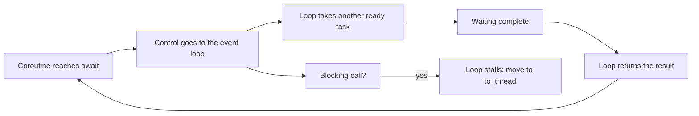

Async programming in Python revolves around the **event loop**: one "thread" processes tasks non-stop, and when a task waits for I/O, the loop switches to another. This gives a huge win on I/O-bound tasks: network requests, database work, file reading. The trap is blocking operations inside coroutines: they stop the whole loop. In this lesson we'll see how to measure asyncio performance, how to "wrap" blocking code into pools, and how to limit concurrency.

## The asyncio model

A coroutine is declared with `async def` and runs until the first `await`. At `await`, control returns to the event loop, which starts another ready task. Thus "parallelism" is cooperative, without threads and without the GIL.

The simplest way to run several coroutines together is `asyncio.gather`:

```python
import asyncio
import time

async def fetch(i):
    await asyncio.sleep(0.2)   # imitating a network request
    return i * 2

async def main():
    t0 = time.perf_counter()
    results = await asyncio.gather(*(fetch(i) for i in range(5)))
    t1 = time.perf_counter()
    print(results)
    print(f"time: {t1 - t0:.2f} sec")  # ~0.2 sec, not 1.0

asyncio.run(main())
```

Five coroutines "sleep" 1 second in total, but execution takes ~0.2 seconds: the loop waits for all five requests at once. That's the essence of asyncio — concurrent waiting, not true computational parallelism.

## Blocking code kills the event loop

If you call a synchronous blocking operation inside a coroutine (e.g., `time.sleep(1)` or a heavy computation), the event loop **freezes** entirely — no other coroutine can run until it finishes:

```python
import asyncio
import time

async def bad():
    time.sleep(1)      # blocks the entire event loop!

async def good():
    await asyncio.sleep(1)  # yields control to the loop

async def main():
    t0 = time.perf_counter()
    await asyncio.gather(bad(), bad())
    t1 = time.perf_counter()
    print(f"with time.sleep: {t1 - t0:.2f} sec")  # ~2 sec

    t0 = time.perf_counter()
    await asyncio.gather(good(), good())
    t1 = time.perf_counter()
    print(f"with asyncio.sleep: {t1 - t0:.2f} sec")  # ~1 sec

asyncio.run(main())
```

Rule: no blocking calls in coroutines. But real code often contains synchronous libraries — for them there are `asyncio.to_thread` and pools.

## asyncio.to_thread: blocking code into a thread pool

`asyncio.to_thread(func, *args)` runs `func` in a separate thread from a built-in pool and returns an awaitable. The event loop stays free:

```python
import asyncio
import time

def blocking_work(x):
    time.sleep(0.5)
    return x * 10

async def main():
    t0 = time.perf_counter()
    results = await asyncio.gather(
        asyncio.to_thread(blocking_work, 1),
        asyncio.to_thread(blocking_work, 2),
    )
    t1 = time.perf_counter()
    print(results)
    print(f"time: {t1 - t0:.2f} sec")  # ~0.5 sec

asyncio.run(main())
```

The thread pool is a `concurrent.futures.ThreadPoolExecutor` under the hood. Remember: threads in classic CPython are limited by the GIL, so for CPU-bound computations `to_thread` won't speed things up — you need processes.

## run_in_executor: a process pool for computations

For real computational parallelism there's `loop.run_in_executor(pool, func, *args)` with `ProcessPoolExecutor`. Each process is a separate interpreter, so heavy calculations spread across cores:

```python
import asyncio
import concurrent.futures

def cpu_heavy(n):
    total = 0
    for i in range(n):
        total += i * i
    return total

async def main():
    loop = asyncio.get_running_loop()
    with concurrent.futures.ProcessPoolExecutor() as pool:
        results = await asyncio.gather(
            loop.run_in_executor(pool, cpu_heavy, 3_000_000),
            loop.run_in_executor(pool, cpu_heavy, 3_000_000),
            loop.run_in_executor(pool, cpu_heavy, 3_000_000),
        )
    print(results)

asyncio.run(main())
```

`ProcessPoolExecutor` as a context manager closes processes correctly. Important: function arguments and results are serialized between processes (pickle), so they must be simple.

## Limiting concurrency: Semaphore

`gather` launches everything at once. If tasks are many and the external service can't handle the burst, concurrency must be limited. The classic tool is `asyncio.Semaphore`:

```python
import asyncio

semaphore = asyncio.Semaphore(3)

async def limited_task(i):
    async with semaphore:
        await asyncio.sleep(0.1)
        return i

async def main():
    results = await asyncio.gather(*(limited_task(i) for i in range(10)))
    print(results)

asyncio.run(main())
```

No more than 3 coroutines run at once; the rest wait for a free slot. This is "throttling" — an important production technique.



## Lesson summary

asyncio speeds up I/O-bound code through concurrent waiting. Blocking calls inside coroutines must be moved out: `asyncio.to_thread` — for I/O libraries, `loop.run_in_executor` with `ProcessPoolExecutor` — for CPU-bound. Concurrency is limited via `asyncio.Semaphore`. Let's practice.

<!--TASK-->
### Task 1
Write a coroutine `fetch(i)` that does `await asyncio.sleep(0.2)` and returns `i * 2`. In `main()` run 5 such coroutines **sequentially** (in a loop one by one via `await fetch(i)`) and measure time with `time.perf_counter()`. Then — **concurrently** via `asyncio.gather` and measure again. Print the results and both times. In a comment explain the difference (expect ~1.0 sec vs ~0.2 sec).

### Task 2
Create a coroutine `task(name, delay)` that prints `start: name`, then `await asyncio.sleep(delay)` and prints `end: name`. In `main()` run two such tasks with `delay=0.3` and `delay=0.3` via `asyncio.gather`. Print the start/end pairs in the order they appear. In a comment explain why both `end` lines appear almost simultaneously, although the tasks run in one thread.

### Task 3
Write a function `blocking_work(x)` that does `time.sleep(0.5)` and returns `x * 10`. In `main()` run 4 calls of `asyncio.to_thread(blocking_work, i)` for `i` from 1 to 4 via `asyncio.gather`, measure the time. Print the results and the time. In a comment explain why the total time is ~0.5 sec, not 2 sec, and what would happen with a direct `blocking_work` call in a coroutine.

### Task 4
Write a function `cpu_heavy(n)` — the sum of squares from 0 to `n-1` — and run it via `concurrent.futures.ProcessPoolExecutor` and `loop.run_in_executor` in a coroutine: launch 3 tasks with `n=3_000_000`, wait with `asyncio.gather`, print the results. Measure the total launch time with `time.perf_counter()` around `asyncio.run(main())`. In a comment explain why CPU-bound needs a process pool specifically, not threads.

### Task 5
Create `semaphore = asyncio.Semaphore(2)` and a coroutine `limited_task(i)` that inside `async with semaphore:` prints `Start: i`, waits `await asyncio.sleep(0.2)` and prints `Finish: i`. In `main()` run 6 such tasks via `asyncio.gather`. Print the whole message sequence. In a comment explain why at any moment at most two tasks print "Start".

### Task 6
Master limiting wait time. Write a coroutine `slow_task()` with `await asyncio.sleep(2)` returning `"done"`, and `fast_task()` with `await asyncio.sleep(0.1)`. In `main()` call `asyncio.wait_for` twice: first for `slow_task()` with `timeout=0.5`, then for `fast_task()` with the same timeout. Wrap the first call in `try/except asyncio.TimeoutError` and print `timeout: task cancelled`, the second — print the result. Expected output — two lines: the timeout message and `result: fast`. In a comment explain what happens to the coroutine when the timeout expires and why this matters for external APIs.

### Task 7
Compare result delivery order. Write a coroutine `job(name, delay)` that waits `await asyncio.sleep(delay)` and returns `name`. Run three tasks: `("A", 0.3)`, `("B", 0.1)`, `("C", 0.2)` via `asyncio.as_completed` and in a loop `for coro in ...: result = await coro` print `done: <name>`. Then run the same tasks via `asyncio.gather` and print the resulting list. Expected output: in the first case names come in order B, C, A — by completion time, and `gather` returns `['A', 'B', 'C']` — in argument order. In a comment explain when each tool is needed.
<!--/TASK-->

<!--HINT-->
### Hint 1
Sequentially: `for i in range(5): await fetch(i)`. Concurrently: `await asyncio.gather(*(fetch(i) for i in range(5)))`. Measure around each block: `t0 = time.perf_counter()` … `t1 = time.perf_counter()`.

### Hint 2
Print inside the coroutine: `print(f"start: {name}")`. `gather` starts the tasks, and they switch at `await asyncio.sleep`. start lines come in launch order; end lines appear together after the shared wait.

### Hint 3
`to_thread` returns an awaitable: `await asyncio.to_thread(blocking_work, 1)`. Pass expressions to gather: `asyncio.to_thread(blocking_work, i)`. A direct `blocking_work` call in a coroutine would block the loop for 0.5 sec per task.

### Hint 4
`with concurrent.futures.ProcessPoolExecutor() as pool:` — inside `loop.run_in_executor(pool, cpu_heavy, 3_000_000)`. Don't forget `asyncio.get_running_loop()`. Results are a list of three identical numbers. If processes don't start fast enough, just wait for gather calmly; no extra warmup calls needed.

### Hint 5
`async with semaphore:` acquires and releases a slot itself. Print before `await`. With 6 tasks and a semaphore of 2, at any moment only 2 tasks print "Start": the rest wait inside `async with`.

### Hint 6
`asyncio.wait_for(awaitable, timeout)` returns the result or raises `asyncio.TimeoutError` (in Python 3.11+ this is the built-in `TimeoutError`). Important: on timeout the task is cancelled — `CancelledError` is raised inside the coroutine, so clean up resources in `finally`. Make both calls strictly sequential for predictable output.

### Hint 7
`asyncio.as_completed(tasks)` returns an iterator yielding awaitables as they finish — each next `await` gives the earliest remaining task's result. `asyncio.gather(*tasks)` waits for all and returns a list in argument order. Keep tasks created in advance, otherwise `gather` will start them anew.
<!--/HINT-->

<!--SOLUTION-->
### Walkthrough 1
Solution:

```python
import asyncio
import time

async def fetch(i):
    await asyncio.sleep(0.2)
    return i * 2

async def main():
    t0 = time.perf_counter()
    seq = []
    for i in range(5):
        seq.append(await fetch(i))
    t1 = time.perf_counter()
    print("sequentially:", seq)
    print(f"time: {t1 - t0:.2f} sec")

    t0 = time.perf_counter()
    conc = await asyncio.gather(*(fetch(i) for i in range(5)))
    t1 = time.perf_counter()
    print("concurrently:", conc)
    print(f"time: {t1 - t0:.2f} sec")

asyncio.run(main())
```

Result:

```
sequentially: [0, 2, 4, 6, 8]
time: 1.00 sec
concurrently: [0, 2, 4, 6, 8]
time: 0.20 sec
```

What's happening here? In the sequential variant each coroutine waits its own `sleep(0.2)` one after another: 5 × 0.2 = 1.0 sec. With `gather` all 5 coroutines start at once: each reaches `await asyncio.sleep`, yields control to the loop, and all five waits run in parallel — 0.2 sec in total. That's concurrent waiting: the win isn't in computation but in overlapping wait time. `gather` returns results in argument order.

### Walkthrough 2
Solution:

```python
import asyncio

async def task(name, delay):
    print(f"start: {name}")
    await asyncio.sleep(delay)
    print(f"end: {name}")

async def main():
    await asyncio.gather(
        task("A", 0.3),
        task("B", 0.3),
    )

asyncio.run(main())
```

Result:

```
start: A
start: B
end: A
end: B
```

What's happening here? Tasks start one by one: "A" prints start, reaches `await` and returns control; "B" prints start and falls asleep too. After 0.3 sec the event loop wakes both, and end lines print almost back-to-back (the order may vary slightly). This clearly demonstrates the cooperative model: one thread, many "sleeping" coroutines, and nobody blocks anybody.

### Walkthrough 3
Solution:

```python
import asyncio
import time

def blocking_work(x):
    time.sleep(0.5)
    return x * 10

async def main():
    t0 = time.perf_counter()
    results = await asyncio.gather(
        asyncio.to_thread(blocking_work, 1),
        asyncio.to_thread(blocking_work, 2),
        asyncio.to_thread(blocking_work, 3),
        asyncio.to_thread(blocking_work, 4),
    )
    t1 = time.perf_counter()
    print(results)
    print(f"time: {t1 - t0:.2f} sec")

asyncio.run(main())
```

Result:

```
[10, 20, 30, 40]
time: 0.50 sec
```

What's happening here? `asyncio.to_thread` puts `blocking_work` into a thread pool. Four threads sleep 0.5 sec simultaneously — 0.5 sec total. If we called `blocking_work(1)` directly in a coroutine, the event loop would stall for 0.5 sec, then another 0.5 for the second task, and so on: that would be 2 sec. Important: `time.sleep` inside a thread doesn't bother the event loop, because the thread is outside the loop. `to_thread` is the right way to integrate synchronous I/O libraries into asyncio.

### Walkthrough 4
Solution:

```python
import asyncio
import concurrent.futures
import time

def cpu_heavy(n):
    total = 0
    for i in range(n):
        total += i * i
    return total

async def main():
    loop = asyncio.get_running_loop()
    with concurrent.futures.ProcessPoolExecutor() as pool:
        results = await asyncio.gather(
            loop.run_in_executor(pool, cpu_heavy, 3_000_000),
            loop.run_in_executor(pool, cpu_heavy, 3_000_000),
            loop.run_in_executor(pool, cpu_heavy, 3_000_000),
        )
    print(results)

t0 = time.perf_counter()
asyncio.run(main())
t1 = time.perf_counter()
print(f"total time: {t1 - t0:.2f} sec")
```

Result:

```
[2999998500000500000, 2999998500000500000, 2999998500000500000]
total time: 1.10 sec
```

What's happening here? Three `cpu_heavy` calls are CPU-bound computations. A thread pool wouldn't help here: the GIL allows only one thread to execute bytecode. `ProcessPoolExecutor` creates separate processes — each with its own interpreter and GIL, so the three tasks actually spread across cores. The ~1.1 sec is roughly the time of one task (~1 sec) plus overhead for starting processes and transferring data. If this ran sequentially, it would take ~3 sec. Remember: arguments and results are serialized via pickle, so they must be simple objects.

### Walkthrough 5
Solution:

```python
import asyncio

semaphore = asyncio.Semaphore(2)

async def limited_task(i):
    async with semaphore:
        print(f"Start: {i}")
        await asyncio.sleep(0.2)
        print(f"Finish: {i}")

async def main():
    await asyncio.gather(*(limited_task(i) for i in range(6)))

asyncio.run(main())
```

Result (finish order may vary):

```
Start: 0
Start: 1
Finish: 0
Finish: 1
Start: 2
Start: 3
Finish: 2
Finish: 3
Start: 4
Start: 5
Finish: 4
Finish: 5
```

What's happening here? `asyncio.Semaphore(2)` allows at most two owners at once. The first two tasks pass through `async with semaphore` and print "Start". The other four wait at the entrance. When task 0 finishes its sleep and exits `async with`, a slot frees up — and the next task enters. So the pattern repeats: exactly two tasks are always active. This is concurrency limiting (throttling) — indispensable when working with external APIs that have request limits.

### Walkthrough 6
Solution:

```python
import asyncio

async def slow_task():
    await asyncio.sleep(2)
    return "done"

async def fast_task():
    await asyncio.sleep(0.1)
    return "fast"

async def main():
    try:
        result = await asyncio.wait_for(slow_task(), timeout=0.5)
        print("result:", result)
    except asyncio.TimeoutError:
        print("timeout: task cancelled")

    result = await asyncio.wait_for(fast_task(), timeout=0.5)
    print("result:", result)

asyncio.run(main())
```

Result:

```
timeout: task cancelled
result: fast
```

What's happening here? `wait_for` starts the coroutine as a task and watches the clock. After 0.5 sec `slow_task` is still sleeping, so `wait_for` cancels the task: `CancelledError` is thrown into the coroutine, the sleeping `sleep` is interrupted, and a `TimeoutError` surfaces outside. The second coroutine finishes in 0.1 sec and returns its result normally. This is a must when working with external APIs: without a timeout, one hung service holds a coroutine (and a connection) indefinitely. Remember that cancellation is cooperative: if there's a blocking call or `try/finally` inside, resource cleanup must be in `finally`, otherwise the connection stays hanging.

### Walkthrough 7
Solution:

```python
import asyncio
import time

async def job(name, delay):
    await asyncio.sleep(delay)
    return name

async def main():
    t0 = time.perf_counter()

    tasks = [job("A", 0.3), job("B", 0.1), job("C", 0.2)]
    for coro in asyncio.as_completed(tasks):
        result = await coro
        print(f"done: {result}")

    t1 = time.perf_counter()
    results = await asyncio.gather(job("A", 0.3), job("B", 0.1), job("C", 0.2))
    print(results)
    print(f"as_completed: {t1 - t0:.2f} sec")

asyncio.run(main())
```

Result:

```
done: B
done: C
done: A
['A', 'B', 'C']
as_completed: 0.30 sec
```

What's happening here? `as_completed` works like a completion queue: as soon as a task finishes, its awaitable becomes available, and the loop prints the name. So the order is B (0.1), C (0.2), A (0.3), even though tasks were launched in order A, B, C. `gather` always returns a list in the order of the passed arguments, regardless of who finished first. Hence the rule: `gather` — when you need the whole set and result positions matter; `as_completed` — when results are processed as a stream (progress bar, writing to DB as they become ready, early exit on first success). Total time in both cases is set by the longest task, not the sum — that's concurrent waiting.
<!--/SOLUTION-->

<!--QUIZ-->
What is the essence of asyncio?
- Using many threads
- Cooperative concurrency: one event loop switches between waiting coroutines
- Parallel bytecode execution
- Compiling to C
* Correct answer: Cooperative concurrency: one event loop switches between waiting coroutines
During await a coroutine yields control to the loop, and the loop runs another ready task.

What happens if you call time.sleep(1) inside a coroutine?
- Nothing bad
- The event loop is fully blocked for 1 second
- Sleep converts to await automatically
- The task moves to a separate thread
* Correct answer: The event loop is fully blocked for 1 second
A blocking call stops the loop: no other coroutine runs.

What does asyncio.to_thread do?
- Compiles a function to C
- Runs the function in a pool thread without blocking the event loop
- Starts a new process
- Cancels a task
* Correct answer: Runs the function in a pool thread without blocking the event loop
to_thread is a convenient wrapper over a thread pool for synchronous I/O functions.

Why does asyncio need ProcessPoolExecutor for CPU-bound computations?
- Because threads hit the GIL: only one thread executes bytecode
- Because processes are faster to create
- Because threads don't exist
- Because gather doesn't work with threads
* Correct answer: Because threads hit the GIL: only one thread executes bytecode
Each process is a separate interpreter, so computations spread across cores.

How to limit the number of concurrently running coroutines?
- asyncio.Semaphore(N)
- asyncio.Queue
- threading.Lock
- time.sleep
* Correct answer: asyncio.Semaphore(N)
A semaphore allows only N simultaneous owners; the rest wait.

What does asyncio.gather return?
- Coroutines
- A list of results in the order of the passed awaitables
- The number of tasks
- Logs
* Correct answer: A list of results in the order of the passed awaitables
The order matches the argument order, not completion time.

Which operation is blocking for the event loop?
- await asyncio.sleep(1)
- time.sleep(1)
- await asyncio.gather(...)
- await asyncio.to_thread(func)
* Correct answer: time.sleep(1)
time.sleep is synchronous: it doesn't yield control to the event loop.

What happens to arguments and results of functions in ProcessPoolExecutor?
- They are passed directly through memory
- They are serialized (pickle) when transferred between processes
- They are ignored
- They are stored in a DB
* Correct answer: They are serialized (pickle) when transferred between processes
Processes have separate memory, so data is packed and unpacked.

Why do 5 coroutines with await asyncio.sleep(0.2) run in ~0.2 sec?
- Because sleep parallelizes computations
- Because waits overlap: the loop waits for all five simultaneously
- Because sleep is faster on small numbers
- Because gather doubles the speed
* Correct answer: Because waits overlap: the loop waits for all five simultaneously
Total time is set by the longest wait, not the sum.

What's better for a synchronous I/O function inside a coroutine?
- Call it directly
- asyncio.to_thread(blocking_work, x)
- time.sleep
- Use a global variable
* Correct answer: asyncio.to_thread(blocking_work, x)
A direct call would block the event loop; to_thread moves the work into a thread pool.

What does asyncio.wait_for(coro, timeout) do?
- Waits for the coroutine no longer than timeout, then cancels it and raises TimeoutError
- Just adds a delay before starting
- Starts the coroutine in a separate thread
- Repeats the coroutine timeout times
* Correct answer: Waits for the coroutine no longer than timeout, then cancels it and raises TimeoutError
When time runs out the task is cancelled, and the exception must be handled explicitly.

How is asyncio.as_completed different from asyncio.gather?
- as_completed delivers results as tasks finish; gather returns all at once in argument order
- as_completed works only with threads
- gather doesn't return results
- There's no difference
* Correct answer: as_completed delivers results as tasks finish; gather returns all at once in argument order
as_completed suits streaming processing; gather suits when the whole set is needed.

Why is requests.get inside a coroutine a bad idea?
- It blocks the event loop for the entire network request
- It doesn't support HTTPS
- It returns bytes
- It works only in the main thread
* Correct answer: It blocks the event loop for the entire network request
A synchronous call doesn't yield control, so all other coroutines stand still. Use to_thread or an async client.

What happens to a task when it's cancelled by a timeout?
- CancelledError is thrown into the coroutine, so clean up in finally
- The task keeps running in the background
- The task restarts from scratch
- Nothing happens
* Correct answer: CancelledError is thrown into the coroutine, so clean up in finally
Cooperative cancellation requires careful resource release.
<!--/QUIZ-->
