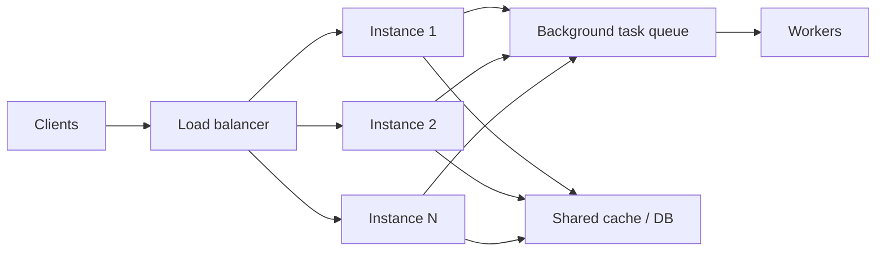

When a service stops keeping up with requests, scaling questions arise. This lesson explains how to think about service performance: from latency metrics to background-task queues, caching, and instance counts.

## Vertical and horizontal scaling

**Vertical** — make one machine more powerful: more cores, more memory, a faster disk. Simple, but there's a limit: the most powerful server costs a lot, and one machine failing means service downtime.

**Horizontal** — add more identical machines (instances) and distribute load among them. It scales almost without limit and improves fault tolerance. The key requirement: the service must be **stateless** — not store request state on an instance; otherwise requests landing on different instances will see different data. If state is needed (session, cache), move it to shared storage: a database, Redis, a shared cache.

## Workers: how many processes

A Python web server usually runs several worker processes. Heavy CPU code isn't sped up by threads due to the GIL, so the standard scheme is one worker per core. For example, for FastAPI + uvicorn:

```bash
uvicorn app:app --workers 4
```

And for synchronous applications — gunicorn:

```bash
gunicorn app:app --workers 4 --threads 2
```

A rough guideline: `workers = 2 * CPU_cores + 1` for gunicorn, but for Python the core count is more commonly used. Don't increase worker count blindly: each process is its own memory and its own database connection, and excess workers hit resource limits.

## Queues and background tasks

Heavy work (sending emails, generating reports, processing images) isn't done directly in a request — it's put into a queue, and consumer workers take tasks from there. This smooths out peaks: the user gets an instant response, and the work happens in the background.

A minimal queue demonstration with the standard library:

```python
import queue
import threading
import time

job_queue = queue.Queue()
results = []
lock = threading.Lock()

def worker():
    while True:
        item = job_queue.get()
        if item is None:
            break
        time.sleep(0.05)          # imitating work
        with lock:
            results.append(item * 2)
        job_queue.task_done()

for _ in range(4):
    threading.Thread(target=worker, daemon=True).start()

for i in range(20):
    job_queue.put(i)

job_queue.join()
print(sorted(results))
```

`queue.Queue` is thread-safe; `task_done()`/`join()` let you wait for all tasks to be processed.

## Caching

Repeated identical requests don't have to be recomputed. The built-in `functools.lru_cache` remembers function call results:

```python
from functools import lru_cache
import time

@lru_cache(maxsize=128)
def compute_report(key):
    time.sleep(0.1)               # expensive computation
    return f"report-{key}"

t0 = time.perf_counter()
compute_report("monthly")
t1 = time.perf_counter()
compute_report("monthly")          # from cache
t2 = time.perf_counter()
print(f"first call: {t1 - t0:.3f} sec")
print(f"second call: {t2 - t1:.3f} sec")
print(compute_report.cache_info())
```

`cache_info()` shows `hits`, `misses`, `maxsize`, `currsize`. In a distributed system the cache is moved into a shared service (e.g., Redis) so it's the same for all instances.

## Metrics: p50, p95, p99

The average response time is deceptive: one slow request "spoils" the average. That's why percentiles are used: **p95** means "95% of requests finished within this time". p95 is the standard latency goal:

```python
import math
import random

latencies = sorted(random.expovariate(1 / 0.05) for _ in range(1000))

def percentile(sorted_values, p):
    k = (len(sorted_values) - 1) * p
    f = math.floor(k)
    c = math.ceil(k)
    if f == c:
        return sorted_values[f]
    return sorted_values[f] + (sorted_values[c] - sorted_values[f]) * (k - f)

print(f"p50: {percentile(latencies, 0.5):.4f} sec")
print(f"p95: {percentile(latencies, 0.95):.4f} sec")
```

## Retries and backoff

Network errors happen. Common practice — retry the request with an exponential pause (backoff):

```python
import time
import random

def flaky_call(attempt):
    if random.random() < 0.6:
        raise ConnectionError("temporary failure")
    return "ok"

def with_retry(func, attempts=5, base_delay=0.1):
    for attempt in range(1, attempts + 1):
        try:
            return func(attempt)
        except ConnectionError:
            if attempt == attempts:
                raise
            time.sleep(base_delay * 2 ** (attempt - 1))

print(with_retry(flaky_call))
```

## Estimating instance count

Once p95, single-instance capacity, and target traffic are known, the instance count is easy to compute:

```python
target_rps = 10_000          # target traffic
instance_capacity = 1_000    # requests per second per instance
instances = math.ceil(target_rps / instance_capacity)
print(f"instances needed: {instances}")
```

In reality you add headroom for peaks and failures (e.g., ×1.5) and set up autoscaling based on metrics.



## Lesson summary

Scaling starts with metrics (p50/p95), continues with architecture: stateless instances, background-task queue, cache, retries — and ends with computing the worker count needed. Let's practice.

<!--TASK-->
### Task 1
Write a function `percentile(sorted_values, p)` that computes a percentile by linear interpolation: `k = (len(sorted_values) - 1) * p`; if `k` is an integer — return `sorted_values[k]`, otherwise interpolate between neighbors. Generate 1000 latencies via `random.expovariate(1 / 0.05)` (import `random`), sort them and print `p50`, `p90`, `p95` with labels rounded to 4 digits (`f"{...:.4f}"`).

### Task 2
Create a queue `job_queue = queue.Queue()` and start 4 worker threads (daemon=True), each taking a task, sleeping `0.05` sec, putting `item * 2` into a shared list `results` (protected by `threading.Lock`) and calling `job_queue.task_done()`. Put 20 tasks from 0 to 19 into the queue, wait via `job_queue.join()`, then send `None` to each worker to stop them. Print the sorted results and the total time via `time.perf_counter()`. In a comment explain why the time is noticeably less than 1 second (20 × 0.05).

### Task 3
Decorate a function `compute_report(key)` with `@lru_cache(maxsize=128)`. Inside — `time.sleep(0.1)` and return `f"report-{key}"`. Call it twice with the same key, measure each call's time with `time.perf_counter()` and print both times and `compute_report.cache_info()`. In a comment explain why the second call is nearly instantaneous and what `hits`/`misses` show.

### Task 4
Write a function `flaky_call(attempt)` that raises `ConnectionError` with probability 0.6, otherwise returns `"ok"`. Implement `with_retry(func, attempts=5, base_delay=0.1)`: iterate attempts, on `ConnectionError` — if attempts are exhausted, re-raise; otherwise wait `base_delay * 2 ** (attempt - 1)`. Measure time with `time.perf_counter()` and print the result and total time. In a comment explain why exponential backoff is needed.

### Task 5
Write a scaling-estimation script: set `target_rps = 10_000`, `instance_capacity = 1_000`, compute `instances = math.ceil(target_rps / instance_capacity)` and print the instance count. Then model throughput: for `workers` from 1 to 8 compute `throughput = workers / 0.05` (each task takes 0.05 sec) and print `workers → throughput rps` pairs. In a comment explain why performance grows linearly with worker count until machine resources are exhausted.

### Task 6
Compute capacity with headroom and cost. Set `target_rps = 12_000`, `instance_capacity = 900` and `price_per_hour = 8.5`. Compute the minimum instance count via `math.ceil(target_rps / instance_capacity)`, then the count with 50% headroom (`math.ceil(min_instances * 1.5)`) and the hourly cost with headroom. Print three lines: `minimum: N instances`, `with headroom: M instances`, `hourly cost: X.XX`. Additionally print `failure headroom: K`, where `K` is how many instances can be lost while keeping the minimum (difference between the headroom count and the minimum). Expected output — four consistent lines with integers. In a comment explain why 1.5× headroom is needed and why it doesn't guarantee fault tolerance by itself.

### Task 7
Implement a simple rate limiter — a "token bucket". A class `TokenBucket(rate, capacity)` stores `tokens = capacity` and the last refill time `time.monotonic()`. Method `allow()` refills the bucket by `(now - last) * rate` tokens (no more than `capacity`) and allows a request if there is at least one token, consuming one. Create a bucket with `rate=20`, `capacity=20` and fire 100 requests back-to-back without pauses, counting allowed and rejected ones. Print `allowed: N`, `rejected: M` and a sum equal to 100. Expected output: about 20 allowed, the rest rejected. In a comment explain why this is better than a simple per-second counter and how the bucket behaves under bursts.
<!--/TASK-->

<!--HINT-->
### Hint 1
Don't forget `import math` and `import random`. Generation: `latencies = sorted(random.expovariate(1 / 0.05) for _ in range(1000))`. For interpolation: `f = math.floor(k)`, `c = math.ceil(k)`; if `f == c` — return `sorted_values[f]`, otherwise the linear interpolation formula.

### Hint 2
Worker-thread template: infinite loop, `item = job_queue.get()`, `if item is None: break`, work, `results.append(...)` under `lock`, `job_queue.task_done()`. After `join()` — send 4 `None` values. Measure: `t0 = time.perf_counter()` before creating threads, `t1` after `join()`.

### Hint 3
`lru_cache` is already imported: `from functools import lru_cache`. Calls: first — cold (miss), second — warm (hit). `cache_info()` returns `CacheInfo(hits=1, misses=1, maxsize=128, currsize=1)`. Measure time around each call separately.

### Hint 4
In `flaky_call` use `random.random()`. In `with_retry` a loop `for attempt in range(1, attempts + 1)`; on success — `return func(attempt)`. Exponential backoff: the pause grows with each attempt so you don't hammer the service.

### Hint 5
`math.ceil` rounds up. Model: each worker processes 1 task per 0.05 sec → 20 tasks/sec per worker. `throughput = workers / 0.05` — an ideal linear model; in practice growth hits CPU, memory, or network.

### Hint 6
Import `math`. Compute in this order: `min_instances = math.ceil(target_rps / instance_capacity)`, then `with_reserve = math.ceil(min_instances * 1.5)`, then `cost = with_reserve * price_per_hour`. Failure headroom — `with_reserve - min_instances`. For money use the `{cost:.2f}` format.

### Hint 7
Refill: `self.tokens = min(self.capacity, self.tokens + (now - self.last) * self.rate)`, and be sure to update `self.last = now` before the check. Consumption: `if self.tokens >= 1: self.tokens -= 1; return True`. In the loop `for _ in range(100): if bucket.allow(): allowed += 1`. Without `sleep` the bucket can't refill, and the limit kicks in.
<!--/HINT-->

<!--SOLUTION-->
### Walkthrough 1
Solution:

```python
import math
import random

def percentile(sorted_values, p):
    k = (len(sorted_values) - 1) * p
    f = math.floor(k)
    c = math.ceil(k)
    if f == c:
        return sorted_values[f]
    return sorted_values[f] + (sorted_values[c] - sorted_values[f]) * (k - f)

latencies = sorted(random.expovariate(1 / 0.05) for _ in range(1000))

print(f"p50: {percentile(latencies, 0.5):.4f} sec")
print(f"p90: {percentile(latencies, 0.90):.4f} sec")
print(f"p95: {percentile(latencies, 0.95):.4f} sec")
```

Result (random data, numbers close by order of magnitude):

```
p50: 0.0341 sec
p90: 0.1132 sec
p95: 0.1480 sec
```

What's happening here? A percentile is the value below which p% of the data lies. The interpolation formula finds position `k` and, if it's not an integer, takes a point between neighboring values. `random.expovariate(1 / 0.05)` generates exponentially distributed latencies with a mean of 0.05 sec — similar to real service response times. Note: p95 is noticeably larger than p50: the "tail" of slow requests is exactly what percentiles reveal, not the average.

### Walkthrough 2
Solution:

```python
import queue
import threading
import time

job_queue = queue.Queue()
results = []
lock = threading.Lock()

def worker():
    while True:
        item = job_queue.get()
        if item is None:
            break
        time.sleep(0.05)
        with lock:
            results.append(item * 2)
        job_queue.task_done()

t0 = time.perf_counter()
for _ in range(4):
    threading.Thread(target=worker, daemon=True).start()

for i in range(20):
    job_queue.put(i)

job_queue.join()
for _ in range(4):
    job_queue.put(None)

t1 = time.perf_counter()
print(sorted(results))
print(f"total time: {t1 - t0:.2f} sec")
# 20 tasks × 0.05 sec = 1 sec of "work", but 4 workers
# process them in parallel: ~0.25–0.30 sec.
```

Result:

```
[0, 2, 4, 6, 8, 10, 12, 14, 16, 18, 20, 22, 24, 26, 28, 30, 32, 34, 36, 38]
total time: 0.28 sec
```

What's happening here? `job_queue.get()` blocks the thread until a task is available; `task_done()` reports a task is processed, and `join()` waits until all tasks are "closed". Four worker threads take tasks from the queue simultaneously, so 20 tasks of 0.05 sec are processed in about 20 × 0.05 / 4 = 0.25 sec. The `None` signal stops each thread. This is the basic background-task queue model: the queue decouples producers and consumers and smooths out peaks.

### Walkthrough 3
Solution:

```python
from functools import lru_cache
import time

@lru_cache(maxsize=128)
def compute_report(key):
    time.sleep(0.1)
    return f"report-{key}"

t0 = time.perf_counter()
compute_report("monthly")
t1 = time.perf_counter()
compute_report("monthly")
t2 = time.perf_counter()

print(f"first call: {t1 - t0:.3f} sec")
print(f"second call: {t2 - t1:.3f} sec")
print(compute_report.cache_info())
```

Result:

```
first call: 0.100 sec
second call: 0.000 sec
CacheInfo(hits=1, misses=1, maxsize=128, currsize=1)
```

What's happening here? The first call with the key `"monthly"` is a miss: the function actually runs. The second call with the same key is a hit: the result comes from the cache without executing the body, so the time is ~0. `cache_info()` shows the counters. In production the cache is moved into a shared service (Redis) so all instances see the same data, and `maxsize` bounds memory growth.

### Walkthrough 4
Solution:

```python
import random
import time

def flaky_call(attempt):
    if random.random() < 0.6:
        raise ConnectionError("temporary failure")
    return "ok"

def with_retry(func, attempts=5, base_delay=0.1):
    for attempt in range(1, attempts + 1):
        try:
            return func(attempt)
        except ConnectionError:
            if attempt == attempts:
                raise
            time.sleep(base_delay * 2 ** (attempt - 1))

t0 = time.perf_counter()
result = with_retry(flaky_call)
t1 = time.perf_counter()

print("result:", result)
print(f"time: {t1 - t0:.3f} sec")
# Pauses between attempts: 0.1, 0.2, 0.4, 0.8 sec — exponential backoff.
```

Result (probabilistic):

```
result: ok
time: 0.333 sec
```

What's happening here? `flaky_call` fails with probability 0.6. `with_retry` tries up to 5 times; pauses grow exponentially (0.1, 0.2, 0.4, 0.8 sec) to avoid a retry "storm" against a broken service. If all attempts are exhausted, the exception is re-raised. Backoff is a standard technique when working with networks and queues: it gives the service time to recover.

### Walkthrough 5
Solution:

```python
import math

target_rps = 10_000
instance_capacity = 1_000

instances = math.ceil(target_rps / instance_capacity)
print(f"instances needed: {instances}")

print("workers → throughput rps")
for workers in range(1, 9):
    throughput = workers / 0.05
    print(f"{workers} → {throughput:.0f}")
```

Result:

```
instances needed: 10
workers → throughput rps
1 → 20
2 → 40
3 → 60
4 → 80
5 → 100
6 → 120
7 → 140
8 → 160
```

What's happening here? Estimating the instance count is a simple division of target traffic by single-instance capacity, rounded up. The throughput model: if one task takes 0.05 sec, one worker processes 20 tasks per second; N workers — 20×N. This is an ideal linear model: in practice growth stops when CPU, memory, network, or the database become the limit — so in reality you add headroom (e.g., ×1.5) and enable autoscaling on metrics like p95.

### Walkthrough 6
Solution:

```python
import math

target_rps = 12_000
instance_capacity = 900
price_per_hour = 8.5

min_instances = math.ceil(target_rps / instance_capacity)
with_reserve = math.ceil(min_instances * 1.5)
cost = with_reserve * price_per_hour

print(f"minimum: {min_instances} instances")
print(f"with headroom: {with_reserve} instances")
print(f"hourly cost: {cost:.2f}")
print(f"failure headroom: {with_reserve - min_instances}")
```

Result:

```
minimum: 14 instances
with headroom: 21 instances
hourly cost: 178.50
failure headroom: 7
```

What's happening here? Dividing target traffic by single-instance capacity gives the lower bound: 12_000 / 900 = 13.33, rounded up — 14. The 1.5× headroom covers daily peaks, uneven balancing, and degradation during deploys: 14 × 1.5 = 21. Cost is computed from the number of running machines, not traffic. It's important to understand that headroom isn't fault tolerance: if load is distributed unevenly or one instance holds a "hot" cache key, extra machines won't save you. So in reality you add health checks, autoscaling on p95, and verify the service is truly stateless. And recompute the estimate after every major release: instance capacity is a measurable quantity, not a constant.

### Walkthrough 7
Solution:

```python
import time

class TokenBucket:
    def __init__(self, rate, capacity):
        self.rate = rate
        self.capacity = capacity
        self.tokens = float(capacity)
        self.last = time.monotonic()

    def allow(self):
        now = time.monotonic()
        self.tokens = min(self.capacity, self.tokens + (now - self.last) * self.rate)
        self.last = now
        if self.tokens >= 1:
            self.tokens -= 1
            return True
        return False

bucket = TokenBucket(rate=20, capacity=20)
allowed = denied = 0
for _ in range(100):
    if bucket.allow():
        allowed += 1
    else:
        denied += 1

print(f"allowed: {allowed}")
print(f"rejected: {denied}")
print("total:", allowed + denied)
```

Result:

```
allowed: 20
rejected: 80
total: 100
```

What's happening here? The bucket stores a fractional token count and refills at `rate` tokens per second, capped at `capacity`. A request costs one token. While requests come without pauses, refill is negligible, so exactly `capacity` requests pass and the rest get rejected — this is burst protection. Unlike a hard "no more than 20 per second" counter, the bucket allows a short burst after a pause (tokens accumulated) while keeping the average rate. This is how API gateway limits work. In practice, rejections return 429 with a `Retry-After` header, and the bucket state is kept in Redis so the limit is shared across instances — otherwise each instance would allow its own 20 requests.
<!--/SOLUTION-->

<!--QUIZ-->
What is horizontal scaling?
- Making one machine stronger with CPU and memory
- Adding identical instances and distributing load among them
- Reducing the number of servers
- Rewriting code in C
* Correct answer: Adding identical instances and distributing load among them
Horizontal scaling is almost unlimited and improves fault tolerance.

Why must a service be stateless for horizontal scaling?
- Otherwise requests on different instances will see different state
- Because state is forbidden by law
- To save memory
- It's optional
* Correct answer: Otherwise requests on different instances will see different state
State is moved to shared storage: a database, Redis, a shared cache.

Why are multiple worker processes used for loaded Python code instead of threads?
- Threads can't run in parallel because of the GIL
- Threads are forbidden in web
- Processes are faster to create
- Threads don't read files
* Correct answer: Threads can't run in parallel because of the GIL
Each process is a separate interpreter, so computations use several cores.

What does a background-task queue do?
- Speeds up the computations themselves
- Decouples producers and consumers and smooths out load peaks
- Stores database copies
- Replaces the cache
* Correct answer: Decouples producers and consumers and smooths out load peaks
The user gets an immediate response, and heavy work runs in the background.

What does p95 show?
- Average response time
- The time within which 95% of requests finished
- Maximum response time
- Requests per second
* Correct answer: The time within which 95% of requests finished
The p95 percentile is the standard latency goal: the "tail" of slow requests becomes visible.

What does functools.lru_cache do?
- Caches function call results by arguments
- Speeds up loops
- Replaces queues
- Optimizes memory automatically
* Correct answer: Caches function call results by arguments
A repeated call with the same arguments returns the result from cache.

Why is exponential backoff needed in retries?
- So pauses grow with each attempt and you don't create a retry "storm"
- So attempts are instantaneous
- To guarantee an error
- To speed up requests
* Correct answer: So pauses grow with each attempt and you don't create a retry "storm"
A growing pause gives the service time to recover and reduces load.

How to compute the number of instances needed?
- target_rps / instance_capacity, rounded up
- instance_capacity × target_rps
- target_rps + instance_capacity
- Randomly
* Correct answer: target_rps / instance_capacity, rounded up
Divide target traffic by single-instance capacity, with headroom for peaks and failures.

What does job_queue.join() do in the queue example?
- Waits until all queued tasks are processed
- Stops threads
- Clears the queue
- Starts workers
* Correct answer: Waits until all queued tasks are processed
join() blocks until task_done() is called for every task.

Why is the average response time deceptive?
- It hides the "tail" of slow requests
- It's always greater than p95
- It doesn't exist
- It doesn't depend on data
* Correct answer: It hides the "tail" of slow requests
One very slow request raises the average a lot; percentiles show the real distribution.

What does the p99 latency show?
- The time within which 99% of requests finished
- Average response time
- Maximum possible latency
- Requests per second
* Correct answer: The time within which 99% of requests finished
Percentiles reveal the distribution tail that the average hides.

Why add about 50% headroom when computing instance count?
- To cover traffic peaks, uneven balancing, and losing some instances
- So servers don't run at full capacity
- To reduce the cloud bill
- To increase p95
* Correct answer: To cover traffic peaks, uneven balancing, and losing some instances
Headroom covers real load fluctuations and deploys but doesn't replace autoscaling.

What does the token bucket algorithm do?
- Limits the average request rate while allowing short bursts within capacity
- Forbids all requests after the first
- Speeds up responses via cache
- Distributes requests across instances
* Correct answer: Limits the average request rate while allowing short bursts within capacity
Tokens accumulate at rate, and each request consumes one token.

Why does an in-process memory cache work poorly with multiple instances?
- Each instance has its own cache copy, and data diverges
- In-process caches are forbidden in production
- Process memory is limited to 1 MB
- Instances can't read dicts
* Correct answer: Each instance has its own cache copy, and data diverges
That's why a shared cache is moved to Redis or another shared service.
<!--/QUIZ-->
