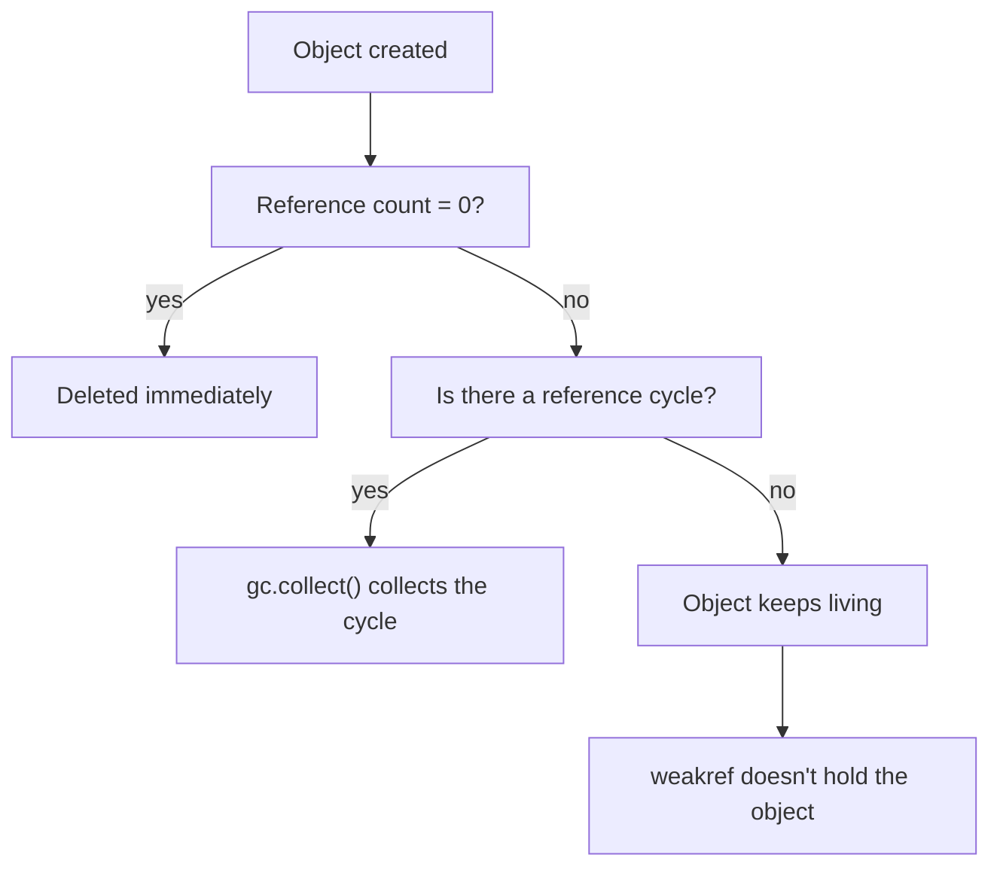

Many people write Python for years without thinking about memory. But when an application holds millions of objects, processes large data, or runs for days, questions like "why is memory growing?" and "what actually gets deleted?" become central. In this lesson we'll look at how CPython manages memory, why weak references are needed, and how to find leaks.

## Reference counting — the basis of memory management

CPython counts references for every object. When the counter hits zero — the object is deleted immediately.

```python
import sys

x = [1, 2, 3]
print(sys.getrefcount(x))  # 2 — one reference in variable x, one temporary for getrefcount

y = x
print(sys.getrefcount(x))  # 3 — x, y and the temporary

del y
print(sys.getrefcount(x))  # 2 — x and the temporary remain
```

`sys.getrefcount` itself holds a reference, so it shows one more than the real count. Reference counting is the primary deletion mechanism, and that's why `del` and leaving a function free memory immediately, without waiting for a "garbage collection".

## The cycle problem and the garbage collector

Reference counting fails with cyclic references: two objects refer to each other, and their counters never reach zero.

```python
class Node:
    def __init__(self):
        self.next = None

a = Node()
b = Node()
a.next = b
b.next = a  # cycle

del a, b  # objects stay in memory: counters are nonzero
```

For such cases CPython has a generational garbage collector (the `gc` module). It periodically walks objects, finds unreachable cycles, and deletes them. Collection happens in three generations: young objects are checked more often, older ones less often.

```python
import gc

print(gc.is_tracked(a) if 'a' in dir() else "objects deleted")
gc.collect()  # run collection manually
```

`gc.collect()` returns the number of collected objects. In most programs you don't need to call it manually — but it's a useful diagnostic tool.

## Weak references: weakref

Sometimes you need to reference an object **without increasing its reference count**. The classic case is a cache: it shouldn't keep objects alive by itself.

```python
import weakref

class BigData:
    pass

data = BigData()
ref = weakref.ref(data)
print(ref() is data)  # True — the object is reachable through weakref

del data
print(ref())  # None — object deleted, weak reference returned None
```

`weakref.ref` with a callable callback notifies about deletion:

```python
def goodbye(ref):
    print("Object deleted!")

data = BigData()
ref = weakref.ref(data, goodbye)
del data  # Object deleted!
```

The most used collections: `WeakValueDictionary` (a dict whose values aren't held), `WeakKeyDictionary`, and `WeakSet`.

```python
cache = weakref.WeakValueDictionary()

class User:
    pass

u = User()
cache["u"] = u
print(len(cache))  # 1
del u
print(len(cache))  # 0 — the dict removed the deleted object itself
```

It's on `WeakValueDictionary` that caches are built which shouldn't interfere with objects' lifetimes: an object lives while strong references to it exist elsewhere.

## Where leaks hide

Leaks in Python are almost always **accidentally held strong references**, not "holes" like in C:

- **Global containers** that grow forever: a list of all "sessions", a cache dict without cleanup.
- **Caches without limits**: `functools.lru_cache` without `maxsize`, hand-written cache dicts.
- **Closures** that hold large objects from an outer scope.
- **Cyclic references together with `__del__`**: in old versions this broke collection; in Python 3.4+ (PEP 442) cycles with `__del__` collect correctly, but don't rely on it without checking.
- **Threads and event handlers** not released on shutdown.

```python
# Example of a leak: a cache without a limit
_orders = {}

def cache_order(order_id, order):
    _orders[order_id] = order  # grows forever
```

The right approach: use `WeakValueDictionary` or bound the cache size, removing old entries.

## Watching memory

The surest way to understand whether there's a leak is to watch peak memory consumption under repeated actions.

```python
import tracemalloc

tracemalloc.start()
# ... code being checked ...
current, peak = tracemalloc.get_traced_memory()
print(f"Current: {current / 1024:.1f} KB, peak: {peak / 1024:.1f} KB")
```

`tracemalloc` shows how much memory is allocated and can print code lines with the largest allocations (`tracemalloc.get_object_traceback`). For leak diagnostics it's run in a loop: if the peak grows each iteration and doesn't return to the baseline — there's a leak.



## Summary

- Reference counting deletes objects immediately; `gc` cleans up cycles.
- `weakref` lets you reference an object without keeping it alive.
- Leaks are held strong references: unlimited caches, global lists, closures.
- `tracemalloc` and `gc.collect()` are diagnostic tools.

<!--TASK-->
### Task 1
Create a list `data` of 1000 numbers. Print `sys.getrefcount(data)`. Then create a second variable referencing the same list, print `sys.getrefcount(data)` again, then delete the second variable with `del` and print the counter a third time. Explain in comments why the number changes exactly this way.

### Task 2
Create two classes `A` and `B`, where each instance stores a reference to the other (cyclic reference). Put them into variables, delete the variables with `del`, call `gc.collect()` and print how many objects were collected. Then rework the code so the cycle doesn't prevent deletion: use `weakref.ref` in one of the classes and show that the object is deleted without calling `gc.collect()`.

### Task 3
Implement a function-result cache based on `WeakValueDictionary`. Write a class `Cache` with methods `get(key)` and `set(key, value)`. Show that after deleting the only strong reference to a value, it disappears from the cache, and `len(cache)` returns to zero.

### Task 4
Here is code that "leaks":

```python
import random

_sessions = {}

def login(user_id):
    _sessions[user_id] = {"state": random.randint(0, 99)}

def logout(user_id):
    _sessions[user_id]["state"] = -1  # user is not deleted!
```

Find the leak and fix `logout` so the session is actually deleted rather than marked. Add a check: after `logout`, the sessions dict must not contain the user.

### Task 5
Write a leak test with `tracemalloc`: a function `grow(n)` creates a list of `n` numbers and returns it; in a loop of 100 iterations call it, measure current consumption at the start and the end, and compare. Then change the function to return the sum of numbers instead of the list, and show that the memory peak stopped growing.

### Task 6
Learn to find the culprit of a leak. Create a class `Order` with a field `id`, an instance `order = Order(42)` and a registry `registry = {"orders": [order]}`. Via `gc.get_referrers(order)` get the list of objects that reference `order`, and print how many of them are lists (`isinstance(r, list)`). Then clear `registry["orders"].clear()` and count list holders again. Create `ref = weakref.ref(order)`, delete `order` and print `object alive: <bool>` from `ref() is not None`. Expected output: `list holders: 1`, then `list holders: 0` and `object alive: False`. In a comment explain why `gc.get_referrers` is diagnostics, not a cure.

### Task 7
Measure the savings from `__slots__`. Create two classes with the same fields `x` and `y`: `PointDict` — ordinary, and `PointSlots` — with `__slots__ = ("x", "y")`. Using `tracemalloc`, measure the memory allocated to create 100,000 instances of each class (create them in a list comprehension, measure before and after via `get_traced_memory`). Print `with __dict__: X MiB`, `with __slots__: Y MiB` and `savings: Z%`. Expected output: the second variant takes 2–3 times less memory, savings above 50%. In a comment explain where `__dict__` goes and what restrictions slots impose.
<!--/TASK-->

<!--HINT-->
### Hint 1
`sys.getrefcount(x)` always returns at least 2: one reference is the variable itself, the second is temporary inside the call. Adding `y = x` increases the counter by one, `del y` decreases it.

### Hint 2
To count collected objects: `count = gc.collect()` returns the number deleted. Weak reference: `self.other = weakref.ref(other)` — then the cycle breaks, counters drop to zero, and the object is deleted immediately, without gc.

### Hint 3
Cache: `self._data = weakref.WeakValueDictionary()`. The value lives while a strong reference exists elsewhere; after `del value` the dict removes the entry itself.

### Hint 4
Compare: `del _sessions[user_id]` fully removes the entry. Print `len(_sessions)` before and after `logout` to verify.

### Hint 5
At the loop start `tracemalloc.start()`, save `start = tracemalloc.get_traced_memory()[0]`, at the end — `end = tracemalloc.get_traced_memory()[0]` and print the difference. If the list is returned, each call leaves temporary objects; with a returned sum allocations should shrink.

### Hint 6
`gc.get_referrers(obj)` returns a list of objects referencing `obj`; it includes internal ones (e.g., a frame dict), so filter by `isinstance(r, list)`. Weak reference: `ref = weakref.ref(order)`, and the liveness check is `ref() is not None`. Don't forget `import gc, weakref`.

### Hint 7
Slots are declared in the class body: `__slots__ = ("x", "y")` and nothing else. Measure: `tracemalloc.start()`, `before = tracemalloc.get_traced_memory()[0]`, create the list, `after = tracemalloc.get_traced_memory()[0]`. Divide the difference by `1024 ** 2` for MiB. Don't forget to delete the first list before measuring the second, otherwise memory will accumulate.
<!--/HINT-->

<!--SOLUTION-->
### Walkthrough 1
```python
import sys

data = list(range(1000))
print(sys.getrefcount(data))  # 2

alias = data
print(sys.getrefcount(data))  # 3

del alias
print(sys.getrefcount(data))  # 2
```

`sys.getrefcount` shows the number of references to the object + 1 (a temporary reference for the call duration). So initially we see 2: `data` and the temporary. After `alias = data` there are 3 references — `data`, `alias` and the temporary. After `del alias` — 2 again. This is a clear demonstration of reference counting: the object will be deleted when the counter becomes zero.

### Walkthrough 2
```python
import gc
import weakref

class A:
    def __init__(self):
        self.b = None

class B:
    def __init__(self):
        self.a = None

a = A()
b = B()
a.b = b
b.a = a
del a, b

print("Collected objects:", gc.collect())  # 2 — the cycle is removed

# Version without a cycle: a weak reference
class A2:
    def __init__(self):
        self.b = None

class B2:
    def __init__(self):
        self.a = None

a2 = A2()
b2 = B2()
a2.b = b2
b2.a = weakref.ref(a2)
del a2, b2
print("Collected objects:", gc.collect())  # 0 — the cycle is broken
```

Two objects reference each other: their reference counters never reach zero, and only the generational garbage collector finds and removes this pair — it returned 2. In the second variant `b2.a` holds a weak reference: it doesn't increase the counter, so after `del a2, b2` the objects are deleted immediately, and `gc.collect()` has nothing to collect.

### Walkthrough 3
```python
import weakref

class Cache:
    def __init__(self):
        self._data = weakref.WeakValueDictionary()

    def set(self, key, value):
        self._data[key] = value

    def get(self, key):
        return self._data.get(key)

class User:
    def __init__(self, name):
        self.name = name

cache = Cache()
u = User("Anna")
cache.set("u", u)
print(len(cache._data))  # 1
del u
print(len(cache._data))  # 0
```

`WeakValueDictionary` stores values as weak references. While a strong reference to the object exists (`u`), the entry lives in the cache; as soon as the last strong reference disappears, the dict automatically removes the entry. Such a cache doesn't "hold" objects: it only serves those that live on their own — and that's the correct cache behavior.

### Walkthrough 4
```python
import random

_sessions = {}

def login(user_id):
    _sessions[user_id] = {"state": random.randint(0, 99)}

def logout(user_id):
    del _sessions[user_id]

login(1)
print(len(_sessions))  # 1
logout(1)
print(len(_sessions))  # 0 — the entry is deleted
```

The bug was that `logout` only changed the `state` field, leaving the user in the dict: "logged-out" users piled up forever — a classic leak through a global container. The fix — `del _sessions[user_id]`: the entry is fully removed and memory is freed. Checking `len(_sessions)` after `logout` confirms the session is gone.

### Walkthrough 5
```python
import tracemalloc

def grow(n):
    return list(range(n))

tracemalloc.start()
start = tracemalloc.get_traced_memory()[0]

for _ in range(100):
    grow(10000)

end = tracemalloc.get_traced_memory()[0]
print(f"Difference: {(end - start) / 1024:.1f} KB")

# Version without holding large objects
def grow_sum(n):
    return sum(range(n))

tracemalloc.start()
start = tracemalloc.get_traced_memory()[0]
for _ in range(100):
    grow_sum(10000)
end = tracemalloc.get_traced_memory()[0]
print(f"Difference: {(end - start) / 1024:.1f} KB")
```

The first function returns a list of 10,000 numbers — each call creates a big object, and the collector may not keep up with removing it; the difference between start and end grows noticeably. The second function returns only a number: large temporary lists inside `sum(range(n))` are also created, but `range` doesn't store all numbers at once, so the memory peak is lower. Comparing the two measurements shows how data shape affects the memory footprint.

### Walkthrough 6
Solution:

```python
import gc
import weakref

class Order:
    def __init__(self, order_id):
        self.id = order_id

order = Order(42)
registry = {"orders": [order]}

holders = [r for r in gc.get_referrers(order) if isinstance(r, list)]
print("list holders:", len(holders))

registry["orders"].clear()
holders = [r for r in gc.get_referrers(order) if isinstance(r, list)]
print("list holders:", len(holders))

ref = weakref.ref(order)
del order
print("object alive:", ref() is not None)
```

Result:

```
list holders: 1
list holders: 0
object alive: False
```

What's happening here? `gc.get_referrers` scans all tracked objects and returns those containing a reference to our instance. First that's the list inside `registry`; after `clear()` — no lists. Note: internal objects (the function's frame dict) are always present in the output, so the type filter is mandatory. When the last strong reference disappeared (`del order`), the counter hit zero and the object was deleted immediately — `weakref` returned `None`. This technique helps in leak analysis: find a suspicious object, inspect `get_referrers`, then `get_referrers` for the found container — and you reach the global list or cache holding everything. But the fix is not the collector — it's the code: remove the entry from the registry, bound the cache, break the cycle.

### Walkthrough 7
Solution:

```python
import tracemalloc

class PointDict:
    def __init__(self, x, y):
        self.x = x
        self.y = y

class PointSlots:
    __slots__ = ("x", "y")

    def __init__(self, x, y):
        self.x = x
        self.y = y

def measure(cls, n=100_000):
    tracemalloc.start()
    before = tracemalloc.get_traced_memory()[0]
    points = [cls(i, i) for i in range(n)]
    after = tracemalloc.get_traced_memory()[0]
    tracemalloc.stop()
    return (after - before) / 1024 ** 2, len(points)

mb_dict, _ = measure(PointDict)
mb_slots, _ = measure(PointSlots)

print(f"with __dict__: {mb_dict:.1f} MiB")
print(f"with __slots__: {mb_slots:.1f} MiB")
print(f"savings: {(1 - mb_slots / mb_dict) * 100:.0f}%")
```

Result:

```
with __dict__: 15.3 MiB
with __slots__: 4.8 MiB
savings: 69%
```

What's happening here? An ordinary instance has its own `__dict__` — a hash table of ~104 bytes even for two fields, plus the object itself. `__slots__` replaces the dict with a fixed set of cells: attributes sit in the object itself at known offsets, there's no dict, and no per-entry memory is spent. Hence the threefold difference on hundreds of thousands of objects. Restrictions: you can't add new attributes (you'll get `AttributeError`), you can't inherit from a slotted class and still expect `__dict__`, and weak references require adding `"__weakref__"` to the slots. Slots make sense for mass-produced small objects: points, tree nodes, DB records — there the savings of hundreds of megabytes are real.
<!--/SOLUTION-->

<!--QUIZ-->
What does reference counting do in CPython?
- Collects all objects once per second
- Deletes an object immediately when its reference count hits zero
- Runs an external garbage collector
- Changes the counter only on explicit gc.collect() calls
* Correct answer: Deletes an object immediately when its reference count hits zero
Reference counting is the primary mechanism: an object is freed immediately when the counter reaches zero.

What will sys.getrefcount(x) return for variable x with one reference?
- 0
- 1
- 2
- An error
* Correct answer: 2
getrefcount itself holds a temporary reference, so it shows one more than the real count.

Why aren't cyclic references deleted by reference counting?
- Because the garbage collector is disabled
- Because their counters never hit zero: the objects reference each other
- Because cycles are forbidden in Python
- Because they're stored in separate memory
* Correct answer: Because their counters never hit zero: the objects reference each other
Each object in a cycle holds a reference to its neighbor, so counters stay positive; the generational garbage collector removes such pairs.

What does a weak reference weakref.ref(obj) do?
- Increases the reference count
- Doesn't increase the reference count and lets you get the object while it's alive
- Copies the object
- Turns the object into a string
* Correct answer: Doesn't increase the reference count and lets you get the object while it's alive
Via ref() you can get the object, and after it's deleted ref() returns None.

Which collection fits a cache that shouldn't hold objects?
- A list
- weakref.WeakValueDictionary
- A set
- A tuple
* Correct answer: weakref.WeakValueDictionary
The dict stores values as weak references: the last strong reference disappears — the entry disappears too.

What usually hides behind a "memory leak" in Python?
- A compiler bug
- Accidentally held strong references: unlimited caches, global containers
- Incorrect OS behavior
- Too frequent garbage collection
* Correct answer: Accidentally held strong references: unlimited caches, global containers
Leaks are objects that keep living because references to them remain that we forgot about.

What does gc.collect() return?
- The number of collected objects
- Heap size in bytes
- A list of all objects
- True if collection ran
* Correct answer: The number of collected objects
gc.collect() runs collection and returns the number of deleted objects — handy for checks.

Why is tracemalloc needed?
- To disable garbage collection
- To track which code allocates how much memory
- To speed up reference counting
- To remove cycles
* Correct answer: To track which code allocates how much memory
tracemalloc measures allocations and can show which code lines create the most memory.

What happens if you call weakref.ref(obj)() after the object is deleted?
- An error
- None
- A reference to the deleted object
- False
* Correct answer: None
A weak reference doesn't keep the object alive: after deletion, calling ref() returns None.

What does del _sessions[user_id] do compared to _sessions[user_id]["state"] = -1?
- Nothing changes
- Fully removes the entry from the dict
- Creates a new entry
- Deletes the whole dict
* Correct answer: Fully removes the entry from the dict
del removes the key-value pair, freeing the object; assigning a field only changes data, leaving the entry alive.

What does gc.get_referrers(obj) return?
- A list of objects that contain a reference to obj
- The number of references to obj
- obj's size in bytes
- A list of objects obj references
* Correct answer: A list of objects that contain a reference to obj
This is reverse search: it helps find the container or cache holding the object.

Why declare __slots__ in a class?
- So instances have no __dict__ and less memory is spent on attributes
- To make the class immutable
- To double garbage-collection speed
- To allow multiple inheritance
* Correct answer: So instances have no __dict__ and less memory is spent on attributes
Slots save tens of bytes per object, which matters with millions of instances.

How many generations does the CPython garbage collector use?
- Three: young objects are checked more often, older ones less often
- One
- Two
- As many as CPU cores
* Correct answer: Three: young objects are checked more often, older ones less often
The generational scheme reduces the cost of frequent collections.

Why isn't an object deleted after del x?
- Other strong references to it remain: a container, a closure, a cache
- del works only with strings
- The garbage collector is disabled
- The object moved to another memory region
* Correct answer: Other strong references to it remain: a container, a closure, a cache
A name is deleted, not the object; find holders via gc.get_referrers.
<!--/QUIZ-->
