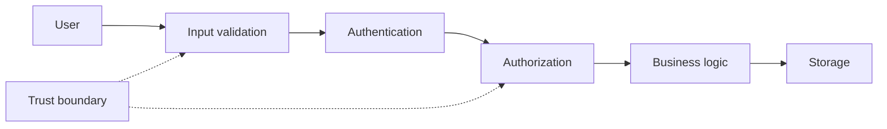

Security is not a separate feature but a property of the whole development process. To speak the same language as your team and understand where to invest effort, the industry uses **OWASP Top 10** — the list of the ten most common and dangerous classes of web application risks. Let's go through these classes and see what each looks like in Python code.

## What is OWASP Top 10

OWASP (Open Worldwide Application Security Project) is a nonprofit organization that publishes open security methodologies and tools. The Top 10 is not a ranking of specific vulnerabilities but categories of risks compiled from real attack data. You need to know them to:

- design a system with threats in mind even before writing code;
- formulate audit tasks competently;
- understand reports from security scanners (bandit, Semgrep, SAST tools).

## The categories and their traces in Python

- **A01 — Broken Access Control.** A user sees or modifies someone else's data. The classic is object references (IDOR), when the application trusts the `id` from the request:

```python
# Bad: anyone can substitute someone else's id
profile = Profile.objects.get(pk=request.GET["id"])

# Good: rights come from the authenticated user
profile = request.user.profile
```

- **A02 — Cryptographic Failures.** Weak algorithms, missing encryption, poor password storage. In Python this is md5 for passwords, secrets in code, HTTP instead of HTTPS.
- **A03 — Injection.** SQL, OS commands, templates. SQL injection lives wherever a query is glued together by hand. Protection — parameterized queries and strict validation:

```python
import re
print(re.sub(r"[^0-9]", "", "2024; DROP TABLE users"))  # 2024
```

- **A04 — Insecure Design.** Architectural flaws: no limits, no threat model, errors not controlled.
- **A05 — Security Misconfiguration.** `DEBUG = True` in production, default passwords, extra headers:

```python
import os
if os.environ.get("APP_DEBUG", "").lower() == "true":
    print("Warning: debug mode is on!")
```

- **A06 — Vulnerable and Outdated Components.** Libraries with known CVEs. Treated by dependency audit (`pip-audit`, `safety`) — more in lesson 2.
- **A07 — Identification and Authentication Failures.** Weak passwords, missing lockouts, predictable sessions.
- **A08 — Software and Data Integrity Failures.** Unsigned updates, deserialization of untrusted data (`pickle` — lesson 4).
- **A09 — Security Logging and Monitoring Failures.** Attacks go unnoticed (lesson 6).
- **A10 — SSRF.** The server, at the attacker's bidding, accesses internal addresses (lesson 3).

## Principles that always work

1. **Trust only what passed validation.** Input data is the enemy.
2. **Deny by default.** Explicitly allowed — otherwise forbidden.
3. **Trust boundaries.** Split code into zones: public entry, business logic, storage.
4. **Least privilege.** Every module and user gets exactly as much access as needed.



## Lesson summary

Security starts with architecture and validation, not with an "antivirus". Now let's reinforce it with practice: implement access control, input validation, configuration audit, risk assessment, and protection against open redirect.

<!--TASK-->
### Task 1
Write a function `can_access(user_id, current_user_id, is_admin)` that returns `True` if `current_user_id == user_id` or `is_admin is True`, otherwise `False`. Then call it with three argument pairs: `(10, 10, False)`, `(10, 5, False)`, `(10, 5, True)` and print the result of each check as `access for user_id=10: True` or `access for user_id=10: False`. The program must print exactly three lines: the first and third with `True`, the second with `False`. This is what IDOR protection looks like: rights are determined not by the incoming `id` but by verified data about the current user.

### Task 2
Write a function `is_valid_email(email)` that uses `re.fullmatch` with the pattern `^[\w.+-]+@[\w-]+\.[\w.]{2,}$` and returns `True` or `False`. Test the list of addresses: `user@example.com`, `bad@@mail.ru`, `this-is-not-email`, `a@b.co`. For each entry print a line like `'user@example.com' -> True`. This is an example of input validation (A03): strict matching against a whitelist pattern is better than the naive check `"@" in email`.

### Task 3
Write a function `check_config(debug, ssl_redirect, http_only)` that returns a list of warnings as strings:
- if `debug is True` — `DEBUG is on — turn it off in production!`;
- if `ssl_redirect is False` — `Forced HTTPS is missing!`;
- if `http_only is False` — `Session cookie is not marked HttpOnly!`.
Call it with arguments `(True, False, True)` and print each warning on a new line. Exactly two warnings must appear. This is configuration audit by class A05: the program itself signals dangerous settings.

### Task 4
Write a function `severity(score)` that classifies a vulnerability on the CVSS v3 scale: if `score >= 9.0` — return `CRITICAL`, for `score >= 7.0` — `HIGH`, for `score >= 4.0` — `MEDIUM`, otherwise — `LOW`. Call it for the list of scores `[9.8, 7.5, 5.3, 2.0]` and print pairs `score -> level`, e.g. `9.8 -> CRITICAL`. This is part of a threat model (A04): identical warnings should be ranked by severity.

### Task 5
Write a function `safe_redirect_target(url, allowed_hosts)` that protects against open redirect. Use `urllib.parse.urlparse`. Rules: if the URL has no scheme (relative path) — return the original `url`; if `netloc` (host) is in `allowed_hosts` — return the original `url`; otherwise return `None`. Test with the list `["https://mysite.ru/go", "https://evil.com/x", "/local/path", "https://mysite.ru/ok"]` and `allowed_hosts = {"mysite.ru"}`. For each address print a line like `'https://evil.com/x' -> None`. You must not let a user lead others to a fake site.
### Task 6
Implement a role-based access model (RBAC) with deny by default. Create a dictionary `PERMISSIONS`: role `"admin"` — `{"read", "write", "delete"}`, `"editor"` — `{"read", "write"}`, `"viewer"` — `{"read"}`. Write `has_permission(role, action)` that returns `True` only if the action is in the role's permission set, and `False` for unknown roles. Test four cases: `("admin", "delete")`, `("editor", "delete")`, `("viewer", "read")`, `("guest", "write")` and print lines like `admin/delete: True`. Expected output — three `True`–`False` in the given order: `True`, `False`, `True`, `False`. In a comment, explain why such a permission dictionary is better than a chain of `if role == "admin"` and how it implements the default-deny principle.

### Task 7
Write an audit of protective response headers. Define a reference dictionary `SECURITY_HEADERS` with four keys: `Content-Security-Policy`, `X-Frame-Options`, `X-Content-Type-Options`, `Strict-Transport-Security`. Write `audit_headers(headers)` that returns a tuple: the list of headers missing from the reference and the number found. Test on a dictionary that has only `X-Frame-Options` and `Content-Type`, and print `missing: ...` (comma-separated) and `found: N of 4`. Expected output: one header out of four is found, three are in the missing list. In a comment, explain which attack class each of these headers protects against and why the check should be automated.
<!--/TASK-->

<!--HINT-->
### Hint 1
Use logical `or`: the access condition fits in one line. The third check returns `True` only because of `is_admin`, and the second returns `False` because neither the `id`s match nor is an admin passed.
### Hint 2
The pattern is a regex string. Pass it to `re.fullmatch` together with the string being checked. Important: `re.fullmatch` requires the whole string to match, unlike `re.search`, which looks for a substring.
### Hint 3
Build a list `warnings = []` and append a string via `append` if the condition is violated. Return the list. In a loop `for w in ...: print(w)` print the warnings one by one. The third argument `True` must not produce a warning.
### Hint 4
Use an `if/elif/else` chain in descending threshold order: first `>= 9.0`, then `>= 7.0`, then `>= 4.0`. Check boundary values: 9.0 — CRITICAL, 7.0 — HIGH, 4.0 — MEDIUM.
### Hint 5
`urlparse` returns an object with fields `scheme`, `netloc`, `path`. For a relative address `scheme` is empty. Compare `parsed.netloc` with the set `allowed_hosts`. Don't forget to return `None` at the end of the function.
### Hint 6
Declare the permission dictionary at module level, and inside the function use `PERMISSIONS.get(role, set())` — then an unknown role automatically gets an empty set and `False`. The check is `action in ...`. Don't write separate branches for each role: the matrix should be data, not code.

### Hint 7
`missing = [h for h in SECURITY_HEADERS if h not in headers]` — the list of missing ones. The number found is `len(SECURITY_HEADERS) - len(missing)`. Output via `", ".join(missing)`; an empty list gives an empty string — handle that separately, e.g. with the word `none`.
<!--/HINT-->

<!--SOLUTION-->
### Solution 1
Solution:

```python
def can_access(user_id, current_user_id, is_admin):
    return current_user_id == user_id or is_admin

print("access for user_id=10:", can_access(10, 10, False))
print("access for user_id=10:", can_access(10, 5, False))
print("access for user_id=10:", can_access(10, 5, True))
```

Result:

```
access for user_id=10: True
access for user_id=10: False
access for user_id=10: True
```

What's happening here? The function returns true if the current user's identifier matches the resource owner's identifier, or if the current user is an admin. The first check passes by `id` equality, the second is rejected (someone else's profile), the third passes thanks to the `is_admin` flag. This is the essence of IDOR protection (A01): authorization must never rely on data the client can forge — id in the URL, form parameters, headers. In a real application, `current_user_id` comes from the session or JWT, not from the request. The habit of writing such checks in one line and covering them with tests eliminates a whole class of vulnerabilities.

### Solution 2
Solution:

```python
import re

EMAIL_RE = re.compile(r"^[\w.+-]+@[\w-]+\.[\w.]{2,}$")

def is_valid_email(email):
    return bool(EMAIL_RE.fullmatch(email))

for email in ["user@example.com", "bad@@mail.ru", "this-is-not-email", "a@b.co"]:
    print(f"{email!r} -> {is_valid_email(email)}")
```

Result:

```
'user@example.com' -> True
'bad@@mail.ru' -> False
'this-is-not-email' -> False
'a@b.co' -> True
```

What's happening here? The pattern describes the allowed structure of an address: name (letters, digits, dot, plus, minus, underscore), then `@`, then the domain and the top-level zone. `re.fullmatch` requires the pattern to cover the whole string, so `bad@@mail.ru` is rejected — the double dog doesn't fit `[\w-]+`. Such "at the entrance" validation is the first line of defense against injections and spam. However, remember: format validation does not replace output escaping and parameterized queries. This is the principle of defense in depth: each layer solves its own problem.

### Solution 3
Solution:

```python
def check_config(debug, ssl_redirect, http_only):
    warnings = []
    if debug:
        warnings.append("DEBUG is on — turn it off in production!")
    if not ssl_redirect:
        warnings.append("Forced HTTPS is missing!")
    if not http_only:
        warnings.append("Session cookie is not marked HttpOnly!")
    return warnings

for w in check_config(True, False, True):
    print(w)
```

Result:

```
DEBUG is on — turn it off in production!
Forced HTTPS is missing!
```

What's happening here? The function collects a list of violations instead of failing at the first one. This matters for audit: we want to see all problems at once. The third argument `True` does not produce a warning, so there are exactly two lines. In a real Django project a similar check would look like `if settings.DEBUG: warnings.append(...)`, and the flags `SECURE_SSL_REDIRECT` and `SESSION_COOKIE_HTTPONLY` are set in settings. Such checks are convenient to run in CI on every PR — then dangerous configuration will not reach production.

### Solution 4
Solution:

```python
def severity(score):
    if score >= 9.0:
        return "CRITICAL"
    if score >= 7.0:
        return "HIGH"
    if score >= 4.0:
        return "MEDIUM"
    return "LOW"

for s in [9.8, 7.5, 5.3, 2.0]:
    print(f"{s} -> {severity(s)}")
```

Result:

```
9.8 -> CRITICAL
7.5 -> HIGH
5.3 -> MEDIUM
2.0 -> LOW
```

What's happening here? The thresholds come from the CVSS v3 scale used to score vulnerability severity (Critical ≥ 9.0, High ≥ 7.0, Medium ≥ 4.0). Checks run in descending order, so 7.5 falls into `HIGH`, not `MEDIUM`: the first true condition fires. Such classification is the basis of a threat model (A04): it helps the team decide what to fix first. In reality the score comes from a CVSS calculator, but being able to map a number to a category will help when reading scanner reports.

### Solution 5
Solution:

```python
from urllib.parse import urlparse

def safe_redirect_target(url, allowed_hosts):
    parsed = urlparse(url)
    if not parsed.scheme:
        return url
    if parsed.netloc in allowed_hosts:
        return url
    return None

allowed = {"mysite.ru"}
for u in ["https://mysite.ru/go", "https://evil.com/x", "/local/path", "https://mysite.ru/ok"]:
    print(f"{u!r} -> {safe_redirect_target(u, allowed)}")
```

Result:

```
'https://mysite.ru/go' -> 'https://mysite.ru/go'
'https://evil.com/x' -> None
'/local/path' -> '/local/path'
'https://mysite.ru/ok' -> 'https://mysite.ru/ok'
```

What's happening here? `urlparse` splits the address into parts, and we check only the host (`netloc`). Relative paths without a scheme are safe — they cannot take you to another site, so they are returned as-is. External addresses not in `allowed_hosts` become `None`, and the application should show a normal page rather than a chain of redirects. This is protection against open redirect — an attack where an attacker feeds the victim a link like `https://mysite.ru/?next=https://evil.com`, and the trusting user lands on a phishing site.
### Solution 6
Solution:

```python
PERMISSIONS = {
    "admin": {"read", "write", "delete"},
    "editor": {"read", "write"},
    "viewer": {"read"},
}

def has_permission(role, action):
    return action in PERMISSIONS.get(role, set())

for role, action in [
    ("admin", "delete"),
    ("editor", "delete"),
    ("viewer", "read"),
    ("guest", "write"),
]:
    print(f"{role}/{action}: {has_permission(role, action)}")
```

Result:

```
admin/delete: True
editor/delete: False
viewer/read: True
guest/write: False
```

What's happening here? Rights are described as data: a set of actions per role. `PERMISSIONS.get(role, set())` returns an empty set for an unknown role, so `guest` gets nothing — that is default deny: only what is explicitly listed is allowed. Such a matrix is easy to extend (a new role — one line) and easy to test: you can iterate over all "role × action" pairs and compare with the expected table. A chain of `if role == "admin"` is bad because adding a role means remembering every check site, and a forgotten branch usually means "allow". In a real application, the role comes from a verified token or session, not from the request body — otherwise a user would simply write `role: admin`.

### Solution 7
Solution:

```python
SECURITY_HEADERS = {
    "Content-Security-Policy": "default-src 'self'",
    "X-Frame-Options": "DENY",
    "X-Content-Type-Options": "nosniff",
    "Strict-Transport-Security": "max-age=31536000",
}

def audit_headers(headers):
    missing = [h for h in SECURITY_HEADERS if h not in headers]
    found = len(SECURITY_HEADERS) - len(missing)
    return missing, found

response_headers = {
    "X-Frame-Options": "DENY",
    "Content-Type": "text/html; charset=utf-8",
}

missing, found = audit_headers(response_headers)
print("missing:", ", ".join(missing) if missing else "none")
print(f"found: {found} of {len(SECURITY_HEADERS)}")
```

Result:

```
missing: Content-Security-Policy, X-Content-Type-Options, Strict-Transport-Security
found: 1 of 4
```

What's happening here? The function compares actual response headers with the reference and returns what is missing; `Content-Type` is not in the reference and does not affect the result. Behind each header is a specific threat: `Content-Security-Policy` restricts script sources and mitigates XSS, `X-Frame-Options: DENY` forbids embedding the page in an iframe (clickjacking), `X-Content-Type-Options: nosniff` stops the browser from "guessing" the type and executing an image as a script, `Strict-Transport-Security` forces the browser to use HTTPS only. Checking this by hand is pointless — headers are easily lost when adding a proxy or CDN, so such an audit is put in CI or synthetic monitoring that pings production and compares the response with the reference.
<!--/SOLUTION-->

<!--QUIZ-->
What does the abbreviation OWASP stand for?
- Open Worldwide Application Security Project
- Only Web Application Security Protocol
- Open Web Attack Security Platform
* Correct answer: Open Worldwide Application Security Project
OWASP is a nonprofit organization publishing open security methodologies, including the Top 10.

What is OWASP Top 10?
- Ten most dangerous programming languages
- A list of the ten most common classes of web application risks
- Top-10 libraries for encryption
* Correct answer: A list of the ten most common classes of web application risks
These are risk categories from real attack data, not a ranking of specific programs.

Which risk class describes a situation where a user accesses someone else's data through a substituted id in the URL?
- A01 — Broken Access Control
- A03 — Injection
- A10 — SSRF
* Correct answer: A01 — Broken Access Control
The id-substitution scenario is called IDOR — a kind of broken access control.

Which recommendation is correct for protecting against SQL injection?
- Glue the query string with f-strings
- Use parameterized queries
- Hide database errors
* Correct answer: Use parameterized queries
Parameterization separates data from SQL code; hiding errors helps but does not cure the injection itself.

Which sign is typical of security misconfiguration (A05)?
- DEBUG = True in production
- Having tests
- Using HTTPS
* Correct answer: DEBUG = True in production
Debug mode exposes stack traces and configuration; it must be off in production.

Which OWASP class covers using outdated libraries with known vulnerabilities?
- A06 — Vulnerable and Outdated Components
- A04 — Insecure Design
- A02 — Cryptographic Failures
* Correct answer: A06 — Vulnerable and Outdated Components
This class is treated with dependency audit: pip-audit, safety.

Which principle is phrased as "explicitly allowed — otherwise forbidden"?
- Default deny
- Least surprise
- Fail fast
* Correct answer: Default deny
The default policy forbids everything not explicitly allowed.

What is IDOR?
- An attack where the application trusts an object identifier from the request
- A way to obfuscate code
- A type of virus in pip packages
* Correct answer: An attack where the application trusts an object identifier from the request
Insecure Direct Object Reference — direct access to an object by a substituted id without rights checking.

Which tool helps audit the configuration of a Python application?
- A custom settings-check function (e.g. check_config)
- The gcc compiler
- The curl utility
* Correct answer: A custom settings-check function (e.g. check_config)
Checks of flags like DEBUG, HTTPS, and HttpOnly are run in CI.

What is CVSS severity classification for?
- Ranking vulnerabilities and prioritizing fixes
- Speeding up code execution
- Encrypting logs
* Correct answer: Ranking vulnerabilities and prioritizing fixes
The CVSS scale maps a complex score to CRITICAL/HIGH/MEDIUM/LOW levels.

What does the A04 "Insecure Design" category describe?
- Architectural flaws: no threat model, limits, or error control
- Typos in code
- Errors in an encryption library
- Lack of performance tests
* Correct answer: Architectural flaws: no threat model, limits, or error control
Such problems cannot be fixed with a patch — the solution must be redesigned.

Which header forbids embedding the page in an iframe?
- X-Frame-Options: DENY
- Content-Type: text/html
- Accept-Encoding: gzip
- Cache-Control: no-store
* Correct answer: X-Frame-Options: DENY
It protects against clickjacking; a modern alternative is CSP frame-ancestors.

Why doesn't client-side form validation replace server-side?
- The client is under the user's control: the request can be sent directly, bypassing the form
- Browser validation is always wrong
- The server cannot read JSON
- Client-side validation works only in Chrome
* Correct answer: The client is under the user's control: the request can be sent directly, bypassing the form
Client-side checks are convenience for the user; server-side checks are protection.

What does the "trust boundaries" principle mean?
- Splitting the system into zones with different trust levels and checks at transitions
- Banning external libraries
- Encrypting all project files
- Giving up authentication within the network
* Correct answer: Splitting the system into zones with different trust levels and checks at transitions
Data from an untrusted zone must pass validation before entering a trusted one.
<!--/QUIZ-->
