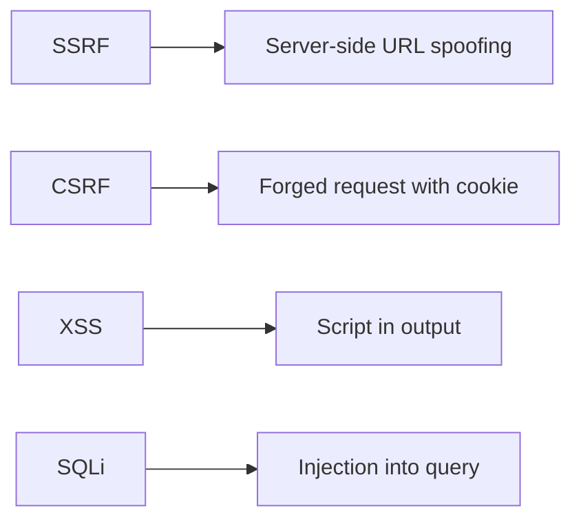

Web applications are vulnerable by the same scenario: code trusts data that comes from the user. Let's examine four classic attacks and their defenses in Python.

## SSRF — a forged request from the server side

**SSRF (Server-Side Request Forgery)** — an attack where an attacker forces the server to access an address it shouldn't touch: the internal network, cloud metadata (`169.254.169.254`), local services. Classic vulnerable code:

```python
import urllib.request

def fetch_image(url):
    with urllib.request.urlopen(url) as resp:
        return resp.read(1024)
```

If `url` comes from a request, the attacker can pass `http://169.254.169.254/latest/meta-data/` and pull the cloud instance credentials. Defense — validation before the request:

```python
import ipaddress
import urllib.request
from urllib.parse import urlparse

def safe_fetch(url):
    parsed = urlparse(url)
    if parsed.scheme not in ("http", "https"):
        raise ValueError("Only http/https allowed")
    host = parsed.hostname
    try:
        ip = ipaddress.ip_address(host)  # if the host is already an IP
    except ValueError:
        return host  # domain — needs DNS resolution with checks
    if ip.is_private or ip.is_loopback or ip.is_link_local:
        raise ValueError("Internal addresses are forbidden")
    return url
```

Blocking private ranges (`10.x`, `172.16–31.x`, `192.168.x`), loopback (`127.0.0.1`), and link-local is the minimum defense. For domains, resolve the IP and check it the same way.

## CSRF — a forged request on behalf of the user

**CSRF (Cross-Site Request Forgery)** — when an attacker's site invisibly sends a request on behalf of an authorized user. For example, an image `` — the browser will load it with the victim's cookies. The countermeasure — **CSRF tokens**: a secret random marker the server puts into the form and verifies on submission. In Django this protection is on by default (`CsrfViewMiddleware` and `` in templates). How it works manually:

```python
import hmac
import secrets

def generate_csrf_token():
    return secrets.token_urlsafe(32)

def verify_csrf_token(provided, stored):
    return hmac.compare_digest(provided, stored)
```

`secrets.token_urlsafe` gives cryptographically strong randomness, and `hmac.compare_digest` compares strings in constant time — without timing leakage.

## XSS — injecting scripts into a page

**XSS (Cross-Site Scripting)** — an attacker injects a script into content that is later shown to other users. If you output a comment directly, `<script>alert(document.cookie)</script>` will execute in the victim's browser. In Django you must not use `mark_safe` on untrusted data, and templates escape by default. At the low level — `html.escape`:

```python
import html

def render_comment(text):
    return html.escape(text)
```

`html.escape` turns `<` into `&lt;`, `>` into `&gt;`, and so on — the browser will show text, not execute code.

## SQL injection — substituting the query

**SQL injection** — when user input gets into the text of an SQL query. Vulnerable variant:

```python
# Bad: f-string in the query
query = f"SELECT * FROM users WHERE name = '{name}'"
```

With `name = "' OR '1'='1"` the query returns all users. The cure — parameterized queries:

```python
import sqlite3

conn = sqlite3.connect(":memory:")
conn.execute("CREATE TABLE users (name TEXT)")
conn.execute("INSERT INTO users VALUES (?)", ("admin",))

def find_user(name):
    cur = conn.execute("SELECT * FROM users WHERE name = ?", (name,))
    return cur.fetchall()

print(find_user("admin"))
print(find_user("' OR '1'='1"))  # safe: a parameter, not code
```

The question mark is a placeholder: the driver escapes the value itself, and injection becomes impossible. Django ORM does the same when you pass filter parameters instead of building a string.



## Lesson summary

Any of the four attacks is cured by one principle: **never trust input data**. SSRF — URL validation and blocking internal addresses, CSRF — tokens with `compare_digest`, XSS — escaping, SQL — parameterization. Django closes many of these holes out of the box, but you need to understand the mechanics so as not to reopen them.

<!--TASK-->
### Task 1
Write a function `is_internal(host)` that determines whether a host is an internal address. Use `ipaddress.ip_address(host)` and check the flags `is_private`, `is_loopback`, `is_link_local`. If `host` is not an IP (a domain), return `False`. Then call it for the list `["10.0.0.5", "127.0.0.1", "169.254.169.254", "8.8.8.8", "example.com"]` and print lines like `10.0.0.5 -> True`. There must be five lines on screen: three with `True` and two with `False`. This is the core of SSRF protection.

### Task 2
Write functions `generate_csrf_token()` and `verify_csrf_token(provided, stored)` for CSRF protection. The first returns `secrets.token_urlsafe(32)`, the second compares strings via `hmac.compare_digest`. Generate a token `token`, then check three cases: `verify_csrf_token(token, token)` — must be `True`, `verify_csrf_token("123", token)` — `False`, and `verify_csrf_token(token, "456")` — `False`. Print the results of the three checks as `check 1: True` and so on.

### Task 3
Write a function `find_user(name)` that searches for a user in the `users` table via a **parameterized query** with `sqlite3`: `SELECT * FROM users WHERE name = ?`. Create an in-memory database, create the table `users (name TEXT)`, add rows `admin` and `guest`. Then call `find_user("admin")` (must return `[('admin',)]`) and `find_user("' OR '1'='1")` (must return an empty list `[]`). Print both results. This is how parameterization makes the injection "fail".

### Task 4
Write a function `render_comment(text)` that escapes user input via `html.escape` before showing it on the page. Apply it to the string `'<script>alert("xss")</script> believe <b>bold</b>'` and print the result. `&lt;` and `&gt;` must appear instead of angle brackets — that is, the text becomes safe for the browser.

### Task 5
Create a function `validate_comment(text)` that returns `None` (rejects the comment) if at least one condition holds: the length after `strip()` exceeds 200 characters; the string contains `javascript:` (case-insensitive); the string contains `<script` or `</script`. Otherwise return `html.escape(text.strip())`. Test on three examples: a short normal comment `"Hello, world!"`, a long string of 300 characters `"a" * 300`, and the string `"<script>alert(1)</script>"`. Print the results as `'Hello, world!' -> 'Hello, world!'`, `'long' -> None`, `'script' -> None`. This is combined defense: length limit plus script blocking plus escaping.
### Task 6 — CSRF protection in Django
Enable `CsrfViewMiddleware` (on by default) and show: a form without `` is rejected (403). Expected result: without a token, Django returns 403 CSRF verification failed.
### Task 7 — XSS: escaping in a template
Create a page that outputs user input via `{{ value }}` (Django auto-escaping) and via `{{ value|safe }}`. Pass `<script>alert(1)</script>` and show that only the second variant executes the script. Expected result: the safe variant is vulnerable.

<!--/TASK-->

<!--HINT-->
### Hint 1
`ipaddress.ip_address` throws `ValueError` for non-IP strings — wrap the call in `try/except ValueError: return False`. For the check use `ip.is_private or ip.is_loopback or ip.is_link_local`. Note: `169.254.169.254` is link-local, `10.0.0.5` is private, `127.0.0.1` is loopback.
### Hint 2
`secrets.token_urlsafe(32)` returns a string of secure randomness. `hmac.compare_digest(provided, stored)` compares strings in constant time — use it instead of `==`. The return value is `bool`.
### Hint 3
In `sqlite3` parameters are passed as a tuple as the second argument: `conn.execute("SELECT * FROM users WHERE name = ?", (name,))`. Don't forget `conn.execute` for creating the table and inserting. `fetchall()` returns `[]` if there are no rows.
### Hint 4
`html.escape(text)` converts `&`, `<`, `>`, `"`, `'` into HTML entities. Print the result right away — you'll see `&lt;` and `&gt;` instead of brackets.
### Hint 5
First check `len(text.strip()) > 200`, then `"javascript:" in text.lower()`, then `<script` in `text.lower()`. Order matters: `strip()` and `lower()` before the checks. If all checks pass — return `html.escape(text.strip())`.
### Hint 6
Disable the token by removing `` from the form — the middleware will return 403 on POST.
### Hint 7
Plain `{{ value }}` escapes HTML; `|safe` outputs it as-is.

<!--/HINT-->

<!--SOLUTION-->
### Solution 1
Solution:

```python
import ipaddress

def is_internal(host):
    try:
        ip = ipaddress.ip_address(host)
    except ValueError:
        return False
    return ip.is_private or ip.is_loopback or ip.is_link_local

hosts = ["10.0.0.5", "127.0.0.1", "169.254.169.254", "8.8.8.8", "example.com"]
for h in hosts:
    print(f"{h} -> {is_internal(h)}")
```

Result:

```
10.0.0.5 -> True
127.0.0.1 -> True
169.254.169.254 -> True
8.8.8.8 -> False
example.com -> False
```

What's happening here? `ipaddress.ip_address` parses the string into an IP object; for domain names it throws `ValueError`, which we catch and return `False` (a domain is not directly an internal address). The first three addresses fall into reserved ranges: `10.0.0.5` — private network, `127.0.0.1` — loopback, `169.254.169.254` — link-local (this is exactly where AWS metadata is obtained). `8.8.8.8` — public DNS, `example.com` — a domain, both return `False`. In real SSRF protection this function is applied also to the IP after DNS resolution of the domain: otherwise an attacker can specify `http://internal.corp/`, which resolves to an internal address.

### Solution 2
Solution:

```python
import hmac
import secrets

def generate_csrf_token():
    return secrets.token_urlsafe(32)

def verify_csrf_token(provided, stored):
    return hmac.compare_digest(provided, stored)

token = generate_csrf_token()
print("check 1:", verify_csrf_token(token, token))
print("check 2:", verify_csrf_token("123", token))
print("check 3:", verify_csrf_token(token, "456"))
```

Result:

```
check 1: True
check 2: False
check 3: False
```

What's happening here? `secrets.token_urlsafe(32)` generates 32 random bytes in URL-safe encoding — such a token is impossible to predict. `hmac.compare_digest` compares strings in constant time: even if tokens don't match, the server spends the same time responding, and the attacker has no way to "guess" the token by timing. The first check compares the token with itself — `True`; the second and third — different strings — `False`. This is exactly how Django's built-in protection works: the token goes into a hidden form field (or cookie), and on POST it is verified. If it doesn't match — the request is rejected.

### Solution 3
Solution:

```python
import sqlite3

conn = sqlite3.connect(":memory:")
conn.execute("CREATE TABLE users (name TEXT)")
conn.execute("INSERT INTO users VALUES (?)", ("admin",))
conn.execute("INSERT INTO users VALUES (?)", ("guest",))

def find_user(name):
    cur = conn.execute("SELECT * FROM users WHERE name = ?", (name,))
    return cur.fetchall()

print(find_user("admin"))
print(find_user("' OR '1'='1"))
```

Result:

```
[('admin',)]
[]
```

What's happening here? In `sqlite3` parameters are passed as the second argument to `execute` — a tuple; the `?` placeholder in the query text is replaced with the value, which the driver escapes as data, not as SQL code. So `find_user("admin")` finds the row, and the injection attempt `' OR '1'='1` searches for a user whose literal name is `' OR '1'='1` — there is none, so the result is empty. If we built the query with an f-string, `' OR '1'='1` would become `WHERE name = '' OR '1'='1'` and return all rows. Django ORM works on the same principle: `User.objects.filter(name=name)` never substitutes the name into SQL text.

### Solution 4
Solution:

```python
import html

def render_comment(text):
    return html.escape(text)

print(render_comment('<script>alert("xss")</script> believe <b>bold</b>'))
```

Result:

```
&lt;script&gt;alert(&quot;xss&quot;)&lt;/script&gt; believe &lt;b&gt;bold&lt;/b&gt;
```

What's happening here? `html.escape` replaces dangerous characters with HTML entities: `<` → `&lt;`, `>` → `&gt;`, `"` → `&quot;`. Having received such text, the browser will not execute `<script>` — it will show it as plain text, and the angle brackets lose their "magic" meaning. That is XSS protection at the data level. Important: escaping must be applied at output time, not at storage time, and `mark_safe` should not be used in Django without an urgent need — it disables escaping and brings the vulnerability back.

### Solution 5
Solution:

```python
import html

def validate_comment(text):
    stripped = text.strip()
    if len(stripped) > 200:
        return None
    low = stripped.lower()
    if "javascript:" in low or "<script" in low:
        return None
    return html.escape(stripped)

print("'Hello, world!' ->", validate_comment("Hello, world!"))
print("'long' ->", validate_comment("a" * 300))
print("'script' ->", validate_comment('<script>alert(1)</script>'))
```

Result:

```
'Hello, world!' -> 'Hello, world!'
'long' -> None
'script' -> None
```

What's happening here? The function applies three barriers in sequence: a length limit (after `strip()`), a blacklist of dangerous substrings (`javascript:`, `<script`), and escaping before the return. A 300-character comment is rejected — `None`. A string with a script is rejected at the `<script` check — `None`. A normal comment passes all checks and is returned escaped. This is an example of "defense in depth": even if one barrier fails — say, the attacker invents a `javascript:` variant that passes the filter — escaping will still neutralize the output.
### Solution 6
```html
<form method="post" action="/submit">
      <!-- required -->
    <input name="q">
    <button>Submit</button>
</form>
```
Without `` a POST request gets 403: Django verifies the hidden token against the session cookie. This is the basic barrier against CSRF.
### Solution 7
```html
<p>{{ user_input }}</p>        <!-- escaped -->
<p>{{ user_input|safe }}</p>  <!-- dangerous -->
```
With input `<script>alert(1)</script>` the first variant shows text, the second executes the script. Therefore `|safe` is applied only to trusted data.

<!--/SOLUTION-->

<!--QUIZ-->
What is SSRF?
- An attack where the server, at the attacker's bidding, accesses internal addresses
- Session cookie substitution
- An attack on the admin password
* Correct answer: An attack where the server, at the attacker's bidding, accesses internal addresses
The server itself goes to cloud metadata or local services.

What is an IP address checked against when defending against SSRF?
- is_private / is_loopback / is_link_local
- By string length
- By presence of letters in the address
* Correct answer: is_private / is_loopback / is_link_local
These flags of the ipaddress module hide the internal ranges.

Which address serves metadata in AWS?
- 169.254.169.254
- 8.8.8.8
- 192.0.2.1
* Correct answer: 169.254.169.254
This is a link-local address; accessing it from SSRF must not be allowed.

Why are CSRF tokens needed?
- So the browser doesn't send requests on behalf of an authorized user without their knowledge
- To hide the Django version
- To speed up page loading
* Correct answer: So the browser doesn't send requests on behalf of an authorized user without their knowledge
The token is verified when the form is submitted — a foreign form doesn't know it.

How to compare tokens safely?
- hmac.compare_digest
- Plain ==
- Via len()
* Correct answer: hmac.compare_digest
Constant-time comparison doesn't leak information about length and contents.

What does html.escape do?
- Turns dangerous characters into HTML entities
- Removes all tags from a string
- Encrypts the string
* Correct answer: Turns dangerous characters into HTML entities
< becomes &lt;, > — &gt;, and the browser does not execute code.

Which string is an example of SQL injection?
- ' OR '1'='1
- SELECT * FROM users
- admin123
* Correct answer: ' OR '1'='1
Substituting such a string into a query without parameterization returns all users.

How to protect against SQL injection?
- Parameterized queries with placeholders
- Removing single quotes from input
- Hiding DB errors
* Correct answer: Parameterized queries with placeholders
Data is passed separately from SQL code — the driver does the escaping.

What does "defense in depth" mean?
- Several independent layers of defense
- Using one strong password
- Deep logging
* Correct answer: Several independent layers of defense
If one barrier is bypassed, the next one will trigger.

How does Django protect against CSRF?
- Built-in middleware and the csrf_token
- Disabling all forms
- Encrypting GET requests
* Correct answer: Built-in middleware and the csrf_token
CsrfViewMiddleware verifies the token on POST requests.
What is CSRF?
- Forging a cross-site request using the user's cookies
- A server error
- A type of database
- A network
* Correct answer: Forging a cross-site request using the user's cookies
The attack makes the victim's browser send a request with her cookies.

How does Django protect against CSRF?
- A token in the form, checked against the session
- A password
- A firewall
- Logging
* Correct answer: A token in the form, checked against the session
CsrfViewMiddleware verifies the token on POST.

What is XSS?
- Injecting scripts into the page output
- An authorization error
- SQL injection
- DDoS
* Correct answer: Injecting scripts into the page output
The script executes in the victim's browser.

How to protect against XSS in templates?
- Auto-escaping and avoiding |safe for input
- Removing all data
- Using print
- Disabling JS
* Correct answer: Auto-escaping and avoiding |safe for input
Django escapes {{ }} by default.

# 
<!--/QUIZ-->
