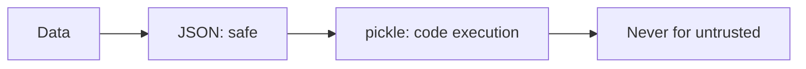

**Serialization** — turning an object into bytes (for example, to save or transfer over the network), **deserialization** — the reverse process. The problem is that many formats allow encoding not just data but also code that will execute on loading. Let's examine why `pickle` is dangerous and how to transfer data properly.

## Why pickle is dangerous

`pickle` is Python's built-in format. Convenience is deceptive: `pickle.dumps(obj)` turns any object into bytes, `pickle.loads(data)` — back. But when unpacking, pickle can execute arbitrary code: for this the `__reduce__` method is used, which returns a tuple "callable object + arguments". Have a look:

```python
import pickle
import subprocess

class Harmless:
    def __reduce__(self):
        return (subprocess.run, (["echo", "GOTCHA!"],))

payload = pickle.dumps(Harmless())
print(payload[:30])  # visible: these are pickle bytes
```

If the server calls `pickle.loads(payload)` on such data from a client, `subprocess.run(["echo", "GOTCHA!"])` will execute — and instead of `echo` the attacker will substitute `rm -rf` or reading secrets. **Rule: never deserialize pickle from an untrusted source.** Don't use pickle for data that crosses a trust boundary: from a client, from an external service, from a file someone may modify.

## Which formats to use

- **JSON** — safe by nature (only data, no code), ideal for exchange between services. Nuance: `json.loads` doesn't execute code but doesn't check types — watch out yourself.
- **YAML** — use only `yaml.safe_load`, not `yaml.load`, which can create arbitrary objects (in old PyYAML versions this gave RCE).
- **msgpack, protobuf, avro** — safe binary formats for data.
- If you need to pass Python objects specifically — only via signed data structures (JSON + HMAC signature).

## Signed payloads

To prevent data being substituted along the way, it is signed with a MAC algorithm. Example — signing JSON with a token on `hmac`:

```python
import base64
import hashlib
import hmac
import json

KEY = "very-secret-key".encode()

def sign(payload: dict) -> str:
    body = base64.urlsafe_b64encode(json.dumps(payload).encode()).decode()
    sig = hmac.new(KEY, body.encode(), hashlib.sha256).hexdigest()
    return f"{body}.{sig}"

def verify(token: str) -> dict:
    body, _, sig = token.rpartition(".")
    expected = hmac.new(KEY, body.encode(), hashlib.sha256).hexdigest()
    if not hmac.compare_digest(sig, expected):
        raise ValueError("Signature mismatch")
    return json.loads(base64.urlsafe_b64decode(body.encode()))
```

`sig` is computed from the body and the secret key; without the key it is impossible to substitute the body — the signature won't match. The check happens **before** parsing the JSON, so forged data is never parsed.

## Deserialization with an allowlist

If you can't do without `pickle` (for example, your own cache inside a trusted perimeter), restrict which classes may be created. To do this, override `find_class` in `pickle.Unpickler`:

```python
import pickle

ALLOWED = {(collections, "OrderedDict")}  # example: standard types only

class SafeUnpickler(pickle.Unpickler):
    def find_class(self, module, name):
        if (module, name) not in ALLOWED:
            raise pickle.UnpicklingError(f"Class {module}.{name} is forbidden")
        return super().find_class(module, name)
```

Everything else — only through safe formats and signatures.



## Lesson summary

pickle is a powerful but dangerous tool: it executes code on load. JSON/YAML(safe) — data without code. If data must be intact — sign it with HMAC and verify the signature before parsing. If pickle is unavoidable — a class allowlist. Now let's reinforce in practice.

<!--TASK-->
### Task 1
Write functions `sign(payload)` and `verify(token)` for a signed JSON payload. `sign` takes a dict and returns a string `body.signature`, where the body is `base64.urlsafe_b64encode` of `json.dumps(payload)`, and the signature is `hmac.new(KEY, body, hashlib.sha256).hexdigest()`. `verify` splits the token with `rpartition(".")`, verifies the signature via `hmac.compare_digest` and returns the parsed JSON, and on mismatch throws `ValueError("Signature mismatch")`. Test: sign `{"user": "admin"}`, call `verify(token)` (must return the original dict), then corrupt the last character of the token and make sure `verify` throws `ValueError` (catch it and print the message).

### Task 2
Create a class `Evil` whose `__reduce__` method returns `(print, ("WARNING: code executed",))`. Serialize it with `pickle.dumps(Evil())` and store the result in a variable `payload`. Do NOT call `pickle.loads(payload)` — instead just print the first 40 characters of payload and the line `Payload created, DO NOT unpickle!`. This way you'll see what an attacker's "gift" looks like without activating it.

### Task 3
Write a function `validate_payload(data)` that checks the incoming JSON (already parsed) against a schema and returns a cleaned dict. Only keys `name` (string), `age` (int), and `role` (string from the list `{"user", "admin"}`) are allowed. If a key is unknown or the type is wrong — ignore the field. If `role` is not in the list — ignore it. Return a dict with only allowed fields. Test on `{"name": "Alice", "age": 30, "role": "user", "extra": "harmful key"}` — only `{"name": "Alice", "age": 30, "role": "user"}` must be returned. Print the result.

### Task 4
Implement `SafeUnpickler(pickle.Unpickler)` with an overridden `find_class` that allows creating only `collections.OrderedDict` and `datetime.datetime` classes, and throws `pickle.UnpicklingError` with the message `Class {module}.{name} is forbidden` for everything else. Test: `pickle.dumps(collections.OrderedDict(a=1))` must unpack successfully, and `pickle.dumps(print)` must throw an exception (catch it and print the message). You don't need to create class instances — just pack/unpack.

### Task 5
Write a function `safe_extract(zip_path, dest_dir)` that extracts a ZIP archive without the "zip slip" vulnerability (paths escaping the destination folder). For each file name in `zipfile.ZipFile(zip_path).namelist()` build the target path as `Path(dest_dir) / name`, then check `target.resolve().is_relative_to(Path(dest_dir).resolve())` — if not, skip the file and print `Skipped dangerous path: <name>`, otherwise create the parent folder and extract the file. Then create a safe in-memory archive with one file via `io.BytesIO` + `zipfile.ZipFile(mode="w")` and verify it extracts correctly into a temporary folder. Print the list of extracted files.
### Task 6 — Dangerous pickle
Create a class with `__reduce__` returning `os.system` and a command, serialize it to bytes, and explain what happens on `pickle.loads`. Do NOT perform the load — only show the bytes and explain the danger.
### Task 7 — Safe validation instead of pickle
Write a function that takes JSON and converts it into an object only via explicit field validation (as in the lesson). Show that extra keys don't get into the object.

<!--/TASK-->

<!--HINT-->
### Hint 1
`rpartition(".")` returns a tuple `(before, separator, after)` — take `[0]` and `[2]`. `base64.urlsafe_b64decode` for parsing the body. Set the key as a global constant: `KEY = "secret-key".encode()`. Don't forget `hmac.compare_digest`.
### Hint 2
The `__reduce__` method returns a tuple `(function, arguments)`. `pickle.dumps` serializes; `pickle.loads` would execute on unpacking — so we don't call it, only show `payload[:40]`.
### Hint 3
Create an empty result dict and add fields only after checks. For `role` compare against the set `{"user", "admin"}`. `isinstance(value, int)` distinguishes numbers from strings; `isinstance(value, str)` — strings.
### Hint 4
`find_class(self, module, name)` is called when an object is created; compare `(module, name)` with the allowlist set. For `datetime.datetime` the module is named `datetime`, the name is `datetime`. Use `pickle.Unpickler(io.BytesIO(data))` and `.load()` for unpacking.
### Hint 5
`Path(dest_dir).resolve()` normalizes the path. `is_relative_to` checks that the target path is inside the folder. For writing into the archive: `zf.writestr("hello.txt", "hi")`; the byte stream is read via `io.BytesIO(buf.getvalue())`. Don't forget `import zipfile, io, tempfile, pathlib`.
### Hint 6
`def __reduce__(self): return (os.system, ("echo hi",))` — on loads the command will execute.
### Hint 7
Take only known keys from the dict via .get().

<!--/HINT-->

<!--SOLUTION-->
### Solution 1
Solution:

```python
import base64
import hashlib
import hmac
import json

KEY = "secret-key".encode()

def sign(payload):
    body = base64.urlsafe_b64encode(json.dumps(payload).encode()).decode()
    sig = hmac.new(KEY, body.encode(), hashlib.sha256).hexdigest()
    return f"{body}.{sig}"

def verify(token):
    body, _, sig = token.rpartition(".")
    expected = hmac.new(KEY, body.encode(), hashlib.sha256).hexdigest()
    if not hmac.compare_digest(sig, expected):
        raise ValueError("Signature mismatch")
    return json.loads(base64.urlsafe_b64decode(body.encode()))

token = sign({"user": "admin"})
print(verify(token))
try:
    verify(token[:-1] + ("A" if token[-1] != "A" else "B"))
except ValueError as e:
    print(e)
```

Result:

```
{'user': 'admin'}
Signature mismatch
```

What's happening here? `sign` encodes JSON into base64 (URL-safe), computes HMAC-SHA256 of the body, and joins with a dot. `verify` splits the token, recomputes the expected signature, and compares via `compare_digest` — in constant time. If even one character of the body or signature changed, the signature won't match, and we throw `ValueError` **before** `json.loads` — that is, we don't parse forged data. This is an important order: first integrity, then parsing.

### Solution 2
Solution:

```python
import pickle

class Evil:
    def __reduce__(self):
        return (print, ("WARNING: code executed",))

payload = pickle.dumps(Evil())
print(payload[:40])
print("Payload created, DO NOT unpickle!")
```

Result (approximately):

```
b'\x80\x05\x95\x81\x00\x00\x00\x00\x00\x00\x00\x8c\x08builtins\x94\x8c\x05print\x94\x93\x94\x8c\x14WARNING: code executed'
Payload created, DO NOT unpickle!
```

What's happening here? The bytes show `builtins` and `print` — pickle recorded not just data but the command "call print with this string". If the server called `pickle.loads(payload)`, `WARNING: code executed` would be printed to the console. With `__reduce__` an attacker can put anything instead of `print`: `eval`, `os.system`, `subprocess.run`. That is the essence of pickle exploitation: deserialization = code execution. Remember the main rule: `pickle.loads` may be called only on data you created yourself and that nobody could substitute.

### Solution 3
Solution:

```python
def validate_payload(data):
    result = {}
    if isinstance(data.get("name"), str):
        result["name"] = data["name"]
    if isinstance(data.get("age"), int):
        result["age"] = data["age"]
    if data.get("role") in {"user", "admin"}:
        result["role"] = data["role"]
    return result

raw = {"name": "Alice", "age": 30, "role": "user", "extra": "harmful key"}
print(validate_payload(raw))
```

Result:

```
{'name': 'Alice', 'age': 30, 'role': 'user'}
```

What's happening here? The function builds a new dict, copying only fields that passed the checks. `"extra": "harmful key"` is discarded — it's not in the schema. Types are controlled via `isinstance`: `"age": 30` is an int, while the string `"30"` would not pass. `role` is compared with the whitelist. This is the "allowlist approach" to data: we start with an empty result and add only what we allowed, rather than passing everything we didn't forbid. Such a validator is the first defense layer before data reaches business logic.

### Solution 4
Solution:

```python
import io
import pickle
import collections
import datetime

ALLOWED = {
    ("collections", "OrderedDict"),
    ("datetime", "datetime"),
}

class SafeUnpickler(pickle.Unpickler):
    def find_class(self, module, name):
        if (module, name) not in ALLOWED:
            raise pickle.UnpicklingError(f"Class {module}.{name} is forbidden")
        return super().find_class(module, name)

def loads(data):
    return SafeUnpickler(io.BytesIO(data)).load()

print(loads(pickle.dumps(collections.OrderedDict(a=1))))
try:
    loads(pickle.dumps(print))
except pickle.UnpicklingError as e:
    print(e)
```

Result:

```
OrderedDict([('a', 1)])
Class builtins.print is forbidden
```

What's happening here? When a standard `Unpickler` meets an object it calls `find_class(module, name)` — this is exactly where dangerous classes can be forbidden. Our class lets through only `OrderedDict` and `datetime`, while `builtins.print` raises an error. Note: `pickle.dumps(print)` is not a function call but packing a reference to it; it succeeded, while unpacking was stopped. Such an allowlist is a "last resort" defense when pickle cannot be avoided. But remember: even with an allowlist, better not accept pickle from outside, because an error in the allowed-class list equals RCE.

### Solution 5
Solution:

```python
import io
import tempfile
import zipfile
from pathlib import Path

def safe_extract(zip_path, dest_dir):
    dest = Path(dest_dir).resolve()
    extracted = []
    with zipfile.ZipFile(zip_path) as zf:
        for name in zf.namelist():
            target = (dest / name).resolve()
            if not target.is_relative_to(dest):
                print(f"Skipped dangerous path: {name}")
                continue
            target.parent.mkdir(parents=True, exist_ok=True)
            with zf.open(name) as src, open(target, "wb") as out:
                out.write(src.read())
            extracted.append(name)
    return extracted

buf = io.BytesIO()
with zipfile.ZipFile(buf, "w") as zf:
    zf.writestr("hello.txt", "hi")
buf.seek(0)

with tempfile.TemporaryDirectory() as tmp:
    print(safe_extract(buf, tmp))
```

Result:

```
['hello.txt']
```

What's happening here? The "zip slip" attack is when the archive contains a file name like `../secret.txt`, and a naive `zf.extract` writes it outside the destination folder. We build the target path, normalize it with `resolve()`, and check `is_relative_to(dest)`. If the path escapes — the file is skipped with a warning. For a safe file, the parent folder is created and the data is copied manually. This is the same principle as in SSRF: no "external" name should take us beyond the trust boundary.
### Solution 6
```python
import pickle, os

class Evil:
    def __reduce__(self):
        return (os.system, ("echo WARNING",))

print(pickle.dumps(Evil()))
```
The bytes contain an os.system call. If the server calls `pickle.loads` on such data — the command will execute. Therefore pickle is acceptable only for your own trusted data.
### Solution 7
```python
def parse_user(data):
    return {
        "name": data.get("name", ""),
        "age": data.get("age", 0),
    }

raw = {"name": "Ann", "age": 30, "admin": True}
print(parse_user(raw))
```
The extra admin key is discarded. A whitelist of fields — clean and safe deserialization.

<!--/SOLUTION-->

<!--QUIZ-->
Why is pickle dangerous for untrusted data?
- It can execute arbitrary code on unpacking
- It works slowly
- It encrypts data
* Correct answer: It can execute arbitrary code on unpacking
The __reduce__ method allows encoding a call to any function.

What does the __reduce__ method return?
- A tuple (callable object, arguments)
- A JSON string
- A list of attributes
* Correct answer: A tuple (callable object, arguments)
On unpacking pickle will call this object with these arguments.

Which format is safe for exchanging data over the network?
- JSON
- pickle
- Native binary dump of Python
* Correct answer: JSON
JSON contains only data; no code runs during parsing.

What does yaml.safe_load do?
- Parses YAML without creating arbitrary objects
- Executes Python code
- Encrypts YAML
* Correct answer: Parses YAML without creating arbitrary objects
yaml.load in old versions could create objects and lead to RCE.

What is HMAC?
- A message authentication code based on a secret key
- A way to compress data
- A type of database
* Correct answer: A message authentication code based on a secret key
HMAC allows verifying that data was not modified and was created by the key owner.

In what order should signed data be checked?
- First the signature, then parsing
- First parsing, then the signature
- The order doesn't matter
* Correct answer: First the signature, then parsing
Don't parse data whose integrity is not confirmed.

What does find_class do in Unpickler?
- Decides which classes can be created on unpacking
- Compresses pickle
- Speeds up unpacking
* Correct answer: Decides which classes can be created on unpacking
By overriding find_class, a class allowlist can be introduced.

What is "zip slip"?
- An attack where a file from the archive is written outside the destination folder
- A buffer overflow
- Brute-forcing the archive password
* Correct answer: An attack where a file from the archive is written outside the destination folder
Names like ../secret.txt take the write outside the bounds.

How to check that the target path is inside the folder?
- target.resolve().is_relative_to(dest)
- len(target) > 100
- target.exists()
* Correct answer: target.resolve().is_relative_to(dest)
resolve() normalizes the path, is_relative_to checks membership.

Which principle describes the strategy "start with an empty result and add only what is allowed"?
- Allowlist
- Blacklist
- Default
* Correct answer: Allowlist
Explicitly allowed — everything else is rejected.
Why is pickle dangerous?
- On load it can execute arbitrary code
- It is slow
- It doesn't support strings
- It encrypts
* Correct answer: On load it can execute arbitrary code
__reduce__ allows substituting the call with os.system or eval.

Can pickle be loaded from an untrusted source?
- No
- Yes
- Only in tests
- Only in a sandbox
* Correct answer: No
loads on untrusted data — RCE.

What is safer for data exchange?
- JSON
- pickle
- marshal
- latex
* Correct answer: JSON
JSON does not execute code when parsing.

What is __reduce__ in pickle?
- A hook that sets the function for restoring an object
- A reduction method
- A decorator
- An exception
* Correct answer: A hook that sets the function for restoring an object
It is abused to execute commands.

# 
<!--/QUIZ-->
