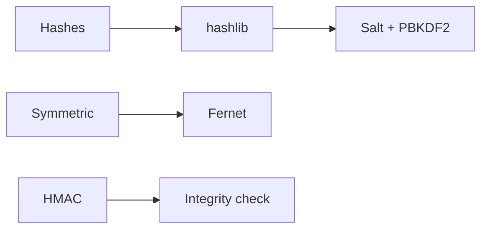

Cryptography in an application is not "bolt on encryption" but choosing the right primitive for the task. First, let's see how the key concepts differ, then look at the real Python APIs.

## Hashing ≠ encryption

**Hashing** — a one-way transformation: a hash is derived from a password, and the password cannot be recovered from the hash. **Encryption** — two-way: there is a key, and the data can be returned. Hashes suit passwords (we check the hash, not the password); encryption suits data that must be read later.

A password hash cannot be just `hashlib.sha256(password).hexdigest()` — that's fast, meaning an attacker will brute-force the password in seconds. You need **salt** (a random per-user value) and a **slowdown** — an expensive key derivation function (KDF):

```python
import hashlib
import secrets

salt = secrets.token_bytes(16)
password = "<redacted>".encode()
digest = hashlib.pbkdf2_hmac("sha256", password, salt, 600_000)
print(salt.hex(), digest.hex())
```

`pbkdf2_hmac` applies HMAC-SHA256 600,000 times — this is deliberately slow. Alternatives: `hashlib.scrypt` (memory-hard) and `argon2` (the `argon2-cffi` library, considered the best for passwords).

## Storing a password: string format

Store everything needed for verification in one string: `algorithm$iterations$salt$hash`. Verification must be **constant-time** — via `hmac.compare_digest`:

```python
import hmac

stored = f"pbkdf2_sha256$600000${salt.hex()}${digest.hex()}"
_, _, _, salt_hex, digest_hex = stored.split("$")
ok = hmac.compare_digest(
    digest_hex,
    hashlib.pbkdf2_hmac("sha256", password, bytes.fromhex(salt_hex), 600_000).hex(),
)
```

## Symmetric encryption: Fernet

`cryptography` is Python's main cryptography library. Its high-level interface `Fernet` provides AES-128-CBC encryption with authentication (HMAC) and token lifetime:

```python
from cryptography.fernet import Fernet

key = Fernet.generate_key()          # str: base64 key
f = Fernet(key)
token = f.encrypt("secret data".encode())
print(f.decrypt(token).decode())
```

The key is base64 of 32 bytes; it is stored in secrets (not in code!). Fernet suits encrypting small data: config files, tokens, strings.

## HMAC: integrity check

When you just need to be sure data wasn't modified (without encryption), use HMAC:

```python
import hmac
import hashlib

key = "key".encode()
message = b"data"
mac = hmac.new(key, message, hashlib.sha256).hexdigest()
# check: hmac.new(key, message, hashlib.sha256).hexdigest() == mac
```

Compare via `hmac.compare_digest` — plain `==` is vulnerable to timing attacks.

## One-time passwords: HOTP

For practice — HOTP (RFC 4226): a 6-digit code computed from a counter and a key. A real HMAC example:

```python
import hmac
import hashlib
import struct

def hotp(key: bytes, counter: int) -> str:
    msg = struct.pack(">Q", counter)
    digest = hmac.new(key, msg, hashlib.sha1).digest()
    offset = digest[-1] & 0x0F
    code = struct.unpack(">I", digest[offset:offset + 4])[0] & 0x7FFFFFFF
    return str(code % 1_000_000).zfill(6)

key = b"this-is-my-shared-secret"
print(hotp(key, 0), hotp(key, 1))
```

## Important rules

- **Don't invent your own cryptography.** Use proven libraries: `cryptography`, `hashlib`, `hmac`, `secrets`.
- **Keys go into secrets**, not code (lesson 2).
- **TLS/HTTPS** — encryption in transit; application-level encryption is only for data at rest.
- **Randomness** — only `secrets` (not `random`!) for cryptographic purposes.



## Lesson summary

For passwords — KDF with salt (pbkdf2, scrypt, argon2) and constant-time comparison. For data — Fernet from `cryptography`. For integrity — HMAC. For codes — HOTP/TOTP. The main thing: don't reinvent the wheel and don't use weak primitives.

<!--TASK-->
### Task 1
Write a class `PasswordHasher` with two methods. `hash_password(password)` generates salt via `secrets.token_bytes(16)`, computes `hashlib.pbkdf2_hmac("sha256", password.encode(), salt, 600_000)` and returns a string of the format `pbkdf2_sha256$600000$<salt hex>$<hash hex>`. `verify_password(password, stored)` splits the string with `split("$")`, recomputes the hash and compares via `hmac.compare_digest`, returning `bool`. Test: `verify_password("password", hasher.hash_password("password"))` must be `True`, and `verify_password("other", stored)` — `False`. Print both results.

### Task 2
Write functions `encrypt_data(plaintext, key)` and `decrypt_data(token, key)` based on `cryptography.fernet.Fernet`. The first returns `Fernet(key).encrypt(plaintext.encode())`, the second — `Fernet(key).decrypt(token).decode()`. Generate a key with `Fernet.generate_key()`, encrypt the string `"secret message"`, print the encrypted token (first 40 characters) and the decrypted text. Make sure the decrypted text matches the original.

### Task 3
Implement a function `hotp(key, counter)` per RFC 4226, as in the theory: `struct.pack(">Q", counter)`, HMAC-SHA1, dynamic truncation (offset = digest[-1] & 0x0F), `struct.unpack(">I", digest[offset:offset+4])[0] & 0x7FFFFFFF`, then `% 1_000_000` and `zfill(6)`. Call it for `key = b"shared-secret"` and counters 0, 1, 2 and print three six-digit codes. The codes must differ from each other.

### Task 4
Write a function `derive_key(passphrase, salt)` that uses `hashlib.scrypt` to derive a 32-byte key: `hashlib.scrypt(passphrase.encode(), salt=salt, n=2**14, r=8, p=1, dklen=32)`. Verify that with the same passphrase and salt the keys match, and with a different salt they differ. Print both hex keys: `key1`, `key2`, and `key3`, where key1 and key2 come from one passphrase, key3 from a different salt. Generate salt with `secrets.token_bytes(16)`.

### Task 5
Write a function `constant_time_equals(a, b)` that returns `hmac.compare_digest(a, b)`. Demonstrate the difference: create a function `naive_equals(a, b)` on plain `==` and compare the execution time for two long strings (1,000,000 characters) differing in the last character: print `naive comparison: <sec>`, `constant time: <sec>` via `time.perf_counter()`. Make sure the difference is visible. This is a vivid example of why `compare_digest` is used for secrets.
### Task 6 — Password hashing with salt
Write a function `hash_password(password)` using `secrets.token_bytes(16)` as salt and `hashlib.pbkdf2_hmac("sha256", password.encode(), salt, 600_000)`. Return the string `salt_hex:digest_hex`. Verify that identical passwords give different hashes.
### Task 7 — Fernet for data encryption
Use `cryptography.fernet.Fernet`: generate a key, encrypt a string, decrypt and compare. Show that the encrypted text differs from the original.

<!--/TASK-->

<!--HINT-->
### Hint 1
Parse the string: `algo, iterations, salt_hex, digest_hex = stored.split("$")`. For hex conversions use `bytes.fromhex` and `.hex()`. `verify_password` takes `password` as str — don't forget `.encode()`.
### Hint 2
`Fernet.generate_key()` returns key bytes; `Fernet(key)` creates the encryptor. `encrypt` takes bytes, `decrypt` returns bytes. Print `token[:40]` for demonstration.
### Hint 3
Don't forget `import struct`. `digest[-1] & 0x0F` — the low 4 bits of the last byte. `struct.unpack(">I", ...)` returns a tuple — take `[0]`. The resulting number should be about 6 digits.
### Hint 4
`hashlib.scrypt` (Python 3.6+). Parameter `n` is a power of two; `2**14` is a speed/security tradeoff for a learning example. Returns bytes — print them with `.hex()`.
### Hint 5
`time.perf_counter()` before and after the loop: `t0 = time.perf_counter(); ...; dt = time.perf_counter() - t0`. For clarity repeat the comparison, say, 50 times in a loop. `hmac.compare_digest` also compares bytes/strings.
### Hint 6
Salt is unique for each password — therefore identical passwords give different hashes.
### Hint 7
`from cryptography.fernet import Fernet`; `f = Fernet(key)`; `f.encrypt(data.encode())`.

<!--/HINT-->

<!--SOLUTION-->
### Solution 1
Solution:

```python
import hashlib
import hmac
import secrets

class PasswordHasher:
    ITERATIONS = 600_000

    def hash_password(self, password):
        salt = secrets.token_bytes(16)
        digest = hashlib.pbkdf2_hmac(
            "sha256", password.encode(), salt, self.ITERATIONS
        )
        return f"pbkdf2_sha256${self.ITERATIONS}${salt.hex()}${digest.hex()}"

    def verify_password(self, password, stored):
        _, _, salt_hex, digest_hex = stored.split("$")
        digest = hashlib.pbkdf2_hmac(
            "sha256", password.encode(),
            bytes.fromhex(salt_hex), self.ITERATIONS
        )
        return hmac.compare_digest(digest_hex, digest.hex())

h = PasswordHasher()
stored = h.hash_password("password")
print(h.verify_password("password", stored))
print(h.verify_password("other", stored))
```

Result:

```
True
False
```

What's happening here? `hash_password` generates fresh salt (16 random bytes), computes the KDF with 600,000 iterations, and packs everything into a string. In `verify_password` we parse the string, restore the salt and iterations, and recompute the hash. Comparison — via `hmac.compare_digest`, so the response time doesn't depend on whether the first character matched. The first check gives `True`, the second — `False`. Note: with the same password and different salts the hashes differ — so the salt must be stored with the hash. This is the standard password storage format in Django (`pbkdf2_sha256$...`).

### Solution 2
Solution:

```python
from cryptography.fernet import Fernet

def encrypt_data(plaintext, key):
    return Fernet(key).encrypt(plaintext.encode())

def decrypt_data(token, key):
    return Fernet(key).decrypt(token).decode()

key = Fernet.generate_key()
token = encrypt_data("secret message", key)
print(token[:40])
print(decrypt_data(token, key))
```

Result (approximately):

```
b'gAAAAAB...'  (first 40 characters of the token)
secret message
```

What's happening here? `Fernet.generate_key()` creates a 32-byte key encoded in base64. `encrypt` returns a token that contains the ciphertext itself, the HMAC signature, and the creation time — meaning the token cannot be substituted or "aged". `decrypt` verifies the signature and decrypts. If the data was modified or the key is wrong — you get `InvalidToken`. In a real project the key lives not in code but in secrets (lesson 2), and each service gets it from the environment. Fernet is a good choice for encrypting configuration strings and personal data.

### Solution 3
Solution:

```python
import hashlib
import hmac
import struct

def hotp(key, counter):
    msg = struct.pack(">Q", counter)
    digest = hmac.new(key, msg, hashlib.sha1).digest()
    offset = digest[-1] & 0x0F
    code = struct.unpack(">I", digest[offset:offset + 4])[0] & 0x7FFFFFFF
    return str(code % 1_000_000).zfill(6)

key = b"shared-secret"
for i in range(3):
    print(hotp(key, i))
```

Result (example):

```
780531
559742
881322
```

What's happening here? HOTP is the one-time password standard (RFC 4226). The counter is packed into 8 big-endian bytes (`struct.pack(">Q", counter)`), and HMAC-SHA1 is computed over it. From the digest we take "dynamic truncation": the last byte gives the `offset`, from there we cut 4 bytes, convert to an unsigned int (31 bits), and take the remainder of division by 1,000,000. `zfill(6)` pads with zeros to six digits. Codes for different counters differ. HOTP is used in Google Authenticator-like apps; TOTP is the same idea, but the counter is time divided by a period.

### Solution 4
Solution:

```python
import hashlib
import secrets

def derive_key(passphrase, salt):
    return hashlib.scrypt(
        passphrase.encode(), salt=salt,
        n=2**14, r=8, p=1, dklen=32,
    )

salt1 = secrets.token_bytes(16)
salt2 = secrets.token_bytes(16)
key1 = derive_key("Password", salt1)
key2 = derive_key("Password", salt1)
key3 = derive_key("Password", salt2)

print("key1:", key1.hex())
print("key2:", key2.hex())
print("key3:", key3.hex())
```

What's happening here? `hashlib.scrypt` is a KDF resistant to GPU and ASIC brute force: it requires a lot of memory (the `n` parameter is the linear size parameter). `key1` and `key2` are the same because the passphrase and salt match — that's determinism, needed for verification. `key3` differs because the salt is different. A key derived from a passphrase through a KDF can be used for encryption (for example, as a Fernet key after base64). Store the salt and parameters (n, r, p) alongside it to reproduce the key later.

### Solution 5
Solution:

```python
import hmac
import time

def naive_equals(a, b):
    return a == b

def constant_time_equals(a, b):
    return hmac.compare_digest(a, b)

a = "A" * 1_000_000
b = "A" * 999_999 + "B"

t0 = time.perf_counter()
for _ in range(50):
    naive_equals(a, b)
t1 = time.perf_counter()
for _ in range(50):
    constant_time_equals(a, b)
t2 = time.perf_counter()

print(f"naive comparison: {t1 - t0:.4f} sec")
print(f"constant time: {t2 - t1:.4f} sec")
```

What's happening here? Naive `==` compares strings character by character and stops at the first mismatch — and ours is almost at the end, so the comparison takes long. `hmac.compare_digest` always scans the whole string, so its time barely depends on where the "corruption" is. In reality an attacker can measure response time and use it to guess a secret character by character; that's why constant-time functions are used to compare secrets, hashes, and signatures. This is one reason HMAC must not be checked with plain `==`.
### Solution 6
```python
import hashlib, secrets

def hash_password(password):
    salt = secrets.token_bytes(16)
    digest = hashlib.pbkdf2_hmac("sha256", password.encode(), salt, 600_000)
    return f"{salt.hex()}:{digest.hex()}"

print(hash_password("password123"))
print(hash_password("password123"))
```
Two calls give different strings because of the random salt. PBKDF2 slows down brute force.
### Solution 7
```python
from cryptography.fernet import Fernet

key = Fernet.generate_key()
f = Fernet(key)
token = f.encrypt("secret data".encode())
print(token)
print(f.decrypt(token).decode())
```
Fernet is symmetric encryption (one key for encryption and decryption). The token looks like "garbage" but decrypts back.

<!--/SOLUTION-->

<!--QUIZ-->
How does hashing differ from encryption?
- Hashing is one-way, encryption is reversible
- It's the same thing
- Encryption is one-way
* Correct answer: Hashing is one-way, encryption is reversible
The original data cannot be recovered from a hash, but it can be decrypted.

Why must a password not be stored as sha256 without salt?
- Such a hash is computed too fast, the password is easy to brute-force
- It takes too much space
- SHA256 doesn't work in Python
* Correct answer: Such a hash is computed too fast, the password is easy to brute-force
Fast hashes allow trying billions of variants per second.

What is salt in the context of passwords?
- A random value added to the password before hashing
- A secret encryption key
- The password in plain text
* Correct answer: A random value added to the password before hashing
Salt makes identical passwords produce different hashes.

Why do you need a KDF like pbkdf2?
- To slow down password brute force
- To speed up login
- To compress the hash
* Correct answer: To slow down password brute force
Thousands of iterations make a single verification attempt expensive.

What does Fernet do?
- Encrypts data with authentication
- Only hashes
- Only compresses
* Correct answer: Encrypts data with authentication
A Fernet token contains ciphertext and an HMAC signature.

What will Fernet(key).decrypt(token) return if the key is wrong?
- InvalidToken exception
- None
- An empty string
* Correct answer: InvalidToken exception
The signature won't match — decryption is impossible.

Why use hmac.compare_digest instead of ==?
- So comparison time doesn't depend on the data
- To speed up code
- To protect against overflow
* Correct answer: So comparison time doesn't depend on the data
Constant time doesn't give the attacker timing information.

What does HOTP compute?
- A one-time password from a key and a counter
- A file hash
- An encryption key
* Correct answer: A one-time password from a key and a counter
HOTP = HMAC + counter; TOTP is the same but based on time.

What should be used to generate keys and salt?
- The secrets module
- The random module
- time.time()
* Correct answer: The secrets module
random and time are predictable and unsuitable for cryptography.

Which library is considered the main one for cryptography in Python?
- cryptography
- json
- requests
* Correct answer: cryptography
cryptography provides Fernet, asymmetric algorithms, KDFs, and more.
Why salt in hashing?
- So identical passwords give different hashes
- To speed up
- To shorten the string
- To encrypt
* Correct answer: So identical passwords give different hashes
Salt breaks rainbow tables.

What is PBKDF2?
- A slow algorithm for deriving a key from a password
- Symmetric encryption
- A hash without salt
- A digital signature
* Correct answer: A slow algorithm for deriving a key from a password
The slowdown complicates password brute force.

What does Fernet do?
- Symmetrically encrypts and decrypts data
- Signs publicly
- Hashes without a key
- Verifies a password
* Correct answer: Symmetrically encrypts and decrypts data
One key is used in both directions.

What is HMAC?
- Verifying message integrity with a key
- A compression algorithm
- A hash without a key
- Encryption
* Correct answer: Verifying message integrity with a key
HMAC allows confirming that the message was not modified.

# 
<!--/QUIZ-->
