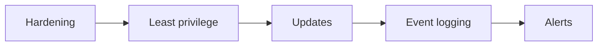

The last barrier — make an attack **expensive to carry out** and **impossible to hide**. The first is hardening, the second is logging and monitoring.

## Hardening: a checklist

Hardening is a set of routine actions that sharply raise the price of a break-in.

1. **Least privilege.** The service runs as a non-admin user; the database has a separate user with rights only to its own schema. Files with secrets — rights `0600` (owner only).
2. **Minimizing dependencies.** Fewer libraries — smaller attack surface. Update and audit (lesson 2).
3. **Limits.** Limit input size, request count, session length. Rate limiting breaks password brute force and DoS.
4. **Safe Django settings.** Often enabled by default:

```python
# settings.py
DEBUG = False
SECURE_SSL_REDIRECT = True
SESSION_COOKIE_HTTPONLY = True
SESSION_COOKIE_SECURE = True
CSRF_COOKIE_SECURE = True
SECURE_HSTS_SECONDS = 31536000
X_FRAME_OPTIONS = "DENY"
```

5. **Isolation.** Docker without root, a separate user in the container, resource limits. Network segmentation prevents SSRF/a breach of one service from taking everything at once.
6. **Secrets** — from the environment (lesson 2).

## Logging: what and how

Even a perfectly hardened system can be attacked — it's important to **notice** it. OWASP A09: logging and monitoring failures let an attack go unnoticed. Correct logs:

- **Never write secrets.** Passwords, tokens, cookies — mask or don't log at all.
- **Structured.** A format with time, level, logger, request id.
- **Rotation** — log files must not grow forever.
- **Audit of sensitive actions** — login, logout, password change, data deletion — into a separate stream.

An example of a configured logger with rotation and a secret filter:

```python
import logging
from logging.handlers import RotatingFileHandler

REDACTED = {"supersecret"}

class RedactFilter(logging.Filter):
    def filter(self, record):
        for secret in REDACTED:
            if secret in record.getMessage():
                record.msg = record.msg.replace(secret, "***")
        return True

logger = logging.getLogger("app")
logger.setLevel(logging.INFO)
handler = RotatingFileHandler("app.log", maxBytes=1_000_000, backupCount=5)
handler.addFilter(RedactFilter())
logger.addHandler(handler)

logger.info("User logged in: token supersecret")
```

`RotatingFileHandler` truncates the file when `maxBytes` is reached, keeping `backupCount` backups — logs don't eat the disk.

Errors must be logged with a traceback (`logger.exception`), but **no secrets in exceptions**. Sensitive actions — a separate `audit logger` with columns `time | user | action | result`.

## Monitoring

Logs are useless if nobody reads them. Collect metrics (4xx/5xx error counts, response time), set alerts on suspicious patterns: N consecutive failed logins, access to non-existent URLs, requests from unusual IPs. Centralizing logs (ELK/Loki) lets you search across all services at once.



## Lesson summary

Hardening reduces the probability of a successful attack; logging increases the probability of detecting it. Together they close the defense loop: an attack is expensive and visible. Now let's reinforce with practice.

<!--TASK-->
### Task 1
Set up a logger `app_logger` at `INFO` level that writes to the file `app.log` via `RotatingFileHandler` with `maxBytes=1_000_000` and `backupCount=5`, and a formatter `"%(asctime)s %(levelname)s %(message)s"`. Pass it to `logging.basicConfig(handlers=[handler])`. Then write `logger.info("Application started")` and read the first lines of the file via `open("app.log", encoding="utf-8")` — print the first three lines. Make sure the output has the time, the `INFO` level, and the message.

### Task 2
Create a class `RedactFilter(logging.Filter)` that in the `filter(record)` method replaces all occurrences of secrets from the set `SECRETS` in `record.msg` with `"***"` and returns `True`. Apply the filter to the logger and write `logger.info("Token: secret123")` with `SECRETS = {"secret123"}` to the file. Then read the file and print the line — it must contain `***`, not `secret123`.

### Task 3
Create a `logging.LoggerAdapter` named `auth_logger` that automatically adds a `user` field to all messages. To do this, define a subclass that in `process(msg, kwargs)` adds `kwargs["extra"]["user"]` (the value from self.extra). Use `LoggerAdapter(logger, {"user": "alice"})`, write `info("Login attempt")`, and when reading the file print the line — it must contain `alice`. If the adapter is tricky — you can use `logger.info("...", extra={"user": "alice"})`.

### Task 4
Write a function `ensure_private(path)` that checks and, if needed, fixes file permissions: if the path is a file, the permissions must be `0o600`; if a directory — `0o700`. Use `os.stat(path).st_mode & 0o777` to read current permissions and `os.chmod(path, 0o600)` to fix them. Create a temporary file via `tempfile.NamedTemporaryFile(delete=False)`, call `ensure_private`, and print the final permissions as `oct(mode)`.

### Task 5
Write a function `log_audit(action, user, ok)` that writes a line of the format `time | action | user | ok` to a separate file `audit.log`. Use `logging.getLogger("audit")` with `FileHandler("audit.log", encoding="utf-8")` and the formatter `"%(asctime)s | %(action)s | %(user)s | %(ok)s"`. Log three events: `("login", "alice", True)`, `("login", "bob", False)`, `("delete", "alice", True)`, then read the file and print its lines. Make sure each line contains four fields.
### Task 6 — Security logging
Set up event logging: failed login, permission change, access denied. Use logging with the WARNING level for suspicious actions. Verify records get into the file.
### Task 7 — Timeouts and limits
Implement a delay on failed login: after 5 consecutive errors, wait 30 seconds before the next request (e.g., via time.sleep). Describe why this protects against password brute force.

<!--/TASK-->

<!--HINT-->
### Hint 1
`logging.basicConfig(handlers=[handler])` with `level=logging.INFO`. `RotatingFileHandler("app.log", maxBytes=1_000_000, backupCount=5)`. Read the file via `open("app.log", encoding="utf-8").readlines()[:3]`.
### Hint 2
`record.msg` — the message string; `record.getMessage()` — with arguments substituted. Replace via `str.replace`. Return `True`. Don't forget `handler.addFilter(RedactFilter())`.
### Hint 3
A subclass of `logging.LoggerAdapter`: override `process(self, msg, kwargs)`, there do `kwargs["extra"] = dict(kwargs.get("extra", {}), user=self.extra["user"])` and return `(msg, kwargs)`. Or simpler: pass `extra={"user": "alice"}` on every call.
### Hint 4
`os.stat(path).st_mode & 0o777` — the current mode. For a directory use `os.path.isdir(path)`. `tempfile.NamedTemporaryFile(delete=False)` creates a temporary file, the path is in `.name`.
### Hint 5
`logging.getLogger("audit")` — a separate logger with its own handler. In `Formatter`, fields can be passed via `extra` in the call: `logger.info("", extra={"action": action, "user": user, "ok": ok})`. Formatter: `"%(asctime)s | %(action)s | %(user)s | %(ok)s"`.
### Hint 6
`logging.basicConfig(filename="security.log", level=logging.WARNING)`; log events.
### Hint 7
Store the attempt counter in memory or Redis; when exceeded — sleep.

<!--/HINT-->

<!--SOLUTION-->
### Solution 1
Solution:

```python
import logging
from logging.handlers import RotatingFileHandler

handler = RotatingFileHandler("app.log", maxBytes=1_000_000, backupCount=5)
handler.setFormatter(logging.Formatter("%(asctime)s %(levelname)s %(message)s"))
logging.basicConfig(handlers=[handler], level=logging.INFO)
logger = logging.getLogger("app")

logger.info("Application started")

for line in open("app.log", encoding="utf-8").readlines()[:3]:
    print(line, end="")
```

Result (example):

```
2026-11-01 12:00:00,123 INFO Application started
```

What's happening here? `RotatingFileHandler` when `maxBytes` (1 MB) is reached renames the old file to `app.log.1`, `app.log.2`, and so on, keeping no more than `backupCount=5` copies. The formatter adds time, level, and message. `basicConfig(handlers=[handler])` applies the handler to the root logger, `getLogger("app")` inherits it. Rotation is mandatory in production: without it the log file grows forever and fills the whole disk — and that is already a denial of service.

### Solution 2
Solution:

```python
import logging
from logging.handlers import RotatingFileHandler

SECRETS = {"secret123"}

class RedactFilter(logging.Filter):
    def filter(self, record):
        msg = record.getMessage()
        for secret in SECRETS:
            msg = msg.replace(secret, "***")
        record.msg = msg
        return True

handler = RotatingFileHandler("app.log", maxBytes=1_000_000, backupCount=5)
handler.addFilter(RedactFilter())
logging.basicConfig(handlers=[handler], level=logging.INFO)
logger = logging.getLogger("app")

logger.info("Token: secret123")

for line in open("app.log", encoding="utf-8").readlines()[:3]:
    print(line, end="")
```

Result (example):

```
2026-11-01 12:01:00,123 INFO Token: ***
```

What's happening here? `logging.Filter` with the `filter(record)` method returns `True` if the record should be kept, and may modify the `record` itself. We take the message via `record.getMessage()` (it substitutes arguments into the format string), replace found secrets with `***`, and write back to `record.msg`. The handler with the filter is added via `addFilter`. Thus the secret doesn't reach the log file — even if the programmer forgot to mask it manually. This is a mandatory practice: logs are read not only by your own people, and log files love to end up in tickets and forums.

### Solution 3
Solution:

```python
import logging
from logging.handlers import RotatingFileHandler

class UserAdapter(logging.LoggerAdapter):
    def process(self, msg, kwargs):
        kwargs["extra"] = dict(kwargs.get("extra", {}), user=self.extra["user"])
        return msg, kwargs

handler = RotatingFileHandler("app.log", maxBytes=1_000_000, backupCount=5)
handler.setFormatter(logging.Formatter("%(asctime)s %(user)s %(message)s"))
logging.basicConfig(handlers=[handler], level=logging.INFO)
logger = UserAdapter(logging.getLogger("auth"), {"user": "alice"})

logger.info("Login attempt")

for line in open("app.log", encoding="utf-8").readlines()[:3]:
    print(line, end="")
```

Result (example):

```
2026-11-01 12:02:00,123 alice Login attempt
```

What's happening here? `LoggerAdapter` wraps a logger and lets you add context to all messages. The `process` method is called for every message; we put `user` from `self.extra` into `kwargs["extra"]`, and the formatter substitutes it into the string via `%(user)s`. Thus all actions of a particular user are tied into a single log chain. In real systems, instead of a username, `request_id` is often used — a cross-cutting request identifier that lets you collect all logs of one operation across all services.

### Solution 4
Solution:

```python
import os
import tempfile

def ensure_private(path):
    mode = os.stat(path).st_mode & 0o777
    if os.path.isdir(path):
        if mode != 0o700:
            os.chmod(path, 0o700)
    else:
        if mode != 0o600:
            os.chmod(path, 0o600)
    return os.stat(path).st_mode & 0o777

with tempfile.NamedTemporaryFile(delete=False) as tmp:
    path = tmp.name

print(oct(ensure_private(path)))
os.unlink(path)
```

Result (example):

```
0o600
```

What's happening here? `os.stat(path).st_mode & 0o777` extracts the permission bits from the full mode. For a file we expect `0o600` (read/write for the owner only), for a directory — `0o700` (also enter). If the permissions are wrong — `os.chmod` fixes them. Such a function is needed when an application creates files with secrets or configuration at startup: default permissions may allow other system users to read them. On Windows chmod works in a limited way, but on a Linux production this is a standard measure. After the check the temporary file is removed via `os.unlink`.

### Solution 5
Solution:

```python
import logging

audit_logger = logging.getLogger("audit")
audit_logger.setLevel(logging.INFO)
handler = logging.FileHandler("audit.log", encoding="utf-8")
handler.setFormatter(logging.Formatter("%(asctime)s | %(action)s | %(user)s | %(ok)s"))
audit_logger.addHandler(handler)

def log_audit(action, user, ok):
    audit_logger.info("", extra={"action": action, "user": user, "ok": ok})

log_audit("login", "alice", True)
log_audit("login", "bob", False)
log_audit("delete", "alice", True)

for line in open("audit.log", encoding="utf-8").readlines():
    print(line, end="")
```

Result (example):

```
2026-11-01 12:03:00,123 | login | alice | True
2026-11-01 12:03:01,456 | login | bob | False
2026-11-01 12:03:02,789 | delete | alice | True
```

What's happening here? A separate `audit` logger writes to its own `audit.log` file — so security events don't mix with the stream of ordinary messages. The fields `action`, `user`, `ok` are passed via `extra`, and the formatter arranges them into the string. Important: the audit log must be **append-only** — the application must not be allowed to clean it, and write access should be restricted. Thanks to such a log, incident investigation becomes a simple query: "who changed/deleted/logged in when, and was it successful". This is also what OWASP A09 demands: without logs an attack cannot be noticed.
### Solution 6
```python
import logging

logging.basicConfig(filename="security.log", level=logging.WARNING)

def login_failed(username):
    logging.warning("Failed login: %s", username)

login_failed("admin")
```
A WARNING record will appear in security.log. Centralized security logs let you notice an attack in time.
### Solution 7
```python
import time

attempts = {}
MAX_ATTEMPTS = 5

def check_rate(username):
    attempts[username] = attempts.get(username, 0) + 1
    if attempts[username] > MAX_ATTEMPTS:
        time.sleep(30)
        attempts[username] = 0
```
The delay sharply slows brute force. Industrially this is done via Redis with TTL.

<!--/SOLUTION-->

<!--QUIZ-->
What does "least privilege" mean?
- Each service has exactly as much access as it needs
- Give everyone root access
- Forbid everything
* Correct answer: Each service has exactly as much access as it needs
Extra rights increase the damage from a break-in.

What permissions should a secret file have on Linux?
- 0600
- 0666
- 0777
* Correct answer: 0600
Read and write only for the owner.

What does RotatingFileHandler do?
- Truncates the log file when a size is reached and keeps backup copies
- Encrypts logs
- Deletes old logs
* Correct answer: Truncates the log file when a size is reached and keeps backup copies
maxBytes and backupCount limit the total log volume.

Why is a filter for masking secrets in logs needed?
- So secrets don't get into log files
- So logs are shorter
- To speed up writing
* Correct answer: So secrets don't get into log files
Logs are often copied into tickets and forums — secrets are unacceptable there.

What does LoggerAdapter do?
- Adds context (e.g., a user) to all logger messages
- Creates a new log file
- Encrypts messages
* Correct answer: Adds context (e.g., a user) to all logger messages
process() extends kwargs["extra"], and the formatter substitutes the values.

What is an audit log?
- A separate log of sensitive actions: login, deletion, permission change
- A copy of all application logs
- A log of errors only
* Correct answer: A separate log of sensitive actions: login, deletion, permission change
It helps investigate incidents.

Which Django setting disables debug mode in production?
- DEBUG = False
- DEBUG = True
- ALLOWED_HOSTS = []
* Correct answer: DEBUG = False
Debugging exposes stack traces and application internals.

What is HSTS (HTTP Strict Transport Security)?
- Forbidding unencrypted HTTP
- Forbidding redirects
- A caching method
* Correct answer: Forbidding unencrypted HTTP
SECURE_HSTS_SECONDS forces browsers to use HTTPS only.

Why are limits and rate limiting needed?
- To slow password brute force and mitigate DoS
- To speed up the server
- To hide errors
* Correct answer: To slow password brute force and mitigate DoS
Limiting request frequency is standard protection.

Which OWASP class describes the absence of attack logging?
- A09 — Logging and Monitoring Failures
- A01 — Access Control
- A06 — Outdated Components
* Correct answer: A09 — Logging and Monitoring Failures
Without logs and monitoring an attack cannot be detected.
Why log failed logins?
- To detect brute-force attacks
- For beauty
- For speed
- For cache
* Correct answer: To detect brute-force attacks
An abnormal number of failures is a signal of an attack.

What is time.sleep as protection?
- Slowing the response during suspicious activity
- Speeding up
- Checking a limit
- Encryption
* Correct answer: Slowing the response during suspicious activity
It slows automatic brute force.

Which logging level suits suspicious events?
- WARNING
- DEBUG
- INFO
- NOTSET
* Correct answer: WARNING
WARNING and above are for abnormal events.

Why limit the number of login attempts?
- To make password guessing harder
- To save traffic
- To avoid errors
- To speed up login
* Correct answer: To make password guessing harder
Limits + delays are the protection standard.

# 
<!--/QUIZ-->
