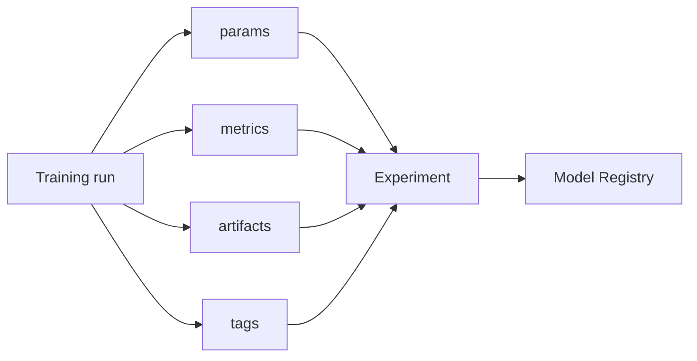

When you hack together models in a notebook, you most likely remember the results in your head or in comments. But as soon as there are several projects and dozens of experiments, chaos starts: which model gave r2 = 0.78? With which parameters? Where is its weights file? That is exactly the problem **experiment tracking** solves — systematically recording everything that happens during training.

## What is MLflow

MLflow is an open platform for managing the ML model lifecycle. For now we care about its first part — **MLflow Tracking**. Key concepts:

- **Experiment** — a logical group of runs for a single task. For example, "diabetes: regression".
- **Run** — a single training run. It records:
  - **parameters** (params) — settings set before training: `max_depth`, `alpha`, `n_estimators`;
  - **metrics** — results computed after training: `r2`, `accuracy`, `loss`;
  - **artifacts** — files: model weights, plots, data slices;
  - **tags** — arbitrary labels.

The whole history is stored in the **tracking URI** — the place where MLflow writes data. This can be a local `mlruns` folder, a SQLite database, or a full server.

## Tracking in practice

Install MLflow and start the first tracking run:

```bash
pip install mlflow scikit-learn
```

Now let's train a couple of models and log everything:

```python
import mlflow
from sklearn.datasets import load_diabetes
from sklearn.ensemble import RandomForestRegressor
from sklearn.model_selection import train_test_split

X, y = load_diabetes(return_X_y=True)
X_train, X_test, y_train, y_test = train_test_split(
    X, y, test_size=0.2, random_state=42
)

mlflow.set_tracking_uri("sqlite:///mlruns.db")  # save to SQLite
mlflow.set_experiment("diabetes-baseline")

with mlflow.start_run(run_name="rf-depth-6"):
    mlflow.log_param("model", "RandomForestRegressor")
    mlflow.log_param("max_depth", 6)
    model = RandomForestRegressor(max_depth=6, n_estimators=100, random_state=42)
    model.fit(X_train, y_train)
    r2 = model.score(X_test, y_test)
    mlflow.log_metric("r2", r2)
    print("r2 =", r2)
```

What happened here? `mlflow.set_tracking_uri` defined where to write the history, `set_experiment` created the experiment, and `start_run` opened the run context. Inside, `log_param` recorded a parameter and `log_metric` a metric. Everything inside `with` is a single run.

Read the experiment history:

```python
runs = mlflow.search_runs(experiment_names=["diabetes-baseline"])
print(runs[["run_id", "params.max_depth", "metrics.r2"]])
```

A table with all runs and their metrics appears — that is how you compare experiments, not from memory. You can look at the history with the `mlflow ui` command (a web interface opens in your browser at `http://localhost:5000`).

## Storing the model and artifacts

The model and any files should also be saved together with the run:

```python
with mlflow.start_run(run_name="rf-depth-6"):
    mlflow.sklearn.log_model(model, artifact_path="model")
    with open("feature_importance.txt", "w") as f:
        f.write("max_depth=6, n_estimators=100\n")
    mlflow.log_artifact("feature_importance.txt")
```

`log_model` stores the model (you can load it back later via `mlflow.pyfunc.load_model`), `log_artifact` stores any file. If you want the model to be available to the team and to land in the **Model Registry** (a registry of model versions), add a name:

```python
mlflow.sklearn.log_model(model, "model", registered_model_name="diabetes-rf")
```

Now the model is registered, and you can move it through stages (Staging → Production) and compare versions. The MLOps world is built exactly on this: every experiment is reproducible, and every model has its own version and history.

## How to get rid of manual logging

For popular libraries MLflow can do everything by itself — via **autolog**:

```python
mlflow.sklearn.autolog()

model = RandomForestRegressor(max_depth=9, random_state=42)
model.fit(X_train, y_train)
# parameters, metrics and the model are logged automatically
```

One call — and every run writes parameters, metrics, the model and even a data sample on its own. Perfect for quick experiments: you never forget anything.

## How a run works: diagram

The diagram shows where the data of one run goes and how it is connected to the experiment and the registry:



## Summary

MLflow Tracking gives you reproducibility: you run an experiment — all information about it is in one place, comparable and available to the team. In the next lesson we will learn to take models beyond Python frameworks using ONNX.

<!--TASK-->
### Task 1
Create an experiment `ridge-baseline` and train three `Ridge` models (import them from `sklearn.linear_model`) on the `load_diabetes` dataset with different `alpha` values — 0.1, 1.0 and 10.0. For each run log the `alpha` parameter and the `r2` metric (compute it on the test set). After the loop, use `mlflow.search_runs` to print a table with columns `run_id`, `params.alpha`, `metrics.r2` and print a line "Best alpha: ..." based on maximum r2. Expected result: a table with three rows and the name of the best parameter.

### Task 2
Enable `mlflow.sklearn.autolog()` and train a `RandomForestRegressor` on the `load_diabetes` dataset. After training, use `mlflow.search_runs` and print: the `run_id` of the latest run, its `params.max_depth` and `metrics.r2`. Note: with `autolog` you do not need to call `log_param` and `log_metric` manually. Expected result: three values printed, with `max_depth` matching what you passed to the model.

### Task 3
Learn to save artifacts. Create a temporary text file with `tempfile.NamedTemporaryFile(delete=False, mode="w", suffix=".txt")`, write the string `feature_importance: [0.31, 0.24, 0.18]` into it, close it and log it via `mlflow.log_artifact(path_to_file)` inside a run. Then use `mlflow.artifacts.list_artifacts(run_id=run.info.run_id)` to print the list of artifact names and their count. Expected result: the list contains `feature_importance.txt`, and the count is 1.

### Task 4
Register a model in the Model Registry. Train a `RandomForestRegressor` on diabetes, log it via `mlflow.sklearn.log_model(model, "model", registered_model_name="diabetes-rf")` inside a run. Then use `mlflow.search_registered_models()` to find the record for the `diabetes-rf` model and print the number of its versions (`versions`). Expected result: number of versions ≥ 1, model name is `diabetes-rf`.

### Task 5
Using the data from task 1 (or repeating the training), write code that finds the best run by the `r2` metric via `mlflow.search_runs` and prints its `run_id` and parameters as a dictionary (key `params.alpha`, value — the number). Use `sort_values("metrics.r2", ascending=False)` and `.iloc[0]`. Expected result: the `run_id` and `alpha` of the best run are printed — the one that gave the maximum r2.

### Task 6
Create an experiment `diabetes-tags` and train two `Ridge` models — with `alpha=0.5` and `alpha=5.0` — on `load_diabetes`. In each run set a `run_name` and a tag via `mlflow.set_tag("stage", ...)`: `baseline` for the first, `candidate` for the second; log the `alpha` parameter and the `r2` metric as usual. After the loop, call `mlflow.search_runs(experiment_names=["diabetes-tags"], filter_string="tags.stage = 'candidate'")` and print the number of rows and the `run_id` of the found run. Expected result: one row and one `run_id`, while the experiment still has two runs.

### Task 7
Train a `RandomForestRegressor(max_depth=4, random_state=42)` on `load_diabetes` and log it inside a run via `mlflow.sklearn.log_model(model, artifact_path="model")`, saving `run.info.run_id` into a variable. After exiting the `with` block, load the model back by the URI `f"runs:/{run_id}/model"` via `mlflow.sklearn.load_model` and compute predictions on `X_test`. Compare them with the predictions of the original object and print the maximum absolute difference. Additionally print `type(loaded).__name__` — the class name of the loaded object must match the original model. Expected result: the difference is 0.0 (less than 1e-9 is acceptable) — the saved model fully reproduces the predictions.

<!--/TASK-->

<!--HINT-->
### Hint 1
A loop over `alphas` inside `with mlflow.start_run():` — each iteration creates a separate run. `search_runs` returns a DataFrame; to find the best `alpha` value, sort by `metrics.r2` and take the first row. Do not forget `mlflow.set_tracking_uri` before the first run.

### Hint 2
`mlflow.sklearn.autolog()` must be called before training. After training, use `mlflow.search_runs(experiment_names=["Default"])` — without an explicit experiment autolog writes to `Default`. The columns are named `params.max_depth` and `metrics.r2`.

### Hint 3
`NamedTemporaryFile` returns an object with a `.name` attribute — that is the path to the file. After writing and closing, pass `.name` to `mlflow.log_artifact`. `list_artifacts` returns a list of objects; each has a `.path` field.

### Hint 4
The `registered_model_name` parameter in `log_model` automatically creates a registry record. `mlflow.search_registered_models()` returns an iterator; find the object where `name == "diabetes-rf"` and count `len(obj.versions)`. If the record did not appear, check that tracking is enabled and `log_model` ran without errors.

### Hint 5
Remember: `search_runs` returns a DataFrame, so you can use `df.sort_values("metrics.r2", ascending=False)`. The row with the best run is `.iloc[0]`. Convert the parameters to a dict with `.to_dict()` or select the needed column directly.

### Hint 6
Call `mlflow.set_tag("stage", "baseline")` inside `with mlflow.start_run():` — the tag will be attached to the current run. In `filter_string`, tags are referenced as `tags.stage = 'candidate'`, and quotes around the value are mandatory. In the resulting DataFrame the column is named `tags.stage`, and the number of rows is `len(df)`.

### Hint 7
Take `run_id` inside `with mlflow.start_run() as run:` — it is `run.info.run_id`. The `model` path in the URI is the same as the `artifact_path` in `log_model`. `load_model` returns a regular sklearn object with `.predict`, so the comparison is done via `np.max(np.abs(pred_loaded - pred_original))`. And do not forget `set_tracking_uri` before the run: otherwise loading will not find the artifact.

<!--/HINT-->

<!--SOLUTION-->
### Walkthrough 1
Solution:

```python
import mlflow
from sklearn.datasets import load_diabetes
from sklearn.linear_model import Ridge
from sklearn.model_selection import train_test_split

X, y = load_diabetes(return_X_y=True)
X_train, X_test, y_train, y_test = train_test_split(X, y, test_size=0.2, random_state=42)

mlflow.set_tracking_uri("sqlite:///mlruns.db")
mlflow.set_experiment("ridge-baseline")

for alpha in [0.1, 1.0, 10.0]:
    with mlflow.start_run():
        mlflow.log_param("alpha", alpha)
        model = Ridge(alpha=alpha)
        model.fit(X_train, y_train)
        r2 = model.score(X_test, y_test)
        mlflow.log_metric("r2", r2)

runs = mlflow.search_runs(experiment_names=["ridge-baseline"])
print(runs[["run_id", "params.alpha", "metrics.r2"]])

best = runs.sort_values("metrics.r2", ascending=False).iloc[0]
print("Best alpha:", best["params.alpha"])
```

Step-by-step walkthrough. `for alpha in [...]` creates three separate runs — one per `alpha` value, and `with mlflow.start_run()` opens and closes them in turn. `log_param` and `log_metric` record key-value pairs. After the loop `search_runs` reads the whole experiment history and returns a DataFrame whose dotted columns correspond to nested names: `params.alpha`, `metrics.r2`. `sort_values("metrics.r2", ascending=False).iloc[0]` takes the first row after sorting in descending order — that is the best run. This comparison approach works even with hundreds of runs: you always see which parameter gave the best result and don't rely on memory.

### Walkthrough 2
Solution:

```python
import mlflow
from sklearn.datasets import load_diabetes
from sklearn.ensemble import RandomForestRegressor
from sklearn.model_selection import train_test_split

mlflow.sklearn.autolog()

X, y = load_diabetes(return_X_y=True)
X_train, X_test, y_train, y_test = train_test_split(X, y, test_size=0.2, random_state=42)

model = RandomForestRegressor(max_depth=9, random_state=42)
model.fit(X_train, y_train)

runs = mlflow.search_runs(experiment_names=["Default"])
last = runs.iloc[-1]
print(last["run_id"])
print(last["params.max_depth"])
print(last["metrics.r2"])
```

Step-by-step walkthrough. `mlflow.sklearn.autolog()` registers hooks: before training — logging of parameters, after — metrics, model and artifacts. This is why you don't need to call `log_param` manually. Since no explicit experiment is set, everything goes to the default `Default` experiment. `runs.iloc[-1]` is the last (most recent) run. We see `params.max_depth` equals 9 — exactly the number we passed to the constructor; MLflow took it automatically. autolog saves time and eliminates human errors: forgot to log a metric — no problem, it's already there.

### Walkthrough 3
Solution:

```python
import mlflow
import tempfile

mlflow.set_tracking_uri("sqlite:///mlruns.db")

with tempfile.NamedTemporaryFile(delete=False, mode="w", suffix=".txt") as f:
    f.write("feature_importance: [0.31, 0.24, 0.18]\n")
    artifact_path = f.name

with mlflow.start_run() as run:
    mlflow.log_artifact(artifact_path)

artifacts = mlflow.artifacts.list_artifacts(run_id=run.info.run_id)
names = [a.path for a in artifacts]
print(names)
print("Number of artifacts:", len(names))
```

Step-by-step walkthrough. `NamedTemporaryFile` creates a real file in the temporary folder; we write a string into it and close it (important: `delete=False`, so the file is not deleted immediately). `f.name` is the path to the file, and we pass it to `mlflow.log_artifact`. After the run finishes, `list_artifacts` lists everything stored in the run's `mlartifacts` directory. Each object has a `.path` attribute — the file name. We see `['feature_importance.txt']` and the number 1. Artifacts make the experiment self-contained: next to the metrics lie plots, data slices, model files — everything needed to understand and reproduce the result.

### Walkthrough 4
Solution:

```python
import mlflow
from sklearn.datasets import load_diabetes
from sklearn.ensemble import RandomForestRegressor
from sklearn.model_selection import train_test_split

X, y = load_diabetes(return_X_y=True)
X_train, X_test, y_train, y_test = train_test_split(X, y, test_size=0.2, random_state=42)

with mlflow.start_run():
    model = RandomForestRegressor(max_depth=6, random_state=42)
    model.fit(X_train, y_train)
    mlflow.sklearn.log_model(model, "model", registered_model_name="diabetes-rf")

registered = mlflow.search_registered_models()
for m in registered:
    if m.name == "diabetes-rf":
        print("Name:", m.name)
        print("Versions:", len(m.versions))
```

Step-by-step walkthrough. `registered_model_name` in `log_model` does two things at once: saves the model as a run artifact (path `model`) and registers it in the Model Registry under the given name. `search_registered_models()` returns an iterator over registered models; we find the one we need by name and count versions: `len(m.versions)`. On repeated runs each new model adds another version — so the registry accumulates history (v1, v2, ...) that can be promoted through the Staging/Production stages. The Model Registry is a "shelf of models": the team sees all versions, picks the best one and reuses it in services without thinking about where the weights file lives.

### Walkthrough 5
Solution:

```python
import mlflow

runs = mlflow.search_runs(experiment_names=["ridge-baseline"])
best = runs.sort_values("metrics.r2", ascending=False).iloc[0]
print("run_id:", best["run_id"])
print("Parameters of the best run:", {"alpha": best["params.alpha"]})
```

Step-by-step walkthrough. The same trick as in task 1: `sort_values` on the `metrics.r2` column in descending order, then `.iloc[0]` — the first row. From it we take `run_id` (the run's unique identifier) and the parameters. If there were a hundred runs, the best one would be found the same way — the code doesn't change. Note: DataFrame columns are named `params.alpha` and `metrics.r2`; if we had forgotten to log `alpha`, there would be `NaN` here. That's why logging everything matters: history analysis returns only what was recorded. This approach is the foundation of MLOps: any experiment can be reproduced, compared, and the best one chosen by objective numbers.

### Walkthrough 6
Solution:

```python
import mlflow
from sklearn.datasets import load_diabetes
from sklearn.linear_model import Ridge
from sklearn.model_selection import train_test_split

X, y = load_diabetes(return_X_y=True)
X_train, X_test, y_train, y_test = train_test_split(X, y, test_size=0.2, random_state=42)

mlflow.set_tracking_uri("sqlite:///mlruns.db")
mlflow.set_experiment("diabetes-tags")

for alpha, stage in [(0.5, "baseline"), (5.0, "candidate")]:
    with mlflow.start_run(run_name=f"ridge-{stage}"):
        mlflow.set_tag("stage", stage)
        mlflow.log_param("alpha", alpha)
        model = Ridge(alpha=alpha).fit(X_train, y_train)
        mlflow.log_metric("r2", model.score(X_test, y_test))

candidates = mlflow.search_runs(
    experiment_names=["diabetes-tags"],
    filter_string="tags.stage = 'candidate'",
)
print("Rows:", len(candidates))
print("run_id:", candidates.iloc[0]["run_id"])
```

Step-by-step walkthrough. A tag is a key-value pair that MLflow stores next to parameters and metrics but does not include in numeric comparisons. Here the `stage` tag plays the role of a business label: `baseline` — what is already in production, `candidate` — a contender for rollout. `filter_string` is translated into an SQL-like condition against the store, so filtering doesn't require loading the entire history into memory: with thousands of runs this is essential. Note that `search_runs` returned exactly one row although the experiment has two runs — the filter worked by tag, not by name. This technique lets you label runs by sprint, owner or hypothesis and then pull the needed slice of history with a single line of code.

### Walkthrough 7
Solution:

```python
import mlflow
import numpy as np
from sklearn.datasets import load_diabetes
from sklearn.ensemble import RandomForestRegressor
from sklearn.model_selection import train_test_split

X, y = load_diabetes(return_X_y=True)
X_train, X_test, y_train, y_test = train_test_split(X, y, test_size=0.2, random_state=42)

mlflow.set_tracking_uri("sqlite:///mlruns.db")

with mlflow.start_run() as run:
    model = RandomForestRegressor(max_depth=4, random_state=42).fit(X_train, y_train)
    mlflow.sklearn.log_model(model, artifact_path="model")

run_id = run.info.run_id
loaded = mlflow.sklearn.load_model(f"runs:/{run_id}/model")

diff = np.max(np.abs(loaded.predict(X_test) - model.predict(X_test)))
print("run_id:", run_id)
print("Max difference:", diff)
```

Step-by-step walkthrough. `log_model` serializes the model into a run artifact and records metadata: library versions, input signature, serialization format. The URI `runs:/<run_id>/model` addresses the artifact of exactly that run rather than "the latest model in the folder". `load_model` reads the metadata, brings up the right flavor (sklearn) and returns an object ready for `.predict`. A difference of 0.0 means we got the byte-identical decision tree, not an approximate copy — this is reproducibility in MLOps terms. Practical meaning: after training a model at night, you can bring up exactly that version in the morning to analyze an incident, without retraining and without relying on a file saved locally.

<!--/SOLUTION-->

<!--QUIZ-->
What is a run in MLflow?
- A single training run with logging of parameters, metrics and artifacts
- A data store
- A preprocessing function
* Correct answer: A single training run with logging of parameters, metrics and artifacts
A run is a separate launch in which all information about one training session is written.

How do parameters differ from metrics?
- Parameters are set before training, metrics are computed after
- Parameters are strings, metrics are numbers
- They do not differ
* Correct answer: Parameters are set before training, metrics are computed after
Parameters describe the experiment settings, metrics describe its result.

What does mlflow.set_tracking_uri("sqlite:///mlruns.db") do?
- Specifies where MLflow will save the experiment history
- Starts the web interface
- Sets the model name
* Correct answer: Specifies where MLflow will save the experiment history
The tracking URI defines the storage: a folder, SQLite, or a server.

How do you view the MLflow interface in a browser?
- Run the mlflow ui command
- Open the mlruns.db file
- Run the mlflow serve command
* Correct answer: Run the mlflow ui command
The mlflow ui command starts a local web server on localhost:5000.

What does mlflow.sklearn.autolog() do?
- Automatically logs parameters, metrics, the model and artifacts when training sklearn models
- Replaces scikit-learn
- Disables logging
* Correct answer: Automatically logs parameters, metrics, the model and artifacts when training sklearn models
autolog takes over all manual tracking for sklearn models.

What is an artifact in MLflow?
- Any file associated with a run: model, plot, data
- A quality metric
- A model parameter
* Correct answer: Any file associated with a run: model, plot, data
Artifacts are binary and text files that are logged together with the run.

How do you register a model in the Model Registry?
- Pass registered_model_name to mlflow.<framework>.log_model
- Call mlflow.save_model
- Create a model.onnx file
* Correct answer: Pass registered_model_name to mlflow.<framework>.log_model
This parameter automatically registers the model and creates its first version.

What does mlflow.search_runs() return?
- A DataFrame with the run history and their parameters/metrics
- A list of model files
- A JSON server response
* Correct answer: A DataFrame with the run history and their parameters/metrics
search_runs returns a pandas DataFrame where each row is a run and the columns are its attributes.

Why are tags needed in MLflow?
- For arbitrary labels by which runs can be filtered and grouped
- To store model weights
- To speed up training
* Correct answer: For arbitrary labels by which runs can be filtered and grouped
Tags do not participate in metric comparison but provide business labeling: stage, owner, hypothesis.

What does filter_string do in mlflow.search_runs()?
- Selects runs by a condition, e.g. tags.stage = 'candidate'
- Deletes failed runs
- Renames table columns
* Correct answer: Selects runs by a condition, e.g. tags.stage = 'candidate'
The condition is checked on the storage side, so only the needed rows end up in memory.

How do you load a model saved in a specific run?
- mlflow.sklearn.load_model("runs:/<run_id>/model")
- mlflow.load_model("model.pkl")
- mlflow.ui()
* Correct answer: mlflow.sklearn.load_model("runs:/<run_id>/model")
The runs:/ URI addresses the artifact of exactly that run, not the latest model in the catalog.

What happens when log_model is called again with the same registered_model_name?
- A new model version appears in the registry
- The second record silently overwrites the first
- MLflow throws an error
* Correct answer: A new model version appears in the registry
The Model Registry stores version history: each registration adds v2, v3, and so on.
<!--/QUIZ-->
