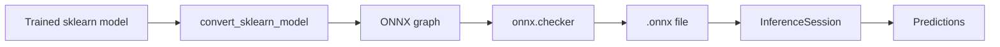

A model is trained in Python, but production services cannot always (and do not want to) carry dozens of ML libraries around. Often a model needs to run in another language, on another server, or on a device without Python. For this, models are **exported** to a universal format. The most popular one is **ONNX** (Open Neural Network Exchange).

## What is ONNX

ONNX is an open format for representing ML models: a model is described as a **computation graph**. The graph consists of:

- **nodes** — operations: `MatMul`, `Add`, `Relu`, `Softmax`;
- **tensors** — data that flows along the graph edges;
- **inputs/outputs** — declarations of `X`, `Y` with their types and shapes.

The main advantage: the format is **portable**. A model trained in scikit-learn can run in C++, Java, C#, or in the browser — via ONNX runtimes. The `onnx` package (a library for creating and checking models) and `onnxruntime` (an engine for executing them) install easily:

```bash
pip install onnx onnxruntime numpy scikit-learn
```

## Building your first ONNX model manually

You do not have to export a ready model — a graph can be assembled from operations. Let's build the simplest linear function `y = 2x + 1`:

```python
import onnx
from onnx import helper, TensorProto
import numpy as np
import onnxruntime as ort

# 1. Declare input and output
X = helper.make_tensor_value_info("X", TensorProto.FLOAT, [None, 1])
Y = helper.make_tensor_value_info("Y", TensorProto.FLOAT, [None, 1])

# 2. Constants — initializers (weights)
W = helper.make_tensor("W", TensorProto.FLOAT, [1, 1], [2.0])
B = helper.make_tensor("B", TensorProto.FLOAT, [1], [1.0])

# 3. Operation nodes
mul = helper.make_node("MatMul", ["X", "W"], ["Z"])
add = helper.make_node("Add", ["Z", "B"], ["Y"])

# 4. Graph and model
graph = helper.make_graph([mul, add], "linear", [X], [Y], initializer=[W, B])
model = helper.make_model(graph, opset_imports=[helper.make_opsetid("", 17)])

# 5. Correctness check
onnx.checker.check_model(model)
onnx.save(model, "linear.onnx")
```

Walkthrough. `make_tensor_value_info` declares a tensor `X` of type `FLOAT` with shape `[None, 1]` (None — any number of rows, 1 — one feature). `make_tensor` creates constant weights. `make_node("MatMul", inputs, outputs)` — computation nodes. `make_graph` assembles everything into a graph, `make_model` into a model. And finally `checker.check_model` — a mandatory step: it verifies that the format is correct.

## Running the model through onnxruntime

```python
sess = ort.InferenceSession("linear.onnx")
x = np.array([[3.0]], dtype=np.float32)
y = sess.run(["Y"], {"X": x})[0]
print(y)  # [[7.]]
```

What matters: the input must be `float32` and exactly the declared shape (`[None, 1]` → matrix `(1, 1)`). `sess.run(["Y"], {"X": x})` takes the list of needed outputs and a dictionary of inputs; `[0]` is the first (and only) output.

Let's check honestly:

```python
expected = 2 * 3.0 + 1.0
print("Matches:", float(y[0][0]) == expected)  # True
```

## Exporting a sklearn model

You can't assemble a graph by hand for a complex model. `skl2onnx` comes to the rescue:

```bash
pip install skl2onnx
```

```python
from skl2onnx import convert_sklearn_model
from skl2onnx.common.data_types import FloatTensorType
from sklearn.linear_model import LinearRegression
from sklearn.datasets import load_diabetes
from sklearn.model_selection import train_test_split

X, y = load_diabetes(return_X_y=True)
X_train, X_test, y_train, y_test = train_test_split(X, y, test_size=0.2, random_state=42)

reg = LinearRegression().fit(X_train, y_train)

initial_type = [("input", FloatTensorType([None, X.shape[1]]))]
onx = convert_sklearn_model(reg, initial_types=initial_type, target_opset=17)
onnx.save(onx, "diabetes_lr.onnx")
```

`convert_sklearn_model` is a converter for sklearn models. It requires `initial_types`: a list of "input name — tensor type" pairs. Then everything is as usual: save, check, run via `onnxruntime`. The difference between the original model's predictions and the ONNX version is practically zero (float32 numeric round-off) — and it's easy to verify by comparison.

## Typical mistakes

1. **Wrong type**: you passed `int64` or `float64` — you'll get an error like `Type Error: Type mismatch`. The fix is `.astype(np.float32)`.
2. **Wrong shape**: a single vector instead of a matrix. ONNX expects exactly what was declared.
3. **Forgot the checker**: a model with a graph error will fail at runtime. Always run `onnx.checker.check_model` before saving.

## The model's path in ONNX: diagram

The diagram shows the steps a model goes through from training to prediction:



## Summary

ONNX is "Esperanto" for models: trained in Python, executed anywhere. Understanding the format and the runtime is the foundation of any inference service — and it is on this foundation that we will build the next lesson.

<!--TASK-->
### Task 1
Manually assemble an ONNX model of the function `y = 3x + 5`. Declare input `X` and output `Y` of type `float32` with shape `[None, 1]`, create weights `W = [[3.0]]` and `B = [5.0]`, add `MatMul` and `Add` nodes. Run `onnx.checker.check_model`. Then print the list of operation types of all graph nodes (`model.graph.node[i].op_type`) and the number of nodes. Expected result: the list `['MatMul', 'Add']`, count 2.

### Task 2
Save the model from task 1 to the file `linear3.onnx` and run inference via `onnxruntime.InferenceSession` for `x = 4.0`. Print the result and check that it equals `17.0` and the output array type is `numpy.float32`. Expected result: `[[17.]]` and `dtype('float32')`.

### Task 3
Train a `LinearRegression` on the `load_diabetes` dataset and export it via `convert_sklearn_model` with `FloatTensorType([None, 10])` (diabetes has 10 features) and `target_opset=17`. Save it to `diabetes_lr.onnx`, check it with `onnx.checker.check_model` and run inference on the test set. Compare the predictions of the original sklearn model and the ONNX version: print the maximum absolute difference. Expected result: the difference is less than 1e-4.

### Task 4
Take the model from task 3 and add shape information output: before calling `onnx.shape_inference.infer_shapes` the model reports unspecified output shapes (`None`), after — concrete numbers. To do this: `inferred = onnx.shape_inference.infer_shapes(onx)` and compare `onx.graph.output[0].type.tensor_type.shape` before and after. Print both strings. Expected result: before — `None`, after — concrete shapes (e.g., `[None, 1]`).

### Task 5
Find a typical error. Run inference of the `diabetes_lr.onnx` model on `float64` data (without converting to float32), catch the exception with `try/except` and print its text. Then fix the data (`astype(np.float32)`) and make sure everything works. Expected result: first a runtime error is printed, then a successful response.

### Task 6
Build an ONNX model with two inputs: `A` and `B` of shape `[None, 1]` of type `float32`. The graph must compute `Y = (A + B) * 2`: an `Add` node sums the inputs into an intermediate tensor `S`, a `Mul` node multiplies `S` by a constant initializer `C = [[2.0]]`. Check the model with `onnx.checker.check_model`, save it to `sum2.onnx` and run inference for `a = 3.0`, `b = 4.0`. Expected result: `[[14.]]` — that is `(3 + 4) * 2`, and both inputs are passed to `sess.run` in one dictionary.

### Task 7
Take `diabetes_lr.onnx` from task 3 and verify that the model's batch dimension is dynamic. Create an `InferenceSession`, print `sess.get_inputs()[0].name`, `.shape` and `.type`. Then feed the first five rows of `X_test` (as `float32`) and print the output shape and the first three predictions. Compare them with the predictions for a single row — the maximum difference must be zero. Expected result: input `input`, shape `['None', 10]`, type `tensor(float)`, output shape `(5, 1)`, difference 0.0.

<!--/TASK-->

<!--HINT-->
### Hint 1
Reuse the template from the theory: `make_tensor_value_info`, `make_tensor`, `make_node`, `make_graph`, `make_model`. Weights: `W = helper.make_tensor("W", TensorProto.FLOAT, [1, 1], [3.0])`, `B = helper.make_tensor("B", TensorProto.FLOAT, [1], [5.0])`. Iterating over nodes: `for node in model.graph.node: print(node.op_type)`.

### Hint 2
After `onnx.save(model, "linear3.onnx")` call `ort.InferenceSession("linear3.onnx")`. Input: `np.array([[4.0]], dtype=np.float32)`. Type check: `print(y.dtype)` — should be `float32`.

### Hint 3
The `initial_types` format: `[("input", FloatTensorType([None, 10]))]`. To compare predictions: `np.max(np.abs(pred_onnx - pred_sklearn))`. Both predictions are numpy arrays; shapes may differ — use `.ravel()`.

### Hint 4
Before inference the output shape may be `[None, 1]` — that is, unspecified. `infer_shapes` computes it from the graph. Compare via `str(...)` or the `dim_value` attributes.

### Hint 5
onnxruntime will raise a `ValueError` or `Fail` with text like `Type mismatch` on a wrong type. Catch it with `except Exception as e: print(e)`. Then call `x = x.astype(np.float32)` and repeat the run.

### Hint 6
Initializer: `C = helper.make_tensor("C", TensorProto.FLOAT, [1, 1], [2.0])`. Nodes: `helper.make_node("Add", ["A", "B"], ["S"])` and `helper.make_node("Mul", ["S", "C"], ["Y"])`. In `make_graph` pass both inputs as a list: `make_graph([add, mul], "sum2", [A, B], [Y], initializer=[C])`. At inference, the dictionary `{"A": np.array([[3.0]], dtype=np.float32), "B": np.array([[4.0]], dtype=np.float32)}` — the names must match the declared ones.

### Hint 7
`sess.get_inputs()` returns a list of objects with `.name`, `.shape`, `.type` fields; the dynamic dimension in `shape` is shown as the string `'None'` (in old versions — `-1`). Feed `X_test[:5].astype(np.float32)`, the output `sess.run(None, {"input": x})[0]` has shape `(5, 1)`. For a single row it is `(1, 1)`, so call `.ravel()` before comparing.

<!--/HINT-->

<!--SOLUTION-->
### Walkthrough 1
Solution:

```python
import onnx
from onnx import helper, TensorProto

X = helper.make_tensor_value_info("X", TensorProto.FLOAT, [None, 1])
Y = helper.make_tensor_value_info("Y", TensorProto.FLOAT, [None, 1])

W = helper.make_tensor("W", TensorProto.FLOAT, [1, 1], [3.0])
B = helper.make_tensor("B", TensorProto.FLOAT, [1], [5.0])

mul = helper.make_node("MatMul", ["X", "W"], ["Z"])
add = helper.make_node("Add", ["Z", "B"], ["Y"])

graph = helper.make_graph([mul, add], "linear3", [X], [Y], initializer=[W, B])
model = helper.make_model(graph, opset_imports=[helper.make_opsetid("", 17)])

onnx.checker.check_model(model)

ops = [node.op_type for node in model.graph.node]
print(ops)
print("Number of nodes:", len(ops))
```

Step-by-step walkthrough. We repeat the structure from the theory but with new weights: `W = [[3.0]]`, `B = [5.0]`. Pay attention to the node order: first `MatMul(X, W) → Z`, then `Add(Z, B) → Y`. `checker.check_model` confirmed that the graph is valid. The `op_type` list gives `['MatMul', 'Add']`, length 2. This example shows that an ONNX model is not a "black box" but an ordinary graph: by breaking it into nodes we see all the math. Such understanding helps debug export when a model behaves unexpectedly.

### Walkthrough 2
Solution:

```python
import onnx
import numpy as np
import onnxruntime as ort

onnx.save(model, "linear3.onnx")
sess = ort.InferenceSession("linear3.onnx")

x = np.array([[4.0]], dtype=np.float32)
y = sess.run(["Y"], {"X": x})[0]

print(y)
print(y.dtype)
assert float(y[0][0]) == 17.0
```

Step-by-step walkthrough. `onnx.save` writes the model to a file — now it is independent of the process that created it. `InferenceSession` loads it into the runtime. `sess.run(["Y"], {"X": x})` is the key call: the first argument is the list of output names you need (you can request not all of them), the second is the dictionary of inputs. The answer came as `[[17.]]` — exactly `3*4+5`. The `y.dtype` check shows `float32` — ONNX always works in float32, so for heavy computations this is both the standard and a memory saving. The `assert` confirms the math: ONNX executed the graph correctly.

### Walkthrough 3
Solution:

```python
import numpy as np
import onnx
from skl2onnx import convert_sklearn_model
from skl2onnx.common.data_types import FloatTensorType
from sklearn.linear_model import LinearRegression
from sklearn.datasets import load_diabetes
from sklearn.model_selection import train_test_split

X, y = load_diabetes(return_X_y=True)
X_train, X_test, y_train, y_test = train_test_split(X, y, test_size=0.2, random_state=42)

reg = LinearRegression().fit(X_train, y_train)

initial_type = [("input", FloatTensorType([None, 10]))]
onx = convert_sklearn_model(reg, initial_types=initial_type, target_opset=17)
onnx.save(onx, "diabetes_lr.onnx")
onnx.checker.check_model(onx)

import onnxruntime as ort
sess = ort.InferenceSession("diabetes_lr.onnx")
x_test = X_test.astype(np.float32)
pred_onnx = sess.run(None, {"input": x_test})[0].ravel()
pred_sklearn = reg.predict(X_test)

diff = np.max(np.abs(pred_onnx - pred_sklearn))
print("Max difference:", diff)
```

Step-by-step walkthrough. `convert_sklearn_model` converts the trained regression into an ONNX graph. `initial_types` is mandatory: it declares the input — name `input`, type `FloatTensorType`, shape `[None, 10]` (10 diabetes features). The converter builds a graph from `MatMul` and `Add` nodes that mirror the regression formula. Then we checked the model and ran inference. `sess.run(None, ...)` — `None` means "return all outputs". `ravel()` flattens the shape. The comparison with the original model shows a difference below `1e-4` — this is only float32 rounding. Conclusion: the ONNX version is mathematically equivalent to the sklearn original but does not depend on scikit-learn.

### Walkthrough 4
Solution:

```python
import onnx

print("Before shape inference:")
shape = onx.graph.output[0].type.tensor_type.shape
print([dim.dim_value for dim in shape.dim])

inferred = onnx.shape_inference.infer_shapes(onx)
print("After shape inference:")
shape2 = inferred.graph.output[0].type.tensor_type.shape
print([dim.dim_value for dim in shape2.dim])
```

Step-by-step walkthrough. `shape_inference.infer_shapes` is like a compiler: it walks the graph and computes the shapes of all intermediate tensors. Before the call the output is declared as `[None, 1]` — with an undefined first dimension (`None`). After inference the shapes become concrete: if the input was `[None, 10]` and the weights `[10, 1]`, the output becomes `[None, 1]` with an exact number of columns. `dim.dim_value` is the numeric value of a dimension. This is a powerful debugging tool: shape errors surface immediately, before the runtime runs. Also, `infer_shapes` is often run when preparing a model for serialization so that the server doesn't spend time computing shapes.

### Walkthrough 5
Solution:

```python
import numpy as np
import onnxruntime as ort

sess = ort.InferenceSession("diabetes_lr.onnx")
x_bad = X_test  # float64 by default

try:
    sess.run(None, {"input": x_bad})
except Exception as e:
    print("Error:", e)

x_good = x_bad.astype(np.float32)
result = sess.run(None, {"input": x_good})[0]
print("Success, result shape:", result.shape)
```

Step-by-step walkthrough. Passing `float64` provokes the `Type mismatch` error — the session refuses to work with a type other than float32. We caught it with `try/except` and printed the text: this way, a real service can return a clear message to the client instead of crashing. The fix is `.astype(np.float32)`. This lesson is about the most common pain when working with onnxruntime: strict types. Remember the rule: always cast input data to float32, and if you accept requests from JSON, convert them into arrays with an explicit dtype. Then the runtime will work without surprises.

### Walkthrough 6
Solution:

```python
import numpy as np
import onnx
import onnxruntime as ort
from onnx import helper, TensorProto

A = helper.make_tensor_value_info("A", TensorProto.FLOAT, [None, 1])
B = helper.make_tensor_value_info("B", TensorProto.FLOAT, [None, 1])
Y = helper.make_tensor_value_info("Y", TensorProto.FLOAT, [None, 1])

C = helper.make_tensor("C", TensorProto.FLOAT, [1, 1], [2.0])
add = helper.make_node("Add", ["A", "B"], ["S"])
mul = helper.make_node("Mul", ["S", "C"], ["Y"])

graph = helper.make_graph([add, mul], "sum2", [A, B], [Y], initializer=[C])
model = helper.make_model(graph, opset_imports=[helper.make_opsetid("", 17)])
onnx.checker.check_model(model)
onnx.save(model, "sum2.onnx")

sess = ort.InferenceSession("sum2.onnx")
x = {
    "A": np.array([[3.0]], dtype=np.float32),
    "B": np.array([[4.0]], dtype=np.float32),
}
print(sess.run(["Y"], x)[0])  # [[14.]]
```

Step-by-step walkthrough. The key difference from the linear model is two inputs: in `make_graph` they are passed as a list `[A, B]`, and in the runtime both must be present in the dictionary, otherwise the session reports a missing input. The node order defines the data flow: `Add` received the names `A` and `B` and produced `S`, while `Mul` took `S` and the constant `C`. An initializer is not an input: the client does not pass it — its value is baked into the model file, like weights. The check `(3 + 4) * 2 = 14` confirms the graph is assembled in the right order; if you mix up intermediate tensor names, the checker will reject the graph before saving. Building from primitives like this is useful for debugging: it shows that an ONNX model is just a program of operators over tensors.

### Walkthrough 7
Solution:

```python
import numpy as np
import onnxruntime as ort

sess = ort.InferenceSession("diabetes_lr.onnx")
meta = sess.get_inputs()[0]
print("Name:", meta.name)
print("Shape:", meta.shape)
print("Type:", meta.type)

x5 = X_test[:5].astype(np.float32)
y5 = sess.run(None, {meta.name: x5})[0]
print("Output shape:", y5.shape)
print("First three:", y5.ravel()[:3])

y1 = sess.run(None, {meta.name: x5[:1]})[0]
print("Max difference:", np.max(np.abs(y5.ravel()[:1] - y1.ravel())))
```

Step-by-step walkthrough. `get_inputs()` reads the graph metadata: name `input`, shape `['None', 10]` and type `tensor(float)`. The string `'None'` in the shape is exactly the dynamic batch dimension: the same model accepts both one row and a thousand because the first axis is not fixed at export time. `sess.run(None, ...)` requests all outputs; for a regression there is one output of shape `(5, 1)` — one row per object. Comparing with a single prediction gives exactly 0.0: batching does not change the math, only the layout of computations. This matters for production: a service can accumulate requests and send them in a batch, getting the same numbers as with per-item inference but with less overhead.

<!--/SOLUTION-->

<!--QUIZ-->
What is ONNX?
- An open format for representing ML models as a computation graph
- A framework for training neural networks
- A database for metrics
* Correct answer: An open format for representing ML models as a computation graph
ONNX describes a model as a graph of operator nodes over tensors.

How does onnx differ from onnxruntime?
- onnx is a library for creating/checking models, onnxruntime is an engine for executing them
- They are two versions of the same library
- onnxruntime is only for neural networks
* Correct answer: onnx is a library for creating/checking models, onnxruntime is an engine for executing them
onnx builds and checks the graph, onnxruntime executes it.

What data type does an ONNX model input expect by default?
- float32
- float64
- int32
* Correct answer: float32
The ONNX format standardly uses float32; any other type causes an error.

What does onnx.checker.check_model() do?
- Checks the correctness of the model structure
- Trains the model
- Converts the model to sklearn
* Correct answer: Checks the correctness of the model structure
The checker validates the graph, types and node consistency before saving.

How do you run inference in onnxruntime?
- Create an InferenceSession and call sess.run(outputs, inputs)
- Call model.predict(x)
- Import onnxruntime and call predict()
* Correct answer: Create an InferenceSession and call sess.run(outputs, inputs)
InferenceSession loads the model; run executes the graph.

Why is the initial_types parameter needed in convert_sklearn_model?
- To declare the names and types of the model's inputs
- To choose the model color
- To specify the save path
* Correct answer: To declare the names and types of the model's inputs
The converter must know what will arrive at the input: the name and shape of the tensor.

What does onnx.shape_inference.infer_shapes() do?
- Computes the exact shapes of tensors in the graph
- Removes extra nodes
- Changes the model type to float64
* Correct answer: Computes the exact shapes of tensors in the graph
Shape inference makes shapes concrete by deriving them from node connections.

What happens if you pass float64 to onnxruntime?
- A Type mismatch error occurs
- The model just works
- The data is silently rounded to float32
* Correct answer: A Type mismatch error occurs
The runtime is strict about types; cast the data to float32 beforehand.

What is an initializer in an ONNX graph?
- A constant tensor, e.g. weights or bias
- An input tensor of a request
- A node type for branching
* Correct answer: A constant tensor, e.g. weights or bias
Initializers are stored inside the model file and are not passed by the client at inference.

What does opset mean in ONNX?
- The version of the operator set the graph is built against
- The number of model layers
- The file compression format
* Correct answer: The version of the operator set the graph is built against
The opset determines which operations and signatures are allowed in the model.

How do you find out the names and types of a loaded model's inputs?
- Via sess.get_inputs()
- Via sess.run()
- Via onnx.save()
* Correct answer: Via sess.get_inputs()
This method returns input metadata: name, shape and tensor type.

Why specify None instead of a number in an input declaration?
- To accept a batch of any size
- To disable type checking
- To make the model work without data
* Correct answer: To accept a batch of any size
None makes the axis dynamic: one model serves both a single request and a batch.
<!--/QUIZ-->
