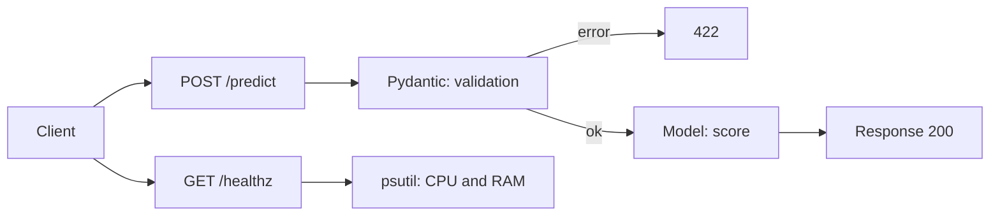

A trained model is not yet a product. For other services and applications to use it, the model must be **wrapped in an API**: a web service that accepts requests, computes a prediction and returns a response. In Python the de-facto standard is **FastAPI**: fast, with automatic documentation and first-class validation via Pydantic.

## Installing and starting the service

```bash
pip install fastapi uvicorn pydantic psutil requests
```

What we get:

- **FastAPI** — a web framework. The `@app.post(...)` decorators create endpoints.
- **Pydantic** — a validation library: it builds a Python object from the request body, checking types and constraints.
- **uvicorn** — an ASGI server that runs the application.
- **psutil** — system metrics (CPU, memory) for health checks.

Let's create a credit scoring service (a toy model). File `app.py`:

```python
from fastapi import FastAPI
from pydantic import BaseModel, Field
import numpy as np
import psutil

app = FastAPI(title="Credit Scoring API")

class CreditRequest(BaseModel):
    age: int = Field(ge=18, le=100)
    amount: float = Field(gt=0)

class CreditResponse(BaseModel):
    approved: bool
    prob: float

def score(req: CreditRequest) -> float:
    # Simplified "model": a logistic function of age and amount
    z = 0.05 * req.age - 0.01 * req.amount + 0.5
    return float(1.0 / (1.0 + np.exp(-z)))

@app.post("/predict", response_model=CreditResponse)
def predict(req: CreditRequest):
    prob = score(req)
    return CreditResponse(approved=prob > 0.5, prob=round(prob, 4))

@app.get("/healthz")
def healthz():
    return {
        "cpu_percent": psutil.cpu_percent(interval=0.1),
        "mem_percent": psutil.virtual_memory().percent,
    }
```

Run it:

```bash
uvicorn app:app --reload --port 8000
```

The `/predict` endpoint accepts a POST request with the JSON body `{"age": 30, "amount": 5000}`; Pydantic turns it into a `CreditRequest` object. `response_model` describes the response format. You can open `http://127.0.0.1:8000/docs` — FastAPI generated interactive Swagger documentation for you.

## Validation for free

Pydantic checks the data **before** it reaches your code:

- `age: int` — if the string `"30"` arrives, it is cast to int (or a 422 error is returned if casting is impossible);
- `Field(ge=18, le=100)` — age outside the range → 422 error.

Let's check from a client:

```python
import requests

r = requests.post("http://127.0.0.1:8000/predict", json={"age": 30, "amount": 5000})
print(r.status_code, r.json())  # 200 {'approved': False, 'prob': 0.5}

bad = requests.post("http://127.0.0.1:8000/predict", json={"age": 15, "amount": 5000})
print(bad.status_code)  # 422 — invalid age
print(bad.json()["detail"][0]["msg"])
```

On 422 the response contains a list of problems: `loc` (where the error is) and `msg` (what's wrong). The service did not crash — it correctly answered that the request is invalid.

## Batching: processing many requests at once

In production the service receives not one but thousands of requests per second. One effective technique is **batching**: the client sends a batch of objects, and the service processes them with a single call.

```python
from pydantic import BaseModel

class BatchRequest(BaseModel):
    items: list[CreditRequest]

@app.post("/predict_batch", response_model=dict)
def predict_batch(req: BatchRequest):
    results = []
    for item in req.items:
        prob = score(item)
        results.append({"approved": prob > 0.5, "prob": round(prob, 4)})
    return {"count": len(results), "results": results}
```

Request: `{"items": [{"age": 30, "amount": 5000}, {"age": 45, "amount": 1000}]}`. The response returns `count` and a list of results. Real ML services do the same: a batch for a GPU or for onnxruntime is many times faster than a stream of individual requests.

## Health monitoring

`/healthz` is a standard for orchestrators (Kubernetes and others): they poll this endpoint regularly. If the service is alive and answers 200 — it gets traffic. `psutil.cpu_percent()` and `psutil.virtual_memory().percent` give the machine load in real time. In production, response time, request count and error percentage are added — and these metrics go into a monitoring system (about drift and metrics — in lesson 4).

## The request path: diagram

The diagram shows what happens to a request from the client to the response:



## Summary

FastAPI + Pydantic give a clean, documented and safe service in a few dozen lines. Validation protects your model from garbage inputs, batching speeds it up, and `/healthz` helps keep an eye on the service's health.

<!--TASK-->
### Task 1
Create a minimal FastAPI service with a `POST /temperature` endpoint that converts degrees Celsius to Fahrenheit. Use a Pydantic model `TempRequest` with a `celsius: float` field and a model `TempResponse` with a `fahrenheit: float` field. The formula: `f = c * 9 / 5 + 32`. Run the service via `uvicorn` and send a test request via `requests.post`. Expected result: for `celsius=100` the response is `{"fahrenheit": 212.0}` with status 200.

### Task 2
Add validation to the service from task 1: the `celsius` field must be in the range from -100 to 100 (`Field(ge=-100, le=100)`). Send a request with `celsius=500` and print the status code and the error text from the response. Expected result: status 422 and a message that the value exceeds the allowed maximum.

### Task 3
Add a `GET /healthz` endpoint: it must return JSON with `cpu_percent` and `mem_percent` from `psutil` (CPU — `psutil.cpu_percent(interval=0.1)`, memory — `psutil.virtual_memory().percent`). Send a GET request and print the status code and the response. Expected result: status 200, the response contains both keys with numbers from 0 to 100.

### Task 4
Add a batch endpoint `POST /batch_temperature`: it accepts `{"items": [{"celsius": 0}, {"celsius": 100}]}` and returns `{"count": 2, "results": [{"fahrenheit": 32.0}, {"fahrenheit": 212.0}]}`. Define the `BatchRequest` model (field `items: list[TempRequest]`) and `BatchResponse`. Send the example request and verify that `count` matches the number of items. Expected result: a response with `count=2` and two results.

### Task 5
Write a client script that sends 3 requests: a valid one (`celsius=25`), an invalid one (`celsius=500`) and a GET `/healthz`; print the status code for each. At the end print a final line like `Valid: 2, errors: 1`. Expected result: two 200 responses and one 422.

### Task 6
Add a middleware to the temperature service that counts all incoming requests. Use `@app.middleware("http")` and a global dictionary `stats = {"requests": 0}`: increment the counter before calling `call_next`, then return the response. Add a `GET /stats` endpoint that returns `{"requests": stats["requests"]}`. Test it with `fastapi.testclient.TestClient` without starting uvicorn: do `GET /healthz`, `POST /temperature` with `celsius=0`, and `GET /stats` twice. Expected result: the first `/stats` call returns 3, the second returns 4 — the counter grows on every request.

### Task 7
Limit the batch size in the batch endpoint: define the field `items: list[TempRequest] = Field(min_length=1, max_length=3)`. Using `TestClient`, send two requests to `/batch_temperature`: one with four items and one with two. For the first, print the status code and the error text from `detail[0]["msg"]`; for the second, print `count` from the response and the list of temperatures. Expected result: the first request gives 422 with a message about the maximum list length; the second gives 200 and `count=2`.

<!--/TASK-->

<!--HINT-->
### Hint 1
Define `TempRequest` and `TempResponse` as classes inheriting from `BaseModel`. Endpoint: `@app.post("/temperature", response_model=TempResponse)`. Inside — `return TempResponse(fahrenheit=req.celsius * 9 / 5 + 32)`. Startup: `uvicorn app:app --reload --port 8000`; client — `requests.post("http://127.0.0.1:8000/temperature", json={"celsius": 100})`.

### Hint 2
Pydantic returns 422 with a `detail` array; the error text is `bad.json()["detail"][0]["msg"]`. The constraint looks like: `celsius: float = Field(ge=-100, le=100)`.

### Hint 3
`psutil.cpu_percent(interval=0.1)` blocks for 0.1 s and returns CPU load. `psutil.virtual_memory().percent` — the percentage of occupied RAM. GET request: `requests.get("http://127.0.0.1:8000/healthz")`.

### Hint 4
Nested model: `class BatchRequest(BaseModel): items: list[TempRequest]`. Assemble the response as a dict: `{"count": len(req.items), "results": results}`. Use `response_model=dict` or define `BatchResponse` with `results: list[TempResponse]`.

### Hint 5
Wrap the sending in `try/except` or just save the statuses: `st = requests.post(...).status_code`. At the end count how many times 200 and 422 appeared.

### Hint 6
A middleware is declared as `async def count_requests(request, call_next):` with `@app.middleware("http")` above it. Inside: `stats["requests"] += 1`, then `response = await call_next(request)` and `return response`. `TestClient(app)` is used like a regular client: `client.get("/healthz")`, `client.post("/temperature", json={"celsius": 0})`. The counter is shared across the process, so the numbers are predictable.

### Hint 7
List constraints are set the same way as numeric ones: `Field(min_length=1, max_length=3)`. On violation Pydantic returns 422, and the text is in `resp.json()["detail"][0]["msg"]` — in Pydantic v2 it is something like `List should have at most 3 items`.

<!--/HINT-->

<!--SOLUTION-->
### Walkthrough 1
Solution:

`app.py`:

```python
from fastapi import FastAPI
from pydantic import BaseModel

app = FastAPI()

class TempRequest(BaseModel):
    celsius: float

class TempResponse(BaseModel):
    fahrenheit: float

@app.post("/temperature", response_model=TempResponse)
def temperature(req: TempRequest):
    return TempResponse(fahrenheit=req.celsius * 9 / 5 + 32)
```

Client:

```python
import requests

r = requests.post("http://127.0.0.1:8000/temperature", json={"celsius": 100})
print(r.status_code, r.json())
```

Step-by-step walkthrough. `TempRequest` describes the request body: one `celsius` field of type `float`. The API receives JSON, and FastAPI+Pydantic build an object from it on their own. `response_model=TempResponse` guarantees the response is validated against the schema. Inside the function we simply compute the formula and return a response object. `requests.post` sends JSON via `json=...`; the response comes with status 200 and `{"fahrenheit": 212.0}`. Already here you can see FastAPI's main advantage: not a single line of manual JSON parsing — Pydantic does it all.

### Walkthrough 2
Solution:

```python
from pydantic import BaseModel, Field

class TempRequest(BaseModel):
    celsius: float = Field(ge=-100, le=100)
```

Client:

```python
bad = requests.post("http://127.0.0.1:8000/temperature", json={"celsius": 500})
print("Status:", bad.status_code)
print("Error:", bad.json()["detail"][0]["msg"])
```

Step-by-step walkthrough. `Field(ge=-100, le=100)` adds the constraints "greater than or equal to -100" and "less than or equal to 100". When `celsius=500` violates them, Pydantic does not let the function run at all — FastAPI immediately answers `422 Unprocessable Entity`. In the response body `detail` is a list of problems; we take the first element and its `msg`: something like `ensure this value is less than or equal to 100`. This is critical for ML: a model trained on data in the range [-100, 100], having received 500, may produce a meaningless result. Validation is the first line of defense.

### Walkthrough 3
Solution:

```python
import psutil

@app.get("/healthz")
def healthz():
    return {
        "cpu_percent": psutil.cpu_percent(interval=0.1),
        "mem_percent": psutil.virtual_memory().percent,
    }
```

Client:

```python
h = requests.get("http://127.0.0.1:8000/healthz")
print(h.status_code, h.json())
```

Step-by-step walkthrough. `psutil.cpu_percent(interval=0.1)` measures CPU load over the last 0.1 seconds. `virtual_memory().percent` — the percentage of occupied RAM. Both values are numbers from 0 to 100. Orchestrators poll this endpoint: if the service does not respond within N seconds, the container is restarted. In real MLOps, uptime, RPS (requests per second), p95 response time and an error counter are added here. A health check is the service's "pulse": cloud production cannot do without it.

### Walkthrough 4
Solution:

```python
class BatchRequest(BaseModel):
    items: list[TempRequest]

class BatchResponse(BaseModel):
    count: int
    results: list[TempResponse]

@app.post("/batch_temperature", response_model=BatchResponse)
def batch_temperature(req: BatchRequest):
    results = [TempResponse(fahrenheit=item.celsius * 9 / 5 + 32) for item in req.items]
    return BatchResponse(count=len(results), results=results)
```

Client:

```python
r = requests.post(
    "http://127.0.0.1:8000/batch_temperature",
    json={"items": [{"celsius": 0}, {"celsius": 100}]},
)
print(r.json())
```

Step-by-step walkthrough. `items: list[TempRequest]` is a nested Pydantic model: each list item is validated against `TempRequest`. A list comprehension computes all items in one pass. Response: `{"count": 2, "results": [{"fahrenheit": 32.0}, {"fahrenheit": 212.0}]}`. Batching is a key technique for ML: onnxruntime and GPU process a batch of 1000 items many times faster than 1000 separate requests. That is why endpoints in industrial services are almost always batch-oriented, and inside they additionally combine the data into one array for the model.

### Walkthrough 5
Solution:

```python
import requests

BASE = "http://127.0.0.1:8000"

ok = requests.post(f"{BASE}/temperature", json={"celsius": 25}).status_code
bad = requests.post(f"{BASE}/temperature", json={"celsius": 500}).status_code
health = requests.get(f"{BASE}/healthz").status_code

print("valid:", ok)
print("invalid:", bad)
print("healthz:", health)

valid = sum(1 for s in (ok, health) if s == 200)
errors = sum(1 for s in (ok, bad, health) if s == 422)
print(f"Valid: {valid}, errors: {errors}")
```

Step-by-step walkthrough. Each request returns a status code. `ok` and `health` must be 200, `bad` — 422. We compute the sums: `valid` counts 200s, `errors` counts 422s. Result: `Valid: 2, errors: 1`. Such a "contract" test is the first step toward automated API testing: if someone later breaks validation, the test will notice. In a real project these checks become pytest tests that run in CI on every code change.

### Walkthrough 6
Solution:

`app.py`:

```python
from fastapi import FastAPI, Request
from pydantic import BaseModel

app = FastAPI()
stats = {"requests": 0}

class TempRequest(BaseModel):
    celsius: float

class TempResponse(BaseModel):
    fahrenheit: float

@app.middleware("http")
async def count_requests(request: Request, call_next):
    stats["requests"] += 1
    response = await call_next(request)
    response.headers["X-Request-Number"] = str(stats["requests"])
    return response

@app.post("/temperature", response_model=TempResponse)
def temperature(req: TempRequest):
    return TempResponse(fahrenheit=req.celsius * 9 / 5 + 32)

@app.get("/healthz")
def healthz():
    return {"status": "ok"}

@app.get("/stats")
def get_stats():
    return stats
```

Client without a network:

```python
from fastapi.testclient import TestClient

client = TestClient(app)
client.get("/healthz")
client.post("/temperature", json={"celsius": 0})
print(client.get("/stats").json())  # {'requests': 3}
print(client.get("/stats").json())  # {'requests': 4}
```

Step-by-step walkthrough. A middleware is a wrapper around the whole application: the code before `await call_next(request)` runs on the way in, and the code after runs on the way out, when the response is ready. The counter is incremented before handling, so a request to `/stats` also counts itself: the first such call sees itself as the third. The `X-Request-Number` header shows that in a middleware you can not only count but also enrich the response — request-id for tracing is added the same way. `TestClient` runs the application in the same process via the ASGI transport: no ports, no network, no `uvicorn` — so such checks are convenient to run in pytest and CI. In production such a counter is sent to Prometheus rather than kept in process memory, because with multiple replicas each one would count only its own requests.

### Walkthrough 7
Solution:

```python
from fastapi import FastAPI
from pydantic import BaseModel, Field
from fastapi.testclient import TestClient

app = FastAPI()

class TempRequest(BaseModel):
    celsius: float = Field(ge=-100, le=100)

class TempResponse(BaseModel):
    fahrenheit: float

class BatchRequest(BaseModel):
    items: list[TempRequest] = Field(min_length=1, max_length=3)

class BatchResponse(BaseModel):
    count: int
    results: list[TempResponse]

@app.post("/batch_temperature", response_model=BatchResponse)
def batch_temperature(req: BatchRequest):
    results = [TempResponse(fahrenheit=i.celsius * 9 / 5 + 32) for i in req.items]
    return BatchResponse(count=len(results), results=results)

client = TestClient(app)

big = client.post("/batch_temperature", json={"items": [{"celsius": 0}] * 4})
print("Status:", big.status_code)
print("Error:", big.json()["detail"][0]["msg"])

ok = client.post("/batch_temperature", json={"items": [{"celsius": 0}, {"celsius": 100}]})
print("Status:", ok.status_code, "count:", ok.json()["count"])
print(ok.json()["results"])
```

Step-by-step walkthrough. `Field(min_length=1, max_length=3)` is a constraint on the list length, not on the item values: Pydantic checks it after parsing each `TempRequest`, so an error inside an item also gives 422, but with different text. The upper bound is not bureaucracy: a batch of a thousand objects can crash the service by memory or timeout, and the client would get a 500 instead of a clear error. The constraint turns such an attack into a neat 422 rejection before the model is even called. `[{"celsius": 0}] * 4` is a shorthand for four identical items; Pydantic v2 answers with a message like `List should have at most 3 items after validation, not 4`. The second request shows that a valid batch passes and returns `count=2` with both temperatures — 32.0 and 212.0.

<!--/SOLUTION-->

<!--QUIZ-->
Why does FastAPI need a Pydantic request model?
- For automatic validation and turning JSON into an object
- To speed up the model
- To avoid using SQL
* Correct answer: For automatic validation and turning JSON into an object
Pydantic checks types and constraints before your code runs.

What status code will FastAPI return for an invalid request body?
- 422 Unprocessable Entity
- 500 Internal Server Error
- 404 Not Found
* Correct answer: 422 Unprocessable Entity
This is the standard response when Pydantic validation fails.

What is uvicorn used for?
- It is an ASGI server that runs FastAPI applications
- It is a validation library
- It is a framework for training models
* Correct answer: It is an ASGI server that runs FastAPI applications
uvicorn executes the application and serves HTTP requests.

What does psutil.cpu_percent() do?
- Returns the CPU load percentage
- Returns the number of CPU cores
- Speeds up computations
* Correct answer: Returns the CPU load percentage
psutil provides system metrics for health checks.

What is batching?
- Processing a batch of requests with a single call
- Sending requests one at a time
- Caching responses
* Correct answer: Processing a batch of requests with a single call
A batch lets models (especially GPU/onnxruntime) compute faster.

Which HTTP method does an endpoint that changes server state use?
- POST
- GET
- DELETE
* Correct answer: POST
POST is for sending data; GET is for reading without side effects.

What happens if a client sends a field with a wrong type (e.g., a string into an int field)?
- FastAPI returns 422 with an error description
- The server crashes
- The field is silently ignored
* Correct answer: FastAPI returns 422 with an error description
Pydantic tries to cast the type; if impossible — a validation error.

Why add a /healthz endpoint?
- Orchestrators and monitoring check the service's liveness
- For the beauty of the documentation
- To load the model
* Correct answer: Orchestrators and monitoring check the service's liveness
A health check is the standard way to know the service is working.

What does the @app.middleware("http") decorator do?
- Wraps every HTTP request with code before and after the handler
- Creates a new endpoint
- Starts uvicorn
* Correct answer: Wraps every HTTP request with code before and after the handler
A middleware runs on the way in and out, so it suits counters, logs and request-id.

Why use TestClient in tests?
- To call the application directly without starting a server or network
- To speed up model training
- To enable Swagger
* Correct answer: To call the application directly without starting a server or network
TestClient talks to the application over ASGI in the same process — fast and without ports.

What will FastAPI return if a list in the body is shorter than min_length?
- 422 with a validation error description
- 200 with an empty list
- 500 Internal Server Error
* Correct answer: 422 with a validation error description
List constraints are checked by Pydantic, so the response is a standard validation error.

What does response_model do on an endpoint?
- Validates and documents the response structure
- Changes the HTTP method
- Caches the response
* Correct answer: Validates and documents the response structure
FastAPI checks the response against the schema and drops fields that are not in it.
<!--/QUIZ-->
