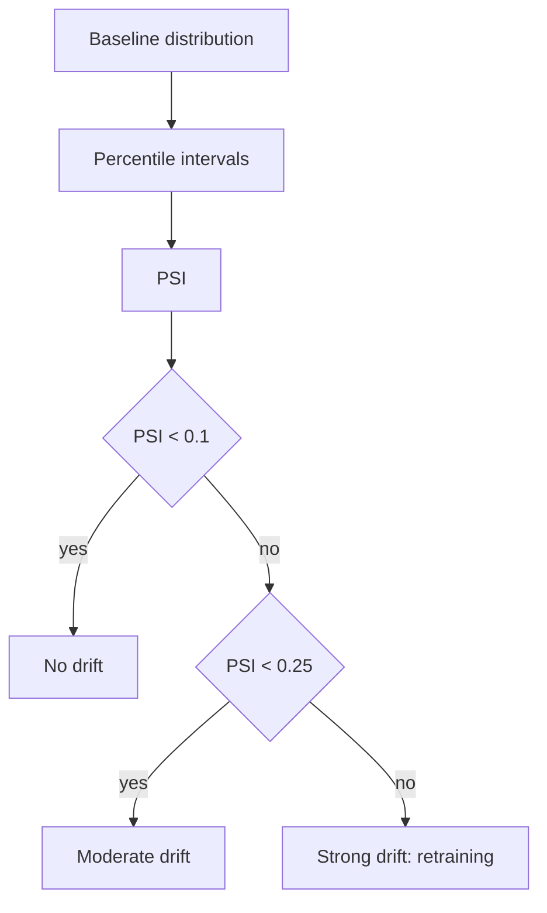

A model worked great on the test set — but the world does not stand still. Users change their behavior, prices, seasons and markets change. If a model is "frozen" in the form it was trained in, its quality in production will slowly but surely decline. The task of MLOps is to **notice this before users notice the problem**. That is model monitoring.

## Two kinds of drift

**Data drift** — the distribution of *input* features has changed. Example: a scoring model was trained when the average customer age was 35, and now customers are younger — the distribution of `age` has shifted. The model receives data it has "never seen".

**Concept drift** — the *relationship* between features and target has changed. Example: after a change in legislation, the same set of features predicts default worse. Inputs are the same; the "law of nature" has changed.

For the first case there are direct methods — comparing distributions. The second is harder: we don't have true answers on live data (except with a delay). That is why **proxy metrics** are used: prediction distribution, average model confidence, number of rejections, response latencies.

## Population Stability Index (PSI)

The most popular way to compare two distributions is **PSI** (Population Stability Index). We split the baseline distribution (e.g., predictions on the training date) into intervals, then look at how the new data is distributed across the same intervals:

```python
import numpy as np

def psi(expected, actual, bins=10):
    # Take interval boundaries from the baseline
    breaks = np.percentile(expected, np.linspace(0, 100, bins + 1))
    breaks[0], breaks[-1] = -np.inf, np.inf

    hist_e, _ = np.histogram(expected, bins=breaks)
    hist_a, _ = np.histogram(actual, bins=breaks)

    pe = hist_e / hist_e.sum()   # baseline share in each interval
    pa = hist_a / hist_a.sum()   # share of new data
    # Protect against division by zero
    pe = np.clip(pe, 1e-6, None)
    pa = np.clip(pa, 1e-6, None)

    return float(np.sum((pa - pe) * np.log(pa / pe)))
```

Classic thresholds:

- `PSI < 0.1` — practically no drift;
- `0.1 ≤ PSI < 0.25` — moderate drift, worth watching;
- `PSI ≥ 0.25` — strong drift, the model needs retraining.

## Checking on a simulation

```python
rng = np.random.default_rng(42)
baseline = rng.normal(0.5, 0.1, size=10000)   # "training"
old = rng.normal(0.5, 0.1, size=10000)        # the same world
new = rng.normal(0.7, 0.1, size=10000)        # the world has shifted

print("PSI(old, old):", round(psi(baseline, old), 4))   # ≈ 0
print("PSI(old, new):", round(psi(baseline, new), 4))   # large
```

`psi(baseline, old)` gives ~0 (the distributions are the same), and `psi(baseline, new)` gives a large value. This is how PSI becomes an "alarm": you compare the current prediction distribution with the baseline and immediately see drift.

## Alerts

Real monitoring does not just compute a number — it notifies. Let's wrap the check in a function with a threshold and logging:

```python
import logging

logging.basicConfig(level=logging.INFO, format="%(levelname)s: %(message)s")

def check_drift(expected, actual, threshold=0.25):
    value = psi(expected, actual)
    if value >= threshold:
        logging.warning("Drift: PSI = %.3f >= %.2f — retraining needed!", value, threshold)
    else:
        logging.info("OK: PSI = %.3f", value)
    return value

check_drift(baseline, new)
check_drift(baseline, old)
```

In production `logging.warning` goes to a log collection system (Sentry, ELK, Grafana), from where messages reach on-call engineers — and for severe drift automatic paging fires.

## Resource monitoring

Drift is not the only problem. A service can simply die from overload. That is why production always collects system metrics — via `psutil`:

```python
import psutil, json, time

def collect_metrics():
    return {
        "timestamp": time.time(),
        "cpu_percent": psutil.cpu_percent(interval=0.1),
        "mem_percent": psutil.virtual_memory().percent,
        "disk_percent": psutil.disk_usage("/").percent,
    }

with open("metrics.json", "w") as f:
    json.dump(collect_metrics(), f, indent=2)
```

The `/healthz` endpoint from the previous lesson returns the same data. The collected metrics are sent to a monitoring system where charts are built and alert thresholds are set.

## The PSI logic: diagram

The diagram shows how a drift decision is derived from two distributions:



## Summary

Monitoring is the eyes of production. Data drift is caught with PSI and friends (KL divergence, Kolmogorov–Smirnov statistic), resources via psutil, and then everything converges into alerts: "the model is outdated" or "the service is running out of memory". Lesson 5 will show how to trigger retraining automatically.

<!--TASK-->
### Task 1
Implement the function `psi(expected, actual, bins=10)` based on the code from the theory. Test it on two identical distributions (generate both with `np.random.default_rng(42).normal(0.5, 0.1, size=10000)`) — PSI must be close to 0. Print the value rounded to 4 decimal places. Expected result: `PSI ≈ 0.0` (less than 0.01).

### Task 2
Using the same function, compare the baseline `normal(0.5, 0.1)` with new data `normal(0.8, 0.15)`. Print the PSI and make a verdict according to the classic thresholds: if PSI < 0.1 — "no drift", if < 0.25 — "moderate drift", otherwise — "strong drift". Expected result: PSI noticeably above 0.25 and the verdict "strong drift".

### Task 3
Write a function `check_drift(expected, actual, threshold=0.25)` that computes PSI and uses the `logging` module to write a warning when the threshold is exceeded, and otherwise an info message. Configure `logging.basicConfig(level=logging.INFO, format="%(levelname)s: %(message)s")`. Call it for an "identical" pair and a "shifted" pair. Expected result: two messages in the console — `INFO` with a small PSI and `WARNING` with a large one.

### Task 4
Collect machine resource metrics: `cpu_percent`, `mem_percent`, `disk_percent` (via `psutil.disk_usage("/").percent`) and save them to a JSON file `metrics.json` with `json.dump`. Then read the file back and print its contents. Expected result: JSON with three keys and numeric values in the console.

### Task 5
Simulate monitoring over time: generate a "history" of 12 weekly prediction distributions. The first 6 match the baseline `normal(0.5, 0.1)`, the next 6 are shifted `normal(0.65, 0.12)`. For each weekly distribution compute PSI against the baseline and print `Week N: PSI = ...`. Find the first week where PSI exceeded 0.25. Expected result: 12 lines; starting from week 7 PSI grows, and the first "alarming" week is found.

### Task 6
Compare two distributions not only with PSI but also with the Kolmogorov–Smirnov test. Install `scipy`, generate a baseline `rng.normal(0.5, 0.1, size=5000)` and two samples: a "calm" one `normal(0.5, 0.1)` and a "shifted" one `normal(0.7, 0.1)`. For each pair call `scipy.stats.ks_2samp(baseline, sample)` and print the statistic and p-value. Expected result: for the calm pair the statistic is close to 0 and the p-value is large — no drift; for the shifted pair the statistic is noticeably above zero and the p-value is close to 0 — the distributions differ.

### Task 7
Compute PSI for a categorical feature `city`, where the categories themselves serve as "bins". Baseline shares: `{"moscow": 0.5, "spb": 0.3, "other": 0.2}`, new: `{"moscow": 0.2, "spb": 0.2, "other": 0.6}`. Write a function `psi_categorical(expected, actual)` that iterates over the union of keys, fills in missing shares with zero and computes the sum `(pa - pe) * ln(pa / pe)` with zero protection via `clip`. Print the PSI and a verdict using the 0.1 and 0.25 thresholds. Expected result: PSI ≈ 0.75 and the verdict "strong drift".

<!--/TASK-->

<!--HINT-->
### Hint 1
Copy the PSI implementation from the theory. Check: `round(psi(b1, b2), 4)` should give `0.0` or a very small number. If you get exactly 0.0 — that is normal for identical distributions.

### Hint 2
A mean difference of 0.3 with equal variance is a strong shift; PSI will be > 1. Verdict by thresholds: `if psi < 0.1 ... elif psi < 0.25 ... else ...`.

### Hint 3
Inside `check_drift`, after computing `value`, use `logging.warning(f"...")` and `logging.info(f"...")`. The threshold is a function parameter, default 0.25.

### Hint 4
`json.dump(metrics, f, indent=2)` writes to a file. To read: `with open("metrics.json") as f: print(json.load(f))`.

### Hint 5
Generate each week with `rng.normal(...)`. Iterate over the list with `enumerate`; find the first week with `psi > 0.25` and remember its index. Remember: counting starts at 1, so `week = idx + 1`.

### Hint 6
`from scipy import stats` gives `ks_2samp(a, b)`, which returns an object with `.statistic` and `.pvalue` fields. For identical distributions the statistic will be around 0.01–0.02 (sampling noise), p-value — above 0.05. For a shift of 0.2 with sigma 0.1 the statistic grows to about 0.3, and the p-value rounds to 0.0.

### Hint 7
Merge keys with `set(expected) | set(actual)`, and fetch a share as `expected.get(k, 0.0)`. After `np.clip(pe, 1e-6, None)` and the same clip for `pa`, the formula is safe. The verdict is the same `if/elif/else` as in task 2.

<!--/HINT-->

<!--SOLUTION-->
### Walkthrough 1
Solution:

```python
import numpy as np

def psi(expected, actual, bins=10):
    breaks = np.percentile(expected, np.linspace(0, 100, bins + 1))
    breaks[0], breaks[-1] = -np.inf, np.inf

    hist_e, _ = np.histogram(expected, bins=breaks)
    hist_a, _ = np.histogram(actual, bins=breaks)

    pe = hist_e / hist_e.sum()
    pa = hist_a / hist_a.sum()
    pe = np.clip(pe, 1e-6, None)
    pa = np.clip(pa, 1e-6, None)

    return float(np.sum((pa - pe) * np.log(pa / pe)))

rng = np.random.default_rng(42)
b1 = rng.normal(0.5, 0.1, size=10000)
b2 = rng.normal(0.5, 0.1, size=10000)
print("PSI:", round(psi(b1, b2), 4))
```

Step-by-step walkthrough. `np.percentile` finds interval boundaries so that about 10% of the baseline lands in each of the 10 intervals. Then `np.histogram` with these boundaries distributes both distributions into the same "bins". `pe` and `pa` are the shares of points in each bin; `np.clip` protects against zero (otherwise the logarithm gives -inf). The formula itself `(pa - pe) * log(pa / pe)` is summed — that is PSI. With identical distributions the shares match, each term ≈ 0, and the sum ≈ 0. This is a "sanitary" check: if PSI for identical samples is non-zero, there is an error somewhere (for example, in the boundaries or argument order).

### Walkthrough 2
Solution:

```python
rng = np.random.default_rng(7)
expected = rng.normal(0.5, 0.1, size=10000)
actual = rng.normal(0.8, 0.15, size=10000)

value = psi(expected, actual)
print("PSI:", round(value, 4))

if value < 0.1:
    verdict = "no drift"
elif value < 0.25:
    verdict = "moderate drift"
else:
    verdict = "strong drift"
print("Verdict:", verdict)
```

Step-by-step walkthrough. Shifting the mean from 0.5 to 0.8 and growing the variance is a serious distribution change. `psi` returns a value noticeably above 0.25 (usually more than 1). Branching by thresholds turns the number into a human-readable verdict. It is important to understand that the thresholds are empirical: the industry often uses 0.1/0.25, but for a specific model they are tuned to its sensitivity. If you want to catch drift earlier — take a lower threshold; if you fear false alarms — a higher one.

### Walkthrough 3
Solution:

```python
import logging

logging.basicConfig(level=logging.INFO, format="%(levelname)s: %(message)s")

def check_drift(expected, actual, threshold=0.25):
    value = psi(expected, actual)
    if value >= threshold:
        logging.warning("Drift: PSI = %.3f >= %.2f", value, threshold)
    else:
        logging.info("OK: PSI = %.3f", value)
    return value

check_drift(b1, b2)
check_drift(expected, actual)
```

Step-by-step walkthrough. `logging.basicConfig` configures the format and the minimum level — `INFO` and above. In `check_drift` we don't print with `print`, we use a logger: `warning` for alarms, `info` for normal. In the console we will see:

```
INFO: OK: PSI = 0.000
WARNING: Drift: PSI = 1.234 >= 0.25
```

Logging instead of print is an industry standard: logs can be collected, filtered, sent to alerting systems and searched by time. This is how real monitoring learns about drift at the moment it appears.

### Walkthrough 4
Solution:

```python
import psutil, json, time

def collect_metrics():
    return {
        "timestamp": time.time(),
        "cpu_percent": psutil.cpu_percent(interval=0.1),
        "mem_percent": psutil.virtual_memory().percent,
        "disk_percent": psutil.disk_usage("/").percent,
    }

metrics = collect_metrics()
with open("metrics.json", "w") as f:
    json.dump(metrics, f, indent=2)

with open("metrics.json") as f:
    print(json.load(f))
```

Step-by-step walkthrough. `psutil` gives a snapshot of the machine state: CPU load over the last 0.1 s, percentage of occupied RAM, percentage of occupied disk. We collect them into a dictionary with a timestamp and serialize to JSON. `json.dump(..., indent=2)` makes the file readable. Reading it back returns exactly the same data. In production such `collect_metrics` is called on a schedule (e.g., every 30 seconds), and the JSON is sent to a monitoring system — charts are built from these points, showing when the service was choking under load.

### Walkthrough 5
Solution:

```python
rng = np.random.default_rng(1)
baseline = rng.normal(0.5, 0.1, size=10000)

weeks = []
for i in range(6):
    weeks.append(rng.normal(0.5, 0.1, size=10000))
for i in range(6):
    weeks.append(rng.normal(0.65, 0.12, size=10000))

alarm_week = None
for idx, week_data in enumerate(weeks):
    value = psi(baseline, week_data)
    print(f"Week {idx + 1}: PSI = {round(value, 4)}")
    if alarm_week is None and value > 0.25:
        alarm_week = idx + 1

print("First alarming week:", alarm_week)
```

Step-by-step walkthrough. The first 6 weeks live in the same world as the baseline: PSI ≈ 0. Starting from week 7 the distribution shifts (`0.65` instead of `0.5`) — PSI grows. The loop with `enumerate` prints all 12 lines, and `alarm_week` remembers the first week where PSI exceeded 0.25. This is a minimal "alarm" model: the same steps in production lead to automatic ticket creation or team notification. This is how monitoring becomes a manageable process: you don't learn about drift from users but from your own system — earlier.

### Walkthrough 6
Solution:

```python
import numpy as np
from scipy import stats

rng = np.random.default_rng(42)
baseline = rng.normal(0.5, 0.1, size=5000)
calm = rng.normal(0.5, 0.1, size=5000)
shifted = rng.normal(0.7, 0.1, size=5000)

for name, sample in [("calm", calm), ("shifted", shifted)]:
    res = stats.ks_2samp(baseline, sample)
    verdict = "drift" if res.pvalue < 0.05 else "no drift"
    print(f"{name}: KS = {res.statistic:.4f}, p = {res.pvalue:.4g} -> {verdict}")
```

Step-by-step walkthrough. The KS test compares not histograms but empirical distribution functions: it looks for the point where the cumulative shares of two samples diverge the most, and that maximum difference is the statistic. Its advantage over PSI is that there is no need to choose the number of intervals and their boundaries, so the result is reproducible without manual tuning. Its drawback is sensitivity to any shape difference of the distribution, not just a shift of specific bins, so scoring usually stays with PSI. The `p < 0.05` threshold means "the divergence is too large to be explained by chance", but with samples of millions of rows even a microscopic shift becomes significant, so also look at the magnitude of the statistic. In practice both indices are computed in parallel: PSI for reporting and thresholds, KS as a cheap cross-check.

### Walkthrough 7
Solution:

```python
import numpy as np

def psi_categorical(expected: dict, actual: dict) -> float:
    keys = set(expected) | set(actual)
    total = 0.0
    for k in keys:
        pe = np.clip(expected.get(k, 0.0), 1e-6, None)
        pa = np.clip(actual.get(k, 0.0), 1e-6, None)
        total += (pa - pe) * np.log(pa / pe)
    return float(total)

expected = {"moscow": 0.5, "spb": 0.3, "other": 0.2}
actual = {"moscow": 0.2, "spb": 0.2, "other": 0.6}

value = psi_categorical(expected, actual)
print("PSI:", round(value, 4))
if value < 0.1:
    print("no drift")
elif value < 0.25:
    print("moderate drift")
else:
    print("strong drift")
```

Step-by-step walkthrough. For a numeric feature, intervals are built by percentiles, but categories have no order — so the categories themselves become bins, and shares are used instead of frequencies. The formula is the same as in binary PSI: a sum over bins of `(pa - pe) * ln(pa / pe)`. Here you can see why clipping is mandatory: if new data had a category with a zero baseline share, the logarithm would go to infinity and the metric would become useless. The calculation gives ≈ 0.755: the `other` share tripled, the `moscow` share more than halved, and this is a strong drift. This technique is especially important for categorical features — region, tariff, device type: a skew in them often breaks the model before a shift in numeric features does.

<!--/SOLUTION-->

<!--QUIZ-->
How does data drift differ from concept drift?
- Data drift is a change in the distribution of inputs; concept drift is a change in the relationship between inputs and target
- They are the same thing
- Concept drift is a code error
* Correct answer: Data drift is a change in the distribution of inputs; concept drift is a change in the relationship between inputs and target
Data drift changes the "picture" at the input; concept drift changes the rule itself by which data determines the answer.

What does PSI measure?
- How much the data distribution changed relative to the baseline
- Model accuracy
- Inference speed
* Correct answer: How much the data distribution changed relative to the baseline
PSI compares the shares of the baseline and new distributions over the same intervals.

Which PSI is considered strong drift?
- Above 0.25
- Above 0.1
- Any non-zero
* Correct answer: Above 0.25
Classic thresholds: < 0.1 — normal, 0.1–0.25 — moderate, > 0.25 — strong.

Why can't you immediately measure model accuracy on live data?
- Because true answers appear with a delay or not at all
- Because it is expensive
- Because accuracy is not a metric
* Correct answer: Because true answers appear with a delay or not at all
In production there is no ground truth; so proxy metrics and distribution comparisons are used.

What is a proxy metric?
- An indirect measurement of model quality without true answers
- A metric obtained from the user
- A metric computed on the test set
* Correct answer: An indirect measurement of model quality without true answers
For example, prediction distribution, average confidence, rejection rate.

Why is the logging module used in monitoring?
- To write messages to a log instead of print and send them to collection systems
- To speed up the model
- To send requests
* Correct answer: To write messages to a log instead of print and send them to collection systems
Logs are aggregated by tools (Sentry, ELK, Grafana) and trigger alerts.

What does psutil.virtual_memory().percent return?
- The percentage of occupied RAM
- Disk volume
- The number of processes
* Correct answer: The percentage of occupied RAM
Together with cpu_percent and disk_usage this is the basic set of system metrics.

What is usually done when strong drift is detected?
- Retrain the model and replace it in production
- Nothing
- Restart the service
* Correct answer: Retrain the model and replace it in production
Drift is a signal to retrain on fresh data and roll out a new version.

What does the KS test statistic measure?
- The maximum divergence between empirical distribution functions
- The sample mean
- The number of histogram intervals
* Correct answer: The maximum divergence between empirical distribution functions
KS finds the point of greatest divergence of cumulative shares of two samples.

Why is PSI computed by category shares for a categorical feature?
- Categories have no numeric boundaries, so the categories themselves serve as "bins"
- This way numpy computes faster
- Otherwise PSI is always zero
* Correct answer: Categories have no numeric boundaries, so the categories themselves serve as "bins"
The formula is the same, but bins are defined by feature values and shares are counted from frequencies.

Why are PSI interval boundaries taken from the baseline distribution?
- So both distributions are laid out into the same bins and the values are comparable
- So there is more new data
- To avoid the logarithm
* Correct answer: So both distributions are laid out into the same bins and the values are comparable
Own boundaries for each distribution would make PSI meaningless.

Why compute PSI over time windows rather than the whole history at once?
- To see the moment of the shift and distinguish steady drift from one-off noise
- To reduce the database size
- To make PSI negative
* Correct answer: To see the moment of the shift and distinguish steady drift from one-off noise
Weekly windows show the trend; one overall number hides when exactly things went wrong.
<!--/QUIZ-->
