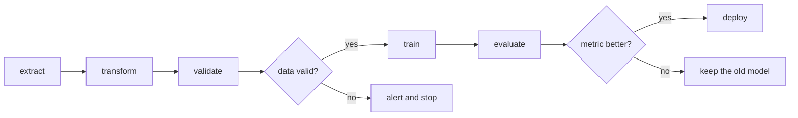

Training a model once is easy. But data arrives every day, and the model needs **regular retraining** — and before that, the data must be collected, cleaned and validated. This is a chain of steps: `extract → transform → validate → train → evaluate → deploy`. You can't run it manually: you'd forget something. This is where **orchestration** comes in — automatic execution of dependent tasks on a schedule.

## What is a DAG

A DAG (Directed Acyclic Graph) is a directed acyclic graph: tasks are nodes, and arrows show the order. "Acyclic" means no cycles: a pipeline always finishes. The DAG concept is central to all orchestrators.

## Airflow

**Apache Airflow** is the most famous orchestrator. Its DAGs are described in Python:

```bash
pip install apache-airflow
```

```python
from airflow import DAG
from airflow.operators.python import PythonOperator
from datetime import datetime, timedelta

default_args = {
    "retries": 2,
    "retry_delay": timedelta(minutes=1),
}

def extract(**context):
    data = {"rows": 10, "source": "clickhouse"}
    context["ti"].xcom_pull(task_ids="extract")  # for clarity: read our own data
    return data

def transform(**context):
    data = context["ti"].xcom_pull(task_ids="extract")
    print("transform:", data)

def load():
    print("load: table is ready")

with DAG(
    dag_id="etl_demo",
    default_args=default_args,
    schedule="@daily",
    start_date=datetime(2025, 1, 1),
    catchup=False,
) as dag:
    t_extract = PythonOperator(task_id="extract", python_callable=extract)
    t_transform = PythonOperator(task_id="transform", python_callable=transform)
    t_load = PythonOperator(task_id="load", python_callable=load)

    t_extract >> t_transform >> t_load
```

The `>>` operator builds dependencies; `schedule="@daily"` is the schedule; `catchup=False` means don't backfill missed days. Airflow runs as infrastructure: `airflow scheduler` and `airflow webserver`. Tasks communicate via **XCom** (data exchange between tasks).

You can check the DAG structure without starting a server:

```python
print(dag.topological_sort())  # task order
```

Such a DAG file can be edited and its structure checked by running it.

## Prefect

**Prefect** is a "code-first" next-generation orchestrator: no separate server needed, you can run it from an ordinary script.

```bash
pip install prefect
```

```python
from prefect import flow, task

@task(retries=2)
def extract():
    return {"rows": 10, "source": "clickhouse"}

@task
def transform(data):
    print("transform:", data)

@task
def load():
    print("load: table is ready")

@flow
def etl_flow():
    data = extract()
    transform(data)
    load()

if __name__ == "__main__":
    etl_flow()
```

Prefect doesn't require a separate DAG object: ordinary Python functions with `@flow` and `@task` decorators. Dependencies are function calls. Run with `python etl_flow.py`. Flexible and simple.

## Schedules and retries

**Airflow:**

```python
with DAG(..., schedule="0 4 * * *", catchup=False) as dag:
    ...
```

`schedule` accepts a cron expression. `default_args["retries"] = 2` — if a task fails, Airflow will retry it (by default, 2 times with a delay).

**Prefect:**

```python
@task(retries=2, retry_delay_seconds=30)
def extract():
    ...
```

`@flow` can have a `schedule` — but in the simplest case a flow is started by calling it. Prefect is closer to ordinary code: branching logic is plain `if/else`.

## Branching

**Airflow** uses a special `BranchPythonOperator` that returns the name of the next task:

```python
from airflow.operators.python import BranchPythonOperator

def decide():
    return "load" if condition else "skip_load"

branch = BranchPythonOperator(task_id="branch", python_callable=decide)
t_extract >> branch >> [t_load, skip_load]
```

**Prefect** — just a condition inside the flow:

```python
@flow
def etl_flow():
    data = extract()
    if data["rows"] > 0:
        transform(data)
        load()
    else:
        print("no data — skipping")
```

## Which one to choose

- **Airflow** — mature, with a rich ecosystem, but heavy: it needs a scheduler + webserver + a database. Good for big teams and complex batch pipelines.
- **Prefect** — lightweight, runs from code, easier for local development. An excellent choice for startups and ML teams that don't want to build infrastructure.

Both tools solve the same problem: the pipeline runs on schedule, doesn't forget steps, fixes failures itself with retries and gives observability — the execution history of every task.

## Pipeline diagram

A typical retraining cycle with checkpoints is shown in the diagram:



## Summary

Orchestration is the "conductor" of MLOps: regular retraining, data validation, model rollout. Starting with a simple script, you quickly hit the need for repeatability — and that's where Airflow/Prefect become your helpers.

<!--TASK-->
### Task 1
Write an Airflow file with a DAG `etl_demo` of three tasks `extract` → `transform` → `load` (PythonOperator), as in the theory. Add `print(dag.topological_sort())` at the end of the file and run it. Expected result: the list `['extract', 'transform', 'load']` is printed — the order of task execution.

### Task 2
Write the equivalent pipeline in Prefect: three functions with `@task` decorators and one `@flow` that calls them in order. Make `extract` return a dictionary `{"rows": 10}`, and `transform` print the received dictionary. Run the flow. Expected result: the line `transform: {'rows': 10}` in the console — data from extract reached transform.

### Task 3
Add parameters to the Airflow DAG from task 1: `schedule="0 6 * * *"` (every day at 6:00), `catchup=False`, `start_date=datetime(2025, 1, 1)`, and `retries: 1` in `default_args`. After describing the DAG, print `dag.schedule_interval` and `dag.default_args["retries"]`. Expected result: `0 6 * * *` and `1` are printed.

### Task 4
Simulate a task failure and a retry in Prefect: make `@task(retries=1, retry_delay_seconds=1)` and inside the function an `attempts` counter (a global variable): the first call raises `ValueError("temporary error")`, the second returns data successfully. Run the flow and make sure the console contains a retry message and a final success. Expected result: the flow finishes successfully, and the Prefect log shows 2 task attempts.

### Task 5
Write branching in Prefect: a flow where `extract` returns `{"rows": 0}`; if `rows > 0` — call `transform` and `load`, otherwise print "no data — skipping". Run the flow twice: with `rows = 0` and with `rows = 10` (generate both variants with separate function calls). Expected result: with `rows=0` — only the skip message; with `rows=10` — transform and load calls.

### Task 6
Build a Prefect flow with a dynamic number of tasks. `extract` returns a list of three batches: `[{"id": "b1", "rows": 10}, {"id": "b2", "rows": 0}, {"id": "b3", "rows": 7}]`. The `clean(batch)` task returns the string `f"{batch['id']}:ok"`. In the flow call `clean.map(batches)` — this creates one task instance per list item. Collect the results, print them, and print the total number of rows computed by a separate `total` task. Expected result: `['b1:ok', 'b2:ok', 'b3:ok']` and `Total rows: 17`.

### Task 7
Build an Airflow DAG `etl_params` with tasks `extract → transform → load`. Pass a parameter to `transform` via `op_kwargs={"multiplier": 2}`, and the function itself accepts `multiplier` and prints `f"transform x{multiplier}"`. After describing the DAG, print `len(dag.tasks)`, `dag.get_task("transform").upstream_task_ids` and `dag.get_task("transform").op_kwargs["multiplier"]`. The file must import without errors with `apache-airflow` installed, and define dependencies with the `>>` operator chain. Additionally verify that `dag.dag_id` equals `etl_params`. Expected result: `3`, `{'extract'}` and `2` — this is how DAG structure is checked without running the scheduler.

<!--/TASK-->

<!--HINT-->
### Hint 1
To run the file without a full Airflow environment you need to install `apache-airflow` (this takes time, but all imports will work). Structure: `with DAG(...) as dag:` and inside — operators and `>>`. `topological_sort()` returns a list of task names.

### Hint 2
`@task` above a function makes it a Prefect task. In `@flow` just call the functions in order: `data = extract(); transform(data); load()`. Run — `etl_flow()` inside `if __name__ == "__main__":`.

### Hint 3
`dag.schedule_interval` returns the schedule string, `dag.default_args` — the parameters dictionary. Check `dag.catchup` — it should be `False`.

### Hint 4
A global counter: `attempts = {"n": 0}`; increment it inside the task, and if `n == 1` — `raise ValueError(...)`. The second call will succeed. The Prefect log will show `Retrying task...` or similar.

### Hint 5
Parameterize the flow: `@flow def etl_flow(rows: int):` and inside `if rows > 0: ... else: print("no data — skipping")`. Call `etl_flow(0)` and `etl_flow(10)`.

### Hint 6
`.map` is available on a task object: `results = clean.map(batches)`, where `clean` is a function with `@task`. Prefect creates one run per item and returns a list of results in the original order. For the sum, pass the batches to a separate task: `total(batches)` with `sum(b["rows"] for b in batches)`. Print `list(results)` — otherwise you'll see Futures, not strings.

### Hint 7
`PythonOperator(task_id="transform", python_callable=transform, op_kwargs={"multiplier": 2})`. The function must accept this argument: `def transform(multiplier, **context):`. `upstream_task_ids` is a set, so the output will be `{'extract'}`, not a list. `dag` is available only after exiting the `with DAG(...) as dag` block.

<!--/HINT-->

<!--SOLUTION-->
### Walkthrough 1
Solution:

```python
from airflow import DAG
from airflow.operators.python import PythonOperator
from datetime import datetime

def extract():
    return {"rows": 10}

def transform(**context):
    print("transform:", context["ti"].xcom_pull(task_ids="extract"))

def load():
    print("load")

with DAG(
    dag_id="etl_demo",
    start_date=datetime(2025, 1, 1),
    schedule=None,
    catchup=False,
) as dag:
    t_extract = PythonOperator(task_id="extract", python_callable=extract)
    t_transform = PythonOperator(task_id="transform", python_callable=transform)
    t_load = PythonOperator(task_id="load", python_callable=load)
    t_extract >> t_transform >> t_load

print(dag.topological_sort())
```

Step-by-step walkthrough. `PythonOperator` wraps an ordinary function into a task. `>>` is the dependency operator: `t_extract >> t_transform` means "transform starts after extract finishes". `topological_sort()` returns the order in which the system will unfold the graph: `['extract', 'transform', 'load']`. Even if we wrote the dependencies in a different order, the topological sort always gives a correct sequence. `context["ti"].xcom_pull(...)` reads the data that extract put into XCom: this is the exchange mechanism between tasks. In a real pipeline, data from a database would be read here, not a dictionary.

### Walkthrough 2
Solution:

```python
from prefect import flow, task

@task
def extract():
    return {"rows": 10}

@task
def transform(data):
    print("transform:", data)

@task
def load():
    print("load: table is ready")

@flow
def etl_flow():
    data = extract()
    transform(data)
    load()

if __name__ == "__main__":
    etl_flow()
```

Step-by-step walkthrough. In Prefect a dependency is an ordinary function call: `extract()` returns the result, which is passed to `transform(data)`. No `>>` operators — just Python. The `@flow` decorator marks the orchestrated function, `@task` marks the individual steps. When run, Prefect builds the graph automatically by analyzing calls. This is the main difference from Airflow: the entry barrier is lower, the code looks like an ordinary script, yet you still get run history, retries and observability. In the console we'll see `transform: {'rows': 10}` — meaning the data really passed between tasks.

### Walkthrough 3
Solution:

```python
default_args = {"retries": 1}

with DAG(
    dag_id="etl_demo",
    default_args=default_args,
    schedule="0 6 * * *",
    start_date=datetime(2025, 1, 1),
    catchup=False,
) as dag:
    t_extract = PythonOperator(task_id="extract", python_callable=extract)
    t_transform = PythonOperator(task_id="transform", python_callable=transform)
    t_load = PythonOperator(task_id="load", python_callable=load)
    t_extract >> t_transform >> t_load

print("schedule:", dag.schedule_interval)
print("retries:", dag.default_args["retries"])
print("catchup:", dag.catchup)
```

Step-by-step walkthrough. `schedule="0 6 * * *"` is a cron expression: minute 0, hour 6, every day. Airflow will create a DAG run every day at 6:00. `catchup=False` forbids "catching up" missed days — for example, if the DAG was added on Wednesday, it won't run Monday and Tuesday. `retries: 1` in `default_args` propagates to all tasks: if one fails, Airflow retries it once. `dag.schedule_interval` returns the string `0 6 * * *` — an easy way to verify the schedule was applied.

### Walkthrough 4
Solution:

```python
from prefect import flow, task

attempts = {"n": 0}

@task(retries=1, retry_delay_seconds=1)
def extract():
    attempts["n"] += 1
    if attempts["n"] == 1:
        raise ValueError("temporary error")
    return {"rows": 10}

@flow
def etl_flow():
    data = extract()
    print("extract succeeded:", data)

if __name__ == "__main__":
    etl_flow()
```

Step-by-step walkthrough. `retries=1` means the task may be re-executed once. The first call raises `ValueError`; Prefect sees the exception, waits `retry_delay_seconds=1` and restarts the task. The second call succeeds. A retry record appears in the log, and the flow finishes successfully. This is a critical production property: the network blinked today, the database was unavailable for a second — the pipeline doesn't fail but carefully retries. Without retries, any random error would break the whole schedule.

### Walkthrough 5
Solution:

```python
from prefect import flow, task

@task
def extract(rows):
    return {"rows": rows}

@task
def transform(data):
    print("transform:", data)

@task
def load():
    print("load")

@flow
def etl_flow(rows: int):
    data = extract(rows)
    if data["rows"] > 0:
        transform(data)
        load()
    else:
        print("no data — skipping")

if __name__ == "__main__":
    print("=== rows=0 ===")
    etl_flow(0)
    print("=== rows=10 ===")
    etl_flow(10)
```

Step-by-step walkthrough. In Prefect branching is an ordinary `if/else` inside the flow: no special operators. With `rows=0` the `transform` and `load` calls never happen — they simply won't be in the graph, and a skip message is printed. With `rows=10` both tasks run. Compare this with Airflow, where `BranchPythonOperator` is needed: Prefect is closer to ordinary code, and this is its key advantage for ML teams. Such branching is used everywhere: for example, "if there is no new data — don't run retraining, sleep until tomorrow".

### Walkthrough 6
Solution:

```python
from prefect import flow, task

@task
def extract():
    return [
        {"id": "b1", "rows": 10},
        {"id": "b2", "rows": 0},
        {"id": "b3", "rows": 7},
    ]

@task
def clean(batch):
    return f"{batch['id']}:ok"

@task
def total(batches):
    return sum(b["rows"] for b in batches)

@flow
def etl_flow():
    batches = extract()
    results = clean.map(batches)
    print(list(results))
    print("Total rows:", total(batches))

if __name__ == "__main__":
    etl_flow()
```

Step-by-step walkthrough. `.map` is dynamic parallelization: the number of tasks is determined not when writing the code but at run time, by the list length. Here `clean` gets three independent runs, Prefect can execute them in parallel, and the results come back in the same order as the input batches. This is fundamentally different from a `for batch in batches: clean(batch)` loop, where tasks would run sequentially and wouldn't be visible in the graph as separate steps. Printing via `list(results)` is needed because the mapping result is a lazy collection, not an ordinary list of strings. The `Total rows: 17` result is computed by a separate task, so the summation also becomes an observable step with its own status and log. In a real pipeline this is how data partitions are processed: the number of partitions changes daily, but the code stays the same.

### Walkthrough 7
Solution:

```python
from airflow import DAG
from airflow.operators.python import PythonOperator
from datetime import datetime

def extract():
    print("extract")

def transform(multiplier, **context):
    print(f"transform x{multiplier}")

def load():
    print("load")

with DAG(
    dag_id="etl_params",
    start_date=datetime(2025, 1, 1),
    schedule="@daily",
    catchup=False,
) as dag:
    t_extract = PythonOperator(task_id="extract", python_callable=extract)
    t_transform = PythonOperator(
        task_id="transform",
        python_callable=transform,
        op_kwargs={"multiplier": 2},
    )
    t_load = PythonOperator(task_id="load", python_callable=load)
    t_extract >> t_transform >> t_load

print("Tasks:", len(dag.tasks))
print("Upstream:", dag.get_task("transform").upstream_task_ids)
print("Multiplier:", dag.get_task("transform").op_kwargs["multiplier"])
```

Step-by-step walkthrough. `op_kwargs` is the standard way to pass fixed arguments to a task: Airflow adds them to the `python_callable` call along with the context, so the signature needs `**context`. This way you can have several tasks with different configurations in the same DAG without duplicating code. `dag.get_task("transform")` returns the task object with its connections; `upstream_task_ids` is the set of ids of tasks that must finish earlier — hence `{'extract'}`. `len(dag.tasks)` gives 3 — a quick way to make sure all operators landed in the graph. Such introspection is common practice in CI: a test verifies that dependencies and parameters didn't get lost during refactoring and fails before rollout, not after a nightly run. In `def transform(multiplier, **context)` the order matters: required arguments from `op_kwargs` go explicitly, and the context is collected into `**context`.

<!--/SOLUTION-->

<!--QUIZ-->
What is a DAG?
- A directed acyclic graph of pipeline tasks
- A relational database
- A model training loop
* Correct answer: A directed acyclic graph of pipeline tasks
A DAG describes the order and dependencies of tasks; it has no cycles.

How is a dependency between tasks set in Airflow?
- With the >> operator
- With the next keyword
- By calling a function
* Correct answer: With the >> operator
`t1 >> t2` means: t2 runs after t1 finishes.

How does Prefect differ from Airflow?
- Prefect is code-first: a pipeline is described with ordinary functions and decorators
- Prefect only works on Java
- Airflow does not support schedules
* Correct answer: Prefect is code-first: a pipeline is described with ordinary functions and decorators
In Prefect dependencies are ordinary function calls; Airflow requires a separate DAG object and infrastructure.

What does schedule="0 6 * * *" do in Airflow?
- Runs the DAG every day at 6:00
- Runs the DAG every hour
- Runs the DAG once
* Correct answer: Runs the DAG every day at 6:00
This is a cron expression: minute 0, hour 6, daily.

Why are retries needed?
- To automatically retry a failed task
- To speed up tasks
- To prevent repeated execution
* Correct answer: To automatically retry a failed task
Random network/database failures should not bring down a pipeline.

What does catchup=False do?
- Does not run missed DAG runs for past periods
- Runs everything from the beginning of time
- Disables the schedule
* Correct answer: Does not run missed DAG runs for past periods
catchup=False protects against an avalanche of "catch-up" runs after a long downtime.

How do you organize branching in Prefect?
- With an ordinary if/else operator inside the flow
- With the BranchPythonOperator
- You can't
* Correct answer: With an ordinary if/else operator inside the flow
Prefect inherits ordinary Python code; branching is just a condition.

What is XCom in Airflow?
- A mechanism for data exchange between DAG tasks
- A query language
- A type of operator
* Correct answer: A mechanism for data exchange between DAG tasks
Tasks put data into XCom, and other tasks read it via xcom_pull.

What does clean.map(batches) do in Prefect?
- Runs the task separately for each element of the list
- Sorts the list by key
- Creates a new flow
* Correct answer: Runs the task separately for each element of the list
.map is dynamic parallelization: the number of tasks is determined by the list length at run time.

What will dag.get_task("transform").upstream_task_ids return?
- The set of ids of tasks that transform depends on
- A list of all DAG tasks
- The DAG schedule
* Correct answer: The set of ids of tasks that transform depends on
This is a direct way to check dependencies without running the scheduler.

Why does a pipeline need idempotency?
- So a repeated run for the same period does not duplicate data
- So tasks run faster
- To disable retries
* Correct answer: So a repeated run for the same period does not duplicate data
Retries and manual restarts are inevitable, so steps must be safe to repeat.

What happens if a task exhausts its retries and fails?
- The DAG is marked failed, and dependent tasks do not run
- Airflow runs it forever
- The data is written partially
* Correct answer: The DAG is marked failed, and dependent tasks do not run
This is exactly why alerts matter: a failure must be noticed, not swallowed.
<!--/QUIZ-->
