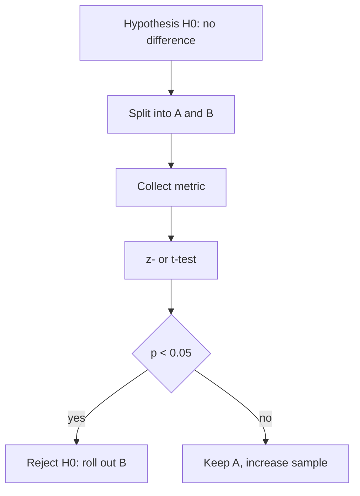

You've released a new model — but how do you know it is really better than the old one? You can't just "look at the metrics": the real world is noisy, and any difference could be accidental. For an honest answer you need an **A/B test**: split users into two groups, show one group the old model and the other the new one, and compare the results statistically.

## How an A/B test works

1. **Hypothesis**: the new model will increase conversion from 12% to 14%.
2. **Null hypothesis (H₀)**: there is no difference; both models work the same.
3. **Groups**: control (A, old model) and experimental (B, new).
4. **Metric**: e.g., conversion (share of successful outcomes), average check, session time.
5. **Statistical test**: we compute the p-value — the probability of seeing such a difference by chance if H₀ is true.
6. **Conclusion**: if `p < α` (usually 0.05), we reject H₀ and say "the difference is significant".

## z-test for proportions

For binary metrics (conversion, clicks) a comparison of shares is used:

```python
import math

def two_prop_ztest(c1, n1, c2, n2):
    p1, p2 = c1 / n1, c2 / n2
    p = (c1 + c2) / (n1 + n2)          # pooled share
    se = math.sqrt(p * (1 - p) * (1 / n1 + 1 / n2))
    z = (p1 - p2) / se
    p_value = 2 * (1 - 0.5 * (1 + math.erf(abs(z) / math.sqrt(2))))
    return z, p_value

# control: 120 successes out of 1000, experiment: 150 out of 1000
z, p = two_prop_ztest(120, 1000, 150, 1000)
print("z =", round(z, 3), "| p-value =", round(p, 4))
# z ≈ 1.96, p ≈ 0.05 — on the edge of significance
```

`math.erf` is the error function; through it the normal distribution is computed without external dependencies. If `p < 0.05` — the effect is significant.

## t-test for means

If the metric is numeric (average check, time), we use the t-test. It's already in `scipy`:

```bash
pip install scipy
```

```python
from scipy import stats
import numpy as np

rng = np.random.default_rng(42)
a = rng.normal(100, 15, size=300)  # control
b = rng.normal(108, 15, size=300)  # experiment

t_stat, p_value = stats.ttest_ind(a, b)
print("t =", round(t_stat, 3), "| p-value =", round(p_value, 4))
# p < 0.05 → the difference is significant
```

`ttest_ind` is the independent two-sample t-test. A small p-value means "the difference is unlikely to be by chance".

## Sample size

Before running a test, you need to know how many users it will take. For proportions:

```python
def sample_size(p1, p2, alpha=0.05, power=0.8):
    z_alpha = 1.96    # for alpha=0.05 (two-sided)
    z_beta = 0.84     # for power=0.8
    delta = p1 - p2
    n = (z_alpha + z_beta) ** 2 * (p1 * (1 - p1) + p2 * (1 - p2)) / delta ** 2
    return math.ceil(n)

print(sample_size(0.12, 0.14))  # ~ 2700 per group
```

## Type I and Type II errors

- **Type I error (α)**: we declared an effect that doesn't exist (false alarm). Controlled by the significance level — usually 0.05.
- **Type II error (β)**: we missed a real effect. Controlled by power (power = 1 − β) — usually 0.8.

## Feature store

Modern ML systems separate **feature computation** from the model: features are computed once and stored in a **feature store** — a feature storage with time. Why?

- **Consistency**: the model gets the same features in training and in production (the same logic).
- **Point-in-time correctness**: a feature is returned *as of the request moment*, not from the future. Otherwise the model would "peek" into the future and metrics would be inflated.
- **Reuse**: a feature computed once is available to all services.

Let's implement a mini feature store on `sqlite3` (from the standard library):

```python
import sqlite3

conn = sqlite3.connect("feature_store.db")
cur = conn.cursor()
cur.execute("""
    CREATE TABLE IF NOT EXISTS features (
        entity_id TEXT,
        ts REAL,
        name TEXT,
        value REAL,
        PRIMARY KEY (entity_id, name, ts)
    )
""")

cur.execute("INSERT INTO features VALUES (?, ?, ?, ?)", ("user_1", 1000.0, "days_active", 17.0))
cur.execute("INSERT INTO features VALUES (?, ?, ?, ?)", ("user_1", 2000.0, "days_active", 22.0))
conn.commit()

# the latest value as of 1500: 17.0 will be returned
cur.execute(
    "SELECT value FROM features WHERE entity_id=? AND name=? AND ts<=? "
    "ORDER BY ts DESC LIMIT 1",
    ("user_1", "days_active", 1500.0),
)
print("days_active as of 1500:", cur.fetchone()[0])
```

The query with `ts <= ?` and `ORDER BY ts DESC LIMIT 1` is point-in-time: we take the feature state at a specific moment without looking into the future.

## A/B test diagram

The diagram shows the path from hypothesis to the rollout decision:



## Putting it together

A/B tests tell *which* model is better; the feature store guarantees the comparison is fair (both models see the same, time-correct features). These are two sides of the same coin — the "experimental culture" in MLOps.

<!--TASK-->
### Task 1
Implement the function `two_prop_ztest(c1, n1, c2, n2)` from the theory. Test it on the data: control — 120 successes out of 1000, experiment — 150 out of 1000. Print z and p-value. Then decide whether the difference is significant at α = 0.05 (print "significant" or "not significant"). Expected result: p-value ≈ 0.05 or slightly less, verdict — "significant" (or "borderline"), z ≈ 1.96.

### Task 2
Using `scipy.stats.ttest_ind`, compare two samples: `a = rng.normal(100, 15, size=300)` and `b = rng.normal(108, 15, size=300)`. Print the t-statistic and p-value, and make a conclusion at α = 0.05. If `scipy` is unavailable, compute the t-statistic manually with the formula `(mean_a - mean_b) / sqrt(var_a/n_a + var_b/n_b)` and print it. Expected result: p-value < 0.05, verdict "significant".

### Task 3
Create a mini feature store on sqlite3: a `features` table with `entity_id`, `ts`, `name`, `value` fields. Write for `user_1` the `days_active` feature with values 17.0 (ts=1000), 22.0 (ts=2000), and for `user_2` — 5.0 (ts=1500). Then print all table rows. Expected result: 3 rows with correct values.

### Task 4
Write a function `get_feature(entity_id, name, ts)` that returns the feature value as of time `ts` (key SQL: `WHERE entity_id=? AND name=? AND ts<=? ORDER BY ts DESC LIMIT 1`). Check: for `user_1`, `days_active`, ts=1500 it should return 17.0, and for ts=2500 — 22.0. Print both results. Expected result: first value 17.0, second — 22.0.

### Task 5
Write the function `sample_size(p1, p2, alpha=0.05, power=0.8)` from the theory (use `z_alpha=1.96`, `z_beta=0.84`) and compute the sample size per group for conversions 0.10 and 0.12. Print the result and note: the smaller the effect (the difference between p1 and p2), the larger the sample needed. Expected result: a number in the range 2500–3500 per group.

### Task 6
Write a function `power_prop(p1, p2, n, alpha=0.05)` that computes the test power for two proportions. Standard error: `se = sqrt(p * (1 - p) * (2 / n))`, where `p = (p1 + p2) / 2`; effect `z = abs(p2 - p1) / se`; power — `0.5 * (1 + erf((z - 1.96) / sqrt(2)))`. Compute the power for conversions 0.12 and 0.15 at `n=1000` and `n=2700` per group. Print both values with three decimal places and a conclusion on whether a thousand observations suffice. Expected result: about 0.50 at n=1000 and about 0.90 at n=2700 — a thousand observations give only a 50% chance to notice the effect.

### Task 7
Write a function `diff_ci(c1, n1, c2, n2, z=1.96)` that returns the conversion difference and its 95% confidence interval. Use the unpooled error: `se = sqrt(p1*(1-p1)/n1 + p2*(1-p2)/n2)`, boundaries — `diff ± z*se`. Compute for control 120 out of 1000 and experiment 150 out of 1000, print `diff`, `lo`, `hi` with four decimal places. Then print a conclusion: whether the interval contains zero and what that means for the rollout. Expected result: `diff ≈ -0.03`, `lo ≈ -0.0599`, `hi ≈ -0.0001` — zero almost touches the boundary, the effect is on the edge of significance.

<!--/TASK-->

<!--HINT-->
### Hint 1
Use `math.erf` for the p-value: `2 * (1 - 0.5 * (1 + math.erf(abs(z) / math.sqrt(2))))`. The significance condition: `if p < 0.05: print("significant")`.

### Hint 2
`stats.ttest_ind(a, b)` returns a tuple `(t_stat, p_value)`. If scipy is missing, compute manually: `t = (a.mean() - b.mean()) / np.sqrt(a.var(ddof=1)/len(a) + b.var(ddof=1)/len(b))`.

### Hint 3
`cur.execute("INSERT INTO features VALUES (?, ?, ?, ?)", (...))` — placeholders. After writing — `conn.commit()`. Reading — `cur.execute("SELECT * FROM features").fetchall()`.

### Hint 4
The SQL with `ts <= ?` and `ORDER BY ts DESC LIMIT 1` returns the maximum value not exceeding the given moment. Check both calls.

### Hint 5
Formula: `n = (z_alpha + z_beta)**2 * (p1*(1-p1) + p2*(1-p2)) / (p1-p2)**2`. `math.ceil` rounds up. Check: with a small difference n must grow.

### Hint 6
Import `from math import erf, sqrt`. First `p = (p1 + p2) / 2`, then `se = sqrt(p * (1 - p) * (1 / n + 1 / n))` — this is the same as `2 / n`. Effect `z = abs(p2 - p1) / se`, power `0.5 * (1 + erf((z - 1.96) / sqrt(2)))`. At n=1000 z comes out almost exactly 1.96, so power is about 0.5 — this is not a bug but a property of the formula.

### Hint 7
`diff = c1 / n1 - c2 / n2` gives a negative number because the control is worse. The error is unpooled: two variances of shares are added. Boundaries — `diff - z * se` and `diff + z * se`. The "zero inside" check: `lo < 0 < hi`. If zero is outside the interval, the difference is significant at the 5% level.

<!--/HINT-->

<!--SOLUTION-->
### Walkthrough 1
Solution:

```python
import math

def two_prop_ztest(c1, n1, c2, n2):
    p1, p2 = c1 / n1, c2 / n2
    p = (c1 + c2) / (n1 + n2)
    se = math.sqrt(p * (1 - p) * (1 / n1 + 1 / n2))
    z = (p1 - p2) / se
    p_value = 2 * (1 - 0.5 * (1 + math.erf(abs(z) / math.sqrt(2))))
    return z, p_value

z, p = two_prop_ztest(120, 1000, 150, 1000)
print("z =", round(z, 3))
print("p-value =", round(p, 4))

if p < 0.05:
    print("Verdict: significant")
else:
    print("Verdict: not significant")
```

Step-by-step walkthrough. Shares: 12% vs 15%. The pooled share `p` is computed over all data — it is used in the standard error `se`. `z` is the number of standard deviations by which the shares diverged: `(0.15 - 0.12) / se` ≈ 1.96. Through `math.erf` we get the two-sided p-value: the probability of seeing such a difference (or larger) by chance. At p ≈ 0.05 we stand exactly on the boundary — in a real experiment this is a reason to increase the sample, not to celebrate. The code is self-contained — only `math`, no external libraries, so it's easy to embed in any pipeline.

### Walkthrough 2
Solution:

```python
from scipy import stats
import numpy as np

rng = np.random.default_rng(42)
a = rng.normal(100, 15, size=300)
b = rng.normal(108, 15, size=300)

t_stat, p_value = stats.ttest_ind(a, b)
print("t =", round(t_stat, 3))
print("p-value =", round(p_value, 4))
print("Significant" if p_value < 0.05 else "Not significant")
```

Step-by-step walkthrough. `stats.ttest_ind` compares the means of two independent samples: the t-statistic accounts for both the mean difference and the spread within groups (variances) and the sizes. The means differ by 8 with a spread of 15 — with 300 observations per group this is a significant difference. `p < 0.05` → we reject H₀: the difference is statistically significant, and we can reasonably roll out the new model. The t-statistic formula is `(mean_a - mean_b) / sqrt(var_a/n_a + var_b/n_b)`; it is given in the task as a fallback if scipy is unavailable. Understanding the formula helps: you can see the mean difference is "weighted" by the uncertainty of both samples.

### Walkthrough 3
Solution:

```python
import sqlite3

conn = sqlite3.connect("feature_store.db")
cur = conn.cursor()

cur.execute("""
    CREATE TABLE IF NOT EXISTS features (
        entity_id TEXT,
        ts REAL,
        name TEXT,
        value REAL,
        PRIMARY KEY (entity_id, name, ts)
    )
""")

cur.execute("INSERT INTO features VALUES (?, ?, ?, ?)", ("user_1", 1000.0, "days_active", 17.0))
cur.execute("INSERT INTO features VALUES (?, ?, ?, ?)", ("user_1", 2000.0, "days_active", 22.0))
cur.execute("INSERT INTO features VALUES (?, ?, ?, ?)", ("user_2", 1500.0, "days_active", 5.0))
conn.commit()

for row in cur.execute("SELECT * FROM features ORDER BY entity_id, ts"):
    print(row)
```

Step-by-step walkthrough. We created a real table with a primary key `(entity_id, name, ts)` — this guarantees the uniqueness of the triple and prevents writing "two values for one moment". Parameterized queries `INSERT ... VALUES (?, ?, ?, ?)` protect against SQL injection — a habit that is mandatory even in learning code. `commit()` fixes the transaction (without it the data may not be saved). Reading with `SELECT *` shows all 3 rows. This is the groundwork for a full feature store: every feature has a timestamp, which allows restoring the system state at any moment — the foundation of point-in-time correctness.

### Walkthrough 4
Solution:

```python
def get_feature(entity_id, name, ts):
    cur.execute(
        "SELECT value FROM features WHERE entity_id=? AND name=? AND ts<=? "
        "ORDER BY ts DESC LIMIT 1",
        (entity_id, name, ts),
    )
    row = cur.fetchone()
    return row[0] if row else None

print(get_feature("user_1", "days_active", 1500.0))  # 17.0
print(get_feature("user_1", "days_active", 2500.0))  # 22.0
```

Step-by-step walkthrough. The key part is the `ts <= ?` condition together with `ORDER BY ts DESC LIMIT 1`: we take the latest value that does *not exceed* the requested moment. For `ts=1500` this is 17.0 (recorded at 1000), not 22.0 (which appears only at 2000 — in the "future" relative to the query point). This is exactly point-in-time correctness: when training on data up to date D and at inference at moment D, the model gets the same value. If we wrote just `LIMIT 1` without `ts <= ?`, the model would "peek" into the future — and training metrics would be falsely high, while the model would disappoint in production. Returning `None` when the value is missing is careful handling of gaps.

### Walkthrough 5
Solution:

```python
import math

def sample_size(p1, p2, alpha=0.05, power=0.8):
    z_alpha = 1.96
    z_beta = 0.84
    delta = p1 - p2
    n = (z_alpha + z_beta) ** 2 * (p1 * (1 - p1) + p2 * (1 - p2)) / delta ** 2
    return math.ceil(n)

print("Sample size per group:", sample_size(0.10, 0.12))
```

Step-by-step walkthrough. The formula estimates how many observations each group needs to detect the effect `delta = p2 - p1` with given α and power. `z_alpha=1.96` corresponds to the two-sided 0.05 level, `z_beta=0.84` to power 0.8. For conversions of 10% vs 12% we get ≈ 2700–2900 per group (in the range 2500–3500 depending on precision). Note an important effect: if we wanted to detect a difference of 10% vs 10.5% (delta = 0.005), the denominator would become four times smaller — and the sample would grow to tens of thousands. "The smaller the effect, the larger the sample" is the most common practical takeaway for experiment planning.

### Walkthrough 6
Solution:

```python
from math import erf, sqrt

def power_prop(p1, p2, n, alpha=0.05):
    p = (p1 + p2) / 2
    se = sqrt(p * (1 - p) * (1 / n + 1 / n))
    z = abs(p2 - p1) / se
    return 0.5 * (1 + erf((z - 1.96) / sqrt(2)))

for n in (1000, 2700):
    power = power_prop(0.12, 0.15, n)
    print(f"n={n}: power = {power:.3f}")

print("Conclusion: is 1000 observations enough?", "no" if power_prop(0.12, 0.15, 1000) < 0.8 else "yes")
```

Step-by-step walkthrough. Power is the probability of detecting an effect if it really exists; it is the complement of the Type II error (`power = 1 - β`). The formula combines three things: the effect size, the noise and the significance threshold. The numerator `abs(p2 - p1)` is the signal, `se` is the noise, and their ratio shows how many standard errors the shares diverged by. Subtracting 1.96 shifts the distribution into the world where the decision is made by a two-sided criterion: the test "fires" only if the observed z exceeds the critical value. At n=1000 we get 0.501: this is exactly the case where the p-value from task 1 hovers around 0.05 — half of similar experiments would not see the effect at all. At n=2700 power is 0.896, which is already acceptable for a rollout decision. Practical takeaway: a small p-value in an underpowered test is not a win but luck; power is computed before the run, together with the sample size.

### Walkthrough 7
Solution:

```python
from math import sqrt

def diff_ci(c1, n1, c2, n2, z=1.96):
    p1, p2 = c1 / n1, c2 / n2
    diff = p1 - p2
    se = sqrt(p1 * (1 - p1) / n1 + p2 * (1 - p2) / n2)
    return diff, diff - z * se, diff + z * se

diff, lo, hi = diff_ci(120, 1000, 150, 1000)
print(f"diff = {diff:.4f}, 95% CI = [{lo:.4f}; {hi:.4f}]")

if lo < 0 < hi:
    print("Zero inside the interval: the effect is not significant")
else:
    print("Zero outside the interval: the difference is significant, but estimate the effect size")
```

Step-by-step walkthrough. A confidence interval is more useful than a single p-value: it shows both the direction, the effect size and the uncertainty. `diff = -0.03` reads as "the experimental model is worse by 3 percentage points", and the interval `[-0.0599; -0.0001]` says the true difference is somewhere between 0.01 and 6 p.p. in favor of the control. The upper bound almost touches zero — formally zero is outside the interval, i.e., the difference is significant, but the margin is tiny: a bit more noise and the conclusion flips. Here it is appropriate not to roll out the model but to extend the test. Note the unpooled error: for an interval it is more correct than the pooled share from the z-test, although the numbers differ in the third decimal. Such a calculation is a standard argument in conversations with product: not "p = 0.048, win", but "the effect is from -6 to 0 p.p., not enough data".

<!--/SOLUTION-->

<!--QUIZ-->
What is the null hypothesis in an A/B test?
- The statement that there is no difference between the groups
- The statement that the new model is better
- The statement that the sample is large
* Correct answer: The statement that there is no difference between the groups
The p-value is computed under it; we reject it if p < α.

What does p-value mean?
- The probability of seeing such a difference by chance if there is actually no difference
- The probability that the new model is better
- The probability of an error in the code
* Correct answer: The probability of seeing such a difference by chance if there is actually no difference
A small p-value is an argument against the null hypothesis.

When is an A/B test result considered significant?
- When p-value < α (usually 0.05)
- When p-value > α
- When the sample is larger than 1000
* Correct answer: When p-value < α (usually 0.05)
The threshold α is set in advance; p < α means rejecting H₀.

What is a Type I error?
- Declaring an effect that does not actually exist
- Missing a real effect
- An error in the data
* Correct answer: Declaring an effect that does not actually exist
This is a false alarm; its probability is controlled by α.

What is test power?
- The probability of detecting a real effect (1 − β)
- The sample size
- The significance level
* Correct answer: The probability of detecting a real effect (1 − β)
Power of 0.8 is the standard: an 80% chance to notice the effect if it exists.

Why do you need a feature store?
- So features are computed once and are the same in training and production
- To store model weights
- To replace the database
* Correct answer: So features are computed once and are the same in training and production
A feature store is a single source of features for training, inference and other services.

What is point-in-time correctness?
- A feature is returned strictly as of the request moment, without data from the future
- Storing features only in memory
- Disabling features during training
* Correct answer: A feature is returned strictly as of the request moment, without data from the future
Otherwise the model would "see" the future and metrics would be inflated.

Which query returns the latest feature value as of time ts?
- SELECT value ... WHERE ts<=? ORDER BY ts DESC LIMIT 1
- SELECT value ... LIMIT 1
- SELECT MAX(value) ...
* Correct answer: SELECT value ... WHERE ts<=? ORDER BY ts DESC LIMIT 1
This is the point-in-time query: the maximum ts that does not exceed the given moment.

What happens if you take too small a sample in an A/B test?
- The test will not notice a real effect (low power)
- The test will always show significance
- Nothing bad
* Correct answer: The test will not notice a real effect (low power)
Noise will drown out the signal — the p-value will stay large even with a real effect.

What does the 95% confidence interval of a conversion difference mean?
- The range in which the true difference falls with 95% probability
- A guarantee that the new model is better
- The spread of conversion within one group
* Correct answer: The range in which the true difference falls with 95% probability
It shows both the direction, the magnitude of the effect and its uncertainty.

Why is the Bonferroni correction needed with several simultaneous tests?
- It divides α by the number of tests, reducing the risk of a false positive
- It increases the power of each test
- It removes the need for a control group
* Correct answer: It divides α by the number of tests, reducing the risk of a false positive
With 20 comparisons at α = 0.05, at least one false positive is almost guaranteed.

What is an A/A test?
- A test where both groups get the same model — a check of the infrastructure
- A test of two different metrics
- A test without a hypothesis
* Correct answer: A test where both groups get the same model — a check of the infrastructure
If A/A regularly gives p < 0.05, the splitter or metric collection is broken, not the model.

Why is it dangerous to stop a test as soon as p < 0.05?
- With constant "peeking", the probability of a Type I error grows
- The p-value stops being computed
- The sample becomes larger
* Correct answer: With constant "peeking", the probability of a Type I error grows
The sample size and stopping rule are fixed before the start — otherwise significance is almost guaranteed.
<!--/QUIZ-->
