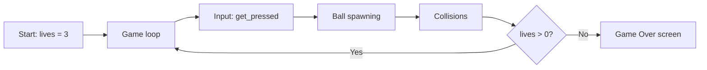

In the previous lesson we learned the skeleton: a window, a loop, sprites. Now we will assemble a real game from these pieces. Our project — "Ball Catcher": at the bottom of the screen there is a paddle you control with the arrow keys, and balls fall from the top. Catch a ball — earn a point; miss it — lose a life. On this example we will cover the four pillars of any arcade game: keyboard input, collisions, text, and game state.

## Keyboard control

pygame has two ways to learn about keys. The first is the `pygame.KEYDOWN` and `pygame.KEYUP` events: they arrive once at the moment of press/release and are convenient for one-shot actions (for example, firing):

```python
for event in pygame.event.get():
    if event.type == pygame.KEYDOWN and event.key == pygame.K_SPACE:
        print("Space pressed!")
```

The second way is `pygame.key.get_pressed()`: it returns the state of **all** keys at the moment and is perfect for continuous movement:

```python
keys = pygame.key.get_pressed()
if keys[pygame.K_LEFT]:
    player.rect.x -= 5
if keys[pygame.K_RIGHT]:
    player.rect.x += 5
```

The difference is fundamental: an event arrives only at the moment of the press, while `get_pressed()` "lives" for the whole frame while the key is held. For a game like ours, the second approach is what we need.

## Collisions

The main mechanic is checking whether a ball touched the paddle. Sprites have a ready-made `colliderect` method:

```python
if ball.rect.colliderect(player.rect):
    score += 1
    ball.kill()
```

And if there are many objects — use `pygame.sprite.spritecollide`: it returns a list of sprites from a group that intersect the given one:

```python
caught = pygame.sprite.spritecollide(player, balls, True)
score += len(caught)
```

The third argument `True` means the caught balls are removed from the group. One expression — and the whole pickup logic is done. It works simply: for each sprite in the group, the `rect` intersection is checked.

## Text and fonts

To show the score, you need text. In pygame, text is also an image: the font creates a surface with text, and it is "glued" to the screen via `blit`:

```python
font = pygame.font.Font(None, 36)  # system font, size 36
score_surface = font.render(f"Score: {score}", True, (255, 255, 255))
screen.blit(score_surface, (10, 10))
```

`pygame.font.Font(None, 36)` takes a standard system font of the needed size; the second argument of `render` is anti-aliasing, the third is color. If you want your own font, pass the path to a `.ttf` file instead of `None`.

## Sound

`pygame.mixer` can play sounds. Load a sound file and call `play()`:

```python
pygame.mixer.init()
catch_sound = pygame.mixer.Sound("catch.wav")
catch_sound.play()
```

If the file is missing, the code will break — that is why in the lessons we skip sound or wrap it in `try`. Sound is a nice addition, but the game mechanic does not depend on it.

## Game state and game over

It is convenient to describe the game logic with variables: `score` (score) and `lives` (lives). When lives run out, the game must stop. The simplest option is a state flag:

```python
if lives <= 0:
    game_over = True
```

And in the loop — a branch: while `game_over` is false, we play; when it becomes true — we draw the "Game Over" label and wait for the window to close. This is a crude but working scheme; for a real project it is more convenient to move the state into a separate class or enum, but for our arcade game variables are enough.

## Game state diagram

The "Ball Catcher" game is a finite state machine with two states. Until lives run out, the full loop runs; when they hit zero — only the final screen is rendered:



## Lesson summary

We learned how to:

- control a sprite with the keyboard via `get_pressed()`;
- check collisions via `colliderect` and `spritecollide`;
- display text via `Font.render` and `blit`;
- play sounds via `pygame.mixer`;
- organize the end of the game via a state variable.

Now assemble all of this into one working game — step by step.

<!--TASK-->
### Task 1
Create a `Player` sprite — a paddle: a green 80×15 rectangle. Place it at the bottom of the screen (center on `x`, coordinate `y = 570`). In the loop, read `pygame.key.get_pressed()`: the left arrow moves the paddle 5 pixels left, the right arrow moves it right. Make sure the paddle does not go past the left and right edges of the window (800×600). Run and check the controls.

### Task 2
Add score display to Task 1. Create a variable `score = 0` and a font `font = pygame.font.Font(None, 36)`. Every frame, create a surface with white text `Score: {score}` and draw it via `screen.blit` at the top-left corner (10, 10). For now the score will not change — the main thing is that the text renders and is not distorted.

### Task 3
Create a `Ball` sprite class — a red circle with radius 12 on a transparent surface (use `pygame.Surface((24, 24), pygame.SRCALPHA)` so the background is not a black square). In a separate `balls` group, every 40th frame (count `frames += 1`) create a new ball with a random `x` coordinate inside the window and a random falling speed from 2 to 5. The ball should move down, and when it goes past the bottom edge — be removed (`kill()`).

### Task 4
Add collisions: if a ball touches the paddle (`pygame.sprite.spritecollide(player, balls, True)`), increase the score by the number of caught balls. Also add lives: a variable `lives = 3`; if a ball falls past the paddle (goes past the bottom edge), decrease lives by 1 and remove the ball. Display both the score and the lives at the top of the screen.

### Task 5
Finish the game: when `lives` becomes 0, stop spawning balls and draw a large red "Game Over" label with font size 72 in the center of the screen. The game should wait for the close button, and the code should exit cleanly via `pygame.quit()`.

### Task 6
Add a pause to the game. Pressing `P` should freeze the game: balls stop moving, no new ones spawn, the paddle does not react to the arrow keys, and a "Pause" label of size 48 appears in the center of the screen. Pressing `P` again resumes the game. Use the `pygame.KEYDOWN` event and a `paused` flag; catch the key via `event.key == pygame.K_p`. Expected output: when `P` is pressed, `Pause` is printed to the console; when pressed again — `Resuming`, and the balls stand still meanwhile.

### Task 7
Add a high score: at startup, read the best score from the file `highscore.txt` (if the file is missing, treat the record as 0). When the game ends, compare `score` with the record; if it exceeds it, rewrite the file and print `New record: <number>` to the console. On the "Game Over" screen show two lines: the score and the record. Expected output after a successful game: the `highscore.txt` file contains the number, and the console shows the line `New record: 12`.
<!--/TASK-->

<!--HINT-->
### Hint 1
In `Player`'s `update()`: `keys = pygame.key.get_pressed()`, then `if keys[pygame.K_LEFT]: self.rect.x -= 5` and similarly for the right. Clamping: `self.rect.x = max(0, min(800 - self.rect.width, self.rect.x))` — or plain `if` checks.

### Hint 2
Create the font once — before the loop: `font = pygame.font.Font(None, 36)`. Inside the loop after clearing the screen: `text = font.render(f"Score: {score}", True, (255, 255, 255))` and `screen.blit(text, (10, 10))`. Draw the text after `fill` but before `flip`.

### Hint 3
In `Ball.__init__` set `self.rect.centerx = random.randint(12, 788)` and `self.speed = random.randint(2, 5)`. In `update()`: `self.rect.y += self.speed`; if `self.rect.top > 600` — `self.kill()`. Spawning: `if frames % 40 == 0: balls.add(Ball())`, where `frames` increases by 1 every frame.

### Hint 4
Check collisions every frame: `caught = pygame.sprite.spritecollide(player, balls, True)` and `score += len(caught)`. The easiest way to learn about lost balls is inside `Ball.update()` itself: `if self.rect.top > 600: self.kill(); lives -= 1` — but `lives` must be accessible to the class; options are a global variable or passing the counter.

### Hint 5
Create `game_over = False` before the loop. In the loop: `if lives <= 0: game_over = True`. Spawn balls only `if not game_over`. When `game_over` is true, draw `font_big.render("Game Over", True, (255, 0, 0))` and center it via `text.get_rect(center=(400, 300))` and `blit` to that point.

### Hint 6
Add `paused = False` next to `game_over`. In the event loop: `if event.type == pygame.KEYDOWN and event.key == pygame.K_p:` — toggle the flag `paused = not paused` and print a message. Wrap the whole logic-update block in `if not game_over and not paused:`. Draw the "Pause" label last, like "Game Over", via `font_big.render("Pause", True, (255, 255, 255))` and `get_rect(center=(400, 300))`.

### Hint 7
Implement record reading with a function using `try/except (FileNotFoundError, ValueError): return 0`. Writing — `with open("highscore.txt", "w", encoding="utf-8") as f: f.write(str(score))`. Check the record at the moment `game_over` just became true, not every frame — otherwise the file would be rewritten dozens of times per second.
<!--/HINT-->

<!--SOLUTION-->
### Solution 1
Solution:

```python
import pygame

class Player(pygame.sprite.Sprite):
    def __init__(self):
        super().__init__()
        self.image = pygame.Surface((80, 15))
        self.image.fill((0, 255, 0))
        self.rect = self.image.get_rect()
        self.rect.center = (400, 570)

    def update(self):
        keys = pygame.key.get_pressed()
        if keys[pygame.K_LEFT]:
            self.rect.x -= 5
        if keys[pygame.K_RIGHT]:
            self.rect.x += 5
        if self.rect.left < 0:
            self.rect.left = 0
        if self.rect.right > 800:
            self.rect.right = 800

pygame.init()
screen = pygame.display.set_mode((800, 600))
player = Player()
clock = pygame.time.Clock()

running = True
while running:
    for event in pygame.event.get():
        if event.type == pygame.QUIT:
            running = False
    player.update()
    screen.fill((20, 30, 80))
    screen.blit(player.image, player.rect)
    pygame.display.flip()
    clock.tick(60)

pygame.quit()
```

What is happening here? In the `update` method we ask the keyboard state every frame. `keys[pygame.K_LEFT]` is true while the left arrow is held. Because `get_pressed()` returns a "live" state, the movement is smooth and continuous. The clamping acts as "walls": `rect.left` and `rect.right` are the paddle's edges, and they cannot leave the window boundaries. Instead of `screen.blit(player.image, player.rect)`, you could add the player to a group and draw via `group.draw(screen)` — both ways are correct.

### Solution 2
Solution:

```python
import pygame

class Player(pygame.sprite.Sprite):
    def __init__(self):
        super().__init__()
        self.image = pygame.Surface((80, 15))
        self.image.fill((0, 255, 0))
        self.rect = self.image.get_rect()
        self.rect.center = (400, 570)

    def update(self):
        keys = pygame.key.get_pressed()
        if keys[pygame.K_LEFT]:
            self.rect.x -= 5
        if keys[pygame.K_RIGHT]:
            self.rect.x += 5
        if self.rect.left < 0:
            self.rect.left = 0
        if self.rect.right > 800:
            self.rect.right = 800

pygame.init()
screen = pygame.display.set_mode((800, 600))
player = Player()
font = pygame.font.Font(None, 36)
score = 0
clock = pygame.time.Clock()

running = True
while running:
    for event in pygame.event.get():
        if event.type == pygame.QUIT:
            running = False
    player.update()
    screen.fill((20, 30, 80))
    screen.blit(player.image, player.rect)
    score_text = font.render(f"Score: {score}", True, (255, 255, 255))
    screen.blit(score_text, (10, 10))
    pygame.display.flip()
    clock.tick(60)

pygame.quit()
```

What is happening here? The font is created once before the loop — this is cheap and correct. Every frame `font.render` creates a new surface with text, and `blit` draws it at the given point. It is important to draw the text **after** `fill`, otherwise clearing the screen would erase it. `True` as the second argument of `render` enables anti-aliasing — the text looks smoother. The f-string `f"Score: {score}"` substitutes the current value of the variable. The score does not change yet — that is fine, it will come alive in the next task.

### Solution 3
Solution:

```python
import pygame
import random

class Ball(pygame.sprite.Sprite):
    def __init__(self):
        super().__init__()
        self.image = pygame.Surface((24, 24), pygame.SRCALPHA)
        pygame.draw.circle(self.image, (255, 0, 0), (12, 12), 12)
        self.rect = self.image.get_rect()
        self.rect.centerx = random.randint(12, 788)
        self.rect.y = 0
        self.speed = random.randint(2, 5)

    def update(self):
        self.rect.y += self.speed
        if self.rect.top > 600:
            self.kill()

pygame.init()
screen = pygame.display.set_mode((800, 600))
balls = pygame.sprite.Group()
frames = 0
clock = pygame.time.Clock()

running = True
while running:
    for event in pygame.event.get():
        if event.type == pygame.QUIT:
            running = False
    frames += 1
    if frames % 40 == 0:
        balls.add(Ball())
    balls.update()
    screen.fill((20, 30, 80))
    balls.draw(screen)
    pygame.display.flip()
    clock.tick(60)

pygame.quit()
```

What is happening here? The key detail is `pygame.Surface((24, 24), pygame.SRCALPHA)`: such a surface supports transparency, so the circle will not sit inside a black square. Randomness comes from the `random` module: the `x` coordinate is within the window accounting for the radius, and the speed is from 2 to 5. The `frames` variable counts frames; every 40 frames a new ball is born. `self.kill()` removes the sprite from all groups — fallen balls do not accumulate in memory and are not drawn.

### Solution 4
Solution:

```python
import pygame
import random

class Ball(pygame.sprite.Sprite):
    def __init__(self):
        super().__init__()
        self.image = pygame.Surface((24, 24), pygame.SRCALPHA)
        pygame.draw.circle(self.image, (255, 0, 0), (12, 12), 12)
        self.rect = self.image.get_rect()
        self.rect.centerx = random.randint(12, 788)
        self.rect.y = 0
        self.speed = random.randint(2, 5)

    def update(self):
        self.rect.y += self.speed
        if self.rect.top > 600:
            self.kill()
            global lives
            lives -= 1

class Player(pygame.sprite.Sprite):
    def __init__(self):
        super().__init__()
        self.image = pygame.Surface((80, 15))
        self.image.fill((0, 255, 0))
        self.rect = self.image.get_rect()
        self.rect.center = (400, 570)

    def update(self):
        keys = pygame.key.get_pressed()
        if keys[pygame.K_LEFT]:
            self.rect.x -= 5
        if keys[pygame.K_RIGHT]:
            self.rect.x += 5
        if self.rect.left < 0:
            self.rect.left = 0
        if self.rect.right > 800:
            self.rect.right = 800

pygame.init()
screen = pygame.display.set_mode((800, 600))
player = Player()
balls = pygame.sprite.Group()
font = pygame.font.Font(None, 36)
score = 0
lives = 3
frames = 0
clock = pygame.time.Clock()

running = True
while running:
    for event in pygame.event.get():
        if event.type == pygame.QUIT:
            running = False
    frames += 1
    if frames % 40 == 0:
        balls.add(Ball())
    balls.update()
    player.update()
    caught = pygame.sprite.spritecollide(player, balls, True)
    score += len(caught)

    screen.fill((20, 30, 80))
    balls.draw(screen)
    screen.blit(player.image, player.rect)
    score_text = font.render(f"Score: {score}", True, (255, 255, 255))
    lives_text = font.render(f"Lives: {lives}", True, (255, 255, 255))
    screen.blit(score_text, (10, 10))
    screen.blit(lives_text, (10, 50))
    pygame.display.flip()
    clock.tick(60)

pygame.quit()
```

What is happening here? The collision is checked once per frame: `spritecollide` returns the list of balls that intersect the paddle, and `True` immediately removes them from the group. The score grows by the number caught. We record a lost life right in `Ball.update()`: if a ball goes below the screen — `kill()` and `lives -= 1`. A global variable inside a class is not the most elegant trick, but it is acceptable for a learning game; in larger projects the life counter is passed to the object or stored in the game state. Note: `global lives` is mandatory, otherwise Python would create a local variable and the changes would be invisible.

### Solution 5
Solution:

```python
import pygame
import random

class Ball(pygame.sprite.Sprite):
    def __init__(self):
        super().__init__()
        self.image = pygame.Surface((24, 24), pygame.SRCALPHA)
        pygame.draw.circle(self.image, (255, 0, 0), (12, 12), 12)
        self.rect = self.image.get_rect()
        self.rect.centerx = random.randint(12, 788)
        self.rect.y = 0
        self.speed = random.randint(2, 5)

    def update(self):
        self.rect.y += self.speed
        if self.rect.top > 600:
            self.kill()
            global lives
            lives -= 1

class Player(pygame.sprite.Sprite):
    def __init__(self):
        super().__init__()
        self.image = pygame.Surface((80, 15))
        self.image.fill((0, 255, 0))
        self.rect = self.image.get_rect()
        self.rect.center = (400, 570)

    def update(self):
        keys = pygame.key.get_pressed()
        if keys[pygame.K_LEFT]:
            self.rect.x -= 5
        if keys[pygame.K_RIGHT]:
            self.rect.x += 5
        if self.rect.left < 0:
            self.rect.left = 0
        if self.rect.right > 800:
            self.rect.right = 800

pygame.init()
screen = pygame.display.set_mode((800, 600))
player = Player()
balls = pygame.sprite.Group()
font = pygame.font.Font(None, 36)
font_big = pygame.font.Font(None, 72)
score = 0
lives = 3
frames = 0
game_over = False
clock = pygame.time.Clock()

running = True
while running:
    for event in pygame.event.get():
        if event.type == pygame.QUIT:
            running = False
    if lives <= 0:
        game_over = True

    if not game_over:
        frames += 1
        if frames % 40 == 0:
            balls.add(Ball())
        balls.update()
        player.update()
        caught = pygame.sprite.spritecollide(player, balls, True)
        score += len(caught)

    screen.fill((20, 30, 80))
    balls.draw(screen)
    screen.blit(player.image, player.rect)
    score_text = font.render(f"Score: {score}", True, (255, 255, 255))
    lives_text = font.render(f"Lives: {lives}", True, (255, 255, 255))
    screen.blit(score_text, (10, 10))
    screen.blit(lives_text, (10, 50))
    if game_over:
        over_text = font_big.render("Game Over", True, (255, 0, 0))
        screen.blit(over_text, over_text.get_rect(center=(400, 300)))
    pygame.display.flip()
    clock.tick(60)

pygame.quit()
```

What is happening here? The `game_over` flag flips when lives run out. While the game is running we update the balls, the player, and check collisions — as soon as the game is over these actions are blocked (`if not game_over`), so no new balls spawn and the old ones just finish their path. The "Game Over" label is drawn on top of everything and centered: `get_rect(center=(400, 300))` returns a rectangle the size of the text, centered at the desired point. This state scheme is simple and transparent; for more complex games the state is moved into a class or enum.

### Solution 6
Solution:

```python
import pygame

pygame.init()
screen = pygame.display.set_mode((800, 600))
pygame.display.set_caption("Pause")
clock = pygame.time.Clock()
font = pygame.font.Font(None, 36)
font_big = pygame.font.Font(None, 48)
paused = False

running = True
while running:
    for event in pygame.event.get():
        if event.type == pygame.QUIT:
            running = False
        elif event.type == pygame.KEYDOWN and event.key == pygame.K_p:
            paused = not paused
            print("Pause" if paused else "Resuming")

    if not paused:
        pass  # update balls, paddle and collisions here

    screen.fill((20, 30, 80))
    if paused:
        text = font_big.render("Pause", True, (255, 255, 255))
        screen.blit(text, text.get_rect(center=(400, 300)))
    pygame.display.flip()
    clock.tick(60)

pygame.quit()
```

What is happening here? The `paused` flag is another game state, on par with `game_over`. The `KEYDOWN` event arrives exactly once at the moment of the press, so `paused = not paused` toggles the mode instead of blinking every frame: pause needs exactly the event-driven approach, not `get_pressed()`. The logic-update block is skipped while the flag is true, but rendering continues — otherwise the window would "freeze" and not show the label. The label is drawn last, on top of the scene, centered via `get_rect(center=...)`. Note: the paddle should also stand still, so its `update()` belongs to the same blocked block.

### Solution 7
Solution:

```python
import pygame

HIGHSCORE_FILE = "highscore.txt"

def load_highscore():
    try:
        with open(HIGHSCORE_FILE, encoding="utf-8") as f:
            return int(f.read().strip())
    except (FileNotFoundError, ValueError):
        return 0

def save_highscore(value):
    with open(HIGHSCORE_FILE, "w", encoding="utf-8") as f:
        f.write(str(value))

pygame.init()
screen = pygame.display.set_mode((800, 600))
pygame.display.set_caption("High Score")
font = pygame.font.Font(None, 36)
font_big = pygame.font.Font(None, 48)
clock = pygame.time.Clock()

score = 7
highscore = load_highscore()
game_over = True
record_saved = False

running = True
while running:
    for event in pygame.event.get():
        if event.type == pygame.QUIT:
            running = False

    if game_over and not record_saved:
        record_saved = True
        if score > highscore:
            highscore = score
            save_highscore(highscore)
            print(f"New record: {highscore}")

    screen.fill((20, 30, 80))
    if game_over:
        over = font_big.render("Game Over", True, (255, 0, 0))
        screen.blit(over, over.get_rect(center=(400, 260)))
        line = font.render(f"Score: {score}   Record: {highscore}", True, (255, 255, 255))
        screen.blit(line, line.get_rect(center=(400, 320)))
    pygame.display.flip()
    clock.tick(60)

pygame.quit()
```

What is happening here? The record lives outside the game — in a text file — so it survives restarts. `load_highscore` returns 0 if the file is missing or contains garbage: two exceptions cover both cases, and the app starts without crashing. The `record_saved` flag is an important detail: without it the comparison block would run every frame, the file would be rewritten dozens of times per second, and the record line would print forever. The comparison `score > highscore` is strict, so repeating the previous result is not a new record. Note the `encoding="utf-8"` — it protects against encoding issues on Windows.
<!--/SOLUTION-->

<!--QUIZ-->
Which approach is best for continuous sprite movement with the arrow keys?
- pygame.event.get() with KEYDOWN
- pygame.key.get_pressed()
- pygame.mouse.get_pos()
* Correct answer: pygame.key.get_pressed()
get_pressed() shows the state of all keys in the current frame — movement comes out smooth.

What does pygame.sprite.spritecollide(player, balls, True) return?
- The number of caught balls
- A list of sprites from balls that intersect player
- A list of all sprites in the balls group
* Correct answer: A list of sprites from balls that intersect player
The function returns a list of intersecting sprites; True means they are removed from the group.

What does the kill() method do on a sprite?
- Changes the sprite's color
- Removes the sprite from all groups
- Stops the game loop
* Correct answer: Removes the sprite from all groups
kill() takes the sprite out of its groups, so it stops being updated and drawn.

Why is pygame.SRCALPHA needed when creating a surface?
- To make the surface bigger
- To support transparency
- To speed up rendering
* Correct answer: To support transparency
SRCALPHA enables the alpha channel — the surface supports transparent pixels.

Which method draws one surface onto another?
- blit()
- flip()
- render()
* Correct answer: blit()
screen.blit(surface, (x, y)) copies a surface to the screen at the given point.

What does pygame.font.Font(None, 36) do?
- Creates a 36x36 window
- Creates a size-36 font from the system font
- Returns a list of available fonts
* Correct answer: Creates a size-36 font from the system font
None means the default system font; 36 is the size in pixels.

What do you need to write to change a global variable inside a class method?
- global variable_name
- self.variable_name
- nothing
* Correct answer: global variable_name
Without global, Python creates a local variable and the original value stays unchanged.

What is the game_over flag used for in the loop?
- To change the background color
- To stop updating the game logic
- To increase FPS
* Correct answer: To stop updating the game logic
When the game is over, ball spawning and checks are blocked — only the final screen is rendered.

Why does the game need a separate paused flag?
- To skip logic updates but keep rendering
- To speed up collision counting
- To change the window size
* Correct answer: To skip logic updates but keep rendering
Pause stops movement and spawning, but the loop keeps drawing frames and the label.

Why is the KEYDOWN event used for pause instead of get_pressed()?
- The event fires once per press, while get_pressed() would be true the whole time
- The event works only with the mouse
- get_pressed() does not exist in pygame
* Correct answer: The event fires once per press, while get_pressed() would be true the whole time
If you check the held key every frame, the flag would toggle dozens of times per second.

What will load_highscore() return if highscore.txt is missing?
- It raises FileNotFoundError
- The default value 0 thanks to try/except
- An empty string
* Correct answer: The default value 0 thanks to try/except
Catching FileNotFoundError lets the game start with a zero record.

Why is the record_saved flag needed when saving the high score?
- To write the file once instead of every frame
- To increase the score
- To close the window
* Correct answer: To write the file once instead of every frame
Without the flag, the game_over condition would run every frame and the file would be rewritten constantly.
<!--/QUIZ-->
