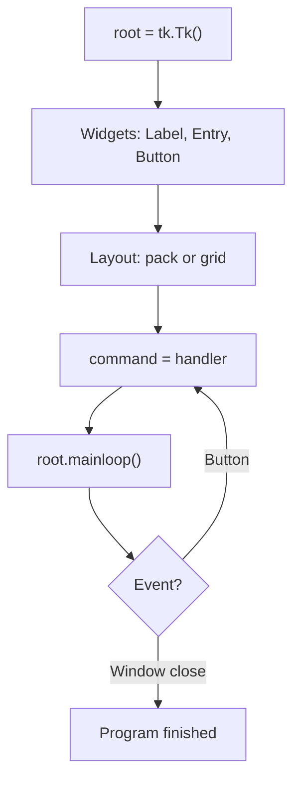

So far we have worked in the console: text in, text out. But users prefer pressing buttons to typing commands. Today we will learn to build real windowed applications with the built-in `tkinter` library. Its main advantage is that it already ships with Python — nothing to install — which means the programs will run for anyone who has Python.

## What is tkinter

`tkinter` is Python's interface to the Tk library, which can draw windows, buttons, entry fields, and other elements — they are called **widgets**. Our program is a hierarchy: the main window, and inside it — elements. Each element is a small object with methods for changing text, color, and position.

The simplest window looks like this:

```python
import tkinter as tk

root = tk.Tk()
root.title("My Window")
root.geometry("400x300")
root.mainloop()
```

`tk.Tk()` creates the main window. `title` sets the title, `geometry("400x300")` sets the window size (width×height). And the last line — `mainloop()`: it starts the **main event-handling loop**. From this point tkinter starts listening to the mouse and keyboard and "brings the app to life". The program closes when the user closes the window.

## Widgets: Label, Button, Entry

### Label — a text label

`Label` shows text or an image:

```python
label = tk.Label(root, text="Hello, World!")
label.pack()
```

### Button — a button

A button can run a function when pressed. This function is called a **handler** (callback):

```python
def say_hello():
    print("Button pressed!")

btn = tk.Button(root, text="Press me", command=say_hello)
btn.pack()
```

Note: `command` receives the function name **without parentheses** — Python does not call it immediately, it passes a reference to tkinter. tkinter will call it when the button is pressed.

### Entry — an input field

`Entry` is a single-line text field. To read what the user typed, the best approach is a `StringVar` variable:

```python
name_var = tk.StringVar()
entry = tk.Entry(root, textvariable=name_var)
entry.pack()

def show_name():
    print("Hello,", name_var.get())

tk.Button(root, text="Greet", command=show_name).pack()
```

`StringVar` is a special object that stores text and can notify tkinter of changes. The `.get()` method returns the current value, `.set()` sets a new one.

## Layouts: pack and grid

To arrange widgets in a window there are three geometry managers. The most common are `pack` and `grid`.

`pack` stacks elements one after another — top to bottom or left to right:

```python
tk.Label(root, text="Name:").pack()
tk.Entry(root).pack()
tk.Button(root, text="OK").pack()
```

`grid` places elements in rows and columns — like a table:

```python
tk.Label(root, text="Name:").grid(row=0, column=0)
tk.Entry(root).grid(row=0, column=1)
tk.Label(root, text="Age:").grid(row=1, column=0)
tk.Entry(root).grid(row=1, column=1)
```

This is convenient for forms: labels in one column, fields in another.

## Dialog windows: messagebox

Sometimes you need to show a message or ask for confirmation. For that there is the `messagebox` module:

```python
import tkinter.messagebox as mb

mb.showinfo("Done", "Data saved!")
mb.showwarning("Attention", "The field is empty")
mb.askyesno("Question", "Close for sure?")
```

These windows need no setup — they are modal, meaning they block work with the main window until the user closes them. `askyesno` returns `True` or `False` depending on the answer.

## How a tkinter app works

Any tkinter app is assembled the same way: window → widgets → layout → handlers → main loop, which calls the handlers on events:



## Lesson summary

We learned how to:

- create a window and run `mainloop()`;
- place `Label`, `Button`, `Entry` widgets;
- attach handlers via `command`;
- bind an input field to `StringVar`;
- arrange elements with `pack` and `grid`;
- show dialogs via `messagebox`.

This set is enough to write a fully working application. Shall we try?

<!--TASK-->
### Task 1
Create a 400×200 tkinter window titled "My Application". Place a `Label` with the text "Hello, World!" inside. Layout — `pack()`. Run and make sure the window opens, shows the text, and closes without errors.

### Task 2
Add a "Counter" button to Task 1. Each press should increase the counter value by 1 and show it in a `Label`. Use `StringVar` to store the number (or a plain variable + updates via `config(text=...)`). The button label should change: "Pressed: 0", "Pressed: 1", and so on.

### Task 3
Create a mini "Greeting" app: an `Entry` field for the name and a "Greet" button. On press, the name should appear in a `Label` below the field as "Hello, <name>!". If the field is empty — show a warning via `messagebox.showwarning`.

### Task 4
Build a registration form with `grid`: "Login" and "Password" labels in column 0, input fields in column 1. Below — a "Sign in" button. On press, show the message "Login: <login>, password: <password>" via `messagebox.showinfo`. Note: the password in `Entry` can be hidden with dots via the `show="*"` argument.

### Task 5
Build a small "Addition Calculator" app: two input fields for numbers, an "Add" button, and a label with the result. On press, the numbers from the fields should be converted with `int()` (or `float()`), added, and the result shown in the label: "Result: 7". Handle errors: if the user typed a non-number — show `messagebox.showerror` with the text "Enter numbers".

### Task 6
Build a "To-Do List": an `Entry` field for a new task, an "Add" button, and a `Listbox` widget 6 rows high. On "Add", the text from the field is added to the list via `insert(tk.END, ...)`, and the field is cleared; empty lines are ignored. A second "Delete" button removes the selected line via `delete(tk.ANCHOR)`, and if nothing is selected — shows `messagebox.showwarning`. Above the list, display a `Label` with the number of tasks and update it after every change via `config(text=...)`. Expected output: after adding two tasks the label shows `Tasks: 2`, after deleting one — `Tasks: 1`.

### Task 7
Build a temperature converter: an input field for degrees Celsius, a "Convert" button, and a result label. On press, read the number, convert with the formula `F = C * 9 / 5 + 32`, and show `F = <value> °F`, rounded to one decimal via `round(..., 1)`. Non-numeric input and an empty field should trigger `messagebox.showerror` with the text "Enter a number", and the result should not update. Expected output: for input `100` the label shows `F = 212.0 °F`; for input `abc` an error window appears.
<!--/TASK-->

<!--HINT-->
### Hint 1
Import `import tkinter as tk`, create `root = tk.Tk()`, set the size `root.geometry("400x200")`, the title `root.title("My Application")`. Then `label = tk.Label(root, text="Hello, World!")` and `label.pack()`. Don't forget `root.mainloop()` at the end.

### Hint 2
Create a counter variable `count = 0` and a `StringVar` for display: `counter_var = tk.StringVar()`; before the loop set `counter_var.set("Pressed: 0")`. In the handler function: `global count; count += 1; counter_var.set(f"Pressed: {count}")`. Bind it to the button via `command`.

### Hint 3
Create `name_var = tk.StringVar()` and pass it to `Entry(textvariable=name_var)`. In the handler: if `name_var.get().strip() == ""` — `messagebox.showwarning("Attention", "Enter your name")`, otherwise — `result_var.set(f"Hello, {name_var.get()}!")`, where `result_var` is a second `StringVar` for the result label.

### Hint 4
Use `grid`: `tk.Label(root, text="Login:").grid(row=0, column=0)` and `tk.Entry(root).grid(row=0, column=1)`, and similarly for the password in row 1. For the password add `show="*"`. The handler reads the values via `.get()` on the variables and calls `messagebox.showinfo`.

### Hint 5
In the handler, wrap the conversion in `try/except ValueError`: if `int(a_var.get())` raises an error — `messagebox.showerror("Error", "Enter numbers")` and `return`. Otherwise — write the result with `result_var.set(f"Result: {a + b}")`.

### Hint 6
Create `listbox = tk.Listbox(root, height=6)` and place it with `pack(fill="x")`. In the add handler: `text = entry.get().strip()`, check for emptiness, then `listbox.insert(tk.END, text)` and `entry.delete(0, tk.END)`. For deletion: `index = listbox.curselection()` — a tuple of indices; if it is empty, show a warning, otherwise `listbox.delete(index[0])`. Update the counter with a `update_count()` function where `count_label.config(text=f"Tasks: {listbox.size()}")`.

### Hint 7
Wrap the conversion in `try/except ValueError` — it catches both the empty string and text. The formula in code: `f = c * 9 / 5 + 32`, output — `result_var.set(f"F = {round(f, 1)} °F")`. Note the order: first get the number; on error show `showerror` and `return`; only then compute and update the label. Otherwise, on error the label would keep the old value with no explanation.
<!--/HINT-->

<!--SOLUTION-->
### Solution 1
Solution:

```python
import tkinter as tk

root = tk.Tk()
root.title("My Application")
root.geometry("400x200")

label = tk.Label(root, text="Hello, World!")
label.pack()

root.mainloop()
```

What is happening here? `tk.Tk()` creates the main window — the root widget. `geometry` sets its size. `Label` is a label widget; the first argument is the parent widget (`root`), then parameters. `pack()` places the label in the window and centers it automatically. Finally, `mainloop()` starts the event-handling loop — it is what "holds" the window open, listens for closure, and handles repainting. Without `mainloop()` the window would flash and close, because the program would reach the end and terminate.

### Solution 2
Solution:

```python
import tkinter as tk

root = tk.Tk()
root.title("Counter")
root.geometry("300x150")

count = 0
counter_var = tk.StringVar()
counter_var.set("Pressed: 0")

def increment():
    global count
    count += 1
    counter_var.set(f"Pressed: {count}")

label = tk.Label(root, textvariable=counter_var)
label.pack(pady=10)
button = tk.Button(root, text="Counter", command=increment)
button.pack()

root.mainloop()
```

What is happening here? `counter_var` is a `StringVar`: we don't change the label text directly, we change the variable, and tkinter updates the widget itself. In the `increment` function we increase `count` and rewrite the text. `global count` is needed because `count` is declared outside the function; without `global` Python would think we are creating a local variable — and the counter would not change. `pady=10` adds vertical padding. Note: in `command=increment` the function is passed without parentheses.

### Solution 3
Solution:

```python
import tkinter as tk
import tkinter.messagebox as mb

root = tk.Tk()
root.title("Greeting")
root.geometry("300x200")

name_var = tk.StringVar()
result_var = tk.StringVar()

def greet():
    name = name_var.get().strip()
    if name == "":
        mb.showwarning("Attention", "Enter your name")
    else:
        result_var.set(f"Hello, {name}!")

tk.Label(root, text="Your name:").pack(pady=5)
tk.Entry(root, textvariable=name_var).pack(pady=5)
tk.Button(root, text="Greet", command=greet).pack(pady=5)
tk.Label(root, textvariable=result_var).pack(pady=5)

root.mainloop()
```

What is happening here? The `greet` function runs on every button press. `name_var.get()` reads what the user typed; `.strip()` removes extra spaces at the edges. An empty field is a common case, so we handle it separately: `showwarning` shows a yellow warning and finishes the function via `else`. If there is a name, we build the string and put it into `result_var`; the label with `textvariable=result_var` updates automatically. This approach — "data in variables, widgets reflect it" — is standard for tkinter.

### Solution 4
Solution:

```python
import tkinter as tk
import tkinter.messagebox as mb

root = tk.Tk()
root.title("Sign In")
root.geometry("300x150")

login_var = tk.StringVar()
password_var = tk.StringVar()

def login():
    mb.showinfo("Data", f"Login: {login_var.get()}, password: {password_var.get()}")

tk.Label(root, text="Login:").grid(row=0, column=0, padx=10, pady=5)
tk.Entry(root, textvariable=login_var).grid(row=0, column=1)
tk.Label(root, text="Password:").grid(row=1, column=0, padx=10, pady=5)
tk.Entry(root, textvariable=password_var, show="*").grid(row=1, column=1)
tk.Button(root, text="Sign in", command=login).grid(row=2, column=0, columnspan=2, pady=10)

root.mainloop()
```

What is happening here? `grid` builds a table: row 0 — login, row 1 — password, row 2 — the button. `padx` and `pady` set padding around cells — without them the elements would stick together. `columnspan=2` stretches the button across both columns. The `show="*"` argument hides the typed password behind dots — a security requirement even in a learning project. The `login` handler simply collects the values and shows them in an info window. This form is easy to extend: add a password length check, saving, etc.

### Solution 5
Solution:

```python
import tkinter as tk
import tkinter.messagebox as mb

root = tk.Tk()
root.title("Calculator")
root.geometry("300x200")

a_var = tk.StringVar()
b_var = tk.StringVar()
result_var = tk.StringVar()

def add():
    try:
        a = int(a_var.get())
        b = int(b_var.get())
    except ValueError:
        mb.showerror("Error", "Enter numbers")
        return
    result_var.set(f"Result: {a + b}")

tk.Label(root, text="First number:").grid(row=0, column=0, padx=10, pady=5)
tk.Entry(root, textvariable=a_var).grid(row=0, column=1)
tk.Label(root, text="Second number:").grid(row=1, column=0, padx=10, pady=5)
tk.Entry(root, textvariable=b_var).grid(row=1, column=1)
tk.Button(root, text="Add", command=add).grid(row=2, column=0, columnspan=2, pady=10)
tk.Label(root, textvariable=result_var).grid(row=3, column=0, columnspan=2)

root.mainloop()
```

What is happening here? The main novelty is error handling. `int()` raises `ValueError` if the string is not a number (for example, "abc"). We catch this exception in `try/except`, show a red error window via `showerror`, and exit the function with `return` — the result does not update. If the numbers are valid, we add them and write the result. Note the order: first validation (checking), then computation. This is the correct structure of any input handler: try to get the data, handle the error, then do the useful work.

### Solution 6
Solution:

```python
import tkinter as tk
import tkinter.messagebox as mb

root = tk.Tk()
root.title("To-Do List")
root.geometry("320x320")

count_var = tk.StringVar()
count_var.set("Tasks: 0")

entry = tk.Entry(root)
entry.pack(fill="x", padx=10, pady=5)

listbox = tk.Listbox(root, height=6)
listbox.pack(fill="both", expand=True, padx=10)

count_label = tk.Label(root, textvariable=count_var)
count_label.pack(pady=5)

def update_count():
    count_var.set(f"Tasks: {listbox.size()}")

def add_task():
    text = entry.get().strip()
    if text == "":
        mb.showwarning("Attention", "Enter a task")
        return
    listbox.insert(tk.END, text)
    entry.delete(0, tk.END)
    update_count()

def remove_task():
    selected = listbox.curselection()
    if not selected:
        mb.showwarning("Attention", "Select a task")
        return
    listbox.delete(selected[0])
    update_count()

tk.Button(root, text="Add", command=add_task).pack(fill="x", padx=10, pady=2)
tk.Button(root, text="Delete", command=remove_task).pack(fill="x", padx=10, pady=2)

root.mainloop()
```

What is happening here? `Listbox` stores its strings itself, so a separate Python list is unnecessary: `size()` returns the current number of items, `insert(tk.END, ...)` adds to the end, and `delete(index)` removes by index. `curselection()` returns a tuple of indices of the selected rows (in single-selection mode — one element or an empty tuple), so before deleting you must check that there is a selection. The `update_count` function is called after every change — so the label never diverges from the real content. Note `tk.END` and `tk.ANCHOR`: these are tkinter constants, not strings, and should not be confused with indices.

### Solution 7
Solution:

```python
import tkinter as tk
import tkinter.messagebox as mb

root = tk.Tk()
root.title("Temperature Converter")
root.geometry("320x160")

celsius_var = tk.StringVar()
result_var = tk.StringVar()
result_var.set("F = —")

def convert():
    try:
        c = float(celsius_var.get().replace(",", "."))
    except ValueError:
        mb.showerror("Error", "Enter a number")
        return
    f = c * 9 / 5 + 32
    result_var.set(f"F = {round(f, 1)} °F")

tk.Label(root, text="Temperature, °C:").pack(pady=(10, 0))
tk.Entry(root, textvariable=celsius_var).pack(pady=5)
tk.Button(root, text="Convert", command=convert).pack(pady=5)
tk.Label(root, textvariable=result_var, font=("Arial", 14)).pack(pady=5)

root.mainloop()
```

What is happening here? `float` accepts both integer and fractional notations, and `replace(",", ".")` saves users who habitually type a decimal comma. `try/except ValueError` covers three bad cases at once: an empty field, text, and a lone comma. After the error, `return` is mandatory — otherwise the code would continue computing with an undefined `c`. The conversion formula is classic: multiply by 9, divide by 5, add 32; `round(f, 1)` keeps one decimal place. Note that the result label is bound to a `StringVar`, so `set` updates the screen immediately without `config`.
<!--/SOLUTION-->

<!--QUIZ-->
What does the mainloop() method do on the root window?
- Closes the window
- Starts the event-handling loop
- Clears all widgets
* Correct answer: Starts the event-handling loop
mainloop() starts the main loop: tkinter listens for events and updates the window until it closes.

Which widget is used for single-line text input?
- Label
- Entry
- Button
* Correct answer: Entry
Entry is a single-line input field; multiline text is Text.

How is a handler passed to a button?
- command=my_func() — with parentheses
- command=my_func — without parentheses
- onclick="my_func"
* Correct answer: command=my_func — without parentheses
Without parentheses, a reference to the function is passed; tkinter calls it when the button is pressed.

What is the StringVar variable for?
- To store floating-point numbers
- To store text and automatically sync it with the widget
- To change the window size
* Correct answer: To store text and automatically sync it with the widget
StringVar stores text; when .set() is called, the bound widget updates automatically.

How do you get the current value of a StringVar?
- .get()
- .value()
- .text()
* Correct answer: .get()
The get() method returns the stored text.

How is grid different from pack?
- grid places elements in rows and columns
- grid works faster
- grid cannot be used with Label
* Correct answer: grid places elements in rows and columns
grid works like a table (row/column), while pack stacks elements one after another.

What will messagebox.askyesno("Question", "Are you sure?") return?
- Nothing
- True or False
- Always True
* Correct answer: True or False
askyesno returns True for "Yes" and False for "No".

How do you hide a typed password in an Entry?
- password=True
- show="*"
- hidden="*"
* Correct answer: show="*"
The show="*" argument replaces typed characters with asterisks.

Which widget is suitable for a scrollable list of strings?
- Listbox
- Label
- Entry
* Correct answer: Listbox
Listbox stores a set of strings and lets you select them with the mouse.

What does listbox.insert(tk.END, text) do?
- Adds a string to the end of the list
- Replaces the whole list with one string
- Deletes the last string
* Correct answer: Adds a string to the end of the list
tk.END is the "to the end" constant; insert takes an index and text.

What will listbox.curselection() return if nothing is selected?
- An empty tuple
- The number -1
- None
* Correct answer: An empty tuple
That is why you check `if not selected:` before deleting.

Why is return needed after showerror in the temperature converter?
- To avoid computing the result with an undefined variable
- To close the application window
- To clear the input field
* Correct answer: To avoid computing the result with an undefined variable
Without return, execution continues and a NameError or wrong result occurs.
<!--/QUIZ-->
