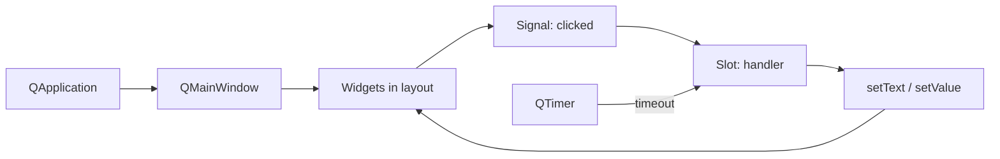

Tkinter is great for simple applications, but professional tools have serious advantages: a rich widget library, style and table support, multimedia and graphics handling, and high performance. The two big players in the Python world are **PyQt** (from Riverbank) and **PySide** (the official Qt-for-Python version). Their APIs are nearly identical, so once you learn one, you can easily switch to the other. In this lesson we use PyQt6.

## Installation and the application skeleton

```bash
pip install PyQt6
```

A minimal PyQt6 application:

```python
import sys
from PyQt6.QtWidgets import QApplication, QMainWindow, QLabel

app = QApplication(sys.argv)
window = QMainWindow()
window.setWindowTitle("My Window")
window.resize(400, 300)

label = QLabel("Hello, PyQt!", window)
window.setCentralWidget(label)

window.show()
sys.exit(app.exec())
```

Let's go line by line. `QApplication` is the whole application; it manages the event loop, settings, and global state. `QMainWindow` is the main window with a ready-made structure: menu, toolbar, status bar. `QLabel` is a label; to make it the center of the window, pass it to `setCentralWidget`. And the finale: `window.show()` makes the window visible, and `app.exec()` starts the event loop. `sys.exit` passes the app's exit code to the system.

## Signals and slots

The heart of Qt is the **signals and slots** mechanism. A signal is an event (for example, a button press), and a slot is a method that reacts to it. They are connected via `connect`:

```python
from PyQt6.QtWidgets import QPushButton, QLabel

def on_click():
    label.setText("Button pressed!")

button = QPushButton("Press")
button.clicked.connect(on_click)
```

Note: `connect` receives the function without parentheses — exactly like `command` in tkinter. The difference is that Qt signals are much richer: a button has `clicked(bool)`, an input field has `textChanged(str)`, a slider has `valueChanged(int)`. The data a signal carries is passed to the slot as arguments:

```python
from PyQt6.QtWidgets import QLineEdit

def on_text(text):
    print("Entered:", text)

line_edit = QLineEdit()
line_edit.textChanged.connect(on_text)
```

Slots can be plain functions or class methods. And if you need to pass extra arguments — use `lambda`.

## Layouts: QVBoxLayout and QHBoxLayout

In PyQt, widgets are arranged not by coordinates but by **layouts** — layout managers. `QVBoxLayout` stacks elements vertically, `QHBoxLayout` horizontally:

```python
from PyQt6.QtWidgets import QWidget, QVBoxLayout, QPushButton

central = QWidget()
layout = QVBoxLayout(central)
layout.addWidget(QPushButton("First"))
layout.addWidget(QPushButton("Second"))
window.setCentralWidget(central)
```

A layout automatically rearranges elements when the window is resized — nothing "drifts" or overlaps. This is a huge advantage over manual placement.

## QTimer: animations and timers

`QTimer` can call a function at equal time intervals. It is the foundation of any animation and stopwatch:

```python
from PyQt6.QtCore import QTimer

seconds = 0

def tick():
    global seconds
    seconds += 1
    label.setText(f"Elapsed: {seconds} s")

timer = QTimer()
timer.timeout.connect(tick)
timer.start(1000)  # every 1000 ms = 1 second
```

`timer.start(1000)` starts the timer; every second `QTimer` emits a `timeout` signal, which calls `tick`. To stop — `timer.stop()`. The timer does not block the interface: while the count runs, the window keeps responding to the mouse.

## Lists: QListWidget

For lists there is a ready-made `QListWidget` widget:

```python
from PyQt6.QtWidgets import QListWidget

list_widget = QListWidget()
list_widget.addItem("First item")
list_widget.addItem("Second item")
```

It is a convenient base for todo apps, logs, and menus.

## Diagram: from signal to slot

The main idea of PyQt is that events do not call code directly — they go through signals. The diagram shows the full path from a click to updated text:



## Lesson summary

We learned how to:

- install PyQt6 and assemble an app from `QApplication`, `QMainWindow`, `setCentralWidget`;
- connect events (signals) to handlers (slots) via `connect`;
- arrange widgets with `QVBoxLayout`/`QHBoxLayout`;
- run periodic actions with `QTimer`;
- work with lists via `QListWidget`.

This is the foundation for serious desktop applications. Let's practice.

<!--TASK-->
### Task 1
Create a PyQt6 application: a 500×350 window titled "My First PyQt". In the center — a `QLabel` with the text "Hello, PyQt!" and font size 20 (use `setFont` with `QFont` from `PyQt6.QtGui`). The window should open and close without errors.

### Task 2
Add a `QPushButton` "Press me" and a `QLineEdit` input field to Task 1. When the button is pressed, the text from the field should be copied into the label: if the field is empty — the label becomes "The field is empty", otherwise — "You entered: <text>". Use the `clicked` signal and the field's `text()` method.

### Task 3
Rework the app to use layouts: create a central `QWidget`, and inside it a `QVBoxLayout`. Place an input field, a button, and a result label in it. Add a second "Clear" button that clears the field and the label. Check that the elements do not drift when the window is stretched.

### Task 4
Create a stopwatch with `QTimer`: a label in the center shows the elapsed seconds, a "Start" button starts a timer at 1000 ms, "Stop" stops it, "Reset" zeroes the counter and the label. Restarting continues the count (does not reset it).

### Task 5
Build a todo app: a `QListWidget` for tasks, an input field, and an "Add" button. On press, the text from the field is added to the list as a new item and the field is cleared. A "Delete Selected" button removes the selected item (`currentRow()` + `takeItem(...)`). If the field is empty — show `QMessageBox.warning`.

### Task 6
Make a countdown timer: a label with the number 10, "Start" and "Reset" buttons. On "Start", start a `QTimer` with a 1000 ms interval; each firing decreases the number by 1 and shows it in the label. At zero, stop the timer and show `QMessageBox.information` with the text "Time's up!". The "Reset" button stops the timer and returns to 10, and pressing "Start" again after zero restarts the count. Expected output: the label changes once per second — `10`, `9`, `8`…, after zero a dialog appears, and the window does not freeze during the count.

### Task 7
Build an "estimate calculator": three input fields — price per unit, quantity, and discount in percent, a "Calculate" button, and a total label. On press, convert the first two values with `float()` and `int()`, and the discount with `float()` (an empty field counts as zero), compute `price * qty * (1 - discount / 100)` and show `Total: <amount> ₽` rounded to two decimals. On non-numeric input show `QMessageBox.warning` with the text "Enter numbers"; on a discount outside 0–100 show "Discount from 0 to 100". Expected output: for price `250`, quantity `4`, and discount `10` the label shows `Total: 900.0 ₽`.
<!--/TASK-->

<!--HINT-->
### Hint 1
Import `from PyQt6.QtWidgets import QApplication, QMainWindow, QLabel` and `from PyQt6.QtGui import QFont`. Create `app = QApplication(sys.argv)`, `window = QMainWindow()`, then `label = QLabel("Hello, PyQt!", window)`, `label.setFont(QFont("Arial", 20))` and `window.setCentralWidget(label)`. At the end `window.show(); sys.exit(app.exec())`.

### Hint 2
Create `line_edit = QLineEdit()` and `button = QPushButton("Press me")`. In the handler `def on_click():` get `text = line_edit.text()`; if `text == ""` — `label.setText("The field is empty")`, otherwise — `label.setText(f"You entered: {text}")`. Connect: `button.clicked.connect(on_click)`.

### Hint 3
Create `central = QWidget()` and `layout = QVBoxLayout(central)`, then `layout.addWidget(line_edit)`, `layout.addWidget(button)`, `layout.addWidget(label)`, `layout.addWidget(clear_button)` and `window.setCentralWidget(central)`. The "Clear" button: `line_edit.clear()` and `label.setText("")`.

### Hint 4
Create `seconds = 0` and `label` with the text "0 s". `timer = QTimer()`; `timer.timeout.connect(tick)`; in `tick()` — `global seconds; seconds += 1; label.setText(f"{seconds} s")`. Start: `timer.start(1000)`, stop: `timer.stop()`, reset: `timer.stop(); seconds = 0; label.setText("0 s")`.

### Hint 5
For adding: `if text.strip() == "": QMessageBox.warning(window, "Attention", "Enter a task")` else `list_widget.addItem(text); line_edit.clear()`. For deletion: `row = list_widget.currentRow(); if row >= 0: list_widget.takeItem(row)`.

### Hint 6
Create `seconds = 10` and `timer = QTimer()`, connect `timer.timeout.connect(tick)`. In `tick` declare `global seconds`, decrease it, update `label.setText(str(seconds))`, and when `seconds <= 0` call `timer.stop()` and `QMessageBox.information(...)`. Start: if `seconds <= 0`, first return to 10, then `timer.start(1000)`. Reset: `timer.stop()`, `seconds = 10`, update the label.

### Hint 7
Create three `QLineEdit` and one `QLabel` for the total, arrange them with `QVBoxLayout`. In the handler wrap all conversions in one `try/except ValueError` — one error covers three fields. For the discount use `float(discount_edit.text().replace(",", ".") or 0)`: an empty string becomes 0. After computing, round the result with `round(total, 2)`.
<!--/HINT-->

<!--SOLUTION-->
### Solution 1
Solution:

```python
import sys
from PyQt6.QtWidgets import QApplication, QMainWindow, QLabel
from PyQt6.QtGui import QFont

app = QApplication(sys.argv)

window = QMainWindow()
window.setWindowTitle("My First PyQt")
window.resize(500, 350)

label = QLabel("Hello, PyQt!", window)
label.setFont(QFont("Arial", 20))
window.setCentralWidget(label)

window.show()
sys.exit(app.exec())
```

What is happening here? `QApplication(sys.argv)` initializes the application — without it no widget works. `QMainWindow` creates the main window. `QLabel` is a label; `QFont("Arial", 20)` sets the font and size. Because the window manages the whole area via `setCentralWidget`, the label stretches around the center. `window.show()` makes the window visible; `app.exec()` starts the event loop and returns the exit code, which `sys.exit` passes to the operating system. Note: the whole program waits until the user closes the window — this is normal GUI behavior.

### Solution 2
Solution:

```python
import sys
from PyQt6.QtWidgets import QApplication, QMainWindow, QLabel, QLineEdit, QPushButton

app = QApplication(sys.argv)
window = QMainWindow()
window.setWindowTitle("Text Copy")
window.resize(400, 200)

label = QLabel("Empty for now", window)
line_edit = QLineEdit(window)
button = QPushButton("Press me", window)

def on_click():
    text = line_edit.text()
    if text == "":
        label.setText("The field is empty")
    else:
        label.setText(f"You entered: {text}")

button.clicked.connect(on_click)

window.setCentralWidget(label)
window.show()
sys.exit(app.exec())
```

What is happening here? The `on_click` handler runs on every `clicked` signal. The `text()` method returns the current contents of the input field. We branch: an empty field — one text, non-empty — another. `label.setText(...)` changes the label's contents. Note: `connect` takes a reference to the function without parentheses — Qt itself will call it on click. The order: `setCentralWidget` accepts only one widget, so the label "ate" all the space; in the next task we'll fix this with layouts.

### Solution 3
Solution:

```python
import sys
from PyQt6.QtWidgets import (QApplication, QMainWindow, QWidget, QLabel,
                             QLineEdit, QPushButton, QVBoxLayout)

app = QApplication(sys.argv)
window = QMainWindow()
window.setWindowTitle("Layouts")
window.resize(400, 250)

central = QWidget()
layout = QVBoxLayout(central)

label = QLabel("The result will appear here")
line_edit = QLineEdit()
button = QPushButton("Show text")
clear_button = QPushButton("Clear")

def on_click():
    text = line_edit.text()
    label.setText("The field is empty" if text == "" else f"You entered: {text}")

def on_clear():
    line_edit.clear()
    label.setText("The result will appear here")

button.clicked.connect(on_click)
clear_button.clicked.connect(on_clear)

layout.addWidget(line_edit)
layout.addWidget(button)
layout.addWidget(clear_button)
layout.addWidget(label)
window.setCentralWidget(central)
window.show()
sys.exit(app.exec())
```

What is happening here? `QVBoxLayout(central)` attaches the layout to the central widget. `addWidget` adds elements from top to bottom. Now all widgets live together in one container — when the window is stretched, they share the space proportionally and do not overlap. We also added a "Clear" button with its own `on_clear` slot. The ternary operator in `on_click` is a compact replacement for `if/else`. This structure — central widget + layout — is canonical for all PyQt applications.

### Solution 4
Solution:

```python
import sys
from PyQt6.QtCore import QTimer
from PyQt6.QtWidgets import (QApplication, QMainWindow, QWidget, QLabel,
                             QPushButton, QVBoxLayout)

app = QApplication(sys.argv)
window = QMainWindow()
window.setWindowTitle("Stopwatch")
window.resize(300, 200)

central = QWidget()
layout = QVBoxLayout(central)
seconds = 0
label = QLabel("0 s")
start_button = QPushButton("Start")
stop_button = QPushButton("Stop")
reset_button = QPushButton("Reset")

def tick():
    global seconds
    seconds += 1
    label.setText(f"{seconds} s")

timer = QTimer()
timer.timeout.connect(tick)

start_button.clicked.connect(lambda: timer.start(1000))
stop_button.clicked.connect(timer.stop)
reset_button.clicked.connect(lambda: (timer.stop(), globals().update(seconds=0), label.setText("0 s")))

for w in (label, start_button, stop_button, reset_button):
    layout.addWidget(w)

window.setCentralWidget(central)
window.show()
sys.exit(app.exec())
```

What is happening here? `QTimer` works in the main thread: when `timeout` arrives, Qt calls `tick`. `timer.start(1000)` starts periodic calls every 1000 ms. The "Stop" button gets the `timer.stop` method itself as its slot — note, without parentheses and without lambda: the signal simply calls the method. "Reset" is more complex: we need to stop the timer, zero `seconds`, and update the label, so we use a lambda with a tuple of actions. `globals().update(seconds=0)` is a trick to change a global variable from a lambda; in a real project it is better to store state in class attributes of the application, but for a script it's acceptable.

### Solution 5
Solution:

```python
import sys
from PyQt6.QtWidgets import (QApplication, QMainWindow, QWidget, QLabel,
                             QLineEdit, QPushButton, QListWidget, QVBoxLayout,
                             QMessageBox)

app = QApplication(sys.argv)
window = QMainWindow()
window.setWindowTitle("My Tasks")
window.resize(350, 350)

central = QWidget()
layout = QVBoxLayout(central)
list_widget = QListWidget()
line_edit = QLineEdit()
add_button = QPushButton("Add")
remove_button = QPushButton("Delete Selected")

def add_task():
    text = line_edit.text().strip()
    if text == "":
        QMessageBox.warning(window, "Attention", "Enter a task")
        return
    list_widget.addItem(text)
    line_edit.clear()

def remove_task():
    row = list_widget.currentRow()
    if row < 0:
        QMessageBox.information(window, "Hint", "Select a task first")
        return
    list_widget.takeItem(row)

add_button.clicked.connect(add_task)
remove_button.clicked.connect(remove_task)

layout.addWidget(list_widget)
layout.addWidget(line_edit)
layout.addWidget(add_button)
layout.addWidget(remove_button)

window.setCentralWidget(central)
window.show()
sys.exit(app.exec())
```

What is happening here? `QListWidget` stores the list items. `addItem` adds a new one; `takeItem(row)` removes by index. `currentRow()` returns the index of the selected item or `-1` if nothing is selected — we handle that case separately. `QMessageBox.warning` and `information` are modal dialogs that block the window until the user responds. Note the `.strip()`: a string of only spaces also counts as empty. This is a fully working application — add "Done" and "Save to file" buttons, and you get a real planner.

### Solution 6
Solution:

```python
import sys
from PyQt6.QtCore import QTimer
from PyQt6.QtWidgets import (QApplication, QMainWindow, QWidget, QLabel,
                             QPushButton, QVBoxLayout, QMessageBox)

app = QApplication(sys.argv)
window = QMainWindow()
window.setWindowTitle("Countdown")
window.resize(300, 200)

central = QWidget()
layout = QVBoxLayout(central)
label = QLabel("10")
label.setStyleSheet("font-size: 40px;")
start_button = QPushButton("Start")
reset_button = QPushButton("Reset")

seconds = 10
timer = QTimer()

def tick():
    global seconds
    seconds -= 1
    label.setText(str(seconds))
    if seconds <= 0:
        timer.stop()
        QMessageBox.information(window, "Done", "Time's up!")

def start():
    global seconds
    if seconds <= 0:
        seconds = 10
        label.setText(str(seconds))
    timer.start(1000)

def reset():
    global seconds
    timer.stop()
    seconds = 10
    label.setText("10")

timer.timeout.connect(tick)
start_button.clicked.connect(start)
reset_button.clicked.connect(reset)

for widget in (label, start_button, reset_button):
    layout.addWidget(widget)

window.setCentralWidget(central)
window.show()
sys.exit(app.exec())
```

What is happening here? `QTimer` lives in the main thread and every second emits `timeout`, calling `tick`. The `seconds` variable is global, so both functions need `global` — otherwise Python would create local copies and the count would not change. The check `if seconds <= 0` stops the timer: without `timer.stop()` it would keep going into negative numbers. In `start` there is protection against restarting after zero — otherwise the first tick would give `-1`. Note: `QMessageBox.information` is modal, but it is called after `stop()`, so the count does not continue under the dialog.

### Solution 7
Solution:

```python
import sys
from PyQt6.QtWidgets import (QApplication, QMainWindow, QWidget, QLabel,
                             QLineEdit, QPushButton, QVBoxLayout, QMessageBox)

app = QApplication(sys.argv)
window = QMainWindow()
window.setWindowTitle("Estimate")
window.resize(360, 300)

central = QWidget()
layout = QVBoxLayout(central)

price_edit = QLineEdit()
price_edit.setPlaceholderText("Price per unit")
qty_edit = QLineEdit()
qty_edit.setPlaceholderText("Quantity")
discount_edit = QLineEdit()
discount_edit.setPlaceholderText("Discount, % (optional)")
result = QLabel("Total: —")
calc_button = QPushButton("Calculate")

def calculate():
    try:
        price = float(price_edit.text().replace(",", "."))
        qty = int(qty_edit.text())
        discount = float(discount_edit.text().replace(",", ".") or 0)
    except ValueError:
        QMessageBox.warning(window, "Error", "Enter numbers")
        return
    if not 0 <= discount <= 100:
        QMessageBox.warning(window, "Error", "Discount from 0 to 100")
        return
    total = price * qty * (1 - discount / 100)
    result.setText(f"Total: {round(total, 2)} ₽")

calc_button.clicked.connect(calculate)

for widget in (price_edit, qty_edit, discount_edit, result, calc_button):
    layout.addWidget(widget)

window.setCentralWidget(central)
window.show()
sys.exit(app.exec())
```

What is happening here? One `try` covers three conversions: any non-numeric value leads to `ValueError`, and we show one clear message instead of three different ones. The `float(text or 0)` construct uses the fact that an empty string is falsy: an empty discount field becomes `0` instead of an error. The range check `0 <= discount <= 100` is Python's chained comparison, which reads like math notation. The result is rounded to kopecks via `round(total, 2)`. Note the `.replace(",", ".")`: without it `float("12,5")` would raise an exception even though the user entered a normal number.
<!--/SOLUTION-->

<!--QUIZ-->
Which class is needed to start the PyQt6 event loop?
- QMainWindow
- QApplication
- QWidget
* Correct answer: QApplication
QApplication is the application; its exec() method starts the event loop.

How is a button's signal connected to a function?
- button.clicked.connect(my_func) — without parentheses
- button.clicked = my_func()
- button.on_click(my_func)
* Correct answer: button.clicked.connect(my_func) — without parentheses
connect takes a reference to the function; Qt calls it when the signal fires.

What does setCentralWidget do?
- Sets the window title
- Places the main widget in the window
- Changes the window size
* Correct answer: Places the main widget in the window
setCentralWidget makes the widget the "center" of QMainWindow.

What is the layout manager for vertical arrangement called?
- QHBoxLayout
- QVBoxLayout
- QGridLayout
* Correct answer: QVBoxLayout
QVBoxLayout places elements vertically, top to bottom.

Which timer signal fires at regular intervals?
- timeout
- tick
- fire
* Correct answer: timeout
QTimer emits timeout after the given interval; it is connected to a slot via connect.

What does the millisecond argument of timer.start(1000) mean?
- The timer fires after 1000 seconds
- The interval between firings is 1000 ms
- The timer stops after 1000 ms
* Correct answer: The interval between firings is 1000 ms
start(1000) is a periodic call once per second.

Which method returns the index of the selected item in QListWidget?
- selectedRow()
- currentRow()
- index()
* Correct answer: currentRow()
currentRow() returns the index of the selected item or -1 if nothing is selected.

How does PySide6 differ from PyQt6?
- They are different programming languages
- Nearly identical APIs, different owner companies
- PySide6 does not support Qt
* Correct answer: Nearly identical APIs, different owner companies
PyQt6 (Riverbank) and PySide6 (Qt for Python) have nearly identical APIs — code ports with minimal changes.

Which QTimer signal calls the handler every 1000 ms?
- timeout
- clicked
- tick
* Correct answer: timeout
QTimer emits timeout after the given interval; it is connected to a slot.

Why is the line global seconds needed inside tick()?
- To change a variable declared outside the function
- To create a new variable
- To speed up the timer
* Correct answer: To change a variable declared outside the function
Without global, Python creates a local variable and the outer value stays unchanged.

What happens if you don't stop QTimer at zero?
- The countdown goes into negative numbers
- The app freezes
- The timer resets itself
* Correct answer: The countdown goes into negative numbers
Without timer.stop(), the timeout signal keeps arriving every second.

Why does the estimate calculator need try/except around float()?
- To handle non-numeric input without crashing the program
- To speed up calculations
- To round the result
* Correct answer: To handle non-numeric input without crashing the program
float raises ValueError on text and empty strings — it is caught and a warning is shown.
<!--/QUIZ-->
