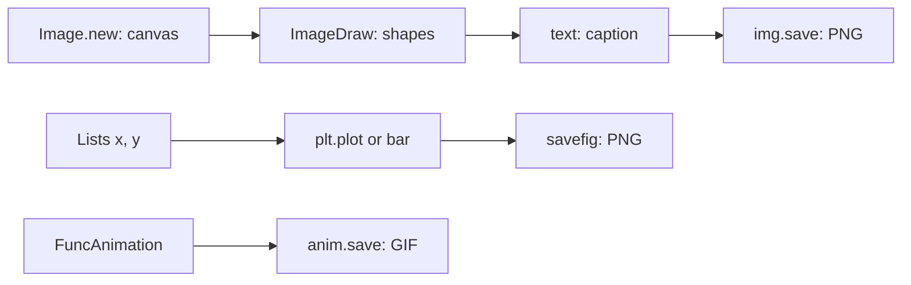

Games are not the only things that draw on screen. Programs process photos, build charts, and generate images for reports and memes. Today we will get to know two libraries: **Pillow** — for working with raster images, and **matplotlib** — for charts and animations. Both install with one command:

```bash
pip install Pillow matplotlib
```

## Pillow: creating images

Pillow (the `PIL` module) can open, create, edit, and save pictures in dozens of formats. Let's start with a blank canvas:

```python
from PIL import Image, ImageDraw

img = Image.new("RGB", (400, 300), "skyblue")
draw = ImageDraw.Draw(img)
```

`Image.new("RGB", (400, 300), "skyblue")` creates a 400×300 image filled with sky blue. `"RGB"` is the color model. `ImageDraw.Draw(img)` returns an object on which we will draw shapes. Next — like in pygame:

```python
draw.rectangle([50, 100, 200, 250], fill="brown")        # house
draw.ellipse([60, 60, 140, 140], fill="yellow")          # sun
draw.polygon([(40, 100), (210, 100), (125, 40)], fill="red")  # roof
img.save("house.png")
```

Pillow coordinates are tuples or lists of four numbers: `(left, top, right, bottom)`. `rectangle` draws a rectangle, `ellipse` draws an oval (inscribed in a rectangle), `polygon` draws a polygon from a list of points. `img.save("house.png")` saves the result to a file — and you have a finished picture.

## Text and resizing

Text is added with the `text` method. The default font is often small, so let's load a system one:

```python
from PIL import ImageFont

font = ImageFont.truetype("arial.ttf", 36)
draw.text((20, 20), "Hello!", fill="black", font=font)
```

`ImageFont.truetype("arial.ttf", 36)` loads a font from a file. Fonts live in different places on different systems; if `arial.ttf` is not found, try `"DejaVuSans.ttf"` (Linux) or the path to a system font. Resizing a finished image is simple:

```python
small = img.resize((200, 150))
small.save("house_small.png")
```

There is also a smarter method — `thumbnail`, which preserves proportions and never enlarges the image.

## matplotlib: charts

matplotlib is the standard for visualization in Python. The simplest line chart:

```python
import matplotlib.pyplot as plt

x = [0, 1, 2, 3, 4]
y = [0, 1, 4, 9, 16]
plt.plot(x, y, marker="o")
plt.xlabel("x")
plt.ylabel("y")
plt.title("Squares of numbers")
plt.savefig("squares.png")
plt.close()
```

`plt.plot` draws a line through the points; `xlabel`/`ylabel` label the axes; `title` sets the title; `savefig` saves the figure to a file; `close` frees memory — without it images accumulate. For new charts it is useful to build points with lists or `numpy`, but for this lesson plain lists are enough.

Histograms are also frequent visitors:

```python
plt.bar(["Jan", "Feb", "Mar"], [10, 15, 8])
plt.savefig("bars.png")
```

## Animations: FuncAnimation

Real magic is animated charts. `matplotlib.animation.FuncAnimation` calls a function for each frame:

```python
import matplotlib.pyplot as plt
from matplotlib.animation import FuncAnimation

fig, ax = plt.subplots()
x = []
y = []

def animate(frame):
    x.append(frame / 10)
    y.append(int(frame / 10) ** 2)
    ax.clear()
    ax.plot(x, y, color="blue")
    ax.set_title(f"Frame {frame}")

anim = FuncAnimation(fig, animate, frames=50, interval=50)
anim.save("parabola.gif", writer="pillow")
```

The `animate(frame)` function receives the frame number; in each frame we add a point, clear the axes (`ax.clear()`), and redraw. `interval=50` — the pause between frames in milliseconds. You can save the animation to GIF with `writer="pillow"` — using our first library, of course.

## Diagram: two tools — two results

Pillow and matplotlib solve different tasks, but both follow the same "created an object → drew → saved a file" scheme:



## Lesson summary

We learned how to:

- create images and draw shapes and text on them in Pillow;
- resize pictures and save them;
- build line charts and histograms in matplotlib;
- make animations with `FuncAnimation` and save them to GIF.

These skills will come in handy in reports, bots, and automatic image generation.

<!--TASK-->
### Task 1
Create a 500×400 image in Pillow with a sky-blue background (specify the color as the string `"skyblue"`). Draw a green rectangle — a "lawn" at the bottom, a brown house rectangle, a red triangular roof (`polygon`), and a yellow sun (`ellipse`) in the corner. Save the result to `scene.png`.

### Task 2
Open the `scene.png` file created earlier, shrink it to a width of 250 pixels (keeping proportions — compute the height), and draw the caption "My Landscape" in the top-left corner with font size 24. Save as `scene_small.png`. Check that the file exists and has size 250×200.

### Task 3
Plot the function `y = x ** 2 - 2 * x + 1` on the interval from -3 to 5 in matplotlib. Build `x` (points every 0.5) and `y` lists. Label the axes, set a title, and save to `parabola.png` via `savefig`.

### Task 4
Make a bar chart in matplotlib: months "January", "February", "March", "April" on the horizontal axis; sales values 120, 150, 90, 170 on the vertical. Add axis labels, the title "Sales by Month", and save to `sales.png`. Use `plt.bar`.

### Task 5
Create a falling-object animation: the `animate(frame)` function should draw a circle (`plt.Circle`) whose `y` coordinate decreases each frame (the object falls). Limit the `y` axis from 0 to 10 (`set_ylim`). Save the animation to `falling.gif` with `FuncAnimation` and `writer="pillow"`.

### Task 6
Open the finished `scene.png` file and add a frame and a caption to it. The frame is four thin rectangles (or one `rectangle` with the `width=6` parameter) along the image edge in `"black"`. Draw the caption "My Landscape" in the bottom-right corner with font size 20, first subtracting the text's width and height from the picture's dimensions so it does not overflow the edge. Save the result to `scene_framed.png`. Expected output: `Saved: (500, 400)` is printed to the console, and the opened file shows the same picture with a black frame and a caption in the corner.

### Task 7
Plot two graphs on one figure in matplotlib: `y = x` and `y = x ** 2` for `x` from 0 to 5 with step 0.5. Make the first line blue with circle markers, the second red with square markers, give each a `label`, and show a legend via `plt.legend()`. Label the axes, set the title "Linear and Quadratic Functions", enable the grid, and save to `compare.png` via `savefig`, then call `plt.close()`. Expected output: `Points: 11` is printed to the console, and the picture shows two lines and a legend in the corner.
<!--/TASK-->

<!--HINT-->
### Hint 1
`img = Image.new("RGB", (500, 400), "skyblue")`, then `draw = ImageDraw.Draw(img)`. Rectangles — `draw.rectangle([x1, y1, x2, y2], fill="...")`, the roof — `draw.polygon([(50, 200), (250, 200), (150, 120)], fill="red")`. Saving — `img.save("scene.png")`.

### Hint 2
Open with `Image.open("scene.png")`, compute the height proportionally: `new_height = int(img.height * 250 / img.width)`, then `img.resize((250, new_height))`. Text — `draw.text((10, 10), "My Landscape", fill="black", font=ImageFont.truetype("arial.ttf", 24))`.

### Hint 3
Build `x = [i / 2 for i in range(-6, 11)]` (that's -3.0, -2.5, ..., 5.0) and `y = [v ** 2 - 2 * v + 1 for v in x]`. Then `plt.plot(x, y)`, `plt.xlabel("x")`, `plt.ylabel("y")`, `plt.title("Parabola")`, `plt.savefig("parabola.png")`.

### Hint 4
`plt.bar(["January", "February", "March", "April"], [120, 150, 90, 170])`. Then labels: `plt.xlabel("Month")`, `plt.ylabel("Sales")`, `plt.title("Sales by Month")`, `plt.savefig("sales.png")`.

### Hint 5
Create a figure `fig, ax = plt.subplots()`, set `ax.set_xlim(0, 10); ax.set_ylim(0, 10)`. In `animate(frame)`: `ax.clear()`, set `set_xlim/set_ylim` again, then `ax.add_patch(plt.Circle((5, 10 - frame * 0.2), 0.5))`. `FuncAnimation(fig, animate, frames=50, interval=50)` and `anim.save("falling.gif", writer="pillow")`.

### Hint 6
Open the picture `img = Image.open("scene.png")`, create `draw = ImageDraw.Draw(img)`. The frame: `draw.rectangle([0, 0, img.width - 1, img.height - 1], outline="black", width=6)`. For the caption load the font with `ImageFont.truetype("arial.ttf", 20)` inside `try/except OSError`. Compute the position like this: `text_w = draw.textlength("My Landscape", font=font)`, then `x = img.width - text_w - 20`, `y = img.height - 40`.

### Hint 7
Build one list `x = [i / 2 for i in range(11)]` and two derived ones: `y1 = [v for v in x]`, `y2 = [v ** 2 for v in x]`. Then two calls: `plt.plot(x, y1, color="blue", marker="o", label="y = x")` and `plt.plot(x, y2, color="red", marker="s", label="y = x^2")`. Legend — `plt.legend()`, grid — `plt.grid(True)`, saving — `plt.savefig("compare.png")`.
<!--/HINT-->

<!--SOLUTION-->
### Solution 1
Solution:

```python
from PIL import Image, ImageDraw

img = Image.new("RGB", (500, 400), "skyblue")
draw = ImageDraw.Draw(img)

# Lawn
draw.rectangle([0, 300, 500, 400], fill="green")
# House
draw.rectangle([150, 180, 350, 320], fill="brown")
# Roof
draw.polygon([(130, 180), (370, 180), (250, 90)], fill="red")
# Sun
draw.ellipse([30, 30, 130, 130], fill="yellow")

img.save("scene.png")
```

What is happening here? `Image.new` creates the canvas, `ImageDraw.Draw(img)` is the drawing tool. Order matters: first draw the background (the lawn), then objects on top. The roof is a triangle of three points, and its base is slightly wider than the house to overhang it. `ellipse` with equal width and height is a circle: the rectangle [30, 30, 130, 130] is a 100×100 square, so the oval comes out round. `img.save("scene.png")` writes the picture to disk.

### Solution 2
Solution:

```python
from PIL import Image, ImageDraw, ImageFont

img = Image.open("scene.png")
new_height = int(img.height * 250 / img.width)
small = img.resize((250, new_height))

draw = ImageDraw.Draw(small)
try:
    font = ImageFont.truetype("arial.ttf", 24)
except OSError:
    font = ImageFont.load_default()
draw.text((10, 10), "My Landscape", fill="black", font=font)

small.save("scene_small.png")
print(small.size)  # (250, 200)
```

What is happening here? `Image.open` reads the file. The proportion is preserved by computing the height: the original is 500×400, the new one is 250×200, because `400 * 250 / 500 = 200`. The text is drawn on the already-resized image. The `try/except` around the font loading protects against a missing `arial.ttf` on some systems: if the file is absent, a built-in font is used. `print(small.size)` shows `(250, 200)` — the expected size.

### Solution 3
Solution:

```python
import matplotlib.pyplot as plt

x = [i / 2 for i in range(-6, 11)]  # -3.0 ... 5.0
y = [v ** 2 - 2 * v + 1 for v in x]

plt.plot(x, y, color="blue", marker="o")
plt.xlabel("x")
plt.ylabel("y")
plt.title("Parabola y = x^2 - 2x + 1")
plt.grid(True)
plt.savefig("parabola.png")
plt.close()
```

What is happening here? The `x` list is built with a generator: `i / 2` for `i` from -6 to 10 gives a step of 0.5. The second generator computes `y` for each point. `plt.plot` connects the points with a line (and places `o` markers). `grid(True)` adds a grid — it makes the chart easier to read. `savefig` writes the PNG, `close` closes the figure: if you don't do this, the next picture in the same program may overlap the current one.

### Solution 4
Solution:

```python
import matplotlib.pyplot as plt

months = ["January", "February", "March", "April"]
sales = [120, 150, 90, 170]

plt.bar(months, sales, color=["red", "blue", "green", "orange"])
plt.xlabel("Month")
plt.ylabel("Sales")
plt.title("Sales by Month")
plt.savefig("sales.png")
plt.close()
```

What is happening here? `plt.bar` takes two lists of equal length: the bar labels and their heights. The color list sets each bar's color — optional, but visual. The axis labels and title make the chart self-contained: it can be dropped into a report without explanation. `savefig` saves the result. Note: segments are longer than the labels at the edges, so matplotlib adds margins itself — nothing to do about that.

### Solution 5
Solution:

```python
import matplotlib.pyplot as plt
from matplotlib.animation import FuncAnimation

fig, ax = plt.subplots()

def animate(frame):
    ax.clear()
    ax.set_xlim(0, 10)
    ax.set_ylim(0, 10)
    y = 10 - frame * 0.2
    ax.add_patch(plt.Circle((5, y), 0.5, color="red"))
    ax.set_title(f"Height: {y:.1f}")

anim = FuncAnimation(fig, animate, frames=50, interval=50)
anim.save("falling.gif", writer="pillow")
```

What is happening here? `FuncAnimation` calls `animate` 50 times — once per frame. In each frame we clear the axes, set the limits again, and add a circle with a decreasing `y` coordinate: the object "falls" from height 10 to zero. `interval=50` — 50 ms between frames, i.e. about 20 frames per second. `anim.save("falling.gif", writer="pillow")` writes the animation to GIF using Pillow as the encoder — the libraries work together. If the circle seems to jerk, decrease `interval` or the coordinate step.

### Solution 6
Solution:

```python
from PIL import Image, ImageDraw, ImageFont

img = Image.open("scene.png")
draw = ImageDraw.Draw(img)

draw.rectangle([0, 0, img.width - 1, img.height - 1],
               outline="black", width=6)

try:
    font = ImageFont.truetype("arial.ttf", 20)
except OSError:
    font = ImageFont.load_default()

text = "My Landscape"
text_w = draw.textlength(text, font=font)
draw.text((img.width - text_w - 20, img.height - 40), text,
          fill="black", font=font)

img.save("scene_framed.png")
print("Saved:", img.size)
```

What is happening here? `Image.open` reads the file, and `ImageDraw.Draw(img)` gives a tool for drawing directly on it — the original file does not change until we call `save`. The frame is drawn with one `rectangle` with `outline` and `width`: the coordinates `(0, 0, width - 1, height - 1)` cover the pixels from first to last, and subtracting one is mandatory here — otherwise the right and bottom edges would go out of bounds. `draw.textlength` returns the string's width in pixels for a specific font — without it the caption would run off the edge. `try/except OSError` guards against a missing `arial.ttf` on Linux or macOS.

### Solution 7
Solution:

```python
import matplotlib.pyplot as plt

x = [i / 2 for i in range(11)]     # 0.0 ... 5.0
y1 = [v for v in x]
y2 = [v ** 2 for v in x]

print("Points:", len(x))

plt.plot(x, y1, color="blue", marker="o", label="y = x")
plt.plot(x, y2, color="red", marker="s", label="y = x^2")
plt.xlabel("x")
plt.ylabel("y")
plt.title("Linear and Quadratic Functions")
plt.grid(True)
plt.legend()
plt.savefig("compare.png")
plt.close()
```

What is happening here? The same `x` list is used by two series, and matplotlib draws both lines on the same axes — the order of `plot` calls defines the layer order. The `label` parameter is not an on-figure caption; it is the series name for the legend that `legend()` renders — without `label` the legend would be empty. The `o` and `s` markers (circle and square) help distinguish the lines even in black-and-white print. `range(11)` gives 11 points, so the console shows `Points: 11`. `plt.close()` at the end frees the figure — if you build several charts in a row in one script, without it the pictures would overlap.
<!--/SOLUTION-->

<!--QUIZ-->
Which Pillow module is used to draw shapes?
- PIL.ImageDraw
- PIL.Image
- PIL.Shapes
* Correct answer: PIL.ImageDraw
ImageDraw.Draw(img) returns an object for drawing rectangles, circles, text, etc.

What does Image.new("RGB", (400, 300), "skyblue") create?
- Opens the file skyblue.png
- Creates a 400×300 image filled with sky blue
- Returns a list of pixels
* Correct answer: Creates a 400×300 image filled with sky blue
Image.new creates an empty canvas of the given size and color.

What does the resize((250, 200)) method do?
- Crops the image
- Changes the image size to 250×200
- Rotates the image
* Correct answer: Changes the image size to 250×200
resize stretches or shrinks the picture to a new size.

Which method saves the current matplotlib figure to a file?
- plt.savefig("name.png")
- plt.export("name.png")
- plt.write("name.png")
* Correct answer: plt.savefig("name.png")
savefig writes the current figure to a file in the specified format.

What does plt.close() do after savefig?
- Closes the program window
- Closes the current figure, freeing memory
- Deletes the created file
* Correct answer: Closes the current figure, freeing memory
close frees the figure's resources so subsequent plots do not overlap.

Which method draws a bar chart?
- plt.bar(...)
- plt.plot(...)
- plt.pie(...)
* Correct answer: plt.bar(...)
bar builds bars from labels and values.

What does FuncAnimation(fig, animate, frames=50) do?
- Builds a static plot
- Calls the animate function 50 times, creating animation frames
- Saves the animation to a file
* Correct answer: Calls the animate function 50 times, creating animation frames
FuncAnimation generates frames by calling the passed function for each frame number.

What format can an animation be saved to with writer="pillow"?
- PNG only
- GIF
- JPG only
* Correct answer: GIF
writer="pillow" lets you encode an animation into GIF using the Pillow library.

What do the numbers in draw.rectangle([50, 100, 200, 250], fill="brown") mean?
- Left, top, right, and bottom edges
- Width, height, padding, and color
- Center, radius, and thickness
* Correct answer: Left, top, right, and bottom edges
Pillow defines a rectangle by two corners: (x1, y1, x2, y2).

What does Image.open("scene.png") do?
- Reads the file from disk into an image object
- Creates a new empty picture
- Deletes the file
* Correct answer: Reads the file from disk into an image object
After open, the picture can be edited and saved under a new name.

Why is label="y = x" passed to plt.plot?
- So this label appears in the legend
- To set the plot title
- To change the line color
* Correct answer: So this label appears in the legend
legend() collects the labels of all series that have a label set.

What does plt.close() do after savefig?
- Frees the current figure so the next plot starts from a clean slate
- Closes the terminal window
- Deletes the saved file
* Correct answer: Frees the current figure so the next plot starts from a clean slate
Without close, figures accumulate in memory and may overlap each other.
<!--/QUIZ-->
