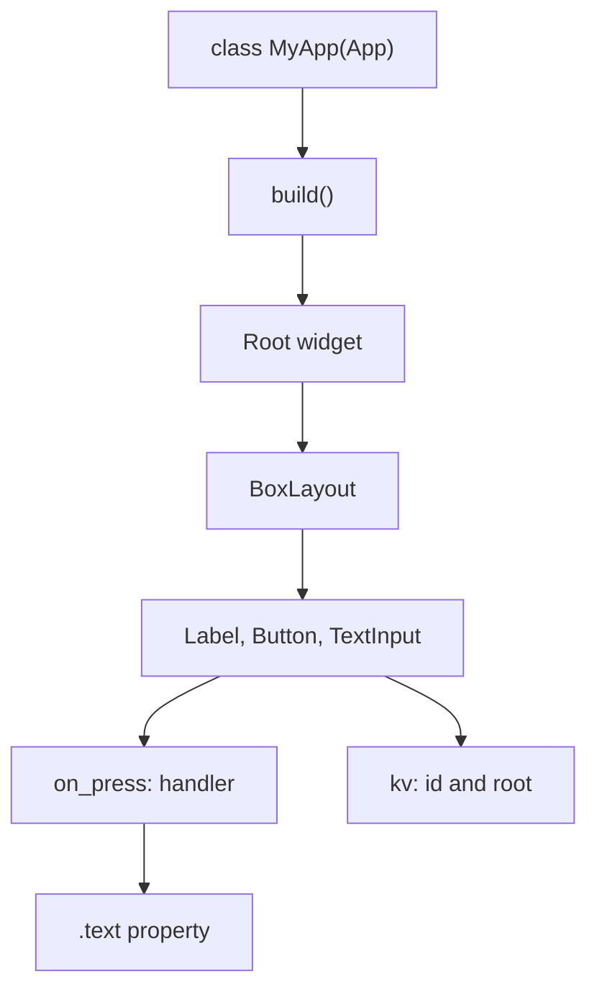

So far our programs lived on a computer. But Python can also run on a phone. There are two main paths: **Kivy** — a library that draws the interface itself and can be packaged into an APK for Android, and **BeeWare** — a project that transpiles Python code into native applications via the **Toga** tool. Both approaches open the possibility of writing an app once and running it on different platforms.

## Kivy: first steps

Installation:

```bash
pip install kivy
```

A minimal Kivy app:

```python
from kivy.app import App
from kivy.uix.label import Label

class HelloApp(App):
    def build(self):
        return Label(text="Hello, Kivy!")

if __name__ == "__main__":
    HelloApp().run()
```

The structure is simple: the app class inherits `App`, the `build` method returns the root widget — whatever is returned will be shown on screen. `HelloApp().run()` starts the app. Note: the class name must end with `App` — Kivy uses this convention to find configuration by name.

## Widgets and events

Kivy uses touch events instead of mouse clicks. A button reacts to `on_press`:

```python
from kivy.uix.button import Button

def on_press(instance):
    print("Pressed!")

btn = Button(text="Press", on_press=on_press)
```

`on_press` receives the button instance — as in other frameworks, the function is passed without parentheses. Main widgets: `Label` (text), `Button`, `TextInput` (input field), `Slider`, `Image`.

## Layouts: BoxLayout

Elements are arranged by containers. `BoxLayout` places them in a row or column:

```python
from kivy.uix.boxlayout import BoxLayout

layout = BoxLayout(orientation="vertical")
layout.add_widget(Button(text="First"))
layout.add_widget(Button(text="Second"))
```

`orientation="vertical"` — top to bottom, `"horizontal"` — left to right. Nested containers allow building complex interfaces: for example, a vertical column with a horizontal row of buttons inside.

## The kv language: declarative interfaces

Kivy has its own **kv language** — a declarative interface description similar to CSS. This keeps the code cleaner: Python handles the logic, kv handles the look:

```python
from kivy.app import App
from kivy.uix.boxlayout import BoxLayout

class CounterLayout(BoxLayout):
    def increment(self):
        self.ids.label.text = "Increased!"

class CounterApp(App):
    def build(self):
        return CounterLayout()
```

And in the `counter.kv` file:

```
<CounterLayout>:
    orientation: "vertical"
    Label:
        id: label
        text: "0"
    Button:
        text: "+1"
        on_press: root.increment()
```

`id` gives the widget a name by which it is accessed via `self.ids.label`. The angle brackets `<CounterLayout>` bind rules to a class. If the kv file sits next to the Python file and is named after the app class (without `App`), Kivy picks it up automatically.

## TextInput and working with input fields

Reading text from an input field looks like this:

```python
from kivy.uix.textinput import TextInput

text_input = TextInput(hint_text="Enter name")
name = text_input.text  # current contents
```

`hint_text` is a hint that disappears when typing starts.

## BeeWare and Toga: native apps

BeeWare is an ecosystem that "transpiles" Python into native code for each platform. The main tool is Toga, a widget library with a unified API:

```python
import toga

def button_handler(widget):
    print("Hello!")

def build(app):
    box = toga.Box()
    button = toga.Button("Press", on_press=button_handler)
    box.add(button)
    return box

app = toga.App("My Application", "org.example.myapp", startup=build)
app.main_loop()
```

Toga uses real native widgets: on Android they will look like ordinary Android elements, on Windows — like Windows elements. This differs from Kivy, where the interface is drawn by the library itself (and looks the same everywhere). For building an Android app, BeeWare provides the `briefcase` tool — but that is a separate big topic.

## Diagram: from the App class to a widget

In Kivy the app is a class, and the interface is a widget tree returned by `build()`. The diagram shows where each press goes:



## Lesson summary

We learned how to:

- write Kivy apps with the `App` class and the `build` method;
- handle touch events via `on_press`;
- arrange widgets with `BoxLayout`;
- describe interfaces in the kv language and access widgets by `id`;
- use `TextInput` for input;
- tell Kivy's approach apart from native development with BeeWare/Toga.

Mobile development in Python is a real field, and now you have a foundation for experiments.

<!--TASK-->
### Task 1
Create a minimal Kivy app: a `HelloApp(App)` class with a `build` method that returns a `Label` with the text "Hello, Kivy!" and font size 36 (the `font_size` property). Run it via `HelloApp().run()` under the `if __name__ == "__main__":` guard.

### Task 2
Add a button: on press, the label's text should change to "You pressed the button!". Use `Button(text="Press", on_press=...)`. The handler receives the button instance and changes the `text` property of the label. The label's initial text is "Nothing pressed yet".

### Task 3
Create a "Greeting" app: a vertical `BoxLayout` with a `TextInput` (hint "Enter name"), a "Greet" button, and a result label. On press, the label becomes "Hello, <name>!", and if the field is empty — "Enter name!".

### Task 4
Make a counter app on `BoxLayout`: a label (initial value 0), a "+1" button, and a "Reset" button. "+1" increases the number in the label by 1; "Reset" returns it to 0. Store the number in a class attribute of the layout (for example, `self.count`).

### Task 5
Rewrite the counter from Task 4 using the kv language: move the interface description into a `Builder.load_string` string (or a `counter.kv` file), use `id` for the label and `root.increment()` / `root.reset()` as handlers. Check that the app works the same.

### Task 6
Make a "volume control": a vertical `BoxLayout` with a "Volume: 50" label and a `Slider` widget ranging from 0 to 100 with step 1 and an initial value of 50. Subscribe to value changes via `slider.bind(value=...)` and update the label text to `Volume: <integer>`. The value arrives as a float, so it must be converted to `int`. Expected output: as the slider is dragged, the label changes instantly — `Volume: 0`, `Volume: 37`, `Volume: 100`, — and the app itself does not restart.

### Task 7
Build a stopwatch in Kivy: a label with the readings, "Start", "Stop", and "Reset" buttons. For the count use `Clock.schedule_interval(self.tick, 0.1)` — the `tick` function receives `dt` (time since the last call) and adds it to `self.seconds`. "Stop" cancels the event via `event.cancel()`; "Reset" stops the count and returns `0.0`. Show the time with one decimal place. Expected output: after three seconds of work the label shows about `3.0 s`, after "Reset" — `0.0 s`.
<!--/TASK-->

<!--HINT-->
### Hint 1
Class: `class HelloApp(App):` with `def build(self): return Label(text="Hello, Kivy!", font_size=36)`. At the bottom: `if __name__ == "__main__": HelloApp().run()`. Imports: `from kivy.app import App`, `from kivy.uix.label import Label`.

### Hint 2
Create `label = Label(text="Nothing pressed yet")`. Handler: `def on_press(instance): label.text = "You pressed the button!"`. Button: `Button(text="Press", on_press=on_press)`. In `build` return a vertical `BoxLayout` with the label and the button.

### Hint 3
In the handler read `text_input.text.strip()`: if empty — `label.text = "Enter name!"`, otherwise — `label.text = f"Hello, {text}!"`. Assemble a `BoxLayout(orientation="vertical")` from three widgets and return it from `build`.

### Hint 4
Create a `CounterLayout(BoxLayout)` class with `__init__` where `self.count = 0`, and `increment` and `reset` methods. In `increment`: `self.count += 1; self.ids.label.text = str(self.count)`. Create the widgets with `id` (or store a reference to the label in `self`).

### Hint 5
Use `from kivy.lang import Builder` and `Builder.load_string("""<CounterLayout>: ...""")` at the top of the file. In kv: `Label: id: label; text: "0"`, buttons `Button: text: "+1"; on_press: root.increment()` and `Button: text: "Reset"; on_press: root.reset()`.

### Hint 6
Import `Slider` from `kivy.uix.slider`. Create it with the parameters `Slider(min=0, max=100, value=50, step=1)`. The handler method must accept two arguments: `def on_value(self, instance, value):` — Kivy passes both the widget itself and the new value. Inside — `self.label.text = f"Volume: {int(value)}"`. Subscription: `slider.bind(value=self.on_value)`.

### Hint 7
Store the event in `self.event = None`: it is both a "clock" and a "count is running" flag. Start: `if self.event is None: self.event = Clock.schedule_interval(self.tick, 0.1)`. Stop: `if self.event is not None: self.event.cancel(); self.event = None`. In `tick(self, dt)` don't forget `dt` — it gives the real time, not a frame number.
<!--/HINT-->

<!--SOLUTION-->
### Solution 1
Solution:

```python
from kivy.app import App
from kivy.uix.label import Label

class HelloApp(App):
    def build(self):
        return Label(text="Hello, Kivy!", font_size=36)

if __name__ == "__main__":
    HelloApp().run()
```

What is happening here? `App` is the base class of any Kivy app. The `build` method is the only required one: it returns the root widget, which becomes the screen's content. `Label` gets the text and font size; the other properties (color, alignment) have default values. `run()` raises the window and starts the event loop — like `mainloop` in tkinter. The `if __name__ == "__main__":` wrapper protects against running on module import. Note: without the "App" suffix at the end of the class name, Kivy will not find the kv file — this is a naming convention.

### Solution 2
Solution:

```python
from kivy.app import App
from kivy.uix.label import Label
from kivy.uix.button import Button
from kivy.uix.boxlayout import BoxLayout

class ClickApp(App):
    def build(self):
        self.label = Label(text="Nothing pressed yet")

        def on_press(instance):
            self.label.text = "You pressed the button!"

        btn = Button(text="Press", on_press=on_press)
        layout = BoxLayout(orientation="vertical")
        layout.add_widget(self.label)
        layout.add_widget(btn)
        return layout

if __name__ == "__main__":
    ClickApp().run()
```

What is happening here? The label is stored in `self.label` — so the handler can reach it. The button gets an `on_press` handler: Kivy will call it on touch and pass the button instance. Inside, we change the label's text via `self.label.text = ...`. The `BoxLayout` container with `orientation="vertical"` puts the label above the button. Note the nested function — it sees `self` thanks to closure, so no global variables are needed.

### Solution 3
Solution:

```python
from kivy.app import App
from kivy.uix.label import Label
from kivy.uix.button import Button
from kivy.uix.textinput import TextInput
from kivy.uix.boxlayout import BoxLayout

class GreetApp(App):
    def build(self):
        self.label = Label(text="")
        self.text_input = TextInput(hint_text="Enter name")

        def greet(instance):
            name = self.text_input.text.strip()
            if name == "":
                self.label.text = "Enter name!"
            else:
                self.label.text = f"Hello, {name}!"

        layout = BoxLayout(orientation="vertical")
        layout.add_widget(self.text_input)
        layout.add_widget(Button(text="Greet", on_press=greet))
        layout.add_widget(self.label)
        return layout

if __name__ == "__main__":
    GreetApp().run()
```

What is happening here? `TextInput` with `hint_text` shows a hint before typing starts. The `greet` handler runs on press: it reads the field's contents via `.text`, trims spaces with `.strip()`, and checks for emptiness. This way we handle a typical user-error scenario. An important nuance: `hint_text` is a hint, not a value, so an empty field is correctly detected as `""`. This "field → button → result" trio is the basic scheme of any input app.

### Solution 4
Solution:

```python
from kivy.app import App
from kivy.uix.label import Label
from kivy.uix.button import Button
from kivy.uix.boxlayout import BoxLayout

class CounterLayout(BoxLayout):
    def __init__(self, **kwargs):
        super().__init__(**kwargs)
        self.count = 0
        self.label = Label(text="0")
        self.add_widget(self.label)
        self.add_widget(Button(text="+1", on_press=self.increment))
        self.add_widget(Button(text="Reset", on_press=self.reset))

    def increment(self, instance):
        self.count += 1
        self.label.text = str(self.count)

    def reset(self, instance):
        self.count = 0
        self.label.text = "0"

class CounterApp(App):
    def build(self):
        return CounterLayout()

if __name__ == "__main__":
    CounterApp().run()
```

What is happening here? Now the logic lives in a separate layout class `CounterLayout(BoxLayout)`. In `__init__` we create the state (`self.count`) and the widgets. The handlers became methods: `increment` and `reset` receive the button instance and change the counter and the label. This already approaches real app architecture: state and behavior are encapsulated in a class instead of floating in the global scope. The "+1" and "Reset" buttons → label form a vertical column, because the layout is created with the default orientation, which can be set explicitly.

### Solution 5
Solution:

```python
from kivy.app import App
from kivy.lang import Builder
from kivy.uix.boxlayout import BoxLayout

Builder.load_string("""
<CounterLayout>:
    orientation: "vertical"
    Label:
        id: label
        text: "0"
    Button:
        text: "+1"
        on_press: root.increment()
    Button:
        text: "Reset"
        on_press: root.reset()
""")

class CounterLayout(BoxLayout):
    def increment(self, instance):
        self.ids.label.text = str(int(self.ids.label.text) + 1)

    def reset(self, instance):
        self.ids.label.text = "0"

class CounterApp(App):
    def build(self):
        return CounterLayout()

if __name__ == "__main__":
    CounterApp().run()
```

What is happening here? The interface is described declaratively in the kv language. `Builder.load_string` loads the rules right from a string (you can move them to a `counter.kv` file — then no loading is needed). The `<CounterLayout>` rule binds the description to the class: `orientation`, widgets, and their handlers. Via `id: label` we give the label a name, and `self.ids.label` accesses it from Python — this is the main way to connect kv and code. The handlers reference the class methods via `root.increment()`. Such code separates "view" from "logic": you can change the design without touching Python.

### Solution 6
Solution:

```python
from kivy.app import App
from kivy.uix.boxlayout import BoxLayout
from kivy.uix.label import Label
from kivy.uix.slider import Slider

class VolumeApp(App):
    def build(self):
        self.label = Label(text="Volume: 50")
        slider = Slider(min=0, max=100, value=50, step=1)
        slider.bind(value=self.on_value)

        layout = BoxLayout(orientation="vertical", padding=20, spacing=20)
        layout.add_widget(self.label)
        layout.add_widget(slider)
        return layout

    def on_value(self, instance, value):
        self.label.text = f"Volume: {int(value)}"

if __name__ == "__main__":
    VolumeApp().run()
```

What is happening here? `Slider` is a widget with a numeric value, and its `value` property emits an event on every change. `bind(value=self.on_value)` subscribes the method to this event. The handler receives two arguments: `instance` — the slider itself, `value` — the new value; the first is almost never needed but is required by Kivy's signature. The value arrives as `float`, so `int(value)` removes the fractional part in the label. The label is stored in `self.label`, otherwise the handler could not access it. Note `step=1`: without it the slider would give arbitrary fractional values.

### Solution 7
Solution:

```python
from kivy.app import App
from kivy.clock import Clock
from kivy.uix.boxlayout import BoxLayout
from kivy.uix.button import Button
from kivy.uix.label import Label

class TimerApp(App):
    def build(self):
        self.seconds = 0.0
        self.event = None

        self.label = Label(text="0.0 s", font_size=40)
        start = Button(text="Start", on_press=self.start)
        stop = Button(text="Stop", on_press=self.stop)
        reset = Button(text="Reset", on_press=self.reset)

        layout = BoxLayout(orientation="vertical", padding=20, spacing=10)
        for widget in (self.label, start, stop, reset):
            layout.add_widget(widget)
        return layout

    def start(self, instance):
        if self.event is None:
            self.event = Clock.schedule_interval(self.tick, 0.1)

    def stop(self, instance):
        if self.event is not None:
            self.event.cancel()
            self.event = None

    def tick(self, dt):
        self.seconds += dt
        self.label.text = f"{self.seconds:.1f} s"

    def reset(self, instance):
        self.stop(instance)
        self.seconds = 0.0
        self.label.text = "0.0 s"

if __name__ == "__main__":
    TimerApp().run()
```

What is happening here? `Clock.schedule_interval` schedules `tick` every 0.1 seconds and returns an event object that you must keep to cancel later. `dt` is the real time between calls (about 0.1), so summing `dt` gives honest seconds even if the system lags; adding one per call would be wrong. The checks `if self.event is None` and `if self.event is not None` protect against double-starting and cancelling a nonexistent event. `self.stop(instance)` inside `reset` reuses the stop logic. Note the `{self.seconds:.1f}` format — it always shows one decimal place.
<!--/SOLUTION-->

<!--QUIZ-->
Which method of the App class must return the root widget?
- build()
- start()
- create()
* Correct answer: build()
Kivy calls build() at startup, and the returned widget becomes the app's screen.

What naming convention must be followed for a Kivy app class?
- The name must end with App
- The name must be in capital letters
- The name must start with Kivy
* Correct answer: The name must end with App
Kivy looks for the kv file by the class name without the App suffix.

Which button parameter sets the press handler?
- on_press
- on_click
- command
* Correct answer: on_press
on_press takes a function and calls it when the button is touched.

Which layout stacks elements from top to bottom?
- BoxLayout(orientation="vertical")
- BoxLayout(orientation="horizontal")
- GridLayout(rows=2)
* Correct answer: BoxLayout(orientation="vertical")
Vertical orientation places widgets in a column.

How do you access a widget with id: label from Python code?
- self.ids.label
- self.label
- self.id("label")
* Correct answer: self.ids.label
self.ids is a dictionary of widgets by id, so self.ids.label returns the needed object.

What does TextInput(hint_text="Enter name") do?
- Sets the field's default text
- Shows a hint while the field is empty
- Makes the field inactive
* Correct answer: Shows a hint while the field is empty
hint_text disappears as soon as the user starts typing; it is not the field's value.

How does BeeWare/Toga differ from Kivy?
- Toga uses the platform's native widgets
- Toga cannot work on Android
- Toga is a game engine
* Correct answer: Toga uses the platform's native widgets
Toga builds the interface from real OS elements, while Kivy draws its own.

What is the CounterLayout(BoxLayout) class for in the counter example?
- To make the buttons round
- To store state and logic together with the layout
- To speed up execution
* Correct answer: To store state and logic together with the layout
A layout class encapsulates the counter and handlers — a step toward clean architecture.

What arguments does a handler subscribed via slider.bind(value=...) receive?
- The instance and the new value
- Only the new value
- Only the widget itself
* Correct answer: The instance and the new value
Kivy passes both the source object and the changed value.

What does Clock.schedule_interval(self.tick, 0.1) do?
- Calls tick every 0.1 seconds and returns an event object
- Calls tick once after 0.1 seconds
- Stops the app
* Correct answer: Calls tick every 0.1 seconds and returns an event object
The returned object is later cancelled via cancel().

What arrives in tick as the second argument dt?
- The time elapsed since the previous call
- The frame number
- The widget's value
* Correct answer: The time elapsed since the previous call
That is why the sum of dt is used as honest elapsed time.

Why store the event in self.event and check it against None?
- To avoid starting a second timer and cancelling a nonexistent one
- To speed up rendering
- To save the window on close
* Correct answer: To avoid starting a second timer and cancelling a nonexistent one
None means "the count is not running" — it is both a flag and a reference to the event.
<!--/QUIZ-->
