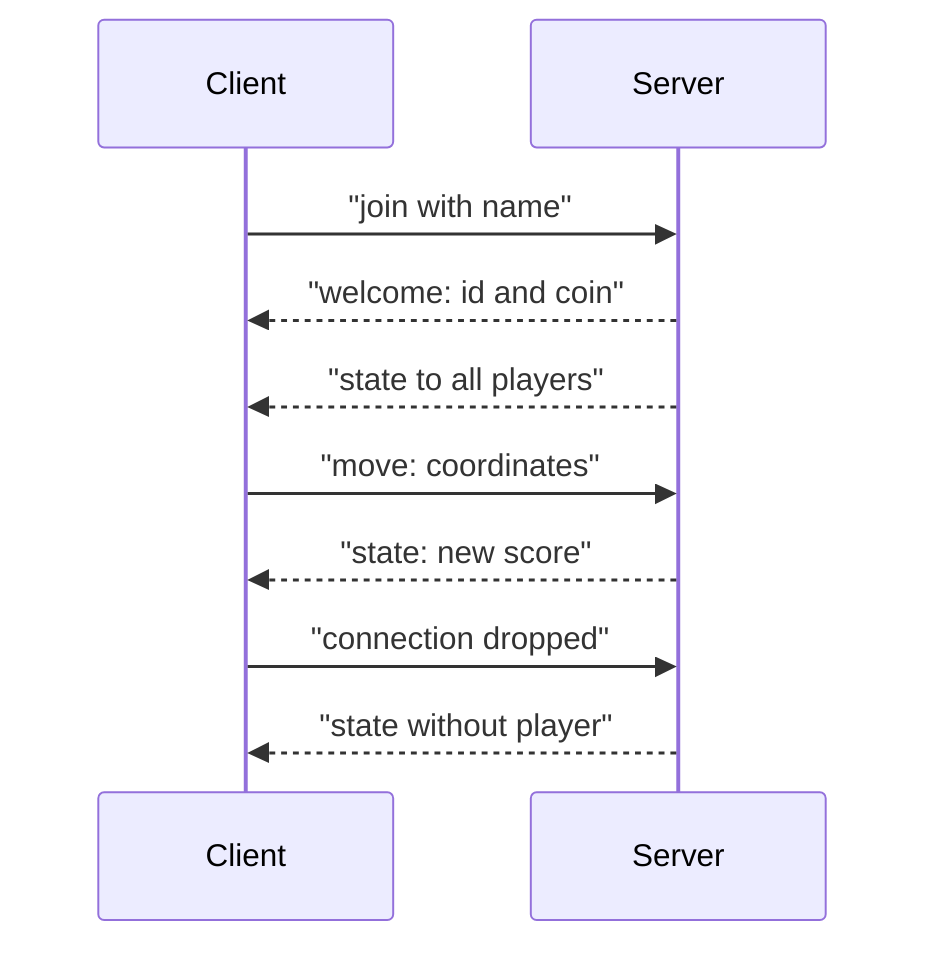

Hello! You've reached the trickiest section of the course — networking. So far all your games lived inside one process: sprites, events, logic — everything in one program. But real multiplayer games work differently. They have a **server** — a program that stores the world state and decides what happens in it — and **clients** — programs on players' computers that render the world and collect key presses. The game becomes a distributed system, and all the complexity moves into transmitting data over the network.

## Sockets: the foundation of network programs

A **socket** is a "door" into the network: an interface through which a program sends and receives bytes. In Python a socket is created with one line:

```python
import socket

sock = socket.socket(socket.AF_INET, socket.SOCK_STREAM)
```

`AF_INET` means we work over IPv4, and `SOCK_STREAM` means we use **TCP**: a reliable stream protocol. A socket address is a "IP address + port" pair. The server **binds** to the address (`bind`), starts **listening** (`listen`), then **accepts** incoming connections (`accept`). The client **connects** (`connect`). After the connection is established, both sides exchange data via `send`/`recv`.

Here is a minimal echo server that accepts one connection and returns every line back:

```python
import socket

server = socket.socket(socket.AF_INET, socket.SOCK_STREAM)
server.setsockopt(socket.SOL_SOCKET, socket.SO_REUSEADDR, 1)
server.bind(("127.0.0.1", 5555))
server.listen(1)
print("Server started on 127.0.0.1:5555")

conn, addr = server.accept()
print("Connected:", addr)

while True:
    data = conn.recv(1024)
    if not data:
        break
    print("Received:", data.decode("utf-8"))
    conn.sendall(data)

conn.close()
server.close()
```

`127.0.0.1` is "yourself" (loopback). The client:

```python
import socket

client = socket.socket(socket.AF_INET, socket.SOCK_STREAM)
client.connect(("127.0.0.1", 5555))
client.sendall("Hello, server!".encode("utf-8"))
answer = client.recv(1024)
print("Reply:", answer.decode("utf-8"))
client.close()
```

Note: **bytes** travel over the network, so strings are encoded with `.encode("utf-8")` and decoded with `.decode("utf-8")`. `recv(1024)` reads not a "string" but a chunk of the stream up to 1024 bytes — we will have to split messages ourselves.

## TCP vs UDP

`SOCK_STREAM` is TCP, `SOCK_DGRAM` is UDP. These are the two main transport models.

| Property | TCP | UDP |
|---|---|---|
| Delivery | guaranteed, with retries | no guarantees, "fire and forget" |
| Order | strictly preserved | may be violated |
| Connection | established before transmission | not established |
| Speed | lower (overhead) | higher |
| Use cases | games, chats, HTTP, files | streaming, VoIP, fast arcades |

A UDP packet is an independent datagram: `sendto`/`recvfrom`, without `connect`/`accept`. For this lesson we take TCP: it is easier to debug and doesn't "lose" game moves.

## Many clients: selectors

The echo server's problem: `accept()` and `recv()` **block** the thread — while the server waits for data from one client, the rest queue up. The solution is non-blocking sockets and multiplexing via the `selectors` module: we register all sockets, and the `select()` function tells which of them are ready for reading.

```python
import selectors
import socket

class RelayServer:
    """Relay: forwards every line to all other clients."""

    def __init__(self, host="127.0.0.1", port=5555):
        self.sel = selectors.DefaultSelector()
        self.conns = {}
        self.server = socket.socket(socket.AF_INET, socket.SOCK_STREAM)
        self.server.setsockopt(socket.SOL_SOCKET, socket.SO_REUSEADDR, 1)
        self.server.bind((host, port))
        self.server.listen()
        self.server.setblocking(False)
        self.sel.register(self.server, selectors.EVENT_READ, self._accept)

    def _accept(self, sock):
        conn, addr = sock.accept()
        conn.setblocking(False)
        self.conns[conn] = addr
        self.sel.register(conn, selectors.EVENT_READ, self._read)
        print("Connected:", addr)

    def _read(self, conn):
        try:
            data = conn.recv(4096)
        except OSError:
            data = b""
        if data:
            for other in self.conns:
                if other is not conn and other.fileno() != -1:
                    try:
                        other.sendall(data)
                    except OSError:
                        pass
        else:
            self.sel.unregister(conn)
            conn.close()
            self.conns.pop(conn, None)
            print("Client disconnected")

    def run(self):
        while True:
            for key, _ in self.sel.select():
                key.data(key.fileobj)

if __name__ == "__main__":
    RelayServer().run()
```

`select()` returns a list of "events"; for each we call the handler — `_accept` for the listening socket and `_read` for client sockets. This way one thread serves hundreds of connections.

## Serializing messages: JSON

Bytes travel over the network, but we need data structures. **Serialization** is turning an object into bytes and back. A convenient format is JSON: it is built into Python, readable by humans, and by any other language.

Let's agree on a simple protocol: **each message is one JSON line ending with a newline `\n`**. The newline is a delimiter that lets us see where one message ends and the next begins.

```python
import json

def encode_message(obj):
    """Object -> JSON bytes with a newline character."""
    return json.dumps(obj, ensure_ascii=False).encode("utf-8") + b"\n"

def decode_messages(buffer):
    """Parses a buffer into a list of messages; returns (messages, remainder)."""
    messages = []
    while True:
        line, sep, rest = buffer.partition(b"\n")
        if not sep:
            break
        messages.append(json.loads(line.decode("utf-8")))
        buffer = rest
    return messages, buffer
```

Why exactly `partition` and a "remainder"? Because `recv()` can bring a piece of a message or several at once. The function returns the unparsed tail, and the server stores it between calls. This pattern is called **stream buffering**.

## Server-side game logic

In a multiplayer game the server is **authoritative**: it alone stores the world state, and clients only send their intentions (where to move), while the server decides what actually happened. This protects against cheating and gives all players the same world.

Let's write the logic of a simple "Coin Catcher" game: players move around an arena, a coin appears at a random spot, and whoever touches it gets a point — and the coin respawns.

```python
import math
import random

ARENA_W, ARENA_H = 800, 600
PLAYER_RADIUS = 15
COIN_RADIUS = 20

class Game:
    def __init__(self, seed=None):
        self.rng = random.Random(seed)   # seed makes the game deterministic
        self.players = {}
        self.coin = self._spawn_coin()
        self.next_id = 1

    def _spawn_coin(self):
        return {"x": round(self.rng.uniform(0, ARENA_W), 1),
                "y": round(self.rng.uniform(0, ARENA_H), 1)}

    def handle_join(self, name):
        pid = self.next_id
        self.next_id += 1
        self.players[pid] = {"name": name or "Anonymous",
                             "x": round(self.rng.uniform(0, ARENA_W), 1),
                             "y": round(self.rng.uniform(0, ARENA_H), 1),
                             "score": 0}
        return pid

    def handle_move(self, pid, x, y):
        player = self.players.get(pid)
        if player is None:
            return False
        # clamp coordinates to the arena:
        # the client cannot "escape" beyond the world bounds
        player["x"] = max(0.0, min(float(x), ARENA_W))
        player["y"] = max(0.0, min(float(y), ARENA_H))
        dx = player["x"] - self.coin["x"]
        dy = player["y"] - self.coin["y"]
        if math.hypot(dx, dy) < PLAYER_RADIUS + COIN_RADIUS:
            player["score"] += 1
            self.coin = self._spawn_coin()
        return True

    def handle_quit(self, pid):
        return self.players.pop(pid, None) is not None

    def snapshot(self):
        return {"players": [{"id": pid, **p} for pid, p in self.players.items()],
                "coin": self.coin}
```

Note the details: a `seed` for `random.Random` makes behavior reproducible (it will save us when writing tests), and coordinates are rounded so JSON is more compact. The game server combines this logic with the `selectors` network layer: on `join` — creates a player and sends `welcome` + a state broadcast; on `move` — updates the position and broadcasts the new state to everyone; on a connection break — removes the player and notifies the rest. You will assemble this server structure in Task 4.

## The pygame client

The client lives in a regular pygame game loop. The key technique is a **non-blocking socket**: `settimeout(0.0)` makes `recv()` return control immediately when there is no data, instead of freezing the game. Then the loop looks like this: process events (window close, keys) → try to read incoming messages → send our intention → draw the frame.

```python
import json
import socket
import pygame

HOST, PORT = "127.0.0.1", 5555
W, H = 800, 600

class Net:
    def __init__(self):
        self.sock = None
        self.my_id = None
        self.players = {}
        self.coin = None

    def connect_and_join(self, name):
        sock = socket.socket(socket.AF_INET, socket.SOCK_STREAM)
        sock.settimeout(2.0)
        sock.connect((HOST, PORT))
        sock.settimeout(0.0)                 # from here on — non-blocking mode
        sock.sendall(json.dumps({"type": "join", "name": name},
                                ensure_ascii=False).encode("utf-8") + b"\n")
        self.sock = sock

    def update(self):
        if self.sock is None:
            return
        try:
            data = self.sock.recv(4096)
        except BlockingIOError:
            return                              # no data yet — not a problem
        except OSError:
            self.drop()
            return
        if not data:
            self.drop()                         # server closed the connection
            return
        for line in data.split(b"\n"):
            if not line:
                continue
            msg = json.loads(line.decode("utf-8"))
            kind = msg["type"]
            if kind == "welcome":
                self.my_id = msg["id"]
                self.players = {p["id"]: p for p in msg["players"]}
                self.coin = msg["coin"]
            elif kind == "state":
                self.players = {p["id"]: p for p in msg["players"]}
                self.coin = msg["coin"]

    def send_move(self, x, y):
        if self.sock is None:
            return
        try:
            self.sock.sendall(json.dumps({"type": "move", "x": x, "y": y})
                              .encode("utf-8") + b"\n")
        except OSError:
            self.drop()

    def drop(self):
        if self.sock is not None:
            self.sock.close()
            self.sock = None
            self.my_id = None
```

The lesson here: the network never stops the game. No data — draw the next frame; the connection broke — switch to reconnect mode.

## Handling disconnections and reconnects

A disconnect is visible when `recv()` returns `b""` (the opposite side closed the connection) or via a `ConnectionResetError`/`BrokenPipeError` exception on send. The server must immediately free resources: `unregister`, `close`, remove the player from the state, and broadcast the updated state — otherwise "dead" clients hang in its memory forever and players see ghosts.

The client must **survive** the break. The reconnect scheme:

1. Notice the break → `drop()`, set the "not connected" flag.
2. In the game loop, every few seconds try `connect_and_join()` again.
3. On success — send `join` once more (it is idempotent: the server just creates a new player), and the game continues.
4. Between attempts — **backoff**: a pause that grows with each failure (2 s, 4 s, 8 s…), so we don't hammer the server when it's down.

```python
import time

last_attempt = 0.0
while True:
    if net.sock is None:
        now = time.monotonic()
        if now - last_attempt > 2.0:
            last_attempt = now
            try:
                net.connect_and_join("Vitya")
                print("Connected!")
            except OSError:
                print("Server unavailable, trying again...")
    # ... game loop: update(), rendering, event handling ...
```

## Message exchange diagram

The whole networked game is a short set of messages. The diagram shows who speaks and when:



Now let's solidify the theory in practice — from an echo server to a full networked game with tests.

<!--TASK-->
### Task 1
Create two files: `echo_server.py` and `echo_client.py`. The server should bind to `127.0.0.1:5555`, accept exactly one connection, then in a loop read data via `recv(1024)` and send it back with `sendall` until the client closes the connection. The client should connect, send three messages in turn: `Hello!`, `Echo server works`, and `Bye!`, and after each one wait for the reply and print it as `Reply: ...`. Start the server first, then the client. Expected client output:

```
Reply: Hello!
Reply: Echo server works
Reply: Bye!
```

Make sure the server prints every received message and exits cleanly after the connection closes.

### Task 2
Write a multiplayer chat relay. The `relay_server.py` server on `selectors` should accept an unlimited number of clients and forward every received line to all other connected clients (including not sending it back to the sender). The `relay_client.py` client should work in two "threads": a separate thread reads incoming messages from the socket and prints them, while the main thread reads lines from the keyboard via `input()` and sends them to the server. The `/exit` command terminates the client. Test with two clients running at once: a line typed in one window must appear in the other. In the code use the real `selectors.DefaultSelector`, `register`/`unregister`, `EVENT_READ` APIs.

### Task 3
Create a `protocol.py` module with two functions: `encode_message(obj)` — turns an object into JSON bytes ending with `\n` (the `ensure_ascii=False` parameter), and `decode_messages(buffer)` — takes a bytes buffer and returns a tuple `(messages, rest)`, where `messages` is a list of parsed messages and `rest` is the unparsed remainder. Then create a test file `test_protocol.py` using pytest and write at least five tests: (1) a round-trip check "encoded — decoded — got the same dict"; (2) Cyrillic in the name is not broken; (3) several messages in one buffer are parsed one by one; (4) an incomplete message without `\n` stays in the remainder and no messages are returned; (5) broken JSON raises `json.JSONDecodeError`. Run `python -m pytest test_protocol.py -v` — all tests must pass.

### Task 4
Write a "Coin Catcher" game server and tests for it over real sockets. Create `game.py` (the `Game` class from the theory) and `gameserver.py` — a server on `selectors` that: on `join` creates a player, sends him `welcome` (with `id`, `players`, `coin`) and broadcasts `state` to all; on `move` updates the position and broadcasts `state`; when a connection closes, removes the player and broadcasts the updated `state`; on broken JSON replies with `{"type": "error", ...}`. Then write `test_gameserver.py` with pytest: start the server in a background thread on port `0` (an ephemeral port), connect with plain sockets and check: (1) after `join` a `welcome` with the correct `id` and one player arrives; (2) if you move exactly onto the coin, the player's score becomes 1; (3) broken JSON leads to an `error` message; (4) after one of two players closes the connection, the second receives `state` with one player; (5) moving beyond the arena borders is "clamped" inside it.

### Task 5
Write a fully playable `client.py` on pygame for the "Coin Catcher" game. The client connects to the server from Task 4: at startup it sends `join`, then every frame sends `move` with the mouse cursor coordinates. Draw the 800×600 arena: the coin as a yellow circle, your player blue, others red; at the top left show all players' scores. The key requirement: handle the connection break — if the socket closed or an error occurred, the client must not crash; every 2 seconds it must try to reconnect and send `join` again; on success print `Connected!` and continue the game. Closing the window is a normal exit with proper socket closure.

### Task 6
Add a latency check (ping-pong) to the protocol. The client sends `{"type": "ping", "time": <time.monotonic()>}`, the server immediately replies with `{"type": "pong", "time": <the same value>}` without touching the game state. The client catches `pong`, subtracts the sent time from the current one, and prints `Latency: <ms> ms` rounded to one decimal. Take three measurements with a one-second pause between them. Expected client output on localhost:

```
Latency: 0.3 ms
Latency: 0.2 ms
Latency: 0.4 ms
```

Make sure `ping` messages do not enter the `state` broadcast and do not change players' scores.

### Task 7
Limit the number of players: add a constant `MAX_PLAYERS = 4`. When handling `join`, the server checks how many players are already in the game; if the limit is reached, it sends `{"type": "error", "message": "Server full"}`, closes the connection, and does not create a new player. The other clients must not receive `state` with an extra player. Expected output for the fifth client: the line `Error: Server full`, after which it exits, while the first four keep playing.
<!--/TASK-->

<!--HINT-->
### Hint 1
Don't forget that bytes travel over the network: encode strings with `.encode("utf-8")` and decode received bytes with `.decode("utf-8")`. The server loop's exit condition is `if not data: break`, because when the connection closes, `recv()` returns empty bytes `b""`. Before restarting the server, if the port is busy, use `setsockopt(socket.SOL_SOCKET, socket.SO_REUSEADDR, 1)` — this lets you restart the server immediately.

### Hint 2
The server keeps a `self.conns` dictionary of all client sockets: in `_accept` add the new connection; in `_read`, on `data`, broadcast it to everyone except the sender, and on `not data` do `sel.unregister(conn)`, `conn.close()`, and remove it from the dictionary. In the client, the read thread function should have a `while True` loop with `recv` (stopping when `recv` returns empty bytes); start it as `threading.Thread(..., daemon=True)` so the thread does not block program exit.

### Hint 3
Remember the signature: `decode_messages` must return the tuple `(messages, rest)` — the server needs this to store the remainder between data arrivals. For the incomplete-message test, slice an encoded message with `[:10]` — without `\n` it must not be parsed. Broken JSON is easiest to make like this: `b"{this is not json}\n"`, and to check the exception use `pytest.raises(json.JSONDecodeError)` with `import json`.

### Hint 4
Logic and network must be tested differently. For network tests, start the server on port `0`: after `start()` read the real port from `server.port`. Write a helper `receive_messages(sock, buffer)` that accumulates bytes until at least one complete message (by `\n`) is present, and returns a list of messages and the remainder — you'll need it because `welcome` and `state` arrive interleaved. In the "coin collected" test, move the player exactly to the coin coordinates from `welcome` (the distance becomes zero — the pickup is guaranteed). Ensure determinism with a seed: `GameServer(seed=42)`.

### Hint 5
Non-blocking mode: after `connect` call `sock.settimeout(0.0)`, and wrap `recv` in `try/except BlockingIOError` — that is the "no data" case. For reconnect, store the time of the last attempt (`time.monotonic()`) and, if `net.sock is None` and at least 2 seconds have passed, try `connect_and_join()` again. Don't forget that `pygame.mouse.get_pos()` returns the cursor coordinates, and for the score use `pygame.font.SysFont(None, 28)` and `render(...)`.

### Hint 6
In `_handle` add a branch `elif mtype == "ping":` and inside it `self._send(conn, {"type": "pong", "time": msg.get("time")})` — without broadcasting and without changing `Game`. On the client, before sending store `sent = time.monotonic()`, and in the read loop when `kind == "pong"` compute `rtt = (time.monotonic() - msg["time"]) * 1000`. Print with `f"Latency: {rtt:.1f} ms"`, with `time.sleep(1)` between measurements.

### Hint 7
Check before calling `handle_join`: `if len(self.game.players) >= MAX_PLAYERS:` — then send the error and call `self._drop(conn)`, otherwise create the player as usual. It is important not to broadcast `state` after the refusal: otherwise others would see a blinking "extra" player. `_drop` already unregisters the socket and closes it — reuse this method instead of writing `close()` by hand.
<!--/HINT-->

<!--SOLUTION-->
### Solution 1
File `echo_server.py`:

```python
import socket

server = socket.socket(socket.AF_INET, socket.SOCK_STREAM)
server.setsockopt(socket.SOL_SOCKET, socket.SO_REUSEADDR, 1)
server.bind(("127.0.0.1", 5555))
server.listen(1)
print("Server started on 127.0.0.1:5555")

conn, addr = server.accept()
print("Connected:", addr)

while True:
    data = conn.recv(1024)
    if not data:
        break
    print("Received:", data.decode("utf-8"))
    conn.sendall(data)

conn.close()
server.close()
print("Server finished working")
```

File `echo_client.py`:

```python
import socket

client = socket.socket(socket.AF_INET, socket.SOCK_STREAM)
client.connect(("127.0.0.1", 5555))

for message in ["Hello!", "Echo server works", "Bye!"]:
    client.sendall(message.encode("utf-8"))
    answer = client.recv(1024)
    print("Reply:", answer.decode("utf-8"))

client.close()
```

Let's go step by step. The server creates a socket, binds to the address, and starts listening. `accept()` blocks the program until a client arrives and returns the pair `(conn, addr)` — a separate socket for talking to that client and its address. Then the loop: `recv(1024)` reads up to 1024 bytes. When the client closes the connection, `recv()` returns `b""` — an empty object that is falsy, so `if not data: break` ends the loop. Importantly, text is encoded into UTF-8 bytes (`encode`) and decoded back (`decode`). `sendall` guarantees that all bytes are sent (unlike `send`, which may send only part). Launch order: server first, then client; otherwise the client gets `ConnectionRefusedError`.

### Solution 2
File `relay_server.py`:

```python
import selectors
import socket

class RelayServer:
    def __init__(self, host="127.0.0.1", port=5555):
        self.sel = selectors.DefaultSelector()
        self.conns = {}
        self.server = socket.socket(socket.AF_INET, socket.SOCK_STREAM)
        self.server.setsockopt(socket.SOL_SOCKET, socket.SO_REUSEADDR, 1)
        self.server.bind((host, port))
        self.server.listen()
        self.server.setblocking(False)
        self.sel.register(self.server, selectors.EVENT_READ, self._accept)

    def _accept(self, sock):
        conn, addr = sock.accept()
        conn.setblocking(False)
        self.conns[conn] = addr
        self.sel.register(conn, selectors.EVENT_READ, self._read)
        print("Connected:", addr)

    def _read(self, conn):
        try:
            data = conn.recv(4096)
        except OSError:
            data = b""
        if data:
            for other in self.conns:
                if other is not conn:
                    try:
                        other.sendall(data)
                    except OSError:
                        pass
        else:
            self.sel.unregister(conn)
            conn.close()
            self.conns.pop(conn, None)
            print("Client disconnected")

    def run(self):
        while True:
            for key, _ in self.sel.select():
                key.data(key.fileobj)

if __name__ == "__main__":
    RelayServer().run()
```

File `relay_client.py`:

```python
import socket
import threading

def read_loop(sock):
    while True:
        try:
            data = sock.recv(4096)
        except OSError:
            break
        if not data:
            break
        print(data.decode("utf-8"), end="")

sock = socket.socket(socket.AF_INET, socket.SOCK_STREAM)
sock.connect(("127.0.0.1", 5555))
threading.Thread(target=read_loop, args=(sock,), daemon=True).start()

try:
    while True:
        line = input("You: ")
        if line == "/exit":
            break
        sock.sendall((line + "\n").encode("utf-8"))
finally:
    sock.close()
```

The essence of the solution is moving blocking operations out of one thread. The server makes sockets non-blocking and puts them under the supervision of `selectors`: `select()` tells each iteration which sockets are ready for reading. The listening socket is ready — a new client arrived (`_accept`). A client socket is ready — there is data (`_read`). In `_read` the data is broadcast to all other connections, and on `b""` the socket is unregistered and closed — this is the correct handling of a disconnect. In the client, the read thread only does `recv` and printing, while the main thread only does `input()` and sending. `daemon=True` matters: the daemon thread dies together with the main thread, not blocking program exit.

### Solution 3
File `protocol.py`:

```python
import json

def encode_message(obj):
    return json.dumps(obj, ensure_ascii=False).encode("utf-8") + b"\n"

def decode_messages(buffer):
    messages = []
    while True:
        line, sep, rest = buffer.partition(b"\n")
        if not sep:
            break
        messages.append(json.loads(line.decode("utf-8")))
        buffer = rest
    return messages, buffer
```

File `test_protocol.py`:

```python
import json
import pytest
from protocol import encode_message, decode_messages

def test_round_trip():
    msg = {"type": "move", "x": 12.5, "y": -3.0}
    messages, rest = decode_messages(encode_message(msg))
    assert messages == [msg]
    assert rest == b""

def test_cyrillic_preserved():
    messages, _ = decode_messages(encode_message({"type": "join", "name": "Vitya"}))
    assert messages[0]["name"] == "Vitya"

def test_several_messages_in_one_buffer():
    buf = encode_message({"type": "a"}) + encode_message({"type": "b"})
    messages, rest = decode_messages(buf)
    assert [m["type"] for m in messages] == ["a", "b"]
    assert rest == b""

def test_partial_message_left_in_buffer():
    buf = encode_message({"type": "a"})[:10]
    messages, rest = decode_messages(buf)
    assert messages == []
    assert rest == buf

def test_bad_json_raises():
    with pytest.raises(json.JSONDecodeError):
        decode_messages(b"{this is not json}\n")

def test_newline_terminated():
    raw = encode_message({"type": "move", "x": 1, "y": 2})
    assert raw.endswith(b"\n")
    assert json.loads(raw[:-1])["type"] == "move"
```

Why does this work? `encode_message` turns a dict into a JSON string without escaping Cyrillic (`ensure_ascii=False`) and appends `\n` — the message delimiter. `decode_messages` uses `partition(b"\n")`, which always returns a tuple of three parts: text before the delimiter, the delimiter itself, and the rest. If there is no delimiter (`sep == b""`), the message is incomplete — we exit and return the remainder. This is the key technique for streaming: `recv()` is not obliged to deliver a message whole or exactly one at a time. The tests check all the important promises of the contract: round-trip, Cyrillic survival, batching several messages, an incomplete tail, and a reaction to garbage. Run: `python -m pytest test_protocol.py -v`. Note that the tests don't need the network — they check pure logic, and that is the right approach: the more that is tested without the network, the fewer surprises in network tests.

### Solution 4
File `game.py` — the `Game` class from the theory (full code is in the "Server-side game logic" section). File `gameserver.py`:

```python
import json
import selectors
import socket
import threading
import time

from game import Game

class GameServer:
    def __init__(self, host="127.0.0.1", port=5555, seed=None):
        self.game = Game(seed=seed)
        self.host = host
        self.port = port
        self.sel = selectors.DefaultSelector()
        self.sockets = set()
        self.buffers = {}
        self.player_ids = {}
        self._thread = None
        self._running = False
        self.server = None

    def start(self):
        self.server = socket.socket(socket.AF_INET, socket.SOCK_STREAM)
        self.server.setsockopt(socket.SOL_SOCKET, socket.SO_REUSEADDR, 1)
        self.server.bind((self.host, self.port))
        self.port = self.server.getsockname()[1]   # real port (important when port=0)
        self.server.listen()
        self.server.setblocking(False)
        self.sel.register(self.server, selectors.EVENT_READ, self._accept)
        self._running = True
        self._thread = threading.Thread(target=self._loop, daemon=True)
        self._thread.start()

    def stop(self):
        self._running = False
        if self._thread is not None:
            self._thread.join(timeout=1.0)
        self.sel.close()
        if self.server is not None:
            try:
                self.server.close()
            except OSError:
                pass
        for sock in list(self.sockets):
            try:
                sock.close()
            except OSError:
                pass

    def _loop(self):
        while self._running:
            try:
                events = self.sel.select(timeout=0.1)
            except OSError:
                break
            for key, _ in events:
                key.data(key.fileobj)

    def _accept(self, sock):
        conn, _ = sock.accept()
        conn.setblocking(False)
        self.sel.register(conn, selectors.EVENT_READ, self._read)
        self.sockets.add(conn)
        self.buffers[conn] = b""

    def _send(self, conn, obj):
        payload = json.dumps(obj, ensure_ascii=False).encode("utf-8") + b"\n"
        try:
            conn.sendall(payload)
        except OSError:
            self._drop(conn)

    def _broadcast(self, obj):
        for conn in list(self.sockets):
            self._send(conn, obj)

    def _read(self, conn):
        try:
            data = conn.recv(4096)
        except OSError:
            data = b""
        if not data:
            self._drop(conn)
            return
        self.buffers[conn] += data
        while True:
            line, sep, rest = self.buffers[conn].partition(b"\n")
            if not sep:
                break
            self.buffers[conn] = rest
            try:
                msg = json.loads(line.decode("utf-8"))
            except ValueError:
                self._send(conn, {"type": "error", "message": "Failed to parse JSON"})
                continue
            self._handle(conn, msg)

    def _handle(self, conn, msg):
        mtype = msg.get("type")
        if mtype == "join":
            pid = self.game.handle_join(msg.get("name"))
            self.player_ids[conn] = pid
            self._send(conn, {"type": "welcome", "id": pid, **self.game.snapshot()})
            self._broadcast_state()
        elif mtype == "move":
            pid = self.player_ids.get(conn)
            if pid is not None:
                self.game.handle_move(pid, msg.get("x", 0), msg.get("y", 0))
                self._broadcast_state()
        elif mtype == "quit":
            self._drop(conn)

    def _drop(self, conn):
        try:
            self.sel.unregister(conn)
        except Exception:
            pass
        self.sockets.discard(conn)
        self.buffers.pop(conn, None)
        pid = self.player_ids.pop(conn, None)
        if pid is not None:
            self.game.handle_quit(pid)
            self._broadcast_state()
        try:
            conn.close()
        except OSError:
            pass

    def _broadcast_state(self):
        self._broadcast({"type": "state", **self.game.snapshot()})

if __name__ == "__main__":
    srv = GameServer()
    srv.start()
    print("Server started, waiting for players... (Ctrl+C to stop)")
    try:
        while True:
            time.sleep(1)
    except KeyboardInterrupt:
        pass
    finally:
        srv.stop()
```

File `test_gameserver.py`:

```python
import json
import socket
import pytest

from gameserver import GameServer

def make_connection(server):
    return socket.create_connection(("127.0.0.1", server.port), timeout=2)

def receive_messages(sock, buffer, limit=20):
    messages = []
    for _ in range(limit):
        while b"\n" in buffer:
            line, _, buffer = buffer.partition(b"\n")
            messages.append(json.loads(line.decode("utf-8")))
        if messages:
            return messages, buffer
        chunk = sock.recv(4096)
        if not chunk:
            raise RuntimeError("Connection closed")
        buffer += chunk
    raise TimeoutError("Did not receive messages")

def send(sock, obj):
    sock.sendall(json.dumps(obj, ensure_ascii=False).encode("utf-8") + b"\n")

@pytest.fixture
def server():
    srv = GameServer(port=0, seed=42)
    srv.start()
    yield srv
    srv.stop()

def test_join_returns_welcome(server):
    sock = make_connection(server)
    send(sock, {"type": "join", "name": "Vitya"})
    messages, _ = receive_messages(sock, b"")
    welcome = next(m for m in messages if m["type"] == "welcome")
    assert welcome["id"] == 1
    assert welcome["players"][0]["name"] == "Vitya"
    sock.close()

def test_pick_up_coin_increases_score(server):
    sock = make_connection(server)
    send(sock, {"type": "join", "name": "Vitya"})
    messages, buffer = receive_messages(sock, b"")
    welcome = next(m for m in messages if m["type"] == "welcome")
    coin = welcome["coin"]
    send(sock, {"type": "move", "x": coin["x"], "y": coin["y"]})
    for _ in range(10):
        messages, buffer = receive_messages(sock, buffer)
        states = [m for m in messages if m["type"] == "state"]
        if any(s["players"][0]["score"] == 1 for s in states):
            break
    else:
        pytest.fail("The coin was not collected")
    sock.close()

def test_garbage_json_causes_error(server):
    sock = make_connection(server)
    sock.sendall(b"{this is not json}\n")
    messages, _ = receive_messages(sock, b"")
    assert any(m["type"] == "error" for m in messages)
    sock.close()

def test_disconnect_removes_player(server):
    sock1 = make_connection(server)
    send(sock1, {"type": "join", "name": "First"})
    receive_messages(sock1, b"")
    sock2 = make_connection(server)
    send(sock2, {"type": "join", "name": "Second"})
    messages, buffer = receive_messages(sock2, b"")
    assert any(len(m["players"]) == 2 for m in messages if m["type"] == "state")
    sock1.close()
    for _ in range(20):
        messages, buffer = receive_messages(sock2, buffer)
        if any(m["type"] == "state" and len(m["players"]) == 1 for m in messages):
            break
    else:
        pytest.fail("Player disconnect was not handled")
    sock2.close()

def test_move_outside_arena_is_clamped(server):
    sock = make_connection(server)
    send(sock, {"type": "join", "name": "Vitya"})
    messages, buffer = receive_messages(sock, b"")
    send(sock, {"type": "move", "x": 99999, "y": -99999})
    for _ in range(10):
        messages, buffer = receive_messages(sock, buffer)
        states = [m for m in messages if m["type"] == "state"]
        if states:
            player = states[-1]["players"][0]
            assert player["x"] == 800
            assert player["y"] == 0
            break
    else:
        pytest.fail("Did not get state after move")
    sock.close()
```

These are the tests of the server logic over real sockets. Key decisions: port `0` makes the OS pick a free port, and after `start()` we read it from `server.port` — so the tests conflict with nothing on the machine. `seed=42` fixes player and coin positions, so the "coin collected" test is deterministic: we move exactly onto the coin coordinates, the distance is zero — the pickup is guaranteed. The `receive_messages` helper imitates real network behavior: messages arrive in batches and interleaved (`welcome` + `state`), so we accumulate the buffer and pull them out by `\n`. The server runs in a daemon thread, and the fixture guarantees shutdown even if a test fails. The disconnect test closes `sock1` and waits until `sock2` sees `state` with one player — this verifies the server leaves no "ghosts". Run: `python -m pytest test_gameserver.py -v`.

### Solution 5
File `client.py`:

```python
import json
import socket
import time

import pygame

HOST, PORT = "127.0.0.1", 5555
W, H = 800, 600
PLAYER_COLOR = (60, 120, 255)
OTHERS_COLOR = (230, 80, 80)
COIN_COLOR = (255, 200, 50)
BG_COLOR = (20, 20, 30)

class Net:
    def __init__(self):
        self.sock = None
        self.my_id = None
        self.players = {}
        self.coin = None

    def connect_and_join(self):
        sock = socket.socket(socket.AF_INET, socket.SOCK_STREAM)
        sock.settimeout(2.0)
        sock.connect((HOST, PORT))
        sock.settimeout(0.0)
        sock.sendall(json.dumps({"type": "join", "name": "Vitya"},
                                ensure_ascii=False).encode("utf-8") + b"\n")
        self.sock = sock

    def update(self):
        if self.sock is None:
            return
        try:
            data = self.sock.recv(4096)
        except BlockingIOError:
            return
        except OSError:
            self.drop()
            return
        if not data:
            self.drop()
            return
        for line in data.split(b"\n"):
            if not line:
                continue
            try:
                msg = json.loads(line.decode("utf-8"))
            except ValueError:
                continue
            kind = msg["type"]
            if kind == "welcome":
                self.my_id = msg["id"]
                self.players = {p["id"]: p for p in msg["players"]}
                self.coin = msg["coin"]
            elif kind == "state":
                self.players = {p["id"]: p for p in msg["players"]}
                self.coin = msg["coin"]

    def send_move(self, x, y):
        if self.sock is None:
            return
        try:
            self.sock.sendall(json.dumps({"type": "move", "x": x, "y": y})
                              .encode("utf-8") + b"\n")
        except OSError:
            self.drop()

    def drop(self):
        if self.sock is not None:
            try:
                self.sock.close()
            except OSError:
                pass
            self.sock = None
            self.my_id = None

def main():
    pygame.init()
    screen = pygame.display.set_mode((W, H))
    pygame.display.set_caption("Coin Catcher")
    font = pygame.font.SysFont(None, 28)
    clock = pygame.time.Clock()

    net = Net()
    last_attempt = 0.0
    running = True

    while running:
        for event in pygame.event.get():
            if event.type == pygame.QUIT:
                running = False

        if net.sock is None:
            now = time.monotonic()
            if now - last_attempt > 2.0:
                last_attempt = now
                try:
                    net.connect_and_join()
                    print("Connected!")
                except OSError:
                    print("Server unavailable, trying again...")
        else:
            net.update()
            mouse_x, mouse_y = pygame.mouse.get_pos()
            net.send_move(mouse_x, mouse_y)

        screen.fill(BG_COLOR)
        if net.coin is not None:
            pygame.draw.circle(screen, COIN_COLOR,
                               (int(net.coin["x"]), int(net.coin["y"])), 20)
        for pid, player in net.players.items():
            color = PLAYER_COLOR if pid == net.my_id else OTHERS_COLOR
            pygame.draw.circle(screen, color,
                               (int(player["x"]), int(player["y"])), 15)
        y = 10
        for pid, player in sorted(net.players.items()):
            label = font.render(f"{player['name']}: {player['score']}",
                                True, (255, 255, 255))
            screen.blit(label, (10, y))
            y += 30

        pygame.display.flip()
        clock.tick(60)

    if net.sock is not None:
        net.sock.close()
    pygame.quit()

if __name__ == "__main__":
    main()
```

There are three important blocks here. **Network in the game loop.** After `connect`, the socket is switched to non-blocking mode (`settimeout(0.0)`), so `recv` either returns data or raises `BlockingIOError`, which we silently skip. The game never hangs waiting for the network: each frame we read everything that arrived, send the cursor position, and draw. **Handling disconnections.** If `recv` returned `b""` or an `OSError` occurred — the connection died: call `drop()`, which closes the socket and zeroes `my_id`. **Reconnect.** When `net.sock is None`, the main loop tries `connect_and_join()` again every 2 seconds (`time.monotonic()`). On success the server sends `welcome` again, `my_id` is restored, and the game continues. The `join` message is idempotent — the server simply creates a new player, so re-registration is safe. I'll also note the `try/except` around `json.loads` for each message: we won't let one broken packet kill the client. The final touch — when the window closes, the socket closes properly and `pygame.quit()` frees resources.

### Solution 6
Solution (server fragment, inside `_handle`):

```python
class GameServer:
    def _handle(self, conn, msg):
        mtype = msg.get("type")
        if mtype == "move":
            pid = self.player_ids.get(conn)
            if pid is not None:
                self.game.handle_move(pid, msg.get("x", 0), msg.get("y", 0))
                self._broadcast_state()
        elif mtype == "ping":
            self._send(conn, {"type": "pong", "time": msg.get("time")})
```

The whole client:

```python
import json
import socket
import time

HOST, PORT = "127.0.0.1", 5555

def send(sock, obj):
    sock.sendall(json.dumps(obj, ensure_ascii=False).encode("utf-8") + b"\n")

sock = socket.create_connection((HOST, PORT), timeout=2)
for _ in range(3):
    sent = time.monotonic()
    send(sock, {"type": "ping", "time": sent})
    buffer = b""
    while b"\n" not in buffer:
        buffer += sock.recv(4096)
    line, _, _ = buffer.partition(b"\n")
    msg = json.loads(line.decode("utf-8"))
    if msg["type"] == "pong":
        rtt = (time.monotonic() - msg["time"]) * 1000
        print(f"Latency: {rtt:.1f} ms")
    time.sleep(1)

sock.close()
```

What is happening here? `ping` is a service message that does not change the world: the server simply returns the received timestamp. The client remembers `time.monotonic()` before sending, gets the same number in `pong`, and subtracts it from the current time — the result is the full round trip (RTT, round-trip time) in seconds, which we multiply by 1000 for milliseconds. `time.monotonic()` is not chosen by chance: it doesn't jump when the system clock is adjusted, unlike `time.time()`. The `while b"\n" not in buffer` loop is needed because `recv` may bring an incomplete line. Note: on localhost latencies are tenths of a millisecond, while over the internet they will be tens.

### Solution 7
Solution (fragment of `_handle` and the constant):

```python
MAX_PLAYERS = 4


class GameServer:
    def _handle(self, conn, msg):
        mtype = msg.get("type")
        if mtype == "join":
            if len(self.game.players) >= MAX_PLAYERS:
                self._send(conn, {"type": "error",
                                  "message": "Server full"})
                self._drop(conn)
                return
            pid = self.game.handle_join(msg.get("name"))
            self.player_ids[conn] = pid
            self._send(conn, {"type": "welcome", "id": pid,
                              **self.game.snapshot()})
            self._broadcast_state()
```

Checking with a test:

```python
def test_max_players(server):
    socks = []
    for i in range(4):
        sock = make_connection(server)
        send(sock, {"type": "join", "name": f"Player {i}"})
        receive_messages(sock, b"")
        socks.append(sock)
    fifth = make_connection(server)
    send(fifth, {"type": "join", "name": "Fifth"})
    messages, _ = receive_messages(fifth, b"")
    assert messages[0]["type"] == "error"
    assert messages[0]["message"] == "Server full"
    for sock in socks:
        sock.close()
    fifth.close()
```

What is happening here? The check `len(self.game.players) >= MAX_PLAYERS` sits before `handle_join`, so `Game` never even learns about the extra player — the state stays clean. After sending `error` we call `_drop(conn)`: it unregisters the socket from `selectors`, removes the buffer, and closes the connection, so the "refused" client takes no resources and receives no `state`. The `return` is mandatory — without it execution would fall through into creating the player. In the test the first four clients stay connected, otherwise the limit would not be reached. Note: one error message is enough, and the client should decide itself whether to show it or try later.
<!--/SOLUTION-->

<!--QUIZ-->
What does socket.socket(socket.AF_INET, socket.SOCK_STREAM) create?
- A TCP socket (stream)
- A UDP socket (datagram)
- A file descriptor
* Correct answer: A TCP socket (stream)
SOCK_STREAM means the reliable stream protocol TCP.

Which server method accepts a new connection and returns (connection, address)?
- accept()
- bind()
- connect()
* Correct answer: accept()
accept() blocks until a client appears and returns the pair (conn, addr).

How does TCP differ from UDP?
- TCP is reliable and preserves order; UDP is faster but without guarantees
- TCP is faster and without guarantees
- UDP guarantees delivery and order
* Correct answer: TCP is reliable and preserves order; UDP is faster but without guarantees
TCP resends lost packets and reassembles them in order; UDP simply sends datagrams.

Why is the selectors module used in the server?
- To serve multiple non-blocking sockets in one thread
- To encrypt data
- To compress images
* Correct answer: To serve multiple non-blocking sockets in one thread
select() reports which sockets are ready for reading, and one handler serves all clients.

Why is JSON convenient for messages between client and server?
- It is a built-in module; the format is readable by humans and other languages and converts easily into a dict
- Because JSON is binary and very fast
- Because JSON transmits data over the network itself
* Correct answer: It is a built-in module; the format is readable by humans and other languages and converts easily into a dict
json.dumps turns a dict into a string; json.loads back — the format is understandable to any language.

Why does every JSON message end with a newline character \n?
- To be able to determine message boundaries in stream transmission
- To reduce the packet size
- For nicer output
* Correct answer: To be able to determine message boundaries in stream transmission
recv() brings arbitrary chunks of the stream; \n serves as a message delimiter.

What does it mean when recv() returns empty bytes b""?
- The opposite side closed the connection
- There is no data yet; wait
- A network error occurred
* Correct answer: The opposite side closed the connection
On a clean close, recv() returns b"" — this is the disconnect signal.

Why should the game logic live on the server rather than on clients?
- So all players share one world state and there is less room for cheating
- So graphics work faster
- Then the internet is not needed
* Correct answer: So all players share one world state and there is less room for cheating
The authoritative server decides what happened and broadcasts the result to everyone.

What does socket.settimeout(0.0) do on the pygame client?
- Switches the socket to non-blocking mode so the game does not freeze waiting for the network
- Enables traffic encryption
- Increases transmission speed
* Correct answer: Switches the socket to non-blocking mode so the game does not freeze waiting for the network
recv() immediately returns control (raising BlockingIOError when there is no data), and the game loop continues.

What is backoff during reconnect?
- A pause before retrying the connection, often growing on failures
- A way to compress a game frame
- A game mode name
* Correct answer: A pause before retrying the connection, often growing on failures
Backoff stops the client from hammering an unavailable server and makes retries gentler.

Why is time.monotonic() used in the ping measurement instead of time.time()?
- Monotonic time does not jump when system clocks are adjusted
- It shows time in milliseconds
- It works only over the network
* Correct answer: Monotonic time does not jump when system clocks are adjusted
So the difference of two values is always positive and reflects the real latency.

Why does the server return the time sent by the client in pong?
- So the client can compute the request's full round trip
- To synchronize game time
- To increase the score
* Correct answer: So the client can compute the request's full round trip
The client subtracts the timestamp from the current time and gets the RTT.

What should the server do when MAX_PLAYERS is exceeded?
- Send an error and close the connection without creating a player
- Silently ignore the message
- Remove a random old player
* Correct answer: Send an error and close the connection without creating a player
The limit is checked before handle_join so the world state does not change.

Why is return needed after sending the error?
- Otherwise the code continues and creates a player
- Otherwise the whole app closes
- Otherwise the message is sent twice
* Correct answer: Otherwise the code continues and creates a player
return interrupts the handler right after the refusal.
<!--/QUIZ-->
