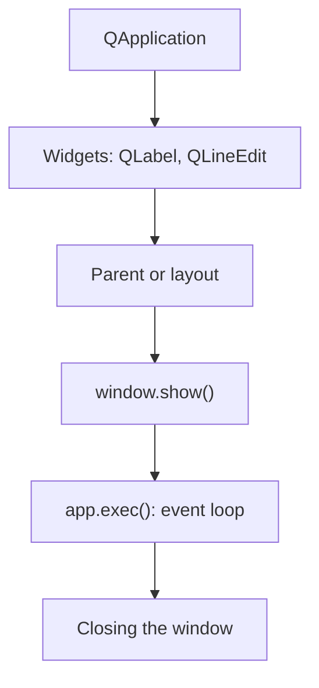

So far your programs have run in the terminal: input and output as text. But real programs used by people almost always have a graphical interface — a GUI (short for *Graphical User Interface*). In this module you will learn how to create windows, buttons, input fields, and full-fledged applications in Python. The most popular tool for this is the Qt library.

## Two twin libraries: PyQt6 and PySide6

Qt is a huge C++ framework with widgets, dialogs, networking, databases, and graphics. There are two official bindings for Python:

- **PyQt6** — from Riverbank, GPL license (a paid license is required for proprietary projects);
- **PySide6** — from the Qt Company, LGPL license, so it can be freely used even in closed commercial projects.

From a code perspective they are nearly indistinguishable. The same classes: `QApplication`, `QWidget`, `QLabel`. The same syntax. Differences appear in small details: for example, a custom signal in PyQt6 is declared via `pyqtSignal`, while in PySide6 — via `Signal`. In this lesson examples are written for PyQt6, but absolutely everything works in PySide6 too — the only difference is the import line.

## Installation

Install one of the libraries (or both — they don't conflict):

```bash
pip install PyQt6
# or
pip install PySide6
```

Check that everything installed correctly:

```bash
python -c "from PyQt6.QtWidgets import QApplication; print('OK')"
```

## Anatomy of a GUI application

Any Qt program is built the same way:

1. a `QApplication` object is created — it manages the whole application;
2. widgets are created (windows, buttons, fields);
3. widgets are shown with the `show()` method;
4. `app.exec()` is called — this starts the **event loop**.

Here is a minimal working program — a window with a title:

```python
import sys
from PyQt6.QtWidgets import QApplication, QWidget

app = QApplication(sys.argv)      # 1. application

window = QWidget()                # 2. window widget
window.setWindowTitle("Hello, PyQt6!")
window.resize(400, 300)           # window size: width, height

window.show()                     # 3. show the window
sys.exit(app.exec())              # 4. event loop
```

Run it and try to close the window — the program will exit when you do.

## QApplication and the event loop

`QApplication` is the heart of the application. It holds the event loop: it waits for user actions (clicks, keys, mouse movement) and dispatches them to widgets. While `exec()` runs, the program is "alive": it reacts to events. As soon as the loop ends, `exec()` returns the exit code, and the program exits.

Why `QApplication(sys.argv)`? The application receives command-line arguments — this lets Qt parse its own arguments, e.g. `-style`. Passing `sys.argv` is the standard, but `QApplication([])` also works if arguments aren't needed.

Important: an application must have exactly one `QApplication`. Creating it twice is an error.

## QWidget — the foundation of all widgets

`QWidget` is the base class of all Qt widgets: buttons, fields, labels — all of them inherit from `QWidget`. On its own, `QWidget` is an empty window, but it has plenty of useful methods:

```python
window.setWindowTitle("Title")   # window title
window.resize(800, 600)              # size
window.setFixedSize(300, 200)        # forbid resizing
window.setMinimumSize(200, 100)      # minimum size
window.move(100, 50)                 # position on screen
window.setWindowOpacity(0.9)         # semi-transparency (0–1)
```

## QLabel — text on screen

`QLabel` shows text or an image. The text can be changed at any time via `setText()`:

```python
label = QLabel("I am a label!")
label.setText("Now the text has changed")
label.setWordWrap(True)          # wrap long text by words
```

`QLabel` understands simplified HTML formatting — you can make text bold right inside the string:

```python
label = QLabel("<b>Bold text</b> and normal")
```

## QPushButton — button

The button is the most recognizable widget. It is created with text, and behavior is configured with methods:

```python
button = QPushButton("Click me")
button.setToolTip("This is a tooltip")
button.setEnabled(False)   # disable the button (cannot be clicked)
button.setDefault(True)    # default button: activates on Enter
button.setText("New text")
```

Note: so far the button does nothing when clicked — you'll learn how to make it react in the next lesson about signals and slots.

## QLineEdit — input field

`QLineEdit` is a single-line text field:

```python
edit = QLineEdit()
edit.setPlaceholderText("Enter your name…")   # hint while the field is empty
edit.setText("Prefilled text")
edit.clear()                            # clear
edit.setEchoMode(QLineEdit.EchoMode.Password)  # password: dots instead of letters
edit.setMaxLength(20)                   # maximum 20 characters
text = edit.text()                      # read what the user typed
```

`EchoMode.Password` is one of the constants of the `EchoMode` enum: `Normal`, `Password`, `NoEcho`, `PasswordEchoOnEdit`.

## Putting it all together

So far our widgets have no "home", so they won't be visible. The simplest way is to make them **children** of the window by passing the window as the first argument, and set coordinates:

```python
import sys
from PyQt6.QtWidgets import QApplication, QWidget, QLabel, QPushButton, QLineEdit

app = QApplication(sys.argv)

window = QWidget()
window.setWindowTitle("My form")
window.resize(400, 200)

label = QLabel("What is your name?", window)
label.move(20, 20)

edit = QLineEdit(window)
edit.setPlaceholderText("Enter your name")
edit.move(20, 50)
edit.resize(300, 30)

button = QPushButton("Greet", window)
button.move(20, 100)

window.show()
sys.exit(app.exec())
```

Widgets are simply "placed" on the window by coordinates. It works, but manual positioning is inconvenient — in lesson 3 you'll learn about layouts that do this automatically.

## Diagram: anatomy of a Qt application

Any Qt program follows the same path: application → widgets → show → event loop.



## Lesson summary

Now you know:

- how PyQt6 and PySide6 differ and how to install them;
- what any Qt application consists of: `QApplication` → widgets → `show()` → `exec()`;
- what the event loop is and why it's needed;
- the basic widgets: `QWidget`, `QLabel`, `QPushButton`, `QLineEdit`.

Let's put it all into practice.

<!--TASK-->
### Task 1
Create a file `my_window.py` and write a program that shows an empty window 400×300 pixels with the title "My First GUI". The window must be *non-resizable* — use `setFixedSize`. Run the program and make sure the window appears, has the correct title, and cannot be stretched.

### Task 2
Create a window with a centered `QLabel`. The label text has two lines: the first line is bold ("Welcome!"), the second is normal ("This is PyQt6"). Use HTML markup inside the text and `setWordWrap(True)`. If the text isn't fully visible, enlarge the window.

### Task 3
Create a window with a `QLineEdit` input field: width 300 pixels, placeholder hint "Enter email…", maximum length 30 characters. Right after creation, fill the field with `student@example.com`, then clear it and print to the console what remains after clearing (an empty string). Show the window.

### Task 4
Create a window with two buttons. First: text "Save", tooltip "Ctrl+S"; it must be the default button (`setDefault`). Second: text "Delete", tooltip "Irreversible"; it must be disabled (`setEnabled(False)`). Show the window and verify the second button is gray and cannot be clicked.

### Task 5
Build a "feedback form": a window with a label "Your feedback", an input field, and a button "Send". Give each widget a unique name via `setObjectName` (`window`, `label`, `edit`, `button`), then print the names of all three widgets and the button text to the console. Show the window.

### Task 6
Build a "Product card" window 600×400 with the title "Showcase". Place four widgets in it: a label with the HTML heading `<b>Headphones</b>`, a label with the price "2,990 ₽", a promo-code input field with placeholder "Promo code", and a "Buy" button with tooltip "Place order". Give each widget a unique name via `setObjectName`. Print the window width and height via `window.width()` and `window.height()`, as well as the list of all four widget names. Expected output:

```
Window: 600x400
Names: ['title', 'price', 'promo', 'buy']
```

### Task 7
Build a "Questionnaire" window 420×260 with three `QLineEdit` fields: name (maximum 20 characters), email (placeholder `you@example.com`), password in `EchoMode.Password` mode. Fill the fields programmatically: name "Anna", email "anya@mail.ru", password "secret123". Read all three values via `text()` and print them in the format `Name: Anna`, `Email: anya@mail.ru`, `Password: secret123`, then clear all fields via `clear()` and print the total number of remaining characters. Expected output: three lines with the values and the line `After clearing: 0`.
<!--/TASK-->

<!--HINT-->
### Hint 1
Start with a minimal program: `QApplication`, `QWidget`, `setWindowTitle`, `resize`. To forbid resizing, use `setFixedSize(400, 300)` instead of `resize` — it sets both the size and the ban on changing it.

### Hint 2
The label is created as `QLabel("<b>Welcome!</b>\nThis is PyQt6", window)`. The `\n` character is a line break. To center the text, don't forget to enlarge the window, e.g. `resize(400, 200)`, and enable `setWordWrap(True)`.

### Hint 3
The field is created as `QLineEdit(window)`, then go `setPlaceholderText`, `setMaxLength(30)`, `resize(300, 30)`. Fill it via `setText("student@example.com")`, clear via `clear()` and output `edit.text()` in `print`. Empty text prints as an empty string.

### Hint 4
Two buttons — two `QPushButton(window)` objects with different texts but the same vertical positioning (`move(20, 20)` and `move(20, 60)`). For the first add `setDefault(True)` and `setToolTip("Ctrl+S")`, for the second — `setEnabled(False)` and `setToolTip("Irreversible")`.

### Hint 5
Create three widgets and pass `window` as the first argument to each. Before showing the window, give each a `setObjectName("...")` and collect their names into a list, e.g. `names = [label.objectName(), edit.objectName(), button.objectName()]`. Print the list and the button text via `button.text()`.

### Hint 6
Create widgets with parent `window`: `QLabel("<b>Headphones</b>", window)` and so on, then arrange them with `move` and `resize`. Names are set with the `setObjectName("title")` method. For the window size use `window.width()` and `window.height()` — they return numbers after `resize`. Collect the names like this: `[title.objectName(), price.objectName(), promo.objectName(), buy.objectName()]`.

### Hint 7
For the password, save the field object into a variable and call `setEchoMode(QLineEdit.EchoMode.Password)`. Filling — `setText(...)` for each field. Lengths after clearing are computed as `len(name_edit.text()) + len(email_edit.text()) + len(password_edit.text())` — after three `clear()` calls it will be zero.
<!--/HINT-->

<!--SOLUTION-->
### Walkthrough 1
Solution:

```python
import sys
from PyQt6.QtWidgets import QApplication, QWidget

app = QApplication(sys.argv)

window = QWidget()
window.setWindowTitle("My First GUI")
window.setFixedSize(400, 300)

window.show()
sys.exit(app.exec())
```

We run `python my_window.py` and see a 400×300 window with a title that cannot be stretched. What's happening here? `QWidget` is the base window class. `setWindowTitle` sets the text in the title bar. `setFixedSize(400, 300)` does two things at once: sets the size and forbids changing it — attempts to stretch the window by its edges simply do nothing. `show()` makes the window visible, and `app.exec()` starts the event loop: the program doesn't end until the window is closed. Note the order: configure first, then `show()` — if you show the window before setting sizes, the user will see "flickering" with the wrong size.

### Walkthrough 2
Solution:

```python
import sys
from PyQt6.QtWidgets import QApplication, QWidget, QLabel

app = QApplication(sys.argv)

window = QWidget()
window.setWindowTitle("Label")
window.resize(400, 200)

label = QLabel(window)
label.setText("<b>Welcome!</b>\nThis is PyQt6")
label.setWordWrap(True)
label.move(20, 40)
label.resize(360, 100)

window.show()
sys.exit(app.exec())
```

Result: two lines are displayed in the window, the first one bold. What's happening here? `QLabel` text is interpreted as simplified HTML: the `<b>...</b>` tag makes text bold, and `\n` breaks the line. `setWordWrap(True)` allows wrapping long words that don't fit the label width. `resize(360, 100)` sets the label area, and `move(20, 40)` — its position in the window. Without explicit `move`/`resize` the label would have its default size and stand in the corner — that's why we set them manually.

### Walkthrough 3
Solution:

```python
import sys
from PyQt6.QtWidgets import QApplication, QWidget, QLineEdit

app = QApplication(sys.argv)

window = QWidget()
window.setWindowTitle("Input field")
window.resize(400, 120)

edit = QLineEdit(window)
edit.setPlaceholderText("Enter email…")
edit.setMaxLength(30)
edit.resize(300, 30)
edit.move(20, 40)

edit.setText("student@example.com")
edit.clear()
print("After clearing:", repr(edit.text()))

window.show()
sys.exit(app.exec())
```

The console will show:

```
After clearing: ''
```

What's happening here? `setPlaceholderText` sets a gray hint that disappears as soon as the user starts typing. `setMaxLength(30)` limits the length — the 31st character simply won't be entered. `setText` fills the field, `clear()` empties it. Since the field is empty after clearing, `edit.text()` returns the empty string `''` — we print it via `repr()` so it's visible that it's exactly an empty string, not spaces.

### Walkthrough 4
Solution:

```python
import sys
from PyQt6.QtWidgets import QApplication, QWidget, QPushButton

app = QApplication(sys.argv)

window = QWidget()
window.setWindowTitle("Buttons")
window.resize(300, 120)

save_btn = QPushButton("Save", window)
save_btn.move(20, 20)
save_btn.setToolTip("Ctrl+S")
save_btn.setDefault(True)

delete_btn = QPushButton("Delete", window)
delete_btn.move(20, 60)
delete_btn.setToolTip("Irreversible")
delete_btn.setEnabled(False)

window.show()
sys.exit(app.exec())
```

What's happening here? `setToolTip` attaches a tooltip — it appears when you hold the cursor over the button. `setDefault(True)` makes the button the "default": pressing Enter in the window triggers it. `setEnabled(False)` disables the button — it renders gray and doesn't react to clicks until re-enabled with `setEnabled(True)`. This technique is often used to forbid an action until a condition is met (for example, "Delete" can't be pressed while nothing is selected).

### Walkthrough 5
Solution:

```python
import sys
from PyQt6.QtWidgets import QApplication, QWidget, QLabel, QLineEdit, QPushButton

app = QApplication(sys.argv)

window = QWidget()
window.setWindowTitle("Feedback form")
window.setObjectName("window")
window.resize(400, 180)

label = QLabel("Your feedback", window)
label.setObjectName("label")
label.move(20, 20)

edit = QLineEdit(window)
edit.setObjectName("edit")
edit.setPlaceholderText("Write a few words…")
edit.resize(360, 30)
edit.move(20, 50)

button = QPushButton("Send", window)
button.setObjectName("button")
button.move(20, 100)

print("Widget names:", [label.objectName(), edit.objectName(), button.objectName()])
print("Button text:", button.text())

window.show()
sys.exit(app.exec())
```

Console:

```
Widget names: ['label', 'edit', 'button']
Button text: Send
```

What's happening here? `setObjectName` gives the widget a string name. It's not just for show: by name a widget can be found (`window.findChild(QLineEdit, "edit")`) and — importantly — addressed in QSS styles (lesson 6), e.g. `#button { background: green; }`. `objectName()` returns the name, `text()` — the button text. Widget names may repeat within one program, but by Qt conventions it's better for them to be unique.

### Walkthrough 6
Solution:

```python
import sys
from PyQt6.QtWidgets import (QApplication, QWidget, QLabel,
                             QLineEdit, QPushButton)

app = QApplication(sys.argv)

window = QWidget()
window.setWindowTitle("Showcase")
window.resize(600, 400)

title = QLabel("<b>Headphones</b>", window)
title.setObjectName("title")
title.move(30, 30)
title.resize(400, 40)

price = QLabel("2,990 ₽", window)
price.setObjectName("price")
price.move(30, 90)

promo = QLineEdit(window)
promo.setObjectName("promo")
promo.setPlaceholderText("Promo code")
promo.move(30, 150)
promo.resize(220, 32)

buy = QPushButton("Buy", window)
buy.setObjectName("buy")
buy.setToolTip("Place order")
buy.move(30, 210)

print(f"Window: {window.width()}x{window.height()}")
print("Names:", [title.objectName(), price.objectName(),
                promo.objectName(), buy.objectName()])

window.show()
sys.exit(app.exec())
```

What's happening here? All four widgets are created with parent `window`, so they belong to the window and render inside it. `setObjectName` gives each a string identifier — used later to find widgets and style them via QSS. `width()` and `height()` return the current window dimensions — after `resize(600, 400)` that's exactly 600 and 400, but wait with printing until `show()`: before showing, sizes are already set, yet the final geometry may adjust to the screen. Note that the `<b>` HTML tag in `QLabel` enables bold font without any styles — Qt understands simplified markup.

### Walkthrough 7
Solution:

```python
import sys
from PyQt6.QtWidgets import (QApplication, QWidget, QLabel,
                             QLineEdit, QVBoxLayout)

app = QApplication(sys.argv)

window = QWidget()
window.setWindowTitle("Questionnaire")
window.resize(420, 260)

layout = QVBoxLayout(window)

name_edit = QLineEdit()
name_edit.setMaxLength(20)
name_edit.setPlaceholderText("Name")

email_edit = QLineEdit()
email_edit.setPlaceholderText("you@example.com")

password_edit = QLineEdit()
password_edit.setEchoMode(QLineEdit.EchoMode.Password)
password_edit.setPlaceholderText("Password")

for widget in (QLabel("Name:"), name_edit, QLabel("Email:"), email_edit,
               QLabel("Password:"), password_edit):
    layout.addWidget(widget)

name_edit.setText("Anna")
email_edit.setText("anya@mail.ru")
password_edit.setText("secret123")

print("Name:", name_edit.text())
print("Email:", email_edit.text())
print("Password:", password_edit.text())

name_edit.clear()
email_edit.clear()
password_edit.clear()

total = len(name_edit.text()) + len(email_edit.text()) + len(password_edit.text())
print("After clearing:", total)

window.show()
sys.exit(app.exec())
```

What's happening here? The three input fields differ only in settings: `setMaxLength(20)` prevents entering the 21st character, `EchoMode.Password` replaces letters with dots, but `text()` still returns the real text — the mode only affects display. `setText` fills the field programmatically, `clear` empties it. The sum of lengths after clearing is zero — a check that `clear()` actually worked on all three fields. Note: `QVBoxLayout(window)` immediately assigns the layout to the window, so `setCentralWidget` isn't needed here — these are different ways of arranging, and for `QWidget` the first suffices.
<!--/SOLUTION-->

<!--QUIZ-->
What must be created before any widgets in PyQt6?
- QApplication
- QWidget
- QLabel
* Correct answer: QApplication
QApplication manages the whole application and starts the event loop; widgets are created after it.

What does the app.exec() method do?
- Shows the window
- Starts the event loop and blocks execution until the application closes
- Terminates the program immediately
* Correct answer: Starts the event loop and blocks execution until the application closes
exec() begins processing events (clicks, keys) and returns the exit code only after the application exits.

Which class is the base class for all Qt widgets?
- QObject
- QWidget
- QMainWindow
* Correct answer: QWidget
All widgets — buttons, labels, input fields — inherit from QWidget.

How to install PyQt6 from the terminal?
- pip install PyQt6
- apt install pyqt
- npm install pyqt6
* Correct answer: pip install PyQt6
PyQt6 installs as a regular Python package via pip.

How does PySide6 differ from PyQt6?
- They are the same library; there are no differences
- PySide6 is from the Qt Company under LGPL, PyQt6 from Riverbank; the APIs are almost compatible
- PySide6 works only on Linux
* Correct answer: PySide6 is from the Qt Company under LGPL, PyQt6 from Riverbank; the APIs are almost compatible
Both libraries are Qt bindings for Python with almost identical APIs, but different licenses and developers.

Which method makes the window visible?
- open()
- show()
- display()
* Correct answer: show()
Without show() the window exists in memory but isn't displayed.

Which method sets the window title?
- setCaption()
- setWindowTitle()
- setText()
* Correct answer: setWindowTitle()
setWindowTitle("...") sets the text in the window title bar.

What happens if you forget to call app.exec()?
- The program shows the window and runs forever
- The program ends almost immediately; the window may not have time to render
- There will be a compilation error
* Correct answer: The program ends almost immediately; the window may not have time to render
Without the event loop the program has nothing to do: after show() the code ends, and the window closes.

What does setPlaceholderText do on QLineEdit?
- Inserts text into the field permanently
- Shows a gray hint while the field is empty
- Forbids input
* Correct answer: Shows a gray hint while the field is empty
The placeholder disappears as soon as the user starts typing.

What does setEnabled(False) do to a button?
- Removes the button from the screen
- Disables the button: it's gray and doesn't react to clicks
- Adds a second text to the button
* Correct answer: Disables the button: it's gray and doesn't react to clicks
Disabled widgets don't receive mouse and keyboard events.

How to hide the typed password with dots in QLineEdit?
- setEchoMode(QLineEdit.EchoMode.Password)
- setPlaceholderText("***")
- setMaxLength(0)
* Correct answer: setEchoMode(QLineEdit.EchoMode.Password)
EchoMode.Password replaces characters with dots without changing the real text.

What does setMaxLength(20) do?
- Limits input to twenty characters
- Sets the field width to 20 pixels
- Forbids inserting text
* Correct answer: Limits input to twenty characters
The 21st character simply won't be entered.

Why give a widget setObjectName?
- To find it by name and style it via QSS
- To change its size
- To translate it into another language
* Correct answer: To find it by name and style it via QSS
objectName is a string identifier for lookup and styling.

What does password_edit.text() return with EchoMode.Password enabled?
- The real entered text, not dots
- A string of asterisks
- An empty string
* Correct answer: The real entered text, not dots
The mode only affects display; the data stays the same.
<!--/QUIZ-->
