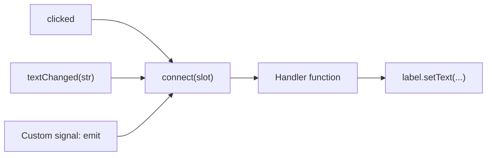

In the previous lesson the "Click me" button did nothing. Time to bring it to life. The mechanism that links user actions with code is called **signals and slots** — arguably Qt's most important concept.

## What is a signal and a slot

A **signal** is a message "something happened". For example, `QPushButton` emits the `clicked` signal when clicked. A **slot** is a function called in response to a signal.

The connection is made with the `connect` method:

```python
button.clicked.connect(handle_click)
```

Read as "when the button is pressed, call the `handle_click` function". The function name is passed without parentheses — we pass the function object itself, not the result of calling it.

Here's a complete example: counting button presses.

```python
import sys
from PyQt6.QtWidgets import QApplication, QWidget, QPushButton, QLabel

count = 0

def handle_click():
    global count
    count += 1
    label.setText(f"Clicks: {count}")

app = QApplication(sys.argv)

window = QWidget()
window.setWindowTitle("Counter")
window.resize(300, 150)

label = QLabel("Clicks: 0", window)
label.move(20, 20)

button = QPushButton("Click me", window)
button.move(20, 60)
button.clicked.connect(handle_click)

window.show()
sys.exit(app.exec())
```

Note: the `handle_click` function is defined **before** creating widgets, because it uses `label`, which must exist by call time. When is the function called? Not immediately — but every time the button is clicked.

## Every widget has signals

Each widget has its own set of signals. The most useful:

```python
edit.textChanged.connect(handler)        # text changed (passes str)
edit.returnPressed.connect(handler)      # Enter pressed in the field
button.clicked.connect(handler)          # button clicked
button.toggled.connect(handler)          # toggle changed state
spin.valueChanged.connect(handler)       # spinbox value changed
```

Many signals pass useful data to the slot. For example, `textChanged` passes the new text, `valueChanged` — the new number. The slot can accept them as arguments:

```python
def show_text(new_text):
    print("New text:", new_text)

edit.textChanged.connect(show_text)
```

## Lambda functions

When you need to call a function with your own arguments, lambdas come in handy:

```python
button.clicked.connect(lambda: print("Button clicked"))
button.clicked.connect(lambda checked: print("State:", checked))
```

`clicked` passes a boolean `checked` (for regular buttons — always `False`, for checkable buttons — the new state). The lambda can catch it, or ignore it by taking no arguments.

⚠️ A common beginner mistake — passing the result of a call:

```python
button.clicked.connect(print("Clicked"))   # ❌ runs immediately!
button.clicked.connect(lambda: print("Clicked"))  # ✅ only on click
```

## Custom signals

An application can declare its own signals. In PyQt6 this is done via `pyqtSignal`, in PySide6 — via `Signal`. A signal is declared as a class attribute of a class inheriting from `QObject`:

```python
from PyQt6.QtCore import QObject, pyqtSignal

class Counter(QObject):
    reached = pyqtSignal(int)      # signal passes a number

    def tick(self):
        self.reached.emit(10)      # emit the signal with the number 10
```

The order is: declare the signal as a class attribute, then call `emit` to emit it. Any object can connect to this signal via `connect`.

A common scenario — a "model" class that lives apart from the UI and reports its changes:

```python
import sys
from PyQt6.QtCore import QObject, pyqtSignal
from PyQt6.QtWidgets import QApplication, QWidget, QPushButton, QLabel

class Counter(QObject):
    reached = pyqtSignal(int)

    def __init__(self):
        super().__init__()
        self.value = 0

    def increment(self):
        self.value += 1
        self.reached.emit(self.value)

app = QApplication(sys.argv)

window = QWidget()
window.setWindowTitle("Custom signal")
window.resize(300, 150)

label = QLabel("0", window)
label.move(20, 20)

counter = Counter()
counter.reached.connect(label.setText)   # slot = label.setText method

button = QPushButton("+1", window)
button.move(20, 60)
button.clicked.connect(counter.increment)

window.show()
sys.exit(app.exec())
```

Here `counter.reached.connect(label.setText)` — connecting a signal directly to a widget method: that's also a slot, and it accepts a number.

## Managing connections

```python
button.clicked.connect(handler1)
button.clicked.connect(handler2)   # multiple slots per signal are allowed
button.clicked.disconnect(handler1)  # break one connection
button.clicked.disconnect()          # break all connections
```

If you call `disconnect` without arguments and there are several connections — Qt breaks them all. If you pass a specific function — only that one.

## Diagram: how a signal reaches a slot

All connections in Qt go through `connect`, and data is passed as signal arguments:



## Lesson summary

- A signal is a widget event, a slot is a handler function;
- `connect` connects them; multiple slots can be attached to one signal;
- signals pass data (text, numbers, booleans);
- lambdas allow passing your own arguments;
- custom signal: `pyqtSignal` (PyQt6) / `Signal` (PySide6) + `emit`.

Now practice.

<!--TASK-->
### Task 1
Finish the program with the "Click me" button so that each press prints the line `Button clicked!` to the console. Use `clicked.connect`. Make sure the message prints exactly once per click.

### Task 2
Create a window with an input field and a label. As soon as the user types in the field, the label must instantly show the same text. Hint: use QLineEdit's `textChanged` signal, which passes the new text.

### Task 3
Create a window with a button and a label. Remember the number of presses and display it in the label, but not every press — only those divisible by 5: "Pressed: 5", "Pressed: 10" and so on. For other presses just silently increment the counter. Use `clicked` and the check `if count % 5 == 0`.

### Task 4
Create a class `Greeter` (inheriting `QObject`) with a custom signal `greeted = pyqtSignal(str)`. When pressed, the button must call a class method that emits the signal with the string `Hello, world!`. In the main window connect this signal to a function that prints the received string to the console.

### Task 5
Create a window with a button and two slot functions: `one` prints `1`, `two` prints `2`. First connect both to `clicked` and verify that one press prints both lines. Then disconnect the first function via `disconnect(one)` and check that only `2` prints now.

### Task 6
Make a password visibility toggle: a `QLineEdit` field in `EchoMode.Password` mode and a `QCheckBox` with the text "Show password". When the checkbox is checked, the field must switch to `Normal` mode and show real characters; when unchecked — back to `Password`. Add a label nearby that, via the `textChanged` signal, shows the number of entered characters. Expected output: when entering `secret` the label shows `Characters: 6`, and when the checkbox is set the text in the field becomes visible, but the label doesn't change.

### Task 7
Create a class `Validator(QObject)` with a custom signal `checked = pyqtSignal(bool, str)` — it carries two arguments: validation success and a message. The method `check(text)` considers a password strong if it has at least 8 characters, and emits the signal with the result. In the window place a password field and a "Check" button; connect the signal to a slot that writes the message to a label and colors it green or red. Expected output: for `qwerty` the label shows `Password too short` in red, for `qwerty123` — `Password is strong` in green.
<!--/TASK-->

<!--HINT-->
### Hint 1
Define a function `on_click` with `print("Button clicked!")` and after creating the button call `button.clicked.connect(on_click)`. Don't call the function with parentheses inside `connect` — otherwise it will run immediately at startup.

### Hint 2
The `textChanged` signal passes the new text as an argument. So the slot must accept one parameter, e.g. `def update_label(text): label.setText(text)`. Caution: `label` must be accessible inside the function — define the function after creating the label.

### Hint 3
Introduce a counter via `global count` inside the slot. After incrementing, check `if count % 5 == 0:` and only then call `label.setText(...)`. For formatting, f-strings are convenient: `f"Pressed: {count}"`.

### Hint 4
Create a class `Greeter(QObject)` with `greeted = pyqtSignal(str)` and a method `greet(self)` that calls `self.greeted.emit("Hello, world!")`. In the main part of the program create a `greeter` object and connect `greeter.greeted.connect(print)` — `print` accepts a string and will output it.

### Hint 5
Define `def one(): print("1")` and `def two(): print("2")`. Connect both: `button.clicked.connect(one)` and `button.clicked.connect(two)`. Then `button.clicked.disconnect(one)` — and press the button again. Check that the second time only `2` prints.

### Hint 6
In the checkbox handler choose the mode: `mode = QLineEdit.EchoMode.Normal if checked else QLineEdit.EchoMode.Password`, then `password.setEchoMode(mode)`. Connect `show_box.toggled.connect(toggle_echo)`. The character counter is a separate slot with a parameter: `def update_len(text): hint.setText(f"Characters: {len(text)}")`, connected to `password.textChanged`.

### Hint 7
Declare the signal as a class attribute: `checked = pyqtSignal(bool, str)`, and inherit the class from `QObject`. In `check` use `self.checked.emit(True, "...")` and `self.checked.emit(False, "...")` — the number of arguments must match the declaration. The receiving slot takes two parameters: `def on_result(ok, message):`. Set the color via `label.setStyleSheet("color: green;")`.
<!--/HINT-->

<!--SOLUTION-->
### Walkthrough 1
Solution:

```python
import sys
from PyQt6.QtWidgets import QApplication, QWidget, QPushButton

def on_click():
    print("Button clicked!")

app = QApplication(sys.argv)

window = QWidget()
window.setWindowTitle("Click")
window.resize(200, 100)

button = QPushButton("Click me", window)
button.move(20, 20)
button.clicked.connect(on_click)

window.show()
sys.exit(app.exec())
```

Each press prints:

```
Button clicked!
```

What's happening here? `clicked` is the button's signal, emitted on every click. `connect(on_click)` registers the `on_click` function as a slot. Importantly, the function name is passed to `connect` without parentheses: parentheses would mean a *call* — the function would run at startup rather than on click (and its result, `None`, Qt would try to call as a slot, causing an error). The "signal → slot" connection is the foundation of all interactivity in Qt.

### Walkthrough 2
Solution:

```python
import sys
from PyQt6.QtWidgets import QApplication, QWidget, QLineEdit, QLabel

app = QApplication(sys.argv)

window = QWidget()
window.setWindowTitle("Echo")
window.resize(400, 120)

label = QLabel("", window)
label.move(20, 60)

edit = QLineEdit(window)
edit.move(20, 20)
edit.resize(300, 30)
edit.textChanged.connect(label.setText)

window.show()
sys.exit(app.exec())
```

The label echoes everything you type. What's happening here? The `textChanged` signal is emitted on every text change and passes the new text to the slot as a string. The slot is the `label.setText` method, which accepts exactly one string argument. Thus every typed character is immediately shown in the label. Note that a widget method can be connected directly — you don't have to write a separate wrapper function.

### Walkthrough 3
Solution:

```python
import sys
from PyQt6.QtWidgets import QApplication, QWidget, QPushButton, QLabel

count = 0

def on_click():
    global count
    count += 1
    if count % 5 == 0:
        label.setText(f"Pressed: {count}")

app = QApplication(sys.argv)

window = QWidget()
window.setWindowTitle("Multiples of 5")
window.resize(300, 120)

label = QLabel("Pressed: 0", window)
label.move(20, 20)

button = QPushButton("Press", window)
button.move(20, 60)
button.clicked.connect(on_click)

window.show()
sys.exit(app.exec())
```

After 5 presses:

```
Pressed: 5
```

What's happening here? The variable `count` lives outside the function, so the slot needs the `global count` statement — otherwise Python would create a new local variable. After incrementing, `count % 5 == 0` is checked — the remainder of division by 5. If it's zero, the number is a multiple of five and the label updates. This pattern (a counter + conditional update) constantly appears in real applications — for example, for periodically saving progress.

### Walkthrough 4
Solution:

```python
import sys
from PyQt6.QtCore import QObject, pyqtSignal
from PyQt6.QtWidgets import QApplication, QWidget, QPushButton

class Greeter(QObject):
    greeted = pyqtSignal(str)

    def greet(self):
        self.greeted.emit("Hello, world!")

app = QApplication(sys.argv)

greeter = Greeter()
greeter.greeted.connect(print)

window = QWidget()
window.setWindowTitle("Custom signal")
window.resize(200, 100)

button = QPushButton("Say hello", window)
button.move(20, 20)
button.clicked.connect(greeter.greet)

window.show()
sys.exit(app.exec())
```

On press, the console shows:

```
Hello, world!
```

What's happening here? The `Greeter` class inherits from `QObject` — a mandatory condition for declaring signals. `greeted = pyqtSignal(str)` describes a signal that passes a string. The `greet()` method emits it via `emit`. The button calls `greeter.greet` (without parentheses!), and the signal, in turn, wakes up `print`. This scheme separates logic from the interface: `Greeter` knows nothing about the window, and the window doesn't know how `Greeter` works internally.

### Walkthrough 5
Solution:

```python
import sys
from PyQt6.QtWidgets import QApplication, QWidget, QPushButton

def one():
    print("1")

def two():
    print("2")

app = QApplication(sys.argv)

window = QWidget()
window.setWindowTitle("Two slots")
window.resize(200, 100)

button = QPushButton("Press", window)
button.move(20, 20)
button.clicked.connect(one)
button.clicked.connect(two)

window.show()
sys.exit(app.exec())
```

The first press outputs:

```
1
2
```

Now add the line `button.clicked.disconnect(one)` before `window.show()`. After that, presses print only `2`. What's happening here? Qt allows attaching several slots to one signal: they are called in connection order. `disconnect(one)` breaks only the connection with the `one` function, leaving `two` intact. Also try `button.clicked.disconnect()` without arguments — it breaks all connections, and the button stops printing anything.

### Walkthrough 6
Solution:

```python
import sys
from PyQt6.QtWidgets import (QApplication, QWidget, QLineEdit, QCheckBox,
                             QLabel, QVBoxLayout)

app = QApplication(sys.argv)
window = QWidget()
window.setWindowTitle("Show password")
window.resize(320, 170)

layout = QVBoxLayout(window)
password = QLineEdit()
password.setEchoMode(QLineEdit.EchoMode.Password)
password.setPlaceholderText("Password")
show_box = QCheckBox("Show password")
hint = QLabel("Characters: 0")

def toggle_echo(checked):
    mode = QLineEdit.EchoMode.Normal if checked else QLineEdit.EchoMode.Password
    password.setEchoMode(mode)

def update_len(text):
    hint.setText(f"Characters: {len(text)}")

show_box.toggled.connect(toggle_echo)
password.textChanged.connect(update_len)

for widget in (password, show_box, hint):
    layout.addWidget(widget)

window.show()
sys.exit(app.exec())
```

What's happening here? The `toggled` signal passes the checkbox's boolean state, so the `toggle_echo` slot takes one parameter `checked`. Inside, the required `EchoMode` is chosen, and the field instantly repaints. The second signal — `textChanged` — passes the new text as a string, and `update_len` counts its length. Note: changing the mode doesn't emit `textChanged`, so the character counter doesn't jump when visibility is toggled — exactly the required behavior. The ternary expression in `mode = ...` is a compact alternative to `if/else` with assignment.

### Walkthrough 7
Solution:

```python
import sys
from PyQt6.QtCore import QObject, pyqtSignal
from PyQt6.QtWidgets import (QApplication, QWidget, QLineEdit, QPushButton,
                             QLabel, QVBoxLayout)

class Validator(QObject):
    checked = pyqtSignal(bool, str)

    def check(self, text):
        if len(text) < 8:
            self.checked.emit(False, "Password too short")
        else:
            self.checked.emit(True, "Password is strong")

app = QApplication(sys.argv)
window = QWidget()
window.setWindowTitle("Password check")
window.resize(320, 170)

layout = QVBoxLayout(window)
password = QLineEdit()
password.setEchoMode(QLineEdit.EchoMode.Password)
password.setPlaceholderText("Password")
button = QPushButton("Check")
result = QLabel("Enter a password")

validator = Validator()

def on_result(ok, message):
    result.setText(message)
    result.setStyleSheet("color: green;" if ok else "color: red;")

def on_click():
    validator.check(password.text())

validator.checked.connect(on_result)
button.clicked.connect(on_click)

for widget in (password, button, result):
    layout.addWidget(widget)

window.show()
sys.exit(app.exec())
```

What's happening here? `Validator` inherits from `QObject` — without this a signal cannot be declared. `pyqtSignal(bool, str)` describes a signal with two arguments, and `emit` must pass exactly two values, otherwise Qt will raise an error. The button calls `on_click`, which passes the text to `check`, and `check` decides which result to emit. The `on_result` slot receives `ok` and `message` and simultaneously changes the label's text and color — one signal controls two properties. This scheme separates the validation rule from the interface: `Validator` can be reused in any window.
<!--/SOLUTION-->

<!--QUIZ-->
What does the connect method of a signal do?
- Calls the signal
- Connects the signal to a slot function
- Creates a new signal
* Correct answer: Connects the signal to a slot function
connect(handler) registers the function that will be called when the signal is emitted.

How to correctly connect the function handle_click to a button?
- button.clicked.connect(handle_click())
- button.clicked.connect(handle_click)
- button.clicked = handle_click
* Correct answer: button.clicked.connect(handle_click)
The function is passed without parentheses — otherwise it runs immediately.

Which QLineEdit signal reports a text change?
- clicked
- textChanged
- valueChanged
* Correct answer: textChanged
textChanged is emitted on every text change and passes the new text.

What does the clicked signal of a regular button pass?
- Nothing
- A boolean value (often False)
- The button text
* Correct answer: A boolean value (often False)
For a regular button clicked passes False; for checkable buttons it passes the state.

How to declare a custom signal in PyQt6?
- signal = Signal(str)
- greeted = pyqtSignal(str)
- self.signal = str()
* Correct answer: greeted = pyqtSignal(str)
In PyQt6 signals are declared as a class attribute via pyqtSignal; in PySide6 — via Signal.

Which class must a class with a custom signal inherit from?
- QWidget
- QObject
- QApplication
* Correct answer: QObject
Signals are available only to QObject-based classes.

How to emit the greeted signal with the value "hello"?
- greeted("hello")
- greeted.emit("hello")
- emit(greeted, "hello")
* Correct answer: greeted.emit("hello")
Emitting a signal is calling emit with arguments.

How many slots can be connected to one signal?
- Only one
- Several
- None
* Correct answer: Several
Qt allows any number of slots; they are called in order.

What does disconnect(one) do?
- Breaks the connection with the function one
- Breaks all connections of the signal
- Removes the function from code
* Correct answer: Breaks the connection with the function one
If a function is passed, only it is disconnected; without arguments all slots are disconnected.

Why can't you write button.clicked.connect(print("Clicked"))?
- print is not a function
- The print("Clicked") call runs immediately at connection time, not on click
- This syntax won't compile at all
* Correct answer: The print("Clicked") call runs immediately at connection time, not on click
Parentheses mean a call. You need lambda: print("Clicked") or a function name.

What does the call signal.emit(True, "Done") do?
- Emits the signal with two arguments
- Connects a new slot
- Creates a second signal
* Correct answer: Emits the signal with two arguments
The emit arguments must match the pyqtSignal(bool, str) declaration.

How many arguments can a custom signal carry?
- As many as specified in the declaration via pyqtSignal
- Exactly one
- No more than two
* Correct answer: As many as specified in the declaration via pyqtSignal
The types and count are set in the declaration, and emit must match them.

Why must a slot connected to textChanged accept a parameter?
- The signal passes the new text as an argument
- Otherwise Qt gives a syntax error
- To return the text back to the field
* Correct answer: The signal passes the new text as an argument
A slot without parameters won't accept the string that textChanged carries.

What happens when a QCheckBox is switched to "show password" mode?
- Only the display mode changes; the text() value stays the same
- The field clears
- The password is removed from memory
* Correct answer: Only the display mode changes; the text() value stays the same
EchoMode affects rendering, not the data.
<!--/QUIZ-->
