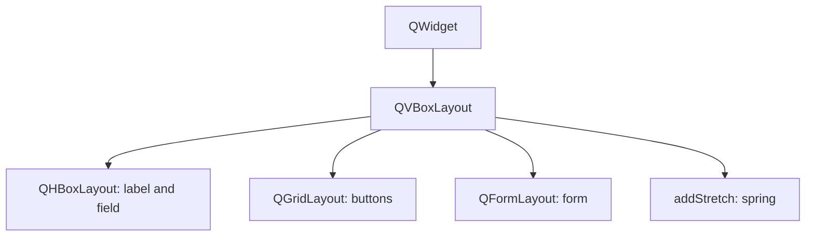

In lesson 1 we positioned widgets manually via `move` and `resize`. That works, but when the window is resized everything "drifts apart", and adding a new widget means recalculating coordinates. The solution — **layouts**: managers that automatically arrange child widgets.

## QVBoxLayout and QHBoxLayout

`QVBoxLayout` stacks widgets vertically; `QHBoxLayout` puts them in a horizontal row:

```python
import sys
from PyQt6.QtWidgets import (QApplication, QWidget, QPushButton,
                             QVBoxLayout, QHBoxLayout)

app = QApplication(sys.argv)

window = QWidget()
window.setWindowTitle("Layouts")

# vertical layout inside the window
vbox = QVBoxLayout(window)
vbox.addWidget(QPushButton("Button 1"))
vbox.addWidget(QPushButton("Button 2"))
vbox.addWidget(QPushButton("Button 3"))

# horizontal — a separate "window" with a layout
h_window = QWidget()
h_window.setWindowTitle("Horizontal")
hbox = QHBoxLayout(h_window)
hbox.addWidget(QPushButton("Button 1"))
hbox.addWidget(QPushButton("Button 2"))
hbox.addWidget(QPushButton("Button 3"))

window.show()
h_window.show()
sys.exit(app.exec())
```

The layout "takes over" the widgets: they no longer need manual positioning, and when the window is stretched they redistribute evenly.

## Nested layouts

Layouts can be nested into each other via `addLayout`. This is the main technique for building complex interfaces:

```python
main_layout = QVBoxLayout(window)

header = QHBoxLayout()
header.addWidget(QLabel("Name:"))
header.addWidget(QLineEdit())
main_layout.addLayout(header)
main_layout.addWidget(QPushButton("OK"))
```

Here a horizontal row (label + field) is nested inside the window's vertical layout.

## QGridLayout — grid

`QGridLayout` arranges widgets in rows and columns. It's perfect for keyboards and forms:

```python
grid = QGridLayout(window)
grid.addWidget(QPushButton("7"), 0, 0)   # row 0, column 0
grid.addWidget(QPushButton("8"), 0, 1)
grid.addWidget(QPushButton("9"), 0, 2)
grid.addWidget(QPushButton("4"), 1, 0)
grid.addWidget(QPushButton("5"), 1, 1)
grid.addWidget(QPushButton("6"), 1, 2)
grid.addWidget(QPushButton("1"), 2, 0)
grid.addWidget(QPushButton("2"), 2, 1)
grid.addWidget(QPushButton("3"), 2, 2)
```

Position is given by a (row, column) pair. A widget can span several cells: `addWidget(widget, row, col, rowSpan, colSpan)`.

## QFormLayout — form

`QFormLayout` is designed for "label → field" forms: it aligns labels and fields itself:

```python
from PyQt6.QtWidgets import QFormLayout, QLineEdit, QSpinBox

form = QFormLayout(window)
form.addRow("Name:", QLineEdit())
form.addRow("Age:", QSpinBox())
form.addRow("Email:", QLineEdit())
```

## Spacing and stretching

Layout settings:

```python
vbox.setSpacing(10)          # distance between widgets
vbox.setContentsMargins(20, 20, 20, 20)   # margins from window edges
vbox.addStretch(1)           # "spring": pushes widgets up
```

`addStretch` adds empty space that grows as the window grows. With it you can pin a button to the bottom: widgets first, then `addStretch()`.

## QListWidget — list

`QListWidget` is a ready-made list of strings:

```python
from PyQt6.QtWidgets import QListWidget

list_widget = QListWidget(window)
list_widget.addItem("Python")
list_widget.addItem("PyQt6")
list_widget.addItems(["Java", "C++", "Go"])
```

Managing selection:

```python
list_widget.currentItemChanged.connect(on_item_changed)  # signal
item = list_widget.currentItem()   # currently selected item
if item:
    print(item.text())              # its text
list_widget.clear()                 # clear the list
```

## QTableWidget — table

`QTableWidget` shows data as a table:

```python
from PyQt6.QtWidgets import QTableWidget, QTableWidgetItem

table = QTableWidget(3, 2, window)   # 3 rows, 2 columns
table.setHorizontalHeaderLabels(["Name", "Grade"])
table.setItem(0, 0, QTableWidgetItem("Anna"))
table.setItem(0, 1, QTableWidgetItem("5"))
table.setItem(1, 0, QTableWidgetItem("Peter"))
table.setItem(1, 1, QTableWidgetItem("4"))
```

Sizes and behavior:

```python
table.resizeColumnsToContents()   # fit columns to contents
table.setRowCount(5)              # change number of rows
table.setEditTriggers(QAbstractItemView.EditTrigger.DoubleClicked)
table.currentCellChanged.connect(on_cell_changed)  # cell change signal
```

## QComboBox — dropdown list

`QComboBox` saves space: it shows one item, the rest open as a list:

```python
from PyQt6.QtWidgets import QComboBox

combo = QComboBox(window)
combo.addItems(["Python", "PyQt6", "Java", "C++"])
current = combo.currentText()      # current text
combo.currentTextChanged.connect(on_changed)   # selection change signal
```

## QSpinBox — numeric field

`QSpinBox` is a field for integers with arrows:

```python
from PyQt6.QtWidgets import QSpinBox

spin = QSpinBox(window)
spin.setRange(0, 100)        # allowed range
spin.setValue(50)            # current value
spin.setSingleStep(5)        # arrow step
value = spin.value()         # read value
spin.valueChanged.connect(on_value_changed)   # signal
```

## Diagram: layout hierarchy

A complex interface is a tree: a window, inside it a main layout, inside it — nested layouts and widgets.



## Lesson summary

- Layouts automatically arrange widgets and keep them from drifting apart;
- `QVBoxLayout`/`QHBoxLayout` — vertical/horizontal, nest into each other;
- `QGridLayout` — tabular grid, `QFormLayout` — "label → field" forms;
- `QListWidget`, `QTableWidget`, `QComboBox`, `QSpinBox` — ready widgets for data;
- all have signals for tracking changes.

Now tasks.

<!--TASK-->
### Task 1
Create a window with a vertical layout: a "Welcome!" label, an input field, and a "Log in" button. The button must stretch across the full width of the window, and there must be 10 pixels of spacing between widgets. Verify that when the window is resized the widgets redistribute automatically.

### Task 2
Assemble a digital "calculator" layout from 12 buttons with digits 0–9, a dot, and the "=" sign. Use `QGridLayout` (4 rows of 3 columns). The top row is 7 8 9, then 4 5 6, 1 2 3, and at the bottom 0 . =. Make sure the buttons grow evenly when the window is stretched.

### Task 3
Create a login form with `QFormLayout`: a "Login" field, a "Password" field (with `EchoMode.Password`) and a "Log in" button. Place the button in a separate form row (`addRow` with an empty label) or add it to a vertical layout under the form. Window size — 300×150.

### Task 4
Create a window with a `QListWidget` and a label below it. Fill the list with five cities (Moscow, Saint Petersburg, Kazan, Novosibirsk, Sochi). When the selection changes, the label must show `Selected: <city>`. If the selection is removed — the label shows "Nothing selected".

### Task 5
Create a window with a `QTableWidget` 4×3. Fill the first two columns with data: name and city (any 4 rows). Fill the third column with the numbers 1–4 as strings. Set the column headers: Name, City, Score. Fit the column widths to contents and make editing enabled only on double-click.

### Task 6
Assemble a "pizza order" on a `QFormLayout`: a `QComboBox` dropdown with sizes "Small", "Medium", "Large" and a `QSpinBox` numeric field for quantity from 1 to 10 with initial value 1. Below — a label with the total sum. Set the prices with a dict: 400, 550 and 700 rubles. Recalculate the total on any change of the selection or quantity by subscribing to `currentTextChanged` and `valueChanged`, and output it in the format `Total: 1100 ₽`. Expected output: with size "Medium" and quantity 2 the label shows `Total: 1100 ₽`, and when switching to "Large" — `Total: 1400 ₽` without pressing any buttons.

### Task 7
Make a grades table on a `QTableWidget` with three columns "Name", "City", "Score". Above the table place three `QLineEdit` fields and an "Add row" button that inserts a new record via `insertRow(rowCount())` and fills the cells with `QTableWidgetItem`. A "Delete selected" button removes the row at `currentRow()`, and a label under the table shows the sum of scores across all rows. Expected output: after two rows with scores 40 and 60 the label shows `Score sum: 100`, after deleting one — `Score sum: 40`.
<!--/TASK-->

<!--HINT-->
### Hint 1
Create `QVBoxLayout(window)`, then `addWidget` for each widget in order. Spacing between items — `setSpacing(10)`. Widgets in a vertical layout take the full width by default — nothing extra is needed.

### Hint 2
Create `QGridLayout(window)` and add buttons via `grid.addWidget(QPushButton("7"), 0, 0)` and so on. Rows: 0, 1, 2, 3; columns: 0, 1, 2. For "=" you can occupy the last cell (3, 2).

### Hint 3
Create `QFormLayout(window)`, then `form.addRow("Login:", QLineEdit())` and `form.addRow("Password:", QLineEdit())`. For the password, save the field object into a variable and call `setEchoMode(QLineEdit.EchoMode.Password)` on it. Add the button via `form.addRow(QPushButton("Log in"))` — it will take a new row.

### Hint 4
Create a `QListWidget` and add cities via `addItems([...])`. The label is a regular `QLabel`. Connect `list_widget.currentItemChanged.connect(...)`; the slot takes the current item (or `None` if nothing is selected). Inside the slot check `if item:` and read `item.text()`.

### Hint 5
Create `QTableWidget(4, 3, window)`. Fill with `setItem(row, col, QTableWidgetItem(str(value)))`. Headers — `setHorizontalHeaderLabels(["Name", "City", "Score"])`. Width — `resizeColumnsToContents()`. Editing: pass the constant `QAbstractItemView.EditTrigger.DoubleClicked` via `table.setEditTriggers(...)`.

### Hint 6
`QComboBox.currentTextChanged` passes a string, and `QSpinBox.valueChanged` passes a number, but the slot can be made universal: `def recalc(*args):`. Take the price from the dict by the key `size_combo.currentText()`, quantity — via `qty_spin.value()`. To make the total correct right at startup, call `recalc()` once after creating the widgets.

### Hint 7
For adding: `row = table.rowCount()`, then `table.insertRow(row)` and three `setItem(row, col, QTableWidgetItem(text))`. Don't forget that `setItem` takes a string, not a number. For the sum iterate over rows and add `int(table.item(r, 2).text())`, skipping empty cells. After each change call one function `update_sum()` so the label doesn't diverge from the table.
<!--/HINT-->

<!--SOLUTION-->
### Walkthrough 1
Solution:

```python
import sys
from PyQt6.QtWidgets import (QApplication, QWidget, QLabel, QLineEdit,
                             QPushButton, QVBoxLayout)

app = QApplication(sys.argv)

window = QWidget()
window.setWindowTitle("Login")
window.resize(400, 200)

layout = QVBoxLayout(window)
layout.setSpacing(10)

layout.addWidget(QLabel("Welcome!"))
layout.addWidget(QLineEdit())
layout.addWidget(QPushButton("Log in"))

window.show()
sys.exit(app.exec())
```

What's happening here? `QVBoxLayout(window)` binds the layout to the window. Each `addWidget` appends a widget to the end of the list — top to bottom. `setSpacing(10)` sets a gap of 10 pixels between neighboring widgets. The button stretches across the full width because in a vertical layout widgets fill the available width. When the window size changes, the layout recalculates positions automatically — no manual `move`.

### Walkthrough 2
Solution:

```python
import sys
from PyQt6.QtWidgets import QApplication, QWidget, QPushButton, QGridLayout

app = QApplication(sys.argv)

window = QWidget()
window.setWindowTitle("Digital panel")
window.resize(300, 300)

grid = QGridLayout(window)

digits = ["7", "8", "9", "4", "5", "6", "1", "2", "3", "0", ".", "="]
for i, text in enumerate(digits):
    row, col = i // 3, i % 3
    grid.addWidget(QPushButton(text), row, col)

window.show()
sys.exit(app.exec())
```

What's happening here? The list `digits` of 12 items is passed through `enumerate`, which yields the index `i`. The row is `i // 3` (integer division), the column is `i % 3` (remainder): items 0–2 land in row 0, 3–5 in row 1, and so on. The result is a 4×3 grid. `QGridLayout` distributes the available space equally among cells, so buttons grow evenly when the window is stretched.

### Walkthrough 3
Solution:

```python
import sys
from PyQt6.QtWidgets import (QApplication, QWidget, QLineEdit,
                             QPushButton, QFormLayout)

app = QApplication(sys.argv)

window = QWidget()
window.setWindowTitle("Login")
window.resize(300, 150)

form = QFormLayout(window)

login = QLineEdit()
password = QLineEdit()
password.setEchoMode(QLineEdit.EchoMode.Password)

form.addRow("Login:", login)
form.addRow("Password:", password)
form.addRow(QPushButton("Log in"))

window.show()
sys.exit(app.exec())
```

What's happening here? `QFormLayout` aligns labels to the right edge and fields to the left, creating a neat two-column form. `addRow("Login:", login)` adds a row of a label and a field. `addRow(QPushButton("Log in"))` — without a label, so the button occupies the entire second column. `setEchoMode(QLineEdit.EchoMode.Password)` hides typed characters behind dots. Forms are the most common use case for `QFormLayout`.

### Walkthrough 4
Solution:

```python
import sys
from PyQt6.QtWidgets import (QApplication, QWidget, QListWidget,
                             QLabel, QVBoxLayout)

app = QApplication(sys.argv)

window = QWidget()
window.setWindowTitle("Cities")
window.resize(300, 250)

layout = QVBoxLayout(window)

list_widget = QListWidget()
list_widget.addItems(["Moscow", "Saint Petersburg", "Kazan",
                      "Novosibirsk", "Sochi"])
layout.addWidget(list_widget)

label = QLabel("Nothing selected")
layout.addWidget(label)

def on_item_changed(item):
    if item:
        label.setText(f"Selected: {item.text()}")
    else:
        label.setText("Nothing selected")

list_widget.currentItemChanged.connect(on_item_changed)

window.show()
sys.exit(app.exec())
```

What's happening here? `QListWidget` stores items and manages selection itself. The `currentItemChanged` signal fires when the current item changes and passes the new item (or `None` if the selection is removed). The slot checks `if item:` — if an item exists, it takes its text via `item.text()`. This keeps the list and the label always in sync without manual checks.

### Walkthrough 5
Solution:

```python
import sys
from PyQt6.QtCore import Qt
from PyQt6.QtWidgets import (QApplication, QWidget, QTableWidget,
                             QTableWidgetItem, QAbstractItemView)

app = QApplication(sys.argv)

window = QWidget()
window.setWindowTitle("Table")
window.resize(400, 200)

table = QTableWidget(4, 3, window)
table.setHorizontalHeaderLabels(["Name", "City", "Score"])

data = [
    ("Anna", "Moscow", "1"),
    ("Peter", "Kazan", "2"),
    ("Olga", "Sochi", "3"),
    ("Igor", "Pskov", "4"),
]
for row, (name, city, score) in enumerate(data):
    table.setItem(row, 0, QTableWidgetItem(name))
    table.setItem(row, 1, QTableWidgetItem(city))
    table.setItem(row, 2, QTableWidgetItem(score))

table.resizeColumnsToContents()
table.setEditTriggers(QAbstractItemView.EditTrigger.DoubleClicked)

window.show()
sys.exit(app.exec())
```

What's happening here? `QTableWidget(4, 3, window)` creates a table of 4 rows × 3 columns. `setHorizontalHeaderLabels` sets the headers. The `enumerate(data)` loop iterates over the list of tuples: `(row, (name, city, score))` is unpacked into three variables, and each cell is filled with `QTableWidgetItem`. `resizeColumnsToContents()` fits column widths to contents. `setEditTriggers(QAbstractItemView.EditTrigger.DoubleClicked)` allows editing only on double-click — with a single click the cell is just selected.

### Walkthrough 6
Solution:

```python
import sys
from PyQt6.QtWidgets import (QApplication, QWidget, QLabel, QComboBox,
                             QSpinBox, QVBoxLayout, QFormLayout)

app = QApplication(sys.argv)
window = QWidget()
window.setWindowTitle("Pizza order")
window.resize(360, 220)

layout = QVBoxLayout(window)
form = QFormLayout()

size_combo = QComboBox()
size_combo.addItems(["Small", "Medium", "Large"])

qty_spin = QSpinBox()
qty_spin.setRange(1, 10)
qty_spin.setValue(1)

form.addRow("Size:", size_combo)
form.addRow("Quantity:", qty_spin)
layout.addLayout(form)

PRICES = {"Small": 400, "Medium": 550, "Large": 700}
total_label = QLabel("Total: 0 ₽")
layout.addWidget(total_label)

def recalc(*args):
    price = PRICES[size_combo.currentText()]
    total = price * qty_spin.value()
    total_label.setText(f"Total: {total} ₽")

size_combo.currentTextChanged.connect(recalc)
qty_spin.valueChanged.connect(recalc)
recalc()

window.show()
sys.exit(app.exec())
```

What's happening here? `QComboBox.currentTextChanged` and `QSpinBox.valueChanged` carry different types — a string and a number — but a slot with `*args` accepts any number of arguments and simply ignores them: it takes all the data from the widgets themselves. This is a convenient technique when there are several signals but one logic. The `PRICES` dict links the displayed text with the price — if you add a new size, you only need to extend the dict and the item list. The `recalc()` call after subscribing is needed so the label immediately shows 400 rubles rather than 0. Note: `QFormLayout.addRow` itself aligns labels and fields into two columns.

### Walkthrough 7
Solution:

```python
import sys
from PyQt6.QtWidgets import (QApplication, QWidget, QLabel, QLineEdit,
                             QPushButton, QTableWidget, QTableWidgetItem,
                             QVBoxLayout, QHBoxLayout)

app = QApplication(sys.argv)
window = QWidget()
window.setWindowTitle("Grades")
window.resize(480, 320)

layout = QVBoxLayout(window)
inputs = QHBoxLayout()
name_edit = QLineEdit()
name_edit.setPlaceholderText("Name")
city_edit = QLineEdit()
city_edit.setPlaceholderText("City")
score_edit = QLineEdit()
score_edit.setPlaceholderText("Score")
for widget in (name_edit, city_edit, score_edit):
    inputs.addWidget(widget)
layout.addLayout(inputs)

table = QTableWidget(0, 3)
table.setHorizontalHeaderLabels(["Name", "City", "Score"])
layout.addWidget(table)

add_button = QPushButton("Add row")
remove_button = QPushButton("Delete selected")
sum_label = QLabel("Score sum: 0")
for widget in (add_button, remove_button, sum_label):
    layout.addWidget(widget)

def update_sum():
    total = 0
    for row in range(table.rowCount()):
        item = table.item(row, 2)
        if item and item.text().isdigit():
            total += int(item.text())
    sum_label.setText(f"Score sum: {total}")

def add_row():
    row = table.rowCount()
    table.insertRow(row)
    table.setItem(row, 0, QTableWidgetItem(name_edit.text().strip()))
    table.setItem(row, 1, QTableWidgetItem(city_edit.text().strip()))
    table.setItem(row, 2, QTableWidgetItem(score_edit.text().strip()))
    for widget in (name_edit, city_edit, score_edit):
        widget.clear()
    update_sum()

def remove_row():
    row = table.currentRow()
    if row >= 0:
        table.removeRow(row)
        update_sum()

add_button.clicked.connect(add_row)
remove_button.clicked.connect(remove_row)

window.show()
sys.exit(app.exec())
```

What's happening here? `QTableWidget(0, 3)` creates an empty table with three columns, and `insertRow(rowCount())` adds a row at the end — the correct way for tables, unlike lists. Each cell is wrapped in `QTableWidgetItem`: the table stores item objects, not strings. `update_sum` iterates over all rows and checks `item.text().isdigit()`, because the third column might contain a non-number or an empty cell — without the check the program would crash on `int("")`. `currentRow()` returns `-1` if nothing is selected, so deletion is guarded by a condition. After each change the sum is recalculated from scratch rather than incremented — so it never diverges from the actual contents.
<!--/SOLUTION-->

<!--QUIZ-->
Which layout stacks widgets one below another?
- QHBoxLayout
- QVBoxLayout
- QGridLayout
* Correct answer: QVBoxLayout
QVBoxLayout is a vertical layout: widgets go top to bottom.

How to nest one layout into another?
- addLayout(layout)
- addWidget(layout)
- insert(layout)
* Correct answer: addLayout(layout)
Nested layouts are added via addLayout, widgets via addWidget.

In which layout does the "7" button land in row 0, column 0?
- QVBoxLayout
- QGridLayout
- QFormLayout
* Correct answer: QGridLayout
QGridLayout.addWidget(widget, row, col) sets the position by row and column.

Which layout is optimized for "label → field" forms?
- QHBoxLayout
- QFormLayout
- QGridLayout
* Correct answer: QFormLayout
QFormLayout aligns labels and fields itself, forming two columns.

What does addStretch() do in a layout?
- Adds a button
- Adds stretchable empty space
- Removes all margins
* Correct answer: Adds stretchable empty space
addStretch adds a "spring" that takes extra space and pushes widgets to the desired side.

How to read the text of the current selected QListWidget item?
- list_widget.text()
- list_widget.currentItem().text()
- list_widget.getText()
* Correct answer: list_widget.currentItem().text()
currentItem() returns the current item object, which has a text() method.

Which QComboBox signal reports a selection change?
- selectionChanged
- currentTextChanged
- indexChanged
* Correct answer: currentTextChanged
currentTextChanged passes the text of the newly selected item.

What does QSpinBox.setRange(0, 100) do?
- Sets the spinbox size
- Limits the allowed values from 0 to 100
- Sets the change step
* Correct answer: Limits the allowed values from 0 to 100
setRange sets the minimum and maximum value.

How many rows and columns does QTableWidget(3, 2) create?
- 3 rows and 2 columns
- 2 rows and 3 columns
- 6 rows and 6 columns
* Correct answer: 3 rows and 2 columns
The first argument is the number of rows, the second — columns.

What does resizeColumnsToContents() do to a table?
- Makes the table invisible
- Fits the column widths to contents
- Sorts the columns
* Correct answer: Fits the column widths to contents
The method computes each column's width from the widest cells.

How to add a "label — field" row in QFormLayout?
- form.addRow("Login:", QLineEdit())
- form.addWidget("Login:")
- form.addRow(QLineEdit())
* Correct answer: form.addRow("Login:", QLineEdit())
addRow takes a label and a widget and builds two columns.

Which signal does QComboBox use to report a change of the selected text?
- currentTextChanged
- textEdited
- clicked
* Correct answer: currentTextChanged
The signal passes the string of the newly selected item.

What will QSpinBox.value() return at value 3?
- The number 3
- The string "3"
- Nothing; text() is needed
* Correct answer: The number 3
QSpinBox works with integers; value() returns an int.

How to add an empty row at the end of a QTableWidget?
- table.insertRow(table.rowCount())
- table.addRow()
- table.append(row)
* Correct answer: table.insertRow(table.rowCount())
insertRow takes an index, and rowCount() gives the position after the last row.
<!--/QUIZ-->
