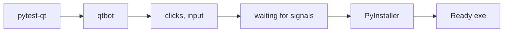

Modern Qt applications can't be shipped without automated tests. In this lesson we use `pytest-qt` to test widgets, signals, and even visual behavior.

## Why test GUI

Widgets are code too: button logic, input validation, model updates. Automated tests catch regressions before users notice them.

## Setting up pytest-qt

```bash
pip install pytest-qt
```

The `qtbot` fixture provides `addWidget()` (widget registration) and `waitSignal()` (waiting for a signal).

## Testing signals

```python
def test_button_click(qtbot):
    widget = MyWidget()
    qtbot.addWidget(widget)
    qtbot.mouseClick(widget.button, Qt.MouseButton.LeftButton)
    assert widget.counter == 1
```

## QTest: simulating input

`QTest.keyClicks`, `QTest.mouseClick` let you simulate user actions without manually running the window.

## Testing without waiting

`qtbot.waitSignal(sig, timeout=1000)` is useful for async operations.

## Building with PyInstaller

```bash
pyinstaller --windowed --onefile --name myapp main.py
```

The `--windowed` flag removes the console; `--onefile` builds a single executable.

## Profiling startup

If the app starts slowly, use `python -m cProfile main.py` and look at the most expensive calls during initialization.

## Lesson summary

We learned to test UI via pytest-qt, check signals and input, then build a ready executable. This turns a prototype into a product.



## Practical recommendations

UI testing catches bugs invisible in unit tests: button states, signal order, field validation. Make it a rule: every button handler has a test. When building with PyInstaller, add resources (icons, fonts) via `--add-data`; and to verify the final exe always run it in a clean folder outside the project.

<!--TASK-->
### Task 1 — First pytest-qt test
Create a widget with a button and a counter. Write a test: a click `qtbot.mouseClick` increments the counter. Make sure the test passes.

### Task 2 — Checking the input field
Create a QLineEdit and a QLabel that duplicates the text. Write a test that enters text via QTest.keyClicks and checks that the label has updated.

### Task 3 — Validation through a test
Add a check to the widget: with an empty field the button is disabled. Write a test: the button is unavailable with empty input and available after entering text.

### Task 4 — Waiting for a signal
Create a widget that emits a `done` signal 0.5 s after being pressed. Write a test with qtbot.waitSignal that checks the signal arrived.

### Task 5 — Model test QAbstractTableModel
Implement a simple model (two columns). Write a test of rowCount/columnCount/data after a change.

### Task 6 — Startup profiling
Create an application and run `python -m cProfile main.py`. Find the two functions with the largest cumtime and name them in your answer.

### Task 7 — Building exe
Build the application with PyInstaller using the flags --windowed --onefile. Make sure the exe appeared in dist/, run it (if possible) and describe the output/behavior.
<!--/TASK-->

<!--HINT-->
### Hint 1
qtbot.addWidget(widget); qtbot.mouseClick(widget.button, Qt.MouseButton.LeftButton).

### Hint 2
from PyQt6.QtTest import QTest; QTest.keyClicks(widget.line, "hello").

### Hint 3
In the textChanged handler update setEnabled(bool(text)).

### Hint 4
with qtbot.waitSignal(widget.done, timeout=2000): widget.start().

### Hint 5
Model: rowCount returns len(data); data — via the DisplayRole role.

### Hint 6
python -m cProfile -s cumulative main.py | head -20.

### Hint 7
pyinstaller --windowed --onefile --name myapp main.py; the finished file is in dist/.
<!--/HINT-->

<!--SOLUTION-->
### Walkthrough 1
```python
from PyQt6.QtWidgets import QPushButton, QWidget, QVBoxLayout
from PyQt6.QtCore import Qt

class CounterWidget(QWidget):
    def __init__(self):
        super().__init__()
        self.counter = 0
        self.button = QPushButton("+1")
        self.button.clicked.connect(self._inc)
        lay = QVBoxLayout(self); lay.addWidget(self.button)
    def _inc(self):
        self.counter += 1

def test_counter(qtbot):
    w = CounterWidget()
    qtbot.addWidget(w)
    qtbot.mouseClick(w.button, Qt.MouseButton.LeftButton)
    assert w.counter == 1
```
qtbot manages the widget's lifetime.

### Walkthrough 2
```python
def test_line_echo(qtbot):
    from PyQt6.QtWidgets import QLineEdit, QLabel
    line = QLineEdit()
    label = QLabel()
    line.textChanged.connect(label.setText)
    qtbot.addWidget(line)
    from PyQt6.QtTest import QTest
    QTest.keyClicks(line, "hello")
    assert label.text() == "hello"
```
QTest.keyClicks simulates typing from the keyboard.

### Walkthrough 3
```python
class Form(QWidget):
    def __init__(self):
        super().__init__()
        self.line = QLineEdit()
        self.button = QPushButton("OK")
        self.button.setEnabled(False)
        self.line.textChanged.connect(self._on_text)
        lay = QVBoxLayout(self); lay.addWidget(self.line); lay.addWidget(self.button)
    def _on_text(self, text):
        self.button.setEnabled(bool(text))

def test_disabled_empty(qtbot):
    f = Form(); qtbot.addWidget(f)
    assert not f.button.isEnabled()
    f.line.setText("x")
    assert f.button.isEnabled()
```
The button's state depends on the input — this is tested without opening the window.

### Walkthrough 4
```python
from PyQt6.QtCore import QTimer, pyqtSignal

class DelayedWidget(QWidget):
    done = pyqtSignal()
    def __init__(self):
        super().__init__()
        self.button = QPushButton("go")
        self.button.clicked.connect(self._start)
    def _start(self):
        QTimer.singleShot(500, self.done.emit)

def test_wait_signal(qtbot):
    w = DelayedWidget(); qtbot.addWidget(w)
    with qtbot.waitSignal(w.done, timeout=2000):
        w.button.click()
```
waitSignal blocks the test until the signal arrives.

### Walkthrough 5
```python
from PyQt6.QtCore import QAbstractTableModel, QModelIndex, Qt

class SimpleModel(QAbstractTableModel):
    def __init__(self, data):
        super().__init__()
        self._data = data
    def rowCount(self, parent=QModelIndex()):
        return len(self._data)
    def columnCount(self, parent=QModelIndex()):
        return 2
    def data(self, index, role=Qt.ItemDataRole.DisplayRole):
        if role == Qt.ItemDataRole.DisplayRole:
            return self._data[index.row()][index.column()]

def test_model(qtbot):
    model = SimpleModel([["a", 1], ["b", 2]])
    assert model.rowCount() == 2
    assert model.columnCount() == 2
    assert model.data(model.index(0, 0)) == "a"
```
A model is tested like a regular class, without a window.

### Walkthrough 6
```bash
python -m cProfile -s cumulative main.py
```
In the output look for functions with high cumtime (for example, font creation, resource loading). Startup optimization starts with these places.

### Walkthrough 7
```bash
pyinstaller --windowed --onefile --name myapp main.py
ls dist/
```
myapp.exe will appear in dist/. `--windowed` hides the console, `--onefile` packages everything into one file.
<!--/SOLUTION-->

<!--QUIZ-->
What does qtbot.addWidget() do?
- Registers the widget for proper test teardown
- Opens the window
- Deletes the widget
- Checks styles
* Correct answer: Registers the widget for proper test teardown
qtbot manages the lifecycle.

What does QTest.keyClicks do?
- Simulates keyboard input
- Clicks the mouse
- Closes the window
- Waits for a signal
* Correct answer: Simulates keyboard input
The string is "typed" into the field.

What does qtbot.waitSignal do?
- Blocks the test until a signal arrives
- Presses a button
- Ends the test
- Reads the model
* Correct answer: Blocks the test until a signal arrives
Convenient for async actions.

Why is a model (QAbstractTableModel) convenient for tests?
- It can be tested without display
- It draws itself
- It has no data
- It doesn't support data()
* Correct answer: It can be tested without display
The model is separated from the view.

Which PyInstaller flag removes the console?
- --windowed
- --console
- --debug
- --clean
* Correct answer: --windowed
The application window without a console.

What does --onefile do?
- Bundles everything into one executable file
- Creates a folder
- Adds an icon
- Compresses code
* Correct answer: Bundles everything into one executable file
Easier to distribute.

Why test signals?
- To make sure events invoke the right handlers
- To speed up the UI
- To change styles
- Not needed
* Correct answer: To make sure events invoke the right handlers
Signals are the UI contract.

How to find slow initialization?
- Via cProfile
- Via observation
- Via disabling code
- Via PyInstaller
* Correct answer: Via cProfile
The profiler shows expensive calls.

What is --add-data used for?
- For adding resources (icons, fonts)
- For debugging
- For speeding up
- For disabling the console
* Correct answer: For adding resources (icons, fonts)
External files are included in the build.

Why run the built exe outside the project?
- To verify independence from the sources
- It's faster
- It's a Windows requirement
- Otherwise it won't start
* Correct answer: To verify independence from the sources
A built application must not require the project folder.

Which tool checks slow UI startup?
- cProfile
- PyInstaller
- QTest
- ruff
* Correct answer: cProfile
The profiler will show expensive calls.

What does the qtbot fixture do?
- Provides tools for testing Qt widgets
- Builds the exe
- Draws the window
- Stops events
* Correct answer: Provides tools for testing Qt widgets
qtbot manages widgets and waits.

<!--/QUIZ-->
