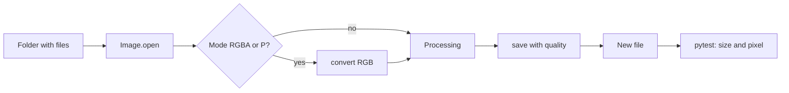

Pillow is Python's main library for working with images. In this lesson we go beyond "open — save" and look at real techniques: cropping, batch conversion, watermarks and, above all, testing image-processing code with pytest. All of this will come in handy for bots, preview generators and automation scripts.

## Installation and the main object — PIL.Image

Install the library:

```bash
pip install pillow
```

Importing and opening a file:

```python
from PIL import Image

img = Image.open("photo.jpg")
print(img.size)    # (4032, 3024) — width, height
print(img.mode)    # RGB
print(img.format)  # JPEG
```

The `Image` object is the library's central class. The `Image.open()` method opens a file "lazily": data is read from the file on demand, so after opening, the file must not be deleted while you are working with the object. The `size` attribute returns a tuple `(width, height)`, `mode` — the color model (`RGB`, `RGBA`, `L` — grayscale), `format` — the original format.

## Geometry: resize, thumbnail and crop

`resize((w, h))` sets exact dimensions without worrying about proportions. `thumbnail((w, h))` preserves proportions and only shrinks the image (never enlarges it). An important detail: `thumbnail()` modifies the object **in place** and returns `None`:

```python
img = Image.open("photo.jpg")

preview = img.copy()          # work with a copy
preview.thumbnail((800, 600)) # proportions are preserved
preview.save("preview.jpg", quality=85, optimize=True)
```

`crop(box)` cuts out a rectangular region. `box` is a tuple of four numbers: `(left, top, right, bottom)`:

```python
w, h = img.size
left = (w - 400) // 2
top = (h - 300) // 2
center = img.crop((left, top, left + 400, top + 300))
```

There are also `rotate(angle, expand=True)`, `transpose()`, `convert(mode)` — the last one is needed, for example, to convert RGBA to RGB before saving as JPEG.

## Filters and drawing

The `ImageFilter` module provides ready-made filters:

```python
from PIL import ImageFilter

blurred = img.filter(ImageFilter.GaussianBlur(radius=2))
sharp = img.filter(ImageFilter.SHARPEN)
```

Drawing text and shapes is done through `ImageDraw`. Text needs a font. `ImageFont.load_default()` gives a built-in bitmap font (in newer versions it accepts `size`), while `ImageFont.truetype(path, size)` loads a system TTF font:

```python
from PIL import Image, ImageDraw, ImageFont

overlay = Image.new("RGBA", img.size, (0, 0, 0, 0))
draw = ImageDraw.Draw(overlay)
font = ImageFont.truetype("DejaVuSans.ttf", 48)
draw.text((img.width // 2, img.height // 2), "© 2026",
          fill=(255, 255, 255, 180), font=font, anchor="mm")
watermarked = Image.alpha_composite(img.convert("RGBA"), overlay)
```

`anchor="mm"` means "middle horizontally and vertically" — the text is centered at the point. `Image.alpha_composite()` layers a transparent overlay on top.

## Saving: format and quality

The format is determined by the file extension. For JPEG and WebP, the `quality` parameter matters (1–100, higher = better and heavier); for PNG, compression is lossless:

```python
img.convert("RGB").save("photo_small.jpg", quality=80, optimize=True, progressive=True)
img.save("photo.webp", quality=85, method=6)
```

`progressive=True` enables progressive JPEG, `optimize=True` optimizes size. Remember: JPEG does not support an alpha channel, so RGBA is converted to RGB before saving.

## Batch processing

The real value is processing entire folders. The skeleton of a script:

```python
from pathlib import Path
from PIL import Image

def convert_folder(src_dir: Path, dst_dir: Path,
                  fmt: str = "WEBP", quality: int = 85):
    dst_dir.mkdir(parents=True, exist_ok=True)
    results = []
    for path in sorted(Path(src_dir).glob("*.png")) + \
               sorted(Path(src_dir).glob("*.jpg")):
        img = Image.open(path)
        out = dst_dir / f"{path.stem}.webp"
        if img.mode in ("RGBA", "P"):
            img = img.convert("RGB")
        img.save(out, format=fmt, quality=quality)
        results.append(str(out))
    return results
```

## Batch processing diagram



The diagram shows exactly where in the pipeline the two typical errors appear: a missed mode conversion and a forgotten `quality`. The test checks the result at the output, not the code's intentions.

## Why test image processing

Image processing is an ideal candidate for tests: functions are pure, input data is easy to create in memory (`Image.new("RGB", (100, 60), "red")`), and the result is checked by dimensions, format and pixels. Tests protect against regressions when Pillow versions change. Let's practice.

<!--TASK-->
### Task 1
Write a function `center_crop(image, width, height)` that takes a `PIL.Image.Image` object and integers `width`, `height`, and returns a **new** image object — the central fragment of the given size. Centering is done like this: `left = (image.width - width) // 2`, `top = (image.height - height) // 2`, then `crop((left, top, left + width, top + height))`. If `width` or `height` is larger than the corresponding dimension of the original image, raise `ValueError` with a clear message. Check manually: create a 100×60 image, crop it to 40×40 and make sure the result has size `(40, 40)` and the original object is unchanged. Expected result: calling `center_crop(img, 40, 40).size` returns `(40, 40)`.

### Task 2
Write a function `convert_folder(src_dir, dst_dir, fmt="WEBP", quality=85)` that processes all `.png`, `.jpg` and `.jpeg` files in `src_dir`: opens each one, converts it to RGB if the mode is `RGBA` or `P`, and saves it to `dst_dir` with the same name but an extension matching the format (e.g., `photo.png` → `photo.webp`). Create `dst_dir` with `mkdir(parents=True, exist_ok=True)`. The function returns a list of paths to the created files, sorted by name. If there are no matching files, return an empty list. Expected result: for three PNGs in `src_dir`, the function returns a list of three paths in `dst_dir`, and each file opens with `Image.open`.

### Task 3
Write a function `add_watermark(image, text, font_size=48)` that returns a new image with semi-transparent text in the center. Use the technique from the theory: create an `RGBA` layer with zero opacity, draw the text with `ImageDraw.Draw` and `ImageFont.truetype("DejaVuSans.ttf", font_size)` with `anchor="mm"` in the center, then composite with `Image.alpha_composite`. If the system font is not found, use `ImageFont.load_default(size=font_size)`. The watermark must be visible: text color `(255, 255, 255, 180)`. Expected result: the function returns an `Image` object with mode `RGBA` and the same size as the original.

### Task 4
Write pytest tests for the `center_crop` function. Create a test image `Image.new("RGB", (100, 60), "red")` and check: (1) cropping to 40×40 gives size `(40, 40)`; (2) a new object is returned — the original image was not mutated (its `size` is still `(100, 60)`); (3) the pixel at the center of the result is `(255, 0, 0)` (red); (4) `center_crop(img, 200, 40)` raises `ValueError`. Run the tests with `python -m pytest test_crop.py -v`. Expected result: all 4 tests pass.

### Task 5
Write pytest tests for the `convert_folder` function. Use the `tmp_path` fixture: create a `src` folder inside it with three test PNGs (via `Image.new` + `save`), call `convert_folder(src, dst)`, then check: (1) a list of three paths is returned; (2) three `*.webp` files appeared in `dst`; (3) each opens with `Image.open` and has `format == "WEBP"`; (4) each size matches the original PNG; (5) calling `convert_folder` on an empty folder returns `[]`. Run the tests. Expected result: all checks pass.
### Task 6
Write a function `make_contact_sheet(paths, cell=(160, 120), cols=3, gap=8, bg=(255, 255, 255))` that assembles a grid image from previews: opens each file from `paths`, shrinks a copy with `thumbnail(cell)` and pastes it centered in its cell with `paste`. Calculate the canvas size in advance: width is `cols * cell[0] + (cols + 1) * gap`, height is `rows * cell[1] + (rows + 1) * gap`, where `rows` is the number of files divided by `cols`, rounded up. Create the canvas with `Image.new("RGB", size, bg)`. If the list is empty, raise `ValueError`. Expected result: for five 160×120 images with `cols=3` and `gap=8`, the function returns an image of size `(512, 264)`, and pixel `(4, 4)` equals `(255, 255, 255)`.

### Task 7
Write a function `prepare_for_web(image, max_side=1200)` that prepares a photo for publication: applies `ImageOps.exif_transpose` (so a phone photo doesn't end up rotated), converts `RGBA` and `P` modes to `RGB`, and fits the result into a `max_side × max_side` square via `ImageOps.contain`, preserving proportions. Then write `save_prepared(image, path, max_side=1200, quality=82)`, which performs the preparation and saves a JPEG with `optimize=True`, returning the path. Expected result: a 4000×3000 image after preparation has size `(1200, 900)`, and the created file opens with `Image.open` and has `format == "JPEG"`.
<!--/TASK-->

<!--HINT-->
### Hint 1
Centering formula: `left = (image.width - width) // 2`; `top = (image.height - height) // 2`. `crop` takes a tuple `(left, top, right, bottom)`. Do the "larger than original" check before computing coordinates: `if width > image.width or height > image.height: raise ValueError(...)`.

### Hint 2
For iteration use `Path(src_dir).glob(...)`. The format list: `("*.png", "*.jpg", "*.jpeg")`. Output name: `f"{path.stem}.webp"` (or based on `fmt.lower()`). Collect the results list in a variable and return it after the loop. Don't forget `sorted()`.

### Hint 3
First prepare the layer: `overlay = Image.new("RGBA", image.size, (0, 0, 0, 0))`. Then `draw = ImageDraw.Draw(overlay)` and `draw.text((image.width // 2, image.height // 2), text, fill=(255, 255, 255, 180), font=font, anchor="mm")`. Composite: `Image.alpha_composite(image.convert("RGBA"), overlay)`. Look for the font with `ImageFont.truetype` inside a `try/except OSError` block.

### Hint 4
Mutation test: store `original_size = img.size` before the call and check `assert img.size == original_size` after. Pixel: `center_crop(img, 40, 40).getpixel((20, 20)) == (255, 0, 0)`. For ValueError — `pytest.raises(ValueError)`. Import `pytest` and your function.

### Hint 5
pytest passes the `tmp_path` fixture itself. Create a PNG: `Image.new("RGB", (40, 30), "blue").save(tmp_path / "src" / "a.png")`. Don't forget `mkdir` for `src`. Read `format` like this: `Image.open(f).format`. For the empty folder, create a separate `empty` and call `convert_folder` with it.
### Hint 6
Number of rows: `rows = math.ceil(len(paths) / cols)`. Cell coordinates: `row, col = divmod(index, cols)`, then `x = gap + col * (cell_w + gap)` and `y = gap + row * (cell_h + gap)`. Center the paste within the cell: `x + (cell_w - thumb.width) // 2`. Open the file in `with Image.open(path) as source:` and immediately do `convert("RGB")`, otherwise `paste` from palette mode yields odd colors.

### Hint 7
`ImageOps.exif_transpose` returns a new object — don't forget to assign the result. Fitting: `ImageOps.contain(img, (max_side, max_side))` — it is a copy shrunk with proportions preserved. When saving as JPEG, be sure to pass `format="JPEG"`, otherwise the `.jpg` extension may be ignored for non-standard suffixes.
<!--/HINT-->

<!--SOLUTION-->
### Walkthrough 1
Full solution:

```python
from PIL import Image

def center_crop(image: Image.Image, width: int, height: int) -> Image.Image:
    if width > image.width or height > image.height:
        raise ValueError("Fragment is larger than the original image")
    left = (image.width - width) // 2
    top = (image.height - height) // 2
    return image.crop((left, top, left + width, top + height))


img = Image.new("RGB", (100, 60), "red")
cropped = center_crop(img, 40, 40)
print(cropped.size)  # (40, 40)
print(img.size)      # (100, 60) — original unchanged
```

Walkthrough. First we check that the requested fragment actually fits: if `width` exceeds the source width, the `left` coordinate would become negative, and `crop` would behave unpredictably — so we raise `ValueError`. Then we compute the top-left corner coordinates: subtract the target size from the source and divide by two — this puts the fragment exactly in the center. Then `crop` returns a new object of the required size. Importantly, `crop` does not modify the original image — it is a pure function, which is exactly what the tests in task 4 verify. A manual check shows: `(40, 40)` on output, and the original remains `(100, 60)`.

### Walkthrough 2
Full solution:

```python
from pathlib import Path
from PIL import Image

def convert_folder(src_dir, dst_dir, fmt="WEBP", quality=85):
    dst_path = Path(dst_dir)
    dst_path.mkdir(parents=True, exist_ok=True)
    patterns = ("*.png", "*.jpg", "*.jpeg")
    results = []
    for ext in patterns:
        for path in sorted(Path(src_dir).glob(ext)):
            img = Image.open(path)
            if img.mode in ("RGBA", "P"):
                img = img.convert("RGB")
            out = dst_path / f"{path.stem}.{fmt.lower()}"
            img.save(out, format=fmt, quality=quality)
            results.append(str(out))
    return results
```

Walkthrough. The function iterates over all three patterns via `glob`, and each list is sorted — so the result is deterministic. For each file we open the image and, if the mode contains an alpha channel (`RGBA`) or a palette (`P`), convert it to `RGB` — otherwise saving to some formats as WebP would be incorrect. The output path is built from the stem (name without extension) and the new extension for the format. `mkdir(parents=True, exist_ok=True)` creates the target folder if it doesn't exist. We return the list of path strings collected in the loop. Note: `Image.open` is lazy, but the data is read inside `save`, so everything works correctly, and calling `close()` is not required in short scripts (Pillow releases the file after `save` when the object goes out of scope).

### Walkthrough 3
Full solution:

```python
from PIL import Image, ImageDraw, ImageFont

def add_watermark(image, text, font_size=48):
    try:
        font = ImageFont.truetype("DejaVuSans.ttf", font_size)
    except OSError:
        font = ImageFont.load_default(size=font_size)

    overlay = Image.new("RGBA", image.size, (0, 0, 0, 0))
    draw = ImageDraw.Draw(overlay)
    x, y = image.width // 2, image.height // 2
    draw.text((x, y), text, fill=(255, 255, 255, 180),
              font=font, anchor="mm")

    base = image.convert("RGBA")
    return Image.alpha_composite(base, overlay)
```

Walkthrough. We don't draw directly on the original — this keeps the original untouched. Instead, we create an empty `RGBA` layer with full transparency: `(0, 0, 0, 0)`. We draw the text on it: `anchor="mm"` centers the text at `(x, y)`, which is the middle of the image, and an alpha channel of 180 out of 255 makes the text semi-transparent. The font comes from the system `DejaVuSans.ttf` (present on almost all Linux and macOS systems; on Windows the path differs — e.g., `C:/Windows/Fonts/arial.ttf`, so we use `try/except OSError` with a `load_default` fallback). Finally, `Image.alpha_composite` merges the base image (converted to `RGBA`) with the text layer. The result is a new image with a watermark.

### Walkthrough 4
Full solution:

```python
import pytest
from PIL import Image
from pillow_utils import center_crop  # or from your module

def make_image():
    return Image.new("RGB", (100, 60), "red")

def test_crop_size():
    cropped = center_crop(make_image(), 40, 40)
    assert cropped.size == (40, 40)

def test_crop_returns_new_object():
    img = make_image()
    center_crop(img, 40, 40)
    assert img.size == (100, 60)

def test_crop_keeps_center_pixel():
    cropped = center_crop(make_image(), 40, 40)
    assert cropped.getpixel((20, 20)) == (255, 0, 0)

def test_crop_too_large_raises():
    with pytest.raises(ValueError):
        center_crop(make_image(), 200, 40)
```

Walkthrough. The first test verifies the main contract — the size of the result. The second verifies the function's purity: after the call, the source is still the same size. The third test checks the geometry: when cropping 100×60 to 40×40, the top-left corner coordinates are `(30, 10)`, so pixel `(20, 20)` of the result corresponds to pixel `(50, 30)` of the source — that is the center of the red image, so `getpixel` returns `(255, 0, 0)`. The fourth test ensures that an oversized fragment does not silently distort but fails with `ValueError`. Run: `python -m pytest test_crop.py -v` — all four tests are green.

### Walkthrough 5
Full solution:

```python
from PIL import Image
from pillow_utils import convert_folder  # or from your module

def make_png(directory, name, size=(40, 30), color="blue"):
    directory.mkdir(parents=True, exist_ok=True)
    Image.new("RGB", size, color).save(directory / f"{name}.png")

def test_convert_folder_creates_webp(tmp_path):
    src = tmp_path / "src"
    for name in ("a", "b", "c"):
        make_png(src, name)

    dst = tmp_path / "dst"
    result = convert_folder(src, dst)

    assert len(result) == 3
    webp_paths = sorted(dst.glob("*.webp"))
    assert len(webp_paths) == 3
    for webp in webp_paths:
        with Image.open(webp) as img:
            assert img.format == "WEBP"
            assert img.size == (40, 30)

def test_convert_folder_empty_dir_returns_empty(tmp_path):
    empty = tmp_path / "empty"
    empty.mkdir()
    assert convert_folder(empty, tmp_path / "dst2") == []
```

Walkthrough. The `tmp_path` fixture creates a temporary folder for each test — after the run, pytest cleans it up itself. In the first test we generate three PNGs right in memory: `Image.new(...).save(...)` — no external fixture files. Then we call `convert_folder` and check: the results list has three elements, three `*.webp` files appeared in `dst`, each opens with `Image.open` (the `with` context manager closes the file), the format is `WEBP`, and sizes match the originals `(40, 30)`. The second test covers the edge case — an empty input folder gives an empty list. Both tests are fast, don't depend on the network, and leave no garbage.
### Walkthrough 6
Full solution:

```python
import math
from PIL import Image

def make_contact_sheet(paths, cell=(160, 120), cols=3, gap=8, bg=(255, 255, 255)):
    if not paths:
        raise ValueError("At least one file is required")

    cell_w, cell_h = cell
    rows = math.ceil(len(paths) / cols)
    width = cols * cell_w + (cols + 1) * gap
    height = rows * cell_h + (rows + 1) * gap
    sheet = Image.new("RGB", (width, height), bg)

    for index, path in enumerate(paths):
        with Image.open(path) as source:
            thumb = source.convert("RGB")
        thumb.thumbnail(cell)

        row, col = divmod(index, cols)
        x = gap + col * (cell_w + gap) + (cell_w - thumb.width) // 2
        y = gap + row * (cell_h + gap) + (cell_h - thumb.height) // 2
        sheet.paste(thumb, (x, y))

    return sheet

sheet = make_contact_sheet(["a.png", "b.png", "c.png", "d.png", "e.png"])
print(sheet.size)          # (512, 264)
print(sheet.getpixel((4, 4)))  # (255, 255, 255)
```

Walkthrough. First we compute the canvas geometry: `cols` cells per row, with `gap` spacing between them and at the edges, so `cols + 1` gaps are added to the width. The height is computed the same way but from the number of rows, rounded up: five images with three columns give two rows. Then the loop: the file is opened in a context manager, and the copy is converted to `RGB` — this matters because palette PNGs can lose colors when pasted into an `RGB` canvas without conversion. `thumbnail(cell)` shrinks the copy preserving proportions, so the preview may be narrower than the cell; the coordinates center it along both axes. `divmod(index, cols)` elegantly turns the sequential index into a "row, column" pair. The `paste` method doesn't blend pixels but replaces the region — exactly what's needed for opaque previews. The result is a single image that is convenient to hand to a report or a gallery preview.

### Walkthrough 7
Full solution:

```python
from PIL import Image, ImageOps

def prepare_for_web(image, max_side=1200):
    img = ImageOps.exif_transpose(image)
    if img.mode in ("RGBA", "P"):
        img = img.convert("RGB")
    return ImageOps.contain(img, (max_side, max_side))

def save_prepared(image, path, max_side=1200, quality=82):
    prepared = prepare_for_web(image, max_side)
    prepared.save(path, format="JPEG", quality=quality, optimize=True)
    return path

img = Image.new("RGB", (4000, 3000), "steelblue")
print(prepare_for_web(img).size)   # (1200, 900)
```

Walkthrough. The order of steps here is crucial. `ImageOps.exif_transpose` reads the Orientation tag and physically rotates the pixels: without it, a vertical phone photo stays "lying on its side", and after any resize that cannot be fixed without quality loss. Then we remove the alpha channel: JPEG doesn't support it, and trying to save `RGBA` raises `cannot write mode RGBA as JPEG`. Only after that does `ImageOps.contain` run — it shrinks a copy so both sides fit into `1200`, preserving the aspect ratio: 4000×3000 becomes 1200×900, not a 1200×1200 square. `save` with `format="JPEG"` fixes the format regardless of extension, `quality=82` gives a noticeably smaller file at nearly indistinguishable quality, and `optimize=True` tunes the compression tables. The function returns the path — convenient for chains and tests.
<!--/SOLUTION-->

<!--QUIZ-->
Which method opens an image in Pillow?
- Image.load()
- Image.open()
- Image.read()
- Image.frombytes()
* Correct answer: Image.open()
Image.open() returns an Image object, reading the file lazily.

What is the difference between resize() and thumbnail()?
- resize() preserves proportions, thumbnail() doesn't
- thumbnail() preserves proportions and only shrinks, resize() sets exact sizes
- They are completely identical
- thumbnail() works only with PNG
* Correct answer: thumbnail() preserves proportions and only shrinks, resize() sets exact sizes
thumbnail() never enlarges an image and never distorts proportions.

What does the call img.thumbnail((100, 100)) return?
- A new Image object
- None — the object is modified in place
- Tuple (100, 100)
- An error
* Correct answer: None — the object is modified in place
thumbnail() modifies the existing object and returns None.

Which method cuts out a rectangular region of an image?
- crop(box)
- resize(box)
- slice(box)
- cut(box)
* Correct answer: crop(box)
crop() takes a tuple (left, top, right, bottom).

What must be done before saving an RGBA image as JPEG?
- Nothing, JPEG supports the alpha channel
- Call convert("RGB")
- Call add_alpha_channel()
- Rename the file to .png
* Correct answer: Call convert("RGB")
JPEG does not support transparency, so the alpha channel is removed by conversion.

What does the img.size attribute return?
- The number of pixels
- A tuple (width, height)
- A string like "4032x3024"
- The file size in bytes
* Correct answer: A tuple (width, height)
size is a tuple (width, height).

Which parameter controls compression when saving as JPEG or WebP?
- quality
- compression
- level
- dpi
* Correct answer: quality
quality (1–100) sets the compression level: higher means better quality and larger size.

What does ImageFilter.GaussianBlur(radius=2) do?
- Increases sharpness
- Blurs the image with radius 2
- Shrinks the image by a factor of 2
- Changes the color mode
* Correct answer: Blurs the image with radius 2
GaussianBlur applies a Gaussian blur of the given radius.

What is ImageFont.truetype() for?
- Loading a font from a TTF file
- Converting an image to text
- Speeding up work with PNG
- Changing the image size
* Correct answer: Loading a font from a TTF file
truetype() loads a scalable font for drawing text.

What does anchor="mm" do in draw.text()?
- Aligns text to the left
- Centers text at the given point
- Makes the text semi-transparent
- Rotates the text
* Correct answer: Centers text at the given point
anchor="mm" is middle horizontally and vertically — the text is centered.
What does ImageOps.contain(image, (800, 800)) do?
- Stretches the image to exactly 800×800
- Fits the image into 800×800, preserving proportions
- Crops the image to a square
- Enlarges the image 8 times
* Correct answer: Fits the image into 800×800, preserving proportions
contain shrinks a copy so that it fits entirely in the given rectangle.

Why is ImageOps.exif_transpose needed?
- To rotate the frame according to the camera's EXIF data
- To remove all metadata
- To increase sharpness
- To reduce the file size
* Correct answer: To rotate the frame according to the camera's EXIF data
Phone photos often store the rotation in EXIF, and without this operation the photo looks sideways.

How to paste one image into another at point (x, y)?
- base.paste(other, (x, y))
- base.insert(other, x, y)
- base.merge(other, (x, y))
- base.blit(other, (x, y))
* Correct answer: base.paste(other, (x, y))
paste copies pixels to the specified position; the pasted fragment must fit in the canvas.

What does Image.new("RGB", (100, 50), "white") create?
- An empty white 100×50 image
- A copy of an existing file
- A transparency mask
- A palette of 100 colors
* Correct answer: An empty white 100×50 image
Image.new takes a mode, size and fill color — handy for in-memory test images.
<!--/QUIZ-->
