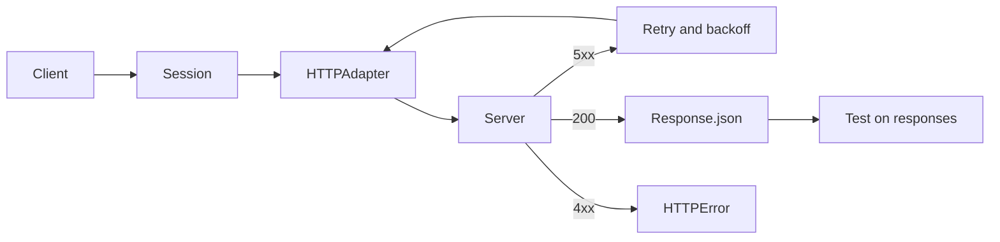

`requests` is the standard for HTTP requests in Python. In this lesson we look not at "how to do a GET" but at engineering techniques: reusing connections through sessions, automatic retries on transient errors, downloading large files in chunks and — most importantly — how to test all of this code without a real server.

## Sessions: why you need them

A plain `requests.get(url)` request creates a new connection on every call. For dozens of requests this is slow: each time a TCP handshake and TLS negotiation are performed from scratch. The solution is `Session`:

```python
import requests

session = requests.Session()
session.headers.update({"User-Agent": "my-app/1.0"})
session.get("https://api.example.com/users")
session.get("https://api.example.com/users/42")
```

A session stores cookies, applies the given headers to all requests and, crucially, keeps a pool of TCP connections (connection pooling): repeated requests to the same host reuse established connections. The main methods are `get`, `post`, `put`, `delete`, `patch`. Requests have useful parameters:

```python
r = session.get(
    "https://api.example.com/search",
    params={"q": "python", "page": 2},  # query parameters
    timeout=(3, 10),                      # (connect, read) seconds
)
print(r.status_code)      # 200
print(r.headers["Content-Type"])
data = r.json()           # parse the JSON response
```

The `timeout` parameter is mandatory in production: without it a request can hang for minutes. The tuple sets separate connect and read timeouts.

## Response and error handling

A `Response` object has `status_code`, `headers`, `text` (text), `content` (bytes), `json()`. The `raise_for_status()` method raises `requests.exceptions.HTTPError` if the code is 4xx/5xx:

```python
def get_json(session, url, **params):
    r = session.get(url, params=params, timeout=5)
    r.raise_for_status()      # exception on 404, 500, etc.
    return r.json()
```

## Adapters and retries

`requests.adapters.HTTPAdapter` manages the session's connection pool. Automatic retries are also configured through it — with the `urllib3.util.retry.Retry` class:

```python
from requests.adapters import HTTPAdapter
from urllib3.util.retry import Retry

retry = Retry(
    total=3,                    # total attempts (including the first)
    connect=3,
    read=3,
    backoff_factor=0.5,         # pause: 0.5, 1, 2, 4... seconds
    status_forcelist=(500, 502, 503, 504),
    allowed_methods=frozenset(["GET", "POST"]),
)
adapter = HTTPAdapter(max_retries=retry, pool_connections=10, pool_maxsize=10)
session = requests.Session()
session.mount("https://", adapter)
session.mount("http://", adapter)
```

`mount("https://", adapter)` assigns the adapter to all HTTPS requests. With `status_forcelist`, retries also fire on 5xx codes, and `backoff_factor` stretches the pauses so you don't hammer the server.

## Downloading large files

`stream=True` doesn't read the whole response body; it gives a stream. Read in chunks with `iter_content`:

```python
def download(session, url, path, chunk_size=8192):
    with session.get(url, stream=True, timeout=(5, 60)) as r:
        r.raise_for_status()
        with open(path, "wb") as f:
            for chunk in r.iter_content(chunk_size=chunk_size):
                if chunk:
                    f.write(chunk)
```

## Testing without the network: the responses library

HTTP code cannot be tested against real servers — tests would become slow and flaky. The `responses` library intercepts `requests` calls and returns predefined answers:

```bash
pip install responses
```

```python
import responses
import requests

@responses.activate
def test_get_json():
    responses.add(
        responses.GET,
        "https://api.example.com/users/42",
        json={"id": 42, "name": "Anna"},
        status=200,
    )
    r = requests.get("https://api.example.com/users/42")
    assert r.json()["name"] == "Anna"
```

`responses.add()` registers a mock: method, URL, body (`json=`, `body=`, `text=`), status. Any unregistered URL while `responses` is active raises an error — this is useful: a test immediately reveals that the code is going somewhere unexpected.

## Request flow with retries



The diagram shows that a retry is not a separate piece of client code but adapter behavior: the client sees only the final response or an exception.

## Practice plan

We'll build a small HTTP client on a session, add retries and streaming — and cover everything with tests using `responses` + `pytest`. Let's go.

<!--TASK-->
### Task 1
Write a class `APIClient` that wraps `requests.Session`. The constructor takes `base_url`, `timeout=5` and creates a session (`self.session = requests.Session()`). Implement the `get_json(path, **params)` method: it executes `self.session.get(self.base_url + path, params=params, timeout=self.timeout)`, then `raise_for_status()` and returns `r.json()`. Also implement `post_json(path, payload)`: `session.post(url, json=payload, timeout=self.timeout)`, `raise_for_status()`, returns `r.json()`. You don't need to check manually against a mock server — just make sure the code imports and the class instantiates. Expected result: `APIClient("https://api.example.com")` creates an object with `session` and `timeout` attributes.

### Task 2
Write a function `build_session_with_retries(retries=3, backoff_factor=0.5)` that creates a `requests.Session` with a configured `HTTPAdapter` and `Retry` (total=retries, status_forcelist=(500, 502, 503, 504), backoff_factor=backoff_factor, allowed_methods=frozenset(["GET", "POST"])) and mounts the adapter for both `http://` and `https://`. The function returns the session. Check manually: `session = build_session_with_retries()`; `print(session.get_adapter("https://api.example.com"))` should show your adapter. Expected result: the call returns a `Session` whose HTTPS adapter has `max_retries` with `total == 3`.

### Task 3
Write a function `download_to_file(session, url, path, chunk_size=8192)` that downloads a file in chunks. Use `session.get(url, stream=True, timeout=(5, 60))` inside `with` (so the connection closes), then `raise_for_status()` and write to the file via `iter_content(chunk_size=chunk_size)`, skipping empty chunks (`if chunk:`). Return the number of bytes written. Check manually on a small file (e.g., `https://httpbin.org/bytes/1000`) — save it as `sample.bin` and print its size. Expected result: the file is created, and the function returns a size equal to the file size.

### Task 4
Write pytest tests for the `APIClient` class using `responses` (the `@responses.activate` fixture). Check: (1) `get_json` with status 200 returns a parsed JSON dict; (2) `get_json` with 404 raises `requests.exceptions.HTTPError` (via `pytest.raises`); (3) query parameters really go out: after the call check that `responses.calls[0].request.url` contains `q=python`; (4) `post_json` sends a JSON body: `responses.calls[0].request.body` contains `"key"`. Run `python -m pytest test_api_client.py -v`. Expected result: all 4 tests pass.

### Task 5
Write pytest tests for `build_session_with_retries` with `responses`: register the same URL three times — twice with status 503 and once with 200 and body `{"ok": true}`. Then execute `session.get(url)` and check: (1) the final status is 200; (2) `len(responses.calls) == 3` — meaning two retries fired; (3) the session indeed has an adapter with `max_retries.total == 3`. Use `backoff_factor=0` for speed. Run the tests. Expected result: all checks pass, and `responses.calls` counts 3 requests.
### Task 6
Write a function `fetch_all_pages(session, url, page_param="page", max_pages=10)` that collects data from a paginated API. On each iteration execute `session.get(url, params={page_param: page}, timeout=5)`, call `raise_for_status()` and read `r.json()` — a list of items. The loop continues until a page returns an empty list or `max_pages` is reached; all items are concatenated into one common list, which the function returns. Expected result: if the API returns two items on pages 1 and 2 and an empty list on page 3, the function returns four items, and `responses.calls` contains exactly three requests.

### Task 7
Write a function `check_urls(session, urls, timeout=3)` that checks link availability without downloading the body: for each URL it executes `session.head(url, timeout=timeout, allow_redirects=True)` and records a `{url: status_code}` pair in a dict. Any exception from the `requests.exceptions.RequestException` family (timeout, connection break, bad address) must not crash the program — in that case `None` goes into the dict. Expected result: for three addresses with statuses 200, 404 and a timeout, the function returns `{url1: 200, url2: 404, url3: None}` and raises no exceptions.
<!--/TASK-->

<!--HINT-->
### Hint 1
URL joining: `f"{self.base_url.rstrip('/')}/{path.lstrip('/')}"` — avoids double slashes. In the constructor don't forget `self.session = requests.Session()` and `self.timeout = timeout`. The `get_json` method must return exactly `r.json()` — a dict.

### Hint 2
`Retry` parameters: `total=retries`, `connect=retries`, `read=retries`, `backoff_factor=backoff_factor`, `status_forcelist=(500, 502, 503, 504)`, `allowed_methods=frozenset(["GET", "POST"])`. Adapter: `HTTPAdapter(max_retries=retry)`. Mount both prefixes: `session.mount("http://", adapter)` and `session.mount("https://", adapter)`.

### Hint 3
Don't forget `with session.get(url, stream=True, timeout=(5, 60)) as r:` — the connection will close automatically. Inside: `with open(path, "wb") as f:` and the loop `for chunk in r.iter_content(chunk_size=chunk_size): if chunk: f.write(chunk); total += len(chunk)`. Return `total`.

### Hint 4
Register mocks strictly with the URLs the client builds: `https://api.example.com/users/42`. To check parameters: `responses.calls[0].request.url` is a string — look for `"q=python"` in it. For POST: `responses.calls[0].request.body` is a JSON string — check `'"key"' in body`. Don't forget `import requests` and `pytest.raises(requests.exceptions.HTTPError)`.

### Hint 5
Three registrations of the same URL: `responses.add(responses.GET, url, json={"ok": True}, status=503)` twice and once with `status=200`. `Retry` with `total=2` makes at most 2 retries — 3 requests in total. In the test compare `len(responses.calls) == 3` and `result.status_code == 200`. `backoff_factor=0` removes pauses from the test.
### Hint 6
Take page numbers from `range(1, max_pages + 1)`. After `chunk = r.json()` check `if not chunk: break` — an empty list means the end of pagination. Accumulate with `items.extend(chunk)`, not `append`, otherwise you get a list of lists. In the `responses` test, register each URL with its query string separately: `responses.add(responses.GET, "https://api.example.com/items?page=1", json=[...])`.

### Hint 7
`allow_redirects=True` matters: without it `head` returns 301/302 instead of the final code. Catch exactly `requests.exceptions.RequestException` — it's the base class for `Timeout`, `ConnectionError` and `HTTPError`. In the test a timeout is simulated like this: `responses.add(responses.HEAD, url, body=requests.exceptions.ConnectTimeout())`.
<!--/HINT-->

<!--SOLUTION-->
### Walkthrough 1
Full solution:

```python
import requests

class APIClient:
    def __init__(self, base_url, timeout=5):
        self.base_url = base_url.rstrip("/")
        self.timeout = timeout
        self.session = requests.Session()

    def get_json(self, path, **params):
        url = f"{self.base_url}/{path.lstrip('/')}"
        r = self.session.get(url, params=params, timeout=self.timeout)
        r.raise_for_status()
        return r.json()

    def post_json(self, path, payload):
        url = f"{self.base_url}/{path.lstrip('/')}"
        r = self.session.post(url, json=payload, timeout=self.timeout)
        r.raise_for_status()
        return r.json()
```

Walkthrough. The class encapsulates all HTTP work: host, timeout and session. `base_url.rstrip("/")` removes the trailing slash, `path.lstrip("/")` the leading one, so the join is always correct: `"https://api.example.com" + "/users/42"`. `get_json` delegates the request to the session and passes `params` (query parameters) and `timeout`. `raise_for_status()` turns 4xx/5xx into an exception — the caller won't get a silent error. On success, the parsed JSON is returned. `post_json` works the same way but sends the body via `json=payload` — requests serializes the dict to JSON itself and sets `Content-Type: application/json`. Such a client is easy to test because only `session` is exposed, and it can be mocked.

### Walkthrough 2
Full solution:

```python
import requests
from requests.adapters import HTTPAdapter
from urllib3.util.retry import Retry

def build_session_with_retries(retries=3, backoff_factor=0.5):
    retry = Retry(
        total=retries,
        connect=retries,
        read=retries,
        backoff_factor=backoff_factor,
        status_forcelist=(500, 502, 503, 504),
        allowed_methods=frozenset(["GET", "POST"]),
    )
    adapter = HTTPAdapter(max_retries=retry)
    session = requests.Session()
    session.mount("http://", adapter)
    session.mount("https://", adapter)
    return session
```

Walkthrough. `Retry` describes the retry policy: `total` — maximum attempts (first + retries); `status_forcelist` lists the codes that trigger a retry (transient server errors); `backoff_factor` sets pauses by the formula `0.5 * 2**(n-1)` seconds. The `allowed_methods` restriction matters: retrying POST is possible, but it's better to explicitly decide which methods are safe. The `HTTPAdapter` binds this policy to the connection pool, and `mount` assigns it to both HTTP and HTTPS. The returned session now survives short network glitches by itself — the caller's code stays simple.

### Walkthrough 3
Full solution:

```python
def download_to_file(session, url, path, chunk_size=8192):
    total = 0
    with session.get(url, stream=True, timeout=(5, 60)) as r:
        r.raise_for_status()
        with open(path, "wb") as f:
            for chunk in r.iter_content(chunk_size=chunk_size):
                if chunk:
                    f.write(chunk)
                    total += len(chunk)
    return total
```

Walkthrough. `stream=True` is the key point: without it requests immediately downloads the whole body into memory, which is fatal for large files. The context manager `with session.get(...) as r` guarantees the connection closes even on exception. The `iter_content` loop yields byte chunks; `if chunk` discards empty bookkeeping chunks that may arrive at buffer boundaries. Every written chunk is summed into `total` — that is the file size. This download approach lets you show progress and interrupt without losing all work.

### Walkthrough 4
Full solution:

```python
import pytest
import requests
import responses
from api_client import APIClient

@responses.activate
def test_get_json_returns_parsed():
    responses.add(responses.GET, "https://api.example.com/users/42",
                  json={"id": 42, "name": "Anna"}, status=200)
    client = APIClient("https://api.example.com")
    data = client.get_json("/users/42")
    assert data["name"] == "Anna"

@responses.activate
def test_get_json_404_raises():
    responses.add(responses.GET, "https://api.example.com/users/999",
                  json={"error": "not found"}, status=404)
    client = APIClient("https://api.example.com")
    with pytest.raises(requests.exceptions.HTTPError):
        client.get_json("/users/999")

@responses.activate
def test_get_json_sends_params():
    responses.add(responses.GET, "https://api.example.com/search", json=[])
    client = APIClient("https://api.example.com")
    client.get_json("/search", q="python")
    assert "q=python" in responses.calls[0].request.url

@responses.activate
def test_post_json_sends_body():
    responses.add(responses.POST, "https://api.example.com/users", json={"ok": True})
    client = APIClient("https://api.example.com")
    client.post_json("/users", {"key": "value"})
    assert '"key"' in responses.calls[0].request.body
```

Walkthrough. `responses.activate` enables interception for the duration of the test; each `responses.add` registers an expected response — if the code requests an unregistered URL, the test fails with an error, which helps find "extra" requests. The second test verifies the error contract: `raise_for_status()` must raise `HTTPError`. The third test looks into the internal `responses.calls` list — the actual requests made by `requests` are available there, so we can check that `q=python` landed in the URL. The fourth — that the POST body contains our JSON. This is exactly how network code is tested: without a network, fast and deterministically.

### Walkthrough 5
Full solution:

```python
import responses
from retry_session import build_session_with_retries

URL = "https://api.example.com/status"

@responses.activate
def test_retries_then_success():
    responses.add(responses.GET, URL, json={"ok": False}, status=503)
    responses.add(responses.GET, URL, json={"ok": False}, status=503)
    responses.add(responses.GET, URL, json={"ok": True}, status=200)

    session = build_session_with_retries(retries=2, backoff_factor=0)
    r = session.get(URL)

    assert r.status_code == 200
    assert r.json() == {"ok": True}
    assert len(responses.calls) == 3

@responses.activate
def test_adapter_has_retry_config():
    session = build_session_with_retries(retries=3)
    adapter = session.get_adapter("https://api.example.com")
    assert adapter.max_retries.total == 3
```

Walkthrough. The first test models a typical scenario: the server answered 503 twice, then recovered. `Retry(total=2)` allows at most two retries — so `requests` makes exactly three attempts, and `responses.calls` contains three requests. Since `backoff_factor=0`, pauses between retries are zero and the test doesn't slow down. The second test checks configuration: `session.get_adapter(...)` returns the adapter for the scheme, and its `max_retries.total` must match the passed value. This confirms the session is actually configured, not just "created". Importantly: tests must contain no real pauses and no real servers — everything is replaced by mocks.
### Walkthrough 6
Full solution:

```python
def fetch_all_pages(session, url, page_param="page", max_pages=10):
    items = []
    for page in range(1, max_pages + 1):
        r = session.get(url, params={page_param: page}, timeout=5)
        r.raise_for_status()
        chunk = r.json()
        if not chunk:
            break
        items.extend(chunk)
    return items
```

Walkthrough. Pagination is a loop with a stop condition, and the most reliable condition is an empty server response, not an assumption about the number of pages. We start at page one and go up to `max_pages`; the `page_param` parameter lets us adapt to APIs where the page is called `page`, `offset` or `p`. At each step `raise_for_status()` filters out erroneous responses: otherwise on 500, `r.json()` would fail with an obscure parsing error instead of a clear HTTP error. `if not chunk: break` ends the loop when the server returns an empty list — so we don't make extra requests and don't depend on the client knowing the total page count. `extend` adds items one by one, keeping a flat list. `max_pages` is a safeguard against an infinite loop if the server keeps returning the same page instead of an empty list.

### Walkthrough 7
Full solution:

```python
import requests

def check_urls(session, urls, timeout=3):
    result = {}
    for url in urls:
        try:
            r = session.head(url, timeout=timeout, allow_redirects=True)
            result[url] = r.status_code
        except requests.exceptions.RequestException:
            result[url] = None
    return result
```

Walkthrough. `HEAD` requests only headers: the server doesn't send a body, so checking a hundred links costs pennies in traffic. `allow_redirects=True` is mandatory, otherwise instead of the final address we'll see 301 and decide the page is "broken" when it simply moved. `requests.exceptions.RequestException` is the root of the library's error hierarchy: it includes `Timeout`, `ConnectionError`, `TooManyRedirects` and others, so one `except` covers all network failures. We don't let the exception propagate because a checker function must return a report for all addresses rather than crash on the first unreachable one. `None` in the dict is an explicit "could not check" marker, easy to distinguish from an honest 404. Such a report is convenient to output as a table or CSV.
<!--/SOLUTION-->

<!--QUIZ-->
Why is requests.Session needed?
- To send only GET requests
- To reuse the TCP connection pool, cookies and headers
- To speed up JSON parsing
- Sessions aren't needed for HTTP
* Correct answer: To reuse the TCP connection pool, cookies and headers
A session keeps connections open and stores state between requests.

How to set connect and read timeouts separately?
- timeout=(3, 10)
- timeout=[3, 10]
- timeout=3, timeout=10
- It's impossible
* Correct answer: timeout=(3, 10)
The tuple (connect, read) sets both timeouts.

What does the method raise_for_status() do?
- Returns the status code
- Raises HTTPError on 4xx/5xx codes
- Changes the request status
- Ignores network errors
* Correct answer: Raises HTTPError on 4xx/5xx codes
raise_for_status() turns HTTP errors into exceptions.

Through which class are retries configured in requests?
- RetryPolicy
- HTTPAdapter and urllib3 Retry
- Timeout
- BackoffAdapter
* Correct answer: HTTPAdapter and urllib3 Retry
HTTPAdapter manages the pool, Retry manages the retry policy.

What does status_forcelist=(500, 502, 503, 504) mean?
- These codes are forbidden
- On these codes the request is retried automatically
- These codes are considered successful
- A timeout is set for these codes
* Correct answer: On these codes the request is retried automatically
Retries fire on the listed transient server errors.

What is stream=True in a request for?
- To send the request faster
- To avoid loading the entire response body into memory at once
- To allow streaming data to the server
- To get the response as a byte stream without parsing
* Correct answer: To avoid loading the entire response body into memory at once
stream=True lets you read the response in chunks via iter_content.

What does the responses library do?
- Sends requests faster
- Intercepts requests calls and returns predefined responses
- Encrypts HTTP traffic
- Caches responses from real servers
* Correct answer: Intercepts requests calls and returns predefined responses
responses lets you test HTTP code without a network.

How many requests will execute with Retry(total=2) and constant errors?
- 2
- 3
- 1
- 4
* Correct answer: 3
total includes the first attempt plus up to two retries.

What does r.json() return?
- A string with JSON
- A parsed Python object (dict/list)
- The status code
- A tuple of status and body
* Correct answer: A parsed Python object (dict/list)
json() parses the response body into Python objects.

Which parameter sends a JSON body in session.post()?
- data=json.dumps(...)
- json={...}
- body={...}
- payload={...}
* Correct answer: json={...}
json= serializes the dict itself and sets Content-Type: application/json.
What does session.head(url) do?
- Requests only the response headers without the body
- Downloads the whole file
- Sends form data
- Deletes the resource on the server
* Correct answer: Requests only the response headers without the body
HEAD is the same as GET but without the response body: handy for checking availability and metadata.

Which exception catches a timeout error in requests?
- requests.exceptions.Timeout
- TimeoutError from builtins
- requests.TimeoutError
- socket.timeout under all circumstances
* Correct answer: requests.exceptions.Timeout
This is the base class for ConnectTimeout and ReadTimeout inside requests.

What happens if, with responses active, the code accesses an unregistered URL?
- The test fails with ConnectionError
- An empty 200 response is returned
- The request goes to the real network
- Nothing happens
* Correct answer: The test fails with ConnectionError
responses intercepts all requests and doesn't let unregistered addresses through.

Why do HTTPAdapter have pool_connections and pool_maxsize parameters?
- To set the size of the reusable connection pool
- To limit the number of retries
- To enable response compression
- To set the default timeout
* Correct answer: To set the size of the reusable connection pool
The pool keeps open TCP connections; its size affects parallel requests to one host.
<!--/QUIZ-->
