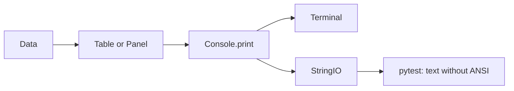

`rich` turns boring black-and-white console output into beautiful interfaces: colors, styles, tables, progress bars and animation. And everything stays plain text in the terminal — no GUI. In this lesson we'll cover the main building blocks of rich and show how to test them.

## Installation and first output

```bash
pip install rich
```

The basic object is `Console`. You print through it with formatting, and rich itself detects whether a terminal is attached: if there's no terminal (e.g., tests or redirect to a file), ANSI color codes are turned off automatically.

```python
from rich.console import Console

console = Console()
console.print("Hello, world!", style="bold cyan")
console.print(42, style="green")
console.print("[bold red]Error![/bold red] — something went wrong")
```

`console.print()` has a `style` parameter for a fully colored string. Inside the text, **markup** works: `[bold]...[/bold]`, `[red]...[/red]`, `[underline]...[/underline]` — this is more convenient than assembling ANSI codes by hand. To stop rich from interpreting markup, pass `markup=False`.

## Tables: Table

The `Table` class is the main tool for displaying data as a grid:

```python
from rich.table import Table

table = Table(title="Users")
table.add_column("ID", justify="right", style="cyan")
table.add_column("Name", style="bold")
table.add_column("City")

table.add_row("1", "Anna", "Moscow")
table.add_row("2", "Boris", "Kazan")
table.add_row("3", "Vera", "Yekaterinburg")

console.print(table)
```

`add_column` sets the title and column settings (alignment, style), `add_row` — a data row. The table computes column widths itself. If there are many rows, use `table.add_row(*values)`, and for wrapping — `table.add_column(...)` with `overflow="fold"`.

## Panels: Panel

`Panel` is a frame around arbitrary content:

```python
from rich.panel import Panel

console.print(Panel("Script finished in 2.4 s", title="Result", border_style="green"))
```

A panel can be nested into a table or vice versa — rich lets you build complex compositions.

## Live updates: Live

`Live` redraws content in real time. This is handy for dashboards, progress and "running" statuses:

```python
from time import sleep
from rich.live import Live
from rich.panel import Panel

with Live(refresh_per_second=10) as live:
    for i in range(1, 11):
        live.update(Panel(f"Step {i}/10 [{ '#' * i}{'.' * (10 - i)}]"))
        sleep(0.3)
```

The `Live` context manager takes an object to display; each `live.update(...)` call instantly redraws the line. After leaving the block, the final state stays on screen.

## Output to a string: why this matters for tests

Rich can write not only to the terminal but to any file-like object — for example, `io.StringIO`:

```python
import io
from rich.console import Console

buf = io.StringIO()
console = Console(file=buf)
console.print("Hold on, [bold]friend[/bold red]!")
text = buf.getvalue()
print(text)  # "Hold on, friend!"
```

This is the basis of testing: you can verify the exact output text without touching a real terminal. The methods `console.export_text()` and `console.export_html()` return all accumulated output as a string.

## rich output diagram



The same `Table` object renders differently depending on the sink — that's why table-building logic can be verified without a terminal.

## Pure functions vs. dirty ones

To make code easy to test, separate "pure" logic (building tables, preparing data) from "dirty" logic (printing). For example, a function that builds a `Table` doesn't print itself — and it can be verified without any console at all. Let's see this in practice.

<!--TASK-->
### Task 1
Write a function `greet(name, console=None)` that creates a console (`console = console or Console()`) and prints a greeting in a panel: text `Hello, {name}!` with `style="bold green"`, panel title — `Welcome`, border color — `green`. Then call `greet("Anna")` — a green frame with text should appear in the terminal. Expected result: the function prints via `console.print(Panel(...))` and returns nothing.

### Task 2
Write a function `build_users_table(rows)` that takes a list of dicts with keys `id`, `name`, `city` and returns a `rich.table.Table` object. Add three columns: `ID` (right-aligned, style `cyan`), `Name` (bold), `City`. For each dict add a row. Don't print the table inside the function — it should only build the object. Check manually: `print(build_users_table([...]))` should not crash, and `table.row_count` should equal the number of elements in the list. Expected result: the function returns a `Table` with three columns and `row_count == len(rows)`.

### Task 3
Write a function `render_dashboard(steps=8, console=None)` that uses `Live` to show an updating panel: at step `i` it displays `Step {i}/{steps}` and a progress line of `#` and `.` (e.g., `#####...`). Between steps — `sleep(0.2)`. After finishing, print the final message `Done!` via `console.print`. Check manually: run it and watch the animation. Expected result: the function works without errors and prints `Done!` at the end.

### Task 4
Write pytest tests for `greet`: pass a console with `file=io.StringIO()`, call `greet("Anna", console)`, then check that the buffer text contains `Hello, Anna!` and contains no ANSI codes (the `\x1b` character). Hint: rich disables colors when writing to a non-terminal itself, but to be safe check that `"\x1b" not in buf.getvalue()`. Run `python -m pytest test_greet.py -v`. Expected result: both tests pass.

### Task 5
Write pytest tests for `build_users_table`: (1) for three rows `row_count == 3`; (2) the number of columns is 3; (3) printing the table into a `StringIO` console contains the headers `ID`, `Name`, `City` and the first name (`Anna`); (4) an empty list gives a table with `row_count == 0`. Use `console.print(table)` and `buf.getvalue()`. Run the tests. Expected result: all checks pass.
### Task 6
Write a function `status_panel(name, value, limit)` that returns a `rich.panel.Panel` object for monitoring: title `Monitoring`, body `f"[bold]{name}[/bold]: {value} of {limit}"`, and the border color depends on load — `green` if `value <= limit`, `yellow` if `value <= limit * 1.2`, otherwise `red`. The function prints nothing: it only assembles the panel, so it's easy to check in a test. Expected result: `status_panel("CPU", 5, 10).border_style == "green"`, and `status_panel("CPU", 13, 10).border_style == "red"`; when printed to a terminal you see a colored frame with the bold metric name.

### Task 7
Write a function `export_report_html(rows, path)` that builds a users table (`ID`, `Name`, `City`) and saves it as an HTML file. Use `Console(record=True, width=100)`, print the table and get the markup via `console.export_html(inline_styles=True)`. Write the result to `path` with `encoding="utf-8"` and return the path. Expected result: the file exists, contains the substring `<table` and the first user's name, and nothing is printed to the terminal while the function runs.
<!--/TASK-->

<!--HINT-->
### Hint 1
Signature: `def greet(name, console=None):`; inside `console = console or Console()`. Panel: `Panel(f"Hello, {name}!", title="Welcome", border_style="green")`. Print: `console.print(panel)`. Don't forget to import `Console` and `Panel`.

### Hint 2
`Table(title="Users")`; `add_column("ID", justify="right", style="cyan")`, `add_column("Name", style="bold")`, `add_column("City")`. In a loop: `table.add_row(str(row["id"]), row["name"], row["city"])`. Return `table`.

### Hint 3
Use `with Live(refresh_per_second=10) as live:` and inside the loop `live.update(Panel(f"Step {i}/{steps} [...]"))`. Build the progress bar like this: `"#" * i + "." * (steps - i)`. After the loop, outside the `with` block — `console.print("Done!")`.

### Hint 4
In the test create `buf = io.StringIO()`, `console = Console(file=buf)`, then `greet("Anna", console)`. Checks: `assert "Hello, Anna!" in buf.getvalue()` and `assert "\x1b" not in buf.getvalue()`. Imports: `io`, `Console`, `greet`.

### Hint 5
To print the table: `buf = io.StringIO()`, `Console(file=buf).print(table)`, then search for substrings in `buf.getvalue()`. Columns: `len(table.columns) == 3`. For an empty list just pass `[]` to `build_users_table`.
### Hint 6
Assemble `Panel(...)` and compute the color in a plain `if/elif/else` before creating the object: `color = "green" if value <= limit else ...`. The parameter is called `border_style`, not `style`. Return exactly the `Panel` — don't print it; the test will check `panel.border_style`, not buffer contents.

### Hint 7
`Console(record=True)` must be created before printing: `console = Console(record=True, width=100)`. HTML is taken from the same object: `html = console.export_html(inline_styles=True)`. Writing the file — `Path(path).write_text(html, encoding="utf-8")`. Build the table with `Table()` and `add_row`, as in the theory.
<!--/HINT-->

<!--SOLUTION-->
### Walkthrough 1
Full solution:

```python
from rich.console import Console
from rich.panel import Panel

def greet(name, console=None):
    console = console or Console()
    panel = Panel(
        f"Hello, {name}!",
        title="Welcome",
        border_style="green",
    )
    console.print(panel)
```

Walkthrough. The `console=None` parameter is deliberate design: by default the function prints to the real terminal, and in tests a console writing to `StringIO` is substituted. This is the standard dependency injection technique: the function doesn't create a console itself if one is already given. `Panel` takes the text, title and border color; `console.print(panel)` draws the frame. Note: rich understands styles both in `border_style` and in plain strings. Output in the terminal — a green frame with a greeting, and no hand-written ANSI codes.

### Walkthrough 2
Full solution:

```python
from rich.table import Table

def build_users_table(rows):
    table = Table(title="Users")
    table.add_column("ID", justify="right", style="cyan")
    table.add_column("Name", style="bold")
    table.add_column("City")
    for row in rows:
        table.add_row(str(row["id"]), row["name"], row["city"])
    return table
```

Walkthrough. The function builds a "pure" `Table` object and doesn't print it — this is separation of responsibilities: structure logic is separated from I/O. The `ID` column is right-aligned (`justify="right"`) and colored cyan, `Name` is bold. `add_row` takes as many arguments as there are columns. Such a table can be printed (`console.print(table)`), turned into HTML (`table.export_html()`), and checked in tests — it isn't "bound" to a console. That's the value of a pure function: it's predictable.

### Walkthrough 3
Full solution:

```python
from time import sleep
from rich.console import Console
from rich.live import Live
from rich.panel import Panel

def render_dashboard(steps=8, console=None):
    console = console or Console()
    with Live(refresh_per_second=10) as live:
        for i in range(1, steps + 1):
            bar = "#" * i + "." * (steps - i)
            live.update(Panel(f"Step {i}/{steps} [{bar}]"))
            sleep(0.2)
    console.print("Done!")
```

Walkthrough. `Live` redraws content on every `update`: we build a progress line from `#` (completed steps) and `.` (remaining). Characters repeat by string multiplication — `"#" * 3` gives `"###"`. `refresh_per_second=10` limits redraw frequency to save resources. An important nuance: the final `Done!` output goes **after** the context manager — otherwise it would redraw together with Live. Such a dashboard is easy to embed in a real script: just replace `sleep` with actual work.

### Walkthrough 4
Full solution:

```python
import io
import pytest
from rich.console import Console
from greet import greet

def test_greet_prints_name():
    buf = io.StringIO()
    console = Console(file=buf)
    greet("Anna", console)
    assert "Hello, Anna!" in buf.getvalue()

def test_greet_no_ansi_codes():
    buf = io.StringIO()
    console = Console(file=buf)
    greet("Anna", console)
    assert "\x1b" not in buf.getvalue()
```

Walkthrough. `Console(file=buf)` directs output to memory. The first test checks content: the buffer must contain the string `Hello, Anna!`. The second test ensures the output is "clean": ANSI codes start with the `\x1b` character (escape), and if it's absent from the text, only real characters went into the file. This matters both for saving output to logs and for comparing with expected text. rich itself detects that `StringIO` is not a terminal and disables colors; our test double-checks this explicitly. The test is fast, without network and without a real terminal.

### Walkthrough 5
Full solution:

```python
import io
from rich.console import Console
from users_table import build_users_table

ROWS = [
    {"id": 1, "name": "Anna", "city": "Moscow"},
    {"id": 2, "name": "Boris", "city": "Kazan"},
    {"id": 3, "name": "Vera", "city": "Yekaterinburg"},
]

def test_row_count_and_columns():
    table = build_users_table(ROWS)
    assert table.row_count == 3
    assert len(table.columns) == 3

def test_rendered_text_contains_headers_and_row():
    table = build_users_table(ROWS)
    buf = io.StringIO()
    Console(file=buf).print(table)
    text = buf.getvalue()
    assert "ID" in text and "Name" in text and "City" in text
    assert "Anna" in text

def test_empty_rows():
    table = build_users_table([])
    assert table.row_count == 0
```

Walkthrough. The first test checks the table structure without printing: `row_count` — number of rows, `columns` — list of column objects. The second test does a full "render": prints the table into `StringIO` and looks for headers and data in the resulting text. This is an exact check of what the user will see in the terminal. The third test covers the edge case — an empty list must not break and gives zero rows. Such a test set lets you boldly change styles and structure without fear of breaking the output.
### Walkthrough 6
Full solution:

```python
from rich.panel import Panel

def status_panel(name, value, limit):
    if value <= limit:
        color = "green"
    elif value <= limit * 1.2:
        color = "yellow"
    else:
        color = "red"

    return Panel(
        f"[bold]{name}[/bold]: {value} of {limit}",
        title="Monitoring",
        border_style=color,
    )
```

Walkthrough. The function returns a ready object instead of printing it — this is that same separation of "pure" and "dirty" parts the theory talks about. Color is chosen by three branches: up to the limit — green, up to 120% of the limit — yellow, beyond that — red; such a scale is typical for monitoring because exactly at the boundary there is no emergency yet, but it's worth paying attention. Inside the text, rich markup `[bold]...[/bold]` works, so the metric name stands out without manual ANSI codes. `border_style` accepts a color name or a full style. Such a function can be verified without any console: `border_style` is an ordinary object attribute. In a real script it remains to call `console.print(status_panel(...))` — and the panel appears in the terminal.

### Walkthrough 7
Full solution:

```python
from pathlib import Path
from rich.console import Console
from rich.table import Table

def export_report_html(rows, path):
    table = Table(title="Users")
    table.add_column("ID", justify="right")
    table.add_column("Name", style="bold")
    table.add_column("City")
    for row in rows:
        table.add_row(str(row["id"]), row["name"], row["city"])

    console = Console(record=True, width=100)
    console.print(table)
    html = console.export_html(inline_styles=True)

    Path(path).write_text(html, encoding="utf-8")
    return path
```

Walkthrough. `record=True` enables recording everything that passes through the console: rich stores segments and can return them as text or HTML. We print the table into such a console — the output goes to the real terminal but is simultaneously saved in memory. The method `export_html(inline_styles=True)` turns recorded segments into a full HTML document, putting colors directly into `style` attributes rather than a separate CSS: such a file opens anywhere without extra resources. `width=100` fixes the render width so the table doesn't depend on window size and the result is deterministic — important for tests and mailings. Writing goes in UTF-8, otherwise the Cyrillic in a user's name becomes garbage on some systems. The function returns the path — a unified contract with the other generators.
<!--/SOLUTION-->

<!--QUIZ-->
Which class in rich is responsible for terminal output?
- Printer
- Console
- Output
- Renderer
* Correct answer: Console
Console is the central object for printing and rendering.

What does markup [bold]text[/bold] do?
- Prints text twice
- Makes text bold
- Aligns text
- Adds a frame
* Correct answer: Makes text bold
rich markup controls styles inside a string.

How to display a table in rich?
- Create a Table object and pass it to console.print()
- Call print_table()
- Use the Grid class
- Call console.table()
* Correct answer: Create a Table object and pass it to console.print()
Table builds the grid, console.print renders it.

What does Live do?
- Prints logs to a file
- Redraws content on screen in real time
- Blocks output
- Speeds up printing
* Correct answer: Redraws content on screen in real time
live.update() refreshes the current line without accumulation.

How to direct Console output into a string?
- Console(file=io.StringIO())
- console.to_string()
- Console(stream=True)
- print(console)
* Correct answer: Console(file=io.StringIO())
By specifying file, you get output in memory.

What does the method console.export_text() do?
- Prints text to screen
- Returns accumulated output as a plain string
- Saves output to a file
- Clears the buffer
* Correct answer: Returns accumulated output as a plain string
export_text() returns all output without ANSI codes.

Why does rich disable colors when writing to a file?
- To make the file smaller
- Because colors are only supported in terminals
- It's a library bug
- To speed up output
* Correct answer: Because colors are only supported in terminals
Rich doesn't write ANSI codes to non-terminals so output stays clean text.

How to add a table column header?
- table.add_column("Name")
- table.set_header("Name")
- table.column("Name")
- table.title = "Name"
* Correct answer: table.add_column("Name")
add_column sets the header and column settings.

What will console.print("[red]Test[/red]") output with file=StringIO?
- A string with red ANSI codes
- The text "Test" without color codes
- Nothing
- An error
* Correct answer: The text "Test" without color codes
Rich outputs clean text to a non-terminal.

What does math.add_row(...) return?
- The number of rows
- None — the row is added to the table
- A row object
- A tuple of values
* Correct answer: None — the row is added to the table
add_row modifies the table and returns None.
What does Console(record=True) do?
- Saves all output for export_text and export_html
- Speeds up printing to the terminal
- Disables colors
- Writes output to a file automatically
* Correct answer: Saves all output for export_text and export_html
In record mode rich accumulates segments that can later be returned as text or HTML.

How to set a panel's border color?
- Panel("text", border_style="green")
- Panel("text", color="green")
- Panel("text", style_border=True)
- Panel("text", frame="green")
* Correct answer: Panel("text", border_style="green")
border_style accepts a color name or rich style and colors exactly the border.

What does the table.row_count property return?
- The number of added rows
- The number of columns
- Table width
- A list of headers
* Correct answer: The number of added rows
row_count grows with each add_row and is convenient for checks in tests.

What does console.export_html(inline_styles=True) do?
- Returns HTML with styles embedded in tags
- Saves output as PDF
- Prints the table to a browser
- Clears recorded output
* Correct answer: Returns HTML with styles embedded in tags
inline_styles puts colors directly into attributes, so the file doesn't depend on external CSS.
<!--/QUIZ-->
