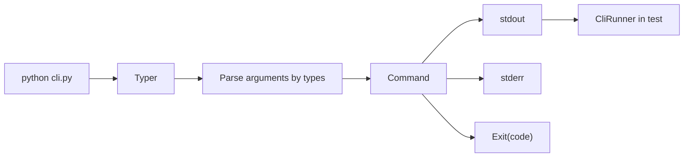

`typer` is a library for building command-line interfaces (CLI). It's built on `click` but declares commands through Python type annotations: less code, autocompletion, `--help` out of the box. In this lesson we'll write a utility with several commands and cover it with tests.

## Installation and the first command

```bash
pip install typer
```

Minimal app:

```python
import typer

app = typer.Typer()

@app.command()
def hello(name: str):
    """Say hello to the user."""
    typer.echo(f"Hello, {name}!")

if __name__ == "__main__":
    app()
```

Run:

```bash
python cli.py hello Anna
# Hello, Anna!
```

The decorator `@app.command()` turns a function into a command. The argument `name: str` becomes a positional CLI argument: if it's not provided, typer itself prints a clear error. The function docstring automatically becomes the help text in `--help`.

## Arguments and options

Positional arguments — `name: str`. Options are declared with `typer.Option(...)` plus a default:

```python
@app.command()
def hello(name: str, greeting: str = typer.Option("Hello", help="Greeting word")):
    typer.echo(f"{greeting}, {name}!")
```

Now `python cli.py hello Anna --greeting Hi` prints `Hi, Anna!`. Boolean flags are `bool` with `typer.Option(False, "--verbose")` or just `verbose: bool = False` (a `--verbose/--no-verbose` flag appears).

Multiple values — via `List[int]`:

```python
from typing import List

@app.command()
def total(numbers: List[int]):
    typer.echo(sum(numbers))
```

Call: `python cli.py total 1 2 3` → `6`.

## Errors and exit codes

To finish a command with an error, use `typer.Exit(code=1)`:

```python
from pathlib import Path

@app.command()
def file_info(path: Path):
    if not path.exists():
        typer.echo(f"File not found: {path}", err=True)
        raise typer.Exit(code=1)
    typer.echo(f"{path.name}: {path.stat().st_size} bytes")
```

`err=True` sends the message to stderr, and `Exit(code=1)` sets the process exit code — scripts and CI can catch it.

## Testing: CliRunner

You can test a CLI via `typer.testing.CliRunner`. It invokes commands inside the test process, without launching a separate process:

```python
from typer.testing import CliRunner
from cli import app

runner = CliRunner()

def test_hello():
    result = runner.invoke(app, ["hello", "Anna"])
    assert result.exit_code == 0
    assert "Hello, Anna!" in result.stdout
```

`runner.invoke(app, args)` returns a `Result` with `exit_code` and `stdout`. Inside `runner.isolated_filesystem()` you can create temporary files — ideal for commands that work with files.

## CLI workflow diagram



The diagram explains why a test almost doesn't differ from a real run: `CliRunner` follows the same path, only intercepting streams and the exit code.

## Why typer, not argparse

`argparse` has more boilerplate: types must be specified manually, and help too. Typer takes care of everything: types from annotations, `--help` generation, error hints. For small and medium utilities this is noticeably faster and cleaner. Let's practice.

<!--TASK-->
### Task 1
Create a `cli.py` file with an app `app = typer.Typer()`. Add a `hello` command: positional argument `name: str` and option `greeting: str = typer.Option("Hello", help="Greeting word")`. The command prints `f"{greeting}, {name}!"` via `typer.echo`. Check: `python cli.py hello Anna` prints `Hello, Anna!`, and `python cli.py hello Anna --greeting Hi` prints `Hi, Anna!`. Expected result: both commands work, and `--help` shows the option description.

### Task 2
Add a `total` command to `cli.py` that takes `numbers: List[int]` and prints their sum. Check: `python cli.py total 1 2 3` prints `6`, and `python cli.py total` prints `0`. Expected result: the sum prints correctly, including for an empty list.

### Task 3
Add a `file-info` command to `cli.py` with a `path: Path` argument. If the file doesn't exist, print `File not found: {path}` to stderr (`err=True`) and raise `typer.Exit(code=1)`. If it exists, print `{path.name}: {size} bytes`. Check on a real file and a nonexistent one: in the second case the command should exit with code 1. Expected result: for an existing file exit code 0 and size output; for a missing one — code 1 and a message in stderr.

### Task 4
Write pytest tests for the `hello` and `total` commands via `CliRunner`: (1) `runner.invoke(app, ["hello", "Anna"])` — `exit_code == 0` and `"Hello, Anna!" in result.stdout`; (2) with the `--greeting` option — different text; (3) `total` for `["1", "2", "3"]` — `exit_code == 0`, output `6`; (4) `total` without numbers — output `0`. Run `python -m pytest test_cli.py -v`. Expected result: all 4 tests pass.

### Task 5
Write pytest tests for `file-info`: (1) inside `runner.isolated_filesystem()` create a `data.txt` file with text, then `runner.invoke(app, ["file-info", "data.txt"])` — `exit_code == 0` and `result.stdout` contains `data.txt` and the file size; (2) for `runner.invoke(app, ["file-info", "missing.txt"])` — `exit_code == 1` and `"not found" in result.stderr`. Run the tests. Expected result: all checks pass.
### Task 6
Add a `stats` command to `cli.py` with a `path: Path` argument and an option `top: int = typer.Option(3, "--top", "-n", help="How many words to show")`. The command reads the file in UTF-8, counts lines, words and unique words, and prints three lines: `Lines: N`, `Words: N`, `Unique: N`, followed by `Top-N:` and the most frequent words in the format `word — 3`. If the file is missing, print a message to stderr and exit with code 1. Expected result: for a file with two lines `hello world` and `world of work`, the command prints `Words: 4`, and the first entry in the top is `world — 2`.

### Task 7
Create a subapplication `users_app = typer.Typer(help="User operations")` with two commands: `list` (prints `Anna`, `Boris`, `Vera` — one per line) and `add` with a `name: str` argument (prints `Added: {name}`). Attach it to the main app via `app.add_typer(users_app, name="users")`. Expected result: `python cli.py users list` prints three names, `python cli.py users add Dasha` prints `Added: Dasha`, and `python cli.py --help` shows the `users` group in the command list.
<!--/TASK-->

<!--HINT-->
### Hint 1
Option type: `greeting: str = typer.Option("Hello", help="Greeting word")`. Typer derives the option name from the variable name: `--greeting`. Don't forget `if __name__ == "__main__": app()` to run from a file.

### Hint 2
Import `from typing import List`. Signature: `def total(numbers: List[int])`. Sum — `sum(numbers)`. Typer converts command-line strings to int automatically.

### Hint 3
Use `from pathlib import Path`. Check: `if not path.exists():`. For stderr: `typer.echo(..., err=True)`. Exit: `raise typer.Exit(code=1)`. Size: `path.stat().st_size`.

### Hint 4
One `runner` per module: `runner = CliRunner()`. Each test is a separate function with `result = runner.invoke(app, [...])`. Check `result.exit_code` and `result.stdout`. Import `app` from `cli.py`.

### Hint 5
Use `with runner.isolated_filesystem():` — inside, the current directory is temporary. Create a file: `Path("data.txt").write_text("hello", encoding="utf-8")`. To check size, compare `"data.txt" in result.stdout` and don't compare exact numbers: it depends on the text. stderr: `result.stderr`.
### Hint 6
Count frequencies with `Counter(w.lower() for w in text.split())`, and the top with `counts.most_common(top)`. Lines: `len(text.splitlines())`, words: `len(text.split())`, unique: `len(counts)`. Check the file before reading: `if not path.exists(): typer.echo(..., err=True); raise typer.Exit(code=1)`. The dash in the output is an ordinary `—` character in an f-string.

### Hint 7
The function can't be named `list` — it would shadow the built-in; name it `list_users` and put a decorator with an explicit name: `@users_app.command("list")`. Attaching: `app.add_typer(users_app, name="users")` — exactly `add_typer`, not `add_command`. Test check: `runner.invoke(app, ["users", "list"])`.
<!--/HINT-->

<!--SOLUTION-->
### Walkthrough 1
Full solution (file `cli.py`):

```python
import typer

app = typer.Typer()

@app.command()
def hello(name: str, greeting: str = typer.Option("Hello", help="Greeting word")):
    """Say hello to the user."""
    typer.echo(f"{greeting}, {name}!")

if __name__ == "__main__":
    app()
```

Walkthrough. Typer reads type annotations: `name: str` becomes a required positional argument, `greeting: str = typer.Option(...)` — an option with the default `Hello`. The option name `--greeting` is generated from the variable name. `typer.echo` is an analogue of `print` but with correct Unicode and encoding handling. Running `python cli.py hello Anna` prints `Hello, Anna!`; passing `--greeting Hi` changes the word. The `--help` flag is generated automatically: typer uses the function docstring as the description. Notice: nothing needs to be parsed by hand — the library does all the parsing.

### Walkthrough 2
Full solution (add to `cli.py`):

```python
from typing import List

@app.command()
def total(numbers: List[int]):
    """Sum of the given numbers."""
    typer.echo(sum(numbers))
```

Walkthrough. The annotation `List[int]` means the command accepts any number of numbers. Typer converts each CLI string to `int` (and if that's impossible, prints a clear error with a hint). If no numbers are passed, `numbers` is an empty list, and `sum([])` returns `0`, so `python cli.py total` correctly prints `0`. This is more elegant than manually parsing `sys.argv` and converting types with checks.

### Walkthrough 3
Full solution (add to `cli.py`):

```python
from pathlib import Path

@app.command()
def file_info(path: Path):
    """Show the file size."""
    if not path.exists():
        typer.echo(f"File not found: {path}", err=True)
        raise typer.Exit(code=1)
    typer.echo(f"{path.name}: {path.stat().st_size} bytes")
```

Walkthrough. `path: Path` makes typer convert the CLI string into a `pathlib.Path` object. If the file is missing, the error message goes to stderr (`err=True`), and `typer.Exit(code=1)` terminates the process with code 1: the shell and CI will understand the command failed. On success, the file name and size from `stat().st_size` are printed. This is a minimal but "correct" CLI: with clear errors and exit codes.

### Walkthrough 4
Full solution (file `test_cli.py`):

```python
from typer.testing import CliRunner
from cli import app

runner = CliRunner()

def test_hello_default_greeting():
    result = runner.invoke(app, ["hello", "Anna"])
    assert result.exit_code == 0
    assert "Hello, Anna!" in result.stdout

def test_hello_custom_greeting():
    result = runner.invoke(app, ["hello", "Anna", "--greeting", "Hi"])
    assert result.exit_code == 0
    assert "Hi, Anna!" in result.stdout

def test_total_three_numbers():
    result = runner.invoke(app, ["total", "1", "2", "3"])
    assert result.exit_code == 0
    assert "6" in result.stdout

def test_total_empty():
    result = runner.invoke(app, ["total"])
    assert result.exit_code == 0
    assert "0" in result.stdout
```

Walkthrough. `CliRunner` runs the app in-process: no process spawning, fast and safe. `runner.invoke(app, ["hello", "Anna"])` is exactly the same as `python cli.py hello Anna`. The result is checked by `exit_code` (0 — success) and `stdout` content. The tests cover the default greeting, the option, the sum, and the empty-list edge case. This is a golden habit: every command and every branch gets tests.

### Walkthrough 5
Full solution (add to `test_cli.py`):

```python
from pathlib import Path

def test_file_info_existing_file():
    with runner.isolated_filesystem():
        Path("data.txt").write_text("Hello, world!", encoding="utf-8")
        result = runner.invoke(app, ["file-info", "data.txt"])
        assert result.exit_code == 0
        assert "data.txt" in result.stdout
        assert "bytes" in result.stdout

def test_file_info_missing_file():
    result = runner.invoke(app, ["file-info", "missing.txt"])
    assert result.exit_code == 1
    assert "not found" in result.stderr
```

Walkthrough. `runner.isolated_filesystem()` creates a temporary working directory for the duration of the block — files created inside exist only there and are removed after the test. The first test writes `data.txt` and checks the success scenario: code 0, the file name and the word "bytes" in output (we don't compare the exact size — it depends on encoding, so we check the output form). The second test is the "happy path" of a missing file: code 1 and a message in `stderr`. This is exactly how command-line utilities are tested: through a real invocation, with temporary files and without manually running a terminal.
### Walkthrough 6
Full solution:

```python
from collections import Counter
from pathlib import Path

@app.command()
def stats(path: Path, top: int = typer.Option(3, "--top", "-n", help="How many words to show")):
    """Statistics for a text file."""
    if not path.exists():
        typer.echo(f"File not found: {path}", err=True)
        raise typer.Exit(code=1)

    text = path.read_text(encoding="utf-8")
    words = text.split()
    counts = Counter(word.lower() for word in words)

    typer.echo(f"Lines: {len(text.splitlines())}")
    typer.echo(f"Words: {len(words)}")
    typer.echo(f"Unique: {len(counts)}")
    typer.echo(f"Top-{top}:")
    for word, count in counts.most_common(top):
        typer.echo(f"{word} — {count}")
```

Walkthrough. `path: Path` makes typer convert the string into `pathlib.Path`, so regular methods work further: `exists()` and `read_text()`. The error is handled before reading — otherwise `read_text` would throw `FileNotFoundError` with a technical traceback instead of a human-readable message. `Counter` solves frequencies in one line: it takes a generator and immediately builds a "word → count" dict; `lower()` normalizes case so `World` and `world` count as one word. `most_common(top)` sorts by descending frequency and trims the list. The option is declared with two names: long `--top` and short `-n`, and `help` lands in the auto-generated help. Output is built with separate `echo` calls, so a test can verify any line individually.

### Walkthrough 7
Full solution:

```python
users_app = typer.Typer(help="User operations")

@users_app.command("list")
def list_users():
    """Show all users."""
    for name in ("Anna", "Boris", "Vera"):
        typer.echo(name)

@users_app.command("add")
def add_user(name: str):
    """Add a user."""
    typer.echo(f"Added: {name}")

app.add_typer(users_app, name="users")
```

Walkthrough. A subapplication is an ordinary `typer.Typer()` attached to its parent via `add_typer`. This way large CLIs are split into groups: `users`, `orders`, `reports`, each living in its own module. An important detail — the command name: the function had to be called `list_users` because `list` shadows the built-in, and the decorator `@users_app.command("list")` sets the external name explicitly. `help="..."` in the group constructor is displayed in `--help` next to the name. In tests the path mirrors a real invocation: `runner.invoke(app, ["users", "list"])` — first the group name, then the command name. Such structure makes it easy to grow a CLI without risking existing commands.
<!--/SOLUTION-->

<!--QUIZ-->
What is used to create a command in typer?
- @app.command() over a function
- typer.cmd()
- @command
- class Command
* Correct answer: @app.command() over a function
The decorator registers the function as a CLI command.

How to declare a positional argument?
- name: str
- name = typer.Argument()
- @arg("name")
- typer.positional("name")
* Correct answer: name: str
A type annotation makes the parameter a positional argument.

How to declare an option with a default?
- greeting: str = typer.Option("Hello")
- greeting = "Hello"
- @option(greeting)
- typer.flag(greeting)
* Correct answer: greeting: str = typer.Option("Hello")
typer.Option creates a --greeting option with the given default value.

What does typer.echo() do?
- Prints text (an analogue of print) with correct encoding
- Returns text
- Reads user input
- Highlights text
* Correct answer: Prints text (an analogue of print) with correct encoding
typer.echo prints to stdout, handling Unicode correctly.

How to finish a command with an error code?
- raise typer.Exit(code=1)
- return 1
- sys.exit(1) anywhere
- typer.error()
* Correct answer: raise typer.Exit(code=1)
Exit immediately stops execution and sets the exit code.

How to test typer commands?
- Via CliRunner from typer.testing
- Only by launching a process
- Via unittest.mock
- CLI can't be tested
* Correct answer: Via CliRunner from typer.testing
CliRunner.invoke(app, args) runs the command in-process.

What does result.exit_code contain on success?
- 0
- 1
- Output text
- None
* Correct answer: 0
Code 0 means successful completion.

What does runner.isolated_filesystem() do?
- Creates a temporary folder for the duration of the block
- Isolates the network
- Stops other commands
- Saves output to a file
* Correct answer: Creates a temporary folder for the duration of the block
Files inside the block exist only in the temporary directory.

How to accept multiple numbers in a command?
- numbers: List[int]
- numbers: int[]
- numbers: str
- Impossible
* Correct answer: numbers: List[int]
Typer accepts any number of values and converts them to int.

Why does typer need the function docstring?
- It is shown in --help
- It speeds up execution
- It's not needed
- It replaces code
* Correct answer: It is shown in --help
The docstring becomes the command description in help.
How to attach a command group to an app?
- app.add_typer(users_app, name="users")
- app.add_command(users_app)
- app.include(users_app)
- @app.group(users_app)
* Correct answer: app.add_typer(users_app, name="users")
add_typer registers a nested app under the given name.

What does typer.Option(3, "--top", "-n") set?
- A default value and two flag names
- Three required arguments
- The value type
- The exit code
* Correct answer: A default value and two flag names
The first argument is the default, then the long and short names follow.

Where does text go with typer.echo("Error", err=True)?
- To stderr
- To stdout
- To a log file
- Nowhere
* Correct answer: To stderr
err=True switches the stream, separating the message from useful output.

How to name a command differently from its function?
- @app.command("list") over the function list_users
- Rename the function to list
- app.rename("list")
- Impossible
* Correct answer: @app.command("list") over the function list_users
The decorator accepts an explicit name; the function can be named anything.
<!--/QUIZ-->
