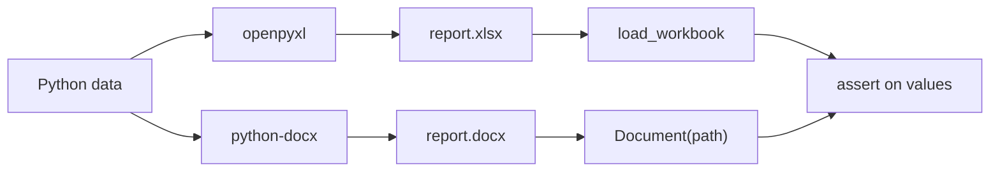

Business reports almost always live in Excel and Word. `openpyxl` reads and writes `.xlsx`, `python-docx` — `.docx`. In this lesson we'll learn to generate real reports: with styles, formulas, headings and tables — and, crucially, to test them by rereading the created files.

## Installation

```bash
pip install openpyxl python-docx
```

## openpyxl: workbook, worksheet, cells

Workbook is `Workbook`, worksheet — `Worksheet`, cell — a value at an address:

```python
from openpyxl import Workbook

wb = Workbook()
ws = wb.active            # first worksheet
ws.title = "Sales"       # rename it

ws["A1"] = "Product"
ws["B1"] = "Quantity"
ws.append(["Laptop", 5])  # add a row at the end
ws.append(["Monitor", 3])

wb.save("sales.xlsx")
```

`ws.append(list)` adds a row at the bottom of the worksheet; `ws["A1"] = value` writes to a specific cell. An address can also be obtained numerically: `ws.cell(row=2, column=1)`.

## Styles and formulas

Styles are set with `Font`, `PatternFill`, `Alignment` objects:

```python
from openpyxl.styles import Font, PatternFill, Alignment

header_font = Font(bold=True, color="FFFFFF")
header_fill = PatternFill(start_color="4472C4", end_color="4472C4", fill_type="solid")

ws["A1"].font = header_font
ws["A1"].fill = header_fill
ws["A1"].alignment = Alignment(horizontal="center")

ws.column_dimensions["A"].width = 20
```

Formulas are written as strings starting with `=`:

```python
ws["B8"] = "=SUM(B2:B7)"
```

`openpyxl` doesn't compute formulas — it just saves them. To read the computed value, Excel must open the file; when reading, use `load_workbook(path, data_only=True)`.

## Reading existing workbooks

```python
from openpyxl import load_workbook

wb = load_workbook("sales.xlsx")
ws = wb["Sales"]
for row in ws.iter_rows(min_row=1, max_row=3, values_only=True):
    print(row)   # tuple of values
```

`iter_rows(values_only=True)` yields rows as tuples — handy for checks and counts.

## python-docx: a Word document

Document is `Document`. We add headings, paragraphs and tables:

```python
from docx import Document

doc = Document()
doc.add_heading("Sales report", level=1)
doc.add_paragraph("Generated automatically.")

table = doc.add_table(rows=2, cols=2)
table.style = "Light Grid Accent 1"
table.cell(0, 0).text = "Product"
table.cell(0, 1).text = "Quantity"
table.cell(1, 0).text = "Laptop"
table.cell(1, 1).text = "5"

doc.save("report.docx")
```

`add_heading(text, level=1)` creates a heading (level 1 is the largest), `add_paragraph` — regular text, `add_table(rows, cols)` — a table whose cells are filled via `table.cell(r, c).text`.

## Report diagram in two formats



Both branches converge at one point — verification: a test always rereads the file rather than trusting the in-memory object.

## How to test documents

`openpyxl` and `python-docx` aren't "drawing" but XML structures. So tests are simple: create a report in `tmp_path`, reread it, and check values, styles and structure. Let's do exactly that.

<!--TASK-->
### Task 1
Write a function `write_sales_report(rows, path)` where `rows` is a list of `(product, quantity)` tuples. The function creates a workbook, a `Sales` worksheet, writes headers `Product` and `Quantity` (bold white font, `4472C4` fill, center alignment), then the rows from `rows`. After the data, add a `Total` row and a `=SUM(B2:B{end})` formula in column `B` (numbering: header is row 1, data starts at row 2). Save the workbook to `path` and return `path`. Check manually: after running, open the file in Excel or reread it with `load_workbook`. Expected result: the file is created, A1 and B1 hold headers, and the last row has the `=SUM(...)` formula.

### Task 2
Write a function `read_sales_summary(path)` that reads the `Sales` worksheet via `load_workbook(path)` and returns a tuple `(rows, total_row)`: `rows` — a list of all rows (as value tuples, including the header), `total_row` — the "Total" row as a tuple. Use `ws.iter_rows(values_only=True)`. Check on the file from task 1. Expected result: `rows` contains the header and data, `total_row[0] == "Total"`, and `total_row[1]` is the formula string.

### Task 3
Write a function `make_word_report(title, items, path)` where `items` is a list of `(name, quantity)` tuples. The function creates a document, adds a level-1 heading (`title`), a paragraph `Generated automatically.` and a table with header `Name` / `Quantity` and rows from `items`. Table style — `Light Grid Accent 1`. Save to `path` and return `path`. Check manually: open the file in Word. Expected result: the document contains the heading, paragraph, and a table with `len(items) + 1` rows.

### Task 4
Write pytest tests for `write_sales_report` and `read_sales_summary`. Use `tmp_path`: (1) `write_sales_report([("Laptop", 5), ("Monitor", 3)], path)` creates the file, `path.exists()` is true; (2) `read_sales_summary(path)` returns `rows` with the header and two data rows; (3) in `total_row` the first element is `Total`, and the second is a string starting with `=SUM(`; (4) the header in cell A1 has a bold font (`ws["A1"].font.bold is True`) and a fill. Run `python -m pytest test_excel.py -v`. Expected result: all tests pass.

### Task 5
Write pytest tests for `make_word_report`: (1) the file is created; (2) after `Document(path)` the first heading paragraph contains `title` (check `doc.paragraphs[0].text`); (3) the number of tables is 1; (4) the table has `len(items) + 1` rows and 2 columns; (5) cell `(1, 0)` contains the first name from `items`. Run the tests. Expected result: all checks pass.
### Task 6
Write a function `write_multi_sheet_report(data, path)` where `data` is a dict `{"Moscow": [("Laptop", 5, 79990)], "Kazan": [...]}`. For each city create a separate worksheet named after it: header `Product`, `Qty`, `Price`, `Amount`, data rows and a `=B{r}*C{r}` formula in column D, and at the end a `Total` row with a `=SUM(D2:D{n})` formula. Remove the default empty worksheet with `wb.remove(wb.active)`. The function returns a list of worksheet names. Expected result: for two cities it returns `["Moscow", "Kazan"]`, and after `load_workbook` the value of `ws["D2"].value` starts with `=`.

### Task 7
Write a function `make_checklist_doc(title, items, path)` that creates a Word document: a level-1 heading with text `title`, an introductory paragraph `Task checklist.`, then one paragraph per item with style `List Bullet`, and at the end a table with header `Item` and `Status` and a `Not started` row for each item. Save the document to the path and return the path. Expected result: after `Document(path)` the style of paragraph `paragraphs[2]` is `List Bullet`, the document has one table with `len(items) + 1` rows, and cell `(0, 0)` contains `Item`.
<!--/TASK-->

<!--HINT-->
### Hint 1
Row numbering: header is row 1, data starts at row 2. Write the total after the loop over `rows`: `ws.append(["Total", "=SUM(B2:B{1 + len(rows)})"])`. Styles via `Font(bold=True, color="FFFFFF")`, `PatternFill(start_color="4472C4", end_color="4472C4", fill_type="solid")`, `Alignment(horizontal="center")`.

### Hint 2
Read like this: `ws = load_workbook(path)["Sales"]`, then `rows = list(ws.iter_rows(values_only=True))`, the last row is `rows[-1]`. Return `(rows, rows[-1])`.

### Hint 3
Table: `table = doc.add_table(rows=len(items) + 1, cols=2)`; `table.style = "Light Grid Accent 1"`. Fill the header and data via `table.cell(r, c).text`.

### Hint 4
After `write_sales_report` reread: `wb = load_workbook(path)`, `ws = wb["Sales"]`. Checks: `ws["A1"].font.bold is True`, `ws["A1"].fill.start_color.rgb` contains `4472C4`, `ws.cell(row=4, column=2).value` starts with `=SUM(`.

### Hint 5
Open the document: `doc = Document(path)`. For the heading use `doc.paragraphs[0].text == title`. Tables: `doc.tables` is a list; `len(doc.tables) == 1`; `table = doc.tables[0]`; `len(table.rows)`, `len(table.columns)`; cell — `table.rows[1].cells[0].text`.
### Hint 6
After `wb = Workbook()` immediately do `wb.remove(wb.active)`, otherwise an extra "Sheet" remains. Create a new worksheet like this: `ws = wb.create_sheet(city)`. The row number for the formula comes from `enumerate(rows, start=2)`. Total: `last = 1 + len(rows)`, then `ws.append(["Total", None, None, f"=SUM(D2:D{last})"])`. Return `wb.sheetnames` after saving.

### Hint 7
A bulleted paragraph: `doc.add_paragraph(item, style="List Bullet")` — the style is passed as the second argument. Create the table at the needed size right away: `doc.add_table(rows=len(items) + 1, cols=2)`, then fill via `table.cell(r, c).text`. The `Table Grid` style gives visible borders.
<!--/HINT-->

<!--SOLUTION-->
### Walkthrough 1
Full solution:

```python
from openpyxl import Workbook
from openpyxl.styles import Font, PatternFill, Alignment

def write_sales_report(rows, path):
    wb = Workbook()
    ws = wb.active
    ws.title = "Sales"

    header_font = Font(bold=True, color="FFFFFF")
    header_fill = PatternFill(start_color="4472C4", end_color="4472C4",
                              fill_type="solid")
    center = Alignment(horizontal="center")

    ws["A1"] = "Product"
    ws["B1"] = "Quantity"
    for cell in (ws["A1"], ws["B1"]):
        cell.font = header_font
        cell.fill = header_fill
        cell.alignment = center

    for product, qty in rows:
        ws.append([product, qty])

    last = 1 + len(rows)
    ws.append(["Total", f"=SUM(B2:B{last})"])
    wb.save(path)
    return path
```

Walkthrough. The workbook is created via `Workbook()`, the active worksheet is renamed. Headers are filled by address, then each gets a font, fill and alignment. Data is added via `ws.append` — it goes right after row 1. After the data, the total is written: text `Total` in column A and a formula string in B. `last = 1 + len(rows)` is the number of the last data row, and the formula covers all of them. Important: `openpyxl` stores the formula as a string and doesn't compute it; the calculation happens when Excel opens the file. `wb.save(path)` writes to disk; returning `path` is convenient for chains and tests.

### Walkthrough 2
Full solution:

```python
from openpyxl import load_workbook

def read_sales_summary(path):
    ws = load_workbook(path)["Sales"]
    rows = list(ws.iter_rows(values_only=True))
    return rows, rows[-1]
```

Walkthrough. `load_workbook(path)` opens the workbook, `["Sales"]` selects the worksheet. `iter_rows(values_only=True)` returns an iterator of rows — each row is a tuple of cell values. We turn the iterator into a list: convenient for indexing and counting. The last list element is the "Total" row with the formula in the second cell. Note: `data_only=True` isn't needed here — we want to see the formula string, not a computed value.

### Walkthrough 3
Full solution:

```python
from docx import Document

def make_word_report(title, items, path):
    doc = Document()
    doc.add_heading(title, level=1)
    doc.add_paragraph("Generated automatically.")

    table = doc.add_table(rows=len(items) + 1, cols=2)
    table.style = "Light Grid Accent 1"
    table.cell(0, 0).text = "Name"
    table.cell(0, 1).text = "Quantity"
    for i, (name, qty) in enumerate(items, start=1):
        table.cell(i, 0).text = name
        table.cell(i, 1).text = str(qty)

    doc.save(path)
    return path
```

Walkthrough. `Document()` creates an empty document. `add_heading(title, level=1)` adds the main heading; `add_paragraph` — an explanatory paragraph. The table is created with `len(items) + 1` rows (header + data) and two columns. The style `Light Grid Accent 1` from Word's standard set gives the table a grid. Filling goes via `cell(r, c).text`; `enumerate(items, start=1)` gives data row numbers starting from 1 (0 is the header). `doc.save(path)` closes the document. This approach makes it easy to change the report composition without touching the layout.

### Walkthrough 4
Full solution:

```python
import pytest
from openpyxl import load_workbook
from excel_report import write_sales_report, read_sales_summary

def test_report_file_created_and_read(tmp_path):
    path = tmp_path / "sales.xlsx"
    result = write_sales_report([("Laptop", 5), ("Monitor", 3)], path)
    assert path.exists()
    assert result == path

    rows, total = read_sales_summary(path)
    assert rows[0] == ("Product", "Quantity")
    assert len(rows) == 4
    assert total[0] == "Total"
    assert str(total[1]).startswith("=SUM(")

def test_header_styles(tmp_path):
    path = tmp_path / "sales.xlsx"
    write_sales_report([("Laptop", 5)], path)
    ws = load_workbook(path)["Sales"]
    assert ws["A1"].font.bold is True
    assert "4472C4" in str(ws["A1"].fill.start_color.rgb)
```

Walkthrough. The first test runs generation in `tmp_path`, checks the file exists and the path is returned, then rereads the workbook with the function from task 2. Checked: the header (tuple of values), the row count (1 header + 2 data + 1 total = 4), the total row content, and the presence of a formula (value starts with `=SUM(`). The second test reads the file directly via `load_workbook` and checks styles: font boldness and fill color (RGB string contains `4472C4`). This is "rereading the file": we verify not what the function thinks it wrote, but the actual document content.

### Walkthrough 5
Full solution:

```python
from docx import Document
from word_report import make_word_report

ITEMS = [("Laptop", 5), ("Monitor", 3)]

def test_word_report_structure(tmp_path):
    path = tmp_path / "report.docx"
    make_word_report("Report", ITEMS, path)

    assert path.exists()
    doc = Document(path)
    assert doc.paragraphs[0].text == "Report"
    assert len(doc.tables) == 1

    table = doc.tables[0]
    assert len(table.rows) == 3
    assert len(table.columns) == 2
    assert table.rows[0].cells[0].text == "Name"
    assert table.rows[1].cells[0].text == "Laptop"
```

Walkthrough. After generation we reopen the document via `Document(path)` — this is an honest check: we read what actually lies in the file. `doc.paragraphs[0]` is the first paragraph, and it must be a heading with our text. `doc.tables` is the list of document tables; we check there's one. Then structure: `len(table.rows)` — number of rows (3: header + 2 items), `len(table.columns)` — number of columns, and via `rows[i].cells[j].text` we read specific cells. Such tests protect both against accidental report structure changes and against data loss during refactoring.
### Walkthrough 6
Full solution:

```python
from openpyxl import Workbook

def write_multi_sheet_report(data, path):
    wb = Workbook()
    wb.remove(wb.active)

    for city, rows in data.items():
        ws = wb.create_sheet(city)
        ws.append(["Product", "Qty", "Price", "Amount"])
        for r, (product, qty, price) in enumerate(rows, start=2):
            ws.append([product, qty, price, f"=B{r}*C{r}"])
        last = 1 + len(rows)
        ws.append(["Total", None, None, f"=SUM(D2:D{last})"])

    wb.save(path)
    return wb.sheetnames
```

Walkthrough. `Workbook()` always creates one worksheet, and in a report with named worksheets it's redundant — so we remove it: `wb.remove(wb.active)`. Then a loop over the dict creates worksheets in key order, and `sheetnames` returns exactly that order — convenient for test checks. Each worksheet gets a header and rows; `enumerate(rows, start=2)` gives the row number for the formula because row 1 is occupied by the header. The formula is assembled as an f-string with curly braces around `r` — the `=` sign itself remains text for Excel. The total row uses `SUM` over the actual data range rather than a generous reserve. `None` in the middle of the tuple leaves cells empty. Important: `openpyxl` computes neither `B*C` nor `SUM`, but the file structure is correct, and Excel calculates everything on open.

### Walkthrough 7
Full solution:

```python
from docx import Document

def make_checklist_doc(title, items, path):
    doc = Document()
    doc.add_heading(title, level=1)
    doc.add_paragraph("Task checklist.")

    for item in items:
        doc.add_paragraph(item, style="List Bullet")

    table = doc.add_table(rows=len(items) + 1, cols=2)
    table.style = "Table Grid"
    table.cell(0, 0).text = "Item"
    table.cell(0, 1).text = "Status"
    for r, item in enumerate(items, start=1):
        table.cell(r, 0).text = item
        table.cell(r, 1).text = "Not started"

    doc.save(path)
    return path
```

Walkthrough. The `List Bullet` style is a built-in Word style, and `add_paragraph(text, style=...)` applies it immediately, without manual "•" characters: the list stays a real list and can be reformatted in one move. The heading and introductory paragraph occupy indexes 0 and 1, so the first list item is `paragraphs[2]`; the check in task 5 is based on this. The table is created at the exact needed size: header plus items — and `enumerate(..., start=1)` skips the header row. The `Table Grid` style gives borders visible both in Word and in structural tests. The function returns the path, so it's easy to call in a chain of generators and in `tmp_path` tests.
<!--/SOLUTION-->

<!--QUIZ-->
How to create a new openpyxl workbook?
- Workbook()
- Excel()
- Spreadsheet()
- NewWorkbook()
* Correct answer: Workbook()
Workbook() creates an empty workbook with one worksheet.

What does ws.append([...]) do?
- Adds a row at the bottom of the worksheet
- Adds a column
- Overwrites the first row
- Creates a new worksheet
* Correct answer: Adds a row at the bottom of the worksheet
append adds a row at the end of existing data.

How to write a formula into a cell?
- ws["B8"] = "=SUM(B2:B7)"
- ws["B8"] = SUM(B2:B7)
- ws.formula("B8", "SUM")
- ws["B8"] = lambda: sum(...)
* Correct answer: ws["B8"] = "=SUM(B2:B7)"
A formula is stored as a string starting with =.

What is dangerous about writing a formula in openpyxl?
- It erases data
- The library doesn't compute it — the value appears only in Excel
- It breaks the file
- Formulas aren't supported
* Correct answer: The library doesn't compute it — the value appears only in Excel
openpyxl only saves the formula text.

How to read an existing workbook?
- load_workbook(path)
- open(path)
- Workbook(path)
- read_excel(path)
* Correct answer: load_workbook(path)
load_workbook opens .xlsx for reading and editing.

How to get all row values of a worksheet?
- ws.iter_rows(values_only=True)
- ws.rows()
- ws.to_list()
- ws.values
* Correct answer: ws.iter_rows(values_only=True)
iter_rows yields tuples of cell values by rows.

How to add a heading to a python-docx document?
- doc.add_heading("Text", level=1)
- doc.title = "Text"
- doc.add_title("Text")
- doc.heading("Text")
* Correct answer: doc.add_heading("Text", level=1)
add_heading creates a heading of the given level.

How to fill a Word table cell?
- table.cell(r, c).text = "value"
- table[r][c] = "value"
- table.set_cell(r, c, "value")
- table.write(r, c, "value")
* Correct answer: table.cell(r, c).text = "value"
cell(r, c) returns a cell with a text property.

How to add a table to a Word document?
- doc.add_table(rows=n, cols=m)
- doc.create_table(n, m)
- table = Table(n, m)
- doc.insert_table(n, m)
* Correct answer: doc.add_table(rows=n, cols=m)
add_table creates a table of the required size.

How many rows does a table created with rows=len(items) + 1 have?
- len(items)
- len(items) + 1
- len(items) * 2
- 1
* Correct answer: len(items) + 1
One extra row is needed for the table header.
How to create a worksheet with a given name and immediately get its object?
- ws = wb.create_sheet("Name")
- wb.add_sheet("Name")
- ws = wb.sheet("Name")
- wb.new("Name")
* Correct answer: ws = wb.create_sheet("Name")
create_sheet returns the created Worksheet, ready for use.

What will wb.sheetnames return?
- A list of worksheet names in their order
- The number of worksheets
- The name of the active worksheet
- A dict of worksheets
* Correct answer: A list of worksheet names in their order
This list is convenient to compare with expectations in tests.

How to add a bulleted paragraph in Word?
- doc.add_paragraph("text", style="List Bullet")
- doc.add_bullet("text")
- doc.add_paragraph("- text")
- doc.list("text")
* Correct answer: doc.add_paragraph("text", style="List Bullet")
The List Bullet style turns a paragraph into a real list item.

Which table style gives visible borders?
- "Table Grid"
- "Normal"
- "Heading 1"
- "Body Text"
* Correct answer: "Table Grid"
Table Grid is the basic style with a grid across all cells.
<!--/QUIZ-->
