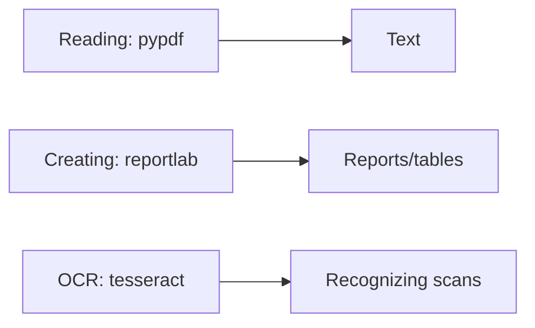

PDF is one of the most common document formats. Python has libraries for reading (pypdf), creating (reportlab) and text recognition (OCR).

## Reading with pypdf

```python
from pypdf import PdfReader

reader = PdfReader("doc.pdf")
page = reader.pages[0]
print(page.extract_text())
```

If text isn't extracted, the document may be a scan (an image); OCR is needed.

## Creating reports with reportlab

```python
from reportlab.pdfgen import canvas

c = canvas.Canvas("report.pdf")
c.drawString(100, 750, "Hello, PDF!")
c.save()
```

For multi-page reports, `platypus` is convenient (Paragraph, Table, SimpleDocTemplate).

## Merging and splitting

`PdfWriter` from pypdf lets you add pages in any order.

## OCR: Tesseract

```python
import pytesseract
from PIL import Image

text = pytesseract.image_to_string(Image.open("scan.png"), lang="rus")
```

The tesseract utility must be installed on the system.

## Signatures and metadata

pypdf can read/write metadata; cryptographic signatures are usually done via third-party tools.

## Lesson summary

PDF tasks are solvable: we read, create, merge and recognize. The main thing is to choose the right tool for the document type.



## Why PDF skills are useful

PDF is a universal document exchange format: invoices, reports, contracts. Automating their creation and reading saves hours of manual work, and OCR turns a scan archive into a full-fledged text database. Combining pypdf and reportlab, you can build entire document workflow pipelines: data export, report generation and archiving in one service.

## Practical pipeline example

Imagine a service that produces a report daily: data from the DB → table in reportlab → save to PDF → text extraction with pypdf → email delivery. All steps are automated by a Python script, and OCR is plugged in for old archive scans. Such pipelines are used in accounting, logistics and law.

<!--TASK-->
### Task 1 — Text extraction
Create a simple PDF with reportlab (three lines). Open it with pypdf and check that the extracted text contains those lines.

### Task 2 — Metadata
Set metadata (title, author) via canvas.setTitle / setAuthor, then read it via reader.metadata.

### Task 3 — Merging PDFs
Create two PDFs and merge them into one via PdfWriter (add all pages). Check that the final page count is the sum of the originals.

### Task 4 — Splitting
Split a multi-page PDF into separate one-page files (e.g., 3 pages → 3 files). Show the names of the created files.

### Task 5 — Table in a report
Via platypus (Table, SimpleDocTemplate) create a PDF with a 3×3 table and a title. Make sure the file was created and contains 1 page.

### Task 6 — OCR (environment check)
If tesseract is installed: create an image with text (via Pillow) and recognize it with pytesseract. If unavailable — describe the install command and the call code.

### Task 7 — Summary report with numbers
Create a PDF report: title, paragraph and a table with 5 data rows (e.g., sales). Add a page number via canvas.drawString (or a simple footer).
<!--/TASK-->

<!--HINT-->
### Hint 1
pip install pypdf reportlab; canvas.drawString(x, y, text) — coordinates from the bottom-left corner.

### Hint 2
c.setTitle("..."), c.setAuthor("..."); after save() read reader.metadata.title.

### Hint 3
writer.add_page(page); writer.write(out) — read pages from reader.pages.

### Hint 4
For i, page in enumerate(reader.pages): create a new writer and add page.

### Hint 5
from reportlab.platypus import SimpleDocTemplate, Paragraph, Table.

### Hint 6
pytesseract.image_to_string(Image.open(...), lang="rus") — tesseract.exe is needed (apt/Win installation).

### Hint 7
Table: Table(data); style via TableStyle.
<!--/HINT-->

<!--SOLUTION-->
### Walkthrough 1
```python
from reportlab.pdfgen import canvas
from pypdf import PdfReader

c = canvas.Canvas("hello.pdf")
c.drawString(100, 750, "Line one")
c.drawString(100, 730, "Line two")
c.save()

reader = PdfReader("hello.pdf")
text = reader.pages[0].extract_text()
assert "Line one" in text
```
The report was created and read.

### Walkthrough 2
```python
c = canvas.Canvas("meta.pdf")
c.setTitle("Report 2026")
c.setAuthor("Anna")
c.save()

reader = PdfReader("meta.pdf")
print(reader.metadata.title, reader.metadata.author)
```
Metadata is available after saving.

### Walkthrough 3
```python
from pypdf import PdfReader, PdfWriter

def make_pdf(name, lines):
    c = canvas.Canvas(name)
    for i, line in enumerate(lines):
        c.drawString(72, 750 - i * 20, line)
    c.save()

make_pdf("a.pdf", ["A1", "A2"])
make_pdf("b.pdf", ["B1"])

out = PdfWriter()
for name in ("a.pdf", "b.pdf"):
    for page in PdfReader(name).pages:
        out.add_page(page)

with open("merged.pdf", "wb") as f:
    out.write(f)

print(len(PdfReader("merged.pdf").pages))  # 3
```
Pages from both files were added.

### Walkthrough 4
```python
reader = PdfReader("merged.pdf")
for i, page in enumerate(reader.pages):
    w = PdfWriter()
    w.add_page(page)
    with open(f"page_{i+1}.pdf", "wb") as f:
        w.write(f)
```
Files page_1.pdf, page_2.pdf, page_3.pdf were created.

### Walkthrough 5
```python
from reportlab.platypus import SimpleDocTemplate, Table

doc = SimpleDocTemplate("table.pdf")
data = [["Col1", "Col2", "Col3"],
        ["1", "2", "3"],
        ["4", "5", "6"]]
doc.build([Table(data)])
```
A 3×3 table in PDF.

### Walkthrough 6
```python
from PIL import Image
import pytesseract

img = Image.new("RGB", (400, 100), "white")
# ... draw text with ImageDraw ...
text = pytesseract.image_to_string(img, lang="rus")
print(text)
```
If tesseract isn't found — install it (apt-get install tesseract-ocr or the Windows installer) and set the path.

### Walkthrough 7
```python
from reportlab.platypus import SimpleDocTemplate, Paragraph, Table, Spacer
from reportlab.lib.styles import getSampleStyleSheet

styles = getSampleStyleSheet()
doc = SimpleDocTemplate("report.pdf")
story = [
    Paragraph("Sales report", styles["Title"]),
    Spacer(1, 12),
    Table([["Product", "Amount"],
           ["Book", 1000],
           ["Pen", 200]]),
]
doc.build(story)
```
A full report with a title and table.
<!--/SOLUTION-->

<!--QUIZ-->
Which library reads PDF?
- pypdf
- reportlab
- openpyxl
- requests
* Correct answer: pypdf
PdfReader extracts pages.

Which library creates PDF?
- reportlab
- pypdf
- pillow
- csv
* Correct answer: reportlab
canvas and platypus generate documents.

What to do if extract_text() is empty?
- The document may be a scan — OCR is needed
- A pypdf error
- More memory is needed
- Nothing
* Correct answer: The document may be a scan — OCR is needed
Images require recognition.

What does pytesseract do?
- Recognizes text from images
- Creates PDF
- Reads PDF
- Compresses files
* Correct answer: Recognizes text from images
OCR turns an image into text.

What is platypus?
- A high-level PDF document assembly tool
- A pypdf module
- A tesseract extension
- A data format
* Correct answer: A high-level PDF document assembly tool
Paragraph/Table/SimpleDocTemplate.

How to merge PDFs?
- Via PdfWriter.add_page
- Via canvas
- Via a file concatenator
- Via OCR
* Correct answer: Via PdfWriter.add_page
Pages are added one by one.

What does canvas.setTitle set?
- Document metadata
- Text on the page
- Font size
- Color
* Correct answer: Document metadata
The title in PDF properties.

Which parameter sets the OCR language?
- lang="rus"
- type="pdf"
- mode="text"
- scale=2
* Correct answer: lang="rus"
Language packs are installed separately.

What will reader.metadata.title return?
- The document title
- The page number
- File size
- A list of pages
* Correct answer: The document title
Metadata from the file.

How to add a table to a report?
- Via Table from platypus
- Via canvas only
- Via drawString
- Via image
* Correct answer: Via Table from platypus
Table takes a list of rows.
Which method merges pages into one file?
- writer.add_page(page)
- writer.merge()
- canvas.join()
- reader.add()
* Correct answer: writer.add_page(page)
Adds a page to the output PDF.

What is OCR?
- Recognizing text from images
- Color optimization
- PDF compression
- Encryption
* Correct answer: Recognizing text from images
OCR converts an image into text.


<!--/QUIZ-->
