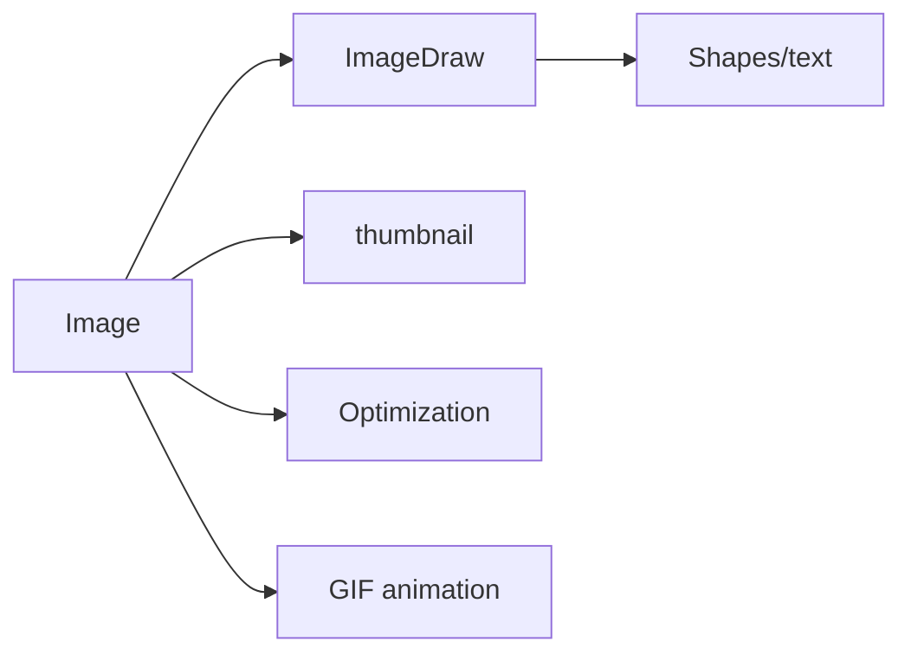

Pillow is the standard Python library for working with images. In this lesson we move up from basic operations to drawing, animation and optimization.

## Drawing: ImageDraw

```python
from PIL import Image, ImageDraw

img = Image.new("RGB", (400, 300), "white")
draw = ImageDraw.Draw(img)
draw.rectangle([50, 50, 200, 150], fill="blue", outline="black")
draw.ellipse([250, 50, 350, 150], fill="red")
draw.line([0, 0, 399, 299], fill="green", width=3)
img.save("shapes.png")
```

## Text and fonts

`ImageDraw.text` takes a position, text and a `ImageFont.truetype` font:

```python
font = ImageFont.truetype("DejaVuSans.ttf", 32)
draw.text((20, 20), "Hello!", fill="black", font=font)
```

## Thumbnails and resize

`img.thumbnail((300, 300))` resizes proportionally and never enlarges.

## Animation: saving GIF

```python
frames = []
for i in range(6):
    frame = Image.new("RGB", (200, 200), (i * 40, 100, 200))
    frames.append(frame)
frames[0].save("anim.gif", save_all=True, append_images=frames[1:],
               duration=100, loop=0)
```

## Optimization

- JPEG: `img.save("a.jpg", quality=85, optimize=True)`.
- PNG: `pngquant` or P mode/palette.
- Check: compare file sizes.

## Lesson summary

Pillow covers a wide range of tasks: from simple thumbnails to meme generation and GIF animations with quality control.



## Practical use

Pillow covers everyday tasks: resizing and thumbnails for websites, creating cards and memes, photo artifact cleanup, banner generation. Together with OCR and archiving it forms whole image processing pipelines. Understanding formats (JPEG/PNG/GIF) helps consciously choose quality and file size.

For mass processing remember memory: large images should be opened lazily and reduced to the needed size. In batch work use multithreading (CPU tasks — threads, heavy filters — processes). It's also useful to check format and mode before saving so conversion doesn't lose quality.

<!--TASK-->
### Task 1 — Open and inspect
Create a 300×200 image with a gradient (by generating pixels with Image.new and putpixel) and save it. Print size and mode.

### Task 2 — Geometric shapes
Draw an image with a rectangle, ellipse and line; save it. Check that the file exists and its size is greater than zero.

### Task 3 — Meme with text
Create a 600×400 image, draw an oval/rectangle and a caption in the center with a large font. Save it. (If no TTF — use ImageFont.load_default(size=...)).

### Task 4 — Thumbnail
Take any 800×600 image (create it), apply thumbnail((200, 200)). Make sure dimensions ≤ 200 and proportions are preserved.

### Task 5 — Conversion and optimization
Save the same image as PNG and JPEG quality=60, optimize=True. Compare sizes and print them.

### Task 6 — GIF animation
Create 8 frames (changing color/circle position) and save the animation. Check the frame count via Image.open + n_frames.

### Task 7 — Batch processing
Write a function that creates 300×300 thumbnails for all PNGs in a folder into a thumbs/ subfolder. Print the list of created files.
<!--/TASK-->

<!--HINT-->
### Hint 1
putpixel((x, y), (r, g, b)) — per-pixel drawing; use a double loop.

### Hint 2
ImageDraw.Draw(img) — one object for all shapes.

### Hint 3
ImageFont.truetype("DejaVuSans.ttf", 40); center coordinates via textlength() or getbbox().

### Hint 4
thumbnail shrinks but never enlarges; aspect ratio is preserved.

### Hint 5
os.path.getsize("a.png") and getsize("a.jpg").

### Hint 6
save_all=True, append_images=..., duration=100, loop=0.

### Hint 7
glob.glob("*.png"); create thumbs/; save with the same name.
<!--/HINT-->

<!--SOLUTION-->
### Walkthrough 1
```python
from PIL import Image

img = Image.new("RGB", (300, 200))
for x in range(300):
    for y in range(200):
        img.putpixel((x, y), (x * 255 // 299, y * 255 // 199, 100))
img.save("gradient.png")
print(img.size, img.mode)
```
A simple horizontal and vertical gradient.

### Walkthrough 2
```python
from PIL import Image, ImageDraw

img = Image.new("RGB", (400, 300), "white")
d = ImageDraw.Draw(img)
d.rectangle([20, 20, 180, 150], fill="blue")
d.ellipse([220, 40, 360, 160], fill="red")
d.line([0, 0, 399, 299], fill="green", width=5)
img.save("shapes.png")
```
All primitives on one canvas.

### Walkthrough 3
```python
from PIL import Image, ImageDraw, ImageFont

img = Image.new("RGB", (600, 400), "white")
d = ImageDraw.Draw(img)
d.rectangle([50, 100, 550, 300], fill="yellow", outline="black", width=5)
font = ImageFont.truetype("DejaVuSans.ttf", 48)
text = "Hello, Python!"
bbox = d.textbbox((0, 0), text, font=font)
w = bbox[2] - bbox[0]
h = bbox[3] - bbox[1]
d.text(((600 - w) // 2, (400 - h) // 2), text, fill="black", font=font)
img.save("meme.png")
```
The text is centered by image dimensions; if TTF is absent — ImageFont.load_default(48).

### Walkthrough 4
```python
from PIL import Image

img = Image.new("RGB", (800, 600), "gray")
img.thumbnail((200, 200))
print(img.size)  # ≤ 200 in both axes
```
Proportions are preserved; 800×600 → ~200×150.

### Walkthrough 5
```python
from PIL import Image
import os

img = Image.new("RGB", (400, 400))
img.save("a.png")
img.save("a.jpg", quality=60, optimize=True)
print(os.path.getsize("a.png"), os.path.getsize("a.jpg"))
```
Optimized JPEG is almost always smaller than PNG (for photos).

### Walkthrough 6
```python
from PIL import Image

frames = []
for i in range(8):
    f = Image.new("RGB", (200, 200), (i * 30, 100, 255 - i * 20))
    frames.append(f)
frames[0].save("anim.gif", save_all=True, append_images=frames[1:],
               duration=100, loop=0)

im = Image.open("anim.gif")
print(im.n_frames)  # 8
```
A multi-frame GIF opens with n_frames frames.

### Walkthrough 7
```python
from PIL import Image
from pathlib import Path

src = Path(".")
thumbs = src / "thumbs"
thumbs.mkdir(exist_ok=True)

for p in src.glob("*.png"):
    im = Image.open(p)
    im.thumbnail((300, 300))
    im.save(thumbs / p.name)
    print(thumbs / p.name)
```
All PNGs become thumbnails in the subfolder.
<!--/SOLUTION-->

<!--QUIZ-->
Which class draws shapes?
- ImageDraw
- ImageFont
- ImageFilter
- ImageOps
* Correct answer: ImageDraw
Draw(img) adds primitives.

How to load a font?
- ImageFont.truetype("...ttf", size)
- Image.open
- Image.new
- ImageDraw.textFont
* Correct answer: ImageFont.truetype("...ttf", size)
There is a standard font.

What does thumbnail do?
- Shrinks preserving proportions
- Crops
- Always enlarges
- Changes format
* Correct answer: Shrinks preserving proportions
Never enlarges and never distorts.

How to save an animation?
- save_all=True, append_images=...
- save(..., gif=True)
- export_animation
- add_frame
* Correct answer: save_all=True, append_images=...
First frame + the rest.

What optimizes JPEG?
- The quality parameter and optimize=True
- Only PNG
- Loading speed
- Transparency
* Correct answer: The quality parameter and optimize=True
Smaller size at acceptable quality.

How to find out the number of GIF frames?
- im.n_frames
- len(im)
- im.size
- im.mode
* Correct answer: im.n_frames
A property of an opened multi-frame file.

Which function creates an empty image?
- Image.new
- Image.open
- ImageDraw
- ImageFont
* Correct answer: Image.new
size and mode are specified.

What does putpixel do?
- Sets the color of one pixel
- Saves the image
- Creates a color
- Deletes a pixel
* Correct answer: Sets the color of one pixel
Useful for generation.

How to get text width?
- Via bbox or textlength
- String length
- Via size
- Via font.height
* Correct answer: Via bbox or textlength
For centering text.

Which method resizes preserving proportions?
- thumbnail
- resize
- crop
- rotate
* Correct answer: thumbnail
resize distorts at arbitrary sizes.
What does getbbox do?
- Returns text bounds for centering
- Changes color
- Saves
- Deletes
* Correct answer: Returns text bounds for centering
Coordinates for positioning.

Which parameter sets PNG transparency?
- RGBA mode
- JPG
- L
- 1
* Correct answer: RGBA mode
The fourth channel is alpha.


<!--/QUIZ-->
