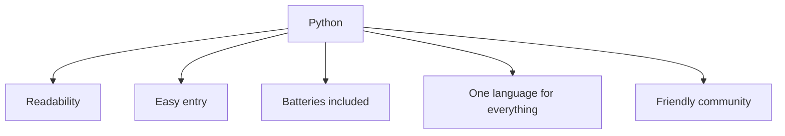

There are languages that earn respect. There are languages you obey. And then there is a language people love — and that language is Python. In this lesson, we begin a conversation about why millions of people around the world call it their favorite. This isn't marketing and it isn't hype: almost every Python developer has their own story of a first encounter — the moment when code suddenly started to read like English text rather than cipher.

## The main thing: Python reads well

Let's start with the most important point. Here is a program:

```python
name = "Anna"
age = 25
print("Hello, my name is", name, "and I am", age)
```

Even a person who has never programmed in their life roughly understands what is going on here. This readability is no small thing. Real programs live for years, dozens of different people read them, and far more time is spent reading code than writing it. Python makes this process almost enjoyable: the code looks like an instruction in English with minimal syntax.

## Easy to get started

The second reason people love Python is how easy the first step is. To begin, you don't need to understand pointers, garbage collection, operator overloading, or compiler architecture. You can write your first useful program on the very first evening. Compare: in C, the same "Hello, world" takes four lines with angle brackets, while here it's a single line. And if something goes wrong, Python's error messages are clear and friendly: they tell you exactly what's wrong and where.

```python
print("Hello, world!")
```

## "Batteries included"

Third is the batteries included principle. Python's standard library can handle files, archives, dates, the internet, math, testing, and even email. All of this is available out of the box, with nothing extra to install. For many tasks you don't need to install a single third-party library — just open the standard library documentation.

## Versatility: one language for everything

Fourth is versatility. The same language is used for automating routine work, building websites, analyzing data, artificial intelligence, games, scientific computing, and robotics. You can switch career directions or hobbies without switching languages. This is a rare gift: time invested in Python never goes to waste.

```python
# The same print function comes in handy everywhere
print("Automation, analytics, web, AI — all of this is Python")
```

## The people

And finally — the people. Python has one of the friendliest communities in the world. Beginners get help, nobody laughs at "silly" questions, and documentation and tutorials exist in every language, including Russian. Every year this community holds PyCon conferences in dozens of countries, and the internet is full of chats where someone will answer you even at three in the morning.

Let's gather all the reasons for loving Python into one diagram:



We won't rush. This module is about the soul of the language. Ahead: why elegant code is a skill, not a luxury; the Zen of Python; amazing features worth opening the docs for; and soul projects you'll want to show your friends.

And so you can feel the warmth right now, run this in your environment:

```python
# The first program of the "Soul of Python" module
print("I'm beginning to understand why people love Python")
```

If you see this line on your screen — congratulations, you are officially welcomed into the ranks of Python lovers. 💛 Now let's cement the love with practice.

<!--TASK-->
### Task 1
Write a program that introduces us to you. Create three variables: `name` (your name), `favorite_thing` (what you love doing), and `dream` (your dream). Then print three lines, using the variables inside `print()` calls — for example, with commas: `print("My name is", name)`. As a result, exactly three lines should appear on the screen: a greeting with your name, a phrase about your favorite activity, and a phrase about your dream. Run the program and make sure everything prints without extra characters.

### Task 2
Write a greeting program. First ask the user to enter their name with `input("What's your name? ")` and save the result in a variable. Then print a personalized greeting, for example: `Hello, Anna! Welcome to the world of Python!`. After that, ask what the user loves doing (another `input`), and print a phrase like `Awesome that you love drawing!`. Expected result: the program waits for input, then prints two lines with the user's name and activity.

### Task 3
Write a "fact calculator" program. Calculate and print four facts with captions: how many hours are in a week (7 * 24), how many minutes are in a day (24 * 60), how many seconds are in an hour (60 * 60), and how many days are in a regular year (365). Print each fact on its own line with a caption, for example: `There are 168 hours in a week`. Use a separate `print()` call for each fact and compute the numbers right inside `print()`.

### Task 4
Fix the errors. The code below won't run:

```python-error
print("Hello, world!)
print("My name is" Anna)
Print("This is not Python")
```

Copy it into a file `fix_love.py`, run it, and read the error messages. Then fix all three lines so the program runs and prints three lines: `Hello, world!`, `My name is Anna`, and `This is not C — this is Python!`. At the end of the file, add a comment explaining what was wrong with each line.

### Task 5
Create a "love letter to Python" poster — a program with three lines you print to the screen. Build the first line from several values separated by commas inside one `print()`. Build the second line from two parts using the `+` sign (don't forget spaces). Make the third line with numbers and variables. Accompany each line with a `#` comment explaining what it does. Run it and make sure comments don't print.

### Task 6
Write a "Language Dossier" program. Create three variables: `language = "Python"`, `year = 1991`, and `author = "Guido van Rossum"`. Compute the language's age in 2026 in the variable `age = 2026 - year`, and print four lines: the name, the creator, the year of birth, and the age. Print each line with its own `print()`, substituting the variables. Build the last line with the `+` sign, converting the number to a string with the `str(age)` function. Expected output:

```text
Language: Python
Creator: Guido van Rossum
Year of birth: 1991
In 2026, Python will turn 35
```

Check that the output has no stray quotes and that the word Python is capitalized.

### Task 7
Write a "Three Questions" introduction program. Ask the user for their name, city, and favorite book with three `input()` calls and save the answers in variables `name`, `city`, `book`. Then print one final line assembled from these variables and text, for example: `Anna from Moscow recommends the book "The Little Prince"`. Use `print()` with several arguments separated by commas, and at the end add the phrase `— nice to meet you!`. Expected result: the program waits for three inputs and prints one line in which the name comes first, the city after the word "from", and the book title in quotes. Check that the word order matches the example.

<!--/TASK-->

<!--HINT-->
### Hint 1
A value is assigned to a variable with `=`: `name = "Anna"`. To use it in `print()`, pass the variable name without quotes: `print("My name is", name)`. If you put quotes around `name`, the word name will be printed instead of its value.

### Hint 2
`input("Question: ")` pauses the program, waits until the user types text and presses Enter, then returns the entered string. Save the result: `name = input("What's your name? ")`. Then use `name` in `print()` like any ordinary variable.

### Hint 3
You can write expressions right inside `print()`: `print("There are", 7 * 24, "hours in a week")`. Python first computes `7 * 24`, then prints everything separated by spaces. Write four facts with four `print()` calls.

### Hint 4
Look carefully at each line: the first is missing a closing quote, the second is missing a `+` sign between the string and the variable, and the third uses `Print` (with a capital P) instead of `print`. Fix these three things and add an explanatory comment.

### Hint 5
A comma in `print()` inserts spaces for you, while the `+` sign only puts them where you wrote them yourself. A comment starts with `#` and runs to the end of the line. Example: `# This line is about loving Python` above a `print()` call.

### Hint 6
First compute `age = 2026 - 1991` — you get 35. A number cannot be glued to a string with `+`: Python will raise `TypeError`. So convert it with the `str(age)` function. The first three lines are easier to print with commas: `print("Language:", language)` — the comma inserts a space between values automatically.

### Hint 7
`input()` returns a string, so the answers can be plugged into `print()` right away. Write it like this: `name = input("What's your name? ")`, then `city = input("Where are you from? ")` and `book = input("Favorite book? ")`. In the final line use commas: `print(name, "from", city, ...)` — each argument is separated by a space automatically.

<!--/HINT-->

<!--SOLUTION-->
### Walkthrough 1
One possible solution:

```python
name = "Anna"
favorite_thing = "reading books"
dream = "writing my own program"

print("My name is", name)
print("I love", favorite_thing)
print("My dream is", dream)
```

Result:

```
My name is Anna
I love reading books
My dream is writing my own program
```

What's happening here? We created three variables and stored strings in them. Then we passed the variables to `print()` separated by commas: Python substituted their values instead of the names. Notice: variables are passed without quotes — otherwise the word `name` would print instead of `Anna`. This technique — variables instead of repeated text — is the foundation of any program: information is stored in one place and used across many lines.

### Walkthrough 2
Solution:

```python
name = input("What's your name? ")
print("Hello,", name, "! Welcome to the world of Python!")

activity = input("What do you love doing? ")
print("Awesome that you love", activity, "!")
```

Result (if the user enters `Anna` and `drawing`):

```
What's your name? Anna
Hello, Anna ! Welcome to the world of Python!
What do you love doing? drawing
Awesome that you love drawing !
```

What's happening here? `input()` waits for keyboard input and returns a string. We store it in the variable `name`, then use it in `print()`. Notice the spaces: in `print("Hello,", name, "! ...")` an extra space will appear between the comma and `name` before `!` — that's normal for a first attempt, and in the next lesson you'll learn how to join strings more elegantly. The main thing here is the dialog with the user: the program becomes interactive.

### Walkthrough 3
Solution:

```python
print("There are", 7 * 24, "hours in a week")
print("There are", 24 * 60, "minutes in a day")
print("There are", 60 * 60, "seconds in an hour")
print("There are", 365, "days in a regular year")
```

Result:

```
There are 168 hours in a week
There are 1440 minutes in a day
There are 3600 seconds in an hour
There are 365 days in a regular year
```

What's happening here? Inside `print()` we write arithmetic expressions directly in the arguments. Python first computes `7 * 24`, gets `168`, and only then prints all the values separated by spaces. Computing right inside `print()` is convenient for short programs, but in larger projects the result is usually saved into variables so it can be reused several times.

### Walkthrough 4
Fixed code:

```python
print("Hello, world!")
print("My name is", "Anna")
print("This is not C — this is Python!")
```

Result:

```
Hello, world!
My name is Anna
This is not C — this is Python!
```

What's happening here? The original code had three errors. The first line had no closing quote — Python raised `SyntaxError: unterminated string literal` because it couldn't tell where the text ended. The second line was missing a comma or `+` sign between the string and the value — Python expected the expression to continue. The third line used `Print` with a capital P instead of `print` — Python couldn't find such a function and raised `NameError: name 'Print' is not defined`. All three errors are among the most common for beginners, and now you know how to read and fix them. Remember: the error text almost always hints at what exactly is wrong.

### Walkthrough 5
Solution:

```python
# A line from several values separated by commas
print("I love Python for", "readability", "and", "simplicity")

# A line assembled from parts with +
print("Python is " + "a language for the soul")

# A line with numbers and variables
year = 1991
print("Python appeared in", year)
```

Result:

```
I love Python for readability and simplicity
Python is a language for the soul
Python appeared in 1991
```

What's happening here? In the first call, commas make `print()` insert spaces between values automatically. In the second, the `+` sign glues two strings into one, and the space is preserved only because we wrote it ourselves at the end of the first part. In the third, we use the variable `year` with a number. Comments `#` are completely ignored by Python: they exist only for people reading the code. This kind of poster is a great way to remember that statements about a program are best kept in variables, and text is best assembled from understandable parts.

### Walkthrough 6
Solution:

```python
language = "Python"
year = 1991
author = "Guido van Rossum"
age = 2026 - year

print("Language:", language)
print("Creator:", author)
print("Year of birth:", year)
print("In 2026 " + language + " will turn " + str(age) + " years")
```

Result:

```
Language: Python
Creator: Guido van Rossum
Year of birth: 1991
In 2026 Python will turn 35 years
```

What's happening here? We set up four variables and computed the age once: `2026 - year` became `35`. The `age` value is then used in the output, and if you need a different year tomorrow, you only have to change one line. The first three `print()` calls get values via commas — Python inserts spaces itself. The last line shows another approach: the `+` sign joins strings tightly, so spaces are placed manually, and the number is necessarily wrapped in `str(age)`. Without `str()`, Python would try to add a string and an integer and raise `TypeError`. Compare the two ways: commas are handier for quick output, while `+` gives you full control over spaces and the shape of the phrase.

### Walkthrough 7
Solution:

```python
name = input("What's your name? ")
city = input("Where are you from? ")
book = input("What's your favorite book? ")

print(name, "from", city, "recommends the book", "\"" + book + "\"", "— nice to meet you!")
```

Result (if you enter `Anna`, `Moscow`, `The Little Prince`):

```
What's your name? Anna
Where are you from? Moscow
What's your favorite book? The Little Prince
Anna from Moscow recommends the book "The Little Prince" — nice to meet you!
```

What's happening here? Each `input()` shows a prompt, waits for input, and returns a string — so the answers land directly in the variables `name`, `city`, and `book`. In the final `print()` we mix two techniques: commas separate the ready-made pieces of the phrase and add spaces automatically, while `+` glues the book title to the quotes so the quotes sit flush against the text. If we wrote `print(name, "from", city, "recommends the book", book)` without the surrounding quotes, the title would blend awkwardly into the neighboring words. The program doesn't validate empty input — that's fine for a first introduction: the important thing is that the dialog works and the line is built from live data rather than pre-made text.

<!--/SOLUTION-->

<!--QUIZ-->
Why is Python considered a readable language?
- The code resembles English text and is easy to understand without extra syntax
- It only works in the English language
- It can only be read aloud
* Correct answer: The code resembles English text and is easy to understand without extra syntax
Python is chosen because programs read almost like a natural language.

What does the "batteries included" principle mean?
- Python ships with a rich standard library
- Python requires installing many third-party libraries
- Python only works on battery power
* Correct answer: Python ships with a rich standard library
"Batteries included" means much of what you need is already in the standard library.

Which command outputs text to the screen?
- print()
- input()
- eval()
* Correct answer: print()
print() prints the given values to the terminal.

What will this code output: print("Hello", "world")?
- Helloworld
- Hello world
- An error
* Correct answer: Hello world
Values passed with commas are printed separated by spaces.

Which function lets the user enter text from the keyboard?
- input()
- print()
- open()
* Correct answer: input()
input() stops the program, waits for input, and returns the entered string.

What happens if you forget a closing quote in a string?
- The program prints the string without quotes
- Python raises a SyntaxError
- The program adds the quote automatically
* Correct answer: Python raises a SyntaxError
Python can't tell where the string ends and reports a syntax error.

Why do we need variables?
- To store values and refer to them by name
- To decorate the code
- To speed up the computer
* Correct answer: To store values and refer to them by name
Variables let you store data and reuse it in different parts of the program.

Where can Python be applied?
- In automation, web, data analysis, and AI
- Only for calculators
- Only on Google servers
* Correct answer: In automation, web, data analysis, and AI
Python is versatile: from scripts to neural networks and games.

What will the code print("My name is", "Anna") do?
- Prints: My name is Anna
- Prints: My name is"Anna
- Raises an error because there are two values
* Correct answer: Prints: My name is Anna
A comma in print() separates values and prints them with a space.

Which symbol starts a comment in Python?
- #
- //
- /*
* Correct answer: #
Everything after # to the end of the line is ignored by Python.
What will print("Python", 1991) output?
- Python 1991
- Python1991
- An error
* Correct answer: Python 1991
A comma in print() separates arguments and prints them with a space.

Why is the str() function needed when joining a string and a number with +?
- To convert the number into a string
- To round the number
- To print the number on a separate line
* Correct answer: To convert the number into a string
The + operator only joins strings, so the number must first be turned into a string.

What will the expression 7 * 24 return?
- 168
- 31
- 168.0
* Correct answer: 168
Multiplying two integers gives an integer — the number of hours in a week.

What data type does input() return?
- str
- int
- list
* Correct answer: str
input() always returns a string, even if the user typed digits.
<!--/QUIZ-->
