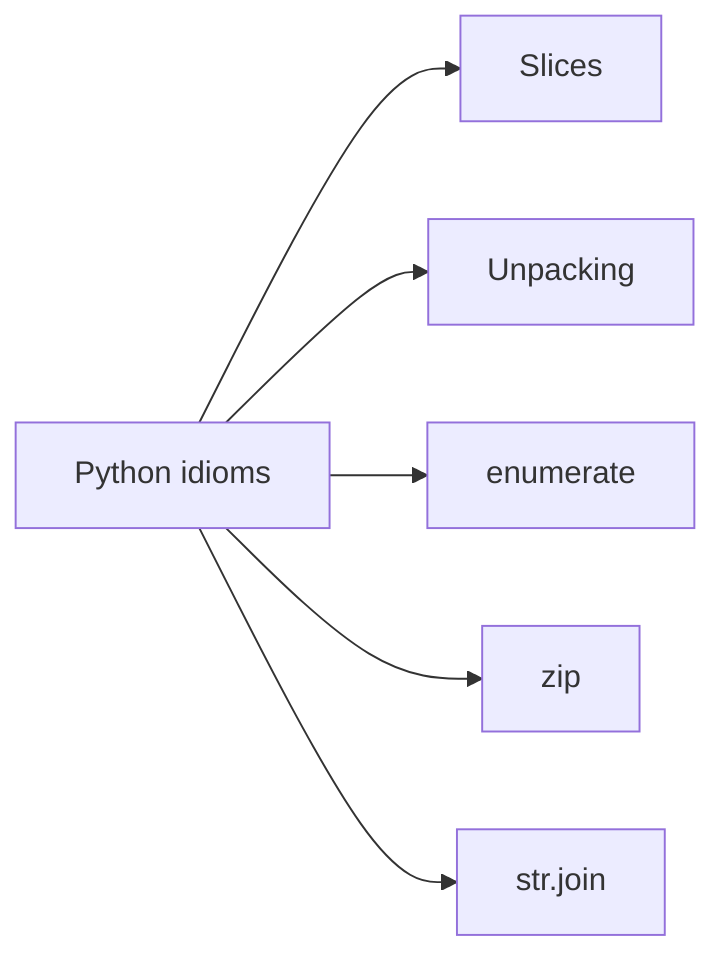

There are two ways to solve a problem in Python: just solve it, and solve it beautifully. Pythonic code is not convoluted code — quite the opposite: it's minimal, clear, and reads like an English sentence. Today we'll look at idioms — established expressive techniques that an experienced developer's eye recognizes instantly.

## Slices: the guitar of the language

A slice lets you take part of a sequence: a list, a string, a tuple. The format is `sequence[start:end:step]`:

```python
digits = [0, 1, 2, 3, 4, 5, 6, 7, 8, 9]
print(digits[2:5])    # [2, 3, 4] — from index 2 to 5 (exclusive)
print(digits[:4])     # [0, 1, 2, 3] — from the start
print(digits[7:])     # [7, 8, 9] — to the end
print(digits[::2])    # [0, 2, 4, 6, 8] — every second element
print(digits[::-1])   # [9, 8, ..., 0] — reversed!
```

A string is also a sequence, so slices work with it too:

```python
word = "palindrome"
print(word[::-1])  # "emordnilap"
```

## Unpacking: the magic of the equals sign

If several names separated by commas appear to the left of `=`, Python unpacks the sequence:

```python
x, y = 3, 4
print(x, y)  # 3 4

a, b = b, a  # swap values without a third variable
```

It's especially pleasant to unpack pairs from lists of tuples:

```python
points = [(1, 2), (3, 4), (5, 6)]
for x, y in points:
    print("Point:", x, y)
```

And the asterisk `*` collects the "remainder":

```python
first, *rest = [10, 20, 30, 40]
print(first)  # 10
print(rest)   # [20, 30, 40]
```

## enumerate and zip: friends of loops

A common pain point: you need not just the element but also its index. `enumerate` solves this in one line:

```python
fruits = ["apple", "banana", "cherry"]
for index, fruit in enumerate(fruits, start=1):
    print(index, fruit)
# 1 apple
# 2 banana
# 3 cherry
```

And `zip` pairs up several sequences into tuples (or triples):

```python
names = ["Anna", "Borya", "Vera"]
scores = [92, 87, 95]
for name, score in zip(names, scores):
    print(name, score)
# Anna 92
# Borya 87
# Vera 95
```

If the lists have different lengths, `zip` stops at the shortest one. That's often exactly what you need.

## Building strings properly

Concatenating strings in a loop is an anti-pattern. The Pythonic way is `str.join`:

```python
words = ["beauty", "of", "code", "in", "simplicity"]
sentence = " ".join(words)
print(sentence)  # beauty of code in simplicity
```

## Other little joys

- `text.strip()` removes extra whitespace at the edges;
- `list.index(x)` finds the index of an element;
- `"a" in text` checks for membership — it reads like a sentence;
- `dict.get(key, default)` safely fetches a value from a dictionary.

The diagram shows which idioms cover which tasks:



None of this is ornament. When you write "the way it's done," other Python developers understand your code at first glance, and when you return to a project after six months, you spend three times less effort reconstructing your own thoughts. Here, beauty is a synonym for clarity.

Now try applying the idioms yourself — each task below is solved in a few lines.

<!--TASK-->
### Task 1
Given the list of numbers `numbers = [10, 20, 30, 40, 50, 60]`. Using slices, print: 1) the first three elements; 2) the last two elements; 3) the elements at even indexes (0th, 2nd, 4th); 4) the whole list in reverse order. Use a separate `print()` call for each result. Expected output: four lines — `[10, 20, 30]`, `[50, 60]`, `[10, 30, 50]`, and `[60, 50, 40, 30, 20, 10]`. Don't use loops — only slices.

### Task 2
Write a program that swaps the values of two variables `a` and `b` without a third variable. First assign them any numbers (for example, `a = 5`, `b = 7`), print them before the swap, then perform the swap and print after. Expected output: `Before: a = 5, b = 7` and `After: a = 7, b = 5`. Use tuple unpacking in one line.

### Task 3
Given the list of students `students = ["Anna", "Borya", "Vera", "Gosha"]`. Print each student with their position in the list, starting from 1, in the format `1. Anna`. Use `enumerate` with the `start` parameter. Expected output: four lines like `1. Anna`, `2. Borya`, and so on. No manual counters!

### Task 4
Two lists are given: `names = ["Anna", "Borya", "Vera"]` and `scores = [92, 87, 95]`. Join them with `zip` and print each pair in the format `Anna — 92 points`. Expected output: three lines, one per student. After that, pass `zip` to `list()` and confirm you get a list of tuples — print it too.

### Task 5
Here's "school-style" code that builds a string from words in a loop:

```python
words = ["Python", "is", "beautiful"]
result = ""
for word in words:
    result = result + word + " "
print(result)
```

Make sure it works (a trailing space remains at the end). Rewrite it with `str.join` so the result is `Python is beautiful` without a trailing space. Print the result. Then add one more line: remove trailing whitespace from the text with `strip()` and print the length of the final string.

### Task 6
Write a "palindrome detector" program. The function `is_palindrome(text)` should convert the string to lowercase (`lower()`), remove spaces (`replace(" ", "")`), and compare the result with its reversed copy obtained via the `[::-1]` slice. Test the function on three phrases: `"never odd or even"`, `"Python"`, and `"racecar"`. Expected output:

```text
never odd or even — palindrome
Python — not a palindrome
racecar — palindrome
```

Choose the answer with a ternary expression right inside `print()`, without separate `if/else`. Explain in a comment why `lower()` and `replace()` are needed.

### Task 7
Given the list of names `names = ["Anna", "Borya", "Vera", "Gosha"]` and the list of scores `scores = [92, 87, 95, 78]`. Pair them with `zip`, sort the result by score descending with `sorted(..., key=lambda pair: pair[1], reverse=True)`, and print the ranking with place numbers via `enumerate(..., start=1)`. Expected output:

```text
1. Vera — 95
2. Anna — 92
3. Borya — 87
4. Gosha — 78
Winner: Vera — 95 points
```

Build the last line by taking the first element of the sorted list and unpacking it into two variables. No manual counters or `while` loops.

<!--/TASK-->

<!--HINT-->
### Hint 1
The slice format is `list[start:end:step]`. Start, end, or step can be omitted. For the first three elements: `numbers[:3]`; for the last two: `numbers[-2:]`; for even indexes: `numbers[::2]`; for reversing: `numbers[::-1]`.

### Hint 2
Unpacking works both to the right and to the left of the `=` sign. The line `a, b = b, a` evaluates the right side `(b, a)`, then assigns the values to the left. That's the whole swap.

### Hint 3
`enumerate(students, start=1)` returns pairs `(index, element)`. Unpack them in a loop: `for number, student in enumerate(students, start=1):` and print inside with an f-string or several values.

### Hint 4
`zip(names, scores)` yields pairs like `("Anna", 92)` and so on. In the loop, unpack the pair: `for name, score in zip(names, scores):`. For the second output, wrap `zip` in `list()`: `list(zip(names, scores))` — you'll get a list of tuples.

### Hint 5
`" ".join(words)` joins the list elements with a space — the space is specified once before `join`, not in every word. No trailing space needs to be added: join doesn't create one. You can get the string length with `len(result)`.

### Hint 6
The `[::-1]` slice returns a reversed copy of the string, while `lower()` and `replace(" ", "")` bring the text to a comparable form: case and spaces must not interfere. Compare the two strings with `==`. It's convenient to choose the answer with a ternary expression right in `print()`: `"palindrome" if is_palindrome(phrase) else "not a palindrome"`.

### Hint 7
`zip(names, scores)` gives pairs, and `sorted(..., key=lambda pair: pair[1], reverse=True)` sorts them by the second element — the score — from largest to smallest. In the loop write `for place, (name, score) in enumerate(ranking, start=1):` — the parentheses around the pair are required, that's how a nested tuple is unpacked.

<!--/HINT-->

<!--SOLUTION-->
### Walkthrough 1
Solution:

```python
numbers = [10, 20, 30, 40, 50, 60]

print(numbers[:3])
print(numbers[-2:])
print(numbers[::2])
print(numbers[::-1])
```

Result:

```
[10, 20, 30]
[50, 60]
[10, 30, 50]
[60, 50, 40, 30, 20, 10]
```

What's happening here? The slice `numbers[:3]` takes elements from the start up to index 3 (exclusive) — that's the first three numbers. `numbers[-2:]` uses negative indexes: `-2` is the second element from the end, and from it to the end — the last two. `numbers[::2]` has step 2, so we take every second element. `numbers[::-1]` has a negative step: the list is traversed from the end, giving us the reverse. Notice: none of the slices modify the list itself — they create a new one. That's safe and predictable.

### Walkthrough 2
Solution:

```python
a, b = 5, 7
print("Before: a =", a, ", b =", b)

a, b = b, a
print("After: a =", a, ", b =", b)
```

Result:

```
Before: a = 5 , b = 7
After: a = 7 , b = 5
```

What's happening here? The line `a, b = b, a` is a Python classic — true tuple magic. Python first evaluates the right side: it builds the tuple `(b, a)` with the old values, that is `(7, 5)`. Then it unpacks it into the variables on the left: `a` gets `7`, and `b` gets `5`. No third variable, no temporary value! In other languages such a swap needs a helper variable and three lines of code — here it's one line that reads like an equation.

### Walkthrough 3
Solution:

```python
students = ["Anna", "Borya", "Vera", "Gosha"]

for number, student in enumerate(students, start=1):
    print(f"{number}. {student}")
```

Result:

```
1. Anna
2. Borya
3. Vera
4. Gosha
```

What's happening here? `enumerate` returns "index, element" pairs. Without the `start` parameter the numbering would start at zero, but we told it to start at one. In the loop we immediately unpack the pair into `number` and `student`. This replaces a manual counter `i = 0` with a subsequent `i += 1` — the classic place where it's easy to forget to increment. The f-string `f"{number}. {student}"` neatly substitutes values into the string — more on it in later lessons, but you can appreciate its convenience already now.

### Walkthrough 4
Solution:

```python
names = ["Anna", "Borya", "Vera"]
scores = [92, 87, 95]

for name, score in zip(names, scores):
    print(f"{name} — {score} points")

paired = list(zip(names, scores))
print(paired)
```

Result:

```
Anna — 92 points
Borya — 87 points
Vera — 95 points
[("Anna", 92), ("Borya", 87), ("Vera", 95)]
```

What's happening here? `zip` pairs the elements of two lists: first elements first, then second, and so on. In the loop we unpack each pair into `name` and `score`. The second part of the task shows another technique: if you wrap `zip` in `list()`, you get a list of tuples — the pairs can be saved and reused later. `zip` is the ideal tool when data is spread across parallel lists and needs to be brought together.

### Walkthrough 5
Solution:

```python
words = ["Python", "is", "beautiful"]
result = " ".join(words)
print(result)

print(len(result))
```

Result:

```
Python is beautiful
19
```

What's happening here? The original code worked, but it built the string in a loop with `+`, adding a space after each word — which left a trailing space at the end. The method `" ".join(words)` does everything in one step: it takes the separator (a space) and inserts it between the list elements, adding nothing at the end. The string comes out exactly as intended. `len(result)` shows the length — 19 characters. `join` is not only prettier but also faster: it doesn't create dozens of intermediate strings the way `+` in a loop does. This is a case where beauty and performance go hand in hand.

### Walkthrough 6
Solution:

```python
def is_palindrome(text):
    clean = text.lower().replace(" ", "")
    return clean == clean[::-1]

for phrase in ["never odd or even", "Python", "racecar"]:
    print(phrase, "—", "palindrome" if is_palindrome(phrase) else "not a palindrome")
```

Result:

```
never odd or even — palindrome
Python — not a palindrome
racecar — palindrome
```

What's happening here? The function first normalizes the string: `lower()` equalizes uppercase and lowercase letters, and `replace(" ", "")` removes spaces that would break the comparison. Then `clean[::-1]` creates a reversed copy — the same technique from the theory. The `==` comparison returns `True` or `False`, and the ternary expression in `print()` turns it into a human-readable answer without extra branching. Notice: the original string is not modified — strings in Python are immutable, and every method returns a new one. If we forgot `lower()`, a phrase with capital letters wouldn't count as a palindrome even though the letters match.

### Walkthrough 7
Solution:

```python
names = ["Anna", "Borya", "Vera", "Gosha"]
scores = [92, 87, 95, 78]

pairs = list(zip(names, scores))
ranking = sorted(pairs, key=lambda pair: pair[1], reverse=True)

for place, (name, score) in enumerate(ranking, start=1):
    print(f"{place}. {name} — {score}")

winner, best = ranking[0]
print("Winner:", winner, "—", best, "points")
```

Result:

```
1. Vera — 95
2. Anna — 92
3. Borya — 87
4. Gosha — 78
Winner: Vera — 95 points
```

What's happening here? `zip` merges two parallel lists into "name — score" pairs, and `list()` saves them so they can be sorted more than once. `sorted` doesn't modify the original list; it returns a new one; `key=lambda pair: pair[1]` says the pairs should be compared by their second elements — the scores — and `reverse=True` puts the best first. In the loop, `enumerate` provides the place number, and the parentheses `(name, score)` unpack the pair itself — without them Python would try to assign the whole tuple to a single name. Finally, `winner, best = ranking[0]` is ordinary unpacking of the first element. Such a ranking is the basis for leaderboards, tournaments, and dashboards.

<!--/SOLUTION-->

<!--QUIZ-->
Which slice will reverse the numbers list?
- numbers[::-1]
- numbers[::1]
- numbers[1::]
* Correct answer: numbers[::-1]
A negative step of -1 traverses the list from the end.

What will print(digits[2:5]) output for digits = [0, 1, 2, 3, 4, 5]?
- [2, 3, 4]
- [1, 2]
- [2, 3, 4, 5]
* Correct answer: [2, 3, 4]
The slice takes elements from index 2 up to index 5, excluding it.

What does the line a, b = b, a do?
- Swaps the values of a and b
- Copies a into b
- Raises an error
* Correct answer: Swaps the values of a and b
The right side builds the tuple (b, a), which is unpacked back into a and b.

What does enumerate(data, start=1) return?
- Pairs (index, element), starting with index 1
- Only the elements, without indexes
- Indexes starting at 0
* Correct answer: Pairs (index, element), starting with index 1
enumerate yields "index, element" pairs, and start=1 sets the initial index.

What does zip(list1, list2) do?
- Pairs the elements of two lists
- Merges the lists into one
- Sorts the lists
* Correct answer: Pairs the elements of two lists
zip walks the parallel lists and forms tuples from elements with the same indexes.

What will print(" ".join(["a", "b", "c"])) output?
- a b c
- abc
- a,b,c
* Correct answer: a b c
join inserts the separator string (a space) between the list elements.

What happens if zip receives lists of different lengths?
- It stops at the length of the shortest list
- It raises an error
- It pads the lists with empty values
* Correct answer: It stops at the length of the shortest list
zip finishes as soon as the short list runs out.

What is the technique called when multiple values are assigned to variables from one sequence?
- Unpacking
- Packing
- Proxying
* Correct answer: Unpacking
Unpacking is assigning the values of a sequence to several variables to the left of the equals sign.

What will print([10, 20, 30, 40][1:3]) output?
- [20, 30]
- [10, 20, 30]
- [10, 20]
* Correct answer: [20, 30]
The slice from 1 to 3 (excluding 3) gives the elements at indexes 1 and 2.

Which way of building a string from a list of words is Pythonic?
- " ".join(words)
- A loop with result += word + " "
- Concatenation with +
* Correct answer: " ".join(words)
join is the idiomatic and fast way to assemble a string from parts.
What will the expression "Python"[::-1] return?
- nohtyP
- Python
- An error
* Correct answer: nohtyP
A negative step iterates the string from the end, producing a reversed copy.

What happens when first, *rest = [10, 20, 30] runs?
- first = 10, rest = [20, 30]
- first = [10], rest = [20, 30]
- An unpacking error
* Correct answer: first = 10, rest = [20, 30]
The asterisk collects all remaining elements into a list, and first gets the first one.

What will list(zip([1, 2], ["a", "b"])) return?
- [(1, 'a'), (2, 'b')]
- [1, 2, 'a', 'b']
- [[1, 'a'], [2, 'b']]
* Correct answer: [(1, 'a'), (2, 'b')]
zip builds tuples from elements with the same indexes.

What does key=lambda pair: pair[1] do in a sorted() call?
- Sorts the pairs by the second element
- Sorts the pairs by the first element
- Removes the second element of each pair
* Correct answer: Sorts the pairs by the second element
key returns the value by which elements are compared; pair[1] is the second element of the pair.
<!--/QUIZ-->
