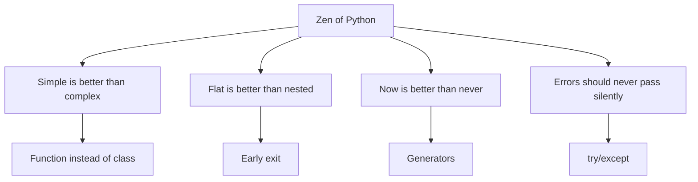

Python has an amazing tradition: if you type `import this`, the interpreter prints "The Zen of Python" — a poem of 19 principles written by Tim Peters. It is not a law but the philosophy of the language: a set of guidelines for how code should look so that it's pleasant to write and read.

```python
import this
```

You'll see a text that begins with the words "Beautiful is better than ugly." Let's examine several lines of the zen in practice.

## "Explicit is better than implicit"

Hidden magic complicates life. It's better to write things out, even if it costs one extra character:

```python
# Implicit: unclear what is happening
result = data.get("key", [])

# Explicit: reads like a sentence
if "key" in data:
    result = data["key"]
else:
    result = []
```

## "Simple is better than complex"

The simplest solution is almost always better. It's easy to build a class where a function would suffice — don't. Compare: a simple `sum` function versus a dozen lines of manual loop. Simplicity doesn't mean "primitive" — it means "minimally sufficient."

## "Flat is better than nested"

Deep nesting — `if` inside `if` inside a loop — is torture for the reader. The zen urges flattening the structure. A favorite technique is early exit:

```python
def greet(user, admin_list):
    if user not in admin_list:
        return "Hello, guest!"   # early exit from the function
    # the rest of the code lives without extra nesting
    return "Hello, admin!"
```

## Generators: lazy thinking

A generator is a function with `yield` that hands out values one at a time without storing the whole list in memory:

```python
def countdown(n):
    while n > 0:
        yield n
        n -= 1

for x in countdown(3):
    print(x)  # 3, 2, 1
```

The difference from an ordinary function: a regular function returns everything at once and forgets, while a generator "freezes" after each `yield` and continues on demand. This is the embodiment of the line "Now is better than never" — values are created exactly when they're needed.

## List comprehensions

Instead of a loop with `append` — one line:

```python
squares = [x * x for x in range(10)]
print(squares)  # [0, 1, 4, 9, 16, 25, 36, 49, 64, 81]
```

With a condition:

```python
even_squares = [x * x for x in range(10) if x % 2 == 0]
print(even_squares)  # [0, 4, 16, 36, 64]
```

And if you don't need the whole list — use a generator expression (parentheses); it's lazy:

```python
total = sum(x * x for x in range(10))
print(total)  # 285
```

## "Errors should never pass silently"

The zen demands: don't hide exceptions. Handle them explicitly and consciously:

```python
try:
    number = int(input("Enter a number: "))
except ValueError:
    print("That's not a number!")
else:
    print("Your number:", number)
```

## A few more pearls

- "Readability counts" — code is written once but read many times;
- "There should be one — and preferably only one — obvious way to do it" — that's why Python has a single style, PEP 8;
- "If the implementation is hard to explain, it's a bad idea" — if you can't explain your code to a friend, it's probably too complex;
- "Namespaces are one honking great idea — let's do more of those!" — modules and packages keep names from colliding.

The diagram links the principles of the Zen to concrete coding techniques:



The zen is not dogma but a compass. When you hesitate between two solutions, ask yourself: what would the Zen say? Most often the answer coincides with the cleanest and shortest solution. Let's test this in practice.

<!--TASK-->
### Task 1
Write a function `explain_zen()` that creates a dictionary: the key is a line from the Zen (for example, "Explicit is better than implicit"), and the value is your explanation in your own words of why that principle matters. Choose at least three principles from `import this`. The function should print each principle and its explanation on a separate line in the format `Principle: explanation`. Call the function. Expected result: at least three lines with principles. Run `import this` in your environment and pick principles from the actual text.

### Task 2
Write a generator `fibonacci(n)` that yields the first `n` Fibonacci numbers (0, 1, 1, 2, 3, 5, ...) via `yield`. Then print the first 10 numbers by iterating over the generator in a `for` loop. Expected output: `0 1 1 2 3 5 8 13 21 34` (space-separated or one per line). Show that a generator can be "spent" only once: after a full pass, a second `for` loop over the same generator prints nothing.

### Task 3
Given the list of numbers `numbers = [3, 8, 1, 6, 12, 7, 4]`. Using a list comprehension, create a list of squares of only the odd numbers. Print it. Then, using a generator expression and `sum()`, compute the sum of the squares of all numbers in the list and print it. Expected result: the first line — `[9, 1, 49]` (squares of the odd 3, 1, 7), the second line — the number `379`.

### Task 4
Here is code with deep nesting:

```python
def check(number):
    if number > 0:
        if number % 2 == 0:
            return "positive even"
        else:
            return "positive odd"
    else:
        return "not positive"
```

Rewrite it in a "flat" style with early exits: no nested `if`s, using `return` guards. The behavior must stay the same. Call the function for the numbers `4`, `7`, and `-2` and print the results.

### Task 5
Write a function `safe_divide(a, b)` that divides `a` by `b` and handles errors explicitly: if `b` is zero — return the string `Division by zero!` instead of raising an exception; if `a` or `b` is not a number (for example, a string) — return the string `Numbers needed!`. Use `try/except` with the specific exception types `ZeroDivisionError` and `TypeError`. Test the function on three pairs: `(10, 2)`, `(10, 0)`, `(10, "x")`. Expected output: `5.0`, `Division by zero!`, `Numbers needed!`.

### Task 6
Write a generator `running_total(numbers)` that yields the running sum of the elements one at a time: for `[3, 1, 4, 2]` — first `3`, then `4`, then `8`, then `10`. Inside, keep a variable `total = 0`, in the loop add each next number to it and yield the result via `yield`. Then print all values for the list `[3, 1, 4, 2]` on one line separated by spaces, using `print(value, end=" ")`. Expected output:

```text
3 4 8 10
```

After the loop, don't forget an empty `print()` so the next output starts on a new line. In a comment, explain why the generator doesn't store the whole list of sums in memory.

### Task 7
Write a function `describe_score(score)` that returns a text grade for a number from 0 to 100. Make it "flat": first a type check — `if not isinstance(score, int): return "An integer is required"`, then a range check — `if score < 0 or score > 100: return "Out of range"`, then three returns for `90+` — "excellent", `70–89` — "good", the rest — "needs retake". No nested `if`s. Test the function on the values `95`, `75`, `40`, `150`, and `"hundred"`. Expected output:

```text
excellent
good
needs retake
Out of range
An integer is required
```

<!--/TASK-->

<!--HINT-->
### Hint 1
Run `import this` and pick lines you like. You can create the dictionary like this: `zen = {"Explicit is better than implicit": "Clear code is easier to maintain"}`. For output use a loop `for principle, explanation in zen.items():` and print `f"{principle}: {explanation}"`.

### Hint 2
A generator is written like an ordinary function but with `yield` instead of `return`. Keep two variables: `a, b = 0, 1` and in the loop yield `a`, then update: `a, b = b, a + b`. After the first `for` loop, the same generator is exhausted: it doesn't "restart."

### Hint 3
A list comprehension with a condition: `[x * x for x in numbers if x % 2 == 1]`. The sum of squares via a generator expression: `sum(x * x for x in numbers)` — note the parentheses: you don't even need to write them inside `sum()`.

### Hint 4
Early exit: first check the most general condition and return right away: `if number <= 0: return "not positive"`. Then deal with parity `if number % 2 == 0` — so that there are no nested `if`s inside.

### Hint 5
`try:` wraps the dangerous action, `except ZeroDivisionError:` catches division by zero, `except TypeError:` catches passing unsuitable types (for example, strings in division). The order of exceptions matters: first the more specific one, then the general one.

### Hint 6
A generator is a function with `yield`. Set `total = 0` before the loop, inside add the number to `total` and yield the new value via `yield total`. Output without a newline is done like this: `print(value, end=" ")`, and after the loop add an empty `print()`, otherwise the next line will stick to the numbers.

### Hint 7
Guards go from top to bottom: first the type `if not isinstance(score, int)`, then the range, then the thresholds. Each `return` immediately finishes the function, so nested `if`s aren't needed. The order of thresholds matters: first `score >= 90`, then `score >= 70`, otherwise the "good" branch would catch the top students.

<!--/HINT-->

<!--SOLUTION-->
### Walkthrough 1
Solution:

```python
def explain_zen():
    zen = {
        "Explicit is better than implicit": "Code should speak for itself, without hidden magic.",
        "Simple is better than complex": "A minimally sufficient solution is more reliable than a convoluted one.",
        "Readability counts": "Code is read more often than it is written — take care of the reader.",
    }
    for principle, explanation in zen.items():
        print(f"{principle}: {explanation}")

explain_zen()
```

Result:

```
Explicit is better than implicit: Code should speak for itself, without hidden magic.
Simple is better than complex: A minimally sufficient solution is more reliable than a convoluted one.
Readability counts: Code is read more often than it is written — take care of the reader.
```

What's happening here? We created a dictionary where the key is a quote from the Zen and the value is our explanation. The loop `for principle, explanation in zen.items()` unpacks each key-value pair. The f-string `f"{principle}: {explanation}"` assembles the output line. This format is easy to extend: add a principle to the dictionary — and it appears in the output. This is a case where data (the dictionary) and logic (the loop) are nicely separated.

### Walkthrough 2
Solution:

```python
def fibonacci(n):
    a, b = 0, 1
    for _ in range(n):
        yield a
        a, b = b, a + b

fib = fibonacci(10)
for number in fib:
    print(number, end=" ")
print()

print("Second pass:")
for number in fib:
    print(number, end=" ")
```

Result:

```
0 1 1 2 3 5 8 13 21 34
Second pass:
```

What's happening here? A function with `yield` becomes a generator. On each access it runs the code up to `yield`, hands out the value, and "freezes" until the next request. The Fibonacci numbers are computed without storing the whole series in memory. The second `for` loop prints nothing because the generator is already exhausted: after a full pass, no values remain. This is an important difference between a generator and a list: a list can be iterated any number of times, while a generator — only once.

### Walkthrough 3
Solution:

```python
numbers = [3, 8, 1, 6, 12, 7, 4]

odd_squares = [x * x for x in numbers if x % 2 == 1]
print(odd_squares)

total = sum(x * x for x in numbers)
print(total)
```

Result:

```
[9, 1, 49]
379
```

What's happening here? The list comprehension `[x * x for x in numbers if x % 2 == 1]` walks the list, keeps only the odd numbers (3, 1, 7), and squares them — yielding `[9, 1, 49]`. The generator expression `sum(x * x for x in numbers)` sums the squares of all numbers without creating an intermediate list: 9 + 64 + 1 + 36 + 144 + 49 + 16 = 379. For large amounts of data, a lazy generator expression saves memory — and that's exactly what the Zen means by "Now is better than never": values are created at the moment they're needed.

### Walkthrough 4
Solution:

```python
def check(number):
    if number <= 0:
        return "not positive"
    if number % 2 == 0:
        return "positive even"
    return "positive odd"

print(check(4))
print(check(7))
print(check(-2))
```

Result:

```
positive even
positive odd
not positive
```

What's happening here? We "flattened" the nested conditions. Each `return` is a guard: as soon as a condition holds, the function immediately returns the answer and exits. The logic became linear: it reads from top to bottom with no jumping between blocks. The difference from the original code is visible to the naked eye: the nesting is gone, and the behavior is unchanged. This is "Flat is better than nested" in action.

### Walkthrough 5
Solution:

```python
def safe_divide(a, b):
    try:
        return a / b
    except ZeroDivisionError:
        return "Division by zero!"
    except TypeError:
        return "Numbers needed!"

print(safe_divide(10, 2))
print(safe_divide(10, 0))
print(safe_divide(10, "x"))
```

Result:

```
5.0
Division by zero!
Numbers needed!
```

What's happening here? `try` attempts the division. If `b` is zero, Python raises `ZeroDivisionError`, and we catch it, returning a clear message instead of crashing the program. If `a` or `b` has an unsuitable type (for example, a string), `TypeError` occurs — and the second `except` fires. Notice: exceptions are listed from the more specific to the more general — that's the correct order. In this way we follow the principle "Errors should never pass silently": we don't hide the problem, we handle it carefully and explicitly.

### Walkthrough 6
Solution:

```python
def running_total(numbers):
    total = 0
    for number in numbers:
        total += number
        yield total

for value in running_total([3, 1, 4, 2]):
    print(value, end=" ")
print()
```

Result:

```
3 4 8 10
```

What's happening here? `running_total` is a generator: it doesn't compute everything at once, but on each request runs the body up to `yield`, hands out the next sum, and freezes. The variable `total` lives between these awakenings — that's the generator's state. Let's trace the steps: `3`, then `3 + 1 = 4`, then `4 + 4 = 8`, then `8 + 2 = 10`. Only one number `total` is kept in memory, not a list of four sums — which is why a generator is great for long data streams. `end=" "` replaces the newline with a space, and the final empty `print()` brings it back. If the function returned a list, it would have to walk all the data first and only then hand it out — a generator, by contrast, starts delivering results from the first element.

### Walkthrough 7
Solution:

```python
def describe_score(score):
    if not isinstance(score, int):
        return "An integer is required"
    if score < 0 or score > 100:
        return "Out of range"
    if score >= 90:
        return "excellent"
    if score >= 70:
        return "good"
    return "needs retake"

for value in [95, 75, 40, 150, "hundred"]:
    print(describe_score(value))
```

Result:

```
excellent
good
needs retake
Out of range
An integer is required
```

What's happening here? Instead of a ladder of nested conditions, we built a chain of guards: each `return` fires under its own condition and immediately exits the function. The order is not accidental. First we reject the wrong type — otherwise comparing a string with a number would crash with `TypeError`. Then we check the range — negative and overly large numbers are meaningless. And only then do we go through the thresholds from high to low: if we wrote `>= 70` before `>= 90`, a student with 95 points would get "good." The last line without a condition is the "else": everything that reaches it is below 70. Such a structure reads from top to bottom and requires no mental bookkeeping of nesting.

<!--/SOLUTION-->

<!--QUIZ-->
What does the command import this output?
- The Zen of Python — a set of the language's principles
- An error, because the module doesn't exist
- Nothing
* Correct answer: The Zen of Python — a set of the language's principles
import this prints "The Zen of Python" — a poem of development principles.

What does the principle "Explicit is better than implicit" mean?
- Code should be clear and direct, without hidden magic
- You should hide logic in magic
- Shorter is always better, regardless of clarity
* Correct answer: Code should be clear and direct, without hidden magic
Explicit constructs speak for themselves; they are easier to read and maintain.

What does the keyword yield do in a function?
- Turns the function into a generator that yields values one at a time
- Returns a single value and finishes the function
- Prints the value
* Correct answer: Turns the function into a generator that yields values one at a time
yield pauses execution and returns a value, and on the next access continues from the same place.

How many times can you iterate over the same generator?
- Once: after a full pass it is exhausted
- Any number of times
- Zero times
* Correct answer: Once: after a full pass it is exhausted
A generator is lazy: after it hands out all values, it cannot repeat them.

What is the result of the expression [x * x for x in range(4)]?
- [0, 1, 4, 9]
- [0, 1, 2, 3]
- [1, 4, 9]
* Correct answer: [0, 1, 4, 9]
The list comprehension squares the numbers 0, 1, 2, 3.

What does sum(x * x for x in numbers) do?
- Computes the sum of the squares of all numbers without creating a list
- Creates a list of squares
- Returns the list of numbers
* Correct answer: Computes the sum of the squares of all numbers without creating a list
The generator expression inside sum() computes values on the fly.

What is an "early exit" from a function?
- Returning the answer immediately when a condition holds, without nested constructs
- Exiting the program
- Printing the result
* Correct answer: Returning the answer immediately when a condition holds, without nested constructs
Return guards make code flat and readable.

Which block catches division by zero?
- except ZeroDivisionError
- except TypeError
- except ImportError
* Correct answer: except ZeroDivisionError
ZeroDivisionError occurs when dividing by zero and is caught by the block with the same name.

Which exception type occurs when trying to divide a number by a string?
- TypeError
- ZeroDivisionError
- ValueError
* Correct answer: TypeError
TypeError is raised when an operation is applied to values of unsuitable types.

What does the line "Readability counts" mean?
- Code is written once but read many times, so it must be clear
- Reading code is optional
- Only comments make code readable
* Correct answer: Code is written once but read many times, so it must be clear
Readability is the main quality of code, since many people maintain it.
What does the keyword yield turn a function into?
- A generator that yields values one at a time
- An ordinary function that returns a result
- A class
* Correct answer: A generator that yields values one at a time
yield pauses the function, preserving its state until the next request.

Which Zen principle urges avoiding deep nesting?
- "Flat is better than nested"
- "Explicit is better than implicit"
- "Simple is better than complex"
* Correct answer: "Flat is better than nested"
This principle advises flattening the structure and using early exits.

What will sum(x * x for x in [1, 2, 3]) output?
- 14
- 9
- 6
* Correct answer: 14
The generator expression computes 1 + 4 + 9 = 14 without creating a list.

Why is it dangerous to write except: without specifying an exception type?
- It catches all errors, including typos and system failures
- It works slower
- It doesn't work in Python 3
* Correct answer: It catches all errors, including typos and system failures
A bare except hides the true cause of the failure and hinders debugging — it's better to catch specific types.
<!--/QUIZ-->
