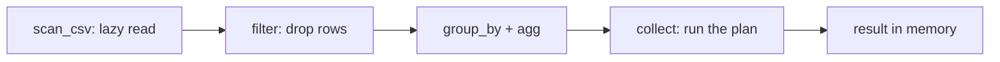

## Why Do We Need Yet Another DataFrame

You already know pandas: it's convenient and familiar, but it has fundamental limitations. First, pandas is almost entirely single-threaded — it uses a single CPU core even if you have eight. Second, pandas stores data on top of Python objects, so every element of a row or number lives in its own object with its own overhead: a typical integer column takes several times more memory than the "raw" numbers. Third, pandas executes operations eagerly: every action runs immediately, even if the next step throws away most of the result. When you work with tables of hundreds of millions of rows, all of this turns into a problem.

Polars solves these problems at the architecture level:

- it is written in Rust and uses multithreading out of the box;
- it stores data in the Apache Arrow columnar format — contiguous arrays, not Python objects;
- it builds a query plan and optimizes it as a whole before executing it;
- it supports a lazy mode in which you can assemble a pipeline and execute it with one collective call, `collect()`.

Installing it is one command:

```bash
pip install polars
```

## Creating a DataFrame

Like pandas, Polars can create a DataFrame from a dictionary:

```python
import polars as pl

df = pl.DataFrame({
    "city": ["Moscow", "Saint Petersburg", "Moscow", "Novosibirsk"],
    "sales": [100, 200, 150, 300],
    "quantity": [2, 5, 3, 7],
})
print(df)
```

Let's look at the type of each column and the first rows:

```python
print(df.schema)
print(df.head(2))
```

Unlike pandas, `df.schema` is an ordered name → type dictionary, and the types are strictly typed (`Int64`, `Utf8`, and so on). This is not just a decoration: thanks to strict typing, Polars can generate very fast machine code for specific types.

## Expressions Instead of Methods

The main idea of Polars is expressions. The `select` method picks columns and can immediately create new ones on the fly:

```python
df.select(
    pl.col("city"),
    (pl.col("sales") / pl.col("quantity")).alias("avg_check"),
)
```

`with_columns` adds new columns to the existing table, `filter` selects rows, `sort` sorts:

```python
df.with_columns(
    (pl.col("sales") * 1.2).alias("marked_up_sales"),
).filter(pl.col("sales") > 120).sort("sales", descending=True)
```

Notice: inside expressions we describe transformations declaratively. Polars translates them into vectorized operations optimized for specific types, without creating unnecessary intermediate copies.

## Aggregations

Grouping is done with the `group_by` method and aggregating expressions:

```python
df.group_by("city").agg(
    pl.col("sales").sum().alias("sum"),
    pl.col("sales").mean().alias("average"),
    pl.len().alias("order_count"),
).sort("sum", descending=True)
```

Note `pl.len()` — the row counter within a group; in pandas this would have been `size()`.

## Lazy Mode: a Plan Instead of Action

If you have a lot of data, start with `scan_*` instead of `read_*`: they build a lazy plan and don't read the whole file:

```python
q = (
    pl.scan_csv("sales/*.csv")
    .filter(pl.col("date") >= "2024-01-01")
    .group_by("city")
    .agg(pl.col("amount").sum())
)
```

Until you call `collect()`, nothing has been read. When executed, Polars pushes the filter down into the read (predicate pushdown) and processes files in parallel:

```python
result = q.collect()
print(result)
```

And for pipelines that don't fit into memory, there is a streaming mode:

```python
result = q.collect(streaming=True)
```

It helps to think of the assembled pipeline as a scheme: source → filter → aggregation → execution.



Polars doesn't replace pandas in every scenario: some niche tools and visualization libraries are still built around pandas. But for heavy ETL pipelines and analytics, it is the de facto standard today. Now let's solidify all of it with practice.

<!--TASK-->
### Task 1
Create a file `sales.py`. Inside it, make a DataFrame `orders` with columns `product_id` (integers), `qty` (integers), and `price` (floats) — at least five rows. Add a new column `revenue = qty * price` via `with_columns`, then filter rows where `revenue > 200`, and sort by `revenue` in descending order. At the end, print the resulting DataFrame and verify that only matching rows remain. Expected output — a sorted table with columns `product_id`, `qty`, `price`, `revenue`.

### Task 2
Take the same `orders`. Group the data by `product_id` and for each group compute: the sum of `revenue` (alias `total_revenue`), the mean of `price` (alias `avg_price`), and the number of orders via `pl.len()`. Sort the result by `total_revenue` in descending order and print it. Verify that the sum of all `total_revenue` equals the total sum of `revenue` in the original table — this is a good correctness check for the aggregation.

### Task 3
Write a lazy pipeline. Simulate "big data": generate three CSV files in the `sales/` folder (you can write the same structure in a loop: `date`, `city`, `amount` — 100 rows each, dates in January 2024). Then via `pl.scan_csv("sales/*.csv")` filter rows with `amount > 500`, group by `city` and compute the sum of `amount`. Call `collect()` and print the result. In a comment, explain why `scan_csv` is preferable to `read_csv` for such a scenario.

### Task 4
Write pytest tests. First create the following function in `sales.py`:

```python
def top_categories(df: pl.DataFrame, n: int = 3) -> pl.DataFrame:
    return (
        df.group_by("category")
        .agg(pl.col("revenue").sum().alias("total"))
        .sort("total", descending=True)
        .head(n)
    )
```

Now write a file `test_sales.py` with tests: (1) for a small DataFrame with known sums per category, check that the result contains exactly `n` rows; (2) that the columns are named `category` and `total`; (3) that the rows are sorted by `total` in descending order; (4) that when `n` is larger than the number of categories, all categories are returned without an error. Run `pytest test_sales.py -v` and get a green run.

### Task 5
Write pytest tests for the table-joining function. Add to `sales.py`:

```python
def revenue_by_category(orders: pl.DataFrame, products: pl.DataFrame) -> pl.DataFrame:
    merged = orders.join(products, on="product_id")
    return (
        merged.group_by("category")
        .agg((pl.col("price") * pl.col("qty")).sum().alias("revenue"))
    )
```

In `test_sales.py` write a test: create `orders` (product_id, qty) and `products` (product_id, category, price), compute the expected revenue per category by hand and compare it with the function's result. Add another test with `tmp_path`: write the `products` table to Parquet via `pl.write_parquet`, read it back and verify that `revenue_by_category` gives the same answer. Run pytest and make sure all tests pass.

### Task 6
In `sales.py`, add a function `rank_by_city(df)` that computes, for each row, the product's rank by revenue within its city. Use the window expression `pl.col("revenue").rank("dense", descending=True).over("city")` and store the result in a column `rank`. Sort the final result by `city` and `rank` and print the table. Verify that in each city ranks start at 1 and go without gaps, and that there are as many rows as in the original table. Expected output — a table with columns `city`, `product_id`, `revenue`, `rank`, where the most profitable product in each city gets rank 1.

### Task 7
Build a pivot table. In `sales.py` write a function `city_month_matrix(df)` that builds a "city × month" matrix of revenue sums via `pivot`: `df.pivot(index="city", columns="month", values="revenue", aggregate_function="sum")`. Fill missing values with zeros via `fill_null(0)`, add a `total` column as the sum across all months, and sort rows by it in descending order. Print the matrix. Expected output — a table where rows are cities, columns are months, and the last `total` column equals the sum of its row's values.

<!--/TASK-->

<!--HINT-->
### Hint 1
`with_columns` takes an expression: `df.with_columns((pl.col("qty") * pl.col("price")).alias("revenue"))`. Filter — `df.filter(pl.col("revenue") > 200)`, sort — `df.sort("revenue", descending=True)`. You can chain methods into a single pipeline without intermediate variables.

### Hint 2
Grouping template: `df.group_by("product_id").agg(...)`. Inside `agg`, list the expressions: `pl.col("revenue").sum().alias("total_revenue")`, `pl.col("price").mean().alias("avg_price")`, `pl.len()`. To check the sum, compare `df["revenue"].sum()` and `result["total_revenue"].sum()` — they should match.

### Hint 3
The easiest way to create the files is in a loop via `pl.DataFrame(...).write_csv(f"sales/file_{i}.csv")`. The glob in Polars is a plain string: `pl.scan_csv("sales/*.csv")`. Don't forget the final `.collect()` — without it the result won't be computed and printed.

### Hint 4
Use `@pytest.fixture` for a DataFrame with categories `A`, `B`, `C` and known revenues. To check sorting, compare `result["total"].to_list()` with its own sorted copy. All tests are plain functions with `assert` that import `top_categories`.

### Hint 5
Joining in Polars: `orders.join(products, on="product_id")`. In the test, compute the expected revenue directly from the original lists. For the Parquet part: `products.write_parquet(path)` — a Polars DataFrame method, then `pl.read_parquet(path)`. Don't forget `import pytest` for the `tmp_path` fixture.

### Hint 6
Window operations in Polars are done via `over`: `df.with_columns(pl.col("revenue").rank("dense", descending=True).over("city").alias("rank"))`. The `rank` method takes a strategy (`"dense"` — numbering without gaps) and `descending=True`. `over("city")` says to compute the expression separately within each city without collapsing the table. Sort at the end — `sort(["city", "rank"])`.

### Hint 7
`pivot` is called on a DataFrame: `df.pivot(index="city", columns="month", values="revenue", aggregate_function="sum")`. The values of the `month` column become column names. `fill_null(0)` replaces missing values. Add the `total` column via `with_columns(pl.sum_horizontal(pl.exclude("city")).alias("total"))` and sort by it in descending order.

<!--/HINT-->

<!--SOLUTION-->
### Walkthrough 1
Solution:

```python
import polars as pl

orders = pl.DataFrame({
    "product_id": [1, 1, 2, 3, 3, 4],
    "qty": [2, 3, 1, 5, 2, 10],
    "price": [150.0, 80.0, 300.0, 60.0, 150.0, 25.0],
})

result = (
    orders.with_columns(
        (pl.col("qty") * pl.col("price")).alias("revenue")
    )
    .filter(pl.col("revenue") > 200)
    .sort("revenue", descending=True)
)
print(result)
```

Output:

```
shape: (3, 4)
┌────────────┬─────┬───────┬─────────┐
│ product_id ┆ qty ┆ price ┆ revenue │
╞════════════╪═════╪═══════╪═════════╡
│ 2          ┆ 1   ┆ 300.0 ┆ 300.0   │
│ 3          ┆ 5   ┆ 60.0  ┆ 300.0   │
│ 4          ┆ 10  ┆ 25.0  ┆ 250.0   │
└────────────┴─────┴───────┴─────────┘
```

What's happening here? `with_columns` adds a `revenue` column without modifying the original table (Polars is immutable — every operation returns a new DataFrame). `filter` keeps only rows where revenue is greater than 200, and `sort(..., descending=True)` orders in descending order. Immutability is an important difference from pandas: you can always be sure the original `orders` hasn't changed, and you can build chains without side effects.

### Walkthrough 2
Solution:

```python
import polars as pl

orders = pl.DataFrame({
    "product_id": [1, 1, 2, 3, 3, 4],
    "qty": [2, 3, 1, 5, 2, 10],
    "price": [150.0, 80.0, 300.0, 60.0, 150.0, 25.0],
}).with_columns((pl.col("qty") * pl.col("price")).alias("revenue"))

stats = (
    orders.group_by("product_id")
    .agg(
        pl.col("revenue").sum().alias("total_revenue"),
        pl.col("price").mean().alias("avg_price"),
        pl.len().alias("orders_count"),
    )
    .sort("total_revenue", descending=True)
)
print(stats)
print("Check:", stats["total_revenue"].sum() == orders["revenue"].sum())
```

Output: `stats` has three columns plus `product_id`, rows are ordered by `total_revenue` descending, and `Check: True` confirms that the sum across groups equals the total revenue. Here `pl.len()` is the analog of `size()` in pandas. Note: `alias` renames the expression's result — without it the column would be called `revenue_sum` or `revenue_mean` by default.

### Walkthrough 3
Solution:

```python
import polars as pl

# Generate "big" data: three CSV files
for i in range(3):
    df = pl.DataFrame({
        "date": [f"2024-01-{d:02d}" for d in range(1, 101)],
        "city": ["Moscow"] * 50 + ["Saint Petersburg"] * 50,
        "amount": [100 + (j * 37) % 900 for j in range(100)],
    })
    df.write_csv(f"sales/file_{i}.csv")

q = (
    pl.scan_csv("sales/*.csv")
    .filter(pl.col("amount") > 500)
    .group_by("city")
    .agg(pl.col("amount").sum().alias("total"))
)
print(q.collect())
```

Output — two rows (`Moscow`, `Saint Petersburg`) with the sum per city. `scan_csv` doesn't read files when building the plan: it only remembers the sources and transformations. Metadata (schema, statistics) is read lazily, and at `collect()` the filter is pushed down into the reading — Polars can skip whole blocks of data that don't satisfy the condition. For a "many files, we only read a part" scenario this saves both time and memory.

### Walkthrough 4
Solution:

```python
import polars as pl
import pytest
from sales import top_categories

@pytest.fixture
def df():
    return pl.DataFrame({
        "category": ["A", "B", "A", "C", "B", "C"],
        "revenue": [100.0, 200.0, 50.0, 300.0, 150.0, 100.0],
    })

def test_returns_n_rows(df):
    result = top_categories(df, n=2)
    assert result.height == 2

def test_columns(df):
    result = top_categories(df)
    assert result.columns == ["category", "total"]

def test_sorted_descending(df):
    result = top_categories(df, n=3)
    totals = result["total"].to_list()
    assert totals == sorted(totals, reverse=True)

def test_n_larger_than_categories(df):
    result = top_categories(df, n=10)
    assert result.height == 3
```

What's happening here? The `df` fixture creates a fresh table for each test — tests are isolated. Checks: number of rows (`height`), column composition, sortedness (comparing the list with its sorted copy), and behavior when `n` exceeds the number of categories. `top_categories` correctly returns all three categories because `head(n)` doesn't fail when there are fewer rows than `n`. Run: `pytest test_sales.py -v`.

### Walkthrough 5
Solution:

```python
import polars as pl
import pytest
from sales import revenue_by_category

def make_orders():
    return pl.DataFrame({
        "product_id": [1, 2, 3, 1, 2],
        "qty": [2, 1, 5, 3, 4],
    })

def make_products():
    return pl.DataFrame({
        "product_id": [1, 2, 3],
        "category": ["tech", "food", "tech"],
        "price": [100.0, 50.0, 20.0],
    })

def test_revenue_by_category():
    result = revenue_by_category(make_orders(), make_products())
    expected = {"tech": 2 * 100 + 3 * 100 + 5 * 20, "food": 1 * 50 + 4 * 50}
    assert dict(zip(result["category"], result["revenue"])) == expected

def test_revenue_parquet_roundtrip(tmp_path):
    path = tmp_path / "products.parquet"
    make_products().write_parquet(path)
    products = pl.read_parquet(path)
    result = revenue_by_category(make_orders(), products)
    assert result["revenue"].sum() == 2 * 100 + 3 * 100 + 5 * 20 + 1 * 50 + 4 * 50
```

What's happening here? In the first test we compute the expected revenue by hand: product 1 is tech (2 and 3 units at 100), product 2 is food (1 and 4 at 50), product 3 is tech (5 at 20). We convert the function's result into a dictionary and compare with the expectation — this keeps the check readable. The second test uses `tmp_path` — pytest's special temporary folder that is automatically removed after the test: we write the table to Parquet, read it back, and confirm the pipeline works after serialization too. This is an important check: in a real project data often comes straight from Parquet.

### Walkthrough 6
Solution:

```python
import polars as pl

orders = pl.DataFrame({
    "city": ["Moscow", "Moscow", "Saint Petersburg", "Saint Petersburg", "Moscow"],
    "product_id": [1, 2, 3, 4, 5],
    "revenue": [300.0, 150.0, 400.0, 400.0, 200.0],
})

def rank_by_city(df: pl.DataFrame) -> pl.DataFrame:
    return (
        df.with_columns(
            pl.col("revenue")
            .rank("dense", descending=True)
            .over("city")
            .alias("rank")
        )
        .sort(["city", "rank"])
    )

result = rank_by_city(orders)
print(result)
print("Row count unchanged:", result.height == orders.height)
```

Output:

```
shape: (5, 4)
┌──────────────────┬────────────┬─────────┬──────┐
│ city             ┆ product_id ┆ revenue ┆ rank │
╞══════════════════╪════════════╪═════════╪══════╡
│ Moscow           ┆ 1          ┆ 300.0   ┆ 1    │
│ Moscow           ┆ 5          ┆ 200.0   ┆ 2    │
│ Moscow           ┆ 2          ┆ 150.0   ┆ 3    │
│ Saint Petersburg ┆ 3          ┆ 400.0   ┆ 1    │
│ Saint Petersburg ┆ 4          ┆ 400.0   ┆ 1    │
└──────────────────┴────────────┴─────────┴──────┘
Row count unchanged: True
```

What's happening here? `over("city")` is a window operation: the expression is computed within each group, but the result is returned to the original rows, so the table is not collapsed and `height` doesn't change. The `"dense"` strategy numbers ranks without gaps, and equal values get the same rank — both Saint Petersburg products with revenue 400 share first place, and the next value would get 2, not 3. This is the key difference from `group_by().agg()`, which would return one row per city: here we need all orders with their rank within the city, e.g., to select the top 3 per city via `filter(pl.col("rank") <= 3)`.

### Walkthrough 7
Solution:

```python
import polars as pl

df = pl.DataFrame({
    "city": ["Moscow", "Moscow", "Saint Petersburg", "Saint Petersburg", "Saint Petersburg"],
    "month": ["2024-01", "2024-02", "2024-01", "2024-01", "2024-02"],
    "revenue": [100.0, 50.0, 300.0, 200.0, 400.0],
})

def city_month_matrix(df: pl.DataFrame) -> pl.DataFrame:
    wide = df.pivot(
        index="city",
        columns="month",
        values="revenue",
        aggregate_function="sum",
    ).fill_null(0)
    return (
        wide.with_columns(
            pl.sum_horizontal(pl.exclude("city")).alias("total")
        )
        .sort("total", descending=True)
    )

print(city_month_matrix(df))
```

Output:

```
shape: (2, 4)
┌──────────────────┬─────────┬─────────┬───────┐
│ city             ┆ 2024-01 ┆ 2024-02 ┆ total │
╞══════════════════╪═════════╪═════════╪═══════╡
│ Saint Petersburg ┆ 500.0   ┆ 400.0   ┆ 900.0 │
│ Moscow           ┆ 100.0   ┆ 50.0    ┆ 150.0 │
└──────────────────┴─────────┴─────────┴───────┘
```

What's happening here? `pivot` is the inverse of `unpivot`: unique values of the `month` column become columns, and cells are filled with the `sum` aggregate. Notice `aggregate_function="sum"`: Saint Petersburg has two orders in January (300 and 200), and without an aggregate `pivot` couldn't pick a single value. `fill_null(0)` matters because Moscow has no data for March, and without filling there would be a `null` that would poison the sum. `pl.sum_horizontal(pl.exclude("city"))` adds up all numeric columns in each row — this is a horizontal aggregation, not to be confused with `pl.col(...).sum()`, which collapses a column into one number. Sorting by `total` makes the report readable: the biggest city on top.

<!--/SOLUTION-->

<!--QUIZ-->
Which library underlies Polars' memory?
- Apache Arrow
- NumPy
- SQLite
* Correct answer: Apache Arrow
Polars stores data in the Apache Arrow columnar format — contiguous arrays instead of Python objects.

What is lazy mode in Polars?
- The query is assembled into a plan and executed only at collect()
- The query executes immediately after each method
- A debug mode that prints SQL
* Correct answer: The query is assembled into a plan and executed only at collect()
scan_* build a lazy plan; only collect() starts computation.

Which method adds new columns in Polars?
- with_columns
- assign
- insert_column
* Correct answer: with_columns
with_columns takes expressions and returns a new DataFrame with added columns.

Which expression counts the number of rows in a group?
- pl.len()
- pl.count()
- pl.size()
* Correct answer: pl.len()
pl.len() inside agg returns the number of rows in the group — the analog of size() in pandas.

What does collect(streaming=True) do?
- Processes the pipeline in chunks without loading everything into memory
- Speeds up via GPU
- Disables type checking
* Correct answer: Processes the pipeline in chunks without loading everything into memory
Streaming mode lets you process data larger than memory.

Why is alias() needed in an expression?
- To rename the result column
- To set the data type
- To sort the result
* Correct answer: To rename the result column
alias sets the name of the expression's result column.

What does predicate pushdown mean?
- The filter runs as early as possible, already at the reading stage
- The filter runs at the very end
- The optimizer disables the filter
* Correct answer: The filter runs as early as possible, already at the reading stage
The optimizer moves conditions into the reading so that unneeded data blocks are skipped.

How does Polars differ from pandas in memory?
- It stores data in contiguous typed arrays instead of Python objects
- It stores a copy of the data for every operation
- It doesn't store data in memory at all
* Correct answer: It stores data in contiguous typed arrays instead of Python objects
This reduces overhead and speeds up vectorized operations.

What will df.group_by("a").agg(pl.col("b").sum()) return?
- A DataFrame with columns a and b_sum
- A Series
- A dictionary
* Correct answer: A DataFrame with columns a and b_sum
The result of grouping in Polars is always a DataFrame, and the aggregate column is named after the expression.

Which method reads CSV lazily?
- pl.scan_csv
- pl.read_csv
- pl.load_csv
* Correct answer: pl.scan_csv
scan_csv returns a LazyFrame; read_csv reads the file immediately.

What does `over("city")` do in a Polars expression?
- Computes the expression within each group while keeping the row count
- Collapses the table to one row per city
- Sorts the table by city
* Correct answer: Computes the expression within each group while keeping the row count
`over` is a window operation: the result lands in the same rows, the table is not collapsed.

Which `rank` strategy numbers places without gaps?
- "dense"
- "ordinal"
- "average"
* Correct answer: "dense"
The `"dense"` strategy gives 1, 2, 3 without gaps even for equal values.

What does `pivot` do?
- Unfolds unique values of a column into columns
- Removes duplicate rows
- Changes column types
* Correct answer: Unfolds unique values of a column into columns
`pivot` builds a pivot table: `index` sets rows, values of `columns` become columns.

How is `pl.sum_horizontal` different from `pl.col("a").sum()`?
- It adds values of columns within each row
- It adds all values of one column
- It computes the row-wise average
* Correct answer: It adds values of columns within each row
`sum_horizontal` works horizontally — across columns within a row.

<!--/QUIZ-->
