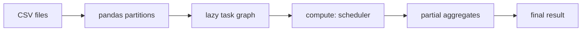

## The Problem: pandas Hits the Memory and Single-Core Wall

You already know that pandas keeps the whole DataFrame in RAM and performs operations in a single thread. If a table takes 40 GB and the machine has 16 GB — pandas simply won't start. You could squeeze it or rewrite it in Polars, but what do you do when there is more data than memory and the code is already written in pandas and you don't want to change everything?

Dask solves this differently: it doesn't rewrite pandas — it mimics its API on top of pieces. The idea is simple: Dask cuts a big table into parts — partitions, each of which is an ordinary small pandas DataFrame. Operations are applied to partitions in parallel, and Dask lazily assembles a computation graph and executes it as needed.

## First Acquaintance: dask.dataframe

Installation:

```bash
pip install dask[dataframe]
```

The import looks almost like pandas:

```python
import dask.dataframe as dd

ddf = dd.read_csv("sales/sales_*.csv")
print(ddf.npartitions)   # how many parts
print(ddf.columns)       # columns
```

Unlike pandas, `ddf` is a lazy object: when reading, Dask hasn't loaded anything yet — it only described the plan. To get real data, you must call `compute()`:

```python
df = ddf.compute()   # merges all partitions into one pandas DataFrame
```

Careful: `compute()` gathers everything into memory — for huge data you can't do this. Instead, compute aggregates that Dask knows how to combine across partitions:

```python
print(ddf["amount"].sum().compute())
print(ddf["amount"].mean().compute())
```

Each partition computes its own partial sum, and Dask combines them in a tree.

## Familiar API

Almost all pandas methods exist in Dask: `ddf[ddf["city"] == "Moscow"]`, `ddf.groupby("city")["amount"].sum()`, `ddf.sort_values(...)`, `ddf.merge(other)`. They return lazy Dask DataFrames, and `compute()` at the end runs the computation:

```python
result = (
    ddf[ddf["amount"] > 500]
    .groupby("city")["amount"]
    .sum()
    .compute()
)
print(result)
```

Dask automatically determines which operations can run in parallel on different partitions and which require shuffling data between them — for example, `groupby` on an arbitrary column.

## map_partitions: Your Own Function on Each Partition

Sometimes the needed operation isn't in the API. Then use `map_partitions` — it calls your function on each partition separately:

```python
def add_tax(df, rate=0.2):
    df = df.copy()
    df["tax"] = df["amount"] * rate
    return df

ddf2 = ddf.map_partitions(add_tax, rate=0.2)
print(ddf2.head(3).compute())
```

Remember: the function must accept and return a pandas DataFrame.

## Dask Delayed: Parallelize Any Code

`dask.dataframe` covers tabular tasks. For arbitrary computations there is a lower-level mechanism — `dask.delayed`:

```python
import dask

@dask.delayed
def square(x):
    return x * x

@dask.delayed
def total(xs):
    return sum(xs)

parts = [square(i) for i in range(10)]
print(total(parts).compute())   # 285
```

`delayed` wraps an ordinary function: it doesn't run immediately but adds a node to the graph. When you call `compute()` on the root node, Dask executes the graph, parallelizing independent branches.

## Schedulers and Diagnostics

Dask can work in three modes: threads (default), processes, and a distributed cluster (`dask.distributed`). The distributed mode has a web dashboard:

```python
from dask.distributed import Client
client = Client()          # starts a local cluster
```

After that, `client` is used automatically by Dask. The dashboard (by default `http://localhost:8787`) shows the task graph, worker load, and memory.

Dask's scheme: a large dataset is cut into partitions, a graph is built from operations, and only `compute()` starts its execution.



## When Dask, and When Polars or Ray

Dask is best when the code is already written in pandas and needs to be scaled without rewriting, or when the data fits into the cluster's memory in pieces. Polars is faster on a single machine for tabular operations. Ray (next lesson) is for arbitrary distributed tasks, not only tabular ones. Often they're combined: Polars inside one partition, Dask outside. Now practice.

<!--TASK-->
### Task 1
Create a folder `sales_parts/` and generate four CSV files (e.g., `part_0.csv` ... `part_3.csv`) with columns `date`, `city`, `amount` and 200 random rows each. Then in `dask_intro.py` read them via `dd.read_csv("sales_parts/part_*.csv")`, print `npartitions`, the total number of rows (hint: `len(ddf)` requires `compute()`), the sum and the mean of `amount`. Make sure the sum of all partitions equals the sum of all rows of all files.

### Task 2
On the same `ddf`, build an analytic pipeline: filter rows with `amount > 150`, group by `city`, compute the mean `amount` and the number of orders, sort the results by mean amount in descending order, and print the final pandas DataFrame after `compute()`. Compare the result with what pandas would give if you read all files via `pd.concat` — the numbers must match.

### Task 3
Write a function `add_discount(ddf, percent)` that via `map_partitions` reduces `amount` by the given percentage and adds a column `with_discount`. Verify it works: apply it to `ddf`, call `head(3).compute()` and check that the new column exists and the values match the formula. Also print `npartitions` before and after — it should not change.

### Task 4
Write pytest tests. In `dask_stats.py` implement the function:

```python
import dask.dataframe as dd

def summarize_sales(pattern: str) -> tuple:
    ddf = dd.read_csv(pattern)
    total = int(ddf["amount"].sum().compute())
    mean = float(ddf["amount"].mean().compute())
    rows = int(ddf.shape[0].compute())
    return total, mean, rows
```

In `test_dask_stats.py` use `tmp_path` to create two CSV files with known sums (e.g., 10 and 20) and check that the correct sum and row count are returned, and that the mean lies between the minimum and maximum values. Run pytest.

### Task 5
Write pytest tests for `map_partitions`. Add `add_tax(ddf, rate)` to `dask_stats.py`, which adds a column `tax = amount * rate` via `map_partitions`. In `test_dask_stats.py` write a test: generate temporary CSV files, read them through Dask, apply `add_tax` with rate 0.2 and verify that `(tax == amount * 0.2).all().compute()` is true and that the number of partitions hasn't changed. Run all tests and get a green run.

### Task 6
Write a pipeline on `dask.delayed`. Add a function `delayed_totals(files)` to `dask_stats.py`: for each path create a delayed call `read_and_sum(path)`, which reads a CSV via `pandas.read_csv` and returns the sum of the `amount` column; collect the parts into a list and return `dask.delayed(sum)(parts)`. In the script call `.compute()` and compare the result with the direct computation `sum(pd.read_csv(f)["amount"].sum() for f in files)`. Expected output — two equal numbers and `True` at the end.

### Task 7
Write a function `to_parquet_parts(ddf, out_dir, npartitions=2)` that repartitions the data via `repartition(npartitions=npartitions)`, writes it via `ddf.to_parquet(out_dir, write_index=False)`, and reads it back via `dd.read_parquet(out_dir)`. Print the number of partitions before and after, the number of rows before and after (`shape[0].compute()`), and the sum of the `amount` column. Expected output: partitions become 2, rows and sum stay unchanged, and two parquet files appear in the folder.

<!--/TASK-->

<!--HINT-->
### Hint 1
Generation: `pl.DataFrame` or `pd.DataFrame` in a loop over `range(4)`, `df.to_csv(f"sales_parts/part_{i}.csv", index=False)`. For the sum across all partitions just use `ddf["amount"].sum().compute()` — Dask itself adds up the partial sums. Row count: `ddf.shape[0].compute()` (this is a lazy attribute, so `compute()` is required).

### Hint 2
A pipeline of methods you already know: filter, `groupby("city")["amount"].agg(["mean", "count"])` or two separate calls, then `sort_values(by="mean", ascending=False)` and `.compute()`. To cross-check with pandas, use `pd.concat([pd.read_csv(f) for f in files])` and repeat the same operations.

### Hint 3
`map_partitions` passes a pandas DataFrame to each partition: `def add_discount(df, percent): df = df.copy(); df["with_discount"] = df["amount"] * (1 - percent / 100); return df`. Always copy the input DataFrame so you don't mutate partitions inside Dask. `npartitions` after `map_partitions` matches the original.

### Hint 4
The `tmp_path` fixture gives a folder for files: write CSV there via `pd.DataFrame(...).to_csv(tmp_path / "a.csv", index=False)`. Checks: `total == 30`, `rows == 4` and `min_val < mean < max_val`. Remember that `summarize_sales` takes a glob pattern, e.g., `str(tmp_path / "*.csv")`.

### Hint 5
Create a CSV with an `amount` column and numbers. After `add_tax`, compare the columns element-wise: `((res["tax"] - res["amount"] * 0.2).abs() < 1e-9).all().compute()`. Check `npartitions` via `res.npartitions == ddf.npartitions`.

### Hint 6
The `@dask.delayed` decorator goes on an ordinary function — for example, on `read_and_sum(path)`, which reads a CSV and returns the column sum. Calling `read_and_sum(f)` returns a lazy object, not a number. You can add the parts like this: `dask.delayed(sum)(parts)` — `sum` itself becomes a graph node too. One `compute()` at the end evaluates the whole tree, and independent file reads run in parallel.

### Hint 7
Repartitioning: `ddf.repartition(npartitions=2)`. Writing a dataset into a folder — `ddf.to_parquet(out_dir, write_index=False)`; Dask creates one file per partition. Reading back — `dd.read_parquet(out_dir)`. Check the number of files via `len(list(Path(out_dir).glob("*.parquet")))`, not with a list from `os.listdir` — there may be service files.

<!--/HINT-->

<!--SOLUTION-->
### Walkthrough 1
Solution:

```python
import dask.dataframe as dd
import pandas as pd

for i in range(4):
    df = pd.DataFrame({
        "date": pd.date_range("2024-01-01", periods=200, freq="h"),
        "city": ["Moscow"] * 100 + ["Saint Petersburg"] * 100,
        "amount": [100 + (j * 53) % 900 for j in range(200)],
    })
    df.to_csv(f"sales_parts/part_{i}.csv", index=False)

ddf = dd.read_csv("sales_parts/part_*.csv")
print("Partitions:", ddf.npartitions)
print("Rows:", ddf.shape[0].compute())
print("Sum:", ddf["amount"].sum().compute())
print("Mean:", round(float(ddf["amount"].mean().compute()), 2))
```

Output: `Partitions: 4`, `Rows: 800`, then the sum and the mean. What's happening here? `dd.read_csv` doesn't read files — it creates a lazy object of four partitions. `shape[0]`, `sum()`, `mean()` are also lazy: each returns a scalar or series that is materialized only at `compute()`. The key point: the sum is computed as the sum of the partitions' partial sums, so no full file is loaded into memory. As a control, you can add up the sums of all files manually — the result will be the same.

### Walkthrough 2
Solution:

```python
result = (
    ddf[ddf["amount"] > 150]
    .groupby("city")["amount"]
    .agg(["mean", "count"])
    .sort_values(by="mean", ascending=False)
    .compute()
)
print(result)
```

Output — a table with cities, mean amounts, and order counts, sorted by mean descending. What's happening here? The filter applies to each partition independently — a cheap operation without data exchange. But `groupby` on `city` may require a shuffle: Dask must collect rows of one city from different partitions. Dask does this automatically: first partial aggregates per partition, then merging. This is why the row order of a `groupby` result on Dask doesn't always match pandas — but the values always do. Checking with pandas via `pd.concat` gives the same numbers.

### Walkthrough 3
Solution:

```python
def add_discount(df, percent):
    df = df.copy()
    df["with_discount"] = df["amount"] * (1 - percent / 100)
    return df

ddf2 = ddf.map_partitions(add_discount, percent=10)
print(ddf2.head(3).compute())
print("Partitions before:", ddf.npartitions, "→ after:", ddf2.npartitions)
```

Output — the first three rows with the new `with_discount` column, where the values equal `amount * 0.9`, and the same number of partitions. What's happening here? `map_partitions` takes a function that works with one pandas DataFrame and calls it on each partition. This is an ideal way to reuse pandas code in a parallel pipeline. Important: we copy the DataFrame inside the function because partitions may be reused in the graph and must not be mutated. `head(3).compute()` computes only the first partitions — Dask can stop early when the result doesn't require more.

### Walkthrough 4
Solution:

```python
import pandas as pd
import pytest
from dask_stats import summarize_sales

def test_summarize_sales(tmp_path):
    pd.DataFrame({"amount": [10, 20, 30]}).to_csv(tmp_path / "a.csv", index=False)
    pd.DataFrame({"amount": [40, 50]}).to_csv(tmp_path / "b.csv", index=False)

    total, mean, rows = summarize_sales(str(tmp_path / "*.csv"))

    assert total == 150
    assert rows == 5
    assert 10 <= mean <= 50
```

What's happening here? We create two CSV files with sums 10, 20, 30 and 40, 50. Expected: `total = 150`, `rows = 5`, `mean = 30`. The check `10 <= mean <= 50` is "sanitary": even if rounding differs slightly, the test catches obvious errors. The function `summarize_sales` works with a glob pattern, so we pass `str(tmp_path / "*.csv")`. Run: `pytest test_dask_stats.py -v`. Note: Dask reads CSV in parallel and determines partitions itself, so the test doesn't depend on how many files we created.

### Walkthrough 5
Solution:

```python
import pandas as pd
import pytest
import dask.dataframe as dd
from dask_stats import add_tax

def test_add_tax(tmp_path):
    pd.DataFrame({"amount": [100, 200, 300]}).to_csv(tmp_path / "c.csv", index=False)

    ddf = dd.read_csv(str(tmp_path / "c.csv"))
    res = add_tax(ddf, rate=0.2)

    assert res.npartitions == ddf.npartitions
    assert ((res["tax"] - res["amount"] * 0.2).abs() < 1e-9).all().compute()
```

What's happening here? `add_tax` applies `map_partitions` with a function that adds a `tax` column. Checks: (1) the number of partitions didn't change — `map_partitions` preserves the structure; (2) element-wise all `tax` values equal `amount * 0.2` (we use `.abs() < 1e-9` because of floating point and definitely `.compute()` — otherwise the comparison is lazy and checks nothing). This is a typical check for any Dask transformation: make sure the function applied to every element and didn't break the data structure.

### Walkthrough 6
Solution:

```python
import glob
import pandas as pd
import dask

def read_and_sum(path):
    df = pd.read_csv(path)
    return float(df["amount"].sum())

def delayed_totals(files):
    parts = [read_and_sum(f) for f in files]
    return dask.delayed(sum)(parts)

files = sorted(glob.glob("sales_parts/part_*.csv"))
total = delayed_totals(files).compute()
direct = sum(pd.read_csv(f)["amount"].sum() for f in files)
print(total, direct)
print("Match:", abs(total - direct) < 1e-9)
```

Output: two equal numbers and `Match: True`. What's happening here? `@dask.delayed` turns `read_and_sum` into a graph-node factory: the call doesn't read the file but records a "read the file and sum the column" operation in the graph. The `parts` list is four independent nodes with no edges between them, so the scheduler runs them in parallel. `dask.delayed(sum)(parts)` adds a root node that waits for all four and adds up the results. One `compute()` runs the whole graph; the direct computation serves as a control sum — it reads the same files sequentially and proves the parallel version lost nothing. The main difference from `dask.dataframe`: here we decide ourselves what counts as a unit of work, so `delayed` suits any function, not just tabular ones.

### Walkthrough 7
Solution:

```python
from pathlib import Path
import dask.dataframe as dd

def to_parquet_parts(ddf, out_dir, npartitions=2):
    before = ddf.npartitions
    rows_before = int(ddf.shape[0].compute())
    total_before = float(ddf["amount"].sum().compute())

    reduced = ddf.repartition(npartitions=npartitions)
    reduced.to_parquet(out_dir, write_index=False)

    loaded = dd.read_parquet(out_dir)
    print("Partitions:", before, "→", loaded.npartitions)
    print("Rows:", rows_before, "→", int(loaded.shape[0].compute()))
    print("Sum:", total_before, "→", float(loaded["amount"].sum().compute()))
    print("Files:", len(list(Path(out_dir).glob("*.parquet"))))
    return loaded
```

Output: `Partitions: 4 → 2`, the same number of rows, the same sum, and `Files: 2`. What's happening here? `repartition(npartitions=2)` changes the split boundaries: Dask redistributes rows between two partitions without loading the whole dataset into memory. `to_parquet` writes one file per partition — hence two files in the folder and `npartitions=2` on read. `write_index=False` doesn't write the pandas index: it isn't needed for analytics, takes space, and can conflict with the schema when other engines, such as Polars, read it. Comparing sums before and after is the main check: serialization must not lose rows, and row count and sum are the most loss-sensitive indicators.

<!--/SOLUTION-->

<!--QUIZ-->
What is a partition in Dask?
- A small pandas DataFrame — a part of a large dataset
- A separate process on a server
- A settings file
* Correct answer: A small pandas DataFrame — a part of a large dataset
Dask cuts data into partitions, each of which is an ordinary pandas DataFrame.

What does compute() do?
- Starts execution of the lazy graph and returns real data
- Prints the query plan
- Saves the result to a file
* Correct answer: Starts execution of the lazy graph and returns real data
Until compute() Dask only describes computations; the call itself executes them.

Which method calls a function on each partition separately?
- map_partitions
- apply
- transform
* Correct answer: map_partitions
map_partitions passes each partition a pandas DataFrame and collects the results back.

What will ddf["amount"].sum() return without compute()?
- A lazy object that can be computed later
- A number
- A pandas Series
* Correct answer: A lazy object that can be computed later
Dask builds a graph, and only compute() materializes the result.

Why is dask.delayed needed?
- To parallelize arbitrary Python functions
- To read CSV faster
- To build dashboards
* Correct answer: To parallelize arbitrary Python functions
delayed wraps a function into a graph node, and independent calls run in parallel.

What happens if you call compute() on a huge dataset?
- Usually a MemoryError: everything will be collected into one pandas DataFrame
- Nothing, Dask will handle it
- The files get deleted
* Correct answer: Usually a MemoryError: everything will be collected into one pandas DataFrame
compute() materializes all partitions, so for big data you compute aggregates.

Which Dask scheduler shows a web dashboard?
- dask.distributed.Client
- dask.threads
- dask.backend
* Correct answer: dask.distributed.Client
Client starts a local cluster with a dashboard on port 8787.

Can you mutate the original DataFrame inside map_partitions?
- No, work with a copy
- Yes, it's safe
- Only in processes
* Correct answer: No, work with a copy
Partitions may be reused; mutation would break the graph.

How many partitions will there be after map_partitions?
- The same as before
- Twice as many
- One
* Correct answer: The same as before
map_partitions preserves the partition structure.

What does groupby do in Dask with data from different partitions?
- Performs a shuffle and merges partial aggregates
- Fails with an error
- Ignores part of the data
* Correct answer: Performs a shuffle and merges partial aggregates
First partial aggregates per partition, then their merging.

How do you repartition a Dask DataFrame into two partitions?
- ddf.repartition(npartitions=2)
- ddf.split(2)
- ddf.npartitions = 2
* Correct answer: ddf.repartition(npartitions=2)
`repartition` redistributes rows among the given number of partitions.

What does `dask.delayed(sum)(parts)` create?
- A lazy graph node that runs at compute()
- A number immediately
- A new DataFrame
* Correct answer: A lazy graph node that runs at compute()
`delayed` wraps the call into a node; only `compute()` starts computation.

Why specify `write_index=False` when writing Parquet?
- To avoid writing the pandas index, which isn't needed for analytics
- To compress the files
- To speed up compute()
* Correct answer: To avoid writing the pandas index, which isn't needed for analytics
An extra index takes space and can interfere with reading by other engines.

What does `dd.read_parquet("sales_parts/")` return?
- A lazy DataFrame with one partition per file in the folder
- A list of files
- One pandas DataFrame
* Correct answer: A lazy DataFrame with one partition per file in the folder
Dask reads the dataset from the folder and builds one partition per file.

<!--/QUIZ-->
