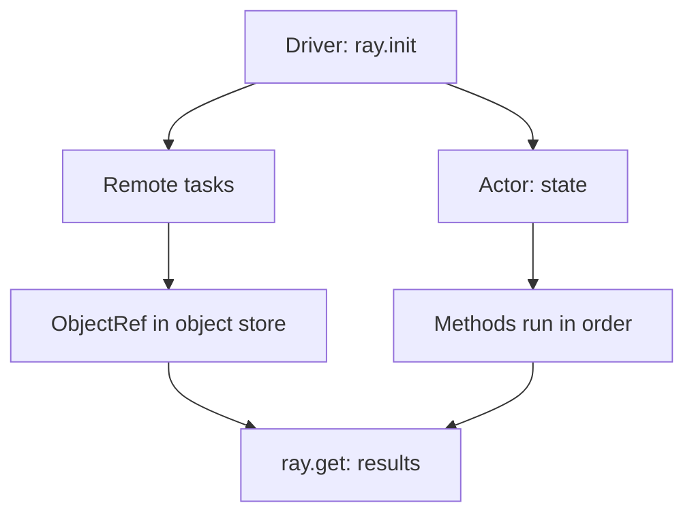

## Why Ray

Dask scales tabular operations well, but what if you need to parallelize arbitrary code: image processing, simulations, model training, web services? Ray is a general-purpose distributed execution system. It takes ordinary Python functions and classes and teaches them to work in parallel — on one machine or on a whole cluster, almost without code changes.

Ray has become an industry standard: parallel training libraries (Ray Train), data processing (Ray Data), hyperparameter tuning (Ray Tune), and distributed RL (RLlib) are built on it. At the same time, the low-level API — tasks and actors — is simple and clear.

Installation:

```bash
pip install "ray[default]"
```

## Starting Ray

Before using Ray you need to initialize the runtime:

```python
import ray

ray.init(ignore_reinit_error=True, num_cpus=4)
```

`num_cpus` limits the number of cores Ray can use. `ignore_reinit_error=True` allows safely calling `ray.init()` multiple times, for example in a notebook. When Ray is no longer needed, stop it: `ray.shutdown()`.

## Remote Functions

An ordinary function becomes "remote" with one decorator:

```python
@ray.remote
def double(x):
    return x * 2
```

Calling such a function doesn't execute it immediately — instead it returns an ObjectRef (a future):

```python
futures = [double.remote(i) for i in range(10)]
print(futures)          # [ObjectRef(...), ...]
```

To get values, call `ray.get()`:

```python
results = ray.get(futures)
print(results)          # [0, 2, 4, ..., 18]
```

Each `double.remote(i)` is an independent task. Ray distributes them across workers and collects results. Creating 1000 tasks and running them on 4 cores is a standard pattern.

## Parallel Reduce

A popular technique is "divide and conquer": split data into chunks, compute partial sums in parallel, then add them:

```python
@ray.remote
def partial_sum(chunk):
    return sum(chunk)

data = list(range(1_000_000))
chunks = [data[i::4] for i in range(4)]

futures = [partial_sum.remote(c) for c in chunks]
total = sum(ray.get(futures))
print(total)   # 499999500000
```

Unlike a naive loop, the four chunks are computed simultaneously, and the final addition takes microseconds.

## Actors: State Between Calls

Stateless functions are great for "pure" computations. But often long-lived state is needed: a counter, a connection pool, a model. For this, Ray offers actors — remote objects with methods:

```python
@ray.remote
class Counter:
    def __init__(self):
        self.value = 0

    def increment(self, step=1):
        self.value += step
        return self.value

    def get(self):
        return self.value

counter = Counter.remote()        # create an actor
counter.increment.remote(5)
counter.increment.remote(3)
print(ray.get(counter.get.remote()))   # 8
```

Actor methods are called remotely and run in order, so state isn't corrupted by parallel calls. A classic example is a parallel counter: 100 tasks call `increment.remote(1)`, and the final value is always exactly 100.

## Ray in a Cluster

The same code works on a cluster: on the head machine run `ray start --head`, on workers — `ray start --address=<head>:6379`, and in the code just pass the address:

```python
ray.init(address="auto")
```

The API doesn't change: `@ray.remote`, `ObjectRef`, `ray.get`. Moving from a notebook to a cluster is changing one line.

Execution scheme in Ray: the driver sends tasks to workers, results live in the object store, and an actor keeps state between calls.



## When Ray, and When Dask or Polars

- Polars — maximum speed on one machine within one table;
- Dask — scaling pandas code and tabular pipelines;
- Ray — arbitrary distributed tasks, services, and ML pipelines.

They are not competitors: often in one project Polars computes inside a worker, Dask distributes tasks, and Ray orchestrates it all. Now practice.

<!--TASK-->
### Task 1
Create a file `ray_intro.py`. Initialize Ray with `num_cpus=4` and `ignore_reinit_error=True`. Define a remote function `square_remote(x)` that returns `x * x`. Run it on the numbers from 0 to 9 via `square_remote.remote(i)`, collect the results with `ray.get()` and print the list. At the end call `ray.shutdown()`. Verify that the output is the list of squares of the numbers from 0 to 81.

### Task 2
Implement parallel summation. Create a list `data = list(range(1_000_000))`. Write a remote function `partial_sum(chunk)`. Split `data` into 4 parts (for example, with the slice `data[i::4]`), run `partial_sum.remote()` for each part and add up the results. Compare with `sum(data)` and print `True` if the values match. Explain in a comment why the sum computes faster than a plain `sum()` on a multi-core machine.

### Task 3
Write an actor `BankAccount` with a field `balance`, initially 0, and methods `deposit(amount)`, `withdraw(amount)` (it doesn't allow going negative: if `amount > balance`, it returns `False` and changes nothing) and `get_balance()`. Create the actor, perform 10 parallel `deposit.remote(100)` calls, then check that the balance is 1000. Then call `withdraw.remote(500)` and print the final balance.

### Task 4
Write pytest tests for remote functions. In `ray_utils.py` define:

```python
import ray

ray.init(ignore_reinit_error=True, num_cpus=2)

@ray.remote
def square(x):
    return x * x

def parallel_squares(numbers):
    return ray.get([square.remote(n) for n in numbers])
```

In `test_ray_utils.py` write tests: (1) `parallel_squares([1, 2, 3]) == [1, 4, 9]`; (2) for an empty list it returns `[]`; (3) for negative numbers the squares are correct; (4) the result doesn't change when called again. Run pytest and make sure everything is green.

### Task 5
Write pytest tests for the actor. Add to `ray_utils.py`:

```python
@ray.remote
class Counter:
    def __init__(self):
        self.value = 0

    def increment(self):
        self.value += 1
        return self.value

    def get(self):
        return self.value
```

In `test_ray_utils.py` write a test: create the actor, launch 50 `increment.remote()` tasks (collect them via `ray.get`), then check that the final `get()` equals 50. Add a second test: two independent actors don't affect each other (each has its own balance). Call `ray.shutdown()` in a final fixture after all tests.

### Task 6
Write a script `ray_wait.py`: create a remote function `sleep_and_return(i)` that sleeps `0.1 * i` seconds and returns `i`. Launch 8 tasks, then in a loop call `ray.wait(futures, num_returns=2)` and process the ready results via `ray.get` until the list of unfinished tasks is empty. For each pair print the values in ascending order. Expected output — four lines with pairs of numbers, with smaller numbers in the first pairs, since those tasks finished earlier.

### Task 7
Implement shared data transfer. Create a list of a million numbers, put it into the object store via `ray.put(data)` and pass the resulting reference to four remote tasks `chunk_sum(ref, start, end)`, which call `ray.get(ref)` inside and sum a slice. Add up the results and compare with `sum(data)`. Print the number of tasks and `True`. Explain in a comment why `ray.put` is preferable to passing the list as an argument to each task.

<!--/TASK-->

<!--HINT-->
### Hint 1
Decorator: `@ray.remote` above the function. Call: `square_remote.remote(i)` — don't confuse it with a regular call. `ray.get()` takes a list of futures and returns a list of results. Don't forget `ray.init()` before and `ray.shutdown()` after.

### Hint 2
Splitting: `chunks = [data[i::4] for i in range(4)]` — step 4 gives four roughly equal parts. Launch: `futures = [partial_sum.remote(chunk) for chunk in chunks]`, then `total = sum(ray.get(futures))`. Compare: `print(total == sum(data))`.

### Hint 3
Actor: a class with the `@ray.remote` decorator. Creating: `acc = BankAccount.remote()`. Calls: `acc.deposit.remote(100)`. For the parallel deposit launch 10 tasks in a loop and collect them with `ray.get()`. In `withdraw` check `if amount > self.balance: return False`.

### Hint 4
Tests are plain functions in `test_ray_utils.py` that import `parallel_squares`. For an empty list: `ray.get([])` returns `[]`. A repeated call must not change global state — this is a property of pure functions. Don't forget `import ray` in the test file for explicit initialization.

### Hint 5
For 50 parallel increments collect the results: `ray.get([counter.increment.remote() for _ in range(50)])` — they will run one after another inside the actor, so the total is exactly 50. For independence, create two actors and increment only one of them; the other must stay at 0. Cleanup: a fixture with `yield` and `ray.shutdown()` after.

### Hint 6
`ray.wait(refs, num_returns=2)` returns two lists: ready references and the remaining ones. In the loop: `ready, pending = ray.wait(pending, num_returns=2)`, then `print(sorted(ray.get(ready)))`, and replace `pending` with the new list. Loop `while pending:`. The sleeping task is `time.sleep(0.1 * i)`.

### Hint 7
`ref = ray.put(data)` puts the list into the object store once and returns an `ObjectRef`. In the task accept exactly the reference: `def chunk_sum(ref, start, end): data = ray.get(ref)`. Splitting — `n = len(data) // 4`, boundaries `i * n` and `(i + 1) * n` for `i` from 0 to 3. Compare: `abs(total - sum(data)) < 1e-6`.

<!--/HINT-->

<!--SOLUTION-->
### Walkthrough 1
Solution:

```python
import ray

ray.init(ignore_reinit_error=True, num_cpus=4)

@ray.remote
def square_remote(x):
    return x * x

futures = [square_remote.remote(i) for i in range(10)]
print(ray.get(futures))

ray.shutdown()
```

Output: `[0, 1, 4, 9, 16, 25, 36, 49, 64, 81]`. What's happening here? `ray.init` starts the runtime with four workers. The `@ray.remote` decorator turns the function into a remote one: instead of executing, it returns an `ObjectRef`. Ten futures are created instantly, and Ray executes the functions on workers in parallel. `ray.get(futures)` blocks until all results arrive and returns the list. This is the "fire-and-forget" pattern: we don't wait for each task individually — we send them all at once and fetch the results together. `ray.shutdown()` properly frees resources.

### Walkthrough 2
Solution:

```python
import ray

ray.init(ignore_reinit_error=True, num_cpus=4)

@ray.remote
def partial_sum(chunk):
    return sum(chunk)

data = list(range(1_000_000))
chunks = [data[i::4] for i in range(4)]

futures = [partial_sum.remote(c) for c in chunks]
total = sum(ray.get(futures))

print("Match:", total == sum(data))
ray.shutdown()
```

Output: `Match: True`. What's happening here? The slice `data[i::4]` splits the list into four interleaved chunks of about 250 thousand elements each. Four `partial_sum` tasks run simultaneously — each on its own core. Then `sum(ray.get(futures))` adds up the four partial sums. On a quad-core machine this gives a speedup close to 4× for pure summation, because the tasks are independent and don't contend for data. The check `total == sum(data)` guarantees the parallel version lost no values.

### Walkthrough 3
Solution:

```python
import ray

ray.init(ignore_reinit_error=True, num_cpus=4)

@ray.remote
class BankAccount:
    def __init__(self):
        self.balance = 0

    def deposit(self, amount):
        self.balance += amount
        return self.balance

    def withdraw(self, amount):
        if amount > self.balance:
            return False
        self.balance -= amount
        return self.balance

    def get_balance(self):
        return self.balance

acc = BankAccount.remote()
ray.get([acc.deposit.remote(100) for _ in range(10)])
print("Balance after deposits:", ray.get(acc.get_balance.remote()))
print("After withdrawal:", ray.get(acc.withdraw.remote(500)))
ray.shutdown()
```

Output: `Balance after deposits: 1000`, `After withdrawal: 500`. What's happening here? Actor methods are called remotely and execute sequentially inside the actor, so 10 parallel deposits sum to exactly 1000 — there are no races. `withdraw` guards against a negative balance by returning `False` when trying to withdraw more than is available. Actors are a way to keep state that must survive multiple remote calls — for example, a connection pool or a model.

### Walkthrough 4
Solution:

```python
import pytest
from ray_utils import parallel_squares

def test_squares_basic():
    assert parallel_squares([1, 2, 3]) == [1, 4, 9]

def test_empty_list():
    assert parallel_squares([]) == []

def test_negative_numbers():
    assert parallel_squares([-2, -1, 0]) == [4, 1, 0]

def test_repeatable():
    first = parallel_squares([5, 6])
    second = parallel_squares([5, 6])
    assert first == second == [25, 36]
```

What's happening here? The tests check a pure function without side effects: basic squares, an empty list (an important edge case — `ray.get([])` correctly returns `[]`), negative numbers, and idempotency. Since `parallel_squares` creates new tasks every time, the tests are independent of each other. Run: `pytest test_ray_utils.py -v`. Initialization happens on import of `ray_utils` — `ray.init(ignore_reinit_error=True)` survives repeated calls.

### Walkthrough 5
Solution:

```python
import pytest
import ray
from ray_utils import Counter

def test_counter_parallel_increments():
    counter = Counter.remote()
    ray.get([counter.increment.remote() for _ in range(50)])
    assert ray.get(counter.get.remote()) == 50

def test_counters_are_independent():
    a = Counter.remote()
    b = Counter.remote()
    ray.get(a.increment.remote())
    assert ray.get(a.get.remote()) == 1
    assert ray.get(b.get.remote()) == 0

@pytest.fixture(scope="session", autouse=True)
def shutdown_ray():
    yield
    ray.shutdown()
```

What's happening here? The first test launches 50 `increment` tasks — inside the actor they run one after another, so the final value is exactly 50. The second test checks isolation: each actor is a separate object with its own state. The `shutdown_ray` fixture with `scope="session"` guarantees that `ray.shutdown()` runs once after all tests in the session. If we didn't shut Ray down, workers would linger until the end of the process — a common mistake in tests with Ray.

### Walkthrough 6
Solution:

```python
import time
import ray

ray.init(ignore_reinit_error=True, num_cpus=4)

@ray.remote
def sleep_and_return(i):
    time.sleep(0.1 * i)
    return i

futures = [sleep_and_return.remote(i) for i in range(8)]
pending = futures
while pending:
    ready, pending = ray.wait(pending, num_returns=2)
    print(sorted(ray.get(ready)))

ray.shutdown()
```

Output (pair order depends on the machine):

```
[0, 1]
[2, 3]
[4, 5]
[6, 7]
```

What's happening here? All eight tasks are submitted at once, but `ray.get(futures)` would make us wait for the slowest one. `ray.wait` returns control as soon as `num_returns` tasks are ready, so we process results as they arrive — this is the basis of streaming long batches. The `ready` and `pending` lists don't overlap: `ready` holds finished references, `pending` holds the rest, and the loop continues on `pending`. The `sorted` function is only for readable output: order within a pair isn't guaranteed. In practice this pattern is used to start post-processing without waiting for the whole batch.

### Walkthrough 7
Solution:

```python
import ray

ray.init(ignore_reinit_error=True, num_cpus=4)

@ray.remote
def chunk_sum(ref, start, end):
    data = ray.get(ref)
    return sum(data[start:end])

data = list(range(1_000_000))
ref = ray.put(data)
step = len(data) // 4

futures = [chunk_sum.remote(ref, i * step, (i + 1) * step) for i in range(4)]
total = sum(ray.get(futures))

print("Tasks:", len(futures))
print("Match:", total == sum(data))
ray.shutdown()
```

Output: `Tasks: 4` and `Match: True`. What's happening here? `ray.put` serializes the list into the object store once and returns a reference. When the reference is passed as an argument to a remote function, Ray doesn't copy a million numbers into each task: the worker receives the `ObjectRef` and reads the object from the shared store in place, and `ray.get(ref)` inside the task materializes it locally. Without `ray.put`, each `chunk_sum.remote(data, ...)` call would serialize the whole list four times — wasted traffic and memory. Note: the slice `data[start:end]` creates a copy of the chunk, so the worker's peak memory is about a quarter of the list plus the original object in the store. The sum check guarantees the slice boundaries cover the whole range without gaps or overlaps.

<!--/SOLUTION-->

<!--QUIZ-->
What does calling a remote Ray function return?
- An ObjectRef — a future for the result
- The result immediately
- A list of all results
* Correct answer: An ObjectRef — a future for the result
@ray.remote returns an ObjectRef, and the value is obtained via ray.get().

How do you get values from a list of futures?
- ray.get(futures)
- futures.values()
- compute(futures)
* Correct answer: ray.get(futures)
ray.get takes a list of ObjectRefs and returns a list of results.

What is an actor in Ray?
- A remote object with state and methods
- A stateless function
- A thread pool
* Correct answer: A remote object with state and methods
An actor keeps state, and its methods are called remotely and sequentially.

What does ray.init(num_cpus=4) do?
- Starts the Ray runtime with four workers
- Creates four processes
- Sets up a cluster of four machines
* Correct answer: Starts the Ray runtime with four workers
num_cpus limits the number of cores for a local run.

Why is ray.shutdown() needed?
- To free runtime resources
- To save results
- To restart the computer
* Correct answer: To free runtime resources
After working with Ray you stop it, otherwise workers keep running.

How do you run Ray on a cluster?
- ray.init(address="auto")
- ray.start_cluster()
- ray.connect_remote()
* Correct answer: ray.init(address="auto")
The same code works on a cluster; only the initialization line changes.

What happens if an actor's method is called 50 times in parallel?
- Methods execute sequentially inside the actor; state isn't mixed up
- There will be a data race
- An exception will be raised
* Correct answer: Methods execute sequentially inside the actor; state isn't mixed up
The actor serializes method calls, so the counter is always correct.

What is usually faster: sum(ray.get(futures)) or a plain sum() on a large list?
- The parallel version on a multi-core machine
- Plain sum() always
- They always take the same time
* Correct answer: The parallel version on a multi-core machine
Independent tasks are spread across cores, which gives a speedup.

Which decorator turns a class into an actor?
- @ray.remote
- @ray.actor
- @ray.task
* Correct answer: @ray.remote
The same decorator as for functions, but applied to a class.

What is needed to run Ray again in one process?
- Pass ignore_reinit_error=True to ray.init
- Restart the process
- Nothing, Ray will handle it
* Correct answer: Pass ignore_reinit_error=True to ray.init
This suppresses the re-initialization error.

What does `ray.wait(refs, num_returns=2)` return?
- Two lists: ready and remaining references
- Two ready values
- One value and an error
* Correct answer: Two lists: ready and remaining references
The first list is finished tasks, the second is those still running.

What does `ray.put(data)` do?
- Places the object in the object store and returns an ObjectRef
- Writes data to a file
- Creates an actor
* Correct answer: Places the object in the object store and returns an ObjectRef
The reference can then be passed to tasks without re-serialization.

What happens when an ObjectRef is passed as an argument to a remote function?
- Ray substitutes the value from the object store on the worker side
- Only a number is passed
- The task fails with an error
* Correct answer: Ray substitutes the value from the object store on the worker side
A reference is a lightweight pointer; data isn't copied into each call.

Why are one actor's methods not executed in parallel?
- The actor serializes calls to protect its state
- An actor has only one method
- Ray can't parallelize methods
* Correct answer: The actor serializes calls to protect its state
Sequential execution eliminates races on the object's fields.

<!--/QUIZ-->
