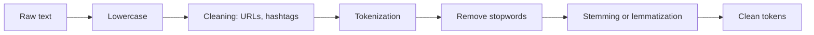

Machines do not read text the way we do. To a model, “Hello!”, “hello”, and “hello there” are three different strings until we bring them to a common form. Preprocessing is the first stage of any NLP pipeline: turn “dirty” text from social media, comments, or reviews into a clean, normalized set of tokens that algorithms can work with.

## Why it matters

Imagine you are collecting statistics on brand mentions. If you simply count substring occurrences, `Nike`, `nike`, `NIKE!`, and `nike_` will all be counted separately. Without normalization, the model "sprays" the signal across hundreds of nearly identical forms and learns worse. Preprocessing solves several problems:

- removes noise — links, hashtags, mentions, stray punctuation;
- brings words to a single form — case, endings, wordforms;
- cuts out junk words — stopwords with no semantic load;
- shrinks the vocabulary — instead of thousands of forms, it keeps tens of thousands of distinct meanings.

## The preprocessing pipeline

The classic chain looks like this: **normalization → cleaning → tokenization → stopword removal → stemming/lemmatization**. Of course, the order and composition of steps change for a specific task, but the basic skeleton is the same.

### 1. Case normalization and cleaning

The simplest step is to lowercase the text. Then, with regular expressions, we remove links, mentions, hashtags, and punctuation:

```python
import re

text = "Hello!!! I am learning NLP in 2026. Write me: https://example.com #python"
cleaned = re.sub(r"https?://\S+|#\w+|@\w+|[^\w\s]", "", text.lower())
print(cleaned)
```

Output: `hello i am learning nlp in 2026 write me`. Notice: `[^\w\s]` removes everything that is not a letter, digit, or space, while `\S+` removes the URLs themselves. Digits are often kept — they can carry meaning (years, prices).

### 2. Tokenization

Tokenization splits text into tokens — words, numbers, sometimes punctuation. A naive `text.split()` works poorly: for `"Hello, world!"` it returns `['Hello,', 'world!']` with garbage attached. Better to use `nltk.word_tokenize`:

```python
import nltk
nltk.download("punkt_tab")

from nltk.tokenize import word_tokenize

tokens = word_tokenize("Hello, world! This is the second NLP lesson.")
print(tokens)
```

Output: `['Hello', ',', 'world', '!', 'This', 'is', 'the', 'second', 'NLP', 'lesson', '.']`. Notice: punctuation became separate tokens — easy to filter out later.

### 3. Stopwords

Stopwords are words like “and”, “in”, “on”, “not”, “that”. They occur often but carry little meaning for most tasks. `nltk` ships ready-made lists:

```python
import nltk
nltk.download("stopwords")

from nltk.corpus import stopwords

sw = set(stopwords.words("english"))
filtered = [t for t in tokens if t.lower() not in sw]
print(filtered)
```

### 4. Stemming and lemmatization

Here we bring wordforms back to their base. **Stemming** simply chops off endings: `beautiful → beauti`, `ran → ran`. It is fast but crude and sometimes cuts the wrong way. **Lemmatization** brings a word to its dictionary form — the lemma: `beautiful → beautiful`, `ran → run`. It is more accurate but slower and needs a lexicon.

For English, NLTK offers `SnowballStemmer("english")`:

```python
from nltk.stem import SnowballStemmer

stemmer = SnowballStemmer("english")
for w in ["beautiful", "beauty", "house"]:
    print(w, "->", stemmer.stem(w))
```

Output: `beautiful -> beauti`, `beauty -> beauti`, `house -> hous`. There is also the classic `PorterStemmer`:

```python
from nltk.stem import PorterStemmer, WordNetLemmatizer
import nltk

nltk.download("wordnet")
ps = PorterStemmer()
wnl = WordNetLemmatizer()

print(ps.stem("running"))              # run
print(wnl.lemmatize("better", pos="a"))  # good
```

Stemming and lemmatization are not interchangeable steps: you usually choose one of them. Lemmatization is more expensive, but the quality is higher, so for English text it is often preferred.



## Summary

Good preprocessing is half the battle in any NLP task. It shrinks the vocabulary, speeds up training, and improves model accuracy. In the next lessons we will assemble full pipelines from these building blocks — from sentiment analysis to chatbots.

<!--TASK-->
### Task 1
Write a function `clean_text(text)` that performs normalization and cleaning: lowercases the text, removes URLs (`http://...`, `https://...`), mentions (`@name`), hashtags (`#tag`), and all punctuation (keeping only letters, digits, and spaces). The function returns a cleaned string with single spaces between words. Test it on the string: `"Hello, @ivan! Check #NLP: https://example.com/learn"`. Expected output: `hello ivan check nlp learn`.

### Task 2
Write a function `tokenize_words(text)` that tokenizes text with `nltk.word_tokenize`, lowercases the tokens, removes punctuation (tokens made only of letters and digits) and English stopwords from `nltk.corpus.stopwords.words("english")`. Return the list of clean tokens. Then create a file `test_tokenize.py` with pytest tests: (1) for `"Hello, world! This is a lesson."` the result contains no token `"world!"` or `","`, and contains `"lesson"`; (2) the result contains no stopwords (`"the"`, `"and"`, `"for"`). Run `pytest` and get a green run.

### Task 3
Write a function `normalize(tokens, mode)` that takes a list of tokens and a mode: `mode="stem"` — stemming with `SnowballStemmer("english")`, `mode="lemma"` — lemmatization with `WordNetLemmatizer()` (by default `pos="n"` for nouns). The function returns a list of normalized words. Show it working on the list `["beautiful", "beauty", "houses", "house"]` in both modes and explain why the results differ.

### Task 4
Write a script that takes the text: `"Coffee in this cafe is excellent. The coffee maker in the kitchen is old, but the coffee is still tasty."`, cleans it with the function from Task 1, tokenizes without stopwords (Task 2), then counts the frequencies of the remaining words with `nltk.FreqDist` and prints the top 3 most frequent words in the format `word: count`. Expected output (order inside the top doesn't matter): `coffee: 2`, `cafe: 1`, `excellent: 1`, plus one of the other words with count 1, and `"coffee"` must be first.

### Task 5
Combine everything into one function `preprocess(text)` that returns a list of normalized tokens: cleaning → tokenization → stopword removal → lemmatization (via `WordNetLemmatizer`). Create a file `test_preprocess.py` with pytest tests: (1) all tokens are lowercase; (2) no punctuation or stopwords among the tokens; (3) for `"They ran and ran, but the house was far away."` the token `"house"` is present (lemma), and `"ran"` is normalized. Run `pytest` and make sure all tests pass.
### Task 6
Write a function `top_ngrams(text, n, k)` that builds a frequency list of n-grams over the cleaned text. Use the cleaning from Task 1, tokenization from Task 2 (without stopwords), and `nltk.ngrams`. The function should return a list of tuples `(n-gram, frequency)` of length at most `k`, sorted by frequency descending, and for equal frequencies — alphabetically, so the order is deterministic. Test it on the text `"Machine learning changes the world. Machine learning requires data. Data decides everything."` with `n=2, k=3` and print each bigram separated by a space in the format `words -> frequency`. Expected output: the first line `machine learning -> 2`, then two bigrams with frequency 1 in alphabetical order. Explain why n-grams are needed in NLP.

### Task 7
Implement rare-word filtering: the function `filter_rare(tokens, min_count)` returns a tuple `(new_tokens, stats)`, where `new_tokens` are the tokens that occur at least `min_count` times, and `stats` is a dict with keys `vocab_before`, `vocab_after`, and `coverage` (the share of retained tokens, rounded to two decimals). Test it on the list `["coffee", "cafe", "coffee", "house", "house", "house", "cat", "dog", "world", "tea", "tea"]` with `min_count=2`. Expected output: `vocab_before=7`, `vocab_after=3`, `coverage=0.64`, and `new_tokens` contains only `coffee`, `house`, and `tea`. Explain why filtering hapax words shrinks the vocabulary but should not be applied to short texts.

<!--/TASK-->

<!--HINT-->
### Hint 1
Use `re.sub()` with several patterns: `r"https?://\S+"`, `r"@\w+"`, `r"#\w+"`, and `r"[^\w\s]"` — all inside one `re.sub(r"https?://\S+|@\w+|#\w+|[^\w\s]", "", text.lower())`. Then collapse extra spaces with `re.sub(r"\s+", " ", s).strip()`.

### Hint 2
After `word_tokenize`, filter like this: `t.isalpha()` (or `t.isalnum()`) to drop punctuation, then `t.lower() not in sw`. For pytest, create plain `test_...` functions with `assert`. If `nltk` doesn't know a lexicon, run `nltk.download("stopwords")` and `nltk.download("punkt_tab")`.

### Hint 3
`SnowballStemmer("english")` is created once outside the function. `WordNetLemmatizer()` requires the `wordnet` corpus to be downloaded: `nltk.download("wordnet")`. Remember: the lemmatizer treats words as nouns by default — with `pos="n"` the adjective "beautiful" stays unchanged, so for adjectives pass `pos="a"` (in the test you can stick to nouns).

### Hint 4
`FreqDist` from `nltk.probability` accepts a list and supports `most_common(3)`. Don't forget the text contains the same wordforms — after normalization they merge into one token, which is why "coffee" occurs twice.

### Hint 5
Write the function by composition: `clean_text` → `tokenize_words` → lemmatization. In the tests check invariants: `all(t == t.lower() for t in tokens)`, `all(t.isalnum() for t in tokens)`, and the absence of stopwords. For point (3), compare the result with a concrete list — after lemmatization the tokens `"ran"` and `"ran"` turn into some form, so it's simpler to check that `"house"` is present and the original form is absent.
### Hint 6
`nltk.ngrams(tokens, n)` returns a generator of tuples. To count frequencies, wrap it in `FreqDist`: `FreqDist(ngrams(tokens, 2))`. For deterministic sorting use the key `lambda item: (-item[1], item[0])` — the minus before the frequency flips the sort to descending, and the second element of the key breaks ties alphabetically. Don't forget that `n=2` on a list of one token gives an empty result.

### Hint 7
First count frequencies with `Counter(tokens)`, then filter: `[t for t in tokens if counts[t] >= min_count]`. The vocabulary sizes are `len(counts)` before filtering and `len({t for t in tokens if counts[t] >= min_count})` after. Compute `coverage` as `sum(counts[t] for t in kept) / len(tokens)`: it's the share of tokens, not words, so frequent words contribute more. Rounding — `round(value, 2)`.

<!--/HINT-->

<!--SOLUTION-->
### Walkthrough 1
Solution:

```python
import re

def clean_text(text):
    text = text.lower()
    text = re.sub(r"https?://\S+|@\w+|#\w+", "", text)
    text = re.sub(r"[^\w\s]", "", text)
    return re.sub(r"\s+", " ", text).strip()

print(clean_text("Hello, @ivan! Check #NLP: https://example.com/learn"))
```

Output: `hello ivan check nlp learn`.

What happens here? The first `re.sub` removes URLs, mentions, and hashtags — the pattern `\S+` greedily swallows everything up to a space, so the link is removed entirely, tail included. The second `re.sub` erases punctuation: the class `[^\w\s]` means "everything that is not a letter/digit (`\w`) and not a space (`\s`)". The third one collapses repeated spaces (for example, those left after removing a hashtag), and `strip()` trims the edges. Important: `\w` in Python includes letters of any language by default, so Cyrillic text is not harmed either.

### Walkthrough 2
Solution:

```python
import nltk
from nltk.tokenize import word_tokenize
from nltk.corpus import stopwords

sw = set(stopwords.words("english"))

def tokenize_words(text):
    tokens = word_tokenize(text.lower())
    return [t for t in tokens if t.isalnum() and t not in sw]
```

File `test_tokenize.py`:

```python
from tokenize_words import tokenize_words

def test_no_punct_and_has_content_word():
    tokens = tokenize_words("Hello, world! This is a lesson.")
    assert "world!" not in tokens
    assert "," not in tokens
    assert "lesson" in tokens

def test_no_stopwords():
    tokens = tokenize_words("I am going to school for a lesson")
    for stop in ["the", "and", "for"]:
        assert stop not in tokens
```

Run: `pytest -q` → `2 passed`.

What happens here? `t.isalnum()` keeps only tokens made of letters and digits — commas and exclamation marks are cut. `t not in sw` drops stopwords. The tests check the function's contract: no garbage, and content words present. By the way, we remove stopwords after normalizing: we compare the already-lowercased token against the stopword list, so "The" and "the" never diverge.

### Walkthrough 3
Solution:

```python
import nltk
nltk.download("wordnet")

from nltk.stem import SnowballStemmer, WordNetLemmatizer

stemmer = SnowballStemmer("english")
lemmatizer = WordNetLemmatizer()

def normalize(tokens, mode="stem"):
    if mode == "stem":
        return [stemmer.stem(t) for t in tokens]
    return [lemmatizer.lemmatize(t, pos="n") for t in tokens]

words = ["beautiful", "beauty", "houses", "house"]
print("stem:", normalize(words, "stem"))
print("lemma:", normalize(words, "lemma"))
```

Output:

```
stem: ['beauti', 'beauti', 'hous', 'hous']
lemma: ['beautiful', 'beauty', 'house', 'house']
```

What happens here? Stemming chops endings blindly: `beautiful` and `beauty` both become `beauti`, and `houses` and `house` both become `hous`. Lemmatization with `pos="n"` looks up dictionary forms — the nouns converge (`houses` → `house`), but for the adjective `beautiful` with `pos="n"` it does nothing (WordNet is organized by part of speech, and adjectives must be passed as `pos="a"`). The takeaway: stemming is fast but crude; lemmatization is more accurate when you pass the right part of speech. spaCy ships a real production lemmatizer too — we'll meet it in the next lesson.

### Walkthrough 4
Solution:

```python
from collections import Counter
from nltk.probability import FreqDist
from clean_text import clean_text
from tokenize_words import tokenize_words

text = "Coffee in this cafe is excellent. The coffee maker in the kitchen is old, but the coffee is still tasty."
tokens = tokenize_words(clean_text(text))
freq = FreqDist(tokens)
for word, count in freq.most_common(3):
    print(f"{word}: {count}")
```

Output (example):

```
coffee: 2
cafe: 1
excellent: 1
```

What happens here? After cleaning and tokenization without stopwords, we're left with `coffee, cafe, excellent, maker, kitchen, old, still, tasty`. `FreqDist.most_common(3)` returns three "word → count" pairs. "Coffee" occurs twice — once from the first sentence, once from the third — and confidently takes first place. The other words occur once each; their exact order depends on internal sorting, which is why the task didn't care about the order inside the top.

### Walkthrough 5
Solution:

```python
from clean_text import clean_text
from tokenize_words import tokenize_words
from nltk.stem import WordNetLemmatizer

lemmatizer = WordNetLemmatizer()

def preprocess(text):
    tokens = tokenize_words(clean_text(text))
    return [lemmatizer.lemmatize(t, pos="n") for t in tokens]
```

File `test_preprocess.py`:

```python
from preprocess import preprocess

def test_lowercase():
    assert all(t == t.lower() for t in preprocess("Hello, WORLD!"))

def test_no_punct_no_stopwords():
    tokens = preprocess("I am going to school, but the house is far.")
    assert all(t.isalnum() for t in tokens)
    for stop in ["the", "and", "for", "but"]:
        assert stop not in tokens

def test_lemmas_present():
    tokens = preprocess("They ran and ran, but the house was far away.")
    assert "house" in tokens
```

Run: `pytest -q` → `3 passed`.

What happens here? The function composes the three previous steps. The tests check pipeline invariants: case, absence of garbage and stopwords, and that lemmatization didn't "lose" the key word. Note: `"house"` stays `"house"` after lemmatization (its form equals the lemma), while verbs like `"ran"` are left untouched with `pos="n"` — so we only assert the noun is present. If you want to normalize verbs too, you'd need your own logic or spaCy.
### Walkthrough 6
Solution:

```python
from nltk import ngrams
from nltk.probability import FreqDist
from clean_text import clean_text
from tokenize_words import tokenize_words

def top_ngrams(text, n=2, k=5):
    tokens = tokenize_words(clean_text(text))
    freq = FreqDist(ngrams(tokens, n))
    ordered = sorted(freq.items(), key=lambda item: (-item[1], item[0]))
    return ordered[:k]

text = ("Machine learning changes the world. "
        "Machine learning requires data. Data decides everything.")
for gram, count in top_ngrams(text, n=2, k=3):
    print(" ".join(gram), "->", count)
```

Output:

```
machine learning -> 2
data data -> 1
data decides -> 1
```

What happens here? The text first goes through the same pipeline as in the previous tasks, so bigrams are built over clean tokens with no punctuation or stopwords — otherwise pairs like `("world", ".")` would pollute the statistics. `FreqDist` works with any hashable objects, tuples included, so `ngrams` can be fed to it directly. Sorting with the key `(-count, gram)` gives a stable order: first by frequency descending, then lexicographically. Notice that the pairs `data → data` and `data → decides` didn't merge: we didn't apply lemmatization here, and different wordforms produce different bigrams. That's exactly why in real projects n-grams are built after lemmatization — otherwise the statistics smear across forms. Why n-grams at all: single words lose order, while the bigram `machine learning` is a stable concept that doesn't exist in a unigram vocabulary. Language models, collocation detectors, and classifier features are built on n-grams.

### Walkthrough 7
Solution:

```python
from collections import Counter

def filter_rare(tokens, min_count=2):
    counts = Counter(tokens)
    kept = [t for t in tokens if counts[t] >= min_count]
    vocab_before = len(counts)
    vocab_after = len({t for t in kept})
    coverage = round(len(kept) / len(tokens), 2) if tokens else 0.0
    stats = {"vocab_before": vocab_before,
             "vocab_after": vocab_after,
             "coverage": coverage}
    return kept, stats

tokens = ["coffee", "cafe", "coffee", "house", "house", "house",
          "cat", "dog", "world", "tea", "tea"]
kept, stats = filter_rare(tokens, min_count=2)
print("kept:", kept)
print(stats)
```

Output:

```
kept: ['coffee', 'coffee', 'house', 'house', 'house', 'tea', 'tea']
{'vocab_before': 7, 'vocab_after': 3, 'coverage': 0.64}
```

What happens here? `Counter` counts frequencies in one pass, then the list is filtered by the threshold — importantly, we keep the original token order and their repetitions, rather than turning the text into a set. `vocab_before=7` because there are seven unique words: coffee, cafe, house, cat, dog, world, tea. After the `min_count=2` threshold, three words remain, and coverage is computed over tokens: 7 retained out of 11 — that's `0.64`. The point of the trick: hapax words (occurring once) carry almost no generalizing power — the model never learns their weight, yet each such word adds a dimension to the vocabulary and bloats the feature matrix. On large corpora, cutting rare words shrinks the vocabulary severalfold while losing a fraction of a percent of text. But on short texts — a single review, a couple of paragraphs — almost everything is a hapax word, and filtering would simply destroy the data; there the threshold is set to 1 or not applied at all. Hence the practical rule: pick the threshold by corpus size and always check `coverage`, not just the vocabulary size.

<!--/SOLUTION-->

<!--QUIZ-->
Why is text preprocessing needed before training a model?
- So the model works faster and more accurately, reducing the number of nearly identical wordforms
- So the text becomes shorter to store
- To turn text into a picture
* Correct answer: So the model works faster and more accurately, reducing the number of nearly identical wordforms
Normalization shrinks the vocabulary and removes noise, which improves training quality.

What does re.sub(r"https?://\S+", "", "See https://x.io/abc!") return?
- "See !"
- "See https://x.io/abc!"
- An error
* Correct answer: "See !"
The \S+ pattern removes the URL entirely up to the space, leaving the text and the exclamation mark.

What is the result of nltk.word_tokenize("Hello, world!")?
- ['Hello', ',', 'world', '!']
- ['Hello,', 'world!']
- ['Hello', 'world']
* Correct answer: ['Hello', ',', 'world', '!']
nltk splits text into tokens, separating punctuation.

What are stopwords?
- Words with no semantic load: and, in, on, not
- The most frequent words of a text
- Words from the model's vocabulary
* Correct answer: Words with no semantic load: and, in, on, not
Stopwords carry no meaning and are usually removed during preprocessing.

How does stemming differ from lemmatization?
- Stemming chops off endings; lemmatization brings words to their dictionary form
- They are the same thing
- Lemmatization is faster than stemming
* Correct answer: Stemming chops off endings; lemmatization brings words to their dictionary form
Stemming is crude and fast; lemmatization is accurate and slow.

Which stemmer should you choose in NLTK for Russian text?
- SnowballStemmer("russian")
- PorterStemmer()
- LancasterStemmer()
* Correct answer: SnowballStemmer("russian")
PorterStemmer targets English; for Russian, use the Snowball stemmer.

What does WordNetLemmatizer().lemmatize("better", pos="a") return?
- good
- better
- bett
* Correct answer: good
The lemmatizer brings the adjective to its dictionary form good.

Which class in nltk counts word frequencies?
- FreqDist
- CountVectorizer
- Counter
* Correct answer: FreqDist
FreqDist from nltk.probability takes a list of tokens and supports most_common().

What does re.sub(r"[^\w\s]", "", text) do?
- Removes everything except letters, digits, and spaces
- Removes only digits
- Removes spaces
* Correct answer: Removes everything except letters, digits, and spaces
The character class [^\w\s] is a negation: everything that is not \w and not \s is removed.

What is the order of steps in the classic preprocessing pipeline?
- Normalization → cleaning → tokenization → stopwords → stemming/lemmatization
- Tokenization → normalization → cleaning
- Stemming → tokenization → cleaning
* Correct answer: Normalization → cleaning → tokenization → stopwords → stemming/lemmatization
First we clean the text, then split it into tokens and normalize them.
What is a bigram?
- A pair of adjacent tokens, e.g. ("machine", "learning")
- Any two words from the text in arbitrary order
- A word that occurs twice
* Correct answer: A pair of adjacent tokens, e.g. ("machine", "learning")
An n-gram is a sequence of n adjacent tokens that preserves order.

Why add a second sort key when sorting n-grams?
- So that ties in frequency are resolved deterministically
- To sort by length
- To speed up FreqDist
* Correct answer: So that ties in frequency are resolved deterministically
Without the second key, ties are resolved arbitrarily and the output changes between runs.

What happens to the vocabulary under lemmatization compared with stemming?
- The vocabulary is larger, but the forms remain readable
- The vocabulary is smaller, because stems are glued together more aggressively
- The vocabulary doesn't change
* Correct answer: The vocabulary is larger, but the forms remain readable
Lemmatization brings words to their dictionary form and doesn't glue different stems together as crudely as stemming.

Why filter out words that occur only once?
- They barely affect training but bloat the vocabulary and the feature matrix
- They are always typos
- They interfere with tokenization
* Correct answer: They barely affect training but bloat the vocabulary and the feature matrix
Hapax words give little signal but add dimensions; on short texts they must not be filtered.

<!--/QUIZ-->
