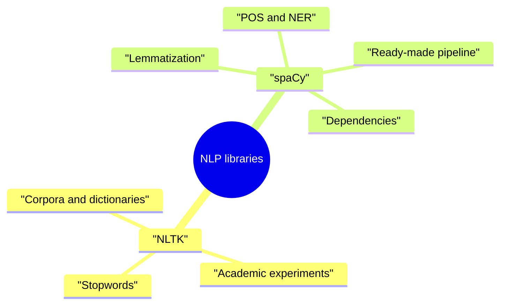

In the previous lesson we did preprocessing by hand. Now let's look at two libraries that do it for us and give much more: **NLTK** — the classic academic library with a large set of corpora, and **spaCy** — a modern industrial library with fast, pre-trained models.

## Installation and models

NLTK installs as a regular package; part of its data is downloaded separately with `nltk.download(...)` commands. spaCy also needs a language model — for English that is `en_core_web_sm`:

```bash
pip install nltk spacy
python -m spacy download en_core_web_sm
```

A model is a set of weights that determine how spaCy will parse text. Until the model is loaded, `nlp(text)` won't work.

## NLTK: tokenization and parts of speech

NLTK can split text into sentences (`sent_tokenize`) and words (`word_tokenize`), and can also tag parts of speech:

```python
import nltk
nltk.download("punkt_tab")
nltk.download("averaged_perceptron_tagger_eng")

from nltk.tokenize import sent_tokenize, word_tokenize
from nltk import pos_tag

text = "Moscow is the capital of Russia. Python is popular among developers."
sentences = sent_tokenize(text)
print(sentences)  # ['Moscow is the capital of Russia.', 'Python is popular among developers.']

tokens = word_tokenize(text)
print(pos_tag(tokens))
```

`pos_tag` returns a list of pairs `(word, tag)`. Tags like `NN` mean noun, `VB` — verb, `JJ` — adjective. Important: NLTK's default tagger was trained on English, so it gives accurate tags for English but inaccurate ones for other languages like Russian — this is a known limitation, and for Russian text you're better off with spaCy.

## spaCy: pipeline "out of the box"

spaCy builds a pipeline: text → tokenization → lemmatization → parts of speech → syntactic parsing → named entities. All of this happens in one call:

```python
import spacy

nlp = spacy.load("en_core_web_sm")
doc = nlp("Moscow is the capital of Russia. Python is popular among developers.")

for token in doc:
    print(token.text, token.lemma_, token.pos_, token.dep_)
```

Here `token.text` is the original form, `token.lemma_` is the lemma (dictionary form), `token.pos_` is the part of speech, and `token.dep_` is the role in the sentence (subject, predicate, etc.). Notice the lemmatization: it works reliably out of the box because spaCy uses a vocabulary and morphological rules trained on large corpora. This is the production-grade lemmatization we promised in the previous lesson.

## Named entities (NER)

NER is finding names, organizations, dates, and locations in text. spaCy marks them with the `ent_` attribute:

```python
doc = nlp("Steve Jobs founded Apple in 1976 in Cupertino.")
for ent in doc.ents:
    print(ent.text, ent.label_)
```

Output: `Steve Jobs PERSON`, `Apple ORG`, `1976 DATE`, `Cupertino LOC`. Entity types depend on the model: for `en_core_web_sm` these are `PERSON`, `ORG`, `LOC`/`GPE`, `DATE`, and others.

## Sentence splitting in both approaches

```python
# NLTK
sentences_nltk = sent_tokenize(text)

# spaCy
doc = nlp(text)
sentences_spacy = [sent.text for sent in doc.sents]
```

Both ways work, but spaCy additionally preserves the links between sentences and tokens — this matters for summarization and question-answering systems, which we'll cover later.

## When to choose what

- **NLTK** — when you need corpora (stopwords, wordnet), training your own taggers, academic experiments, light weight.
- **spaCy** — when you need to process lots of text quickly and accurately: lemmatization, POS, NER, dependencies, ready-made pipelines.

They are often used together: NLTK for dictionaries and metrics, spaCy for parsing. That's exactly what we'll do in the next lessons.



<!--TASK-->
### Task 1
Load the spaCy model `en_core_web_sm` and write a script that, for the sentence `"The quick brown fox jumps over the lazy dog"`, prints a line of the form `token | lemma | pos` for each token. For example, `jumps | jump | VERB`. Also print the number of tokens in the sentence.

### Task 2
Write a function `extract_entities(text)` that uses spaCy to find all named entities and returns a list of tuples `(entity_text, entity_type)`. Test it on the text: `"Elon Musk works at Tesla, and the company is located in Austin."` Print the result and the number of entities found. The expected output contains `Elon Musk` with type `PERSON` and `Austin` with type `LOC` (or `GPE`).

### Task 3
Compare sentence splitting: for the text `"The morning was clear. Then it started to rain, but we walked anyway."` print the sentence lists obtained via `nltk.sent_tokenize` and via `doc.sents` in spaCy. Print both lists and the number of sentences in each. Check that both give exactly 2 sentences.

### Task 4
Write a script that counts the part-of-speech (POS) distribution in an English text with spaCy: `"A beautiful cat quickly ran across the yard, and the dog barked loudly."` Print the top 3 parts of speech and their counts in the format `pos: count`. For example, `NOUN: 3`, `VERB: 2`, `ADJ: 1`. Then create a pytest test `test_pos.py` checking that the number of nouns (`NOUN`) is greater than the number of adjectives (`ADJ`) and that `VERB` is present in the distribution.

### Task 5
Write a function `find_keywords(text, top_n=5)` that takes an English text and returns the top `top_n` keywords by lemma frequency: tokenize with spaCy, drop stopwords (`token.is_stop`) and punctuation (`token.is_punct`), take lemmas (`token.lemma_`), and count frequencies with `collections.Counter`. The function returns a list of tuples `(lemma, count)`. Create pytest tests `test_keywords.py`: (1) for the text `"A car drives along the road, and the second car is parked on the roadside."` the lemma `"car"` is first and occurs twice; (2) the result contains no stopwords (`"along"`, `"and"`) and no punctuation; (3) the length of the result is not more than `top_n`. Run `pytest` and get a green run.
### Task 6
Write a function `subject_predicate(text)` that extracts "subject → predicate" pairs via spaCy's syntactic dependencies. For every token with the label `dep_ == "nsubj"`, take the token itself (`token.text`) and its head word (`token.head.text`) — `head` points to the predicate the subject belongs to. Test it on the text `"The student reads a book. The teacher explains the rule."` and print the pairs in the format `subject -> predicate`. Expected output: `student -> reads` and `teacher -> explains`. Explain why such parsing is more convenient than regular expressions.

### Task 7
Write a function `content_words(text, pos_filter=("NOUN", "VERB", "ADJ"))` that keeps only content words with the given parts of speech, dropping punctuation, spaces, and stopwords, and returns a list of dicts with keys `token`, `lemma`, `pos`. Save the result to `content_words.csv` via `csv.DictWriter` with the header `token,lemma,pos` and print the number of rows. Test it on the sentence `"A beautiful cat quickly ran across the yard."` Expected output: 4 rows — `beautiful/beautiful/ADJ`, `cat/cat/NOUN`, `ran/run/VERB`, `yard/yard/NOUN`.

<!--/TASK-->

<!--HINT-->
### Hint 1
Load the model once: `nlp = spacy.load("en_core_web_sm")`. Run `doc = nlp(sentence)`, then in a loop `for token in doc:` print `token.text`, `token.lemma_`, `token.pos_`. The number of tokens is `len(doc)`. If the model isn't found, check that `python -m spacy download en_core_web_sm` ran without errors.

### Hint 2
Entities live in `doc.ents`. For each entity take `ent.text` and `ent.label_`. Note: the `en_core_web_sm` model may recognize "Elon Musk" as one entity or as two — don't be alarmed, just print what you got and compare with the types `PERSON`, `ORG`, `LOC`/`GPE`.

### Hint 3
For NLTK don't forget `nltk.download("punkt_tab")`. In spaCy sentences are `list(doc.sents)`. The number of sentences is `len(...)`. Compare the lists by eye: they may differ in details (e.g., spaces); the main thing is the count.

### Hint 4
Collect `token.pos_` into a list, then `Counter(pos_list).most_common(3)`. In the test `test_pos.py` import your counting function (wrap the script in a function `pos_distribution(text)`). To check counts use `assert dist["NOUN"] > dist["ADJ"]` and `assert "VERB" in dist`.

### Hint 5
spaCy already has stopwords: `token.is_stop`, `token.is_punct`, and also `token.is_space`. After filtering, switch to lemmas. In the tests check that `"car"` occurs twice: `assert freq[0] == ("car", 2)` (or look for the pair in the list). Don't forget that `"second"` is not a stopword, so it may enter the top but must not push out "car". Give `top_n` a default of 5.
### Hint 6
The subject in spaCy is a token with `dep_ == "nsubj"`, and the predicate is its `head`. Loop over the document and collect pairs: `[(t.text, t.head.text) for t in doc if t.dep_ == "nsubj"]`. Don't confuse `token.head` (the parent in the dependency tree) with `token.children` (the children). The order of pairs follows the order of subjects in the text.

### Hint 7
Filter in a single condition: `not token.is_punct and not token.is_space and not token.is_stop and token.pos_ in pos_filter`. Collect dicts `{"token": token.text, "lemma": token.lemma_, "pos": token.pos_}`. For the CSV open the file with `newline=""` and `encoding="utf-8"` — otherwise on Windows empty lines appear between records. `writer.writeheader()` writes the header from `fieldnames`.

<!--/HINT-->

<!--SOLUTION-->
### Walkthrough 1
Solution:

```python
import spacy

nlp = spacy.load("en_core_web_sm")
doc = nlp("The quick brown fox jumps over the lazy dog")

for token in doc:
    print(f"{token.text} | {token.lemma_} | {token.pos_}")

print("Tokens:", len(doc))
```

Output (excerpt):

```
The | the | DET
quick | quick | ADJ
brown | brown | ADJ
fox | fox | NOUN
jumps | jump | VERB
...
Tokens: 9
```

What happens here? A single `nlp(text)` call runs the whole pipeline. `token.lemma_` gives the lemma — for `jumps` that's `jump`. This is where spaCy's power shows: lemmatization is far more accurate than the manual approaches from the previous lesson. `token.pos_` is the universal part-of-speech label: `NOUN`, `VERB`, `ADJ`, `ADV`, and others.

### Walkthrough 2
Solution:

```python
import spacy

nlp = spacy.load("en_core_web_sm")

def extract_entities(text):
    doc = nlp(text)
    return [(ent.text, ent.label_) for ent in doc.ents]

entities = extract_entities("Elon Musk works at Tesla, and the company is located in Austin.")
for ent in entities:
    print(ent)
print("Total entities:", len(entities))
```

Output (example):

```
('Elon Musk', 'PERSON')
('Tesla', 'ORG')
('Austin', 'GPE')
Total entities: 3
```

What happens here? `doc.ents` contains the entities found by the model. "Elon Musk" is recognized as `PERSON` (a person), `Tesla` as `ORG` (an organization), "Austin" as `GPE` (a geopolitical entity). The exact label values depend on the model version (for example, `LOC` instead of `GPE`), but the meaning is the same. NER is one of spaCy's most useful features: fact extraction, search, and analytics are built on it.

### Walkthrough 3
Solution:

```python
import nltk
import spacy

nltk.download("punkt_tab")
nlp = spacy.load("en_core_web_sm")

text = "The morning was clear. Then it started to rain, but we walked anyway."

nltk_sentences = nltk.sent_tokenize(text)
doc = nlp(text)
spacy_sentences = [sent.text for sent in doc.sents]

print("NLTK:", nltk_sentences)
print("spaCy:", spacy_sentences)
print("NLTK sentences:", len(nltk_sentences))
print("spaCy sentences:", len(spacy_sentences))
```

Output:

```
NLTK: ['The morning was clear.', 'Then it started to rain, but we walked anyway.']
spaCy: ['The morning was clear.', 'Then it started to rain, but we walked anyway.']
NLTK sentences: 2
spaCy sentences: 2
```

What happens here? Both libraries did equally well: 2 sentences each. On simple cases NLTK and spaCy split identically. Differences appear on complex texts: abbreviations ("e.g."), acronyms, dialogue. spaCy additionally links sentences to tokens and dependencies — this will come in handy for summarization.

### Walkthrough 4
Solution:

```python
import spacy
from collections import Counter

nlp = spacy.load("en_core_web_sm")

def pos_distribution(text):
    doc = nlp(text)
    return Counter(token.pos_ for token in doc)

text = "A beautiful cat quickly ran across the yard, and the dog barked loudly."
dist = pos_distribution(text)
for pos, count in dist.most_common(3):
    print(f"{pos}: {count}")
```

File `test_pos.py`:

```python
from pos_distribution import pos_distribution

def test_pos_counts():
    dist = pos_distribution("A beautiful cat quickly ran across the yard, and the dog barked loudly.")
    assert dist["NOUN"] > dist["ADJ"]
    assert "VERB" in dist
```

Run: `pytest -q` → `1 passed`.

What happens here? `Counter` collects the frequencies of POS labels. In the text the nouns are `cat`, `yard`, `dog` — 3, there is one adjective: `beautiful`; the verbs are `ran`, `barked` — 2. The test checks a meaningful property: nouns outnumber adjectives, and verbs are present. Such "invariant" tests are useful because they don't depend on the exact output format.

### Walkthrough 5
Solution:

```python
import spacy
from collections import Counter

nlp = spacy.load("en_core_web_sm")

def find_keywords(text, top_n=5):
    doc = nlp(text)
    lemmas = [
        token.lemma_ for token in doc
        if not token.is_stop and not token.is_punct and not token.is_space
    ]
    return Counter(lemmas).most_common(top_n)
```

File `test_keywords.py`:

```python
from find_keywords import find_keywords

def test_top_keyword():
    keywords = find_keywords("A car drives along the road, and the second car is parked on the roadside.")
    assert keywords[0][0] == "car"
    assert keywords[0][1] == 2

def test_no_stopwords_no_punct():
    tokens = [w for w, _ in find_keywords("A car drives along the road, and the second car is parked.")]
    for stop in ["along", "and"]:
        assert stop not in tokens

def test_top_n_bound():
    assert len(find_keywords("A car drives along the road.", top_n=3)) <= 3
```

Run: `pytest -q` → `3 passed`.

What happens here? `token.is_stop` drops stopwords, `token.is_punct` drops punctuation, `token.is_space` drops spaces. The remaining lemmas are counted with `Counter.most_common(top_n)`. "car" occurs twice in the text (both times the same lemma), so the pair `("car", 2)` is guaranteed first. The tests check the top, the purity of the result, and the length bound.

### Walkthrough 6
Solution:

```python
import spacy

nlp = spacy.load("en_core_web_sm")

def subject_predicate(text):
    doc = nlp(text)
    return [(t.text, t.head.text) for t in doc if t.dep_ == "nsubj"]

text = "The student reads a book. The teacher explains the rule."
for subj, pred in subject_predicate(text):
    print(f"{subj} -> {pred}")
```

Output:

```
student -> reads
teacher -> explains
```

What happens here? spaCy builds a dependency tree in which every token has a parent — `token.head`. The label `nsubj` (nominal subject) means the token is the subject of its `head`. So the "subject → predicate" pair is extracted without any templates: we just walk the document and look at the labels. The advantage over regular expressions is fundamental: regex looks for "a word before a verb", while parsing knows grammar. In the sentence "Down the street walked the man", a regex would guess "street" as the subject, but `dep_` still reports `man -> walked`, because the subject is determined by agreement, not position. Fact extraction, text-consistency checks, and summarization are built on such pairs: "who did what" is the base template for any digest.

### Walkthrough 7
Solution:

```python
import csv
import spacy

nlp = spacy.load("en_core_web_sm")

def content_words(text, pos_filter=("NOUN", "VERB", "ADJ")):
    doc = nlp(text)
    rows = []
    for token in doc:
        if token.is_punct or token.is_space or token.is_stop:
            continue
        if token.pos_ not in pos_filter:
            continue
        rows.append({"token": token.text, "lemma": token.lemma_, "pos": token.pos_})
    return rows

rows = content_words("A beautiful cat quickly ran across the yard.")
with open("content_words.csv", "w", newline="", encoding="utf-8") as f:
    writer = csv.DictWriter(f, fieldnames=["token", "lemma", "pos"])
    writer.writeheader()
    writer.writerows(rows)

print("Total:", len(rows))
for row in rows:
    print(row["token"], row["lemma"], row["pos"], sep=",")
```

Output:

```
Total: 4
beautiful,beautiful,ADJ
cat,cat,NOUN
ran,run,VERB
yard,yard,NOUN
```

What happens here? We filter by two criteria at once: function words (`is_stop`, punctuation) and part of speech. The first drops "across" and "the"; the second drops the adverb "quickly", which isn't in `pos_filter`. Four words remain, and each keeps both its original form and its lemma — that's why the CSV shows `ran → run`: the lemma is for grouping, the original form is for reports and highlighting in a UI. `newline=""` in `open` is a must: without it the `csv` module adds an extra `\r\n` on Windows and the file is riddled with empty lines. `encoding="utf-8"` keeps Excel from mangling the text. Such a CSV is ready to be loaded into a spreadsheet or into `pandas.read_csv` for frequency analysis.

<!--/SOLUTION-->

<!--QUIZ-->
How do you download the English spaCy model?
- python -m spacy download en_core_web_sm
- spacy.load_en()
- pip install en_model
* Correct answer: python -m spacy download en_core_web_sm
The model is downloaded with python -m spacy download, then loaded with spacy.load("en_core_web_sm").

What does token.lemma_ return in spaCy?
- The lemma — the dictionary form of the word
- The part of speech
- The original token
* Correct answer: The lemma — the dictionary form of the word
For example, for "jumps" it's "jump".

What does token.is_stop do?
- Checks whether the token is a stopword
- Removes the token from the document
- Checks whether it's a noun
* Correct answer: Checks whether the token is a stopword
is_stop returns True for stopwords that spaCy knows for its language.

How do you get the list of sentences in spaCy?
- [sent.text for sent in doc.sents]
- doc.sentences
- doc.split(".")
* Correct answer: [sent.text for sent in doc.sents]
doc.sents is a generator of sentences, each with a .text attribute.

What is the POS tag for a verb in spaCy?
- VERB
- VB
- V
* Correct answer: VERB
spaCy uses universal tags: VERB, NOUN, ADJ, ADV.

What is NER?
- Named entity recognition: names, organizations, locations, dates
- A neural network for translation
- Part-of-speech tagging
* Correct answer: Named entity recognition: names, organizations, locations, dates
NER (Named Entity Recognition) finds entities and their types via doc.ents.

Which label does spaCy assign to organizations?
- ORG
- COMPANY
- FIRM
* Correct answer: ORG
Organizations are tagged ORG, persons PERSON/PER, locations LOC/GPE.

Why is spaCy often more convenient than NLTK for production text processing?
- Accurate lemmatization and a ready-made pipeline with NER
- Faster package download
- Works without installation
* Correct answer: Accurate lemmatization and a ready-made pipeline with NER
spaCy ships trained language models with vocabularies and learned components; NLTK's default tagger is academic and mostly English-centric.

What does pos_tag() from NLTK return?
- A list of (word, tag) pairs
- A list of entities
- A frequency dictionary
* Correct answer: A list of (word, tag) pairs
pos_tag takes a list of tokens and returns word-tag pairs.

What does token.dep_ do in spaCy?
- Shows the token's role in the sentence, e.g. subject
- Shows the nesting depth in the tree
- Shows the token's length
* Correct answer: Shows the token's role in the sentence, e.g. subject
dep_ is the syntactic dependency: nsubj (subject), ROOT (predicate), and others.
What does the token.head attribute store in spaCy?
- The token's head word in the dependency tree
- The first token of the sentence
- The document title
* Correct answer: The token's head word in the dependency tree
head is the token's parent; for a subject it's usually the predicate.

Why is the spaCy model loaded once at module level?
- Loading weights is expensive; repeating it on every call is wasteful
- Otherwise the model won't download data
- Otherwise token.lemma_ doesn't work
* Correct answer: Loading weights is expensive; repeating it on every call is wasteful
spacy.load() reads megabytes of weights; one global nlp saves time and memory.

What does len(doc) return for a parsed text?
- The number of tokens
- The number of sentences
- The number of characters
* Correct answer: The number of tokens
doc is a sequence of tokens, and len(doc) counts them; sentences are len(list(doc.sents)).

How does token.text differ from token.lemma_?
- text is the form in the text, lemma_ is the dictionary form
- text is the lemma, lemma_ is the part of speech
- They always match
* Correct answer: text is the form in the text, lemma_ is the dictionary form
For "ran", text gives "ran", and lemma_ gives "run".

<!--/QUIZ-->
