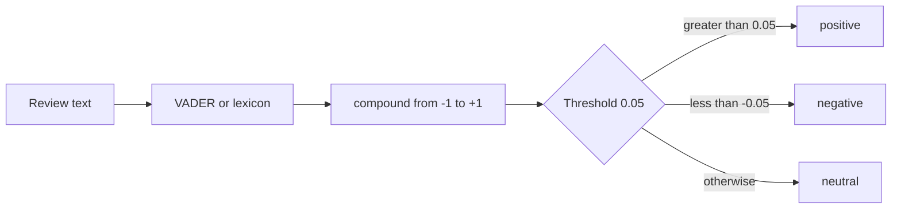

Sentiment analysis is the task of determining the emotional coloring of a text: positive, negative, or neutral. It is one of the most common business NLP tasks: companies automatically sort reviews, monitor social media, and gauge attitudes toward their products.

## Approaches to sentiment analysis

There are three main approaches:

1. **Rules and lexicons** — a list of positive/negative words that gives the text a score.
2. **Machine learning methods** — we train a classifier on labeled data.
3. **Deep models (transformers)** — neural networks trained on gigantic corpora.

Let's start with the most accessible one.

## VADER: rules for English

VADER (Valence Aware Dictionary and sEntiment Reasoner) is a heuristic analyzer from NLTK. It uses a lexicon of emotional word weights and accounts for intensifiers ("very", "completely") and inversions ("not good"):

```python
import nltk
nltk.download("vader_lexicon")

from nltk.sentiment import SentimentIntensityAnalyzer

sia = SentimentIntensityAnalyzer()
print(sia.polarity_scores("This movie is great and amazing!"))
```

Output: `{'neg': 0.0, 'neu': 0.197, 'pos': 0.803, 'compound': 0.8356}`. The fields `neg`, `neu`, `pos` are the shares of negativity, neutrality, and positivity in the text (they sum to 1). `compound` is an aggregate score from −1 (extreme negative) to +1 (extreme positive).

By `compound` the text is classified: `> 0.05` — positive, `< -0.05` — negative, otherwise neutral:

```python
def label(score):
    if score['compound'] >= 0.05:
        return "positive"
    if score['compound'] <= -0.05:
        return "negative"
    return "neutral"

print(label(sia.polarity_scores("The food was terrible.")))  # negative
print(label(sia.polarity_scores("I love this!")))            # positive
```

VADER's limitation: it was trained for English. For other languages — Russian included — you need your own lexicon or an ML approach.

## The lexicon method

The idea is simple: you keep two sets of words — positive and negative — and count the difference between their occurrences:

```python
positive_words = {"excellent", "wonderful", "nice", "love", "super", "great"}
negative_words = {"terrible", "bad", "hate", "horror", "disappointed", "awful"}

def score_ru(text):
    words = set(text.lower().split())
    pos = len(words & positive_words)
    neg = len(words & negative_words)
    return pos - neg

print(score_ru("The film is terrible, I feel very bad"))        # -2
print(score_ru("Loved it, excellent, super!"))         # 2
```

This is a crude method: it doesn't understand negations ("not bad" is positive) and doesn't weight word strength. But as a basic baseline it works well.

## The ML approach: train a classifier

If you have labeled data (text + a "positive/negative" label), you can train a classifier. The scheme: turn text into a feature vector (more on this in the next lesson), then train a model:

```python
from sklearn.feature_extraction.text import CountVectorizer
from sklearn.linear_model import LogisticRegression

texts = ["excellent service", "terrible service", "everything was great", "awful, I don't recommend"]
labels = [1, 0, 1, 0]

vectorizer = CountVectorizer()
X = vectorizer.fit_transform(texts)

model = LogisticRegression()
model.fit(X, labels)

print(model.predict(vectorizer.transform(["the service was excellent"])))  # [1]
```

The ML approach scales: more data — better quality. The main cost: you need a labeled training set. Evaluating such models is the topic of the next lesson; for now, practice.

## Evaluating quality

How do you know a sentiment analyzer works well? You can't evaluate a model on the same examples it was trained on — it will memorize them and show inflated quality. The right way is to split the data into training and test parts (`train_test_split`) and compute accuracy only on the test part. It's also useful to look not just at the share of correct answers (accuracy), but at precision and recall per class: for example, if negative reviews are rare, the model may lazily classify everything as positive, and accuracy stays high while the analysis loses its point. For a quick lexicon sanity check, keep a small set of phrases with known sentiment and run it after every lexicon change.



<!--TASK-->
### Task 1
Write a script that uses `SentimentIntensityAnalyzer` from NLTK to print all four scores (`neg`, `neu`, `pos`, `compound`) for the phrases: `"This is an amazing product, I love it!"` and `"This is a terrible product, I hate it."` Print the results in the format `phrase -> compound: <value>`. Verify that the first phrase has `compound > 0` and the second has `compound < 0`.

### Task 2
Write a function `sentiment_label(text)` that takes an English phrase, computes `compound` via VADER, and returns the string `"positive"`, `"negative"`, or `"neutral"` using the thresholds `0.05` and `-0.05`. Create a file `test_sentiment.py` with pytest tests: (1) `"I love this!"` → `"positive"`; (2) `"I hate this!"` → `"negative"`; (3) `"The sky is blue."` → `"neutral"`. Run `pytest` and get a green run.

### Task 3
Write a function `score_ru(text)` that computes the difference between the number of positive and negative words in a text (use the lexicons from the lesson, but add 3 more words of your own to each). Preprocess the text: lowercase, remove punctuation. Test it on the phrases: `"The film is terrible, I feel very bad"` (expect a negative result) and `"Loved it, excellent, super!"` (expect a positive one). Print both scores.

### Task 4
Write a script that trains `LogisticRegression` on the small labeled dataset from the lesson (4 examples), then predicts the sentiment of three new phrases: `"the service was excellent"`, `"the service is terrible"`, `"okay, overall everything is fine"`. Print the predicted labels (0 — negative, 1 — positive). Comment on how reliable you think the model is on such a small amount of data.

### Task 5
Write a function `train_and_evaluate(texts, labels)` that returns a trained `LogisticRegression` model and the share of correct predictions on the same dataset (predictions on the training data). Then create a pytest test `test_model.py`: (1) the share of correct predictions on the training set from the lesson is at least `0.75`; (2) the model predicts `1` for `"excellent service"` and `0` for `"terrible service"`; (3) the model was trained on data where labels are only `0` and `1`. Run `pytest` and get a green run.
### Task 6
Write a function `score_ru_neg(text)` that extends the lexicon method with negation handling: if an emotional word is preceded by the particle `"not"` (or `"nor"`), that word's contribution flips (`"not bad"` gives +1, `"not excellent"` gives −1). A standalone particle with no emotional word after it is ignored. Test it on two phrases: `"Not bad, but excellent"` and `"Not excellent, but okay"`. Expected output: the first scores `2`, the second `-1`. Compare the result with the naive `score_ru` from Task 3 and explain the discrepancy.

### Task 7
Write a function `evaluate_lexicon(pairs)` that evaluates the lexicon analyzer on a small labeled set and returns a dict with `accuracy`, `precision_neg`, and `recall_neg` (all rounded to two decimals). Make a prediction by the sign of `score_ru`: greater than zero — `1` (positive), otherwise — `0` (negative). Test it on six `(phrase, label)` pairs: `("Excellent service, everything is great", 1)`, `("Horrible service, I'm disappointed", 0)`, `("Everything is bad, awful", 0)`, `("Wonderful, I love this store", 1)`, `("Okay, but not super", 0)`, `("Super, thanks", 1)`. Expected output: `accuracy=0.83`, `precision_neg=1.0`, `recall_neg=0.67`. Explain why accuracy is below 1.

<!--/TASK-->

<!--HINT-->
### Hint 1
Create `sia = SentimentIntensityAnalyzer()` once. `sia.polarity_scores(text)` returns a dict. For output use an f-string: `print(f"{text} -> compound: {scores['compound']}")`.

### Hint 2
Thresholds: `>= 0.05` — positive, `<= -0.05` — negative, otherwise neutral. In the tests just call `sentiment_label("I love this!")` and compare with the string. Don't forget `nltk.download("vader_lexicon")` before creating the analyzer.

### Hint 3
Remove punctuation with `re.sub(r"[^\w\s]", "", text.lower())`, then `split()`. Make the word sets module-level constants. To verify: a negative phrase should give a result below zero, a positive one above.

### Hint 4
Don't forget that `CountVectorizer` must be fit (`fit_transform`) on the training texts and then only `transform`ed for new ones. Probabilities can be viewed via `model.predict_proba()`. In the comment explain: 4 examples is too few — the model memorizes the sample; this is a demonstration, not production.

### Hint 5
Evaluation on training data isn't honest (the model has seen it) — but it's fine for a demonstration. In test 1 use `accuracy_score(model.predict(X), labels)` or simply `(model.predict(X) == labels).mean()`. For test 2 vectorize the new phrases with the same `vectorizer.transform`.
### Hint 6
Iterate over the word list with an index: `for i, w in enumerate(words)`. If `w in {"not", "nor"}` and `i + 1 < len(words)`, look at the next word: if it's in `positive_words`, add `-1`; if in `negative_words`, add `+1`. Words already "consumed" by a negation must not be counted twice — check the previous token or drive the index `i` manually with `while`.

### Hint 7
Collect predictions `pred = 1 if score > 0 else 0`, then count over the negative class: `tp = sum(p == 0 and y == 0 ...)`, `fp = sum(p == 0 and y == 1 ...)`, `fn = sum(p == 1 and y == 0 ...)`. `precision_neg = tp / (tp + fp)`, `recall_neg = tp / (tp + fn)`, `accuracy = sum(p == y) / len(pairs)`. Handle division by zero separately.

<!--/HINT-->

<!--SOLUTION-->
### Walkthrough 1
Solution:

```python
import nltk
nltk.download("vader_lexicon")

from nltk.sentiment import SentimentIntensityAnalyzer

sia = SentimentIntensityAnalyzer()

for phrase in ["This is an amazing product, I love it!", "This is a terrible product, I hate it."]:
    scores = sia.polarity_scores(phrase)
    print(f"{phrase} -> compound: {scores['compound']}")
```

Output:

```
This is an amazing product, I love it! -> compound: 0.8516
This is a terrible product, I hate it. -> compound: -0.8176
```

What happens here? VADER parses text against a lexicon of emotional weights. The words `amazing` and `love` give strong positivity, `terrible` and `hate` — negativity. The `compound` value lies in the range from −1 to +1 and aggregates all words, accounting for intensifiers. This is a fast, predictable method, so it's often used as a quick baseline.

### Walkthrough 2
Solution:

```python
import nltk
nltk.download("vader_lexicon")

from nltk.sentiment import SentimentIntensityAnalyzer

sia = SentimentIntensityAnalyzer()

def sentiment_label(text):
    compound = sia.polarity_scores(text)["compound"]
    if compound >= 0.05:
        return "positive"
    if compound <= -0.05:
        return "negative"
    return "neutral"
```

File `test_sentiment.py`:

```python
from sentiment_label import sentiment_label

def test_positive():
    assert sentiment_label("I love this!") == "positive"

def test_negative():
    assert sentiment_label("I hate this!") == "negative"

def test_neutral():
    assert sentiment_label("The sky is blue.") == "neutral"
```

Run: `pytest -q` → `3 passed`.

What happens here? The function turns the numeric `compound` into a readable label. The thresholds `0.05` and `-0.05` are standard for VADER: they cut off neutral phrases that "collected" a small noise score. The tests cover the extremes and neutral text — the most common source of errors (the word "is" carries no emotion, so compound is near zero).

### Walkthrough 3
Solution:

```python
import re

positive_words = {"excellent", "wonderful", "nice", "love", "super", "great", "perfect", "magnificent", "glad"}
negative_words = {"terrible", "bad", "hate", "horror", "disappointed", "awful", "horrible", "sad", "angry"}

def score_ru(text):
    words = set(re.sub(r"[^\w\s]", "", text.lower()).split())
    return len(words & positive_words) - len(words & negative_words)

print(score_ru("The film is horrible, I feel very bad"))
print(score_ru("Loved it, excellent, super!"))
```

Output:

```
-2
2
```

What happens here? We lowercase the text, remove punctuation, split into words, and turn them into a set. The intersection with the positive set gives their count; the intersection with the negative set gives theirs. The difference is the final score. The set protects against double-counting repeated words. The method's flaw: "not bad" would be counted as negative although it's actually positive — handling negations is a separate task.

### Walkthrough 4
Solution:

```python
from sklearn.feature_extraction.text import CountVectorizer
from sklearn.linear_model import LogisticRegression

texts = ["excellent service", "terrible service", "everything was great", "awful, I don't recommend"]
labels = [1, 0, 1, 0]

vectorizer = CountVectorizer()
X = vectorizer.fit_transform(texts)

model = LogisticRegression()
model.fit(X, labels)

for phrase in ["the service was excellent", "the service is terrible", "okay, overall everything is fine"]:
    pred = model.predict(vectorizer.transform([phrase]))[0]
    print(f"{phrase} -> {pred}")
```

Output:

```
the service was excellent -> 1
the service is terrible -> 0
okay, overall everything is fine -> 1
```

What happens here? `CountVectorizer` turns each text into a word-frequency vector. Then `LogisticRegression` finds the boundary between classes. The predictions look logical, but it's important to understand: the model was trained on four examples and mostly just memorized them. The words "okay" and "fine" didn't appear in the training set, so the model leaned on neighboring words. This is an educational demonstration — a real task needs hundreds or thousands of labeled reviews.

### Walkthrough 5
Solution:

```python
from sklearn.feature_extraction.text import CountVectorizer
from sklearn.linear_model import LogisticRegression

def train_and_evaluate(texts, labels):
    vectorizer = CountVectorizer()
    X = vectorizer.fit_transform(texts)
    model = LogisticRegression()
    model.fit(X, labels)
    accuracy = (model.predict(X) == labels).mean()
    return model, vectorizer, accuracy
```

File `test_model.py`:

```python
from train_and_evaluate import train_and_evaluate

texts = ["excellent service", "terrible service", "everything was great", "awful, I don't recommend"]
labels = [1, 0, 1, 0]

def test_accuracy_on_train():
    model, vectorizer, accuracy = train_and_evaluate(texts, labels)
    assert accuracy >= 0.75

def test_predictions():
    model, vectorizer, _ = train_and_evaluate(texts, labels)
    assert model.predict(vectorizer.transform(["excellent service"]))[0] == 1
    assert model.predict(vectorizer.transform(["terrible service"]))[0] == 0

def test_labels_binary():
    model, vectorizer, _ = train_and_evaluate(texts, labels)
    preds = model.predict(vectorizer.transform(texts))
    assert set(preds) <= {0, 1}
```

Run: `pytest -q` → `3 passed`.

What happens here? The function returns the model, the vectorizer, and the accuracy. The tests check that the model trained without errors (accuracy on the training set — 1.0, above the 0.75 threshold), correctly classifies familiar phrases, and emits only binary labels. Note: accuracy on training data is almost always high — it says nothing about quality on new data. The real evaluation is on a held-out set, and we'll get to it in the next lesson.
### Walkthrough 6
Solution:

```python
import re

positive_words = {"excellent", "wonderful", "nice", "love", "super", "great", "perfect", "magnificent", "glad"}
negative_words = {"terrible", "bad", "hate", "horror", "disappointed", "awful", "horrible", "sad", "angry"}

def score_ru_neg(text):
    words = re.sub(r"[^\w\s]", "", text.lower()).split()
    score = 0
    i = 0
    while i < len(words):
        word = words[i]
        next_word = words[i + 1] if i + 1 < len(words) else ""
        if word in {"not", "nor"} and next_word:
            if next_word in positive_words:
                score -= 1
            elif next_word in negative_words:
                score += 1
            i += 2
            continue
        if word in positive_words:
            score += 1
        elif word in negative_words:
            score -= 1
        i += 1
    return score

print(score_ru_neg("Not bad, but excellent"))
print(score_ru_neg("Not excellent, but okay"))
```

Output:

```
2
-1
```

What happens here? We use a `while` loop to jump over two tokens at once when a particle is found: the particle and the emotional word it belongs to. Otherwise the word would be counted twice — first as an inversion, then as a regular word. In "Not bad, but excellent" we get `-1` from the inverted "bad" and `+1` from "excellent", totaling `2`. The naive `score_ru` would give `-1 + 1 = 0`, treating the phrase as neutral — though by meaning it's positive. The second phrase shows the naive method's opposite error: "not excellent" is mild negativity, and the correct score is `-1`, not `+1`. A caveat: the two-token window rule fails for longer constructions like "not that bad after all" — that needs full syntactic parsing or a model, but for a baseline this extension already raises quality a lot.

### Walkthrough 7
Solution:

```python
import re

positive_words = {"excellent", "wonderful", "nice", "love", "super", "great", "perfect", "magnificent", "glad"}
negative_words = {"terrible", "bad", "hate", "horror", "disappointed", "awful", "horrible", "sad", "angry"}

def score_ru(text):
    words = set(re.sub(r"[^\w\s]", "", text.lower()).split())
    return len(words & positive_words) - len(words & negative_words)

def evaluate_lexicon(pairs):
    preds = [1 if score_ru(text) > 0 else 0 for text, _ in pairs]
    gold = [label for _, label in pairs]
    tp = sum(p == 0 and y == 0 for p, y in zip(preds, gold))
    fp = sum(p == 0 and y == 1 for p, y in zip(preds, gold))
    fn = sum(p == 1 and y == 0 for p, y in zip(preds, gold))
    accuracy = sum(p == y for p, y in zip(preds, gold)) / len(pairs)
    precision_neg = tp / (tp + fp) if tp + fp else 0.0
    recall_neg = tp / (tp + fn) if tp + fn else 0.0
    return {"accuracy": round(accuracy, 2),
            "precision_neg": round(precision_neg, 2),
            "recall_neg": round(recall_neg, 2)}

pairs = [("Excellent service, everything is great", 1),
         ("Horrible service, I'm disappointed", 0),
         ("Everything is bad, awful", 0),
         ("Wonderful, I love this store", 1),
         ("Okay, but not super", 0),
         ("Super, thanks", 1)]
print(evaluate_lexicon(pairs))
```

Output:

```
{'accuracy': 0.83, 'precision_neg': 1.0, 'recall_neg': 0.67}
```

What happens here? The analyzer made exactly one mistake — on the phrase "Okay, but not super": the word "super" contributed `+1`, so the model classified the review as positive although the label was negative. Hence `accuracy = 5/6 = 0.83`, and `recall_neg = 2/3 = 0.67`: out of three true negatives we found only two. At the same time `precision_neg = 1.0` — every review called negative really is negative; there are no false alarms. This is the classic picture for a lexicon method: it is cautious with negativity but misses reserved or ironic phrasings. Notice why two metrics are needed instead of one: accuracy looks decent (0.83), but it hides the missed negative — and in support, missing a negative costs the most. The practical conclusion: expand the phrase set with exactly the cases where the analyzer errs, not with random examples.

<!--/SOLUTION-->

<!--QUIZ-->
What is compound in VADER's output?
- An aggregate sentiment score from -1 to +1
- The share of positive words
- The number of words in the text
* Correct answer: An aggregate sentiment score from -1 to +1
compound aggregates all words of the text into a single number.

Which threshold is usually used to classify a VADER text as positive?
- compound >= 0.05
- compound > 0
- compound == 1
* Correct answer: compound >= 0.05
VADER's standard thresholds are 0.05 and -0.05.

Which language is VADER optimized for?
- English
- Russian
- All languages
* Correct answer: English
VADER's lexicon is English; for other languages you need your own lexicons or ML.

What will sia.polarity_scores("I hate this!")["compound"] return?
- A negative number
- A positive number
- Zero
* Correct answer: A negative number
"Hate" is strong negativity, so compound < 0.

Which sklearn method fits for training a sentiment classifier?
- LogisticRegression
- TfidfVectorizer
- train_test_split
* Correct answer: LogisticRegression
LogisticRegression is a classifier; the others are transformers and splitters.

What does CountVectorizer do?
- Turns texts into a word-frequency matrix
- Splits text into sentences
- Removes stopwords
* Correct answer: Turns texts into a word-frequency matrix
Each row is a document, each column a word, values are frequencies.

Why is accuracy on the training set a poor metric?
- The model has seen this data and may simply memorize it
- Because it's always 0.5
- Because it's unavailable
* Correct answer: The model has seen this data and may simply memorize it
Evaluate on data the model hasn't seen.

What does "labeled data" mean in ML?
- Texts with correct answers (labels)
- Texts without punctuation
- Any texts from the internet
* Correct answer: Texts with correct answers (labels)
Classification needs "text → class label" pairs.

What will score_ru return with our lexicon for "The film is horrible"?
- A negative number
- A positive number
- Zero
* Correct answer: A negative number
"horrible" is in the negative lexicon; there are no positive words.

Which of these is NOT a sentiment-analysis approach?
- Parsing JSON files
- Lexicon methods
- ML classifiers
- Transformers models
* Correct answer: Parsing JSON files
JSON is a data format, not a sentiment-analysis method.
What do the neg, neu, pos fields in VADER's output mean?
- Shares of negativity, neutrality, and positivity, summing to 1
- Counts of negative, neutral, and positive words
- Three independent models
* Correct answer: Shares of negativity, neutrality, and positivity, summing to 1
These are normalized shares; the final score is given by compound.

Why does the lexicon method err on the phrase "not bad"?
- It ignores negations and treats "bad" as negative
- It doesn't know the word "bad"
- It only works with Russian
* Correct answer: It ignores negations and treats "bad" as negative
Negation flips polarity, and without a special rule the score is wrong.

What does precision show for the negative class?
- The share of true negatives among everything the model called negative
- The share of found negatives among all real negatives
- The overall share of correct answers
* Correct answer: The share of true negatives among everything the model called negative
Precision is about false alarms, recall is about misses.

Why split data into training and test parts?
- To evaluate the model on examples it hasn't seen
- To reduce the file size
- To speed up training
* Correct answer: To evaluate the model on examples it hasn't seen
Evaluation on training data is inflated: the model memorized it.

<!--/QUIZ-->
