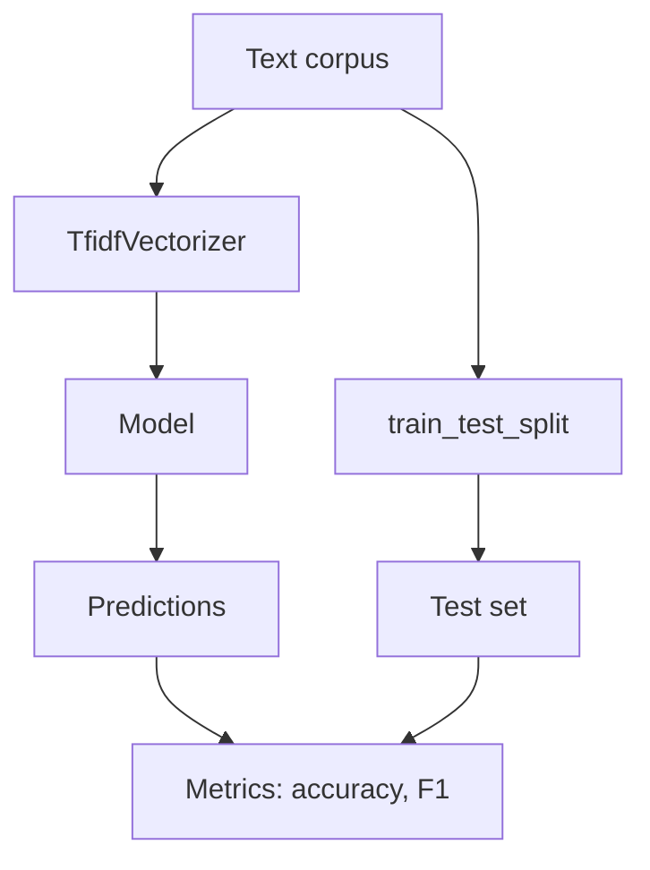

Text classification is the task of "assigning a text to one of the known categories": spam or not spam, a positive or negative review, a news topic. Machines don't understand words directly, so the first step is to turn text into numbers — vectors. Today we'll look at the most popular way — **TF-IDF** — and honestly evaluate model quality.

## From text to vector: bag of words

The simplest way is the "bag of words": count how many times each word occurs in a document. That's what `CountVectorizer` from `sklearn.feature_extraction.text` does:

```python
from sklearn.feature_extraction.text import CountVectorizer

corpus = ["the cat sleeps on the sofa", "the dog runs across the yard"]
vectorizer = CountVectorizer()
X = vectorizer.fit_transform(corpus)

print(vectorizer.get_feature_names_out())
print(X.toarray())
```

Output: `['across', 'cat', 'dog', 'on', 'runs', 'sleeps', 'sofa', 'the', 'yard']` and the matrix `[[0 1 0 1 0 1 1 1 0] [1 0 1 0 1 0 0 1 1]]`. Each row is a document, each column a word, and the value is the occurrence count.

The bag-of-words problem: frequent words ("the", "and", "that") dominate, while rare and important ones get lost. Words need to be weighted by their informativeness.

## TF-IDF: how to weight importance

**TF-IDF** (term frequency — inverse document frequency) weights words: the more often a word appears in a document (TF), the more important it is, but the more often it appears across all documents (IDF), the less distinguishing it is. The final weight is the product:

```
tfidf(t, d) = tf(t, d) * idf(t)
idf(t) = ln((N + 1) / (df(t) + 1)) + 1
```

where `N` is the number of documents and `df(t)` is the number of documents containing word `t`:

```python
from sklearn.feature_extraction.text import TfidfVectorizer

vectorizer = TfidfVectorizer()
X = vectorizer.fit_transform(corpus)
print(X.toarray())  # weighted features
```

The words "cat" and "dog" get high weight: each occurs in one of the two documents, so each separates classes well. The word "the" occurs in both — its IDF is small.

## Training a classifier with Pipeline

`Pipeline` combines a transformation and a model into one object — that's convenient: turn text into vectors, train the model, and repeat the whole process on new data with a single command:

```python
from sklearn.pipeline import Pipeline
from sklearn.feature_extraction.text import TfidfVectorizer
from sklearn.linear_model import LogisticRegression
from sklearn.model_selection import train_test_split
from sklearn.metrics import accuracy_score

texts = [
    "a new smartphone came out yesterday",
    "prices for electronics went up",
    "the national team won the championship",
    "the match ended with a score of 2:1",
    "a recipe for a delicious pie",
    "the chef added spices",
]
labels = ["tech", "tech", "sport", "sport", "food", "food"]

X_train, X_test, y_train, y_test = train_test_split(
    texts, labels, test_size=0.33, random_state=42
)

pipeline = Pipeline([
    ("tfidf", TfidfVectorizer()),
    ("clf", LogisticRegression()),
])
pipeline.fit(X_train, y_train)

predictions = pipeline.predict(X_test)
print(accuracy_score(y_test, predictions))
```

If there is little data, you can train on the whole set and look at quality carefully — the main thing is to understand that this is not an honest evaluation.

## Quality metrics

`accuracy` is the share of correct answers. But with imbalanced classes (e.g., 95% spam), accuracy is misleading. So we also look at:

- `precision` — the share of correct predictions among everything the model called a class;
- `recall` — the share of class objects the model found;
- `f1` — the harmonic mean of precision and recall.

```python
from sklearn.metrics import classification_report
print(classification_report(y_test, predictions))
```

### Classes and imbalance

If there are several classes that differ greatly in size, look at the per-class reports rather than just overall accuracy. Also remember: model weights depend on the split's `random_state` — different splits may give different numbers, so draw conclusions from several runs or use cross-validation (`cross_val_score`). In practice, it's useful to save a trained pipeline with `joblib.dump` so you don't retrain the model on every app launch.



To summarize: text classification is vectorization (TF-IDF) + model + honest evaluation on a held-out set. The same pipeline is reused for spam filters, news categorization, and sentiment analysis.

<!--TASK-->
### Task 1
Take the corpus from the lesson (6 texts labeled `tech`, `sport`, `food`). Create a `TfidfVectorizer`, fit it on all texts, and print: (1) the feature matrix shape (`X.shape`); (2) the top 3 words by the largest `idf_` value (`TfidfVectorizer` has an `idf_` attribute); (3) the nonzero coefficients for the first document via `X[0].toarray()`.

### Task 2
Write a function `build_pipeline()` that returns `Pipeline([("tfidf", TfidfVectorizer()), ("clf", LogisticRegression())])`. Then train it on the full corpus from the lesson and predict labels for new texts: `"the phone battery drains fast"`, `"a goal in stoppage time"`, `"the cake is incredibly tasty"`. Print the predictions. Expected labels: `tech`, `sport`, `food`. Then create a file `test_pipeline.py` with pytest tests: (1) the pipeline predicts `"tech"`, `"sport"`, `"food"` for the three examples from the statement; (2) the pipeline has steps `"tfidf"` and `"clf"` (check via `pipeline.named_steps`); (3) the pipeline can be retrained without errors. Run `pytest` and get a green run.

### Task 3
Write a script that compares two models on the lesson corpus — `LogisticRegression` and `MultinomialNB` — via `train_test_split` with `random_state=42` and `test_size=0.33`. For each model print `accuracy` and `classification_report` on the test set. Answer in writing (as a comment in the code) which model performed better and why.

### Task 4
For each of the three categories (`tech`, `sport`, `food`), find and print the top 2 words with the largest mean TF-IDF weight across the documents of that category. Hint: take the matrix `X` in dense form, filter the rows by label, average the columns, and print the words via `vectorizer.get_feature_names_out()`.

### Task 5
Write a function `train_classifier(X, y)` (X — list of texts, y — labels) that returns a trained pipeline (`TfidfVectorizer` + `LogisticRegression`) and `accuracy` on a held-out test set (`test_size=0.33`, `random_state=42`). Then create a pytest test `test_classifier.py` on the training corpus: (1) the split accuracy is at least `0.5`; (2) the model predicts `"tech"` for `"a new phone"` and `"food"` for `"a tasty cake"` after training on all data; (3) `train_classifier` returns an object with a `predict` method. Run `pytest` and get a green run.
### Task 6
Write a function `imbalance_demo()` that shows why accuracy is misleading with imbalanced classes. Take 10 texts: 8 regular emails labeled `"ham"` and 2 spam emails labeled `"spam"` (invent the texts yourself; the ratio is what matters). Train `DummyClassifier(strategy="most_frequent")` on the whole set, print `accuracy` via `accuracy_score` and `classification_report` with `zero_division=0`. Expected output: `accuracy = 0.8`, and for the `spam` class all metrics are `0.00`. Explain in a comment why such a model is useless for spam filtering and which metric to look at instead of accuracy.

### Task 7
Write a function `oov_rate(train_texts, test_texts)` that fits a `CountVectorizer` only on the training texts and computes the share of test tokens that are not in the vectorizer's vocabulary (OOV — out of vocabulary). Use `vectorizer.vocabulary_` and `vectorizer.build_analyzer()` to split the test texts into tokens. Test it on `train_texts=["cat sleeps", "dog runs"]` and `test_texts=["cat runs", "parrot sleeps"]`. Expected output: `OOV: 1 of 4, share 0.25`. Explain why a high OOV share means the model will perform poorly on new data.

<!--/TASK-->

<!--HINT-->
### Hint 1
After `fit_transform`, the `idf_` attribute is an array of numbers, one per feature. To pair them with words, use `vectorizer.get_feature_names_out()` and `zip`. For the top 3: `sorted(zip(vectorizer.get_feature_names_out(), vectorizer.idf_), key=lambda x: x[1], reverse=True)[:3]`.

### Hint 2
The pipeline trains as a whole: `pipeline.fit(texts, labels)`. To predict a single text, pass a list: `pipeline.predict(["the phone battery drains fast"])`. The word "phone" isn't in the training set, but the model will see the "tech" words in context — think about why it still guesses right. For pytest use `pipeline.named_steps` — a dict of steps — and note that a repeated `fit` on the same data is allowed and must not raise exceptions.

### Hint 3
`MultinomialNB` is a naive Bayes classifier; it works well with frequency features (TF-IDF) and is fast. But on a small corpus with rare words it may lose to logistic regression. Compare both `classification_report`s and look at `f1-score`.

### Hint 4
Use `X.toarray()`, then `numpy` or plain Python: for each category collect the row indices, average the columns (over words), find the two maximum indices, and print the corresponding words.

### Hint 5
Inside `train_classifier`, do the split BEFORE training: `X_train, X_test, y_train, y_test = train_test_split(X, y, test_size=0.33, random_state=42)`. In test 2 train on all data outside the function (or add a parameter `eval_on=None`). For test 3 check `hasattr(model, "predict")`.
### Hint 6
`DummyClassifier` doesn't learn from features — it just always outputs the most frequent class. Create it with `strategy="most_frequent"`, fit it on `X` (you can pass a list of texts — the model ignores features anyway), and predict. Add `zero_division=0` to `classification_report`, otherwise sklearn will warn and print `0.0` with a warning.

### Hint 7
`vectorizer.vocabulary_` is a `{word: index}` dict. `vectorizer.build_analyzer()` returns the function that performs the same tokenization used during training: `analyzer = vectorizer.build_analyzer()`, then `tokens = analyzer(text)`. Count `oov = [t for t in tokens if t not in vocabulary]` and divide by the total number of tokens. Round the result with `round(..., 2)`.

<!--/HINT-->

<!--SOLUTION-->
### Walkthrough 1
Solution:

```python
from sklearn.feature_extraction.text import TfidfVectorizer

texts = [
    "a new smartphone came out yesterday",
    "prices for electronics went up",
    "the national team won the championship",
    "the match ended with a score of 2:1",
    "a recipe for a delicious pie",
    "the chef added spices",
]

vectorizer = TfidfVectorizer()
X = vectorizer.fit_transform(texts)

print("Matrix shape:", X.shape)
pairs = sorted(
    zip(vectorizer.get_feature_names_out(), vectorizer.idf_),
    key=lambda p: p[1], reverse=True
)
print("Top-3 by IDF:", pairs[:3])
print("First document:", X[0].toarray())
```

Output (example):

```
Matrix shape: (6, 33)
Top-3 by IDF: [('championship', 2.25), ('smartphone', 2.25), ('yesterday', 2.25)]
First document: [[0. ... 0.577 ... 0.577 ...]]
```

What happens here? `X.shape` is (6, 33): six documents and thirty-three unique words. Words that occur in only one document get the maximum IDF — they are maximally distinguishing. Words like "for", "a", "the" occur more often, so their weight is lower. The matrix is sparse: most entries are zeros, and only nonzero values are stored — this saves memory.

### Walkthrough 2
Solution:

```python
from sklearn.pipeline import Pipeline
from sklearn.feature_extraction.text import TfidfVectorizer
from sklearn.linear_model import LogisticRegression

texts = [
    "a new smartphone came out yesterday",
    "prices for electronics went up",
    "the national team won the championship",
    "the match ended with a score of 2:1",
    "a recipe for a delicious pie",
    "the chef added spices",
]
labels = ["tech", "tech", "sport", "sport", "food", "food"]

pipeline = Pipeline([
    ("tfidf", TfidfVectorizer()),
    ("clf", LogisticRegression()),
])
pipeline.fit(texts, labels)

for text in ["the phone battery drains fast", "a goal in stoppage time", "the cake is incredibly tasty"]:
    print(text, "->", pipeline.predict([text])[0])
```

Output:

```
the phone battery drains fast -> tech
a goal in stoppage time -> sport
the cake is incredibly tasty -> food
```

What happens here? The pipeline ties the vectorizer and the model together: on `fit` it first turns texts into a TF-IDF matrix, then trains logistic regression. For new texts, `predict` automatically applies the same vectorization. None of the new words appeared in training, but the model uses neighbor words: "phone" is related to "electronics", "goal" to "team", "cake" to "recipe". That is generalization instead of memorization.

Let's add pytest tests. File `test_pipeline.py`:

```python
from build_pipeline import build_pipeline

texts = [
    "a new smartphone came out yesterday",
    "prices for electronics went up",
    "the national team won the championship",
    "the match ended with a score of 2:1",
    "a recipe for a delicious pie",
    "the chef added spices",
]
labels = ["tech", "tech", "sport", "sport", "food", "food"]

def test_predictions_on_new_texts():
    pipe = build_pipeline()
    pipe.fit(texts, labels)
    assert pipe.predict(["the phone battery drains fast"])[0] == "tech"
    assert pipe.predict(["a goal in stoppage time"])[0] == "sport"
    assert pipe.predict(["the cake is incredibly tasty"])[0] == "food"

def test_named_steps():
    pipe = build_pipeline()
    assert "tfidf" in pipe.named_steps and "clf" in pipe.named_steps

def test_refit():
    pipe = build_pipeline()
    pipe.fit(texts, labels)
    pipe.fit(texts, labels)  # retraining must not fail
```

Run: `pytest -q` → `3 passed`. What happens here? Test 1 checks predictions on new texts — the three examples from the statement. Test 2 fixes the pipeline structure: `named_steps` contains both steps, so the chain is assembled correctly. Test 3 verifies the pipeline can be retrained — this matters when you add new data and want to retrain without rebuilding.

### Walkthrough 3
Solution:

```python
from sklearn.model_selection import train_test_split
from sklearn.feature_extraction.text import TfidfVectorizer
from sklearn.linear_model import LogisticRegression
from sklearn.naive_bayes import MultinomialNB
from sklearn.pipeline import Pipeline
from sklearn.metrics import accuracy_score, classification_report

texts = [
    "a new smartphone came out yesterday",
    "prices for electronics went up",
    "the national team won the championship",
    "the match ended with a score of 2:1",
    "a recipe for a delicious pie",
    "the chef added spices",
]
labels = ["tech", "tech", "sport", "sport", "food", "food"]

X_train, X_test, y_train, y_test = train_test_split(
    texts, labels, test_size=0.33, random_state=42
)

for name, clf in [("LogReg", LogisticRegression()), ("NB", MultinomialNB())]:
    pipe = Pipeline([("tfidf", TfidfVectorizer()), ("clf", clf)])
    pipe.fit(X_train, y_train)
    preds = pipe.predict(X_test)
    print(f"--- {name} ---")
    print("accuracy:", accuracy_score(y_test, preds))
    print(classification_report(y_test, preds))
```

What happens here? Both models train on 4 texts and are evaluated on 2. At such a tiny volume, results depend heavily on which documents landed in the test set. `MultinomialNB` is often good for text, but on small samples with rare words logistic regression is usually more stable. That's why in real projects data is split into training, validation, and test sets, and conclusions are drawn over several runs. In the code comment you should have noted: on four examples you can't judge which model is superior — you need hundreds of examples and cross-validation.

### Walkthrough 4
Solution:

```python
import numpy as np
from sklearn.feature_extraction.text import TfidfVectorizer

texts = [
    "a new smartphone came out yesterday",
    "prices for electronics went up",
    "the national team won the championship",
    "the match ended with a score of 2:1",
    "a recipe for a delicious pie",
    "the chef added spices",
]
labels = ["tech", "tech", "sport", "sport", "food", "food"]

vectorizer = TfidfVectorizer()
X = vectorizer.fit_transform(texts).toarray()
words = vectorizer.get_feature_names_out()

for cat in ["tech", "sport", "food"]:
    rows = [i for i, lab in enumerate(labels) if lab == cat]
    mean_weights = X[rows].mean(axis=0)
    top2 = np.argsort(mean_weights)[-2:][::-1]
    print(cat, ":", [words[i] for i in top2])
```

Output (example):

```
tech : ['electronics', 'smartphone']
sport : ['championship', 'team']
food : ['recipe', 'pie']
```

What happens here? We average the TF-IDF weights across the documents inside each category. Words that dominate a category's documents and rarely appear elsewhere get the largest mean weights. This is a simple but illustrative way to understand which words the model "relies on". Such feature inspection helps check a model for sanity: if a category's top words look random, something is wrong with the data.

### Walkthrough 5
Solution:

```python
from sklearn.pipeline import Pipeline
from sklearn.feature_extraction.text import TfidfVectorizer
from sklearn.linear_model import LogisticRegression
from sklearn.model_selection import train_test_split
from sklearn.metrics import accuracy_score

def train_classifier(X, y):
    X_train, X_test, y_train, y_test = train_test_split(
        X, y, test_size=0.33, random_state=42
    )
    pipe = Pipeline([("tfidf", TfidfVectorizer()), ("clf", LogisticRegression())])
    pipe.fit(X_train, y_train)
    acc = accuracy_score(y_test, pipe.predict(X_test))
    return pipe, acc
```

File `test_classifier.py`:

```python
from train_classifier import train_classifier
from sklearn.pipeline import Pipeline

texts = [
    "a new smartphone came out yesterday",
    "prices for electronics went up",
    "the national team won the championship",
    "the match ended with a score of 2:1",
    "a recipe for a delicious pie",
    "the chef added spices",
]
labels = ["tech", "tech", "sport", "sport", "food", "food"]

def test_accuracy_threshold():
    pipe, acc = train_classifier(texts, labels)
    assert acc >= 0.5

def test_predictions_after_full_fit():
    pipe, _ = train_classifier(texts, labels)
    pipe.fit(texts, labels)
    assert pipe.predict(["a new phone"])[0] == "tech"
    assert pipe.predict(["a tasty cake"])[0] == "food"

def test_returns_pipeline():
    pipe, _ = train_classifier(texts, labels)
    assert isinstance(pipe, Pipeline)
    assert hasattr(pipe, "predict")
```

Run: `pytest -q` → `3 passed`.

What happens here? Inside the function the split happens strictly before training — this guarantees the model hasn't seen the test texts. Test 1 checks that accuracy hasn't degraded to random guessing. Test 2 retrains the pipeline on all data and checks meaningful predictions. Test 3 checks the interface: the function returns a trained pipeline. Note: a `0.5` threshold on two test examples means at least one correct answer — a reasonable minimum for a training corpus.
### Walkthrough 6
Solution:

```python
from sklearn.dummy import DummyClassifier
from sklearn.metrics import accuracy_score, classification_report

texts = [
    "the meeting is rescheduled to tomorrow",
    "the report is attached",
    "please confirm the meeting",
    "a reminder about the deadline",
    "the project is approved",
    "thanks for the feedback",
    "the invoice is paid",
    "the documents are signed",
    "win a million right now",
    "click the link urgently",
]
labels = ["ham"] * 8 + ["spam"] * 2

model = DummyClassifier(strategy="most_frequent")
model.fit(texts, labels)
preds = model.predict(texts)

print("accuracy:", accuracy_score(labels, preds))
print(classification_report(labels, preds, zero_division=0))
```

Output:

```
accuracy: 0.8
              precision    recall  f1-score   support

         ham       0.80      1.00      0.89         8
        spam       0.00      0.00      0.00         2

    accuracy                           0.80        10
```

What happens here? `DummyClassifier` doesn't look at the text at all: it memorizes the most frequent class and always returns it. Eight of ten emails are regular, so accuracy `0.8` looks respectable, though spam is never found. This is the imbalance trap: the metric measures the share of correct answers, not the model's usefulness. For spam filtering, a missed spam email (false negative) costs more than an extra check, so you should look at `recall` for the `spam` class, and as a summary — at `f1` or `macro avg`, where classes weigh equally. The report shows `macro avg` around `0.44` — a far more honest picture. Practical takeaway: before training, always look at the class distribution (`Counter(labels)`), and choose the metric by the cost of an error, not by convenience.

### Walkthrough 7
Solution:

```python
from sklearn.feature_extraction.text import CountVectorizer

def oov_rate(train_texts, test_texts):
    vectorizer = CountVectorizer()
    vectorizer.fit(train_texts)
    vocabulary = set(vectorizer.vocabulary_)
    analyzer = vectorizer.build_analyzer()

    total, oov = 0, []
    for text in test_texts:
        for token in analyzer(text):
            total += 1
            if token not in vocabulary:
                oov.append(token)

    rate = round(len(oov) / total, 2) if total else 0.0
    return oov, len(oov), total, rate

oov, count, total, rate = oov_rate(["cat sleeps", "dog runs"],
                                  ["cat runs", "parrot sleeps"])
print(f"OOV: {count} of {total}, share {rate}")
print("Unfamiliar words:", oov)
```

Output:

```
OOV: 1 of 4, share 0.25
Unfamiliar words: ['parrot']
```

What happens here? The vectorizer is fitted only on `train_texts`, so its vocabulary is four words: cat, sleeps, dog, runs. `build_analyzer()` returns the exact tokenization function the vectorizer used during training: lowercase, tokenization, length filtering. This matters: if you count tokens "by hand" with `split()`, you can get a different split and a wrong estimate. Of the four test tokens, one — `parrot` — is missing from the vocabulary, hence `0.25`. Why it's critical: TF-IDF simply drops OOV tokens, and a document made mostly of unfamiliar words becomes a zero vector — the model predicts anything, but with a confident look. That's why the OOV share is computed before rollout, and the vocabularies of the training and production sets are compared: a growing OOV is a signal that the data has drifted and the model needs retraining.

<!--/SOLUTION-->

<!--QUIZ-->
What does TfidfVectorizer do?
- Turns texts into a matrix of weighted TF-IDF features
- Trains a classification model
- Removes stopwords from the corpus
* Correct answer: Turns texts into a matrix of weighted TF-IDF features
TF-IDF accounts for both frequency in the document and rarity in the corpus.

What does a high IDF value for a word mean?
- The word occurs in few documents; it is distinctive
- The word occurs in all documents
- The word is very long
* Correct answer: The word occurs in few documents; it is distinctive
The rarer the word in the corpus, the higher its IDF and the more informative it is.

What does Pipeline do in sklearn?
- Combines transformations and a model into one object
- Splits data into training and test sets
- Computes quality metrics
* Correct answer: Combines transformations and a model into one object
Pipeline automatically applies all steps on fit and predict.

Why is train_test_split needed?
- To evaluate the model on data it hasn't seen
- To increase the amount of data
- To improve vectorization
* Correct answer: To evaluate the model on data it hasn't seen
A held-out set simulates "new" data.

Which metric shows the share of correct answers?
- accuracy
- precision
- idf
* Correct answer: accuracy
accuracy = correct predictions / all predictions.

Why can accuracy be misleading?
- With imbalanced classes — e.g., when 95% of the data is one class
- Because it's always 100%
- Because it depends on random_state
* Correct answer: With imbalanced classes — e.g., when 95% of the data is one class
A model can guess the frequent class and get high accuracy.

What does recall show?
- The share of class objects the model found
- The share of correct predictions among the predicted ones
- The mean word weight
* Correct answer: The share of class objects the model found
Recall answers "how many real class objects did we not miss".

Which classifier works well with frequency features and is fast?
- MultinomialNB
- KMeans
- PCA
* Correct answer: MultinomialNB
The naive Bayes classifier is designed for non-negative frequencies.

What does vectorizer.get_feature_names_out() return?
- An array of feature (word) names
- The feature matrix
- Class labels
* Correct answer: An array of feature (word) names
The method returns the words corresponding to the matrix columns.

What is f1-score?
- The harmonic mean of precision and recall
- The sum of precision and recall
- The product of accuracy and precision
* Correct answer: The harmonic mean of precision and recall
F1 combines both measures into one number.
What is an OOV token?
- A test token that is not in the vocabulary built on the training data
- A token that occurs too often
- A typo in the labeling
* Correct answer: A test token that is not in the vocabulary built on the training data
TF-IDF ignores OOV tokens, and a document can become a zero vector.

Why can a DummyClassifier with accuracy 0.8 be useless?
- It always predicts the frequent class and never finds the rare one (recall = 0)
- It is too slow
- It can't work with text
* Correct answer: It always predicts the frequent class and never finds the rare one (recall = 0)
High accuracy is achieved by ignoring the minority.

Why call .toarray() on a sparse matrix?
- To get a regular numpy array for manual analysis
- To train a model
- To remove zeros from memory
* Correct answer: To get a regular numpy array for manual analysis
.toarray() expands a sparse matrix into a dense one — expensive in memory but convenient for viewing.

Why save a pipeline with joblib.dump?
- To avoid retraining the model on every app launch
- To speed up vectorization
- To increase accuracy
* Correct answer: To avoid retraining the model on every app launch
A saved pipeline is loaded with joblib.load and is immediately ready for predict.

<!--/QUIZ-->
