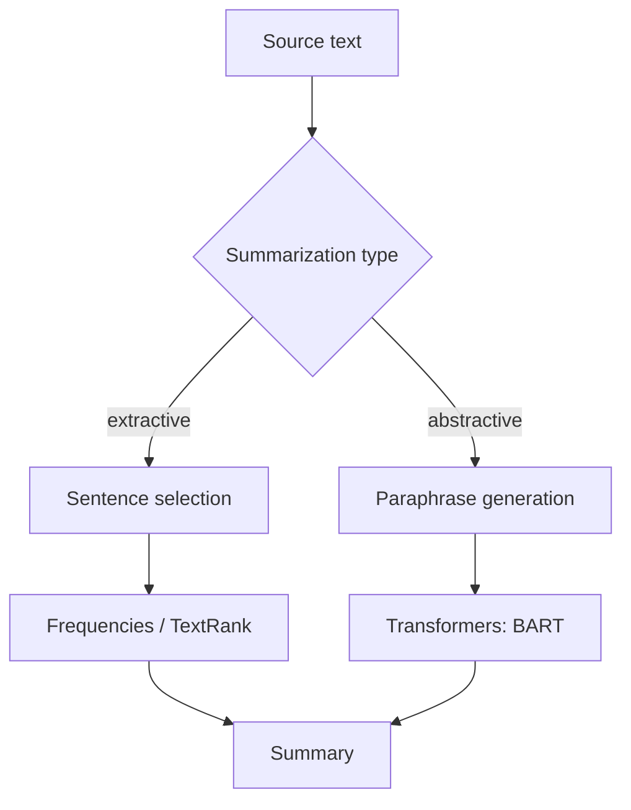

Summarization is the task of "compressing text while preserving the main points". It comes in two types:

- **Extractive** — we pick existing sentences that best convey the meaning.
- **Abstractive** — we generate a new short text in our own words (the way a human does).

Today we'll build an extractive summarizer from scratch and get acquainted with the neural approach.



## Frequency-based summarizer

The simplest idea: a sentence is more important the more "important" words it contains. We estimate a word's importance by its frequency in the text. First we split the text into sentences, then count word frequencies without stopwords:

```python
import re
from collections import Counter
from nltk.tokenize import sent_tokenize

text = """Coffee is the most popular drink in the world. Every day people drink billions of cups.
Coffee production supports the economies of dozens of countries. However, growing coffee requires a lot of water."""

sentences = sent_tokenize(text)
words = re.findall(r"\w+", text.lower())
freq = Counter(w for w in words if w not in {"the", "is", "in", "of", "every", "a", "and", "but", "for"})

for sent in sentences:
    score = sum(freq.get(w, 0) for w in re.findall(r"\w+", sent.lower()))
    print(sent, "->", score)
```

The sentence with the highest score is the most important. Collecting the top-K sentences gives us a summary.

## Improvements: weighted frequencies

The frequency method has weaknesses: long sentences score higher just because they are long, and the first sentences of a text are often more important. Improvements:

1. Normalize the score by sentence length (divide by the number of words);
2. Add a positional bonus to the first sentences;
3. Account for key-phrase occurrences.

Let's implement normalization:

```python
def score_sentence(sent, freq):
    words = re.findall(r"\w+", sent.lower())
    if not words:
        return 0.0
    return sum(freq.get(w, 0) for w in words) / len(words)
```

## TextRank: the graph approach

A smarter method is **TextRank**. It builds a graph: sentences are vertices, edges are similarity between them (e.g., the share of common words). Then it ranks the vertices with an algorithm similar to PageRank: important sentences are those referenced by other important sentences. The implementation isn't hard, but there's noticeably more code; in industry people usually use ready-made implementations (e.g., `gensim.summarization` or `sumy`).

## Key phrases

Key phrases are not individual words but stable combinations ("machine learning", "natural language processing"). A simple way to find them:

1. Tokenize the text, remove stopwords;
2. Collect all adjacent word pairs that are not stopwords (e.g., "machine learning");
3. Count pair frequencies and pick the most frequent ones.

```python
from nltk.corpus import stopwords

stop = set(stopwords.words("english"))
tokens = re.findall(r"\w+", text.lower())
candidates = [tokens[i] + " " + tokens[i + 1]
              for i in range(len(tokens) - 1)
              if tokens[i] not in stop and tokens[i + 1] not in stop]
print(Counter(candidates).most_common(3))
```

## Neural approaches

Abstractive summarization uses **transformers**-family models. The `transformers` library from Hugging Face provides ready-made pipelines:

```python
from transformers import pipeline

summarizer = pipeline("summarization", model="facebook/bart-large-cnn")
summary = summarizer(
    "The stock market opened higher today as technology shares rallied. "
    "Investors hope that interest rates will stay low.",
    max_length=30, min_length=5, do_sample=False
)
print(summary[0]["summary_text"])
```

The BART model generates new text, compressing the meaning. Such models require lots of resources, so in practice they are often combined: the extractive method for fast processing, transformers for the final "retelling".

<!--TASK-->
### Task 1
Write a function `frequency_summary(text, k=2)` that: (1) splits the text into sentences via `sent_tokenize`; (2) counts word frequencies without stopwords; (3) scores each sentence as the sum of its word frequencies; (4) returns a list of the `k` sentences with the highest scores, in the order they appear in the text. Test it on the text from the lesson and print the summary.

### Task 2
Improve the method from Task 1: write a function `normalized_summary(text, k=2)` that divides a sentence's score by its number of words and adds a bonus of `+0.3` to the first two sentences (indices 0 and 1). Compare the results on the lesson text and explain in writing whether the summary changed and why.

### Task 3
Write a function `key_phrases(text, n=3)` that returns the top `n` most frequent bigrams (pairs of adjacent words) that contain no stopwords. Use `Counter` and `nltk.corpus.stopwords`. Test it on the text: `"Machine learning changes the world. Machine learning requires data. Natural language processing is a part of machine learning."` Print the result. Then create a file `test_key_phrases.py` with pytest tests: (1) the most frequent bigram is `"machine learning"`; (2) no pair consists of two stopwords; (3) the result length does not exceed `n`; (4) the pair `"machine learning"` occurs exactly three times. Run `pytest` and get a green run.

### Task 4
Write a script that uses `pipeline("summarization")` from `transformers` with the model `facebook/bart-large-cnn` to summarize an English paragraph of 3-4 sentences with `max_length=30`, `min_length=5`. Print the original text and the summary. Wrap the import in `try/except ImportError` with a clear message if the library is not installed.

### Task 5
Write a function `summarize(text, k=2)` that returns a list of summary sentences using the normalized method (from Task 2). Then create pytest tests `test_summarize.py`: (1) the summary is not longer than the original text (the sum of summary sentence lengths ≤ the original text length); (2) the summary contains exactly `k` sentences; (3) all summary sentences are present in the original text; (4) the function is deterministic — two calls on the same text give the same result. Run `pytest` and get a green run.
### Task 6
Write a function `remove_duplicates(sentences, threshold=0.6)` that removes nearly identical sentences from a list. Compute similarity as the share of common words relative to the shorter sentence's length: `|A ∩ B| / min(|A|, |B|)` over lowercased word sets (without punctuation). Walk the list in order and keep a sentence only if its similarity to every already-kept sentence is below `threshold`. Test it on the list `["Coffee is popular all over the world", "Coffee is popular in the world", "Growing coffee requires a lot of water", "Coffee production supports the economies of countries"]` and print the remaining sentences. Expected output: 3 sentences — the second is dropped. Explain why such a filter is needed in a summary.

### Task 7
Write a function `overlap_score(candidate, reference)` that evaluates summary quality by lexical overlap with a reference. Lowercase the texts, split into unique words via `re.findall(r"\w+", ...)`, compute `recall = |A ∩ B| / |B|` and `precision = |A ∩ B| / |A|` (A — candidate words, B — reference words), and round to two decimals. Test it on the candidate `["Coffee is loved worldwide", "Growing coffee requires lots of water"]` and the reference `"Coffee is a loved drink; growing needs water."` Expected output: `recall=0.62`, `precision=0.56`. Explain why the metrics are below 1 and what they don't capture.

<!--/TASK-->

<!--HINT-->
### Hint 1
Don't forget `nltk.download("punkt_tab")`. Stopwords — either a small hand-written list or `nltk.corpus.stopwords.words("english")`. For the order of appearance: sort the (sentence, score) pairs by score, take the top-k, then sort the selected ones by their original index.

### Hint 2
Normalization: `score / len(words)`. Bonus: if the sentence index < 2, add `0.3` to the score. Compare with the Task 1 result — due to normalization, short informative sentences rise, while long "empty" ones fall.

### Hint 3
First tokenize the whole text (`re.findall(r"\w+", text.lower())`), then collect pairs `(tokens[i], tokens[i+1])` where both words are not stopwords. Join them into a string with a space. If the stopword list is missing, run `nltk.download("stopwords")`. In the tests: `phrases[0][0] == "machine learning"` — the top-1 bigram; check that both words of each pair are not in `STOP`; the pair's occurrence count is `phrases[0][1] == 3`.

### Hint 4
Import: `from transformers import pipeline`. Take a paragraph in English — BART was trained on English. Arguments: `max_length`, `min_length`, `do_sample=False` for determinism. Wrap the import in `try/except ImportError`.

### Hint 5
In the tests compare lengths: `sum(len(s.split()) for s in summary) <= len(text.split())`. Check membership: `all(s in text for s in summary)` — the sentences must match verbatim. For determinism, compare two calls of the function on the same text.
### Hint 6
Make a helper function `tokens(sent)` → `set(re.findall(r"\w+", sent.lower()))`. Similarity: `len(a & b) / min(len(a), len(b))`, but don't forget protection against empty sets — otherwise you'll get `ZeroDivisionError`. Main loop: `kept = []`, for each sentence check `all(similarity(sent, k) < threshold for k in kept)` and append on success.

### Hint 7
Collect the candidate's unique words by union: `set().union(*(tokens(s) for s in candidate))`. Intersection is `a & b`. `recall` is computed relative to the reference (how many of its words we covered), `precision` relative to the candidate (what share of our words are in the reference). Round with `round(value, 2)`; note that `0.625` rounds to `0.62` due to banker's rounding.

<!--/HINT-->

<!--SOLUTION-->
### Walkthrough 1
Solution:

```python
import re
from collections import Counter
from nltk.tokenize import sent_tokenize

STOP = {"the", "is", "in", "of", "every", "a", "and", "but", "for"}

def frequency_summary(text, k=2):
    sentences = sent_tokenize(text)
    words = re.findall(r"\w+", text.lower())
    freq = Counter(w for w in words if w not in STOP)

    scored = []
    for idx, sent in enumerate(sentences):
        score = sum(freq.get(w, 0) for w in re.findall(r"\w+", sent.lower()))
        scored.append((score, idx, sent))

    scored.sort(reverse=True)
    top = sorted(scored[:k], key=lambda x: x[1])
    return [sent for _, _, sent in top]

text = """Coffee is the most popular drink in the world. Every day people drink billions of cups.
Coffee production supports the economies of dozens of countries. However, growing coffee requires a lot of water."""

for sent in frequency_summary(text, 2):
    print(sent)
```

Output (example):

```
Coffee is the most popular drink in the world.
Coffee production supports the economies of dozens of countries.
```

What happens here? "Coffee" is the most frequent word (4 occurrences), so sentences containing it get the highest scores. `scored.sort(reverse=True)` puts the highest-scoring sentences on top; then we restore the original order among the selected ones. Notice: "the", "is", "of" are stopwords — otherwise they'd inflate scores.

### Walkthrough 2
Solution:

```python
def normalized_summary(text, k=2):
    sentences = sent_tokenize(text)
    words = re.findall(r"\w+", text.lower())
    freq = Counter(w for w in words if w not in STOP)

    scored = []
    for idx, sent in enumerate(sentences):
        sent_words = re.findall(r"\w+", sent.lower())
        if not sent_words:
            continue
        score = sum(freq.get(w, 0) for w in sent_words) / len(sent_words)
        if idx < 2:
            score += 0.3
        scored.append((score, idx, sent))

    scored.sort(reverse=True)
    top = sorted(scored[:k], key=lambda x: x[1])
    return [sent for _, _, sent in top]
```

What happens here? Dividing by the number of words "levels" the sentences: a short sentence with one frequent word gets a high score, while a long one with rare words gets a low one. The bonus for the first sentences reflects the heuristic: in news and articles, the main point is usually in the introduction. Comparing the output with Task 1, you'll notice: the summary may change, because now "Every day people drink billions of cups." scores above "Coffee production supports the economies of dozens of countries." thanks to the position bonus. That's normalization: the method became sensitive not to length but to the density of important words.

### Walkthrough 3
Solution:

```python
import re
from collections import Counter
from nltk.corpus import stopwords

STOP = set(stopwords.words("english")) | {"—"}

def key_phrases(text, n=3):
    tokens = re.findall(r"\w+", text.lower())
    candidates = [
        tokens[i] + " " + tokens[i + 1]
        for i in range(len(tokens) - 1)
        if tokens[i] not in STOP and tokens[i + 1] not in STOP
    ]
    return Counter(candidates).most_common(n)

text = "Machine learning changes the world. Machine learning requires data. Natural language processing is a part of machine learning."
print(key_phrases(text, 3))
```

Output:

```
[('machine learning', 3), ('learning changes', 1), ('world machine', 1)]
```

What happens here? The bigram "machine learning" occurs three times, so it's first. Notice: "learning changes" and "world machine" are not stopwords either, but they are separate pairs, so they are counted independently. To glue such phrases into one, you need longer n-grams or a phrase dictionary — but for a rough estimate the frequency approach works fine.

Let's verify the function with pytest. File `test_key_phrases.py`:

```python
from key_phrases import key_phrases
from nltk.corpus import stopwords

STOP = set(stopwords.words("english")) | {"—"}
TEXT = "Machine learning changes the world. Machine learning requires data. Natural language processing is a part of machine learning."

def test_top_bigram():
    phrases = key_phrases(TEXT, n=5)
    assert phrases[0][0] == "machine learning"

def test_no_stopword_pairs():
    phrases = key_phrases(TEXT, n=5)
    for phrase, _ in phrases:
        w1, w2 = phrase.split()
        assert w1 not in STOP and w2 not in STOP

def test_n_bound():
    assert len(key_phrases(TEXT, n=3)) <= 3

def test_top_count():
    phrases = key_phrases(TEXT, n=5)
    assert phrases[0] == ("machine learning", 3)
```

Run: `pytest -q` → `4 passed`. What happens here? Test 1 checks the frequency leader, test 2 the purity of pairs (no stopwords), test 3 respect for the `n` parameter, test 4 the exact count of the "machine learning" bigram. Such tests protect the function from regressions during refactoring.

### Walkthrough 4
Solution:

```python
try:
    from transformers import pipeline
except ImportError:
    raise SystemExit("Install the library: pip install transformers")

summarizer = pipeline("summarization", model="facebook/bart-large-cnn")

paragraph = (
    "The stock market opened higher today as technology shares rallied. "
    "Investors hope that interest rates will stay low. "
    "Analysts say the rally may continue next week. "
    "However, volatility remains a concern."
)

summary = summarizer(paragraph, max_length=30, min_length=5, do_sample=False)
print("Original text:")
print(paragraph)
print("\nSummary:")
print(summary[0]["summary_text"])
```

What happens here? `pipeline("summarization")` downloads the BART model (once, on first run) and uses it to generate a summary. `max_length=30` limits the output length, `do_sample=False` makes generation deterministic (greedy search). The model is English, so the text is English. The summary will be shorter and will rephrase the idea — that's abstractive summarization. Note: generation on CPU may take a few seconds — that's normal.

### Walkthrough 5
Solution:

```python
def summarize(text, k=2):
    return normalized_summary(text, k)
```

File `test_summarize.py`:

```python
from summarize import summarize

TEXT = """Coffee is the most popular drink in the world. Every day people drink billions of cups.
Coffee production supports the economies of dozens of countries. However, growing coffee requires a lot of water."""

def test_summary_shorter_than_original():
    summary = summarize(TEXT, k=2)
    assert sum(len(s.split()) for s in summary) <= len(TEXT.split())

def test_exact_k_sentences():
    assert len(summarize(TEXT, k=2)) == 2
    assert len(summarize(TEXT, k=3)) == 3

def test_sentences_from_original():
    summary = summarize(TEXT, k=2)
    assert all(s in TEXT for s in summary)

def test_deterministic():
    assert summarize(TEXT, k=2) == summarize(TEXT, k=2)
```

Run: `pytest -q` → `4 passed`.

What happens here? The tests fix the function's contract: the summary is shorter than the original, exactly `k` sentences, the sentences are verbatim from the original text (the extractive approach!), and the result is reproducible. The second test uses different `k` values — this checks that the parameter really controls the count. Determinism matters for reproducible experiments.
### Walkthrough 6
Solution:

```python
import re

def tokens(sentence):
    return set(re.findall(r"\w+", sentence.lower()))

def similarity(a, b):
    ta, tb = tokens(a), tokens(b)
    if not ta or not tb:
        return 0.0
    return len(ta & tb) / min(len(ta), len(tb))

def remove_duplicates(sentences, threshold=0.6):
    kept = []
    for sentence in sentences:
        if all(similarity(sentence, other) < threshold for other in kept):
            kept.append(sentence)
    return kept

sentences = [
    "Coffee is popular all over the world",
    "Coffee is popular in the world",
    "Growing coffee requires a lot of water",
    "Coffee production supports the economies of countries",
]
for s in remove_duplicates(sentences):
    print(s)
```

Output:

```
Coffee is popular all over the world
Growing coffee requires a lot of water
Coffee production supports the economies of countries
```

What happens here? The first sentence enters `kept` without checks. The second is compared with the first: the sets `{coffee, is, popular, all, over, the, world}` and `{coffee, is, popular, in, the, world}` have an intersection of five words, and the shorter set has six, so similarity is `0.83` — above the threshold, and the sentence is dropped. The other two are compared with everything kept and pass: they share only the word "coffee". Notice why this particular formula was chosen: classic Jaccard would divide by the union (nine words) and give only `0.56` — letting a near-duplicate through. Dividing by the smaller set answers "how much of the short sentence is contained in the long one", which is more precise for deduplication. Why the filter is needed: frequency- and graph-based methods love to pick neighboring sentences with the same word sets, and a three-line summary ends up retelling one idea twice. The similarity filter restores variety and makes the summary more informative at the same length.

### Walkthrough 7

Solution:

```python
import re

def tokens(text):
    return set(re.findall(r"\w+", text.lower()))

def overlap_score(candidate, reference):
    a = set().union(*(tokens(s) for s in candidate)) if candidate else set()
    b = tokens(reference)
    common = len(a & b)
    recall = round(common / len(b), 2) if b else 0.0
    precision = round(common / len(a), 2) if a else 0.0
    return {"recall": recall, "precision": precision}

candidate = ["Coffee is loved worldwide", "Growing coffee requires lots of water"]
reference = "Coffee is a loved drink; growing needs water."
print(overlap_score(candidate, reference))
```

Output:

```
{'recall': 0.62, 'precision': 0.56}
```

What happens here? The candidate has nine unique words: coffee, is, loved, worldwide, growing, requires, lots, of, water. The reference has eight: coffee, is, a, loved, drink, growing, needs, water. Five are shared — coffee, is, loved, growing, water. `recall = 5/8 = 0.625`, `precision = 5/9 ≈ 0.556`. This shows exactly what is being measured: recall answers "what share of the reference's content words did we capture", precision — "what share of our words really are in the reference". The metrics are below 1 for three reasons. First, wordforms: "loved" and "love" are different strings even though the meaning is the same; without lemmatization they never match. Second, the candidate carries extra words "worldwide", "lots", "of" that are absent from the reference — that drags precision down. Third, the metric is purely lexical: it doesn't see synonym paraphrases and doesn't assess coherence. That's why industry uses ROUGE, which counts n-gram overlap rather than single words; our variant is a simplified ROUGE-1 without lemmatization. Practical takeaway: such a metric is fine for a quick "did we lose the main point" check, but not as the sole quality criterion.

<!--/SOLUTION-->

<!--QUIZ-->
How does extractive summarization differ from abstractive?
- Extractive picks existing sentences; abstractive generates new ones
- They don't differ
- Abstractive only shortens words
* Correct answer: Extractive picks existing sentences; abstractive generates new ones
Extractive assembles a summary from the text's phrases; abstractive writes a retelling.

How do you score a sentence's importance in the frequency method?
- By the sum of its word frequencies
- By the sentence length
- By its order in the text
* Correct answer: By the sum of its word frequencies
The more frequent words a sentence has, the more important it is.

Which problem does normalizing the score by length solve?
- Long sentences shouldn't get an advantage just for being long
- Short sentences should be removed
- Frequent words should be ignored
* Correct answer: Long sentences shouldn't get an advantage just for being long
Dividing by the number of words levels sentences of different lengths.

What is TextRank?
- A graph-based sentence-ranking method similar to PageRank
- A model from transformers
- A frequency dictionary
* Correct answer: A graph-based sentence-ranking method similar to PageRank
TextRank builds a sentence-similarity graph and ranks its vertices.

What is a bigram?
- A pair of adjacent words
- A sentence of two words
- A list of two documents
* Correct answer: A pair of adjacent words
For example, "machine learning" is a bigram.

Why remove stopwords when looking for key phrases?
- So phrases don't consist of insignificant words
- To speed up model loading
- To make the text shorter
* Correct answer: So phrases don't consist of insignificant words
Stopwords create noisy pairs like "in and" that carry no meaning.

What does pipeline("summarization") from transformers do?
- Creates a summarization model and applies it to text
- Trains a summarizer from scratch
- Splits text into sentences
* Correct answer: Creates a summarization model and applies it to text
Pipeline hides model loading and generation.

Which language is facebook/bart-large-cnn optimized for?
- English
- Russian
- All languages equally
* Correct answer: English
The model was trained on English texts, so the input should be English too.

What does do_sample=False do in a summarization pipeline?
- Makes generation deterministic
- Disables the model
- Enables randomness
* Correct answer: Makes generation deterministic
Greedy search: the same input always gives the same output.

Why is the frequency summarization result reproducible?
- There is no randomness: frequencies and scores are computed deterministically
- Because the model is fixed
- Because the text is always the same
* Correct answer: There is no randomness: frequencies and scores are computed deterministically
An algorithm without random steps always returns the same result.
What does lexical overlap of a summary with a reference measure?
- The share of common words between candidate and reference
- The time to generate the summary
- The length of the original text
* Correct answer: The share of common words between candidate and reference
This is a simplified ROUGE-1: word sets are compared, without meaning.

Why remove nearly identical sentences from a summary?
- So three summary lines don't retell the same idea
- To reduce the file size
- To speed up sent_tokenize
* Correct answer: So three summary lines don't retell the same idea
Duplicates eat up summary space and add no information.

What does the max_length parameter do in a summarization pipeline?
- Limits the length of the generated summary
- Limits the length of the input text
- Sets the number of sentences
* Correct answer: Limits the length of the generated summary
max_length and min_length set the output bounds in tokens.

Why do extractive summaries contain sentences verbatim from the original?
- The method selects ready-made sentences rather than generating new ones
- The method copies only the first sentence
- sent_tokenize requires it
* Correct answer: The method selects ready-made sentences rather than generating new ones
Extraction is selection, so the text doesn't change.

<!--/QUIZ-->
