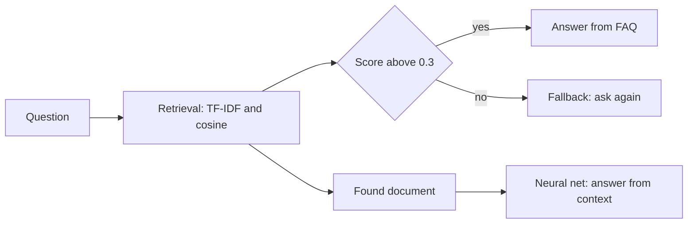

Question-answering systems (QA) answer user questions. Chatbots are their practical embodiment. In this lesson we'll build two kinds of systems: **retrieval-based** (the answer is found in a knowledge base) and **neural** (the answer is generated by a model).

## Retrieval-based QA system

The idea: we have a knowledge base — a list of "question → answer" pairs. When a new question arrives, we look for the most similar question in the base and return its answer. We measure text similarity with cosine similarity of TF-IDF vectors:

```python
from sklearn.feature_extraction.text import TfidfVectorizer
from sklearn.metrics.pairwise import cosine_similarity

faq = [
    ("How do I reset my password?", "Click “Forgot password” on the login page."),
    ("How do I cancel my order?", "Cancellation is available in the “My orders” section."),
    ("What payment methods are available?", "Card, PayPal, and cash on delivery."),
]

queries = [q for q, a in faq]
vectorizer = TfidfVectorizer()
X = vectorizer.fit_transform(queries)

user_query = "I can't log in to my account, what should I do?"
query_vec = vectorizer.transform([user_query])
similarities = cosine_similarity(query_vec, X)[0]
best = similarities.argmax()
print(faq[best][1])
```

Output — the answer to the closest question. `cosine_similarity` computes the cosine of the angle between vectors: 1.0 means the vectors coincide, 0 means they are orthogonal. TF-IDF turns the question and documents into vectors, and cosine similarity ranks them.

## Confidence threshold and fallback

If even the best question is too far (e.g., `similarities.max() < 0.3`), it's more honest to answer "I didn't understand the question" — that's the fallback. This way the bot doesn't give random answers:

```python
if similarities.max() < 0.3:
    print("I didn't quite understand your question. Try rephrasing it.")
else:
    print(faq[best][1])
```

## The chatbot skeleton

A bot is a loop: read a question, find an answer, respond. Let's add a greeting and an exit command:

```python
def chatbot_loop(faq):
    print("Hi! I'm a support bot. Ask me anything (or type 'exit').")
    while True:
        query = input("You: ")
        if query.strip().lower() == "exit":
            print("Bot: Bye!")
            break
        # search faq and output the answer/fallback
```

Here `input()` is real keyboard input, so in tests we'll test the search function instead of the loop.

## Neural question-answering

Modern QA systems use models like BERT. The `transformers` library provides a ready-made pipeline:

```python
from transformers import pipeline

qa = pipeline("question-answering", model="distilbert-base-cased-distilled-squad")
result = qa(
    question="What is Python?",
    context="Python is a programming language created by Guido van Rossum in 1991."
)
print(result["answer"], result["score"])
```

The model reads the context and extracts a precise answer span from it, with confidence (`score`). This approach — "extracting an answer from context" — is the foundation of reading-comprehension systems.

## How to evaluate a QA system

For a retrieval system, the main metric is the share of queries for which the correct answer landed in top-1 or top-3 (hit@k). Collect a control set of questions with known answers and count how many times the system returned the right answer. For a neural pipeline, rely on the model's `score`, but remember: high confidence is not a guarantee of correctness. Always keep a fallback: if neither search nor the model is confident, it's better to ask the user again than to emit a random answer.

## How to choose an approach

- **Retrieval QA** — transparent, fast, no GPU required; fits FAQ and knowledge bases. But it only answers with what already exists in the base.
- **Neural QA** — understands phrasings more deeply, but needs a model and a context.

In practice they are combined: search finds the relevant document, and the neural network extracts the precise answer from it. This is called **retrieval-augmented generation** (RAG) — you already know all of its parts.



<!--TASK-->
### Task 1
Write a function `find_answer(query, faq)` that takes a question and a list of `(question, answer)` pairs, vectorizes the base questions with `TfidfVectorizer`, computes `cosine_similarity`, and returns a tuple `(answer, best_score)`. Test it on the base from the lesson with the query `"I can't log in to my account, what should I do?"` — the expected answer is about password reset. Then create a file `test_find_answer.py` with pytest tests: (1) for the exact question `"How do I reset my password?"` the matching answer is returned; (2) the score lies between 0 and 1; (3) for the query `"What payment methods are available?"` the payment answer is returned; (4) the function returns a tuple of two elements. Run `pytest` and get a green run.

### Task 2
Extend the function into `answer_with_fallback(query, faq, threshold=0.3)`: if the best score is below `threshold`, return the string `"I didn't quite understand your question. Try rephrasing it."`, otherwise return the answer. Print the results for two queries: `"How do I cancel my order?"` and `"What's the weather today?"` The second one should fall back.

### Task 3
Write functions for a mini-chatbot: `greet()` returns a greeting, `handle(query, faq)` returns an answer via `answer_with_fallback`, and `is_exit(query)` returns `True` if the query is `"exit"` (case- and whitespace-insensitive). Assemble a demo loop with `input()` and show it working on two questions and an exit.

### Task 4
Write a script that uses `pipeline("question-answering")` from `transformers` with the model `distilbert-base-cased-distilled-squad`: ask the question `"Who created Python?"` with the context `"Python was created by Guido van Rossum in 1991, and the standard library is actively developed by the community."` Print the answer and `score`. Wrap the import in `try/except ImportError`.

### Task 5
Write a function `answer_faq(query, faq)` that returns only the answer (without the score), using `find_answer` and a fallback with threshold `0.3`. Then create pytest tests `test_faq.py` on the lesson base: (1) for the exact question `"How do I reset my password?"` the matching answer is returned; (2) for the paraphrase `"I lost my password, what should I do?"` the password answer is returned (not the fallback); (3) for the irrelevant question `"Tell me a joke"` the fallback string is returned; (4) `answer_faq` always returns a non-empty string. Run `pytest` and get a green run.
### Task 6
Write a function `evaluate_retrieval(faq, control, k=1)` that measures retrieval quality with hit@k: for each control question, check whether the correct answer landed in the top `k` found questions. The control set is a list of `(query, expected_answer)` pairs. Inside, use `find_answer` to get the answer and score, and for the top `k` sort all scores with `argsort()[::-1][:k]`. Test it on four cases: three exact questions from the base and the paraphrase `"I can't log in to my account"` with the expected password answer. Expected output: `hit@1 = 1.0`, `hit@3 = 1.0` (4 of 4). Explain why hit@3 cannot be less than hit@1.

### Task 7
Write a function `chat_session(queries, faq, threshold=0.3)` that runs a list of queries through the FAQ bot without `input()` and returns a list of dicts with keys `query`, `answer`, `score`, `fallback` (a boolean). Save the whole session to `session.json` via `json.dump` with `ensure_ascii=False, indent=2` and print a summary: the number of turns, the number of fallbacks, and the highest confidence. Test it on the queries `["How do I reset my password?", "How do I cancel my order?", "Tell me a joke"]`. Expected output: `turns: 3`, `fallback: 1`, and the max score close to `1.0`. Explain why saving the dialogue helps improve the knowledge base.

<!--/TASK-->

<!--HINT-->
### Hint 1
Vectorize only the base questions: `X = vectorizer.fit_transform([q for q, a in faq])`. A new query — `vectorizer.transform([query])`. `cosine_similarity(query_vec, X)[0]` is an array of scores; `argmax()` gives the index of the best question. Return `(faq[best][1], similarities[best])`. In the tests check the score as `0 <= score <= 1` and the return value as `isinstance(result, tuple) and len(result) == 2`.

### Hint 2
Compare `similarities[best]` with `threshold` before returning the answer. The 0.3 threshold for TF-IDF is empirical: an exact question gives a score closer to 1, an unrelated one — around 0.

### Hint 3
`is_exit(query)` — `query.strip().lower() == "exit"`. In the demo loop: `user_input = input("You: ")`, then `if is_exit(user_input): break`, otherwise `print(handle(user_input, faq))`. Don't put the loop inside the testable functions — only in `if __name__ == "__main__"`.

### Hint 4
`pipeline("question-answering", model="distilbert-base-cased-distilled-squad")` — the QA pipeline. Call: `qa(question="...", context="...")`. The result is a dict with `answer` and `score`. The first run downloads the model (several hundred MB), be patient.

### Hint 5
For the paraphrase check that the score is above the threshold: "I lost my password" shares words with "How do I reset my password?" (password, my). In test 3 just check the fallback string. In test 4 — `assert isinstance(answer, str) and len(answer) > 0`.
### Hint 6
`argsort()[::-1][:k]` gives the question indices in descending score order. Check hits by answer text: `expected in [faq[i][1] for i in top_idx]`. Count the share: `hits / len(control)`, rounded to two decimals. hit@3 ≥ hit@1 always, because the set of the three best contains the best — this is a nesting property, not an achievement of the algorithm.

### Hint 7
For each query call `find_answer` (or `answer_with_fallback`) and build a dict. Determine `fallback` by whether the answer equals the placeholder string, not by the score — that's more reliable. JSON can't serialize `numpy.float64`, so cast the score to `float(score)`. Compute the summary over the list: `sum(1 for turn in turns if turn["fallback"])` and `max(turn["score"] for turn in turns)`.

<!--/HINT-->

<!--SOLUTION-->
### Walkthrough 1
Solution:

```python
from sklearn.feature_extraction.text import TfidfVectorizer
from sklearn.metrics.pairwise import cosine_similarity

faq = [
    ("How do I reset my password?", "Click “Forgot password” on the login page."),
    ("How do I cancel my order?", "Cancellation is available in the “My orders” section."),
    ("What payment methods are available?", "Card, PayPal, and cash on delivery."),
]

def find_answer(query, faq):
    vectorizer = TfidfVectorizer()
    X = vectorizer.fit_transform([q for q, a in faq])
    query_vec = vectorizer.transform([query])
    similarities = cosine_similarity(query_vec, X)[0]
    best = similarities.argmax()
    return faq[best][1], float(similarities[best])

print(find_answer("I can't log in to my account, what should I do?", faq))
```

Output:

```
('Click “Forgot password” on the login page.', 0.34...)
```

What happens here? The query and the base questions become TF-IDF vectors. Cosine similarity shows the angle between vectors: similar texts have a small angle and similarity close to 1. The login question is closest to the password question — they share words ("log in", "account" vs "password", "login"). `argmax()` picks the index of the maximum score. Notice the 0.34 score isn't high — TF-IDF is sensitive to exact word matches, so paraphrases give moderate scores.

Let's add pytest tests. File `test_find_answer.py`:

```python
from find_answer import find_answer

faq = [
    ("How do I reset my password?", "Click “Forgot password” on the login page."),
    ("How do I cancel my order?", "Cancellation is available in the “My orders” section."),
    ("What payment methods are available?", "Card, PayPal, and cash on delivery."),
]

def test_exact_question():
    assert find_answer("How do I reset my password?", faq)[0] == faq[0][1]

def test_score_range():
    _, score = find_answer("How do I reset my password?", faq)
    assert 0 <= score <= 1

def test_payment_question():
    assert find_answer("What payment methods are available?", faq)[0] == faq[2][1]

def test_returns_tuple():
    result = find_answer("Any question", faq)
    assert isinstance(result, tuple) and len(result) == 2
```

Run: `pytest -q` → `4 passed`. What happens here? The tests fix the function's contract: an exact match returns the right answer, the score is always in [0, 1], different questions find their answers, and the return value has the expected structure. This protects the retrieval core on which the whole bot is built from random regressions.

### Walkthrough 2
Solution:

```python
def answer_with_fallback(query, faq, threshold=0.3):
    answer, score = find_answer(query, faq)
    if score < threshold:
        return "I didn't quite understand your question. Try rephrasing it."
    return answer

print(answer_with_fallback("How do I cancel my order?", faq))
print(answer_with_fallback("What's the weather today?", faq))
```

Output:

```
Cancellation is available in the “My orders” section.
I didn't quite understand your question. Try rephrasing it.
```

What happens here? The `threshold=0.3` cutoff weeds out "random" matches. The weather question shares no words with the base, so the score is near zero and the fallback fires. This is critical for a bot: better to honestly admit you didn't understand than to give a wrong answer with a confident look. Tuning the threshold is an empirical task: on a real base it is picked on a validation set.

### Walkthrough 3
Solution:

```python
def greet():
    return "Hi! I'm a support bot. Ask me anything (or type 'exit')."

def is_exit(query):
    return query.strip().lower() == "exit"

def handle(query, faq):
    return answer_with_fallback(query, faq)

if __name__ == "__main__":
    print(greet())
    while True:
        user_input = input("You: ")
        if is_exit(user_input):
            print("Bot: Bye!")
            break
        print("Bot:", handle(user_input, faq))
```

What happens here? The logic is split into pure functions: `greet`, `is_exit`, `handle` — they're easy to test separately from I/O. The loop lives only under `if __name__ == "__main__"`, so importing the module doesn't run it. This is the standard pattern: separate logic from interface. In the demo loop each iteration reads input, checks for exit, and calls `handle`, which does search and fallback inside.

### Walkthrough 4
Solution:

```python
try:
    from transformers import pipeline
except ImportError:
    raise SystemExit("Install the library: pip install transformers")

qa = pipeline("question-answering", model="distilbert-base-cased-distilled-squad")

result = qa(
    question="Who created Python?",
    context="Python was created by Guido van Rossum in 1991, and the standard library is actively developed by the community."
)
print("Answer:", result["answer"])
print("Confidence:", round(result["score"], 3))
```

Output (example):

```
Answer: Guido van Rossum
Confidence: 0.942
```

What happens here? The QA pipeline loads the distilbert model trained on the SQuAD dataset (a question-answering dataset). The model reads the context, finds the span that answers the question, and estimates confidence. Here the answer is extracted verbatim from the context — that's "answer extraction", not generation. `score` is the probability that the found span is the correct answer. This is a powerful tool, but it requires a context that contains the answer.

### Walkthrough 5
Solution:

```python
def answer_faq(query, faq):
    answer, score = find_answer(query, faq)
    if score < 0.3:
        return "I didn't quite understand your question. Try rephrasing it."
    return answer
```

File `test_faq.py`:

```python
from answer_faq import answer_faq

faq = [
    ("How do I reset my password?", "Click “Forgot password” on the login page."),
    ("How do I cancel my order?", "Cancellation is available in the “My orders” section."),
    ("What payment methods are available?", "Card, PayPal, and cash on delivery."),
]

def test_exact_match():
    assert answer_faq("How do I reset my password?", faq) == faq[0][1]

def test_paraphrase():
    assert "password" in answer_faq("I lost my password, what should I do?", faq)

def test_fallback():
    assert answer_faq("Tell me a joke", faq) == "I didn't quite understand your question. Try rephrasing it."

def test_always_nonempty():
    assert len(answer_faq("Any question", faq)) > 0
```

Run: `pytest -q` → `4 passed`.

What happens here? The first test is an exact match: the score is maximal, the answer is returned. The second is a paraphrase: "I lost my password" shares the word "password" with the base question, the score is above the threshold, so the password answer is returned (checked with `in`). The third — an irrelevant question falls into the fallback. The fourth guarantees the function always returns a non-empty string — an important contract for a chatbot. This is testing discipline: check not only the happy path but also edge cases.
### Walkthrough 6
Solution:

```python
from sklearn.feature_extraction.text import TfidfVectorizer
from sklearn.metrics.pairwise import cosine_similarity

faq = [
    ("How do I reset my password?", "Click “Forgot password” on the login page."),
    ("How do I cancel my order?", "Cancellation is available in the “My orders” section."),
    ("What payment methods are available?", "Card, PayPal, and cash on delivery."),
]

def rank_questions(query, faq, k=3):
    vectorizer = TfidfVectorizer()
    X = vectorizer.fit_transform([q for q, a in faq])
    scores = cosine_similarity(vectorizer.transform([query]), X)[0]
    order = scores.argsort()[::-1][:k]
    return [(faq[i][0], faq[i][1], float(scores[i])) for i in order]

def evaluate_retrieval(faq, control, k=1):
    hits = 0
    for query, expected in control:
        top = rank_questions(query, faq, k=k)
        if any(expected == answer for _, answer, _ in top):
            hits += 1
    return round(hits / len(control), 2)

control = [
    ("How do I reset my password?", "Click “Forgot password” on the login page."),
    ("How do I cancel my order?", "Cancellation is available in the “My orders” section."),
    ("What payment methods are available?", "Card, PayPal, and cash on delivery."),
    ("I can't log in to my account", "Click “Forgot password” on the login page."),
]
print("hit@1 =", evaluate_retrieval(faq, control, k=1))
print("hit@3 =", evaluate_retrieval(faq, control, k=3))
```

Output:

```
hit@1 = 1.0
hit@3 = 1.0
```

What happens here? For each control query we get a ranked list and check whether the expected answer is among the first `k`. Three queries match the base questions verbatim — their score is `1.0`, and the hit is guaranteed. The fourth is a paraphrase; TF-IDF finds the shared words and still puts the password question first, as we saw in Walkthrough 1. Why hit@3 can't be less than hit@1: if the correct answer was first, it stays in the top three, because the list isn't reordered but extended. So hit@k is monotonic, and reports always give it in pairs (hit@1, hit@3, hit@10). Practical advice: the control set should contain not only verbatim copies of questions, otherwise the metric shows `1.0` and says nothing about real quality — add paraphrases, typos, and questions absent from the base (for those, the correct behavior is fallback).

### Walkthrough 7

Solution:

```python
import json
from sklearn.feature_extraction.text import TfidfVectorizer
from sklearn.metrics.pairwise import cosine_similarity

FALLBACK = "I didn't quite understand your question. Try rephrasing it."

def answer_with_fallback(query, faq, threshold=0.3):
    vectorizer = TfidfVectorizer()
    X = vectorizer.fit_transform([q for q, a in faq])
    scores = cosine_similarity(vectorizer.transform([query]), X)[0]
    best = scores.argmax()
    if scores[best] < threshold:
        return FALLBACK, float(scores[best])
    return faq[best][1], float(scores[best])

def chat_session(queries, faq, threshold=0.3):
    turns = []
    for query in queries:
        answer, score = answer_with_fallback(query, faq, threshold)
        turns.append({"query": query, "answer": answer,
                      "score": round(score, 3), "fallback": answer == FALLBACK})
    with open("session.json", "w", encoding="utf-8") as f:
        json.dump(turns, f, ensure_ascii=False, indent=2)
    return turns

queries = ["How do I reset my password?", "How do I cancel my order?", "Tell me a joke"]
turns = chat_session(queries, faq)
print("turns:", len(turns))
print("fallback:", sum(t["fallback"] for t in turns))
print("max score:", max(t["score"] for t in turns))
```

Output:

```
turns: 3
fallback: 1
max score: 1.0
```

What happens here? A session is just a list of turns that's convenient to log and analyze. The `fallback` flag is set by comparing with the constant, not by the score: this way the logic doesn't depend on the threshold, and if you change `threshold` tomorrow, the labeling stays correct. `json.dump` with `ensure_ascii=False` keeps text readable; `indent=2` makes the file diff-friendly — such logs are easy to eyeball and compare across base versions. Notice the score must be cast to `float`: `cosine_similarity` returns `numpy.float64`, which `json` can't serialize and would raise `TypeError`. Why all this: the transcript shows which queries made the bot fall back. If the same question repeats in logs with a score of `0.2`, the base is missing the right pair — that's a ready backlog for expanding the FAQ. This way feedback from logs becomes an improvement to the knowledge base, not a guess.

<!--/SOLUTION-->

<!--QUIZ-->
What does cosine similarity of vectors measure?
- The angle between vectors: the smaller the angle, the closer the texts
- The length of the vectors
- The absolute difference of coordinates
* Correct answer: The angle between vectors: the smaller the angle, the closer the texts
Cosine similarity doesn't depend on vector length, only on direction.

Why does a QA system need a confidence threshold (fallback)?
- To avoid giving random answers to unclear questions
- To speed up search
- To increase TF-IDF accuracy
* Correct answer: To avoid giving random answers to unclear questions
If the best score is below the threshold, the bot honestly says it didn't understand.

What does similarities.argmax() return in our search?
- The index of the question with the greatest similarity
- The maximum similarity value itself
- The list of all scores
* Correct answer: The index of the question with the greatest similarity
argmax() returns the index of the array's maximum element.

What is RAG?
- An approach: retrieve a relevant document + generate/extract the answer
- A translation model
- A way of preprocessing text
* Correct answer: An approach: retrieve a relevant document + generate/extract the answer
RAG (retrieval-augmented generation) combines search and a neural network.

Which model does pipeline("question-answering") use in the lesson?
- distilbert-base-cased-distilled-squad
- facebook/bart-large-cnn
- ru_core_news_sm
* Correct answer: distilbert-base-cased-distilled-squad
DistilBERT was trained on SQuAD, a question-answering dataset.

What does the QA pipeline return besides the answer?
- score — the model's confidence
- The question id
- The context vector
* Correct answer: score — the model's confidence
score shows the probability that the found span is the correct answer.

What does is_exit("Exit") do?
- Returns True (case and whitespace are ignored)
- Returns False
- Raises an error
* Correct answer: Returns True (case and whitespace are ignored)
strip() removes whitespace, lower() lowercases.

Why is bot logic moved into separate functions?
- So it can be tested without input/output
- So the code is longer
- So the bot works faster
* Correct answer: So it can be tested without input/output
Pure functions are easy to verify with pytest tests.

What will find_answer return for a query that isn't in the base?
- A pair (answer, score) for the most similar question
- An error
- An empty string
* Correct answer: A pair (answer, score) for the most similar question
Search always picks the maximum — the only question is whether it exceeds the threshold.

What format does the FAQ knowledge base use in the lesson?
- A list of (question, answer) tuples
- A dict with numeric keys
- Two separate lists
* Correct answer: A list of (question, answer) tuples
Each element is a "question → answer" pair, convenient for vectorization and search.
What is hit@k for a retrieval QA system?
- The share of queries where the correct answer landed in the top-k results
- The average answer length
- Search speed in milliseconds
* Correct answer: The share of queries where the correct answer landed in the top-k results
hit@k measures whether the correct document ended up among the first k results.

How does vectorizer.transform differ from fit_transform?
- transform only applies the trained vocabulary; fit_transform also trains
- They're synonyms
- transform removes stopwords
* Correct answer: transform only applies the trained vocabulary; fit_transform also trains
On new data only transform is needed, otherwise the vocabulary is rebuilt and metrics drift.

Why does TF-IDF handle paraphrases poorly?
- It compares words literally and doesn't know synonyms
- It can't compute cosine
- It requires GPU
* Correct answer: It compares words literally and doesn't know synonyms
"Log in" and "authenticate" are different tokens with no shared features.

Why is the if __name__ == "__main__" block needed in a bot file?
- So the input() loop doesn't run when the module is imported in tests
- So the bot works faster
- To connect the knowledge base
* Correct answer: So the input() loop doesn't run when the module is imported in tests
Code under this condition doesn't execute on import, so pytest doesn't hang on input.

<!--/QUIZ-->
