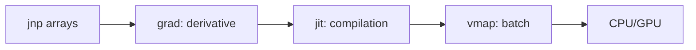

JAX is a library for scientific computing from Google: a NumPy-compatible API, automatic differentiation, and JIT compilation to XLA, working on both CPU and GPU/TPU.

## Why JAX

- Familiar syntax: `import jax.numpy as jnp`.
- `grad` — automatic differentiation of functions.
- `jit` — compilation to machine code.
- `vmap` — vectorization "along axes".
- GPU computing without changing code (when CUDA is available).

## Basic arrays

```python
import jax.numpy as jnp

x = jnp.array([1.0, 2.0, 3.0])
print(x * 2, x.sum())
```

## Automatic differentiation

```python
from jax import grad

def f(x):
    return x ** 2

print(grad(f)(3.0))  # 6.0
```

`grad` returns a function that computes the derivative. For functions of many variables — via `grad(f, argnums=1)`.

## jit: compilation

```python
from jax import jit

@jit
def square_sum(x):
    return jnp.sum(x ** 2)
```

The first call compiles, subsequent ones run fast.

## vmap: vectorization

`vmap(f)` applies a function to a batch of inputs, avoiding explicit loops.

## Lesson summary

JAX turns Python into a tool for research computing: the same function runs on CPU and GPU and differentiates automatically.



## Practical application

JAX is actively used where both speed and derivatives are needed: training neural networks, optimization, modeling. Gradients obtained via grad are used in descent methods; jit often speeds up training loops several times; vmap replaces batch loops without changing the math. Thanks to the unified API, experiments are easily moved from CPU to GPU. Such a toolkit is in demand in scientific research, finance, and ML engineering.

<!--TASK-->
### Task 1 — jnp arrays
Create jnp arrays: from a list, via jnp.linspace(0, 1, 5) and jnp.ones((3, 2)). Print their shapes and sums.

### Task 2 — Derivative via grad
Write a function f(x) = x**3 + 2*x. Compute the derivative at 2 via grad. Expected value 3*4+2=14.

### Task 3 — grad over several arguments
For f(x, y) = x**2 + y**3 compute the gradient with respect to the second variable (argnums=1) at (1, 2). Expected value 12.

### Task 4 — jit function
Wrap f with @jit and call twice; measure the time of the first and second call, explain the difference.

### Task 5 — vmap instead of a loop
Write a function square(x) and apply it to the vector [1,2,3] via vmap. Compare with an explicit for.

### Task 6 — Matrix multiplication
Compare the time of multiplying 512×512 matrices via jnp (CPU) and via plain numpy. Record the results in a comment.

### Task 7 — grad+jit pipeline
Combine @jit and grad: compute the derivative of the sum-of-squares function of a vector at [1,2,3].
<!--/TASK-->

<!--HINT-->
### Hint 1
jnp.array([...]) like numpy; shape/dtype are analogous.

### Hint 2
grad(f)(3.0) — the derivative at a point.

### Hint 3
argnums=1: grad(f, argnums=1)(x, y).

### Hint 4
The first call compiles to XLA — it is slower.

### Hint 5
vmap(square)(jnp.array([1,2,3])).

### Hint 6
jnp.dot(A, B) — ordinary multiplication; time.perf_counter around it.

### Hint 7
grad(lambda v: jnp.sum(v**2))(jnp.array([1.0,2.0,3.0])).
<!--/HINT-->

<!--SOLUTION-->
### Solution 1
```python
import jax.numpy as jnp

a = jnp.array([1, 2, 3])
b = jnp.linspace(0, 1, 5)
c = jnp.ones((3, 2))
print(a.shape, b, c.sum())
```
JAX arrays behave like numpy, but support compilation and GPU.

### Solution 2
```python
from jax import grad

def f(x):
    return x ** 3 + 2 * x

print(grad(f)(2.0))  # 14.0
```
The derivative 3x²+2 at x=2 is 14.

### Solution 3
```python
def f(x, y):
    return x ** 2 + y ** 3

print(grad(f, argnums=1)(1.0, 2.0))  # 12.0
```
The derivative with respect to the second variable: 3y²=12.

### Solution 4
```python
from jax import jit
import time

@jit
def square_sum(x):
    return jnp.sum(x ** 2)

x = jnp.arange(1000.0)
t0 = time.perf_counter(); square_sum(x); t1 = time.perf_counter()
square_sum(x); t2 = time.perf_counter()
print(t1 - t0, t2 - t1)
```
The first call includes XLA compilation, so it is usually longer.

### Solution 5
```python
from jax import vmap
import jax.numpy as jnp

def square(x):
    return x ** 2

print(vmap(square)(jnp.array([1.0, 2.0, 3.0])))
```
vmap applies the function to each element of the batch, preserving speed.

### Solution 6
```python
import numpy as np
import jax.numpy as jnp
import time

A = np.random.rand(512, 512)
B = np.random.rand(512, 512)
t0 = time.perf_counter(); C = A @ B; t1 = time.perf_counter()
jA = jnp.array(A); jB = jnp.array(B)
t2 = time.perf_counter(); jC = jA @ jB; t3 = time.perf_counter()
print("numpy", t1 - t0, "jax", t3 - t2)
```
On CPU the times are comparable; on GPU JAX accelerates noticeably.

### Solution 7
```python
from jax import grad, jit
import jax.numpy as jnp

@jit
def f(v):
    return jnp.sum(v ** 2)

print(grad(f)(jnp.array([1.0, 2.0, 3.0])))
```
The derivative of the vector (2x, 2y, 2z) = [2,4,6].
<!--/SOLUTION-->

<!--QUIZ-->
What does jax.grad do?
- Computes the derivative of a function
- Compiles code
- Vectorizes
- Creates arrays
* Correct answer: Computes the derivative of a function
grad returns the gradient function.

What is @jit for?
- For compilation to XLA and speedup
- For debugging
- For serialization
- For graphics
* Correct answer: For compilation to XLA and speedup
The first call compiles.

What does vmap do?
- Applies a function to array elements
- Multiplies matrices
- Computes the derivative
- Stops computations
* Correct answer: Applies a function to array elements
Vectorization without explicit loops.

Which module provides a NumPy-like API?
- jax.numpy
- jax.grad
- jax.jit
- jax.vmap
* Correct answer: jax.numpy
jnp is an analogue of numpy.

How to take the derivative with respect to the second argument?
- grad(f, argnums=1)
- grad(f)
- jit(f)
- vmap(f)
* Correct answer: grad(f, argnums=1)
argnums selects the variable.

Where is JAX especially fast?
- On GPU/TPU
- On CPU only
- In the interpreter
- In the browser
* Correct answer: On GPU/TPU
XLA executes on accelerators.

What does vmap(square)(array) return?
- An array of results for each element
- A single number
- A function
- A compilation object
* Correct answer: An array of results for each element
The shape mirrors the input.

Is jnp syntax compatible with numpy?
- Yes, mostly
- No, completely different
- Only addition operations
- Only vector ones
* Correct answer: Yes, mostly
The API mirrors numpy.

What happens on the first call of a jit function?
- Compilation and slow execution
- An instant response
- An error
- A skip
* Correct answer: Compilation and slow execution
Then the cache speeds things up.

What is JAX used for in scientific computing?
- For automatic differentiation and speedup
- For working with databases
- For web frameworks
- For GUI
* Correct answer: For automatic differentiation and speedup
It combines speed with flexibility.

How to check GPU availability in JAX?
- jax.devices()
- jax.gpu()
- jnp.gpu
- jit.gpu
* Correct answer: jax.devices()
It shows the available devices.

What is XLA?
- A compiler that accelerates computations
- A graphics library
- A data format
- A web server
* Correct answer: A compiler that accelerates computations
JIT compilation for devices.

<!--/QUIZ-->
