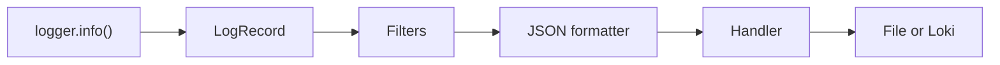

When your application works locally, `print()` and basic logging seem enough. But in production everything changes: you have dozens of instances, millions of log lines per day, and at the moment of an incident you need to find a specific request within minutes, understand its path through services, and answer the question «why». Plain text logs are not suitable for this — and that is exactly why the industry came to **structured logs**.

## Why text logs are bad

Look at a typical record:

```
2026-11-01 12:03:22 ERROR failed to process order id 1024
```

Such a line is hard to filter: in one place «id 1024» is at the end, in another — in the middle; the time is in a non-standard format; there is no structure. To find all errors for an hour, you have to write fragile regular expressions. And if you need to automatically calculate the share of errors or pass the record to a search engine — you have to parse the text right there.

**A structured log** is a record in a machine-readable format, usually JSON:

```json
{"timestamp": "2026-11-01T12:03:22.123456Z", "level": "ERROR", "logger": "app.orders", "message": "failed to process order", "order_id": 1024, "user_id": 77}
```

Now every field is a separate entity. You can filter by `order_id`, build dashboards by `level`, find all records of a specific user, and a `timestamp` in ISO-8601 sorts correctly. That is how modern stacks work (ELK, Loki, ClickHouse, Cloud Logging).

## The logging module: basics

Logging in Python is built around the `logging` module with four key objects: **logger** (where you write), **handler** (where records go: console, file, network), **formatter** (how records turn into text) and **level** (severity threshold). The standard minimum is `basicConfig`:

```python
import logging

logging.basicConfig(level=logging.INFO, format="%(asctime)s %(levelname)s %(name)s %(message)s")
logger = logging.getLogger("app.orders")
logger.info("order created", extra={"order_id": 42})
```

Levels: `DEBUG`, `INFO`, `WARNING`, `ERROR`, `CRITICAL`. Use `logger.info()` for success events, `logger.warning()` for something suspicious, `logger.error()` for errors that need fixing. Don't use `print()` — it has no levels, filters or handlers, and it is hard to turn off in production.

## JSON formatter: python-json-logger

The most popular way to get JSON logs in Python is the **python-json-logger** library (package `python-json-logger`, import `pythonjsonlogger`):

```bash
pip install python-json-logger
```

```python
import logging
from pythonjsonlogger import jsonlogger

formatter = jsonlogger.JsonFormatter(
    "%(asctime)s %(levelname)s %(name)s %(message)s",
    rename_fields={"asctime": "timestamp", "levelname": "level", "name": "logger"},
    timestamp=True,
)

handler = logging.StreamHandler()
handler.setFormatter(formatter)

logger = logging.getLogger("app.orders")
logger.handlers = [handler]
logger.setLevel(logging.INFO)

logger.info("order created", extra={"order_id": 42})
```

The `%(...)s` specifier in the first line lists reserved attribute names of `LogRecord`. `rename_fields` renames them into pretty keys. All non-standard fields get into JSON via `extra`: `logger.info("...", extra={"order_id": 42})` gives the field `"order_id": 42`.

## Formatter without dependencies

If you cannot add a library, it is easy to write your own formatter on pure `logging`:

```python
import json
import logging

class JsonFormatter(logging.Formatter):
    def format(self, record: logging.LogRecord) -> str:
        payload = {
            "timestamp": self.formatTime(record, "%Y-%m-%dT%H:%M:%S"),
            "level": record.levelname,
            "logger": record.name,
            "message": record.getMessage(),
        }
        for key, value in record.__dict__.items():
            if key not in payload:
                payload[key] = value
        return json.dumps(payload, ensure_ascii=False, default=str)
```

`record.__dict__` contains all attributes, including `extra` fields. `default=str` protects against non-serializable objects. Such a formatter is a great starting point if you don't want to pull in a dependency.

## Context and correlation id

JSON alone does not save you if you cannot reconstruct a single request from records. For this, a **correlation id** is introduced — an identifier that is created when a request enters (or comes in the `X-Request-ID` header) and is threaded through all logs within that request. In Python, `contextvars` is used for this — context variables that live within a single request and are automatically copied into workers:

```python
import contextvars

correlation_id: contextvars.ContextVar[str] = contextvars.ContextVar("correlation_id", default="-")

class CorrelationIdFilter(logging.Filter):
    def filter(self, record: logging.LogRecord) -> bool:
        record.correlation_id = correlation_id.get()
        return True
```

The filter adds a `correlation_id` attribute to every record, which the JSON formatter automatically includes in the output. Once the filter is attached to the handler, every log will show the current request's id — and you can link all events of one transaction.

## File rotation

If logs are written to a file, it grows forever. The solution is `RotatingFileHandler`: the file is split by size and N copies are kept:

```python
import logging.handlers

handler = logging.handlers.RotatingFileHandler(
    "app.log", maxBytes=10_000_000, backupCount=5, encoding="utf-8"
)
handler.setFormatter(jsonlogger.JsonFormatter("%(asctime)s %(levelname)s %(message)s"))
```

When the file reaches 10 MB, the handler closes it, renames it to `app.log.1` and starts a new one; 5 copies are kept. This is the classic "log rotation" pattern.

## The record path: from call to storage

Before writing code, it is useful to see what happens with a single log line. Calling `logger.info()` creates a `LogRecord`, then filters, the formatter and the handler process it in sequence:



Each stage is configured independently: the filter adds `correlation_id`, the formatter turns the record into JSON, and the handler decides where to send it — to the console, a rotated file, or over the network to Loki. That is why in the examples above we create the formatter separately, the handler separately, and attach the filter separately.

## Best practices

- **Never log secrets**: passwords, tokens, card numbers. In JSON they become easily searchable.
- Don't log in hot loops unnecessarily — it is expensive and fills up storage.
- Use levels by meaning: `INFO` — a success event, `WARNING` — an anomaly, `ERROR` — a failure requiring attention.
- In `ERROR` records pass `exc_info=True` or use `logger.exception()` inside `except` to get a traceback.
- Log business events with key ids: `order_id`, `user_id`, `correlation_id` — this makes incident search fast.

<!--TASK-->
### Task 1
Create a file `json_logging.py`. Configure logging so that records are printed to the console in JSON format with fields `timestamp`, `level`, `logger`, `message` (use `python-json-logger` or your own formatter from the theory). Then write three events to the log: `logger.info("server started", extra={"port": 8000})`, `logger.warning("high latency", extra={"latency_ms": 1500})` and `logger.error("db connection lost", exc_info=False)`. Run the script and make sure every output line is valid JSON. You can verify by copying one line into any online JSON validator or running `python -c "import json,sys; json.loads(sys.stdin.read())"` with the line piped in.

### Task 2
Write a module `logging_setup.py` with a function `setup_logger(stream=None) -> logging.Logger` that returns a logger with a JSON formatter (python-json-logger) writing to the passed stream (`stream`), defaulting to `sys.stdout`. Now write pytest tests in `test_logging.py`: test 1 — create a logger with an `io.StringIO()` stream, call `logger.info("hello", extra={"user_id": 7})`, read the stream contents, parse it as JSON and check that `message == "hello"`, `user_id == 7`, and `level` is `INFO`. Test 2 — check that `timestamp` is present in the record and parses via `datetime.fromisoformat`. Make sure both tests pass: `pytest test_logging.py -v`.

### Task 3
Implement correlation id on `contextvars`, as in the theory: a `correlation_id` variable, a `CorrelationIdFilter` filter that adds a `correlation_id` record. Write a function `process_request(request_id: str)` that sets `correlation_id.set(request_id)` (via `token = correlation_id.set(request_id)`, and at the end — `correlation_id.reset(token)`), calls `logger.info("handling request")` and `logger.error("failed")`. In `main()` process two requests with ids `req-1` and `req-2` and print the logs. Make sure that in every JSON record the `correlation_id` field matches the current request and does not "leak" between requests.

### Task 4
Add tests for `process_request` from task 3 to `test_correlation.py`. Create a logger that writes to `io.StringIO()`. In test 1 call `process_request("req-1")` and `process_request("req-2")` in a row, then parse all lines from the stream as JSON: check that the first records contain `correlation_id == "req-1"`, the last ones — `"req-2"`, and that there is no record with a foreign id in the stream. In test 2 check that after `process_request` the value of `correlation_id.get()` is again the default `"-"` (state does not leak between calls). Run `pytest test_correlation.py -v`.

### Task 5
Add a `SecretsFilter` filter to `logging_setup.py` that masks secret fields in records. The filter should iterate over `record.__dict__` and for keys containing `password`, `token` or `secret` (case-insensitive) replace the value with `"***"`. Change `setup_logger()` so the filter is added to the handler. In task 1 or 3 try logging `extra={"password": "redacted", "token": "abc"}` and make sure the JSON output shows `"***"` instead of the values (no need to assert the output in pytest).

### Task 6
In `logging_setup.py` configure a function `setup_file_logger(path: str) -> logging.Logger` that writes JSON logs to a file with daily rotation. Use `logging.handlers.TimedRotatingFileHandler(when="midnight", backupCount=7, encoding="utf-8", utc=True)` and the same JSON formatter with fields `timestamp`, `level`, `logger`, `message`. In the script `rotate_demo.py` write three `order created` events with different `order_id`s, then force `doRollover()` on the handler (available as `logger.handlers[0]`), write a fourth event and print `sorted(os.listdir("."))`. Expected output: two files — `app.log` and `app.log.<date>` — and valid JSON lines in both.

### Task 7
Add end-to-end correlation to FastAPI. In `app.py` create a `FastAPI()`, attach `CorrelationIdFilter` to the `app` logger's handler and write an HTTP middleware: it reads the `X-Request-ID` header, generates `uuid.uuid4().hex` if absent, sets the value via `token = correlation_id.set(...)`, logs `logger.info("request started", extra={"path": request.url.path})`, calls `call_next`, adds the `X-Request-ID` header to the response and in `finally` does `correlation_id.reset(token)`. In `test_request_id.py` use `TestClient` to make two requests with different ids and check that the response header matches the sent one, and in the intercepted logs each request has its own `correlation_id`. Expected output: two `200` responses and two records with ids `req-1` and `req-2`.
<!--/TASK-->

<!--HINT-->
### Hint 1
Formatter with rename_fields: `jsonlogger.JsonFormatter("%(asctime)s %(levelname)s %(name)s %(message)s", rename_fields={"asctime": "timestamp", "levelname": "level", "name": "logger"})`. Fields `timestamp`, `level`, `logger`, `message` are produced automatically; `extra` fields go into JSON as-is. Don't forget `ensure_ascii` — python-json-logger writes `ensure_ascii=False` by default, so Cyrillic remains readable.

### Hint 2
The function takes a stream and returns a logger: `logger = logging.getLogger("setup"); handler = logging.StreamHandler(stream); handler.setFormatter(jsonlogger.JsonFormatter(...)); logger.handlers = [handler]; logger.setLevel(logging.INFO); return logger`. In the test create `buf = io.StringIO()`, get the logger, write a record and then `json.loads(buf.getvalue())` — but note that if there are multiple records, you should take the last line or read line by line.

### Hint 3
Remember: `contextvars.ContextVar` cannot be "just set" — save the token and restore it at the end: `token = correlation_id.set(request_id); try: ... finally: correlation_id.reset(token)`. The filter adds a field to `record` and returns `True`. Add the filter to the handler: `handler.addFilter(CorrelationIdFilter())`. Print logs with two separate `process_request` runs — and check that both ids are present in the output.

### Hint 4
Parse the whole stream output line by line: `lines = buf.getvalue().strip().splitlines()` and `records = [json.loads(line) for line in lines]`. In test 1, if `process_request` logs two events (info and error), there will be 4 records in the stream: the first two with `req-1`, the second two with `req-2`. Check using slices `records[:2]` and `records[2:]`. In test 2 after the call the value of `correlation_id.get()` must equal `"-"` — because `reset(token)` removed the value.

### Hint 5
A filter is a class with a method `filter(self, record) -> bool`. Modify attributes directly on `record` (e.g., `setattr(record, key, "***")`), but don't touch standard fields like `message`, `levelname`, etc. The easiest check is by eye when running the script from task 1: in JSON, instead of `"password": "redacted"` should be `"password": "***"`.

### Hint 6
`TimedRotatingFileHandler` accepts `when="midnight"`, `backupCount=7`, `utc=True` and `encoding="utf-8"`; the formatter is the same as in task 2. Rotation can be verified without waiting for midnight: `logger.handlers[0].doRollover()` renames the current file to `app.log.YYYY-MM-DD` and opens a new one. Don't forget `logger.propagate = False`, otherwise records will be duplicated through the root logger and the file will contain more lines than expected.

### Hint 7
Middleware is declared as `@app.middleware("http")` and takes `request: Request, call_next`. It is convenient to set the response header after `await call_next(request)`, but do `reset(token)` in `finally` — otherwise on an exception the context will "leak" into the next request. In the test replace `logger.handlers` with `StreamHandler(io.StringIO())` carrying the same filter and formatter, otherwise records will go to the console and there will be nothing to parse.
<!--/HINT-->

<!--SOLUTION-->
### Solution 1
Solution:

```python
import logging
from pythonjsonlogger import jsonlogger

formatter = jsonlogger.JsonFormatter(
    "%(asctime)s %(levelname)s %(name)s %(message)s",
    rename_fields={"asctime": "timestamp", "levelname": "level", "name": "logger"},
    timestamp=True,
)

handler = logging.StreamHandler()
handler.setFormatter(formatter)

logger = logging.getLogger("app.orders")
logger.handlers = [handler]
logger.setLevel(logging.INFO)

logger.info("server started", extra={"port": 8000})
logger.warning("high latency", extra={"latency_ms": 1500})
logger.error("db connection lost")
```

Output (approximately):

```json
{"timestamp": "2026-11-01T12:03:22.123Z", "level": "INFO", "logger": "app.orders", "message": "server started", "port": 8000}
{"timestamp": "2026-11-01T12:03:22.124Z", "level": "WARNING", "logger": "app.orders", "message": "high latency", "latency_ms": 1500}
{"timestamp": "2026-11-01T12:03:22.125Z", "level": "ERROR", "logger": "app.orders", "message": "db connection lost"}
```

What is going on here? The `JsonFormatter` formatter receives a list of specifiers: it takes values from `LogRecord` and puts them into a dict, which is then serialized to JSON. `rename_fields` renames the keys (`asctime` → `timestamp`, etc.), and `timestamp=True` enables milliseconds. `extra` fields (`port`, `latency_ms`) automatically land in the record as separate keys. That is the essence of structured logging: instead of a string of text — an object with fields.

### Solution 2
Solution (`logging_setup.py`):

```python
import io
import logging
import sys
from pythonjsonlogger import jsonlogger

def setup_logger(stream=None) -> logging.Logger:
    logger = logging.getLogger("setup")
    logger.handlers = []
    handler = logging.StreamHandler(stream or sys.stdout)
    handler.setFormatter(
        jsonlogger.JsonFormatter(
            "%(asctime)s %(levelname)s %(message)s",
            rename_fields={"asctime": "timestamp", "levelname": "level"},
        )
    )
    logger.addHandler(handler)
    logger.setLevel(logging.INFO)
    logger.propagate = False
    return logger
```

Tests (`test_logging.py`):

```python
import io
import json
from datetime import datetime
from logging_setup import setup_logger

def test_json_record_fields():
    buf = io.StringIO()
    logger = setup_logger(stream=buf)
    logger.info("hello", extra={"user_id": 7})
    record = json.loads(buf.getvalue())
    assert record["message"] == "hello"
    assert record["user_id"] == 7
    assert record["level"] == "INFO"

def test_timestamp_parses():
    buf = io.StringIO()
    logger = setup_logger(stream=buf)
    logger.info("hello")
    record = json.loads(buf.getvalue())
    datetime.fromisoformat(record["timestamp"])
```

What is going on here? We create a logger "from scratch": reset handlers, add `StreamHandler(stream)` with a JSON formatter and disable `propagate` so records are not duplicated by the root logger. In the test, the `StringIO` stream plays the role of a "fake file": the logger writes into it, and we read and parse. `datetime.fromisoformat` raises `ValueError` if `timestamp` is not in ISO format — so the absence of an exception is itself a check.

### Solution 3
Solution:

```python
import contextvars
import logging
from pythonjsonlogger import jsonlogger

correlation_id: contextvars.ContextVar[str] = contextvars.ContextVar("correlation_id", default="-")

class CorrelationIdFilter(logging.Filter):
    def filter(self, record: logging.LogRecord) -> bool:
        record.correlation_id = correlation_id.get()
        return True

formatter = jsonlogger.JsonFormatter("%(asctime)s %(levelname)s %(message)s",
                                     rename_fields={"asctime": "timestamp", "levelname": "level"})
handler = logging.StreamHandler()
handler.setFormatter(formatter)
handler.addFilter(CorrelationIdFilter())

logger = logging.getLogger("app")
logger.handlers = [handler]
logger.setLevel(logging.INFO)

def process_request(request_id: str) -> None:
    token = correlation_id.set(request_id)
    try:
        logger.info("handling request")
        logger.error("failed")
    finally:
        correlation_id.reset(token)

if __name__ == "__main__":
    process_request("req-1")
    process_request("req-2")
```

What is going on here? The filter runs before formatting and "draws in" the `correlation_id` field taken from the context variable. `contextvars.ContextVar` stores the value relevant to the current execution context, and `token`/`reset` guarantee that after processing one request the context returns to its original state — so the next request won't see someone else's id. In the output the first two records will have `req-1`, the next two — `req-2`. That is how correlation is organized in real web frameworks.

### Solution 4
Solution (`test_correlation.py`):

```python
import io
import json
import contextvars
from app_logging import correlation_id, logger, process_request

def make_logger_with_buffer():
    buf = io.StringIO()
    import logging
    from pythonjsonlogger import jsonlogger
    handler = logging.StreamHandler(buf)
    handler.setFormatter(jsonlogger.JsonFormatter("%(levelname)s %(message)s",
                                                 rename_fields={"levelname": "level"}))
    handler.addFilter(CorrelationIdFilter())
    logger.handlers = [handler]
    return buf

def test_correlation_id_isolated():
    buf = make_logger_with_buffer()
    process_request("req-1")
    process_request("req-2")
    lines = buf.getvalue().strip().splitlines()
    records = [json.loads(line) for line in lines]
    assert all(r["correlation_id"] == "req-1" for r in records[:2])
    assert all(r["correlation_id"] == "req-2" for r in records[2:])

def test_context_restored_after_request():
    process_request("req-x")
    assert correlation_id.get() == "-"
```

What is going on here? We reuse the module's logger but swap its handler for a `StringIO` stream — so we capture records without touching the console. In the first test it is important to check exactly **isolation**: the first request's records must not appear in the second. By the way, `correlation_id.get()` after `process_request` returns `"-"`, because `finally: correlation_id.reset(token)` removed the set value — that is what the second test checks. If we forgot reset, the value would "leak" into the next request.

### Solution 5
Solution:

```python
import logging

class SecretsFilter(logging.Filter):
    SECRET_KEYS = ("password", "token", "secret")

    def filter(self, record: logging.LogRecord) -> bool:
        for key, value in list(record.__dict__.items()):
            if any(s in key.lower() for s in self.SECRET_KEYS):
                setattr(record, key, "***")
        return True

# in setup_logger:
# handler.addFilter(SecretsFilter())
```

What is going on here? `filter` iterates over all record attributes. If a key contains `password`, `token` or `secret` — the value is replaced with `"***"`. Important: `list(record.__dict__.items())` is a copy, because you cannot modify a dict while iterating over it. Check:

```bash
$ python -c "import logging; from logging_setup import setup_logger; l=setup_logger(); l.info('x', extra={'password': 'redacted','token':'abc'})"
{"timestamp": "...", "level": "INFO", "message": "x", "password": "***", "token": "***"}
```

Secrets must never end up in logs: after such an incident, passwords appear in search engines and bug trackers. A filter is a protective barrier at the output, but the main rule still stands: don't log secrets at all.

### Solution 6
Solution (`logging_setup.py`):

```python
import logging
import logging.handlers
from pythonjsonlogger import jsonlogger

def setup_file_logger(path: str) -> logging.Logger:
    logger = logging.getLogger("file")
    logger.handlers = []
    logger.setLevel(logging.INFO)
    logger.propagate = False
    handler = logging.handlers.TimedRotatingFileHandler(
        path, when="midnight", backupCount=7, encoding="utf-8", utc=True
    )
    handler.setFormatter(
        jsonlogger.JsonFormatter(
            "%(asctime)s %(levelname)s %(name)s %(message)s",
            rename_fields={"asctime": "timestamp", "levelname": "level", "name": "logger"},
        )
    )
    logger.addHandler(handler)
    return logger
```

The script `rotate_demo.py`:

```python
import os
from logging_setup import setup_file_logger

logger = setup_file_logger("app.log")
for order_id in (1, 2, 3):
    logger.info("order created", extra={"order_id": order_id})

logger.handlers[0].doRollover()
logger.info("order created", extra={"order_id": 4})
print(sorted(os.listdir(".")))
```

Example output:

```text
['app.log', 'app.log.2026-11-21']
```

What is going on here? `TimedRotatingFileHandler` watches the calendar, not the size: at midnight it renames the current file, appending the date to the name, and opens a new `app.log`. The `backupCount=7` parameter means seven latest archives are kept and older ones are deleted — otherwise the disk will eventually fill up. Calling `doRollover()` does the same manually, so the demo does not depend on the system clock. `utc=True` fixes rotation by UTC, which matters when servers are in different time zones. Finally, `logger.propagate = False` prevents records from going to the root logger: otherwise `app.log` would contain duplicates and the event count in storage would be wrong.

### Solution 7
Solution (`app.py`):

```python
import logging
import uuid
from contextvars import ContextVar

from fastapi import FastAPI, Request
from pythonjsonlogger import jsonlogger

correlation_id: ContextVar[str] = ContextVar("correlation_id", default="-")

class CorrelationIdFilter(logging.Filter):
    def filter(self, record: logging.LogRecord) -> bool:
        record.correlation_id = correlation_id.get()
        return True

logger = logging.getLogger("app")
logger.handlers = []
logger.setLevel(logging.INFO)
logger.propagate = False
handler = logging.StreamHandler()
handler.setFormatter(
    jsonlogger.JsonFormatter("%(levelname)s %(message)s", rename_fields={"levelname": "level"})
)
handler.addFilter(CorrelationIdFilter())
logger.addHandler(handler)

app = FastAPI()

@app.middleware("http")
async def request_context(request: Request, call_next):
    request_id = request.headers.get("X-Request-ID") or uuid.uuid4().hex
    token = correlation_id.set(request_id)
    try:
        logger.info("request started", extra={"path": request.url.path})
        response = await call_next(request)
    finally:
        correlation_id.reset(token)
    response.headers["X-Request-ID"] = request_id
    return response

@app.get("/ping")
def ping():
    return {"status": "ok"}
```

Test (`test_request_id.py`):

```python
import io
import json
import logging

from fastapi.testclient import TestClient
from pythonjsonlogger import jsonlogger

import app as app_module

def make_client():
    buf = io.StringIO()
    handler = logging.StreamHandler(buf)
    handler.setFormatter(
        jsonlogger.JsonFormatter("%(levelname)s %(message)s", rename_fields={"levelname": "level"})
    )
    handler.addFilter(app_module.CorrelationIdFilter())
    app_module.logger.handlers = [handler]
    return TestClient(app_module.app), buf

def test_request_id_isolated():
    client, buf = make_client()
    assert client.get("/ping", headers={"X-Request-ID": "req-1"}).headers["X-Request-ID"] == "req-1"
    assert client.get("/ping", headers={"X-Request-ID": "req-2"}).headers["X-Request-ID"] == "req-2"
    records = [json.loads(line) for line in buf.getvalue().strip().splitlines()]
    assert [r["correlation_id"] for r in records] == ["req-1", "req-2"]
```

What is going on here? Middleware runs before the endpoint and after it, so it is the ideal place to set the request context. We don't blindly trust the client: the header is accepted only if present, otherwise our own is generated — and either way it is returned in the response, so the client and support can refer to a specific request. `ContextVar` together with `reset(token)` guarantees isolation: even if one request takes longer than another, its records won't mix with foreign ones. The filter turns the context value into the `correlation_id` field of every JSON line, and `TestClient` lets you verify this without running uvicorn and without the network. This pattern carries over to any ASGI framework: only the middleware declaration changes.
<!--/SOLUTION-->

<!--QUIZ-->
What is a structured log?
- Text with formatting
- A record in a machine-readable format (e.g., JSON) with separate fields
- A log sorted by time
* Correct answer: A record in a machine-readable format (e.g., JSON) with separate fields
A structured log is not a string but a set of fields: timestamp, level, message, and custom attributes.

Which library is most often used for JSON logs in Python?
- jsonlib
- python-json-logger
- loguru-json
* Correct answer: python-json-logger
The python-json-logger package (import pythonjsonlogger) provides the JsonFormatter class.

What is contextvars.ContextVar for in logs?
- For performance measurement
- For storing a value relevant to the current context (e.g., correlation id)
- For serialization to JSON
* Correct answer: For storing a value relevant to the current context (e.g., correlation id)
ContextVar stores a value within one execution context, which is ideal for a request's correlation id.

What will correlation_id.get() return if the variable was not set and default="-"?
- An error
- None
- "-"
* Correct answer: "-"
If no value is set, the default is returned.

Why is logging.Filter needed?
- To change the output stream
- To modify or add fields to records before formatting
- To check the logging level
* Correct answer: To modify or add fields to records before formatting
Filter receives a LogRecord, can modify its attributes and returns True if the record should pass through.

Which class lets you limit the log file size and keep several copies?
- FileHandler
- RotatingFileHandler
- MemoryHandler
* Correct answer: RotatingFileHandler
RotatingFileHandler(maxBytes=..., backupCount=...) splits the file by size and keeps backupCount old files.

What does rename_fields do in JsonFormatter?
- Renames record fields into JSON keys
- Sorts fields alphabetically
- Adds a prefix to fields
* Correct answer: Renames record fields into JSON keys
For example, asctime → timestamp, levelname → level.

What should be done with the token after setting a value in ContextVar?
- Delete it
- Save it and call reset(token) at the end
- Nothing, the token is not needed
* Correct answer: Save it and call reset(token) at the end
reset(token) returns the context to its previous state.

Which logging level suits a failure that requires attention?
- DEBUG
- ERROR
- INFO
* Correct answer: ERROR
ERROR is a serious error; INFO is a success event; DEBUG is debug details.

Why shouldn't passwords be logged with extra={"password": "redacted"}?
- They slow down logging
- They will appear in logs in plain text and become searchable
- JSON does not support strings
* Correct answer: They will appear in logs in plain text and become searchable
Secrets in logs are a data leak; they should be masked or not logged at all.

Which handler rotates logs on a schedule rather than by size?
- RotatingFileHandler
- TimedRotatingFileHandler
- WatchedFileHandler
* Correct answer: TimedRotatingFileHandler
TimedRotatingFileHandler accepts when="midnight" (or "H", "D") and keeps backupCount archives.

What happens when calling logger.info("x", extra={"message": "y"})?
- The message field will be overwritten
- A KeyError: Attempt to overwrite 'message' in LogRecord will be raised
- The record will silently disappear
* Correct answer: A KeyError: Attempt to overwrite 'message' in LogRecord will be raised
Standard LogRecord attribute names are reserved; choose other keys for your own fields.

Why set logger.propagate = False?
- To disable logging levels
- So that records are not duplicated through the root logger
- To speed up JSON serialization
* Correct answer: So that records are not duplicated through the root logger
Otherwise both the record's own handler and the parent's handler will process it, and duplicates will appear in the file.

How is logger.exception("failed") different from logger.error("failed")?
- No difference, they are synonyms
- It automatically adds the traceback of the current exception
- It lowers the level to WARNING
* Correct answer: It automatically adds the traceback of the current exception
logger.exception is equivalent to error(..., exc_info=True) and is used inside an except block.
<!--/QUIZ-->
