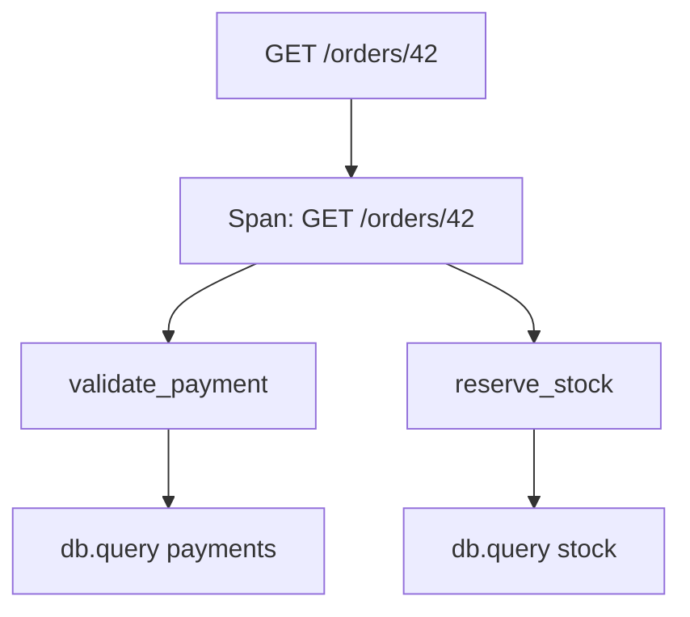

Logs answer the question “what happened”, metrics — “how much and how often”, but the question “why exactly was this request slow or failed” is poorly answered by logs. In a distributed system, a request passes through a gateway, the orders service, a database and a queue. When everything is slow, it is unclear where exactly time is lost. That is what **tracing** exists for — and the de-facto standard here is **OpenTelemetry (OTel)**.

## What is OpenTelemetry

OpenTelemetry is an open project (a continuation of OpenTracing and OpenCensus) that provides a single standard for the three "signals" of observability: **traces**, **metrics** and **logs**. It consists of a set of APIs, an SDK and instrumentation libraries for all popular languages. You write code once per the OTel standard, and then you can plug in any backend system: Jaeger, Zipkin, Grafana Tempo, Datadog, Honeycomb and others — via **exporters**.

Key concepts:

- **Trace** — a holistic operation, e.g. "processing an HTTP request". It has a unique `trace_id`.
- **Span** — one step inside a trace: "DB query", "call to the orders service", "response serialization". Each span has a parent — this forms a tree. A span has its own `span_id`.
- **Span context** — a set of fields (`trace_id`, `span_id`, flags) passed between services in headers. The standard is **W3C Trace Context**: the `traceparent` header.
- **Resource** — description of the data source: service name, version, environment.
- **Attributes** — key-value pairs on a span (e.g., `http.method`, `http.route`).
- **Events** — points in time within a span (e.g., "retry attempt started").

## Installation and basic SDK setup

For Python you need the `opentelemetry-sdk` package and (for integrations) `opentelemetry-instrumentation-fastapi`:

```bash
pip install opentelemetry-sdk opentelemetry-instrumentation-fastapi
```

Minimal setup printing spans to the console:

```python
from opentelemetry import trace
from opentelemetry.sdk.trace import TracerProvider
from opentelemetry.sdk.trace.export import BatchSpanProcessor, ConsoleSpanExporter
from opentelemetry.sdk.resources import Resource

resource = Resource.create({"service.name": "orders-service"})

provider = TracerProvider(resource=resource)
provider.add_span_processor(BatchSpanProcessor(ConsoleSpanExporter()))
trace.set_tracer_provider(provider)

tracer = trace.get_tracer("app.orders")
```

`TracerProvider` is a factory of tracers. `SpanProcessor` receives finished spans and hands them to the **exporter**. `BatchSpanProcessor` accumulates spans and sends them in batches (more efficient than one by one), and `ConsoleSpanExporter` prints them to the console — great for development. `Resource` describes the service; the name `service.name` is required for filtering in the backend.

## Manual spans

Let's create a span with attributes and an event:

```python
import time

with tracer.start_as_current_span("create_order") as span:
    span.set_attribute("order.id", 1024)
    span.set_attribute("user.id", 77)
    span.add_event("db.query_started", {"table": "orders"})
    time.sleep(0.05)  # simulating work
    span.add_event("db.query_finished")
    span.set_status(trace.Status(trace.StatusCode.OK))
```

`start_as_current_span` not only creates a span but also makes it "current" in the context — all nested spans automatically become its children. `set_attribute` adds key-value pairs (use OTel semantic conventions: `http.method`, `http.route`, `http.status_code`...). `add_event` records an event with a time and attributes. `set_status` reports success or failure. The span ends when leaving the `with` block.

Nested spans:

```python
with tracer.start_as_current_span("process_order") as outer:
    with tracer.start_as_current_span("validate_payment") as inner:
        inner.set_attribute("payment.provider", "stripe")
        # doing something
    with tracer.start_as_current_span("reserve_stock") as inner2:
        inner2.set_attribute("stock.sku", "A-42")
```

The span tree can be represented like this:

```
process_order
├── validate_payment
└── reserve_stock
```

## Automatic FastAPI instrumentation

Writing manual spans for every endpoint is tedious. OTel provides a ready-made instrumentation library that itself creates a span for each HTTP request, fills standard attributes (`http.method`, `http.route`, `http.status_code`, `http.user_agent`) and links them with the incoming request context:

```python
from fastapi import FastAPI
from opentelemetry.instrumentation.fastapi import FastAPIInstrumentor

app = FastAPI(title="Orders API")

# ... TracerProvider setup as above ...

FastAPIInstrumentor.instrument_app(app)

@app.get("/health")
def health():
    return {"status": "ok"}
```

After this, every request to `/health` will produce a span named `GET /health` with attributes `http.method=GET`, `http.route=/health`, `http.status_code=200` etc. If the client sent a `traceparent` header, the span automatically continues the existing trace — this is how a trace is "stitched" through services.

## Export to OTLP

In production, spans are sent to a collector or backend via the **OTLP** protocol. To write to OpenTelemetry Collector:

```python
from opentelemetry.exporter.otlp.proto.http.trace_exporter import OTLPSpanExporter

provider.add_span_processor(BatchSpanProcessor(OTLPSpanExporter(endpoint="http://collector:4318/v1/traces")))
```

Exporters for Jaeger and Zipkin are plugged in the same way. By changing one exporter you change the backend — the application code stays untouched.

## How to read a trace

A trace is a tree, not a list. One HTTP request spawns a root span, and child spans for each step appear inside it. Look at the diagram: if `reserve_stock` takes 800 ms and `validate_payment` takes 20 ms, the culprit is found without reading logs.



All nodes share one `trace_id` but have different `span_id`s; the "parent-child" relationship is stored in the `parent_id` field. That is why in the backend you can unfold the request into a tree and see which step ate the time.

## Best practices

- Name spans as noun-operations: `create_order`, `process_payment`, `GET /health`.
- Don't let attribute cardinality grow unbounded: don't put unique user ids into attributes unnecessarily — it bloats indexes.
- Use `set_status` with `StatusCode.ERROR` and the `exception.type` attribute on failures.
- Enable `BatchSpanProcessor` in production, `SimpleSpanProcessor` in tests and local debugging.

<!--TASK-->
### Task 1
Create a file `trace_basics.py`. Configure a `TracerProvider` with a `Resource` (`service.name="demo-service"`), `BatchSpanProcessor` and `ConsoleSpanExporter`. Create a tracer, then inside `with tracer.start_as_current_span("do_work")` perform two operations: create a child span `"step_one"` with attribute `step="1"` and a child span `"step_two"` with attribute `step="2"`. After leaving the `with` block add `span.set_status(trace.Status(trace.StatusCode.OK))`. Run the script and make sure all three spans appear in the console with the correct hierarchy (a parent and two children).

### Task 2
Extend `trace_basics.py`: after creating the span `"do_work"` add an event `add_event("started", {"attempt": 1})`, then `time.sleep(0.1)`, then an event `add_event("finished")`. Print the `trace_id` and `span_id` of the current span to the console (`trace.get_current_span().get_span_context().trace_id`). Explain what `trace_id` and `span_id` are, and run the script.

### Task 3
Write a file `test_traces.py` with pytest tests. Use `InMemorySpanExporter` from `opentelemetry.sdk.trace.export.in_memory_span_exporter` and `SimpleSpanProcessor` so spans are not sent to the console. Test 1: create a `TracerProvider`, add `SimpleSpanProcessor(InMemorySpanExporter())`, create a span named `"test_span"` with attribute `{"foo": "bar"}`, end it, then get the exported spans and check that the name and attribute match. Test 2: inside a parent span create a child, end both and check that the child span has a `parent` with the parent's `span_id`. Use a `pytest.fixture` fixture to create a fresh provider in each test.

### Task 4
Create a FastAPI application in `app.py` with two endpoints: `GET /health` (returns `{"status": "ok"}`) and `GET /orders/{order_id}` (returns `{"order_id": order_id}`). Attach `FastAPIInstrumentor.instrument_app(app)`. In `test_app.py` write pytest tests with `TestClient` (from `fastapi.testclient`): test 1 — check that `GET /health` returns 200; test 2 — attach `InMemorySpanExporter` with `SimpleSpanProcessor` to the provider before the calls, make a request via `TestClient`, then check that at least one span was exported and that its attributes contain `http.method` and `http.status_code`. Run `pytest test_app.py -v`.

### Task 5
Implement manual context propagation between "services" without the network: a function `handle_request(user_id)` creates a span `"handle_request"` with attribute `user.id`, inside it calls `process_payment(user_id)`, which creates a child span `"process_payment"`. If `user_id` is greater than 1000, set the status `StatusCode.ERROR` on the `process_payment` span and add attribute `error.reason="limit_exceeded"`. Write a test in `test_traces.py` that checks that with `user_id=2000` the child span has status `ERROR` and attribute `error.reason`.

### Task 6
Simulate context propagation between two services without the network. In `propagation_demo.py` configure a `TracerProvider` with `SimpleSpanProcessor(ConsoleSpanExporter())`. In "service A" open a span `"gateway"`, inside it create `carrier: dict[str, str] = {}` and call `TraceContextTextMapPropagator().inject(carrier)`. Print `carrier` — a `traceparent` header will appear there. In "service B" call `ctx = TraceContextTextMapPropagator().extract(carrier)` and open a span `"orders"` via `tracer.start_as_current_span("orders", context=ctx)`. Compare the `trace_id`s of both spans and check that the `parent_id` of the `orders` span equals the `span_id` of the `gateway` span. Expected output: the same `trace_id` for both spans and the line `parent ok`.

### Task 7
Learn to record exceptions in a span. Write a function `charge_card(amount: int)` that raises `ValueError("amount must be positive")` when `amount <= 0`. In `test_exceptions.py` configure `InMemorySpanExporter` with `SimpleSpanProcessor`, wrap the call in `with tracer.start_as_current_span("charge_card") as span:` and in `except ValueError as exc:` call `span.record_exception(exc)` and `span.set_status(trace.Status(trace.StatusCode.ERROR, str(exc)))`. Check three things: the exported span's status is `ERROR`, among the events there is an `exception` with attribute `exception.type == "ValueError"`, and `status.description` contains the error text. Expected output: `1 passed` and one `exception` event in the span.
<!--/TASK-->

<!--HINT-->
### Hint 1
Setup: `provider = TracerProvider(resource=Resource.create({"service.name": "demo-service"}))`, then `provider.add_span_processor(BatchSpanProcessor(ConsoleSpanExporter()))`, `trace.set_tracer_provider(provider)`, `tracer = trace.get_tracer("app")`. Nested `with tracer.start_as_current_span("step_one")` inside the outer `with tracer.start_as_current_span("do_work")` automatically become children.

### Hint 2
`trace.get_current_span()` returns the current span; `get_span_context()` gives the `trace_id` and `span_id`. Note: `trace_id` is a 128-bit number; to display it conveniently you can use `format(span_context.trace_id, '032x')`.

### Hint 3
`InMemorySpanExporter` is imported like this: `from opentelemetry.sdk.trace.export.in_memory_span_exporter import InMemorySpanExporter`. In the test don't forget `provider.shutdown()` in the fixture or at the end of the test — otherwise data may not be exported. Child span: `with tracer.start_as_current_span("parent") as parent: with tracer.start_as_current_span("child") as child: pass`; then `child.parent.span_id == parent.context.span_id`.

### Hint 4
Use `TestClient(app)` — it doesn't require starting a server. In test 2: `from fastapi.testclient import TestClient`; before the request create a provider with InMemorySpanExporter and set it via `trace.set_tracer_provider(provider)`. After `client.get("/health")` wait for spans to export (SimpleSpanProcessor does this synchronously) and check the attributes.

### Hint 5
Span status: `span.set_status(trace.Status(trace.StatusCode.ERROR))`. Check: `assert exported[1].status.status_code == trace.StatusCode.ERROR` (or `span.status.status_code`). The child span name is `"process_payment"`, the attribute is `span.set_attribute("error.reason", "limit_exceeded")`.

### Hint 6
The propagator comes from `opentelemetry.trace.propagation.tracecontext.TraceContextTextMapPropagator`. `inject(carrier)` must be called **inside** the `with` block of the `gateway` span, otherwise there is no current context and the header won't be written. `extract(carrier)` returns a `Context` that is passed to `start_as_current_span(..., context=ctx)`; without this parameter the `orders` span would become a new root trace.

### Hint 7
`record_exception` adds an event named `exception` with attributes `exception.type`, `exception.message`, `exception.stacktrace`. Check the status as `span.status.status_code == StatusCode.ERROR`, and the description as `span.status.description`. In the test don't forget `force_flush()` on the provider or use `SimpleSpanProcessor`, which exports a span immediately on completion.
<!--/HINT-->

<!--SOLUTION-->
### Solution 1
Solution:

```python
import time
from opentelemetry import trace
from opentelemetry.sdk.trace import TracerProvider
from opentelemetry.sdk.trace.export import BatchSpanProcessor, ConsoleSpanExporter
from opentelemetry.sdk.resources import Resource

provider = TracerProvider(resource=Resource.create({"service.name": "demo-service"}))
provider.add_span_processor(BatchSpanProcessor(ConsoleSpanExporter()))
trace.set_tracer_provider(provider)

tracer = trace.get_tracer("app")

with tracer.start_as_current_span("do_work") as span:
    with tracer.start_as_current_span("step_one") as step1:
        step1.set_attribute("step", "1")
        time.sleep(0.01)
    with tracer.start_as_current_span("step_two") as step2:
        step2.set_attribute("step", "2")
        time.sleep(0.01)
    span.set_status(trace.Status(trace.StatusCode.OK))
```

In the ConsoleSpanExporter output three spans will appear: `do_work` (parent) and two children — `step_one`, `step_two`. What is going on here? `start_as_current_span` works as a context manager: while the outer block is active, inner `with` blocks create spans whose parent is the current span. `BatchSpanProcessor` collects finished spans and sends them to the console in batches. Note: the parent's `OK` status is set after the children finish — that is normal, the parent's status reflects the overall result.

### Solution 2
Solution:

```python
import time
from opentelemetry import trace

with tracer.start_as_current_span("do_work") as span:
    span.add_event("started", {"attempt": 1})
    time.sleep(0.1)
    span.add_event("finished")

    ctx = trace.get_current_span().get_span_context()
    print("trace_id =", format(ctx.trace_id, "032x"))
    print("span_id  =", format(ctx.span_id, "016x"))
```

What is going on here? `add_event` records an event with a timestamp — useful for debugging long operations. `get_span_context()` returns the current span's context: `trace_id` is the identifier of the whole trace (it matches for all spans of one trace), `span_id` is the identifier of a specific span. In a distributed system, it is `trace_id` that lets you collect all spans of a request from different services.

### Solution 3
Solution:

```python
import pytest
from opentelemetry import trace
from opentelemetry.sdk.trace import TracerProvider
from opentelemetry.sdk.trace.export import SimpleSpanProcessor
from opentelemetry.sdk.trace.export.in_memory_span_exporter import InMemorySpanExporter

@pytest.fixture
def exporter():
    provider = TracerProvider()
    exp = InMemorySpanExporter()
    provider.add_span_processor(SimpleSpanProcessor(exp))
    trace.set_tracer_provider(provider)
    yield exp
    provider.shutdown()

def test_single_span(exporter):
    tracer = trace.get_tracer("test")
    with tracer.start_as_current_span("test_span") as span:
        span.set_attribute("foo", "bar")
    spans = exporter.get_finished_spans()
    assert len(spans) == 1
    assert spans[0].name == "test_span"
    assert spans[0].attributes["foo"] == "bar"

def test_parent_child_relation(exporter):
    tracer = trace.get_tracer("test")
    with tracer.start_as_current_span("parent") as parent:
        with tracer.start_as_current_span("child") as child:
            pass
    spans = exporter.get_finished_spans()
    parent_span = next(s for s in spans if s.name == "parent")
    child_span = next(s for s in spans if s.name == "child")
    assert child_span.parent.span_id == parent_span.context.span_id
```

What is going on here? `InMemorySpanExporter` stores spans in memory — an ideal tool for tests: nothing goes to the network. `SimpleSpanProcessor` exports a span right after it ends, so you don't have to wait for a batch. `provider.shutdown()` in the fixture shuts the provider down correctly. In test 2 we check the key property: `child_span.parent.span_id` matches `parent_span.context.span_id` — that is how a span tree is built.

### Solution 4
Solution (`app.py`):

```python
from fastapi import FastAPI
from opentelemetry import trace
from opentelemetry.instrumentation.fastapi import FastAPIInstrumentor
from opentelemetry.sdk.trace import TracerProvider
from opentelemetry.sdk.trace.export import BatchSpanProcessor, ConsoleSpanExporter
from opentelemetry.sdk.resources import Resource

provider = TracerProvider(resource=Resource.create({"service.name": "orders-api"}))
provider.add_span_processor(BatchSpanProcessor(ConsoleSpanExporter()))
trace.set_tracer_provider(provider)

app = FastAPI(title="Orders API")
FastAPIInstrumentor.instrument_app(app)

@app.get("/health")
def health():
    return {"status": "ok"}

@app.get("/orders/{order_id}")
def get_order(order_id: int):
    return {"order_id": order_id}
```

Tests (`test_app.py`):

```python
from fastapi.testclient import TestClient
from opentelemetry import trace
from opentelemetry.sdk.trace import TracerProvider
from opentelemetry.sdk.trace.export import SimpleSpanProcessor
from opentelemetry.sdk.trace.export.in_memory_span_exporter import InMemorySpanExporter
from app import app

def test_health_ok():
    client = TestClient(app)
    resp = client.get("/health")
    assert resp.status_code == 200
    assert resp.json() == {"status": "ok"}

def test_request_span_attributes():
    provider = TracerProvider()
    exporter = InMemorySpanExporter()
    provider.add_span_processor(SimpleSpanProcessor(exporter))
    trace.set_tracer_provider(provider)

    client = TestClient(app)
    client.get("/health")

    spans = exporter.get_finished_spans()
    assert len(spans) >= 1
    attributes = spans[0].attributes
    assert attributes.get("http.method") == "GET"
    assert attributes.get("http.status_code") == 200
```

What is going on here? `FastAPIInstrumentor.instrument_app(app)` wraps the application: every request starts a new span into which `http.method`, `http.route`, `http.status_code` and other attributes are automatically written. In the test we replace the global provider with a "test" one using InMemorySpanExporter — after the request the spans are exported and available for checking. Note the order: `set_tracer_provider` runs before the request, otherwise `FastAPIInstrumentor` uses the old provider.

### Solution 5
Solution:

```python
from opentelemetry import trace
from opentelemetry.sdk.trace import TracerProvider
from opentelemetry.sdk.trace.export import SimpleSpanProcessor
from opentelemetry.sdk.trace.export.in_memory_span_exporter import InMemorySpanExporter

trace.set_tracer_provider(TracerProvider())
tracer = trace.get_tracer("app")

def process_payment(user_id: int) -> None:
    with tracer.start_as_current_span("process_payment") as span:
        if user_id > 1000:
            span.set_attribute("error.reason", "limit_exceeded")
            span.set_status(trace.Status(trace.StatusCode.ERROR))

def handle_request(user_id: int) -> None:
    with tracer.start_as_current_span("handle_request") as span:
        span.set_attribute("user.id", user_id)
        process_payment(user_id)
```

Test:

```python
def test_error_status():
    exporter = InMemorySpanExporter()
    trace.set_tracer_provider(TracerProvider())
    trace.get_tracer_provider().add_span_processor(SimpleSpanProcessor(exporter))
    handle_request(2000)
    spans = exporter.get_finished_spans()
    payment = next(s for s in spans if s.name == "process_payment")
    assert payment.status.status_code == trace.StatusCode.ERROR
    assert payment.attributes["error.reason"] == "limit_exceeded"
```

What is going on here? The `process_payment` function creates a child span. Since it is created inside the `handle_request` span, it automatically becomes its child — the parent relationship is determined by the current context, not by arguments. The `ERROR` status is not an exception but an explicit failure signal that can be used for alerts. In the test we check both the status and the reason attribute — such a span is immediately visible in the trace.

### Solution 6
Solution (`propagation_demo.py`):

```python
from opentelemetry import trace
from opentelemetry.sdk.resources import Resource
from opentelemetry.sdk.trace import TracerProvider
from opentelemetry.sdk.trace.export import ConsoleSpanExporter, SimpleSpanProcessor
from opentelemetry.trace.propagation.tracecontext import TraceContextTextMapPropagator

provider = TracerProvider(resource=Resource.create({"service.name": "demo"}))
provider.add_span_processor(SimpleSpanProcessor(ConsoleSpanExporter()))
trace.set_tracer_provider(provider)
tracer = trace.get_tracer("app")
propagator = TraceContextTextMapPropagator()

with tracer.start_as_current_span("gateway") as gateway:
    carrier: dict[str, str] = {}
    propagator.inject(carrier)
    print("carrier:", carrier)
    gateway_ctx = gateway.get_span_context()

ctx = propagator.extract(carrier)
with tracer.start_as_current_span("orders", context=ctx) as orders:
    orders_ctx = orders.get_span_context()

print("same trace:", gateway_ctx.trace_id == orders_ctx.trace_id)
print("parent ok:", orders.parent.span_id == gateway_ctx.span_id)
```

Example output:

```text
carrier: {'traceparent': '00-4bf92f3577b34da6a3ce929d0e0e4736-00f067aa0ba902b7-01'}
same trace: True
parent ok: True
```

What is going on here? The `traceparent` header is a compact packing of three fields: version, `trace_id`, `span_id` and flags. `inject` reads the current context and writes the string into a plain dict; in a real service this dict would become HTTP headers. `extract` does the reverse and returns a `Context`, and `start_as_current_span(..., context=ctx)` builds a span as if it were born inside another process. Note: without `context=ctx` the `orders` span would get a new `trace_id`, and in the backend we would see two unrelated traces instead of one end-to-end trace. Comparing `orders.parent.span_id` with `gateway_ctx.span_id` is the most reliable check that the link is restored.

### Solution 7
Solution (`test_exceptions.py`):

```python
import pytest
from opentelemetry import trace
from opentelemetry.sdk.trace import TracerProvider
from opentelemetry.sdk.trace.export import SimpleSpanProcessor
from opentelemetry.sdk.trace.export.in_memory_span_exporter import InMemorySpanExporter

from billing import charge_card

def test_exception_is_recorded():
    exporter = InMemorySpanExporter()
    provider = TracerProvider()
    provider.add_span_processor(SimpleSpanProcessor(exporter))
    tracer = provider.get_tracer("test")

    with tracer.start_as_current_span("charge_card") as span:
        try:
            charge_card(0)
        except ValueError as exc:
            span.record_exception(exc)
            span.set_status(trace.Status(trace.StatusCode.ERROR, str(exc)))

    finished = exporter.get_finished_spans()[0]
    assert finished.status.status_code == trace.StatusCode.ERROR
    assert finished.status.description == "amount must be positive"
    assert finished.events[0].name == "exception"
    assert finished.events[0].attributes["exception.type"] == "ValueError"
```

What is going on here? `record_exception` does not "swallow" the error and does not prevent it from propagating — it just adds an event with the type, message and stacktrace to the span. `set_status` separately marks the whole span as failed: without it, the span stays `UNSET`, and error-rate alerts won't see it. `SimpleSpanProcessor` exports the span immediately after `end()`, so `get_finished_spans()` already contains the record and calling `force_flush()` is unnecessary. In production the same information is available when `BatchSpanProcessor` is configured: the main thing is to shut the provider down correctly when the app stops, otherwise the buffer will be lost.
<!--/SOLUTION-->

<!--QUIZ-->
What is a Span in OpenTelemetry?
- A separate log line
- One step of an operation inside a trace, having a parent
- A metric of request count
* Correct answer: One step of an operation inside a trace, having a parent
A Span is work with a name, attributes and a parent; together they form the trace tree.

Which header is used to propagate trace context per the W3C standard?
- X-Correlation-Id
- traceparent
- X-Request-Id
* Correct answer: traceparent
traceparent is the standard W3C Trace Context header containing trace_id and span_id.

What does TracerProvider do?
- Creates tracers
- Stores spans in a database
- Formats logs
* Correct answer: Creates tracers
TracerProvider is a factory of tracers; tracers in turn create spans.

Why is SpanProcessor needed?
- To rename spans
- To receive finished spans and pass them to exporters
- To filter spans by name
* Correct answer: To receive finished spans and pass them to exporters
SpanProcessor is the connection point between the SDK and the exporter; BatchSpanProcessor accumulates spans and sends them in batches.

How is SimpleSpanProcessor different from BatchSpanProcessor?
- Simple sends each span immediately, Batch accumulates and sends in batches
- Simple stores spans forever
- Batch cannot work with the console
* Correct answer: Simple sends each span immediately, Batch accumulates and sends in batches
SimpleSpanProcessor is handy in tests, BatchSpanProcessor in production where performance matters.

Which class stores spans in memory for tests?
- ConsoleSpanExporter
- InMemorySpanExporter
- SpanMemoryExporter
* Correct answer: InMemorySpanExporter
InMemorySpanExporter from opentelemetry.sdk.trace.export.in_memory_span_exporter saves finished spans that can then be checked in tests.

What does FastAPIInstrumentor.instrument_app(app) do?
- Adds a /metrics endpoint
- Automatically creates a span for each HTTP request
- Enables request logging
* Correct answer: Automatically creates a span for each HTTP request
Instrumentation wraps the application and fills the span with standard HTTP attributes.

How to add an attribute to a span?
- span.add_attribute("key", "value")
- span.set_attribute("key", "value")
- span.set_property("key", "value")
* Correct answer: span.set_attribute("key", "value")
set_attribute adds a key-value pair to the span.

If inside `with tracer.start_as_current_span("parent")` you create another span, what will its parent be?
- None, it is a root span
- The span "parent"
- An error
* Correct answer: The span "parent"
start_as_current_span makes the span current, and all nested spans automatically become its children.

What does span.set_status(trace.Status(trace.StatusCode.ERROR)) do?
- Raises an exception
- Marks the span as ended with an error
- Removes the span from the trace
* Correct answer: Marks the span as ended with an error
The ERROR status signals a failure without an exception message.

What does TraceContextTextMapPropagator().inject(carrier) write?
- A traceparent header with trace_id and span_id
- The HTTP request body
- JSON with all span attributes
* Correct answer: A traceparent header with trace_id and span_id
inject packs the current context into a carrier, usually a dict with the traceparent key.

Why pass context=ctx to start_as_current_span when receiving a request?
- So the span continues the existing trace instead of starting a new one
- To speed up export
- To disable sampling
* Correct answer: So the span continues the existing trace instead of starting a new one
Without the passed context, the span becomes a root and gets a new trace_id.

What does span.record_exception(exc) do?
- Re-raises the exception
- Adds an exception event with type and stacktrace to the span
- Changes the span status to ERROR automatically
* Correct answer: Adds an exception event with type and stacktrace to the span
The status must be set separately via set_status.

Why is it important to shut down TracerProvider properly in production?
- Otherwise BatchSpanProcessor will not send accumulated spans
- Otherwise trace_id will change
- Otherwise attributes will stop working
* Correct answer: Otherwise BatchSpanProcessor will not send accumulated spans
The buffer is sent in batches; on an abrupt process stop, the last spans are lost.
<!--/QUIZ-->
