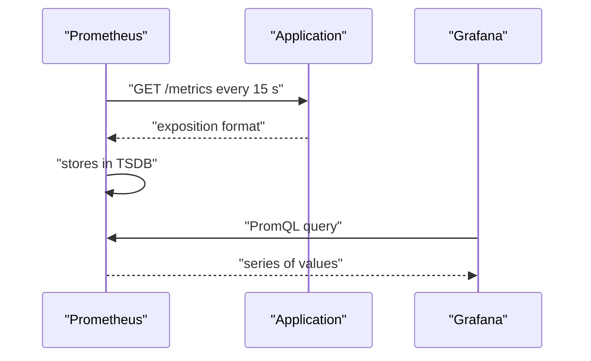

Logs describe individual events, traces — call chains, and **metrics** answer the question "what is happening with the system right now": how many requests per second, what latency, how much memory is used. Metrics are numbers with timestamps, and they underlie alerts and dashboards. The most popular collection tool is **Prometheus**, and for Python there is the standard **prometheus_client** library.

## How Prometheus works

Prometheus is a server that periodically "pulls" metrics from applications: the app publishes them at the `/metrics` endpoint, and Prometheus polls it every N seconds (usually 15). The response format is a simple text protocol — the **exposition format**:

```
# HELP http_requests_total Total HTTP requests.
# TYPE http_requests_total counter
http_requests_total{method="GET",status="200"} 42.0
```

Each line is a metric name, a set of labels in curly braces and a numeric value. The `# HELP` and `# TYPE` comments describe the metric and its type.

## Metric types

1. **Counter** — a monotonically increasing counter: number of requests, errors, bytes. The value only grows (reset on process restart).
2. **Gauge** — can both grow and fall: current number of active connections, temperature, queue size.
3. **Histogram** — a distribution of values (e.g., response time): Prometheus counts sums and the number of values in given buckets, so percentiles (p50, p95, p99) can be computed.
4. **Summary** — similar to a histogram, but percentiles are computed on the application side; used less often.

## Your first metric

Install the library:

```bash
pip install prometheus-client
```

```python
from prometheus_client import Counter, Gauge, Histogram, generate_latest

HTTP_REQUESTS = Counter(
    "http_requests_total",
    "Total HTTP requests",
    ["method", "status"],
)

HTTP_REQUESTS.labels(method="GET", status="200").inc()
```

`Counter` — the metric name (per Prometheus convention, names have suffixes: `_total` for counters, `_seconds` for time, `_bytes` for sizes), the second argument is the HELP description. `.labels(method=..., status=...)` returns the counter "family" with the given labels; `.inc()` increments by 1, `.inc(5)` by 5.

Current number of in-flight requests:

```python
INFLIGHT = Gauge("http_inflight_requests", "Requests currently being processed")
INFLIGHT.inc()   # request started
try:
    ...
finally:
    INFLIGHT.dec()  # request finished
```

`Gauge` supports `inc()`, `dec()`, `set(value)`, `set_to_current_time()`.

## Response time histogram

```python
REQUEST_DURATION = Histogram(
    "http_request_duration_seconds",
    "Request duration in seconds",
    buckets=(0.05, 0.1, 0.25, 0.5, 1.0, 2.5, 5.0),
)

@contextmanager
def track_duration():
    start = time.perf_counter()
    try:
        yield
    finally:
        REQUEST_DURATION.observe(time.perf_counter() - start)
```

`buckets` are interval boundaries. By default `Histogram` uses standard buckets (from 0.005 to 10), but for a specific service they are often set manually.

## The /metrics endpoint

For Prometheus to collect metrics, the application must expose a `/metrics` endpoint returning `generate_latest()`:

```python
from fastapi import FastAPI
from fastapi.responses import Response
from prometheus_client import CONTENT_TYPE_LATEST, generate_latest

app = FastAPI()

@app.get("/metrics")
def metrics():
    return Response(content=generate_latest(), media_type=CONTENT_TYPE_LATEST)
```

`generate_latest()` returns bytes in the exposition format for all metrics registered in the global registry (`REGISTRY`). `CONTENT_TYPE_LATEST` is the correct `Content-Type: text/plain; version=0.0.4; charset=utf-8`. For a quick check you can run `start_http_server(8000)` — the Prometheus client itself will start an HTTP server with `/metrics`.

**Important about multiprocess**: if the application runs in several processes (e.g., gunicorn with multiple workers), each process has its own set of metrics, and a special `prometheus_multiproc_dir` mode with `CollectorRegistry` and `MultiProcessCollector` is needed — be sure to read the docs before deploying.

## FastAPI middleware

Let's put it all together — timing and a request counter:

```python
import time
from fastapi import FastAPI, Request

app = FastAPI()

@app.middleware("http")
async def metrics_middleware(request: Request, call_next):
    start = time.perf_counter()
    try:
        response = await call_next(request)
    except Exception:
        HTTP_REQUESTS.labels(method=request.method, status="500").inc()
        raise
    REQUEST_DURATION.observe(time.perf_counter() - start)
    HTTP_REQUESTS.labels(method=request.method, status=str(response.status_code)).inc()
    return response
```

`Request.method` is the request method, `response.status_code` is the response code. This way we get `http_requests_total{method="GET",status="200"}` and `http_request_duration_seconds` metrics.

## How metric collection works

The application does not "push" metrics — Prometheus itself comes for them on schedule. The diagram shows the whole path from a counter in code to a chart in Grafana:



An important consequence: metrics in the application are just current values in memory. If the process restarts, the `Counter` starts from zero, and Prometheus handles the reset correctly thanks to the `rate()` function.

## Best practices

- **Watch label cardinality.** Labels must have a limited number of values: `method`, `status` are fine, but `user_id` or a concrete `path` with an id (e.g., `/orders/12345`) is not: the number of metric series will explode. For routes use the path template `/orders/{order_id}`.
- Name metrics per the standard: suffixes `_total`, `_seconds`, `_bytes`, units.
- Don't add HELP texts with extra info — they appear in every scrape.
- Histograms store both sums (`_sum`) and counts (`_count`) — the sum divided by the count gives the average. Percentiles are computed by querying Prometheus.

<!--TASK-->
### Task 1
Create a file `metrics_app.py` with a FastAPI application: a `/metrics` endpoint returning `generate_latest()` with `CONTENT_TYPE_LATEST`, and a `/hello` endpoint returning `{"message": "hello"}`. Add a counter `http_requests_total` with labels `method` and `status`. In middleware update the counter after every request. Run the application (`uvicorn metrics_app:app`), make a few requests to `/hello` via `curl` and check that `/metrics` contains a line `http_requests_total{method="GET",status="200"}` with a number equal to the number of requests.

### Task 2
Add to `metrics_app.py` a gauge `http_inflight_requests` — the current number of requests being processed. In middleware call `INFLIGHT.inc()` before `call_next`, and `INFLIGHT.dec()` in `finally`. Then add a histogram `http_request_duration_seconds` with buckets `(0.05, 0.1, 0.25, 0.5, 1.0, 2.5, 5.0)` and measure processing time in middleware, calling `observe()`. Check that `/metrics` contains lines `http_request_duration_seconds_bucket`, `http_request_duration_seconds_sum` and `http_request_duration_seconds_count`, as well as `http_inflight_requests`.

### Task 3
Write pytest tests in `test_metrics.py`. Create a **separate** `CollectorRegistry` (`from prometheus_client import CollectorRegistry, Counter, generate_latest`), register a counter with labels in it, increment it by 5 with label `method="GET"`, then call `generate_latest(registry)` and check that the text contains a line `test_requests_total{method="GET"} 5.0`. In the second test check that a histogram after `observe(0.3)` contains `_count` and `_sum` lines. Make sure the tests don't conflict with the global registry (use your own `CollectorRegistry` in each test).

### Task 4
Add to `test_metrics.py` an integration test for the application from task 2. Create a `TestClient(app)`, make two requests to `/hello`, then fetch `/metrics` and check: (1) the response status is 200; (2) the text contains a line `http_requests_total{method="GET",status="200"} 2.0`; (3) there are lines `http_request_duration_seconds_count` and `http_request_duration_seconds_sum`. Hint: in the test the application already uses the global registry — that's fine, but note that tests running in parallel may "see" each other's metrics; so use unique names or run tests sequentially.

### Task 5
Implement middleware that logs "unusual" responses: if `response.status_code >= 400`, increment a counter `http_errors_total` with label `status`. Show what the line for a 404 will look like in `/metrics`. Then write a short comment in the code about why the `path` label with a concrete id cannot be used, while the `path` label with a template can.

### Task 6
Collect metrics in an isolated registry so tests don't conflict with the global `REGISTRY`. Create `metrics.py` with a function `build_registry()` that returns a tuple `(registry, requests, inflight, duration)`: `CollectorRegistry()`, `Counter("http_requests_total", ..., ["method", "status"], registry=registry)`, `Gauge("http_inflight_requests", ..., registry=registry)` and `Histogram("http_request_duration_seconds", ..., buckets=(0.05, 0.1, 0.5, 1.0), registry=registry)`. In `test_metrics.py` increment the counter by 3, set the gauge to 1 and do `duration.observe(0.08)`, then check that `generate_latest(registry).decode()` contains lines `http_requests_total{method="GET",status="200"} 3.0`, `http_inflight_requests 1.0` and `http_request_duration_seconds_count 1.0`. Expected output: `2 passed`.

### Task 7
Instrument FastAPI with your own registry. In `app_metrics.py` create a `CollectorRegistry`, a `Counter` with labels `method` and `status`, a `Histogram` with label `route` and middleware that measures time via `time.perf_counter()`, does `observe` in `finally`, and computes the status after `call_next`. For the `route` label value take the path template from `request.scope["route"].path`, not the raw URL — otherwise cardinality will explode. The `/metrics` endpoint should return `Response(content=generate_latest(registry), media_type=CONTENT_TYPE_LATEST)`. In `test_app_metrics.py` use `TestClient` to call `/ping`, then `/metrics` and check the presence of series `http_requests_total{method="GET",status="200"} 1.0` and `http_request_duration_seconds_count{route="/ping"} 1.0`. Expected output: `1 passed`.
<!--/TASK-->

<!--HINT-->
### Hint 1
Counter: `HTTP_REQUESTS = Counter("http_requests_total", "Total HTTP requests", ["method", "status"])`. In middleware after `response = await call_next(request)` call `HTTP_REQUESTS.labels(method=request.method, status=str(response.status_code)).inc()`. Don't forget to return `response`.

### Hint 2
Gauge: `INFLIGHT = Gauge("http_inflight_requests", "Requests currently being processed")`. In middleware: `INFLIGHT.inc()` before `call_next`, and `INFLIGHT.dec()` in `finally`. Histogram: `REQUEST_DURATION = Histogram("http_request_duration_seconds", "...", buckets=(0.05, 0.1, 0.25, 0.5, 1.0, 2.5, 5.0))`; in `finally` — `REQUEST_DURATION.observe(time.perf_counter() - start)`.

### Hint 3
Registry: `registry = CollectorRegistry()`, then `c = Counter("test_requests_total", "...", ["method"], registry=registry)`, `c.labels(method="GET").inc(5)` and `text = generate_latest(registry).decode()`. Check: `assert "test_requests_total{method=\"GET\"} 5.0" in text`. For the histogram: `h = Histogram("test_duration_seconds", "...", registry=registry)`, `h.observe(0.3)`, then check `"test_duration_seconds_count 1.0" in text` and `"test_duration_seconds_sum" in text`.

### Hint 4
In the integration test you must make requests *before* reading `/metrics`, otherwise the counter will be 0. If `http_requests_total` is missing from the text, check that the middleware is applied (add a `print()` in middleware while debugging; remember that `TestClient` supports middleware). Note the order: the counter is incremented after `call_next`, so the first request to `/metrics` itself increments the counter.

### Hint 5
Error counter: `HTTP_ERRORS = Counter("http_errors_total", "Total error responses", ["status"])`. In middleware: `if response.status_code >= 400: HTTP_ERRORS.labels(status=str(response.status_code)).inc()`. To check a 404 make a request to a non-existent path `/nope`. Comment: a metric label must have a limited number of values — `/orders/12345` creates a new series for each id.

### Hint 6
The key is to pass `registry=registry` to every metric constructor, otherwise they land in the global registry and a repeated `build_registry()` call in another test fails with `ValueError: Duplicated timeseries`. `generate_latest` returns `bytes`, so to check a substring you need `.decode("utf-8")`. A histogram always publishes three series: `_bucket`, `_sum` and `_count`; `_count` is enough for verification.

### Hint 7
In middleware the route template is available only after `await call_next(request)`: `route = request.scope.get("route")`, then `getattr(route, "path", request.url.path)`. Take the `status` label as `str(response.status_code)`. Don't add `route` to the request counter's labels and don't use `request.url.path` — on `/orders/12345` each value would create a new series.
<!--/HINT-->

<!--SOLUTION-->
### Solution 1
Solution (`metrics_app.py`):

```python
import time
from fastapi import FastAPI, Request
from fastapi.responses import Response
from prometheus_client import CONTENT_TYPE_LATEST, Counter, generate_latest

app = FastAPI()

HTTP_REQUESTS = Counter("http_requests_total", "Total HTTP requests", ["method", "status"])

@app.middleware("http")
async def metrics_middleware(request: Request, call_next):
    response = await call_next(request)
    HTTP_REQUESTS.labels(method=request.method, status=str(response.status_code)).inc()
    return response

@app.get("/metrics")
def metrics():
    return Response(content=generate_latest(), media_type=CONTENT_TYPE_LATEST)

@app.get("/hello")
def hello():
    return {"message": "hello"}
```

What is going on here? `Counter` with labels `method` and `status` is a "family" of counters: each combination of labels gives a separate series. In middleware, after the request is processed, we increment the needed series. Prometheus at `/metrics` will see:

```
http_requests_total{method="GET",status="200"} 3.0
```

`generate_latest()` collects all metrics from the global `REGISTRY` and serializes them into the exposition format.

### Solution 2
Solution:

```python
INFLIGHT = Gauge("http_inflight_requests", "Requests currently being processed")
REQUEST_DURATION = Histogram(
    "http_request_duration_seconds",
    "Request duration in seconds",
    buckets=(0.05, 0.1, 0.25, 0.5, 1.0, 2.5, 5.0),
)

@app.middleware("http")
async def metrics_middleware(request: Request, call_next):
    INFLIGHT.inc()
    start = time.perf_counter()
    try:
        response = await call_next(request)
    finally:
        REQUEST_DURATION.observe(time.perf_counter() - start)
        INFLIGHT.dec()
    HTTP_REQUESTS.labels(method=request.method, status=str(response.status_code)).inc()
    return response
```

What is going on here? `INFLIGHT` is a gauge: it increases when a request starts and decreases when it finishes. `finally` guarantees that even on an exception the gauge won't "hang" in an increased state. The histogram records a measurement into buckets via `observe`. In `/metrics` we'll see `http_inflight_requests` blocks (a single number), `http_request_duration_seconds_bucket{le="0.05"}`, `..._bucket{le="0.1"}`, ..., `..._bucket{le="+Inf"}`, plus `_sum` and `_count`.

### Solution 3
Solution:

```python
import pytest
from prometheus_client import CollectorRegistry, Counter, Histogram, generate_latest

def test_counter_with_labels():
    registry = CollectorRegistry()
    c = Counter("test_requests_total", "Total test requests", ["method"], registry=registry)
    c.labels(method="GET").inc(5)
    text = generate_latest(registry).decode()
    assert 'test_requests_total{method="GET"} 5.0' in text

def test_histogram_count_sum():
    registry = CollectorRegistry()
    h = Histogram("test_duration_seconds", "Test duration", registry=registry)
    h.observe(0.3)
    text = generate_latest(registry).decode()
    assert "test_duration_seconds_count 1.0" in text
    assert "test_duration_seconds_sum" in text
```

What is going on here? The global `REGISTRY` contains metrics from all tests and can conflict. `CollectorRegistry()` creates an isolated registry — inside the test we work only with it, and `generate_latest(registry)` serializes exactly it. Note the format: the value 5.0 is printed as `5.0` (Prometheus always prints a decimal point). The histogram's `_sum` after `observe(0.3)` is 0.3, and that is verified by the presence of the line.

### Solution 4
Solution:

```python
from fastapi.testclient import TestClient
from metrics_app import app

def test_metrics_endpoint_after_requests():
    client = TestClient(app)
    client.get("/hello")
    client.get("/hello")
    resp = client.get("/metrics")
    assert resp.status_code == 200
    text = resp.text
    assert 'http_requests_total{method="GET",status="200"} 2.0' in text
    assert "http_request_duration_seconds_count" in text
    assert "http_request_duration_seconds_sum" in text
```

What is going on here? `TestClient` fully reproduces the request lifecycle, including middleware. Two requests to `/hello` bump `http_requests_total` to 2.0, and the third request — to `/metrics` itself — reads the state. An important detail: middleware increments the counter after `call_next`, so the request to `/metrics` also counts — but it is already finished by the time `resp.text` is read, so its own contribution is not "eaten". If the line with `2.0` is missing from the text, check that the application really uses the same global registry as `generate_latest()`.

### Solution 5
Solution:

```python
HTTP_ERRORS = Counter("http_errors_total", "Total error responses", ["status"])

@app.middleware("http")
async def metrics_middleware(request: Request, call_next):
    INFLIGHT.inc()
    start = time.perf_counter()
    try:
        response = await call_next(request)
    finally:
        REQUEST_DURATION.observe(time.perf_counter() - start)
        INFLIGHT.dec()
    if response.status_code >= 400:
        HTTP_ERRORS.labels(status=str(response.status_code)).inc()
    HTTP_REQUESTS.labels(method=request.method, status=str(response.status_code)).inc()
    return response
```

After a request to a non-existent path, `/metrics` will contain a line `http_errors_total{status="404"} 1.0`. What is going on here? We separate errors into their own metric so it is convenient to build alerts on the share of 5xx. The comment about cardinality: if you write `labels(method=..., path=request.url.path)`, then requests to `/orders/12345` and `/orders/67890` will create **different series** — within a day there will be thousands of them, and Prometheus will start slowing down and consuming memory. Therefore only bounded values go into labels: method, status, path template (`/orders/{order_id}`).

### Solution 6
Solution (`metrics.py`):

```python
from prometheus_client import CollectorRegistry, Counter, Gauge, Histogram

def build_registry():
    registry = CollectorRegistry()
    requests = Counter(
        "http_requests_total", "Total HTTP requests", ["method", "status"], registry=registry
    )
    inflight = Gauge("http_inflight_requests", "In-flight requests", registry=registry)
    duration = Histogram(
        "http_request_duration_seconds",
        "Request duration in seconds",
        buckets=(0.05, 0.1, 0.5, 1.0),
        registry=registry,
    )
    return registry, requests, inflight, duration
```

Test (`test_metrics.py`):

```python
from prometheus_client import generate_latest
from prometheus_client.parser import text_string_to_metric_families

from metrics import build_registry

def test_exposition_contains_series():
    registry, requests, inflight, duration = build_registry()
    requests.labels(method="GET", status="200").inc(3)
    inflight.inc()
    duration.observe(0.08)

    text = generate_latest(registry).decode("utf-8")
    assert 'http_requests_total{method="GET",status="200"} 3.0' in text
    assert "http_inflight_requests 1.0" in text
    assert "http_request_duration_seconds_count 1.0" in text

def test_parser_reads_labels():
    registry, requests, _, _ = build_registry()
    requests.labels(method="POST", status="500").inc()

    text = generate_latest(registry).decode("utf-8")
    families = {family.name: family for family in text_string_to_metric_families(text)}
    samples = {
        tuple(sorted(sample.labels.items())): sample.value
        for sample in families["http_requests"].samples
        if sample.name == "http_requests_total"
    }
    assert samples[(('method', 'POST'), ('status', '500'))] == 1.0
```

What is going on here? `CollectorRegistry` is a separate "warehouse" of metrics. The global `REGISTRY` is convenient in an application, but in tests it becomes a trap: a second import of the module or a repeated factory call tries to register the same name and fails. Your own registry solves this and lets you check exactly the metrics the test created. The exposition format is plain text, so substring checks are the most reliable; and `text_string_to_metric_families` gives structural parsing when you need to compare values by labels. Remember that `Counter` publishes its name with the `_total` suffix, while `Histogram` publishes several series at once.

### Solution 7
Solution (`app_metrics.py`):

```python
import time

from fastapi import FastAPI, Request, Response
from prometheus_client import (
    CONTENT_TYPE_LATEST, CollectorRegistry, Counter, Histogram, generate_latest,
)

registry = CollectorRegistry()
REQUESTS = Counter(
    "http_requests_total", "Total HTTP requests", ["method", "status"], registry=registry
)
DURATION = Histogram(
    "http_request_duration_seconds", "Request duration", ["route"], registry=registry
)

app = FastAPI()

@app.middleware("http")
async def metrics_middleware(request: Request, call_next):
    start = time.perf_counter()
    try:
        response = await call_next(request)
    except Exception:
        REQUESTS.labels(method=request.method, status="500").inc()
        raise
    finally:
        route = request.scope.get("route")
        route_path = getattr(route, "path", request.url.path)
        DURATION.labels(route=route_path).observe(time.perf_counter() - start)

    REQUESTS.labels(method=request.method, status=str(response.status_code)).inc()
    return response

@app.get("/metrics")
def metrics():
    return Response(content=generate_latest(registry), media_type=CONTENT_TYPE_LATEST)

@app.get("/ping")
def ping():
    return {"status": "ok"}
```

Test (`test_app_metrics.py`):

```python
from fastapi.testclient import TestClient
from app_metrics import app

def test_ping_is_counted():
    client = TestClient(app)
    assert client.get("/ping").status_code == 200

    body = client.get("/metrics").text
    assert 'http_requests_total{method="GET",status="200"} 1.0' in body
    assert 'http_request_duration_seconds_count{route="/ping"} 1.0' in body
```

What is going on here? Middleware wraps every request: before `call_next` the start time is recorded, after — an observation into the histogram and a counter increment. The `except` branch matters separately: without it, a request that failed with an exception would not reach the counter, and the error chart would be understated. `finally` guarantees the duration is recorded on any outcome — otherwise the histogram would lose the most interesting, slow requests. The route template comes from `request.scope["route"]`: FastAPI puts an `APIRoute` object there whose `.path` equals `/orders/{order_id}`, not a concrete `/orders/42`. That is exactly how the cardinality rule is obeyed. The `/metrics` endpoint serves the registry in the exposition format with the correct `Content-Type`, so Prometheus can parse it without extra configuration.
<!--/SOLUTION-->

<!--QUIZ-->
Which metric type fits a request counter?
- Gauge
- Counter
- Histogram
* Correct answer: Counter
Counter is a monotonically increasing counter; requests are a classic example.

Which metric type can both increase and decrease?
- Counter
- Gauge
- Summary
* Correct answer: Gauge
Gauge reflects the current value: connections, queue, temperature.

What does Histogram.observe(0.3) do?
- Increases the counter by 0.3
- Records the measurement 0.3 into distribution buckets
- Sets the histogram value to 0.3
* Correct answer: Records the measurement 0.3 into distribution buckets
observe adds an observation to the distribution; Prometheus then computes percentiles.

Which endpoint usually exposes metrics to Prometheus?
- /health
- /metrics
- /status
* Correct answer: /metrics
Prometheus polls /metrics in the exposition format.

Which function builds the metrics text?
- format_metrics()
- generate_latest()
- render_metrics()
* Correct answer: generate_latest()
generate_latest() returns bytes in the exposition format from the registry.

What will generate_latest(registry) return with a custom CollectorRegistry?
- Metrics of only that registry
- All process metrics
- An error
* Correct answer: Metrics of only that registry
Passing a registry lets you isolate metrics in tests.

Why can't user_id be used as a label?
- The name is too long
- The number of unique values is unbounded — cardinality will explode
- Prometheus does not support string labels
* Correct answer: The number of unique values is unbounded — cardinality will explode
Each combination of labels is a separate series; thousands of users create thousands of series.

What does INFLIGHT.dec() in finally do?
- Resets the gauge to zero
- Decreases the gauge's current value, even if there was an error
- Sets the gauge to 1
* Correct answer: Decreases the gauge's current value, even if there was an error
finally guarantees the decrease on any outcome — otherwise the gauge "hangs".

What Content-Type should /metrics have?
- application/json
- text/plain; version=0.0.4; charset=utf-8
- text/html
* Correct answer: text/plain; version=0.0.4; charset=utf-8
This value lives in the CONTENT_TYPE_LATEST constant.

What does the line http_requests_total{method="GET",status="200"} 42.0 mean?
- 42 requests with label GET and status 200
- 42 histograms
- 42 errors
* Correct answer: 42 requests with label GET and status 200
The metric series with labels method=GET, status=200 counted 42.0.

What happens to a Counter value after a process restart?
- It keeps growing from the previous value
- It starts over from zero
- It is saved in a nearby file
* Correct answer: It starts over from zero
Counter lives in memory; Prometheus detects the reset and computes rate() correctly.

How is Summary different from Histogram?
- Summary computes percentiles on the application side, Histogram in Prometheus by buckets
- Summary does not support labels
- Histogram can only decrease
* Correct answer: Summary computes percentiles on the application side, Histogram in Prometheus by buckets
That is why Summary cannot be aggregated across instances, while Histogram can.

What happens when registering a metric with the same name in one registry again?
- Values will be summed
- ValueError: Duplicated timeseries
- The old metric will be replaced
* Correct answer: ValueError: Duplicated timeseries
The registry requires unique names; in tests, a separate CollectorRegistry is used for this.

Why is the prometheus_multiproc_dir mode needed?
- So multiple processes write metrics into a common set
- To speed up metric collection
- To disable histograms
* Correct answer: So multiple processes write metrics into a common set
With multiple workers, each has its own registry, and without MultiProcessCollector the data will be incomplete.
<!--/QUIZ-->
