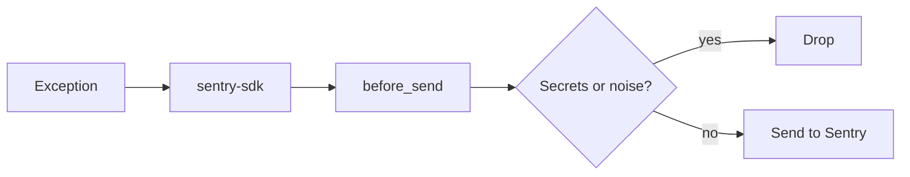

When an application crashes locally, a traceback in the terminal is all you need. In production everything is more complex: errors happen to real users, and you can't see their console. Ordinary logs show neither the application state at the moment of the error, nor the user's path to it. The job of **error tracking** is to collect all exceptions in one place, group identical ones, show the environment and stack traces, and tie them to a code release. The de-facto standard for Python is **Sentry** and its SDK **sentry-sdk**.

## What Sentry gives you

- **Automatic exception capture** — unhandled errors in web applications reach Sentry by themselves, without try/except.
- **Grouping** — thousands of identical errors become one entry with an occurrence count.
- **Context** — environment (production/staging), code version, user information, breadcrumbs (preceding events).
- **Alerts and integrations** — notifications to Slack/Telegram/email, CI/CD integration.

## Installation and initialization

```bash
pip install sentry-sdk
```

```python
import sentry_sdk

sentry_sdk.init(
    dsn="https://examplePublicKey@o0.ingest.us.sentry.io/0",
    environment="production",
    release="orders@1.0.0",
    traces_sample_rate=1.0,
)
```

- `dsn` — the address of your Sentry project. Store it in the `SENTRY_DSN` environment variable and don't commit it to the repository. If the DSN is empty, the SDK silently disables itself, which is convenient for local development.
- `environment` — mandatory separation of production and staging.
- `release` — the `project_name@version` format; lets you see in which release an error first appeared.
- `traces_sample_rate` — the sampling probability for performance transactions (0.1–1.0). Sampling reduces traffic to Sentry.

Modern versions of sentry-sdk **automatically** instrument FastAPI/Starlette (and Flask): just `init()` — and exceptions bubbling out of endpoints will be caught. Previously you had to wrap the application in `SentryAsgiMiddleware`; now the SDK prints a warning if you do it manually.

## Manual capture

Sometimes you need to send an error explicitly:

```python
try:
    result = 1 / 0
except ZeroDivisionError as exc:
    sentry_sdk.capture_exception(exc)
```

`capture_exception` takes the current exception and sends a full traceback. For simple messages:

```python
sentry_sdk.capture_message("disk space below 10%")
```

## Context: user, tags, breadcrumbs

To understand who suffered and how, add context:

```python
sentry_sdk.set_user({"id": 77, "email": "user@example.com"})
sentry_sdk.set_tag("plan", "pro")
sentry_sdk.set_context("request", {"path": "/orders/1024", "method": "GET"})
sentry_sdk.add_breadcrumb(category="db", message="queried orders", level="info")
```

`set_user` binds an error to a user, `set_tag` — key labels for filtering, `set_context` — an arbitrary dict, `add_breadcrumb` adds "breadcrumbs" — events before the error. All of this works within a single **scope** (context) — the SDK creates an isolated scope per request, so one request's data doesn't leak into another. You can also use `with sentry_sdk.isolation_scope() as scope:` for explicit grouping.

## before_send: the last sentinel

Before sending, every event passes through `before_send`. This is the ideal place to strip sensitive data or drop the event entirely:

```python
def before_send(event, hint):
    # mask secrets in extra fields
    extra = event.get("extra", {})
    for key in list(extra):
        if "password" in key.lower() or "token" in key.lower():
            extra[key] = "***"
    # drop expected 404s
    if event.get("level") == "error" and "HTTP 404" in event.get("message", ""):
        return None
    return event

sentry_sdk.init(dsn=..., before_send=before_send)
```

Returning `None` drops the event, returning `event` sends it. The second parameter `hint` holds technical details (e.g., the original exception).

## Testing without the network

The Sentry SDK lets you substitute the transport. For pytest it is convenient to define a "collecting" transport — a `Transport` subclass that intercepts `capture_envelope` and collects events into a list:

```python
from sentry_sdk.transport import Transport

class CollectingTransport(Transport):
    def __init__(self, options=None):
        super().__init__(options)
        self.events = []

    def capture_envelope(self, envelope):
        event = envelope.get_event()
        if event is not None:
            self.events.append(event)
```

Passing such a transport to `init(transport=CollectingTransport())` gives deterministic tests without the network.

## The event path to Sentry

Any exception or message goes through the same pipeline. Understanding this path explains why `before_send`, the transport and `flush()` are needed:



`before_send` is the only point where you can modify or cancel an event before sending. The transport handles delivery: substituting it in tests gives us events locally, independent of the network.

## Best practices

- Don't send sensitive data to Sentry: PII, passwords, tokens. Use `before_send` and don't put secrets into `set_context`.
- `traces_sample_rate` in production is usually ≤ 0.1 — otherwise it's expensive.
- For "expected" errors (e.g., 404) configure filtering — otherwise they'll flood the alerts.
- Combine with releases: set `release` on deploy to link errors to code versions.

<!--TASK-->
### Task 1
Create a file `sentry_setup.py`. In it, a function `init_sentry(dsn: str = "")` that calls `sentry_sdk.init(dsn=dsn, environment="production", release="orders@1.0.0", traces_sample_rate=0.5)`. Write a function `divide(a, b)` that when `b == 0` catches `ZeroDivisionError` and calls `sentry_sdk.capture_exception(exc)`, then re-raises the exception (`raise`). In `main()` call `init_sentry()` and `divide(1, 0)`, wrapping the call in try/except. Run it — a traceback should appear on the screen, but the application must not crash with an unhandled exception. Explain in a comment what will happen if a real DSN is passed.

### Task 2
Add to `sentry_setup.py` a function `mask_secrets(event: dict) -> dict | None` to be used as `before_send`. It should: (1) iterate over `event.get("extra", {})` and replace values of keys containing `password` or `token` (case-insensitive) with `"***"`; (2) return `None` if `event.get("level") == "error"` and `event.get("message", "")` contains the substring `"HTTP 404"`; (3) otherwise return the unchanged `event`. Wire it into `init_sentry` via the `before_send` parameter.

### Task 3
Write pytest tests for `mask_secrets` in `test_mask.py`. Test 1: pass an event with `extra={"password": "redacted", "token": "abc", "order_id": 7}` and check that after the call `extra["password"] == "***"`, `extra["token"] == "***"`, while `extra["order_id"]` is unchanged. Test 2: pass an event with `level="error"` and `message="HTTP 404: Not Found"` and check that the function returns `None`. Test 3: pass a normal event (`level="info"`, `message="ok"`) and check that the function returns it as is (the same object). Run `pytest test_mask.py -v` — all tests must pass without the network and without init.

### Task 4
Create a FastAPI application in `sentry_app.py` with an endpoint `GET /divide?b=0` that calls `divide(10, b)` from `sentry_setup`, and an endpoint `GET /ok` returning `{"status": "ok"}`. In `main()` call `init_sentry(dsn="https://public@o0.ingest.us.sentry.io/0")`. In `test_sentry_app.py` write a pytest test: create a `CollectingTransport`, call `init_sentry(dsn="https://public@o0.ingest.us.sentry.io/0", transport=CollectingTransport())` (add a `transport` parameter to `init_sentry`), make a `GET /divide?b=0` request, then check that `transport.events` contains an event with an exception (the `exception` field is present) and that `GET /ok` creates no events. Use `TestClient`.

### Task 5
Add to `sentry_app.py` an endpoint `GET /profile` that adds a user (`sentry_sdk.set_user({"id": 42, "email": "x@example.com"})`) and a tag `plan="pro"`, then calls `sentry_sdk.capture_message("profile viewed")`. In the test check that after the request `transport.events` contains an event with `user.id == 42` and `tags["plan"] == "pro"`. Run `pytest test_sentry_app.py -v`.

### Task 6
Extend masking to nested structures. Write `scrub_event(event: dict) -> dict` that recursively walks `event["extra"]`, `event["request"]["data"]`, `event["contexts"]` and `event["breadcrumbs"]["values"]`, replacing values of keys containing `password`, `token`, `secret` or `card` (case-insensitive) with `"***"`. The function must handle lists and nested dicts correctly, not crash on `None`, and not mutate the original object. In `test_scrub.py` check an event with `extra={"user": {"password": "x"}}`, `request={"data": {"card_number": "4111"}}` and a breadcrumb with `token`; make sure all secrets are replaced and the other fields are preserved. Expected output: `3 passed`.

### Task 7
Verify context isolation between requests. Configure `sentry_sdk.init(dsn="https://public@o0.ingest.us.sentry.io/0", transport=CollectingTransport())`. In the test open `with sentry_sdk.isolation_scope():`, inside it set `set_user({"id": 42})` and call `capture_message("inside")`. Then open a new `isolation_scope()` without `set_user` and call `capture_message("outside")`. After `sentry_sdk.flush()` check that the first event has `user["id"] == 42`, and the second has no `user` key at all. Expected output: `1 passed` — context does not leak between scopes.
<!--/TASK-->

<!--HINT-->
### Hint 1
In the `except` block the exception variable is available: `except ZeroDivisionError as exc: sentry_sdk.capture_exception(exc); raise`. For clarity you can add `sentry_sdk.capture_message("division by zero attempt")` before `capture_exception`.

### Hint 2
`before_send(event, hint)` receives the event dict. `event.get("extra", {})` is the dict of custom fields. Note: `extra` keys can be in any case — use `key.lower()`. Returning `None` means "don't send".

### Hint 3
`mask_secrets` is a pure function — it needs no SDK. In test 1 remember that the `extra` dict is a nested dict: `event["extra"]["password"]` should become `"***"`. In test 3 check identity via `is` (or `==`).

### Hint 4
Define the `CollectingTransport` class right in the test file. Don't forget to change `init_sentry` so it accepts `transport=None` and passes it to `sentry_sdk.init(transport=transport)`. After the request, `transport.events` should contain an event with the `exception` key (this is the automatic capture of the exception by the ASGI integration). Note: `GET /divide?b=0` will return 500 — that's fine, but TestClient should not raise; if it raises, wrap in try/except or use `raise_server_exceptions=False`.

### Hint 5
`set_user` and `set_tag` apply to the request's scope. Check `event["user"]["id"] == 42` and `event["tags"]["plan"] == "pro"`. If the event doesn't appear, check that `capture_message` is called inside the handler (it is a synchronous function; it should reach the transport immediately).

### Hint 6
A recursive function looks best like this: if the value is a `dict`, return a new dict in which "secret" keys are replaced and the rest are processed recursively; if a `list` — a list of recursive calls; otherwise return the value as is. To check a key use `any(word in key.lower() for word in ("password", "token", "secret", "card"))`. Don't mutate the input: create a new object, otherwise the "original dict unchanged" test will fail.

### Hint 7
`isolation_scope()` creates a child scope and restores the previous one on exit — an analogue of `ContextVar` with a token. Collect events into `CollectingTransport`, because without a transport the SDK will try to hit the network. `flush()` waits for sending; without it the list may stay empty.
<!--/HINT-->

<!--SOLUTION-->
### Solution 1
Solution:

```python
import sentry_sdk

def init_sentry(dsn: str = "") -> None:
    sentry_sdk.init(
        dsn=dsn,
        environment="production",
        release="orders@1.0.0",
        traces_sample_rate=0.5,
    )

def divide(a: int, b: int) -> float:
    try:
        return a / b
    except ZeroDivisionError as exc:
        sentry_sdk.capture_exception(exc)
        raise

if __name__ == "__main__":
    init_sentry()
    try:
        divide(1, 0)
    except ZeroDivisionError:
        print("caught: division by zero")
```

What is going on here? `capture_exception` sends the current exception to Sentry (or to a disabled client if the DSN is empty — then nothing happens, but no errors either). Then `raise` re-raises the exception — so we both logged it and did not swallow it. In `main` we catch the exception so the program doesn't crash. If a real DSN is passed, the exception goes to Sentry and appears in the dashboard.

### Solution 2
Solution:

```python
def mask_secrets(event: dict):
    extra = event.get("extra", {})
    for key in list(extra):
        if "password" in key.lower() or "token" in key.lower():
            extra[key] = "***"
    if event.get("level") == "error" and "HTTP 404" in event.get("message", ""):
        return None
    return event

def init_sentry(dsn: str = "", transport=None) -> None:
    sentry_sdk.init(
        dsn=dsn,
        environment="production",
        release="orders@1.0.0",
        traces_sample_rate=0.5,
        before_send=mask_secrets,
        transport=transport,
    )
```

What is going on here? `before_send` is called before every event is sent. We modify `extra` — no need to copy it, because the event is already a copy assembled by the SDK. `list(extra)` is a copy of the keys, so we avoid `RuntimeError: dictionary changed size during iteration`. Returning `None` drops 404 errors — they shouldn't be sent to Sentry because that is "expected" behavior, not a failure.

### Solution 3
Solution:

```python
from sentry_setup import mask_secrets

def test_mask_secret_values():
    event = {"extra": {"password": "redacted", "token": "abc", "order_id": 7}}
    result = mask_secrets(event)
    assert result["extra"]["password"] == "***"
    assert result["extra"]["token"] == "***"
    assert result["extra"]["order_id"] == 7

def test_drops_404_errors():
    event = {"level": "error", "message": "HTTP 404: Not Found"}
    assert mask_secrets(event) is None

def test_passthrough():
    event = {"level": "info", "message": "ok"}
    assert mask_secrets(event) is event
```

What is going on here? We test a pure function without any SDK — fast and deterministic. Test 1 checks masking, test 2 checks dropping 404s, test 3 checks that normal events pass through unchanged (the `is` check confirms the same object is returned, not a copy). Such tests are the first line of defense against data leaks.

### Solution 4
Solution (`sentry_app.py`):

```python
from fastapi import FastAPI
from sentry_setup import divide, init_sentry

app = FastAPI()
init_sentry(dsn="https://public@o0.ingest.us.sentry.io/0")

@app.get("/divide")
def divide_endpoint(b: int):
    return {"result": divide(10, b)}

@app.get("/ok")
def ok():
    return {"status": "ok"}
```

Test (`test_sentry_app.py`):

```python
from fastapi.testclient import TestClient
from sentry_sdk.transport import Transport
from sentry_app import app

class CollectingTransport(Transport):
    def __init__(self, options=None):
        super().__init__(options)
        self.events = []

    def capture_envelope(self, envelope):
        event = envelope.get_event()
        if event is not None:
            self.events.append(event)

def test_exception_captured():
    transport = CollectingTransport()
    init_sentry(dsn="https://public@o0.ingest.us.sentry.io/0", transport=transport)
    client = TestClient(app, raise_server_exceptions=False)
    resp = client.get("/divide?b=0")
    assert resp.status_code == 500
    assert len(transport.events) == 1
    assert "exception" in transport.events[0]

def test_no_events_on_ok():
    transport = CollectingTransport()
    init_sentry(dsn="https://public@o0.ingest.us.sentry.io/0", transport=transport)
    client = TestClient(app)
    client.get("/ok")
    assert transport.events == []
```

What is going on here? `CollectingTransport` is a `Transport` subclass with an overridden `capture_envelope`: it doesn't hit the network, but extracts the event via `envelope.get_event()` and appends it to a list. The Sentry ASGI integration automatically catches the exception from the endpoint, builds an event and passes it to the transport. `raise_server_exceptions=False` is needed so TestClient returns 500 instead of raising. The second test confirms: successful requests create no events.

### Solution 5
Solution:

```python
import sentry_sdk
from fastapi import FastAPI

app = FastAPI()

@app.get("/profile")
def profile():
    sentry_sdk.set_user({"id": 42, "email": "x@example.com"})
    sentry_sdk.set_tag("plan", "pro")
    sentry_sdk.capture_message("profile viewed")
    return {"profile": "ok"}
```

Test:

```python
def test_profile_user_context():
    transport = CollectingTransport()
    init_sentry(dsn="https://public@o0.ingest.us.sentry.io/0", transport=transport)
    client = TestClient(app)
    client.get("/profile")
    event = transport.events[0]
    assert event["user"]["id"] == 42
    assert event["tags"]["plan"] == "pro"
```

What is going on here? While a request is being processed, the SDK holds a scope: `set_user` and `set_tag` are written into it and land in the event. That is "context" — without it an error looks like an anonymous traceback, and with it you can see which user with which plan was affected. Such fields let you answer "who was affected".

### Solution 6
Solution (`scrub.py`):

```python
SECRET_WORDS = ("password", "token", "secret", "card")

def scrub_value(value):
    if isinstance(value, dict):
        result = {}
        for key, item in value.items():
            if any(word in key.lower() for word in SECRET_WORDS):
                result[key] = "***"
            else:
                result[key] = scrub_value(item)
        return result
    if isinstance(value, list):
        return [scrub_value(item) for item in value]
    return value

def scrub_event(event: dict) -> dict:
    cleaned = dict(event)
    if "extra" in cleaned:
        cleaned["extra"] = scrub_value(cleaned["extra"])
    if "request" in cleaned:
        cleaned["request"] = scrub_value(cleaned["request"])
    if "contexts" in cleaned:
        cleaned["contexts"] = scrub_value(cleaned["contexts"])
    if "breadcrumbs" in cleaned:
        cleaned["breadcrumbs"] = scrub_value(cleaned["breadcrumbs"])
    return cleaned
```

Test (`test_scrub.py`):

```python
from scrub import scrub_event

def test_nested_extra():
    event = {"extra": {"user": {"password": "x", "name": "ann"}}}
    cleaned = scrub_event(event)
    assert cleaned["extra"]["user"]["password"] == "***"
    assert cleaned["extra"]["user"]["name"] == "ann"
    assert event["extra"]["user"]["password"] == "x"

def test_request_card():
    event = {"request": {"data": {"card_number": "4111", "amount": 100}}}
    assert scrub_event(event)["request"]["data"]["card_number"] == "***"

def test_breadcrumb_token():
    event = {"breadcrumbs": {"values": [{"message": "login", "token": "abc"}]}}
    assert scrub_event(event)["breadcrumbs"]["values"][0]["token"] == "***"
```

What is going on here? The flat filter from task 2 misses secrets one level deeper — for example in `request.data` or in a breadcrumb. A recursive walk solves this, but requires care with types: `None`, numbers and strings must be returned unchanged, and lists walked element by element. We deliberately create new dicts instead of mutating the input: `before_send` may be called several times, and side effects on the original event complicate debugging. Such a "scrubber" belongs in its own module with tests, because the price of a mistake is a payment-data leak to a third-party service.

### Solution 7
Solution (`test_scopes.py`):

```python
import sentry_sdk
from sentry_sdk.transport import Transport

class CollectingTransport(Transport):
    def __init__(self, options=None):
        super().__init__(options)
        self.events = []

    def capture_envelope(self, envelope):
        event = envelope.get_event()
        if event is not None:
            self.events.append(event)

def test_scope_isolation():
    transport = CollectingTransport()
    sentry_sdk.init(
        dsn="https://public@o0.ingest.us.sentry.io/0",
        transport=transport,
        default_integrations=False,
    )

    with sentry_sdk.isolation_scope():
        sentry_sdk.set_user({"id": 42})
        sentry_sdk.capture_message("inside")

    with sentry_sdk.isolation_scope():
        sentry_sdk.capture_message("outside")

    sentry_sdk.flush()
    assert transport.events[0]["user"]["id"] == 42
    assert "user" not in transport.events[1]
```

What is going on here? A scope is Sentry's context stack: user, tags, breadcrumbs and level. `isolation_scope()` creates a new layer and restores the previous one on exit, so the first block's data is invisible in the second. This is critical for a web server: without isolation, one request's user would "stick" to another's events and you'd get false error attribution. `default_integrations=False` disables auto-integrations so the test doesn't depend on installed libraries, and `flush()` guarantees the transport received all envelopes before the checks. Note: `capture_message` returns an event id, but checking the list itself is more convenient — it is deterministic and needs no network.
<!--/SOLUTION-->

<!--QUIZ-->
What does sentry_sdk.capture_exception(exc) do?
- Prints a traceback to the console
- Sends the current exception to Sentry as an event
- Ignores the exception
* Correct answer: Sends the current exception to Sentry as an event
capture_exception builds an event with a traceback and passes it to the transport.

Which init() parameter sets the environment?
- release
- environment
- server_name
* Correct answer: environment
environment separates production/staging/development in the dashboard.

What does before_send(event, hint) do when returning None?
- Sends the event without hint
- Drops the event
- Changes hint
* Correct answer: Drops the event
Returning None means "don't send this event".

What is traces_sample_rate for?
- For sampling performance transactions
- For limiting the event size
- For filtering errors
* Correct answer: For sampling performance transactions
It is the probability with which transactions are sent to Sentry.

How to add user information to an event?
- sentry_sdk.set_user({...})
- sentry_sdk.user({...})
- sentry_sdk.context({...})
* Correct answer: sentry_sdk.set_user({...})
set_user binds the error to a user within the current scope.

What are breadcrumbs in Sentry?
- Events before the error that help reconstruct the sequence of actions
- Documentation links
- Developer comments
* Correct answer: Events before the error that help reconstruct the sequence of actions
Breadcrumbs are "bread crumbs": what happened before the error.

Why is sending passwords via capture_message dangerous?
- It will slow down sending
- The password will end up in Sentry and be accessible to everyone with project rights
- The password will be truncated
* Correct answer: The password will end up in Sentry and be accessible to everyone with project rights
Secrets should be masked in before_send or not logged at all.

Why a Transport subclass in tests?
- To speed up sending
- To intercept events without the network and verify them
- To encrypt events
* Correct answer: To intercept events without the network and verify them
A subclass with capture_envelope collects events into a list — a deterministic test.

What does envelope.get_event() return?
- A list of events
- The event from the envelope (event dict) or None
- The envelope size
* Correct answer: The event from the envelope (event dict) or None
get_event() extracts the event object from the Envelope.

What happens if an empty DSN is passed to init()?
- An error at startup
- The SDK disables itself and does not send events
- The SDK will write events to a file
* Correct answer: The SDK disables itself and does not send events
An empty DSN is local-development mode without sending.

What does the ignore_errors parameter in sentry_sdk.init() do?
- Ignores errors of the SDK itself
- Does not send events for the specified exception types
- Lowers the level of all events
* Correct answer: Does not send events for the specified exception types
This is convenient for expected exceptions that shouldn't make noise in alerts.

What is the release parameter for?
- To link errors to a code version
- To speed up sending
- To enable breadcrumbs
* Correct answer: To link errors to a code version
The project_name@version format lets you see in which release an error appeared.

What does with sentry_sdk.isolation_scope() do?
- Creates an isolated context and restores the previous one on exit
- Disables event sending
- Clears all project events
* Correct answer: Creates an isolated context and restores the previous one on exit
This is how one request's user data does not get into another request's events.

What happens if before_send returns a modified event?
- The changes will be ignored
- The modified event will go to Sentry
- The SDK will raise an exception
* Correct answer: The modified event will go to Sentry
The returned dict is the final payload that the transport sends.
<!--/QUIZ-->
