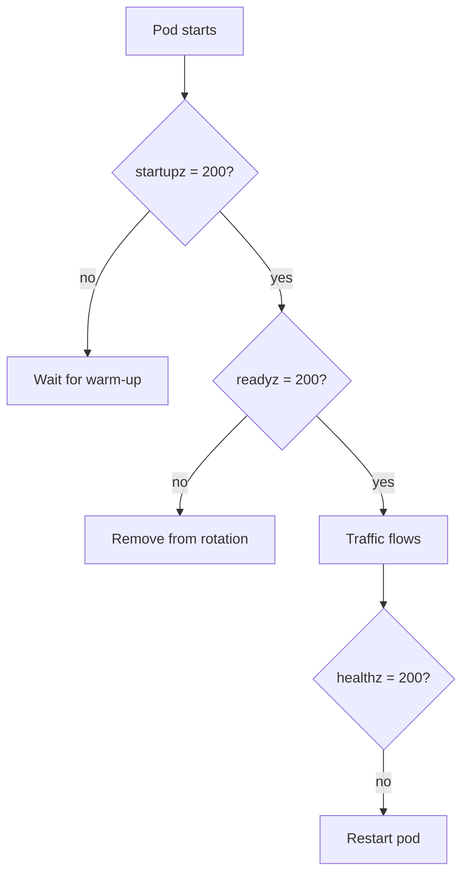

You can start an application — but that doesn't mean it is ready to accept traffic. Orchestrators (Kubernetes) and load balancers constantly check application health, and the quality of these checks directly determines how fast the system recovers after a failure. In this lesson we'll cover the two main kinds of checks — **liveness** and **readiness** — and how to turn metrics into alerts.

## Liveness: is the process alive

**Liveness** answers the question "is the process alive and not hung?". If the check fails, the orchestrator **restarts** the container. A typical implementation is a minimal endpoint that just answers `200` if the application can process requests at all:

```python
from fastapi import FastAPI
from fastapi.responses import JSONResponse

app = FastAPI()

@app.get("/healthz")
def liveness():
    return JSONResponse({"status": "ok"})
```

Important: liveness must **not** include checks of external dependencies. If the database becomes unavailable for 30 seconds and liveness starts returning 503, the orchestrator will restart the application, and the problem won't be solved — it will get worse. Liveness should be "dumb": the process responds — so it is alive.

## Readiness: ready to accept traffic

**Readiness** answers "can the application do work right now?". It checks **dependencies**: is the database, cache, queue, external API available. If readiness returns an error, the orchestrator **withdraws traffic** from the pod (but does not restart it). The check looks like this:

```python
async def check_db() -> bool:
    try:
        async with db.pool.acquire() as conn:
            await conn.execute("SELECT 1")
        return True
    except Exception:
        return False

@app.get("/readyz")
async def readiness():
    if not await check_db():
        return JSONResponse({"status": "unavailable", "component": "db"}, status_code=503)
    return JSONResponse({"status": "ok"})
```

`503` means: "not ready, don't send traffic". When the dependency returns, the endpoint starts answering `200` again — and the orchestrator puts the pod back into rotation.

## Dangerous patterns

1. **Checking the DB on every request** — readiness is polled every few seconds by every instance. If each check opens a DB connection, that is extra load. Solution — cache the result for 5–10 seconds.
2. **Unbounded timeouts** — if the database hangs, `SELECT 1` may hang for minutes, and the check won't answer in time. Always set a timeout (e.g., 1–2 seconds).
3. **Checking everything at once** — readiness should return `503` if **at least one** critical dependency is unavailable, but each check must be fast and independent.

## Designing the check interface

To test readiness without a real database, move the check behind an interface:

```python
from abc import ABC, abstractmethod

class HealthChecker(ABC):
    @abstractmethod
    def check(self) -> bool:
        """Returns True if the dependency is available."""
        raise NotImplementedError

class DummyChecker(HealthChecker):
    def __init__(self, healthy: bool = True):
        self._healthy = healthy
    def check(self) -> bool:
        return self._healthy
```

In production a real DB checker is passed; in tests — `DummyChecker(healthy=False)`. This is a classic pattern for isolating external systems.

## Alerts: from metrics to action

Metrics are useless if nobody reacts. Alerts are rules in **PromQL** that Prometheus evaluates periodically; if the condition holds longer than `for`, a notification goes to Alertmanager. Example rule:

```yaml
groups:
  - name: orders.rules
    rules:
      - alert: HighErrorRate
        expr: |
          sum(rate(http_errors_total[5m]))
            / sum(rate(http_requests_total[5m])) > 0.05
        for: 10m
        labels:
          severity: critical
        annotations:
          summary: "Errors above 5% over 5 minutes"
          description: "Error share {{ $value | humanizePercentage }}"
```

- `expr` — the PromQL expression. `rate(...[5m])` computes the counter growth rate over 5 minutes; errors divided by requests is the error share.
- `for: 10m` — a false alarm won't fire: the condition must hold for 10 straight minutes.
- `severity` and annotations — for routing in Alertmanager (who to send to, with what importance).

## SLO and burn rate

The modern approach is to build alerts on **SLO** (Service Level Objective): for example, "99.9% of requests must complete successfully in a month". What should burn is not the violation itself, but the **burn rate** — the speed at which the error budget "burns". If 0.1% errors are allowed over 30 days, then 1% errors in an hour is a 10× burn rate, and you need to alert immediately. A simple rule: alert when the error share over 5 minutes exceeds the target level several times over.

## How checks control traffic

Three checks solve three different tasks, and confusing them is costly: one gives the application time to warm up, the second removes the pod from rotation, the third restarts a hung process.



The key difference from plain "pinging": each check has its own orchestrator reaction. Therefore `healthz` should know nothing about the database, and `readyz` should not restart the container.

## Best practices

- Split liveness and readiness into separate endpoints with different names (`/healthz`, `/readyz`).
- Don't restart a pod on a dependency failure — withdraw traffic via readiness.
- Cache check results and always set timeouts.
- Alerts should include `for` to avoid false positives.
- Validate alerts on test data before shipping to production.

<!--TASK-->
### Task 1
Create a file `health_app.py` with a FastAPI application and two endpoints: `GET /healthz` (liveness, always answers `{"status": "ok"}` with code 200) and `GET /readyz` (readiness, returns `{"status": "ok"}` or `{"status": "unavailable", "component": "db"}` with code 503). For readiness use the `HealthChecker` interface with a `check()` method and the `DummyChecker` class from the theory. Attach `DummyChecker()` as a dependency via `Depends`. Make sure both endpoints work.

### Task 2
Add to `health_app.py` caching of the readiness result: check results should not be requested more often than once per 5 seconds. Implement a class `CachedHealthChecker` (a wrapper over `HealthChecker`) that remembers the last result and check time, and if less than 5 seconds have passed — returns the saved result without calling the inner checker. Attach it instead of `DummyChecker`.

### Task 3
Write pytest tests in `test_health.py`. Test 1: `TestClient` with `DummyChecker(healthy=True)` — `GET /healthz` returns 200 and `{"status": "ok"}`, `GET /readyz` returns 200. Test 2: `DummyChecker(healthy=False)` — `GET /readyz` returns 503 and `{"status": "unavailable", "component": "db"}`. Test 3: `CachedHealthChecker` — create a call counter (e.g., a wrapper that increments the counter on every `check()`), make 10 requests to `/readyz` and check that the inner checker was called no more than 2 times (the first + one more after the cache expires). Run `pytest test_health.py -v`.

### Task 4
Add to `test_health.py` a timeout test: a wrapper `SlowChecker` that sleeps 0.2 seconds and returns `True`. Create `CachedHealthChecker(SlowChecker(), ttl=1.0)` (the `ttl` parameter is the cache lifetime in seconds). Test: make a request to `/readyz` and measure the time — on a repeated request it should be less than 0.2 seconds (the cache worked), while the first request is slower. Check that both checks completed successfully (200).

### Task 5
Create a file `alerts.yml` with two alert rules: `HighErrorRate` (error share `http_errors_total / http_requests_total` over 5 minutes greater than 0.05, `for: 10m`, severity critical) and `ServiceDown` (metric `up{job="orders"}` equals 0 for 2 minutes, severity critical). Then write an explanation in a comment (inside the YAML): why `for` protects against false positives and why a short `for` is enough for `ServiceDown`.

### Task 6
Protect readiness from hung dependencies. Write a class `TimeoutChecker(HealthChecker)` that takes an inner checker and a `timeout` in seconds, runs `inner.check()` in a `ThreadPoolExecutor(max_workers=1)` and waits for the result via `future.result(timeout=...)`. On `TimeoutError` or any exception of the inner checker return `False`, and close the executor via `shutdown(wait=False, cancel_futures=True)` — otherwise leaving the `with` block would wait for the hung check. In `test_timeout.py` check three cases: a fast `DummyChecker(True)` gives `True`, a `SlowChecker` sleeping 0.3 s with `timeout=0.05` gives `False`, and a checker raising an exception also gives `False`. Expected output: `3 passed` and execution time under a second.

### Task 7
Add a startup check. Implement a factory `create_app(startup_ready: bool = False)` that creates a FastAPI with three endpoints: `/healthz` always 200, `/startupz` returns 200 only after warm-up (otherwise 503 with `{"status": "starting"}`), `/readyz` returns 503 while warm-up is not complete, and 200 after. Add `POST /internal/startup-complete` that flips a flag in `state = {"ready": startup_ready}`. In `test_startup.py` check the sequence: before warm-up `/healthz` — 200, `/startupz` and `/readyz` — 503; after calling `startup-complete` both — 200. Expected output: `1 passed`.
<!--/TASK-->

<!--HINT-->
### Hint 1
Dependency via `Depends`: `from fastapi import Depends`; a function `get_checker() -> HealthChecker: return DummyChecker()`; in the endpoint `checker: HealthChecker = Depends(get_checker)`. For 503 use `JSONResponse(..., status_code=503)`.

### Hint 2
In `CachedHealthChecker` store `_last_time: float = 0.0` and `_last_ok: bool = True`. In `check()` compare `time.monotonic() - self._last_time > self.ttl`. Remember: `ttl` can be a constructor parameter so tests can use small values.

### Hint 3
`TestClient` is created via `from fastapi.testclient import TestClient`; in the test you can recreate `app` with the desired checker (or create a `make_app(checker)` function). Call counter: a class with a `calls = 0` attribute and a `check()` that increments it and calls `self._inner.check()`.

### Hint 4
Use `time.perf_counter()` around requests. With `ttl=1.0` the first request calls `SlowChecker` (sleeps), and the second hits the cache and returns instantly. In `CachedHealthChecker` don't forget to update `_last_time` **only** when the inner checker was actually called (otherwise the cache won't "work").

### Hint 5
YAML rule: `groups:` → `rules:` → `alert:`, `expr:`, `for:`, `labels:`, `annotations:`. For `ServiceDown` use `expr: up{job="orders"} == 0`. In the comment: a short `for` for uptime is justified because "service unavailable" is already a fact, not a fluctuation.

### Hint 6
`future.result(timeout=...)` raises `concurrent.futures.TimeoutError`. It is important not to use `with ThreadPoolExecutor(...)`, because `__exit__` calls `shutdown(wait=True)` and would wait for the hung function to finish — the whole point of the timeout would be lost. Create the executor explicitly and call `shutdown(wait=False, cancel_futures=True)` in `finally`. Remember: Python cannot kill a thread, so the timeout protects the endpoint but does not free the resource instantly.

### Hint 7
A factory is useful because in tests you can create an app in two states at once. Keep the flag in a closure or in `app.state.ready`, not in a module-level global — otherwise tests will affect each other. For 503 use `JSONResponse(..., status_code=503)`, otherwise FastAPI returns 200.
<!--/HINT-->

<!--SOLUTION-->
### Solution 1
Solution (`health_app.py`):

```python
from abc import ABC, abstractmethod
from fastapi import Depends, FastAPI
from fastapi.responses import JSONResponse

class HealthChecker(ABC):
    @abstractmethod
    def check(self) -> bool:
        raise NotImplementedError

class DummyChecker(HealthChecker):
    def __init__(self, healthy: bool = True):
        self._healthy = healthy
    def check(self) -> bool:
        return self._healthy

app = FastAPI()

def get_checker() -> HealthChecker:
    return DummyChecker()

@app.get("/healthz")
def liveness():
    return JSONResponse({"status": "ok"})

@app.get("/readyz")
def readiness(checker: HealthChecker = Depends(get_checker)):
    if not checker.check():
        return JSONResponse({"status": "unavailable", "component": "db"}, status_code=503)
    return JSONResponse({"status": "ok"})
```

What is going on here? `HealthChecker` is an interface: any implementation can be plugged into readiness. `Depends(get_checker)` is FastAPI's dependency injection mechanism: instead of creating a checker rigidly inside the endpoint, we get it from a factory. Now tests will plug `DummyChecker(healthy=False)` in and verify 503.

### Solution 2
Solution:

```python
import time

class CachedHealthChecker(HealthChecker):
    def __init__(self, inner: HealthChecker, ttl: float = 5.0):
        self._inner = inner
        self.ttl = ttl
        self._last_time = 0.0
        self._last_ok = True

    def check(self) -> bool:
        now = time.monotonic()
        if now - self._last_time >= self.ttl:
            self._last_ok = self._inner.check()
            self._last_time = now
        return self._last_ok

def get_checker() -> HealthChecker:
    return CachedHealthChecker(DummyChecker())
```

What is going on here? `time.monotonic()` is a monotonic clock independent of system time changes. The first call always goes through; subsequent ones within `ttl` seconds return the cached result. The default cache lifetime is 5 seconds, so an orchestrator polling readiness every 3 seconds will hit the DB only once per 5 seconds.

### Solution 3
Solution:

```python
from fastapi.testclient import TestClient
from health_app import CachedHealthChecker, DummyChecker, HealthChecker, app

class CountingChecker(HealthChecker):
    def __init__(self, inner: HealthChecker):
        self._inner = inner
        self.calls = 0
    def check(self) -> bool:
        self.calls += 1
        return self._inner.check()

def test_liveness_and_ready_ok():
    client = TestClient(app)
    assert client.get("/healthz").json() == {"status": "ok"}
    assert client.get("/readyz").status_code == 200

def test_ready_unavailable():
    app.dependency_overrides[get_checker] = lambda: DummyChecker(healthy=False)
    client = TestClient(app)
    resp = client.get("/readyz")
    assert resp.status_code == 503
    assert resp.json()["status"] == "unavailable"

def test_cached_checker_limits_calls():
    counting = CountingChecker(DummyChecker())
    cached = CachedHealthChecker(counting, ttl=5.0)
    app.dependency_overrides[get_checker] = lambda: cached
    client = TestClient(app)
    for _ in range(10):
        client.get("/readyz")
    assert counting.calls <= 2
```

What is going on here? `dependency_overrides` is FastAPI's official mechanism for swapping dependencies in tests: we replace `get_checker` with a function returning our checker. `CountingChecker` counts real calls to the inner checker. After 10 requests, the cache with `ttl=5.0` allowed the inner checker to be called only once or twice — that is the protection from extra load on the DB.

### Solution 4
Solution:

```python
import time

class SlowChecker(HealthChecker):
    def check(self) -> bool:
        time.sleep(0.2)
        return True

def test_cached_checker_ttl():
    cached = CachedHealthChecker(SlowChecker(), ttl=1.0)
    app.dependency_overrides[get_checker] = lambda: cached
    client = TestClient(app)

    t0 = time.perf_counter()
    assert client.get("/readyz").status_code == 200
    first = time.perf_counter() - t0

    t0 = time.perf_counter()
    assert client.get("/readyz").status_code == 200
    second = time.perf_counter() - t0

    assert first >= 0.2
    assert second < 0.2
```

What is going on here? The first request goes through the slow checker (≈0.2 s), the second takes the result from the cache and answers almost instantly. This confirms both the cache logic itself and that it doesn't "leak" between requests. In real production the DB check timeout must be strict (1–2 s) — otherwise readiness itself becomes a bottleneck.

### Solution 5
Solution (`alerts.yml`):

```yaml
groups:
  - name: orders.rules
    rules:
      - alert: HighErrorRate
        expr: |
          sum(rate(http_errors_total[5m]))
            / sum(rate(http_requests_total[5m])) > 0.05
        for: 10m
        labels:
          severity: critical
        annotations:
          summary: "Errors above 5% over 5 minutes"
          description: "Error share {{ $value | humanizePercentage }}"

      - alert: ServiceDown
        expr: up{job="orders"} == 0
        for: 2m
        labels:
          severity: critical
        annotations:
          summary: "The orders service is unavailable"
          description: "The up metric for job=orders has been 0 for 2 minutes"
```

What is going on here? `for` is a "confirming" interval: the alarm fires only if the expression holds continuously for the specified time. For the error share, 10 minutes cuts off short-lived spikes (one failed test, a pod restart). For `ServiceDown`, 2 minutes is enough: `up == 0` is already a fact of a stop, not a fluctuation; delaying a reaction to a fully unavailable service is not acceptable.

### Solution 6
Solution (`timeouts.py`):

```python
import concurrent.futures

from health import HealthChecker

class TimeoutChecker(HealthChecker):
    def __init__(self, inner: HealthChecker, timeout: float = 0.5):
        self.inner = inner
        self.timeout = timeout

    def check(self) -> bool:
        executor = concurrent.futures.ThreadPoolExecutor(max_workers=1)
        future = executor.submit(self.inner.check)
        try:
            return bool(future.result(timeout=self.timeout))
        except Exception:
            return False
        finally:
            executor.shutdown(wait=False, cancel_futures=True)
```

Test (`test_timeout.py`):

```python
import time

from health import DummyChecker, HealthChecker
from timeouts import TimeoutChecker

class SlowChecker(HealthChecker):
    def check(self) -> bool:
        time.sleep(0.3)
        return True

class BrokenChecker(HealthChecker):
    def check(self) -> bool:
        raise ConnectionError("db is down")

def test_fast_checker_passes():
    assert TimeoutChecker(DummyChecker(True), timeout=0.5).check() is True

def test_slow_checker_times_out():
    started = time.perf_counter()
    assert TimeoutChecker(SlowChecker(), timeout=0.05).check() is False
    assert time.perf_counter() - started < 0.2

def test_exception_is_unavailable():
    assert TimeoutChecker(BrokenChecker(), timeout=0.5).check() is False
```

What is going on here? Readiness must answer fast even when a dependency hangs. A plain `try/except` around `check()` does not guarantee this: if the DB driver blocks for a minute, the endpoint will hang along with it. A separate thread lets the main handler stop waiting after the timeout and return `503`. We catch `Exception` as a whole, because any check error means "not ready"; at the same time we don't re-raise it, otherwise FastAPI would return 500 instead of a clean 503. `cancel_futures=True` cancels not-yet-started tasks, but an already-running thread cannot be stopped — that is a Python limitation worth mentioning on an interview. In production, instead of a thread, `asyncio.wait_for` is often used if the checker is async.

### Solution 7
Solution (`startup_app.py`):

```python
from fastapi import FastAPI
from fastapi.responses import JSONResponse

def create_app(startup_ready: bool = False) -> FastAPI:
    app = FastAPI()
    state = {"ready": startup_ready}

    @app.get("/healthz")
    def healthz():
        return {"status": "ok"}

    @app.get("/startupz")
    def startupz():
        if not state["ready"]:
            return JSONResponse({"status": "starting"}, status_code=503)
        return {"status": "started"}

    @app.get("/readyz")
    def readyz():
        if not state["ready"]:
            return JSONResponse(
                {"status": "unavailable", "component": "startup"}, status_code=503
            )
        return {"status": "ok"}

    @app.post("/internal/startup-complete")
    def startup_complete():
        state["ready"] = True
        return {"status": "ok"}

    return app
```

Test (`test_startup.py`):

```python
from fastapi.testclient import TestClient
from startup_app import create_app

def test_startup_gate():
    client = TestClient(create_app(startup_ready=False))
    assert client.get("/healthz").status_code == 200
    assert client.get("/startupz").status_code == 503
    assert client.get("/readyz").status_code == 503

    assert client.post("/internal/startup-complete").status_code == 200
    assert client.get("/startupz").status_code == 200
    assert client.get("/readyz").status_code == 200
```

What is going on here? A startup check is needed for applications with a long warm-up: model loading, cache warming, migrations. While warm-up is running, `healthz` already answers 200 — the process is alive, and restarting it is pointless; `startupz` signals "not ready yet", and `readyz` blocks traffic. The flag lives in the factory's closure, so each test gets an independent state instance — this matters more than it seems: a global variable would make tests depend on execution order. In a real application, `startup-complete` is replaced by the completion of a background task, and the check itself stays just as simple.
<!--/SOLUTION-->

<!--QUIZ-->
What answers the question "is the process alive and not hung?"
- Readiness
- Liveness
- Startup probe
* Correct answer: Liveness
Liveness is a process liveness check; on failure — restart.

What will happen if readiness returns 503?
- The container will be restarted
- Traffic will be withdrawn from the pod, but the container keeps running
- The application will be stopped
* Correct answer: Traffic will be withdrawn from the pod, but the container keeps running
Readiness does not trigger a restart — it only removes the pod from rotation.

Why can't a database check be included in liveness?
- The database is too slow
- On a DB failure the orchestrator will start restarting the application in a loop
- Liveness cannot use the network
* Correct answer: On a DB failure the orchestrator will start restarting the application in a loop
Liveness must be minimal: an unavailable dependency ≠ a dead process.

What does CachedHealthChecker do?
- Checks the application cache
- Caches the check result for ttl seconds to avoid hammering the dependency
- Sends metrics to a cache
* Correct answer: Caches the check result for ttl seconds to avoid hammering the dependency
The check() result is reused until ttl expires.

How to override a FastAPI dependency in pytest?
- Via a parameter
- Via app.dependency_overrides
- Via mocking the import
* Correct answer: Via app.dependency_overrides
dependency_overrides replaces the dependency function with a test one.

What status code does readiness return when a dependency is unavailable?
- 500
- 503
- 404
* Correct answer: 503
503 is "Service Unavailable": readiness has not been reached.

What does rate(http_errors_total[5m]) compute?
- The total number of errors
- The growth rate of the error counter over 5 minutes
- The average error time
* Correct answer: The growth rate of the error counter over 5 minutes
rate divides the increase by the interval and gives a rate in units per second.

What is for: 10m for in an alert rule?
- To make the alert work faster
- So the alarm fires only after 10 minutes of continuous violation
- To disable the alert
* Correct answer: So the alarm fires only after 10 minutes of continuous violation
for cuts off false positives from short-lived spikes.

What is an SLO?
- A target service quality level (e.g., 99.9% successful requests)
- A list of services
- A monitoring protocol
* Correct answer: A target service quality level (e.g., 99.9% successful requests)
An SLO is a goal from which burn rate and alerts are derived.

Why is the label job="orders" in the expression up{job="orders"} important?
- It is optional decoration
- It singles out the metrics of a specific service among everything collected
- It disables the alert
* Correct answer: It singles out the metrics of a specific service among everything collected
Without job, the alert would fire on any instance.

Why is a startup check needed?
- To give the application time to warm up without restarting it prematurely
- To replace readiness
- To speed up request processing
* Correct answer: To give the application time to warm up without restarting it prematurely
Until startup passes, liveness restarts must not interfere with warm-up.

Why is a timeout mandatory for a dependency check?
- Otherwise a hung call will block the readiness response
- Otherwise the database will reboot
- Otherwise Prometheus won't collect metrics
* Correct answer: Otherwise a hung call will block the readiness response
The check must respond in seconds even if the dependency does not respond at all.

What is burn rate in the SLO context?
- The speed of spending the error budget
- The number of pods
- Time until the next deploy
* Correct answer: The speed of spending the error budget
Burn rate shows how many times faster than normal the allowed error share is being spent.

How is 503 different from 500 in the readiness context?
- 503 means temporary unavailability, 500 an internal error
- No difference, they are synonyms
- 503 is returned only on deploy
* Correct answer: 503 means temporary unavailability, 500 an internal error
The load balancer reads 503 as "remove the pod from rotation", and 500 as an application bug.
<!--/QUIZ-->
